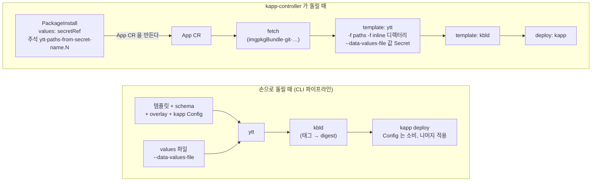

# ytt 로 kapp·kapp-controller 다루기

> 작성 2026-10-28 · 앞 자료: [`carvel-kapp.md`](carvel-kapp.md) [4. ytt 기초](carvel-kapp.md#4-ytt-기초)·[6. kapp-controller & App CRD](carvel-kapp.md#6-kapp-controller--app-crd-gitops)
> 등급: **[근거]** 공식 문서·소스에 그대로 있거나 이 문서를 쓰며 직접 돌려 본 것, **[추론]** 여러 근거를 엮어 내린 결론.
> 기준 판(2026-10-28 `gh release list` 로 확인): ytt **v0.55.4**, kapp **v0.66.1**, kapp-controller·kctrl **v0.60.10**. 공식 문서 사이트의 `latest` 는 이보다 늦다(ytt v0.52.x, kapp v0.64.x, kapp-controller v0.57.x 문서로 이동). 문서와 바이너리가 다르게 보이면 바이너리의 `--help` 와 소스를 믿는다.
> 실습 출력은 모두 ytt v0.55.4·kapp v0.66.1(darwin-arm64, 공식 릴리스의 `checksums.txt` 와 sha256 대조) 로 실제 렌더한 결과를 옮겼다.

`carvel-kapp.md` 4장은 「ytt 로 매니페스트를 만든다」까지다. 이 문서는 그다음, **kapp 과 kapp-controller 가 어떻게 동작할지를 ytt 로 조절하는 법**을 다룬다. kapp 설정(`kapp.k14s.io/v1alpha1 Config`)을 ytt 로 찍어 내기, `kapp.k14s.io/*` 주석을 overlay 로 붙이기, App CR 의 ytt 단계, PackageInstall 에 overlay 덧씌우기, values 검증, 렌더 결과 diff 가 범위다.

---

## 목차

1. [개념: 어느 단계에서 ytt 가 도는가](#1-개념-어느-단계에서-ytt-가-도는가)
2. [kapp 설정(Config)을 ytt 로 만들기](#2-kapp-설정config을-ytt-로-만들기)
3. [`kapp.k14s.io/*` 주석을 overlay 로 붙이기](#3-kappk14sio-주석을-overlay-로-붙이기)
4. [values 검증: `@schema/validation` 과 `assert.fail`](#4-values-검증-schemavalidation-과-assertfail)
5. [App CR 의 `spec.template.ytt`](#5-app-cr-의-spectemplateytt)
6. [PackageInstall 에 overlay 덧씌우기](#6-packageinstall-에-overlay-덧씌우기)
7. [패키지 values 스키마 보기](#7-패키지-values-스키마-보기)
8. [렌더 결과 diff](#8-렌더-결과-diff)
9. [흔한 실수](#9-흔한-실수)
10. [확인 문제](#10-확인-문제)
11. [출처](#11-출처)

---

## 1. 개념: 어느 단계에서 ytt 가 도는가



- [근거] App CR 의 단계는 fetch → template → deploy 이고, template 단계에 ytt·kbld·helmTemplate·cue·sops 를 차례로 둘 수 있다. (kapp-controller App CR spec)
- [근거] kapp-controller 는 ytt 단계를 `ytt -f <paths> -f <inline 디렉터리> [--file-mark …] --data-values-file <valuesFrom 의 파일마다>` 로 부른다. `paths` 를 주지 않으면 fetch 결과 디렉터리 전체를 `-f` 로 준다. (kapp-controller v0.60.10 `pkg/template/ytt.go`)
- [근거] PackageInstall 은 App CR 을 만들고, `spec.values[].secretRef` 와 overlay 주석은 그 App 의 **첫 번째** ytt 단계에 붙는다. (같은 판 `pkg/packageinstall/app.go`)
- [근거] kapp `Config` 는 다른 매니페스트와 함께 입력으로 넣는 리소스이고, 클러스터에는 적용되지 않는다. 여러 개를 넣어도 된다. kapp 은 `-f` 로 직접 받은 Config 만 쓴다. 클러스터에 이미 있는 Config 는 아무 효과가 없다. (kapp Configuration)

[추론] 그러니 「kapp 을 관리하는 ytt」는 세 곳에 쓴다. ① 매니페스트와 함께 kapp Config 를 찍어 낸다(2절). ② 매니페스트에 kapp 주석을 붙인다(3절). ③ kapp-controller 가 대신 돌리는 ytt 단계에 파일·값을 꽂는다(5·6절).

### 실습 준비

```bash
# ytt·kapp 은 공식 릴리스 바이너리를 받아 sha256 을 맞춰 본다 (brew 를 써도 된다)
mkdir -p ~/bin/carvel && cd ~/bin/carvel
gh release download v0.55.4 -R carvel-dev/ytt -p 'ytt-darwin-arm64' -p checksums.txt
grep darwin-arm64 checksums.txt && shasum -a 256 ytt-darwin-arm64     # 두 줄이 같아야 한다
install -m 755 ytt-darwin-arm64 ytt && ./ytt version                   # ytt version 0.55.4
```

이 문서의 예시는 클러스터 없이 `ytt -f` 로 렌더해 확인할 수 있다. 실제 적용(`kapp deploy`, App·PackageInstall)은 kind 클러스터 + kapp-controller 가 있어야 한다.

## 2. kapp 설정(Config)을 ytt 로 만들기

kapp 의 동작(무엇을 덮어쓰지 않을지, 어떤 순서로 적용할지, 어떤 라벨을 붙일지)은 `kapp.k14s.io/v1alpha1 Config` 로 바꾼다. 앱마다·환경마다 값이 달라지므로 ytt 로 만들기 좋다.

| 칸 | 하는 일 |
|---|---|
| `rebaseRules` | 갱신할 때 어떤 필드를 클러스터의 기존 값에서 가져올지(예: HPA 가 바꾸는 `spec.replicas`) |
| `ownershipLabelRules` | kapp 이 소유 라벨을 넣을 위치(Deployment 처럼 자식을 만드는 리소스의 템플릿 안 등) |
| `changeGroupBindings` / `changeRuleBindings` | 주석 없이 리소스 종류로 change-group·change-rule 을 묶기 |
| `additionalLabels` | 모든 리소스에 붙일 추가 라벨 |
| `templateRules` | 판 붙은(versioned) 리소스가 바뀌면 어떤 참조를 고칠지 |

[근거] 표의 칸과 뜻은 kapp Configuration 문서. `changeGroupBindings`·`changeRuleBindings` 는 v0.25.0+ 에서 `kapp.k14s.io/change-group`·`change-rule` 주석 대신 쓸 수 있는 방법이다. 기본 규칙은 `kapp deploy-config` 로 볼 수 있다(클러스터 없이 돈다).

```yaml
#! ex1/schema.yml
#@data/values-schema
---
namespace: demo
#! 배열의 기본값은 항상 [] 이다. 원소 하나는 「원소의 타입」을 뜻할 뿐이다.
#! 기본으로 원소를 넣고 싶으면 @schema/default 를 쓴다.
#@schema/default ["web"]
hpa_managed:
- ""
extra_labels:
  team: platform
```

```yaml
#! ex1/kapp-config.yml
#@ load("@ytt:data", "data")
---
apiVersion: kapp.k14s.io/v1alpha1
kind: Config
minimumRequiredVersion: 0.50.0

rebaseRules:
#@ for name in data.values.hpa_managed:
- path: [spec, replicas]
  type: copy
  sources: [existing, new]
  resourceMatchers:
  - kindNamespaceNameMatcher:
      kind: Deployment
      namespace: #@ data.values.namespace
      name: #@ name
#@ end

changeGroupBindings:
- name: demo.example.com/db-migrations
  resourceMatchers:
  - apiVersionKindMatcher: {apiVersion: batch/v1, kind: Job}

changeRuleBindings:
- rules:
  - upsert after upserting demo.example.com/db-migrations
  resourceMatchers:
  - apiVersionKindMatcher: {apiVersion: apps/v1, kind: Deployment}

additionalLabels: #@ data.values.extra_labels
```

```bash
ytt -f ex1/
```

```yaml
# 실제 출력 (ytt 0.55.4)
apiVersion: kapp.k14s.io/v1alpha1
kind: Config
minimumRequiredVersion: 0.50.0
rebaseRules:
- path:
  - spec
  - replicas
  type: copy
  sources:
  - existing
  - new
  resourceMatchers:
  - kindNamespaceNameMatcher:
      kind: Deployment
      namespace: demo
      name: web
changeGroupBindings:
- name: demo.example.com/db-migrations
  resourceMatchers:
  - apiVersionKindMatcher:
      apiVersion: batch/v1
      kind: Job
changeRuleBindings:
- rules:
  - upsert after upserting demo.example.com/db-migrations
  resourceMatchers:
  - apiVersionKindMatcher:
      apiVersion: apps/v1
      kind: Deployment
additionalLabels:
  team: platform
```

```bash
# 환경별 값: 배열은 --data-value-yaml 로 (-v 는 문자열만 준다)
ytt -f ex1/ -v namespace=prod --data-value-yaml 'hpa_managed=[web,api]'
# → rebaseRules 가 prod/web, prod/api 두 개로 늘어난다

# 매니페스트와 함께 kapp 에 넣는다 — Config 는 kapp 이 먹고 클러스터엔 안 올라간다
ytt -f ex1/ -f app/ | kapp deploy -a demo -f - --diff-changes
```

- [근거] `rebaseRules` 의 `sources: [existing, new]` 는 「클러스터에 값이 있으면 그것, 없으면 새 입력」이다. 값이 어느 쪽에도 없으면 kapp 이 오류를 낸다. (kapp Configuration)
- [근거] 실측: 처음에는 스키마에 `hpa_managed: [web]` 라고 썼는데 렌더 결과가 `rebaseRules: []` 였다. ytt 스키마에서 배열의 기본값은 빈 목록이고, 적어 둔 원소는 원소의 타입·기본값 뜻일 뿐이다. (ytt Schema 레퍼런스, Default Values) → 9절 실수 1.
- [근거] 실측: `- kindNamespaceNameMatcher: {kind: Deployment, namespace: #@ data.values.namespace, …}` 처럼 **흐름식 `{…}` 안에 `#@` 를 넣으면** `yaml: line 15: did not find expected ',' or '}'` 로 파싱부터 실패한다. 값이 들어갈 맵은 블록식으로 쓴다.
- [추론] HPA 를 쓰는 Deployment 에 이 규칙이 없으면, 배포할 때마다 kapp 이 매니페스트의 `replicas` 로 되돌려 HPA 가 늘려 둔 Pod 가 줄었다 다시 늘어난다.

## 3. `kapp.k14s.io/*` 주석을 overlay 로 붙이기

남이 만든 매니페스트(업스트림 YAML, 패키지 안의 설정)를 고치지 않고 kapp 동작만 바꾸려면 overlay 로 주석을 붙인다.

| 주석 | 값 | 쓰는 곳 |
|---|---|---|
| `kapp.k14s.io/change-group` | 임의 이름 (`.x` 꼬리로 여러 개) | 순서 묶음 |
| `kapp.k14s.io/change-rule` | `(upsert\|delete) (after\|before) (upserting\|deleting) <그룹>` | 묶음 사이 순서 |
| `kapp.k14s.io/update-strategy` | `""`, `fallback-on-replace`, `always-replace`, `skip` | 불변 필드가 있는 리소스 |
| `kapp.k14s.io/versioned` | `""` | ConfigMap·Secret 을 `-ver-N` 으로 새로 만들고 참조를 고침 |
| `kapp.k14s.io/nonce` | `""` | 배포마다 값이 바뀌어 강제 갱신 |
| `kapp.k14s.io/delete-strategy` | `""`, `orphan` | 앱을 지워도 남길 리소스 |

[근거] kapp Apply stage·Apply Ordering·Diff 문서. `fallback-on-replace`·`always-replace` 는 지웠다 다시 만들기라서 Deployment·DaemonSet 이면 Pod 가 한꺼번에 다시 떠 가용성 공백이 생길 수 있다고 문서가 경고한다.

```yaml
#! ex2/base.yml — 남이 준 매니페스트라고 치자 (고치지 않는다)
apiVersion: v1
kind: ConfigMap
metadata:
  name: app-config
  namespace: demo
data:
  LOG_LEVEL: info
---
apiVersion: batch/v1
kind: Job
metadata:
  name: migrate
  namespace: demo
spec:
  template:
    spec:
      restartPolicy: Never
      containers:
      - name: migrate
        image: busybox:1.36
        command: ["sh", "-c", "echo migrate"]
---
apiVersion: apps/v1
kind: Deployment
metadata:
  name: web
  namespace: demo
spec:
  replicas: 2
  selector:
    matchLabels: {app: web}
  template:
    metadata:
      labels: {app: web}
    spec:
      containers:
      - name: web
        image: nginx:1.27
        envFrom:
        - configMapRef:
            name: app-config
```

```yaml
#! ex2/kapp-annotations.yml
#@ load("@ytt:overlay", "overlay")

#! 1) 마이그레이션 Job: 먼저 돌 그룹에 넣고, spec 이 불변이라 매번 지웠다 다시 만든다
#@overlay/match by=overlay.subset({"kind": "Job", "metadata": {"name": "migrate"}}), expects=1
---
metadata:
  #@overlay/match missing_ok=True
  annotations:
    #@overlay/match missing_ok=True
    kapp.k14s.io/change-group: demo.example.com/db-migrations
    #@overlay/match missing_ok=True
    kapp.k14s.io/update-strategy: always-replace

#! 2) Deployment 는 마이그레이션이 끝난 뒤에
#@overlay/match by=overlay.subset({"kind": "Deployment"}), expects="1+"
---
metadata:
  #@overlay/match missing_ok=True
  annotations:
    #@overlay/match missing_ok=True
    kapp.k14s.io/change-rule: upsert after upserting demo.example.com/db-migrations

#! 3) ConfigMap 을 판 붙은 리소스로: 내용이 바뀌면 app-config-ver-2 가 새로 생기고
#!    이를 참조하는 Deployment 의 참조 이름도 kapp 이 고쳐 준다(롤링 재시작)
#@overlay/match by=overlay.subset({"kind": "ConfigMap", "metadata": {"name": "app-config"}})
---
metadata:
  #@overlay/match missing_ok=True
  annotations:
    #@overlay/match missing_ok=True
    kapp.k14s.io/versioned: ""
```

```bash
ytt -f ex2/base.yml -f ex2/kapp-annotations.yml | grep -A3 annotations
```

```yaml
# 실제 출력 (발췌)
  annotations:
    kapp.k14s.io/versioned: ""
--
  annotations:
    kapp.k14s.io/change-group: demo.example.com/db-migrations
    kapp.k14s.io/update-strategy: always-replace
--
  annotations:
    kapp.k14s.io/change-rule: upsert after upserting demo.example.com/db-migrations
```

- [근거] 같은 순서는 2절의 `changeGroupBindings`·`changeRuleBindings` 로도 낼 수 있다. 주석은 리소스 하나하나에, 바인딩은 리소스 종류에 거는 방법이다. (kapp Configuration, changeGroupBindings)
- [근거] kapp 기본 `templateRules` 는 ConfigMap 이 Deployment 등의 `envFrom[].configMapRef`·`env[].valueFrom.configMapKeyRef`·`volumes[].configMap` 을 바꾸게 되어 있다. `kapp deploy-config` 출력에서 확인. 그래서 `versioned` 를 붙이면 위 Deployment 의 `envFrom` 참조가 따라간다.
- [추론] `expects` 를 일부러 적어 두면 overlay 가 「붙을 곳이 없다」를 오류로 알려 준다. 기본값(정확히 1개)도 그 역할을 하지만, 여러 개에 붙이는 곳은 `"1+"` 로 바꿔야 한다(9절 실수 3).

## 4. values 검증: `@schema/validation` 과 `assert.fail`

kapp-controller 가 돌리는 ytt 에서 값이 틀리면 App 이 `ReconcileFailed` 로 멈추고 오류는 `status.template.stderr` 에 남는다. 렌더 단계에서 일찍, 읽기 좋은 문장으로 막아 두는 것이 운영에 낫다. [근거] App CR status 칸(kapp-controller App CR spec). [추론] 앞의 이유.

```yaml
#! ex3/schema.yml
#@data/values-schema
---
#@schema/desc "배포할 네임스페이스. tanzu-system- 으로 시작하면 안 된다"
#@schema/validation ("not tanzu-system-*", lambda v: not v.startswith("tanzu-system-")), min_len=1
namespace: demo

#@schema/validation min=1, max=10
replicas: 2

#@schema/validation one_of=["ClusterIP", "NodePort", "LoadBalancer"]
service_type: ClusterIP

tls:
  enabled: false
  #! enabled 일 때만 비어 있으면 안 된다
  #@schema/validation min_len=1, when=lambda v, ctx: ctx.parent["enabled"]
  secret_name: ""
```

```yaml
#! ex3/service.yml
#@ load("@ytt:data", "data")
#@ load("@ytt:assert", "assert")

#@ if data.values.service_type == "LoadBalancer" and data.values.replicas < 2:
#@   assert.fail("LoadBalancer 로 내보낼 때는 replicas 를 2 이상으로")
#@ end
---
apiVersion: v1
kind: Service
metadata:
  name: web
  namespace: #@ data.values.namespace
spec:
  type: #@ data.values.service_type
  selector:
    app: web
  ports:
  - port: 443
    targetPort: 8443
```

```bash
ytt -f ex3/ -v namespace=tanzu-system-ingress --data-value-yaml replicas=0
```

```text
ytt: Error: Validating final data values:
  namespace
    from: (data-value arg):1
    - must be: not tanzu-system-* (by: schema.yml:5)

  replicas
    from: (data-value-yaml arg):1
    - must be: a value >= 1 (by: schema.yml:8)
      found: value < 1
```

```bash
ytt -f ex3/ -v service_type=Ingress          # → must be: one of ["ClusterIP", "NodePort", "LoadBalancer"]
ytt -f ex3/ --data-value-yaml tls.enabled=true  # → tls.secret_name - must be: length >= 1, found: length = 0
ytt -f ex3/ -v service_type=LoadBalancer --data-value-yaml replicas=1
# → - assert.fail: fail: LoadBalancer 로 내보낼 때는 replicas 를 2 이상으로
#      service.yml:6 | #@   assert.fail(...)
ytt -f ex3/ -v replicas=3
# → found: string / expected: integer (by schema.yml:9)   ← -v 는 언제나 문자열
```

- [근거] 위 다섯 줄은 모두 실측 출력이다. 스키마 검증은 값 전부를 모아 한 번에 보고하고(`namespace`·`replicas` 두 건이 함께 나옴), `assert.fail` 은 템플릿을 평가하다 처음 만난 곳에서 멈춘다.
- [근거] 실측: 규칙 튜플을 키워드 뒤에 쓰면(`min_len=1, ("…", lambda …)`) `positional argument may not follow named` 로 스키마부터 실패한다. 튜플을 앞에 둔다.
- [근거] `@schema/validation` 은 `min_len`·`max_len`·`min`·`max`·`one_of`·`not_null`·`format`·`when` 등 이름 붙은 규칙과 `("설명", 함수)` 튜플 규칙을 받는다. `when=` 은 다른 값이 켜졌을 때만 검사하게 한다. (ytt How to write validations)
- [추론] 「여러 값 사이의 관계」(LoadBalancer 이면 replicas ≥ 2)는 `when=` 으로도 쓸 수 있지만, 템플릿 쪽 `assert.fail` 이 메시지를 자유롭게 쓰기 쉽다. 단일 값 범위는 스키마로, 관계는 `assert.fail` 로 나누면 읽기 편하다.

## 5. App CR 의 `spec.template.ytt`

App CR 의 ytt 단계에 넣을 수 있는 것:

| 칸 | 뜻 |
|---|---|
| `paths` | fetch 결과 안에서 ytt 에 줄 경로. 비우면 전체. stdin 은 `"-"` 로 따옴표 |
| `inline.paths` | CR 안에 직접 쓴 파일(경로: 내용). 민감값은 넣지 말 것 |
| `inline.pathsFrom` | Secret·ConfigMap 의 키를 파일로 풀어 넣음 (`directoryPath` 로 하위 폴더) |
| `valuesFrom` | `secretRef`·`configMapRef`·`path`·`downwardAPI` → `--data-values-file` |
| `fileMarks` | `--file-mark` 전달 (예: `dir/**/*:type=data`) |
| `ignoreUnknownComments` | ytt 가 모르는 `#` 주석을 무시 |

[근거] kapp-controller App CR spec. `inline.paths` 에 대해 「CR 은 암호화되지 않으니 민감값은 권장하지 않는다」, `pathsFrom` 에 대해 「data values 는 Secret 에 두기를 권한다」고 적혀 있다.

환경마다 App 과 values Secret 을 하나씩 찍어 내는 것도 ytt 로 한다.

```yaml
#! ex4/gen/schema.yml
#@data/values-schema
---
git_url: https://github.com/example/web-config
#@schema/default [{"name": "staging", "ref": "origin/develop", "replicas": 1}, {"name": "prod", "ref": "origin/main", "replicas": 3}]
envs:
- name: ""
  ref: ""
  replicas: 1
```

```yaml
#! ex4/gen/apps.yml
#@ load("@ytt:data", "data")
#@ load("@ytt:yaml", "yaml")

#@ for env in data.values.envs:
---
#! 환경별 values: Secret 의 키 하나가 data values 파일 하나가 된다
apiVersion: v1
kind: Secret
metadata:
  name: #@ "web-" + env.name + "-values"
  namespace: kapp-apps
stringData:
  values.yml: #@ yaml.encode({"namespace": "web-" + env.name, "replicas": env.replicas})
---
apiVersion: kappctrl.k14s.io/v1alpha1
kind: App
metadata:
  name: #@ "web-" + env.name
  namespace: kapp-apps
spec:
  serviceAccountName: kapp-apps-sa
  syncPeriod: 5m
  fetch:
  - git:
      url: #@ data.values.git_url
      ref: #@ env.ref
      subPath: config
  template:
  - ytt:
      paths: ["."]
      #! 패키지 안을 고치지 않고 덧씌우는 파일
      inline:
        paths:
          zz-kapp-annotations.yml: |
            #@ load("@ytt:overlay", "overlay")
            #@overlay/match by=overlay.subset({"kind": "Service"}), expects="1+"
            ---
            metadata:
              #@overlay/match missing_ok=True
              annotations:
                #@overlay/match missing_ok=True
                kapp.k14s.io/update-strategy: fallback-on-replace
      valuesFrom:
      - secretRef:
          name: #@ "web-" + env.name + "-values"
  deploy:
  - kapp:
      rawOptions: ["--diff-changes=true"]
#@ end
```

```bash
ytt -f ex4/gen/ | head -20
```

```yaml
# 실제 출력 (발췌) — staging 의 Secret. 키 values.yml 의 내용은 #@data/values 머리가 없는 맨 YAML
apiVersion: v1
kind: Secret
metadata:
  name: web-staging-values
  namespace: kapp-apps
stringData:
  values.yml: |
    namespace: web-staging
    replicas: 1
---
apiVersion: kappctrl.k14s.io/v1alpha1
kind: App
metadata:
  name: web-staging
  # … inline.paths 의 overlay 는 | 블록 문자열이라 이 단계에서 해석되지 않고 그대로 실린다
```

클러스터 없이 「kapp-controller 가 이 App 을 렌더하면 무엇이 나오나」를 미리 보려면, kapp-controller 가 부르는 명령을 그대로 흉내 낸다. 여기서 `config/` 는 4절의 `ex3/` 두 파일(git 저장소의 `config/` 라고 치자), `inline/` 은 `inline.paths` 의 파일, `values/values.yml` 은 Secret 의 키다.

```bash
ytt -f config/ -f inline/ --data-values-file values/values.yml
```

```yaml
# 실제 출력
apiVersion: v1
kind: Service
metadata:
  name: web
  namespace: web-staging
  annotations:
    kapp.k14s.io/update-strategy: fallback-on-replace
spec:
  type: ClusterIP
  selector:
    app: web
  ports:
  - port: 443
    targetPort: 8443
```

- [근거] `valuesFrom` 의 Secret 은 키마다 파일로 풀려 `--data-values-file` 로 들어간다. 그래서 키 내용은 `#@data/values` 머리 없는 맨 YAML 이면 된다. (`pkg/template/ytt.go`, App CR spec 의 pathsFrom 설명)
- [근거] 렌더가 실패하면 `kubectl get app <이름> -o yaml` 의 `status.template.exitCode`·`stderr` 를 본다. `kctrl app status -a <이름> -n <ns>` 도 같은 정보를 보여 준다. (App CR spec status, kctrl `app` 하위 명령 목록)
- [근거] 동기화를 바로 다시 돌리려면 `kctrl app kick -a <이름> -n <ns>` 를 쓴다(kctrl v0.60.10 `cli/pkg/kctrl/cmd/app/kick.go`). [추론] App 에 `kapp.k14s.io/update-strategy` 주석을 다는 것은 kapp 이 리소스를 **갱신하는 방식**을 바꾸는 주석이지 App 재동기화 신호가 아니다. `carvel-kapp.md` 8장 예시 3 의 「즉시 동기화 트리거」 줄은 이 점에서 의심스럽다.

## 6. PackageInstall 에 overlay 덧씌우기

패키지가 values 로 열어 두지 않은 곳(예: nodeSelector, 특정 ConfigMap 키)을 바꿔야 할 때, PackageInstall 에 주석을 달아 overlay 파일을 담은 Secret 을 패키지의 ytt 단계에 끼워 넣는다.

```yaml
metadata:
  annotations:
    ext.packaging.carvel.dev/ytt-paths-from-secret-name.0: <overlay 를 담은 Secret 이름>
```

- [근거] 주석 이름은 `ext.packaging.carvel.dev/ytt-paths-from-secret-name` 이고 `.X`(숫자) 꼬리로 여러 번 달 수 있다. 가장 흔한 용도는 data values 로 열리지 않은 설정을 고치는 overlay 다. Secret 은 PackageInstall 과 같은 네임스페이스에 둔다. (kapp-controller Overlays with PackageInstall)
- [근거] kapp-controller 소스로 확인한 동작(v0.60.10 `pkg/packageinstall/app.go`, `pkg/fetch/inline.go`):
  1. 주석의 Secret 들은 만들어지는 App 의 **첫 번째 ytt 단계**에 `inline.pathsFrom` 으로 붙는다. 패키지 템플릿이 helmTemplate → ytt 순이면 helm 렌더 결과 위에 overlay 가 걸린다.
  2. 꼬리(`.0`, `.1` …)는 **문자열로 정렬**된다. `.10` 이 `.2` 보다 먼저다.
  3. 모든 Secret 의 키는 **같은 inline 디렉터리**에 파일로 풀린다(`directoryPath` 를 안 주므로). 서로 다른 Secret 에 같은 키 이름이 있으면 뒤의 것이 앞의 것을 덮어쓴다.
  4. 함께 쓰는 `ext.packaging.carvel.dev/ytt-data-values-overlays` 주석이 있으면 `spec.values` 의 Secret 도 `--data-values-file` 대신 inline 파일로 들어가, values 파일 안에서 `#@data/values` overlay 문법을 쓸 수 있다.
- [근거] Broadcom 공개 KB(Tanzu Application Platform 의 Cloud Native Runtimes 사례)도 같은 주석으로 ConfigMap 키를 고치는 절차를 싣는다. (KB 297871)

### VKS 애드온에 쓸 때의 경계

- [근거] VKS Add-ons 9.1 릴리스 노트는 지원 범위에서 「Customer created YTT overlays: Custom YTT overlays used to modify or inject undocumented parameters fall outside of Broadcom support」라고 적는다. Product 등급 애드온이라도 설정 지원은 Broadcom 문서에 있는 값까지다. ([vks-addons/00](vks-addons/00-repository-and-install-paths.md) 1절과 같은 출처)
- [추론] 그래서 VKS 에서는 순서가 이렇다. ① 패키지 참조 문서의 values 키로 되는지 먼저 본다(7절 `--values-schema`). ② 안 되면 overlay 로 **동작은** 하게 만들 수 있지만, 그 순간 그 부분은 지원 밖이 된다는 것을 운영 기록에 남긴다. ③ 애드온 판을 올릴 때마다 overlay 가 여전히 맞는지(9절 실수 2·3) 렌더로 다시 확인한다.
- [추론] Add-on Management 경로(VKS 3.5+)에서는 PackageInstall 을 VKS 가 만들고 관리한다(00절 2.4). 사용자가 그 PackageInstall 에 손으로 단 주석이 다음 조정 때 유지되는지는 이 문서를 쓰며 확인하지 못했다. 레거시 경로(사용자가 직접 `vcf package install`)에서만 확인된 방법으로 다룬다.

### 실습: overlay Secret 과 PackageInstall 을 ytt 로 찍기

```yaml
#! ex5/gen/overlays/add-node-placement.yml — 패키지 values 에 없는 nodeSelector·tolerations
#@ load("@ytt:overlay", "overlay")
#@overlay/match by=overlay.subset({"kind": "Deployment", "metadata": {"name": "web"}}), expects=1
---
spec:
  template:
    spec:
      #@overlay/match missing_ok=True
      nodeSelector:
        node-role.example.com/infra: "true"
      #@overlay/match missing_ok=True
      tolerations:
      - key: node-role.example.com/infra
        operator: Exists
        effect: NoSchedule
```

```yaml
#! ex5/gen/pkgi.yml
#@ load("@ytt:data", "data")
---
apiVersion: v1
kind: Secret
metadata:
  name: web-overlay-node-placement
  namespace: my-packages
stringData:
  #! overlay 파일을 「글자 그대로」 넣는다 — 여기서 ytt 가 한 번 더 해석하면 안 된다
  add-node-placement.yml: #@ data.read("overlays/add-node-placement.yml")
---
apiVersion: packaging.carvel.dev/v1alpha1
kind: PackageInstall
metadata:
  name: web
  namespace: my-packages
  annotations:
    ext.packaging.carvel.dev/ytt-paths-from-secret-name.0: web-overlay-node-placement
spec:
  serviceAccountName: web-pkg-sa
  packageRef:
    refName: web.example.com
    versionSelection:
      constraints: 1.0.0
  values:
  - secretRef:
      name: web-values
```

```bash
ytt -f ex5/gen/
# ytt: Error: Overlaying (in following order: overlays/add-node-placement.yml):
#   Document on line overlays/add-node-placement.yml:4:
#     Expected number of matched nodes to be 1, but was 0

ytt -f ex5/gen/ --file-mark 'overlays/**/*:type=data'
# → Secret 의 stringData."add-node-placement.yml" 에 overlay 원문이 | 블록으로 그대로 들어가고,
#   PackageInstall 에 주석이 붙어 나온다 (exit 0)
```

- [근거] 실측: `--file-mark` 없이 돌리면 ytt 가 `overlays/` 의 파일을 **지금 이 렌더의 overlay 로** 써 버려, 여기엔 Deployment 가 없으니 실패한다. `type=data` 로 표시한 파일은 평가·출력되지 않고 `data.read()` 로만 읽힌다. (ytt File Marks)
- [추론] 더 나쁜 경우는 이 렌더에 우연히 맞는 문서가 있을 때다. 오류 없이 엉뚱한 리소스에 overlay 가 걸리고 Secret 에는 파일이 안 들어간다.

### 실습: kapp-controller 가 할 렌더를 미리 해 보기

패키지 설정이 `pkg/`(schema + Deployment `web`, replicas 는 values)라고 하고, overlay Secret 둘을 단다고 하자: `.0` 에 `add-node-placement.yml`·`zz-replicas.yml`(replicas: 3), `.1` 에 `aa-replicas.yml`(replicas: 5).

```bash
# kapp-controller 처럼: 모든 overlay Secret 의 키를 한 디렉터리에 풀고, 패키지 경로 뒤에 붙인다
ls inline/
# aa-replicas.yml  add-node-placement.yml  zz-replicas.yml
ytt -f pkg/ -f inline/ --data-values-file values.yml --files-inspect
# - deployment.yml
# - schema.yml
# - aa-replicas.yml
# - add-node-placement.yml
# - zz-replicas.yml
ytt -f pkg/ -f inline/ --data-values-file values.yml | grep replicas
#   replicas: 3
```

- [근거] 실측: `.1` 의 Secret 이 나중에 붙는데도 결과는 `.0` 에 든 `zz-replicas.yml` 의 3 이다. ytt 는 디렉터리 안 파일을 경로 이름순으로 처리하고(`--files-inspect` 출력), kapp-controller 는 모든 Secret 의 키를 한 디렉터리에 푼다.
- [추론] 그러니 overlay 사이의 순서는 주석 꼬리 번호가 아니라 **Secret 키(파일) 이름**이 정한다고 보고, 겹치는 필드를 건드리는 overlay 를 두 Secret 에 나눠 담지 않는다. 클러스터 안 kapp-controller 에 번들된 ytt 판에서 같은지는 kind 로 따로 확인할 일이다.

## 7. 패키지 values 스키마 보기

overlay 를 쓰기 전에 「values 로 되는가」부터 본다.

```bash
# 클러스터의 Package 가 공개하는 values 스키마 (판까지 적어야 한다)
kctrl package available get -p cert-manager.kubernetes.vmware.com/<판> -n tkg-system --values-schema
# 기본값을 파일로
kctrl package available get -p cert-manager.kubernetes.vmware.com/<판> -n tkg-system \
  --default-values-file-output default-values.yml
```

- [근거] `--values-schema`·`--default-values-file-output` 은 `-p <패키지>/<판>` 처럼 판을 함께 적지 않으면 `Package version is required when --values-schema flag is declared` 로 거절한다. (kctrl v0.60.10 `cli/pkg/kctrl/cmd/package/available/get.go`)
- [근거] VKS 레거시 경로의 저장소는 `tkg-system` 에 추가하고 그 Package 는 다른 네임스페이스에서도 보인다(00절 2.3). VKS 문서의 같은 일은 `vcf package available get … ` 이다.
- [근거] Package 는 values 스키마를 `.spec.valuesSchema` 의 OpenAPI v3 로 알린다. ytt 템플릿 패키지면 kctrl 이 ytt 의 스키마 내보내기 기능으로 만들고, Helm 차트면 추정하므로 정확하지 않을 수 있다. (kctrl Package authoring, Reviewing the schema) 아래가 그 「ytt 스키마 내보내기」다.

```bash
ytt -f ex3/ --data-values-schema-inspect -o openapi-v3
```

```yaml
# 실제 출력 (발췌)
components:
  schemas:
    dataValues:
      type: object
      additionalProperties: false
      properties:
        namespace:
          type: string
          description: 배포할 네임스페이스. tanzu-system- 으로 시작하면 안 된다
          default: demo
          minLength: 1
        replicas:
          type: integer
          default: 2
          minimum: 1
          maximum: 10
        service_type:
          type: string
          default: ClusterIP
          enum:
          - ClusterIP
          - NodePort
          - LoadBalancer
```

- [근거] 실측: `min_len`·`min`·`max`·`one_of` 는 `minLength`·`minimum`·`maximum`·`enum` 으로 옮겨지지만, `("not tanzu-system-*", lambda …)` 같은 함수 규칙과 `when=` 조건은 OpenAPI 에 나타나지 않는다.
- [추론] `--values-schema` 로 본 스키마가 「통과」여도 패키지 안 ytt 의 함수 규칙에서 실패할 수 있다. 값 확인은 결국 렌더(또는 kapp-controller 의 `status.template.stderr`)로 한다.

## 8. 렌더 결과 diff

```bash
# 클러스터와 비교 (실제 적용 안 함): rebase·versioned 등 kapp 규칙이 적용된 diff
ytt -f config/ --data-values-file values/prod.yml | kbld -f - | \
  kapp deploy -a web -n web-prod -f - --diff-run --diff-changes

# 클러스터 없이 두 렌더끼리 비교: --file2 가 「지금」, -f 가 「새 것」
ytt -f ex3/ > before.yml
ytt -f ex3/ -v service_type=NodePort > after.yml
kapp tools diff --file2 before.yml -f after.yml --changes
```

```text
# kapp tools diff 실제 출력 (발췌)
 11     -   type: ClusterIP
     11 +   type: NodePort

demo	web	Service	-	update	???	-	ongoing	ClusterIP is empty
```

- [근거] `--diff-run` 은 diff 만 보이고 적용하지 않는다, `--diff-changes` 는 리소스별 줄 단위 변경을 보인다. (carvel-kapp.md 3.5, kapp Diff stage)
- [근거] 실측: `kapp tools diff` 는 `--file2` 를 기존 쪽, `-f` 를 새 쪽으로 본다. 처음에 반대로 넣었더니 `- NodePort / + ClusterIP` 로 거꾸로 나왔다.
- [근거] 실측: 3절의 ConfigMap(`versioned` 주석)의 값만 바꿔 `kapp tools diff` 를 돌리면 `app-config … update` 로 나온다. [추론] 파일끼리 비교에서는 `-ver-N` 새로 만들기·rebase 같은 클러스터 쪽 규칙이 반영되지 않는다. 판 붙은 리소스의 실제 동작은 클러스터 상대 `--diff-run` 으로 본다.
- [추론] PackageInstall 에 overlay 를 붙이기 전에는 6절처럼 패키지 설정을 `imgpkg pull` 로 받아(Package 의 `spec.template.spec.fetch` 이미지) overlay 전·후 렌더를 `kapp tools diff` 로 비교하면, 클러스터에 손대기 전에 바뀌는 줄을 정확히 볼 수 있다.

## 9. 흔한 실수

10·11 을 빼고 모두 이 문서를 쓰며 ytt 0.55.4 로 재현한 것이다(10 은 소스 + 로컬 흉내, 11 은 릴리스 노트).

1. **스키마 배열에 기본 원소를 적었다고 믿기.** `hpa_managed: [web]` 의 기본값은 `[]` 다. 기본 원소가 필요하면 `#@schema/default [...]`. (2절)
2. **오타 난 match.** `overlay.subset({"metadata": {"name": "wbe"}})` → `Expected number of matched nodes to be 1, but was 0`. 이건 좋은 실패다. 나쁜 것은 이를 없애려고 `expects="0+"` 를 붙이는 것: 오류 없이 **아무것에도 안 붙은 채** 렌더가 끝난다. 패키지 판을 올렸더니 리소스 이름이 바뀐 경우가 이 꼴이다.
3. **여럿에 걸리는데 기본 expects.** `overlay.subset({"kind": "Deployment"})` 가 두 개에 맞으면 `but was 2 (lines: base.yml:1, base.yml:11)`. 의도라면 `expects="1+"`, 아니면 이름까지 좁힌다.
4. **새 키에 `missing_ok` 를 빠뜨림.** 원본에 `metadata.labels` 가 없는데 overlay 에서 바로 `labels:` 를 쓰면 `Map item (key 'labels') … Expected number of matched nodes to be 1, but was 0`. 없는 키를 만드는 줄마다 `#@overlay/match missing_ok=True`.
5. **배열 원소를 고치려다 추가하기.** `containers: - name: web` 아래에 `env` 를 넣으면서 원소에 `#@overlay/match by="name"` 를 빼면 오류 없이 **`name: web` 컨테이너가 하나 더 붙는다.** (실측: 결과에 `- name: web` 이 두 번) 배열 원소에는 항상 `by=` 를 적는다.
6. **흐름식 맵 안에 `#@`.** `{kind: Deployment, name: #@ name}` 은 YAML 파싱부터 실패한다. 블록식으로. (2절)
7. **overlay 를 Secret 에 담는 ytt 렌더에서 overlay 가 먼저 실행됨.** `data.read()` 로 읽을 파일은 `--file-mark '…:type=data'`. (6절)
8. **`-v` 로 숫자·불리언 주기.** `-v replicas=3` 은 문자열이라 `expected: integer` 로 거절된다. `--data-value-yaml replicas=3`.
9. **`@schema/validation` 인자 순서.** 함수 규칙 튜플이 키워드 뒤에 오면 `positional argument may not follow named`.
10. **overlay Secret 꼬리 번호로 순서를 정한다고 믿기.** 꼬리는 문자열 정렬(`.10` < `.2`)이고, 실제 적용 순서는 풀린 파일 이름순이며, 같은 키 이름은 덮어써진다. (6절)
11. **VKS 애드온에 overlay 를 「지원되는 커스터마이즈」로 쓰기.** 9.1 기준 사용자 YTT overlay 는 지원 밖이다. (6절)
12. **템플릿 맨 위에 `# 파일명` 주석.** `#@` 가 들어 있는 파일에서 `#` 한 개짜리 주석은 `Expected ytt-formatted string (use '#@' for annotations or code, '#!' for comments)` 로 실패한다. 이 문서의 예시 머리줄이 `#!` 인 이유다. [`carvel-kapp.md` 4장](carvel-kapp.md#4-ytt-기초) 예시처럼 `# schema.yaml` 머리줄이 붙은 것을 통째로 복사하면 그 줄부터 지운다.

## 10. 확인 문제

1. HPA 가 `spec.replicas` 를 바꾸는 Deployment 를 kapp 으로 배포한다. 배포할 때마다 Pod 수가 매니페스트 값으로 돌아가지 않게 하려면 무엇을 넣어야 하고, 그것은 클러스터에 리소스로 남는가?
<details><summary>답</summary>

`kapp.k14s.io/v1alpha1 Config` 의 `rebaseRules` 에 `path: [spec, replicas]`, `type: copy`, `sources: [existing, new]` 와 해당 Deployment 를 고르는 `resourceMatchers` 를 넣어 매니페스트와 함께 `-f` 로 준다(2절). Config 는 kapp 이 읽기만 하고 클러스터에 적용되지 않는다. ConfigMap 으로 감싸 `kapp.k14s.io/config` 라벨을 단 경우에만 클러스터에 올라가지만, 그래도 kapp 은 `-f` 로 받은 것만 쓴다. [근거] kapp Configuration.
</details>

2. PackageInstall 에 `ytt-paths-from-secret-name.0` 과 `.1` 로 overlay Secret 둘을 달았다. 두 overlay 가 같은 필드를 다른 값으로 바꾼다면 어느 값이 남는가? 그렇게 판단한 근거를 클러스터 없이 확인하는 방법은?
<details><summary>답</summary>

꼬리 번호가 아니라 두 Secret 의 **키(파일) 이름**이 이름순으로 뒤인 쪽의 값이 남는다. kapp-controller 는 모든 overlay Secret 의 키를 한 inline 디렉터리에 풀어 `-f` 로 넘기고, ytt 는 디렉터리 안 파일을 이름순으로 처리한다. 키 이름이 같으면 뒤 Secret 이 앞 것을 덮어써 하나만 남는다. 클러스터 없이는 패키지 설정 + 키들을 한 디렉터리에 둔 `ytt -f pkg/ -f inline/ --data-values-file values.yml --files-inspect` 로 처리 순서를 보고, 같은 명령의 렌더 결과로 값을 본다(6절). [근거] kapp-controller 소스 + 실측, 클러스터 안 동작은 [추론].
</details>

3. 다음 overlay 는 오류 없이 렌더된다. 무엇이 잘못됐고, 어떻게 고치는가?

```yaml
#@ load("@ytt:overlay", "overlay")
#@overlay/match by=overlay.subset({"metadata": {"name": "web"}})
---
spec:
  template:
    spec:
      containers:
      - name: web
        #@overlay/match missing_ok=True
        env:
        - name: LOG_LEVEL
          value: debug
```
<details><summary>답</summary>

배열 원소 `- name: web` 에 match 가 없어서 기존 `web` 컨테이너를 고치지 않고 `name: web` 컨테이너를 **새로 하나 더 붙인다.** 원소 위에 `#@overlay/match by="name"` 을 넣는다. [근거] 실측(9절 실수 5). [추론] 컨테이너라면 이름 중복으로 적용 단계에서 거절되겠지만, 이름 제약이 없는 배열(tolerations, env 등)이었다면 조용히 중복이 남는다.
</details>

## 11. 출처

모두 2026-10-28 확인. carvel.dev 의 `latest` 주소는 아래 판 문서로 이동한다.

- ytt 릴리스 v0.55.4 (2026-10-19): <https://github.com/carvel-dev/ytt/releases/tag/v0.55.4>
- kapp 릴리스 v0.66.1 (Latest, 2026-10-13. v0.65.5 는 2026-10-15 의 이전 계열 패치): <https://github.com/carvel-dev/kapp/releases/tag/v0.66.1>
- kapp-controller·kctrl 릴리스 v0.60.10 (2026-10-20): <https://github.com/carvel-dev/kapp-controller/releases/tag/v0.60.10>
- ytt Data Values Schema 레퍼런스(기본값 규칙): <https://carvel.dev/ytt/docs/v0.52.x/lang-ref-ytt-schema/>
- ytt How to write validations: <https://carvel.dev/ytt/docs/v0.52.x/how-to-write-validations/>
- ytt Overlay 레퍼런스: <https://carvel.dev/ytt/docs/v0.52.x/lang-ref-ytt-overlay/>
- ytt File Marks: <https://carvel.dev/ytt/docs/v0.52.x/file-marks/>
- ytt assert 모듈: <https://carvel.dev/ytt/docs/v0.52.x/lang-ref-ytt-assert/>
- kapp Configuration: <https://carvel.dev/kapp/docs/v0.64.x/config/>
- kapp Apply stage(주석): <https://carvel.dev/kapp/docs/v0.64.x/apply/>
- kapp Apply Ordering: <https://carvel.dev/kapp/docs/v0.64.x/apply-ordering/>
- kapp Diff stage(versioned 리소스): <https://carvel.dev/kapp/docs/v0.64.x/diff/>
- kapp-controller App CR spec: <https://carvel.dev/kapp-controller/docs/v0.57.x/app-spec/>
- kapp-controller Overlays with PackageInstall: <https://carvel.dev/kapp-controller/docs/v0.57.x/package-install-extensions/>
- kctrl Package authoring: <https://carvel.dev/kapp-controller/docs/v0.57.x/kctrl-package-authoring/>
- kapp-controller 소스 v0.60.10 — `pkg/packageinstall/app.go`, `pkg/template/ytt.go`, `pkg/fetch/inline.go`, `cli/pkg/kctrl/cmd/package/available/get.go`: <https://github.com/carvel-dev/kapp-controller/tree/v0.60.10>
- Broadcom VKS Add-ons Release Notes (9.1, Scope of Support Boundaries & Exclusions): <https://techdocs.broadcom.com/us/en/vmware-cis/vcf/vcf-service-administration-and-development/9-1/release-notes/vks-addons-release-notes.html>
- Broadcom KB 297871 (PackageInstall 에 ytt overlay Secret 주석으로 ConfigMap 수정, TAP 사례): <https://knowledge.broadcom.com/external/article/297871/changes-to-the-confignetwork-configmap-f.html>
