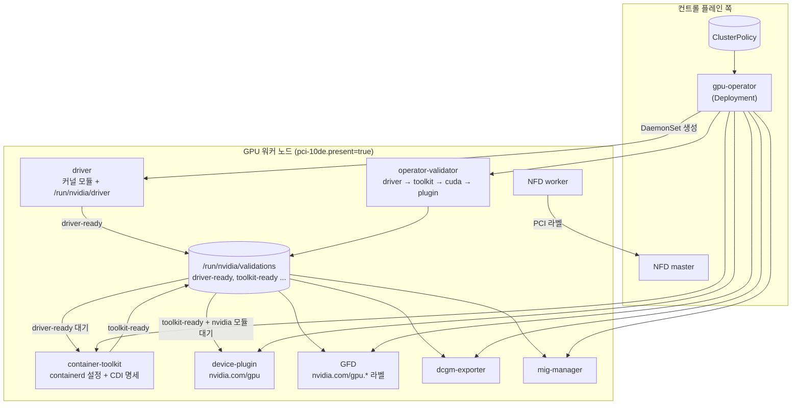
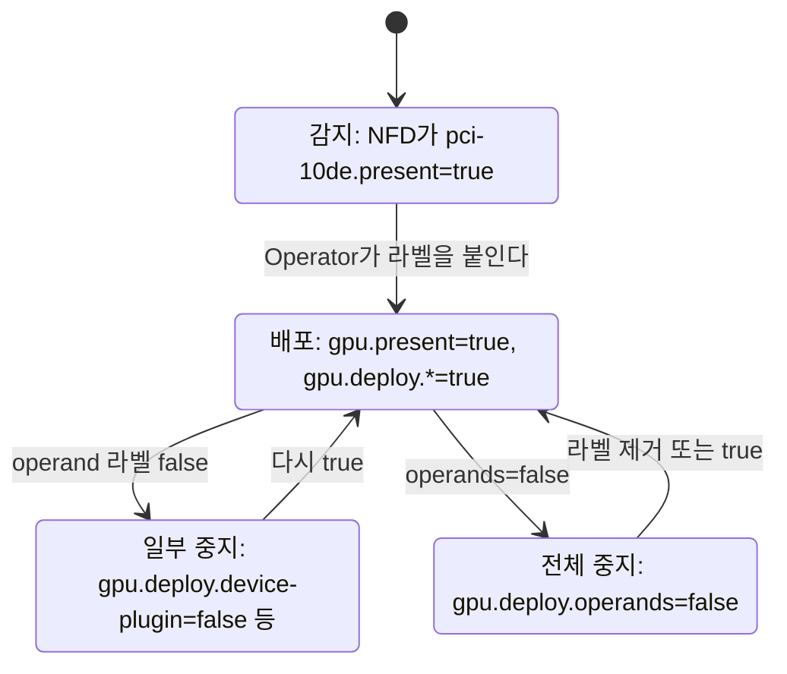

# 02. NVIDIA GPU Operator 구성 요소

> [목차로](CURRICULUM.md) · 작성 2026-10-11 · 기준 버전: GPU Operator v26.7.1(2026-09-23), Kubernetes 1.37 문서
> **[근거]** 출처에 그대로 있는 내용, **[추론]** 여러 출처를 엮어 내린 결론.
> 앞 절: [01. GPU를 Pod에 붙이는 원리](01-gpu-pod-basics.md)

## 1. 개념

01절의 부품 넷(드라이버, device plugin, kubelet Device Manager, 런타임+Container Toolkit) 가운데 Kubernetes가 주는 것은 Device Manager 하나뿐이다. 나머지 셋은 GPU 노드마다 누군가 깔고, 버전을 맞추고, 순서대로 띄워야 한다. GPU Operator는 이 일을 DaemonSet 묶음으로 바꿔 클러스터 안에서 관리하는 오퍼레이터다.

- **[근거]** GPU Operator는 오퍼레이터 패턴으로 GPU에 필요한 NVIDIA 소프트웨어 전부(드라이버, device plugin, Container Toolkit, GFD 노드 라벨링, DCGM 모니터링 등)를 자동 관리한다. 출처: <https://docs.nvidia.com/datacenter/cloud-native/gpu-operator/latest/overview.html> (2026-10-11 확인)
- **[근거]** 기본 설치는 GPU 워커 노드마다 드라이버, Container Toolkit, device plugin, DCGM Exporter, MIG Manager를 Pod로 띄운다. 출처: getting-started 문서 "Procedure" (2026-10-11 확인)

### 1.1 버전과 수명

- **[근거]** 버전은 달력식 `YY.MM.PP`다. 새 메이저(YY.MM)가 나오면 바로 앞 메이저는 "deprecated"로 내려가 치명 버그·CVE 패치만 받고, 그보다 오래된 것은 지원 종료다. 2026-10-11 기준 26.7.x 지원, 26.3.x deprecated, 25.10.x 이하 지원 종료.
- **[근거]** 업그레이드는 같은 메이저 안이나 바로 다음 메이저로만 지원한다.
- **[추론]** 25.10에서 26.7로 한 번에 올리는 것은 지원 경로가 아니다. 26.3을 거쳐야 한다.

출처: <https://docs.nvidia.com/datacenter/cloud-native/gpu-operator/latest/platform-support.html> (2026-10-11 확인)

### 1.2 구성 요소 표 (v26.7.1 기본값)

| 구성 요소 | 하는 일 | 기본 | 버전(v26.7.1) |
|-----------|---------|------|---------------|
| gpu-operator (Deployment) | `ClusterPolicy`를 읽고 아래 DaemonSet을 순서대로 만든다 | 켜짐 | v26.7.1 |
| Node Feature Discovery(NFD) | PCI 장치를 보고 `feature.node.kubernetes.io/pci-10de.present=true` 같은 라벨을 붙인다 | 켜짐 | v0.19.0 |
| driver | 드라이버 컨테이너가 커널 모듈을 올리고 라이브러리를 `/run/nvidia/driver`에 둔다 | 켜짐 | 595.91.07(기본) |
| k8s-driver-manager | 드라이버 교체 전에 GPU Pod를 비우고 노드를 cordon/drain | 드라이버와 함께 | v0.12.1 |
| container-toolkit | 호스트 containerd/CRI-O 설정을 고치고 CDI 명세를 만든다 | 켜짐 | 1.20.1 |
| device-plugin | `nvidia.com/gpu`를 kubelet에 광고(01절) | 켜짐 | 0.20.1 |
| GPU Feature Discovery(GFD) | GPU 모델·메모리·MIG 등 `nvidia.com/gpu.*` 라벨 | 켜짐 | 0.20.1 |
| DCGM Exporter | GPU 지표를 Prometheus 형식으로 낸다 | 켜짐 | 4.6.1-4.8.4 |
| DCGM(단독 hostengine) | 따로 띄우는 DCGM. 기본은 꺼짐이고 exporter 안에 내장된 hostengine을 쓴다 | 꺼짐 | 4.6.1-1 |
| MIG Manager | 노드 라벨 `nvidia.com/mig.config`를 보고 MIG 구성을 바꾼다. MIG 가능한 GPU 노드에서만 뜬다 | 켜짐 | 0.15.1 |
| operator-validator | 단계마다 검증하고 `/run/nvidia/validations/*-ready` 파일을 남긴다 | 켜짐 | v26.7.1 |
| node-status-exporter | 노드별 배포 상태 지표 | 꺼짐 | |

- **[근거]** 버전 열은 Component Matrix, 기본 켜짐/꺼짐은 Helm 차트 `values.yaml`(태그 v26.7.1의 `nfd.enabled`, `dcgm.enabled: false` 주석 "disabled by default to use embedded nv-hostengine by exporter", `nodeStatusExporter.enabled: false`). 출처: platform-support 문서, <https://github.com/NVIDIA/gpu-operator/blob/v26.7.1/deployments/gpu-operator/values.yaml> (2026-10-11 확인)
- **[근거]** MIG Manager는 기본적으로 MIG를 지원하는 GPU가 있는 노드에서만 돈다. 출처: getting-started 문서 `migManager.enabled` 항목.
- 이 밖에 GDS·GDRCopy·KubeVirt/Kata용 장치 플러그인·Confidential Computing Manager·vGPU Device Manager가 있다. vGPU 쪽은 이 과정의 전제(하이퍼바이저 vGPU 안 씀)에서 빠지고, GDS·GDRCopy·RDMA는 10절에서 본다.

### 1.3 CDI가 기본이 됐다 (v25.10.0부터)

01절에서 본 "nvidia 런타임을 기본으로 둘지, RuntimeClass로 나눌지" 문제는 GPU Operator에서 답이 바뀌었다.

- **[근거]** v25.10.0부터 CDI가 기본(`cdi.enabled=true`)이다. Operator는 더 이상 nvidia 런타임을 기본 핸들러로 설정하지 않고, containerd·CRI-O에 내장된 CDI 지원으로 GPU를 넣는다. device plugin으로 GPU를 받는 일반 워크로드는 설정을 바꿀 필요가 없고, 이미 `runtimeClassName: nvidia`를 쓴 워크로드도 그대로 된다.
- **[근거]** 반대로 device plugin이나 DRA를 거치지 않고 `NVIDIA_VISIBLE_DEVICES`로 GPU 전부를 보는 "GPU 관리 컨테이너"(모니터링 에이전트, device plugin 자신 등)는 `runtimeClassName: nvidia`를 **반드시** 써야 한다. NVIDIA는 `NVIDIA_VISIBLE_DEVICES`를 이런 관리 컨테이너에만 쓰라고 권한다.
- **[근거]** NRI 플러그인(`cdi.nriPluginEnabled`)을 켜면 관리 컨테이너에도 `runtimeClassName`이 필요 없고, Toolkit이 containerd 설정 파일을 아예 고치지 않는다. 다만 containerd의 NRI가 아직 GA가 아니라 운영 사용은 권하지 않는다. 요구 런타임은 containerd v1.7.30, v2.1.x~v2.3.x 또는 CRI-O v1.34 이상.

출처: <https://docs.nvidia.com/datacenter/cloud-native/gpu-operator/latest/cdi.html>, getting-started 문서 `cdi.*` 항목 (2026-10-11 확인)

**[추론]** 01절 흔한 실수 1번("GPU를 요청하지 않은 컨테이너가 GPU를 전부 본다")은 기본 런타임이 `nvidia`일 때 생기는 일이었다. CDI 기본 구성에서는 기본 런타임이 runc 그대로라, CUDA 이미지의 `NVIDIA_VISIBLE_DEVICES=all`만으로는 GPU가 들어오지 않는다. 대신 `runtimeClassName: nvidia`를 붙인 Pod는 여전히 전부 볼 수 있으므로, 누가 그 RuntimeClass를 쓸 수 있는지가 새 경계가 된다.

### 1.4 어떤 순서로 뜨나

**[근거]** Operator 컨트롤러는 상태(state)를 정해진 순서로 처리한다. v26.7.1 `controllers/state_manager.go`의 `addState` 순서: `pre-requisites` → `state-operator-metrics` → `state-driver` → `state-container-toolkit` → `state-operator-validation` → `state-device-plugin` → `state-mps-control-daemon` → `state-dcgm` → `state-dcgm-exporter` → `gpu-feature-discovery` → `state-mig-manager` → `state-node-status-exporter` → (이하 vGPU·샌드박스·CC 관련).

**[근거]** 노드 안의 실제 대기는 파일로 맞춘다. 검증기(`nvidia-validator`)의 상태 경로는 `/run/nvidia/validations`이고, 파일 이름은 `driver-ready`, `toolkit-ready`, `cuda-ready`, `plugin-ready` 등이다(`cmd/nvidia-validator/main.go`). 각 DaemonSet은 init 컨테이너로 이 파일을 기다린다.

- container-toolkit: `until [ -f /run/nvidia/validations/driver-ready ]`
- device-plugin·dcgm-exporter·GFD·mig-manager: `toolkit-ready`가 있고 `nvidia` 커널 모듈이 올라와 있을 때까지(`grep -q '^nvidia ' /proc/modules`)
- operator-validator 자신: init 컨테이너 `driver-validation` → `toolkit-validation` → `cuda-validation` → `plugin-validation` 순

출처: <https://github.com/NVIDIA/gpu-operator/tree/v26.7.1/assets> 의 각 `0500_daemonset.yaml`, `controllers/state_manager.go`, `cmd/nvidia-validator/main.go` (2026-10-11 확인)

**[근거]** v26.7.1 수정 사항에, 드라이버 Pod가 재시작한 뒤 라이브러리가 준비되기 전에 다른 operand가 먼저 떠서 실패하던 문제(MIG Manager가 `ERROR_LIBRARY_NOT_FOUND`)가 있다. 이제 operand는 드라이버 검증이 끝날 때까지 기다린다. 출처: <https://docs.nvidia.com/datacenter/cloud-native/gpu-operator/latest/release-notes.html> 26.7.1 Fixed Issues (2026-10-11 확인)

### 1.5 하나가 죽으면 무엇이 멈추나

**[추론]** 위 대기 사슬에서 바로 나온다.

| 죽은 것 | 바로 멈추는 것 | 이미 돌던 GPU Pod |
|---------|----------------|-------------------|
| driver Pod (모듈 미적재) | toolkit 이후 전부가 init에서 대기. `nvidia.com/gpu`가 광고되지 않는다 | 커널 모듈이 내려가면 GPU 접근을 잃는다 |
| container-toolkit | device-plugin·GFD·dcgm-exporter·mig-manager가 init 대기 | 이미 만든 컨테이너는 계속 돈다. **새** GPU 컨테이너는 장치 주입이 안 된다 |
| device-plugin | 새 GPU Pod 스케줄·배정. kubelet에서 플러그인이 빠지면 노드의 GPU 수가 줄어든다 | 대개 계속 돈다(01절: 배정은 이미 끝났다) |
| dcgm-exporter | 지표만 끊긴다 | 영향 없음 |
| GFD | `nvidia.com/gpu.product` 같은 라벨 갱신. 라벨로 고르는 Pod(03절)가 새 노드를 못 찾을 수 있다 | 영향 없음 |
| gpu-operator Deployment | 조정(reconcile)만 멈춘다. 이미 만든 DaemonSet은 그대로 돈다 | 영향 없음 |

### 1.6 노드 라벨로 켜고 끄기

**[근거]** GPU 워커는 NFD 라벨 `feature.node.kubernetes.io/pci-10de.present=true`로 식별한다(0x10de는 NVIDIA의 PCI 벤더 ID). v26.7.1 소스는 `pci-0302_10de.present`, `pci-0300_10de.present`도 같은 뜻으로 본다. Operator는 이런 노드에 `nvidia.com/gpu.present=true`를 붙인다.

**[근거]** operand마다 `nvidia.com/gpu.deploy.<이름>` 라벨이 있다. 컨테이너 워크로드 기본 세트: `driver`, `gpu-feature-discovery`, `container-toolkit`, `device-plugin`, `dcgm`, `dcgm-exporter`, `node-status-exporter`, `operator-validator`, `client`. 그 노드에서 하나를 빼려면 값을 `false`로 바꾼다. 노드 전체 operand를 막는 키는 `nvidia.com/gpu.deploy.operands=false`.

출처: getting-started "Preventing Installation of Operands on Some Nodes", v26.7.1 `controllers/state_manager.go` 41~125행 (2026-10-11 확인)

**[근거]** 이 라벨은 운영 절차에도 쓰인다. 26.7.1 알려진 문제(H100에서 595.91.07 → 615.71.09 드라이버 업그레이드 뒤 MIG 재구성 실패, Xid 119)의 우회 절차가 바로 `gpu.deploy.device-plugin`·`gpu-feature-discovery`·`dcgm`·`dcgm-exporter`·`mig-manager`를 `false`로 내려 GPU 핸들을 쥔 operand를 멈추고, 드라이버 Pod 안에서 `nvidia-smi -r`로 GPU를 리셋한 뒤 다시 `true`로 올리는 것이다. 출처: 릴리스 노트 26.7.1 Known Issues (2026-10-11 확인)

### 1.7 드라이버 사전 설치 노드와 공존

| 상황 | Helm 옵션 | 메모 |
|------|-----------|------|
| 드라이버 미설치, Toolkit 미설치 | 기본값 | Operator가 둘 다 깐다 |
| 드라이버만 사전 설치 | `--set driver.enabled=false` | |
| 드라이버·Toolkit 모두 사전 설치(DGX OS 등) | `--set driver.enabled=false --set toolkit.enabled=false` | 설치 전에 기본 런타임이 `nvidia`인지 확인 |
| Toolkit만 사전 설치 | `--set toolkit.enabled=false` | `/etc/nvidia-container-runtime/config.toml`의 `root`를 `/run/nvidia/driver`로 |
| 일부 노드만 사전 설치 | 그 노드에 `nvidia.com/gpu.deploy.driver=false` | |

- **[근거]** `driver.enabled=false`를 빼먹어도, 드라이버 Pod의 init 컨테이너가 사전 설치 드라이버를 감지해 노드에 라벨을 달고 드라이버 Pod는 끝나며 다시 스케줄되지 않는다. 다른 operand는 계속 진행한다.
- **[근거]** `ClusterPolicy`로 드라이버를 관리하면 GPU 워커는 모두 같은 OS 버전이어야 한다. 드라이버를 사전 설치하거나 `NVIDIADriver` CRD(`driver.nvidiaDriverCRD.enabled`)를 쓰면 OS를 섞을 수 있다. CPU 전용 노드는 Operator가 손대지 않으므로 OS 제약이 없다.
- **[근거]** 이미 클러스터에 NFD가 돌고 있으면 `nfd.enabled=false`로 설치해야 한다. 확인 방법은 노드 라벨에 `feature.node.kubernetes.io`로 시작하는 키가 있는지 보는 것.

출처: getting-started "Prerequisites"·"Common Deployment Scenarios" (2026-10-11 확인)

### 1.8 드라이버 업그레이드

**[근거]** v26.7.1 차트 `driver.upgradePolicy` 기본값: `autoUpgrade: true`, `maxParallelUpgrades: 1`(0은 무제한), `maxUnavailable: 25%`, `gpuPodDeletion.timeoutSeconds: 300`, `drain.enable: false`. 주석에 따르면 drain은 "Operator의 기본 GPU Pod 삭제로 부족할 때만" 켠다. 진행 상황은 노드 라벨 `nvidia.com/gpu-driver-upgrade-state`로 보인다(`controllers/upgrade_controller.go`). 출처: v26.7.1 `values.yaml` 169~200행 (2026-10-11 확인)

**[근거]** 26.7.0부터 `NVIDIADriver` CR마다 `upgradePolicy`를 따로 줄 수 있고, 비우면 Helm 값의 기본 정책을 따른다. 출처: 릴리스 노트 26.7.0 (2026-10-11 확인)

**[추론]** 드라이버 교체는 커널 모듈을 내렸다 올리는 일이라 그 노드의 GPU Pod가 전부 비워져야 한다. 그래서 `maxParallelUpgrades: 1`이 기본이고, 체크포인트 없는 장시간 학습 잡이 있는 노드는 업그레이드 창을 따로 잡아야 한다(12절에서 다시 본다).

### 1.9 ClusterPolicy 대 GPUCluster (DRA 경로)

- **[근거]** 26.7.0에서 새 CR `GPUCluster`가 들어왔다. DRA Driver for NVIDIA GPUs(v0.5.0), Multi-Node NVLink용 ComputeDomain, DCGM, DCGM Exporter, DRA 검증 워크로드를 배포·관리한다. **한 클러스터에서 `GPUCluster`와 `ClusterPolicy`를 동시에 쓸 수 없다.** 요구 조건은 Kubernetes v1.34.2 이상, 드라이버 580 이상, CDI 지원 런타임.
- **[근거]** Helm에서는 `gpuCluster.deployCR=true`와 `clusterPolicy.deployCR=false`를 함께 준다.

출처: 릴리스 노트 26.7.0 New Features, getting-started `gpuCluster.deployCR` 항목 (2026-10-11 확인)

이 절은 device plugin 경로(`ClusterPolicy`)만 다룬다. DRA 경로는 05절에서 본다.

### 1.10 26.7.1에서 새로 생긴 것 하나: 컨테이너별 GPU 메모리 한도

**[근거]** `NVIDIA_GPU_MEMORY_REQUEST`·`NVIDIA_GPU_MEMORY_LIMIT` 환경변수(MiB 단위)로 GPU별 CUDA 메모리 soft/hard 한도를 걸 수 있다. R615 이상 드라이버가 필요하다. 출처: 릴리스 노트 26.7.1, Container Toolkit PR #2093 (2026-10-11 확인)

**[추론]** 이건 Kubernetes 스케줄러가 아는 리소스가 아니라 컨테이너 안 CUDA가 지키는 상한이다. 스케줄링은 여전히 `nvidia.com/gpu` 정수로만 되므로, time-slicing(04절)에서 메모리가 격리되지 않는 문제를 일부 덜어 줄 수는 있어도 "GPU 메모리 8GiB짜리 Pod"를 스케줄러에 표현하는 수단은 아니다. 04절에서 실제 동작을 확인한다.

## 2. 그림

### 2.1 구성 요소와 대기 사슬



### 2.2 노드 라벨로 operand 끄고 켜기



## 3. 실습

GPU 노드가 있는 클러스터 기준. 설치 전에 이미 NFD가 있는지 보고, Pod Security Admission을 쓰면 네임스페이스를 `privileged`로 둔다.

```bash
# 0) NFD가 이미 있는지 (true면 nfd.enabled=false로 설치)
kubectl get nodes -o json \
  | jq '.items[].metadata.labels | keys | any(startswith("feature.node.kubernetes.io"))'

# 1) 네임스페이스와 PSA
kubectl create ns gpu-operator
kubectl label --overwrite ns gpu-operator pod-security.kubernetes.io/enforce=privileged

# 2) 설치 (OCI 차트, 서명 확인은 getting-started 문서의 cosign 절차)
helm install --wait gpu-operator \
  -n gpu-operator \
  oci://nvcr.io/nvidia/cloud-native-charts/gpu-operator \
  --version=v26.7.1

# 3) 확인
kubectl get pods -n gpu-operator          # 전부 Running 또는 Completed
kubectl get clusterpolicy                  # cluster-policy   ready
kubectl get nodes -o json | jq '.items[]
  | select(.status.allocatable["nvidia.com/gpu"] != null)
  | {name: .metadata.name, gpus: .status.allocatable["nvidia.com/gpu"]}'
```

**[근거]** 설치 명령, 기대 Pod 목록(`gpu-feature-discovery`, `node-feature-discovery-{gc,master,worker}`, `nvidia-container-toolkit-daemonset`, `nvidia-cuda-validator`(Completed), `nvidia-dcgm-exporter`, `nvidia-device-plugin-daemonset`, `nvidia-driver-daemonset`, `nvidia-operator-validator`)과 `clusterpolicy ready`는 getting-started 문서 그대로다. (2026-10-11 확인)

검증 Pod는 01절과 같은 모양이다.

```yaml
apiVersion: v1
kind: Pod
metadata:
  name: cuda-vectoradd
spec:
  restartPolicy: OnFailure
  containers:
  - name: cuda-vectoradd
    image: nvcr.io/nvidia/k8s/cuda-sample:vectoradd-cuda12.5.0-ubuntu22.04
    resources:
      limits:
        nvidia.com/gpu: 1
```

```bash
kubectl apply -f cuda-vectoradd.yaml
kubectl logs pod/cuda-vectoradd   # 끝에 "Test PASSED"
```

대기 사슬을 직접 보기:

```bash
NODE=<gpu-node>
# 노드의 검증 파일 (driver Pod 안에서 보는 게 편하다)
DRV=$(kubectl -n gpu-operator get pod -l app=nvidia-driver-daemonset \
      --field-selector spec.nodeName=$NODE -o name | head -1)
kubectl -n gpu-operator exec $DRV -c nvidia-driver-ctr -- ls /run/nvidia/validations

# init 컨테이너에서 멈춘 operand 찾기
kubectl -n gpu-operator get pods -o wide | grep Init

# 노드의 deploy 라벨 보기
kubectl get node $NODE -o json | jq '.metadata.labels | with_entries(select(.key|startswith("nvidia.com/gpu.deploy")))'
```

**[근거]** 드라이버 Pod 라벨 `app: nvidia-driver-daemonset`은 v26.7.1 `assets/state-driver/0500_daemonset.yaml`에 있다. **[추론]** `ls` 결과(1.4의 파일 이름들)는 GPU 노드에서 직접 확인하지 못했다.

## 4. GPU 없이 확인하는 법

GPU가 없어도 "무엇이 어떤 값으로 렌더링되는지"와 "어디서 기다리는지"는 볼 수 있다.

### 4.1 차트 렌더링만 보기 (클러스터 불필요)

```bash
helm show values oci://nvcr.io/nvidia/cloud-native-charts/gpu-operator --version v26.7.1 \
  | grep -nE '^(nfd|cdi|driver|toolkit|dcgm|dcgmExporter|migManager):' -A3

helm template gpu-operator oci://nvcr.io/nvidia/cloud-native-charts/gpu-operator \
  --version v26.7.1 -n gpu-operator \
  --set driver.enabled=false --set toolkit.enabled=false \
  | yq 'select(.kind=="ClusterPolicy") | .spec | {driver: .driver.enabled, toolkit: .toolkit.enabled, cdi: .cdi}'
```

**[추론]** 차트는 operand DaemonSet을 직접 만들지 않고 `ClusterPolicy`만 렌더링한다. DaemonSet은 Operator가 클러스터 안에서 만든다. 그래서 `helm template`로 보이는 것은 ClusterPolicy의 값까지다. operand의 실제 모양을 보려면 리포의 `assets/state-*/0500_daemonset.yaml`을 읽는다.

### 4.2 kind에서 대기 사슬 재현하기

```bash
kind create cluster --name gpuop
kubectl create ns gpu-operator
kubectl label --overwrite ns gpu-operator pod-security.kubernetes.io/enforce=privileged

# NFD를 끄고, 워커에 GPU 노드 라벨을 손으로 붙인다
helm install gpu-operator -n gpu-operator \
  oci://nvcr.io/nvidia/cloud-native-charts/gpu-operator --version v26.7.1 \
  --set nfd.enabled=false
kubectl label node gpuop-control-plane feature.node.kubernetes.io/pci-10de.present=true

kubectl -n gpu-operator get ds
kubectl -n gpu-operator get pods -o wide
```

**[추론]** 기대: Operator가 라벨을 보고 노드에 `nvidia.com/gpu.present=true`와 `gpu.deploy.*` 라벨을 붙이고 DaemonSet을 만든다. 실제 GPU가 없으니 driver Pod는 실패하고, toolkit Pod는 `driver-ready`를 기다리는 init 컨테이너에서, device-plugin 등은 `toolkit-ready`를 기다리는 init 컨테이너에서 멈춘다. 1.4절의 사슬이 눈에 보인다. 이 실습은 로컬에서 돌려 보지 못했고(작성 환경에 kind 없음) 소스 읽기로만 예상한 결과다. 노드 라벨이 반영되기까지 Operator 조정 주기만큼 걸릴 수 있다.

```bash
# 멈춘 이유 확인
kubectl -n gpu-operator logs <toolkit-pod> -c driver-validation
kubectl -n gpu-operator logs <device-plugin-pod> -c toolkit-validation
#   waiting for nvidia container stack to be setup
```

정리: `kind delete cluster --name gpuop`

### 4.3 dry-run으로 CR 검증

```bash
kubectl get clusterpolicy cluster-policy -o yaml > cp.yaml
# cdi.enabled를 바꿨을 때 서버 검증만
yq -i '.spec.cdi.enabled = false' cp.yaml
kubectl apply --dry-run=server -f cp.yaml
```

## 5. 흔한 실수

1. **NFD가 이미 있는데 기본값으로 설치한다.** NFD가 두 벌 뜬다. 설치 전 `feature.node.kubernetes.io` 라벨을 확인하고 있으면 `nfd.enabled=false`.
2. **PSA `restricted` 네임스페이스에 설치한다.** driver·toolkit은 호스트 경로와 특권이 필요하다. 네임스페이스에 `pod-security.kubernetes.io/enforce=privileged`.
3. **CDI 기본 구성에서 관리용 Pod에 `runtimeClassName: nvidia`를 빠뜨린다.** `NVIDIA_VISIBLE_DEVICES=all`만 주고 GPU를 요청하지 않는 모니터링 Pod는 GPU를 못 본다(1.3).
4. **사전 설치 드라이버 노드에 `driver.enabled=false`를 안 준다.** 망가지지는 않지만 드라이버 Pod가 떴다 끝나는 흐름을 장애로 오해하기 쉽다(1.7).
5. **Toolkit만 사전 설치하고 `root` 경로를 안 바꾼다.** 드라이버 컨테이너가 쓰는 `/run/nvidia/driver`를 런타임이 못 찾는다.
6. **operand Pod가 `Init:0/1`에 오래 있으면 그 Pod부터 본다.** 대개 앞 단계(driver 또는 toolkit)가 원인이다. 사슬의 맨 앞, 즉 driver Pod 로그부터 본다.
7. **`ClusterPolicy`와 `GPUCluster`를 같이 만든다.** 동시에 쓸 수 없다(1.9).
8. **메이저 두 개를 건너뛰어 업그레이드한다.** 지원 경로는 바로 다음 메이저까지다(1.1).
9. **H100에서 드라이버를 올린 뒤 재부팅 없이 MIG 구성을 바꾼다.** 26.7.1 알려진 문제(Xid 119). 재부팅하거나 1.6의 리셋 절차를 따른다.

## 6. 확인 문제

1. 새 GPU 노드를 붙였는데 `nvidia.com/gpu` allocatable이 안 보이고, `nvidia-device-plugin-daemonset` Pod가 `Init:0/1`이다. 어떤 순서로 무엇을 보나?
2. GPU Operator v26.7.1 기본 설치에서, GPU를 요청하지 않은 Pod가 `nvidia/cuda` 이미지로 `nvidia-smi`를 돌린다. GPU가 보이나? `runtimeClassName: nvidia`를 붙이면 어떻게 되나?
3. 노드 하나의 dcgm-exporter만 잠시 멈추고 싶다. Helm 값을 바꾸지 않고 어떻게 하나? 그동안 그 노드에서 돌던 학습 Pod는 어떻게 되나?

<details>
<summary>답</summary>

1. device-plugin의 init 컨테이너는 `/run/nvidia/validations/toolkit-ready`와 `nvidia` 커널 모듈을 기다린다. 그러니 거꾸로 올라간다. toolkit Pod 상태와 로그 → toolkit은 `driver-ready`를 기다리므로 driver Pod 상태와 로그(커널 헤더, 드라이버 컴파일, 사전 설치 감지) → operator-validator의 init 컨테이너(`driver-validation`, `toolkit-validation`) 로그. 노드에 `nvidia.com/gpu.deploy.*=false`가 붙어 있지 않은지도 본다.
2. 기본 런타임이 runc이고 CDI로만 주입하므로, GPU를 요청하지 않은 Pod에는 장치가 들어가지 않아 보이지 않는다(추론, 1.3). `runtimeClassName: nvidia`를 붙이면 `NVIDIA_VISIBLE_DEVICES`가 해석돼 노드의 GPU가 보인다. 그래서 문서는 이 방식을 관리 컨테이너에만 쓰라고 한다.
3. 그 노드에 `kubectl label node <node> nvidia.com/gpu.deploy.dcgm-exporter=false --overwrite`. 지표만 끊기고 학습 Pod는 영향받지 않는다(1.5 표). 다시 `true`로 돌린다.

</details>

## 7. 이어 볼 것

- 03절: GFD가 붙이는 `nvidia.com/gpu.*` 라벨로 노드 고르기
- 04절: `devicePlugin.config`로 time-slicing·MPS 켜기, MIG Manager의 `nvidia.com/mig.config` 라벨
- 05절: `GPUCluster`와 DRA 드라이버
- 10절: `driver.rdma`, GDS·GDRCopy, Network Operator
- 12절: dcgm-exporter 지표와 XID

## 8. 출처 (모두 2026-10-11 확인)

- NVIDIA GPU Operator 개요: <https://docs.nvidia.com/datacenter/cloud-native/gpu-operator/latest/overview.html>
- 설치(getting-started, v26.7.1 기준): <https://docs.nvidia.com/datacenter/cloud-native/gpu-operator/latest/getting-started.html>
- Platform Support·Component Matrix·수명: <https://docs.nvidia.com/datacenter/cloud-native/gpu-operator/latest/platform-support.html>
- 릴리스 노트(26.7.1, 26.7.0): <https://docs.nvidia.com/datacenter/cloud-native/gpu-operator/latest/release-notes.html>
- CDI·NRI 플러그인: <https://docs.nvidia.com/datacenter/cloud-native/gpu-operator/latest/cdi.html>
- 소스(태그 v26.7.1): <https://github.com/NVIDIA/gpu-operator/tree/v26.7.1> — `controllers/state_manager.go`, `cmd/nvidia-validator/main.go`, `assets/state-*/0500_daemonset.yaml`, `deployments/gpu-operator/values.yaml`
- GitHub 릴리스 목록: <https://github.com/NVIDIA/gpu-operator/releases> (v26.7.1, 2026-09-23)
