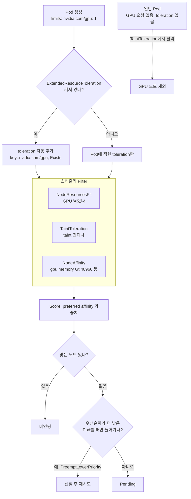

# 03. GPU 노드 고르기: 라벨·affinity·taint·우선순위

> [목차로](CURRICULUM.md) · 작성 2026-10-12 · 기준 버전: NVIDIA k8s-device-plugin/GFD v0.20.1, GPU Operator v26.7.1, Kubernetes 1.37 문서
> **[근거]** 출처에 그대로 있는 내용, **[추론]** 여러 출처를 엮어 내린 결론.
> 앞 절: [02. NVIDIA GPU Operator 구성 요소](02-gpu-operator.md)

## 1. 개념

01절에서 본 대로 `nvidia.com/gpu: 1`만 요청해도 스케줄러는 GPU가 남은 노드에 Pod를 놓는다. 그런데 실제 클러스터에서는 이것만으로 부족한 일이 셋 생긴다.

1. **GPU 종류가 섞여 있다.** A100 노드와 L4 노드가 같이 있으면 `nvidia.com/gpu`라는 이름은 같다. 80GB 메모리가 필요한 학습 잡이 24GB 카드에 떨어질 수 있다.
2. **GPU 노드를 GPU 안 쓰는 Pod가 차지한다.** 웹 서버 Pod가 GPU 노드의 CPU·메모리를 다 써 버리면, 나중에 온 GPU Pod는 GPU가 비어 있어도 못 들어간다.
3. **비싼 노드에서 누가 먼저인가.** 학습 잡과 실험용 노트북이 같은 GPU를 두고 다툴 때 순서를 정해야 한다.

각각에 대응하는 도구가 다르다.

| 문제 | 도구 | 방향 |
|------|------|------|
| 어떤 GPU인지 고르기 | 노드 라벨 + `nodeSelector`/`nodeAffinity` | Pod가 노드를 **끌어당긴다** |
| GPU 노드 지키기 | taint + toleration (+ `ExtendedResourceToleration`) | 노드가 Pod를 **밀어낸다** |
| 다툼의 순서 | `PriorityClass`와 선점 | 스케줄러가 **빼앗는다** |

**[추론]** 끌어당기기와 밀어내기는 둘 다 써야 완성된다. affinity만 쓰면 GPU Pod는 GPU 노드로 가지만 다른 Pod가 GPU 노드로 오는 것은 못 막는다. taint만 쓰면 다른 Pod는 막지만 GPU Pod가 어느 GPU 노드로 갈지는 못 고른다.

### 1.1 라벨은 누가 붙이나

**[근거]** Kubernetes 문서는 GPU 종류가 섞인 클러스터에서 `kubectl label nodes node1 accelerator=example-gpu-x100`처럼 직접 라벨을 붙이고 node selector로 고르라고 한다. 라벨 키 `accelerator`는 예시일 뿐이다. 이어서 자동 라벨러로 NFD를 소개한다. 출처: <https://kubernetes.io/docs/tasks/manage-gpus/scheduling-gpus/> (2026-10-12 확인)

GPU Operator를 쓰면 라벨은 세 곳에서 온다.

| 붙이는 쪽 | 라벨 예 | 쓰임 |
|-----------|---------|------|
| NFD | `feature.node.kubernetes.io/pci-10de.present=true` | NVIDIA PCI 장치가 있다(10de는 NVIDIA 벤더 ID) |
| GPU Operator | `nvidia.com/gpu.present=true`, `nvidia.com/gpu.deploy.*` | Operator가 GPU 노드로 인식했고, 어떤 operand를 띄울지 |
| GFD | `nvidia.com/gpu.product`, `gpu.memory`, `gpu.count`, `gpu.family`, `gpu.compute.major` 등 | GPU 모델과 성능 특성 |

- **[근거]** Operator 컨트롤러 소스에 `commonGPULabelKey = "nvidia.com/gpu.present"`, 값 `"true"`, 그리고 `nvidia.com/gpu.deploy.driver`·`...device-plugin` 등 operand별 배포 라벨 키가 정의돼 있다. 출처: <https://github.com/NVIDIA/gpu-operator/blob/v26.7.1/controllers/state_manager.go> (2026-10-12 확인)

### 1.2 GFD 라벨 중 고르기에 쓰는 것

**[근거]** GFD v0.20.1 README의 "Generated Labels" 표(값은 모두 문자열이고, 표의 형식은 문자열 안의 형식이다).

| 라벨 | 형식 | 의미 | 예 |
|------|------|------|----|
| `nvidia.com/gpu.product` | 문자열 | GPU 모델. 공유 전략에 따라 device plugin이 바꿀 수 있다 | `Tesla-T4` |
| `nvidia.com/gpu.memory` | 정수(MiB) | GPU 메모리 | `15360` |
| `nvidia.com/gpu.count` | 정수 | GPU 수 | `2` |
| `nvidia.com/gpu.family` | 문자열 | 아키텍처 계열 | `turing` |
| `nvidia.com/gpu.compute.major`/`.minor` | 정수 | compute capability | `7`/`5` |
| `nvidia.com/gpu.machine` | 문자열 | 머신 형식(클라우드는 인스턴스 형식) | `DGX-1` |
| `nvidia.com/cuda.driver-version.full` | 문자열 | 드라이버 버전(옛 `cuda.driver.major` 등은 Deprecated) | `550.107.02` |
| `nvidia.com/gpu.replicas` | 문자열 | 공유 전략이 있으면 GPU 수 × replicas | `4` |
| `nvidia.com/gpu.clique` | 문자열 | GPU Fabric ClusterUUID + CliqueID | |

출처: <https://github.com/NVIDIA/k8s-device-plugin/blob/v0.20.1/docs/gpu-feature-discovery/README.md#generated-labels> (2026-10-12 확인)

- **[근거]** MIG `single` 전략이면 `gpu.product`가 `A100-SXM4-40GB-MIG-1g.5gb`처럼 바뀌고 `gpu.count`·`gpu.memory`는 MIG 장치 기준으로 덮어써진다. `mixed` 전략이면 `nvidia.com/mig-1g.5gb.count` 같은 프로필별 라벨이 따로 생긴다. 같은 출처.
- **[근거]** time-slicing·MPS로 공유하고 `renameByDefault=false`이면 `gpu.product` 끝에 `-SHARED`가 붙는다. 문서는 이것이 "공유 GPU 노드를 nodeSelector로 고르는" 수단이라고 한다. 출처: <https://github.com/NVIDIA/k8s-device-plugin/blob/v0.20.1/README.md> "Deploying with gpu-feature-discovery for automatic node labels" (2026-10-12 확인)
- **[추론]** 그래서 `gpu.product`에 정확히 일치(`In`)로 걸면, 나중에 그 노드에 MIG나 time-slicing을 켜는 순간 라벨 값이 바뀌어 Pod가 갈 곳을 잃는다. 모델을 고를 때는 공유 설정에 따라 바뀌지 않는 `gpu.family`나 `gpu.compute.major`, 또는 운영자가 직접 붙인 라벨이 더 안전하다. 공유 여부는 04절에서 다시 본다.

### 1.3 숫자로 고르기: `Gt`·`Lt`

**[근거]** nodeAffinity의 연산자에는 `In`, `NotIn`, `Exists`, `DoesNotExist` 말고 `Gt`, `Lt`가 있다. 라벨 값을 정수로 파싱해 비교하며, 정수가 아니면 Pod가 스케줄되지 않는다. `nodeSelector`(단순 일치)로는 못 쓴다. 출처: <https://kubernetes.io/docs/concepts/scheduling-eviction/assign-pod-node/> "Operators" 표 (2026-10-12 확인)

**[추론]** `nvidia.com/gpu.memory`는 정수(MiB)라 "GPU 메모리 40GB 초과"를 `Gt 40960`으로 쓸 수 있다. 모델 이름 목록을 관리할 필요가 없다. 다만 MIG `single` 전략 노드에서는 이 값이 MIG 장치 메모리로 덮어써지므로 의도대로 걸린다(오히려 그게 맞다). `Gt`는 경계를 포함하지 않는다.

### 1.4 GPU 노드 지키기: taint

**[근거]** Kubernetes 문서는 특수 하드웨어(예: GPU) 노드를 쓸 일 없는 Pod로부터 지키려면 노드에 taint를 걸고, 그 하드웨어를 쓰는 Pod에 toleration을 주라고 한다. 권장 방식은 하드웨어를 확장 리소스로 표현하고, **taint 키를 확장 리소스 이름으로** 건 뒤 `ExtendedResourceToleration` admission 플러그인을 켜는 것이다. 그러면 확장 리소스를 요청한 Pod에 맞는 toleration이 자동으로 붙는다. 출처: <https://kubernetes.io/docs/concepts/scheduling-eviction/taint-and-toleration/> "Example Use Cases" (2026-10-12 확인)

**[근거]** `ExtendedResourceToleration`은 mutating admission 플러그인이고 **기본으로 꺼져 있다.** 출처: <https://kubernetes.io/docs/reference/access-authn-authz/admission-controllers/#extendedresourcetoleration> (2026-10-12 확인)

**[근거]** NVIDIA device plugin README의 예시 Pod도 `key: nvidia.com/gpu, operator: Exists, effect: NoSchedule` toleration을 달고 있고, GPU Operator Helm 차트의 operand 기본 toleration도 같은 모양이다(`daemonsets.tolerations`). 출처: device plugin README "Running GPU Jobs", <https://github.com/NVIDIA/gpu-operator/blob/v26.7.1/deployments/gpu-operator/values.yaml> (2026-10-12 확인)

**[추론]** Operator가 `nvidia.com/gpu` taint를 견디게 만들어져 있을 뿐, taint를 거는 것은 운영자 몫이다. v26.7.1 컨트롤러 소스(`controllers/`, `internal/`)에서 노드 taint를 고치는 코드를 찾지 못했다(`Spec.Taints` 검색 0건, 2026-10-12). 즉 Operator를 깔았다고 GPU 노드가 저절로 보호되지는 않는다.

taint 효과 셋의 차이:

| effect | 새 Pod | 이미 도는 Pod | GPU 노드에 쓰면 |
|--------|--------|---------------|----------------|
| `PreferNoSchedule` | 가능하면 피함 | 그대로 | 자리가 모자라면 일반 Pod가 들어온다 |
| `NoSchedule` | 못 들어옴 | 그대로 | 보통 이것 |
| `NoExecute` | 못 들어옴 | toleration 없으면 쫓겨남 | 이미 돌던 DaemonSet·에이전트까지 쫓을 수 있어 조심 |

### 1.5 다툼의 순서: PriorityClass

**[근거]** `PriorityClass`의 값이 큰 Pod가 스케줄 큐에서 먼저 나오고, 자리가 없으면 낮은 우선순위 Pod를 선점(쫓아냄)할 수 있다. `preemptionPolicy` 기본값은 `PreemptLowerPriority`이고, `Never`로 두면 큐에서는 앞서지만 남을 쫓아내지는 않는다. PodDisruptionBudget은 선점 때 존중하려 하지만 보장하지 않는다. 출처: <https://kubernetes.io/docs/concepts/scheduling-eviction/pod-priority-preemption/> (2026-10-12 확인)

**[근거]** GPU Operator operand의 기본 `priorityClassName`은 `system-node-critical`이다(values.yaml `daemonsets.priorityClassName`).

**[추론]** 기본 스케줄러의 선점은 Pod 하나 단위다. 8 GPU짜리 분산 잡의 워커 하나가 선점으로 죽으면 나머지 7개는 GPU를 잡은 채 기다린다. 잡 단위의 선점·큐·공정 분배는 09절(Kueue·Volcano)의 몫이고, 여기서는 "실험용은 낮게, 운영 추론은 높게" 정도만 둔다.

## 2. 그림



## 3. 실습

### 3.1 GPU 노드에 taint 걸기

```bash
# GPU가 있는 노드만 골라 taint (GPU Operator가 붙인 라벨 사용)
kubectl taint nodes -l nvidia.com/gpu.present=true \
  nvidia.com/gpu=present:NoSchedule

kubectl get nodes -l nvidia.com/gpu.present=true \
  -o custom-columns=NAME:.metadata.name,TAINTS:.spec.taints
```

### 3.2 ExtendedResourceToleration 켜기 (kubeadm)

`/etc/kubernetes/manifests/kube-apiserver.yaml`의 기존 `--enable-admission-plugins` 값 끝에 덧붙인다. 기존 목록을 지우고 새로 쓰면 안 된다.

```yaml
    - --enable-admission-plugins=NodeRestriction,ExtendedResourceToleration
```

확인:

```bash
kubectl apply -f - <<'EOF'
apiVersion: v1
kind: Pod
metadata:
  name: ert-check
spec:
  restartPolicy: Never
  containers:
  - name: c
    image: busybox:1.36
    command: ["true"]
    resources:
      limits:
        nvidia.com/gpu: 1
EOF
kubectl get pod ert-check -o jsonpath='{.spec.tolerations}' ; echo
# 기대: [... {"effect":"NoSchedule","key":"nvidia.com/gpu","operator":"Exists"} ...]
```

### 3.3 메모리 40GB 초과 GPU로 보내기

```yaml
apiVersion: v1
kind: Pod
metadata:
  name: big-gpu
spec:
  restartPolicy: Never
  priorityClassName: gpu-batch        # 3.4에서 만든다
  affinity:
    nodeAffinity:
      requiredDuringSchedulingIgnoredDuringExecution:
        nodeSelectorTerms:
        - matchExpressions:
          - key: nvidia.com/gpu.memory   # MiB, 정수 문자열
            operator: Gt
            values: ["40960"]
      preferredDuringSchedulingIgnoredDuringExecution:
      - weight: 50
        preference:
          matchExpressions:
          - key: nvidia.com/gpu.family
            operator: In
            values: ["hopper", "blackwell"]
  tolerations:                         # ERT를 안 켰다면 직접 적는다
  - key: nvidia.com/gpu
    operator: Exists
    effect: NoSchedule
  containers:
  - name: cuda
    image: nvcr.io/nvidia/k8s/cuda-sample:vectoradd-cuda12.5.0
    resources:
      limits:
        nvidia.com/gpu: 1
```

**[근거]** `gpu.family` 값은 GFD가 compute capability에서 정한다. v0.20.1 `internal/lm/resource.go`에 `"ampere"`, `"hopper"`, `"blackwell"` 문자열이 있다(2026-10-12 확인). 그래도 클러스터마다 실제 라벨로 확인하고 넣는다.

```bash
kubectl get nodes -L nvidia.com/gpu.product,nvidia.com/gpu.memory,nvidia.com/gpu.family,nvidia.com/gpu.count
```

### 3.4 우선순위 둘

```yaml
apiVersion: scheduling.k8s.io/v1
kind: PriorityClass
metadata:
  name: gpu-serving
value: 100000
description: "운영 추론. 실험 Pod를 선점할 수 있다"
---
apiVersion: scheduling.k8s.io/v1
kind: PriorityClass
metadata:
  name: gpu-batch
value: 1000
preemptionPolicy: Never
description: "학습·실험. 큐에서 앞설 수는 있지만 남을 쫓아내지 않는다"
```

## 4. GPU 없이 확인하는 법

taint·affinity·우선순위는 전부 스케줄러 판단이라 실제 GPU가 필요 없다. 01절의 방법(노드 status에 확장 리소스 용량 패치)에 라벨만 더한다.

```bash
# kind 클러스터: 워커 둘. ERT도 같이 켠다.
cat > kind-gpu.yaml <<'EOF'
kind: Cluster
apiVersion: kind.x-k8s.io/v1alpha4
nodes:
- role: control-plane
  kubeadmConfigPatches:
  - |
    kind: ClusterConfiguration
    apiServer:
      extraArgs:
        enable-admission-plugins: NodeRestriction,ExtendedResourceToleration
- role: worker
- role: worker
EOF
kind create cluster --name gpu-lab --config kind-gpu.yaml

# 워커 하나를 "가짜 A100 80GB 노드"로
N=gpu-lab-worker
kubectl label node $N nvidia.com/gpu.present=true \
  nvidia.com/gpu.product=A100-SXM4-80GB nvidia.com/gpu.memory=81920 nvidia.com/gpu.family=ampere
kubectl taint node $N nvidia.com/gpu=present:NoSchedule
kubectl proxy --port=8001 &
curl -s -X PATCH -H 'Content-Type: application/json-patch+json' \
  --data '[{"op":"add","path":"/status/capacity/nvidia.com~1gpu","value":"2"}]' \
  http://localhost:8001/api/v1/nodes/$N/status >/dev/null
```

확인할 것:

1. GPU 요청 없는 `nginx` Deployment(replicas 4)는 전부 `gpu-lab-worker2`로 간다(taint).
2. 3.3의 `big-gpu`는 `gpu-lab-worker`에 배치된다. 이미지가 GPU를 못 찾아 실패하는 것은 상관없다. `kubectl get pod -o wide`의 NODE 칸만 본다.
3. `values: ["90000"]`으로 바꾸면 `Pending`, 이벤트에 `didn't match Pod's node affinity/selector`가 나온다.
4. `--dry-run=server`로는 admission(ERT toleration 추가)까지는 볼 수 있지만 스케줄링은 안 일어난다. `kubectl apply --dry-run=server -o yaml -f pod.yaml | grep -A3 tolerations`.

## 5. 흔한 실수

1. **taint 키를 확장 리소스 이름과 다르게 건다.** `gpu=true:NoSchedule`로 걸면 ERT가 붙이는 toleration(`key: nvidia.com/gpu`)과 맞지 않아 GPU Pod까지 못 들어간다. ERT를 쓸 거면 키를 `nvidia.com/gpu`로.
2. **ERT가 기본으로 켜져 있다고 믿는다.** 꺼져 있다. 관리형 클러스터에서는 API 서버 플래그를 못 바꿀 수 있으니, 그 경우 Pod(또는 Kueue `ResourceFlavor`의 toleration 등 09절)에 직접 적는다.
3. **GPU 노드에 taint를 걸고 노드 에이전트 DaemonSet을 잊는다.** 로그 수집·CNI·모니터링 DaemonSet에 toleration이 없으면 GPU 노드에서만 빠진다. `NoExecute`면 이미 돌던 것도 쫓겨난다.
4. **`gpu.product` 정확 일치로 묶는다.** MIG·time-slicing을 켜면 값이 `...-MIG-1g.10gb`나 `...-SHARED`로 바뀌어 Pod가 `Pending`이 된다(1.2).
5. **`nodeSelector`에 숫자 비교를 기대한다.** `nodeSelector`는 일치만 한다. 크기 비교는 `nodeAffinity`의 `Gt`/`Lt`.
6. **`gpu.memory`를 GB로 적는다.** 단위는 MiB다. `Gt 40`은 사실상 모든 GPU에 걸린다.
7. **`IgnoredDuringExecution`을 잊는다.** 라벨이 바뀌어도(드라이버 교체, MIG 재구성) 이미 도는 Pod는 그대로다. 라벨이 맞지 않는 Pod가 노드에 남아 있을 수 있다.
8. **우선순위만 높이고 `preemptionPolicy`를 안 본다.** 실험용 클래스를 높은 값으로 만들면 운영 Pod까지 선점한다. 실험·배치는 `Never`를 기본으로.

## 6. 확인 문제

1. GPU 노드에 `nvidia.com/gpu=present:NoSchedule` taint를 걸었고 ERT도 켰다. GPU를 요청하지 않는 Prometheus node-exporter DaemonSet이 GPU 노드에서만 안 뜬다. 왜이고, 어떻게 고치나?
2. "GPU 메모리 40GB 초과, 가능하면 Hopper 이상" 조건을 모델 이름 목록 없이 표현하라. `nodeSelector`로는 왜 안 되나?
3. A100 노드에 MIG `single` 전략으로 `1g.10gb`를 켰다. `nvidia.com/gpu.product In [A100-SXM4-80GB]`로 묶인 새 Pod와 이미 돌던 Pod는 각각 어떻게 되나?

<details>
<summary>답</summary>

1. ERT는 확장 리소스를 **요청한** Pod에만 toleration을 붙인다. node-exporter는 GPU를 요청하지 않으니 toleration이 없고 taint에 걸린다. DaemonSet에 `key: nvidia.com/gpu, operator: Exists, effect: NoSchedule` toleration을 직접 단다(또는 모든 taint를 견디는 `operator: Exists`만 단 toleration).
2. `nodeAffinity` required에 `nvidia.com/gpu.memory Gt 40960`, preferred에 `nvidia.com/gpu.family In [hopper, blackwell]`(또는 `nvidia.com/gpu.compute.major Gt 8`). `nodeSelector`는 일치 비교만 하므로 크기 조건과 "가능하면"(가중치)을 쓸 수 없다.
3. GFD가 `gpu.product`를 `A100-SXM4-80GB-MIG-1g.10gb`로 바꾸므로 새 Pod는 affinity를 못 맞춰 `Pending`이다. 이미 돌던 Pod는 `IgnoredDuringExecution`이라 affinity 때문에 쫓겨나지는 않는다. 다만 MIG 재구성 자체가 GPU를 쓰는 Pod를 비우는 과정을 거치므로(02절 MIG Manager), 실제로는 재구성 단계에서 내려간다(추론).

</details>

## 7. 이어 볼 것

- 04절: MIG·time-slicing·MPS를 켜면 바뀌는 라벨과 리소스 이름
- 05절: DRA에서는 노드 라벨 대신 `ResourceSlice`의 장치 속성을 CEL로 고르고, 장치 단위 taint(device taints)가 따로 있다. 출처: <https://kubernetes.io/docs/concepts/scheduling-eviction/taint-and-toleration/> "What's next"의 device taints 링크 (2026-10-12 확인)
- 09절: 잡 단위 선점과 큐, Kueue `ResourceFlavor`로 노드 라벨·toleration 묶기
- 11절: 같은 노드 안에서 어느 GPU·NUMA를 고르나(Topology Manager)

## 8. 출처 (모두 2026-10-12 확인)

- Kubernetes, Schedule GPUs: <https://kubernetes.io/docs/tasks/manage-gpus/scheduling-gpus/>
- Kubernetes, Assigning Pods to Nodes(연산자 표): <https://kubernetes.io/docs/concepts/scheduling-eviction/assign-pod-node/>
- Kubernetes, Taints and Tolerations: <https://kubernetes.io/docs/concepts/scheduling-eviction/taint-and-toleration/>
- Kubernetes, Admission Controllers(ExtendedResourceToleration): <https://kubernetes.io/docs/reference/access-authn-authz/admission-controllers/#extendedresourcetoleration>
- Kubernetes, Pod Priority and Preemption: <https://kubernetes.io/docs/concepts/scheduling-eviction/pod-priority-preemption/>
- NVIDIA GFD 라벨 표(v0.20.1): <https://github.com/NVIDIA/k8s-device-plugin/blob/v0.20.1/docs/gpu-feature-discovery/README.md>
- NVIDIA device plugin README(v0.20.1, 라벨 카탈로그·공유 시 `-SHARED`): <https://github.com/NVIDIA/k8s-device-plugin/blob/v0.20.1/README.md>
- GPU Operator 소스·차트(v26.7.1): <https://github.com/NVIDIA/gpu-operator/blob/v26.7.1/controllers/state_manager.go>, <https://github.com/NVIDIA/gpu-operator/blob/v26.7.1/deployments/gpu-operator/values.yaml>
