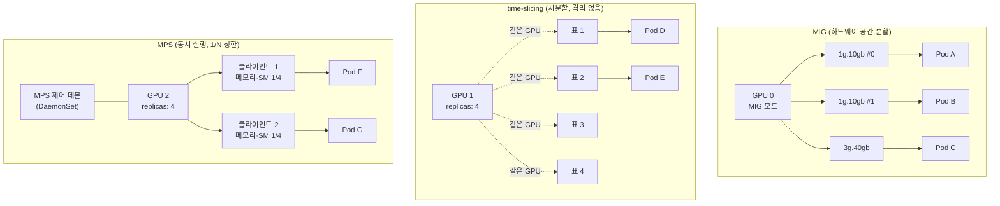
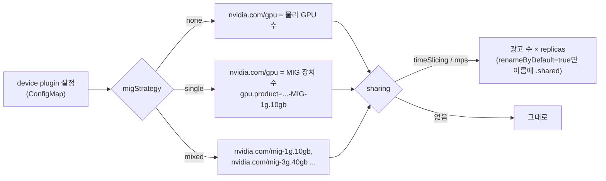

# 04. GPU 나눠 쓰기: MIG·time-slicing·MPS

> [목차로](CURRICULUM.md) · 작성 2026-10-14 · 기준 버전: NVIDIA k8s-device-plugin/GFD v0.20.1, GPU Operator v26.7.1(문서는 v26.7.2 표기), MIG User Guide(2026-09-11 갱신), CUDA MPS 문서(2026-09-09 갱신)
> **[근거]** 출처에 그대로 있는 내용, **[추론]** 여러 출처를 엮어 내린 결론.
> 앞 절: [03. GPU 노드 고르기](03-gpu-node-selection.md)

## 1. 개념

01절에서 본 대로 `nvidia.com/gpu`는 정수 확장 리소스이고 오버커밋이 없다. Pod 하나가 `nvidia.com/gpu: 1`을 받으면 그 GPU 한 장을 통째로 갖는다. 추론 서버 하나가 80GB 중 6GB만 쓰고 SM의 10%만 돌려도 나머지는 아무도 못 쓴다.

GPU 한 장을 여럿이 쓰는 방법은 셋이다. 하는 일이 전혀 다르다.

| 방식 | 무엇을 나누나 | 어디서 나누나 | Kubernetes에 보이는 모습 |
|------|---------------|---------------|--------------------------|
| **MIG** | SM·L2·메모리 컨트롤러·DRAM을 **공간으로** 자른다 | GPU 하드웨어 | 작은 GPU 여러 장(`nvidia.com/gpu` 또는 `nvidia.com/mig-1g.10gb`) |
| **time-slicing** | 같은 GPU를 **시간으로** 돌려 쓴다 | CUDA 드라이버의 시분할 | 같은 GPU를 가리키는 표 여러 장(replicas) |
| **MPS** | 여러 프로세스의 커널을 한 컨텍스트처럼 **동시에** 돌리고, SM 비율·메모리 상한을 건다 | MPS 제어 데몬(소프트웨어) | 표 여러 장, 각 표에 1/N 상한 |

### 1.1 격리 수준 비교

| | MIG | time-slicing | MPS |
|---|---|---|---|
| 메모리 격리 | 있음(하드웨어 분할) | **없음**. 모든 replica가 GPU 메모리 전체에 접근 | 주소 공간은 분리, 상한은 1/N로 강제 |
| 장애 격리 | 있음(인스턴스 단위) | **없음**. 하나가 죽으면 다 죽는다 | 제한적. 치명적 오류는 같은 GPU를 공유한 클라이언트 전체에 퍼진다 |
| 성능 예측성(QoS) | 높음. L2·DRAM 대역폭까지 인스턴스별 | 낮음. 프로세스 수대로 시간을 나눈다 | 중간. SM 비율 상한은 있지만 메모리 대역폭은 공유 |
| 지원 GPU | Ampere(compute capability 8.0) 이상 일부 모델 | 거의 전부 | Volta 이상(MPS 문서가 "Volta MPS" 기준으로 서술, 추론) |
| 나누는 단위 | 정해진 프로필(1g.10gb 등) | 아무 수(replicas) | 아무 수(replicas), 같은 몫 |
| 바꾸는 비용 | GPU에서 워크로드를 비워야 함, 재부팅이 필요할 수 있음 | device plugin 재시작 | device plugin과 MPS 데몬 재시작 |

근거:

- **[근거]** MIG는 인스턴스마다 crossbar 포트·L2 뱅크·메모리 컨트롤러·DRAM 주소 버스를 따로 주어, 다른 작업이 캐시나 DRAM을 포화시켜도 처리량과 지연이 예측 가능하고, 장애 격리가 있는 QoS를 준다. 출처: <https://docs.nvidia.com/datacenter/tesla/mig-user-guide/introduction.html> (2026-10-14 확인)
- **[근거]** time-slicing은 같은 GPU의 replica끼리 격리를 전혀 하지 않는다. 각 워크로드가 GPU 메모리 전체에 접근하고 같은 장애 영역에 있다("하나가 죽으면 다 죽는다"). MPS는 공간 분할을 하고 워크로드별 메모리·연산 한도를 강제한다. 둘은 **동시에 못 쓴다.** 출처: device plugin v0.20.1 README "Shared Access to GPUs" <https://github.com/NVIDIA/k8s-device-plugin/blob/v0.20.1/README.md#shared-access-to-gpus> (2026-10-14 확인)
- **[근거]** MPS 클라이언트는 GPU 주소 공간이 완전히 분리되지만 오류 격리는 제한적이다. Volta MPS 클라이언트가 낸 치명적 GPU 오류는 그 GPU를 공유한 모든 클라이언트에 보고된다. 출처: <https://docs.nvidia.com/deploy/mps/when-to-use-mps.html> "Memory Protection and Error Containment" (2026-10-14 확인)

**[추론]** 표를 한 줄로 줄이면 이렇다. 남의 작업이 내 작업을 죽이면 안 되면 MIG, 같은 팀의 가벼운 작업을 많이 얹고 싶으면 time-slicing, 작은 추론 프로세스 여럿을 동시에 돌려 SM을 꽉 채우고 싶으면 MPS다. 서로 다른 팀(테넌트)을 time-slicing으로 섞으면 안 된다.

### 1.2 이 과정의 전제

목차의 전제대로 하이퍼바이저 vGPU는 다루지 않는다. 베어메탈이나 패스스루 GPU 노드에서 MIG·time-slicing·MPS만 본다.

- **[근거]** MIG User Guide의 지원 GPU 표(2026-09-11 갱신)에는 A100·A30·H100·H200·H20·GH200·B200·GB200·RTX PRO Blackwell 계열이 있다. 최대 인스턴스 수는 A100·H100·B200이 7, A30·RTX PRO 6000이 4다. **B300(Blackwell Ultra)은 이 표에도, 프로필 표에도 아직 없다.** 출처: <https://docs.nvidia.com/datacenter/tesla/mig-user-guide/supported-gpus.html>, <https://docs.nvidia.com/datacenter/tesla/mig-user-guide/supported-mig-profiles.html> (2026-10-14 확인)
- **[근거]** 그러나 HGX B300의 MIG는 다른 1차 출처에 있다. GPU Operator 25.10.0 릴리스 노트에 "Added support for new MIG profiles with NVIDIA HGX B300"과 프로필 목록(`1g.34gb`, `1g.34gb+me`, `1g.67gb`, `2g.67gb`, `3g.135gb`, `4g.135gb`, `7g.269gb`)이 있고, NVIDIA MIG 제품 페이지 사양표에도 HGX B300 열(최대 7개 인스턴스)이 있다. 출처: <https://docs.nvidia.com/datacenter/cloud-native/gpu-operator/latest/release-notes.html>, <https://www.nvidia.com/en-us/technologies/multi-instance-gpu/> (2026-10-14 확인)
- **[근거]** 같은 시기의 CUDA MPS 문서 예시 출력에는 `NVIDIA B300` 8장에서 locality domain(옛 이름 MLOPart)을 쓰는 장면이 나온다. 출처: <https://docs.nvidia.com/deploy/mps/when-to-use-mps.html> "Locality Domains" (2026-10-14 확인)
- **[추론]** 그래서 B300에서 MIG는 쓸 수 있다고 본다. 다만 MIG User Guide 쪽이 늦어서 B300 프로필의 SM·메모리 비율이나 드라이버 최소 버전 같은 세부는 아직 User Guide로 확인할 수 없다. 프로필 이름은 GPU Operator 릴리스 노트를, 실제 가능 여부는 장비의 `nvidia-smi mig -lgip`(가능한 GPU 인스턴스 프로필 목록)를 기준으로 삼는다. 한 문서에 없다고 "지원 안 함"으로 적지 않는다.

## 2. 그림



device plugin이 어느 쪽으로 광고하는지:



## 3. 실습

### 3.1 MIG: single과 mixed

**[근거]** device plugin의 `MIG_STRATEGY`는 `none | single | mixed`이고 기본값은 `none`이다. `mixed`면 `nvidia.com/mig-<slice>g.<mem>gb` 형태의 리소스가 추가로 생겨 특정 MIG 장치를 골라 요청할 수 있다. 출처: device plugin v0.20.1 README "Configuration Option Details" (2026-10-14 확인)

**[근거]** GPU Operator 문서의 설명은 `single`이 "노드의 모든 GPU에 MIG를 켠다", `mixed`가 "노드의 일부 GPU만 MIG"다. MIG를 쓰려면 설치할 때 전략을 골라야 하고, MIG Manager가 노드 라벨 `nvidia.com/mig.config`를 보고 구성을 바꾼다. 출처: <https://docs.nvidia.com/datacenter/cloud-native/gpu-operator/latest/gpu-operator-mig.html> (2026-10-14 확인)

```bash
# 설치 시 전략 지정(이미 깔려 있으면 ClusterPolicy 패치)
kubectl patch clusterpolicies.nvidia.com/cluster-policy --type=json \
  -p='[{"op":"replace","path":"/spec/mig/strategy","value":"single"}]'

# 노드에 원하는 구성을 라벨로
kubectl label node <node> nvidia.com/mig.config=all-1g.10gb --overwrite

# 진행 상태: pending → (rebooting) → success / failed
kubectl get node <node> -L nvidia.com/mig.config,nvidia.com/mig.config.state
```

기대 결과(H100 80GB, single, `all-1g.10gb`): `nvidia.com/gpu.count=7`, `nvidia.com/gpu.product=NVIDIA-H100-80GB-HBM3-MIG-1g.10gb`, `nvidia.com/mig.config.state=success`. 노드 `Allocatable`의 `nvidia.com/gpu`가 GPU 수 × 7이 된다.

- **[근거]** MIG Manager는 라벨을 받으면 GPU Pod를 **모두 종료**하고 MIG 모드를 켠 뒤 구성을 적용한다. 구성 대상 GPU에 사용자 워크로드가 없어야 하고, 클라우드처럼 재부팅이 필요한 곳은 미리 cordon하라고 한다. 같은 출처.
- **[근거]** v26.3.0부터 MIG Manager는 NVML로 그 노드에서 가능한 프로필을 찾아 `<node-name>-mig-config` ConfigMap을 노드마다 만든다(`all-disabled`, `all-enabled`, `all-1g.10gb` 같은 프로필별 구성, `all-balanced`). 535 같은 옛 드라이버는 MIG가 꺼진 상태에서 프로필 조회를 못 해 정적 ConfigMap `default-mig-parted-config`로 돌아간다. 같은 출처.

mixed에서 특정 프로필을 고르는 Pod:

```yaml
apiVersion: v1
kind: Pod
metadata:
  name: mig-small
spec:
  restartPolicy: Never
  tolerations:
  - {key: nvidia.com/gpu, operator: Exists, effect: NoSchedule}
  containers:
  - name: cuda
    image: nvcr.io/nvidia/cuda:12.5.0-base-ubuntu22.04
    command: ["nvidia-smi", "-L"]
    resources:
      limits:
        nvidia.com/mig-1g.10gb: 1     # mixed 전략에서만 존재하는 이름
```

**[근거]** B200 180GB의 프로필 예: `1g.23gb`(SM 1/7, 메모리 1/8, 최대 7개), `2g.45gb`(최대 3개), `3g.90gb`(최대 2개), `4g.90gb`(1개), `7g.180gb`(전체). 출처: MIG User Guide "Supported MIG Profiles" (2026-10-14 확인)

**[추론]** 프로필 이름의 앞 숫자(1g·3g)는 SM 조각 수, 뒤(23gb)는 메모리다. 메모리는 8등분, SM은 7등분이라 `1g.45gb`처럼 SM은 1/7인데 메모리는 2/8인 프로필이 따로 있다. 메모리가 큰 모델을 작은 SM으로 돌리고 싶을 때 쓴다.

### 3.2 time-slicing

**[근거]** GPU Operator에서는 ConfigMap을 만들고 ClusterPolicy의 `devicePlugin.config`가 그것을 보게 한 뒤, 기본 구성(`default`)을 정하거나 노드에 `nvidia.com/device-plugin.config=<키>` 라벨을 붙여 노드별 구성을 고른다. 출처: <https://docs.nvidia.com/datacenter/cloud-native/gpu-operator/latest/gpu-sharing.html> (2026-10-14 확인)

```yaml
apiVersion: v1
kind: ConfigMap
metadata:
  name: time-slicing-config
  namespace: gpu-operator
data:
  t4: |-
    version: v1
    flags:
      migStrategy: none
    sharing:
      timeSlicing:
        renameByDefault: false
        failRequestsGreaterThanOne: true
        resources:
        - name: nvidia.com/gpu
          replicas: 4
```

```bash
kubectl apply -f time-slicing-config.yaml
kubectl patch clusterpolicies.nvidia.com/cluster-policy -n gpu-operator --type merge \
  -p '{"spec":{"devicePlugin":{"config":{"name":"time-slicing-config"}}}}'
kubectl label node <t4-node> nvidia.com/device-plugin.config=t4
kubectl get node <t4-node> -o jsonpath='{.status.allocatable.nvidia\.com/gpu}{"\n"}'
# GPU 1장 노드라면 4
kubectl get node <t4-node> -L nvidia.com/gpu.replicas,nvidia.com/gpu.product
# gpu.replicas=4, gpu.product=Tesla-T4-SHARED
```

`replicas`의 의미를 정확히 잡아 둔다.

- **[근거]** 8 GPU 노드에 `replicas: 10`이면 `nvidia.com/gpu`가 80으로 광고된다. plugin은 GPU마다 참조 10개를 만들어 **요청하는 누구에게나 구분 없이** 나눠 준다. 출처: device plugin v0.20.1 README "With CUDA Time-Slicing" (2026-10-14 확인)
- **[근거]** replica를 2개 요청해도 연산 몫이 2배가 되지 않는다. "공유 GPU에 접근한다"는 뜻일 뿐이고, CUDA는 모든 클라이언트의 GPU 프로세스에 시간을 똑같이 나눈다. `failRequestsGreaterThanOne=true`면 2 이상 요청은 `UnexpectedAdmissionError`로 실패한다. README는 이것을 `true`로 두기를 권하지만 하위 호환 때문에 기본값은 `false`다. 같은 출처.
- **[근거]** time-slicing을 켜면 dcgm-exporter가 지표를 컨테이너에 연결하지 못한다. Operator는 time-slicing ConfigMap 변경을 감시하지 않아서, 고친 뒤 `kubectl rollout restart -n gpu-operator daemonset/nvidia-device-plugin-daemonset`을 직접 해야 한다. 이미 도는 워크로드는 영향받지 않는다. 출처: GPU Operator "Time-Slicing GPUs" Limitations, Updating a Time-Slicing Config Map (2026-10-14 확인)
- **[근거]** time-slicing 대상 리소스는 `nvidia.com/gpu`와 MIG `mixed` 전략에서 생기는 리소스뿐이다. 즉 MIG 인스턴스 위에 time-slicing을 얹을 수 있다. 같은 두 출처.

### 3.3 MPS

```yaml
version: v1
sharing:
  mps:
    renameByDefault: true
    resources:
    - name: nvidia.com/gpu
      replicas: 4
```

- **[근거]** MPS 공유는 device plugin v0.15.0부터 **실험적 기능**이고, MIG가 켜진 장치에서는 지원하지 않는다. MPS 대상은 MIG 아닌 전체 GPU의 `nvidia.com/gpu`뿐이다. replica마다 GPU 전체 메모리·연산의 같은 몫(위 예시면 1/4)이 제어 데몬에 의해 상한으로 걸린다. 출처: device plugin v0.20.1 README "With CUDA MPS" (2026-10-14 확인)
- **[근거]** Helm 차트에는 별도 DaemonSet `daemonset-mps-control-daemon.yml`이 있고, `nvidia.com/mps.capable: "true"` 라벨이 붙은 노드에만 뜬다. 이 라벨은 GFD가 공유 전략이 MPS일 때만 계산하고, 아니면 `false`로 둔다. 데몬 파일은 기본 `/run/nvidia/mps` 아래 전용 `/dev/shm`·파이프·로그 디렉터리로 만들어지며, 드라이버가 호스트 PID 네임스페이스에 있으면 `mps.enableHostPID`를 켜라고 한다. 출처: <https://github.com/NVIDIA/k8s-device-plugin/tree/v0.20.1/deployments/helm/nvidia-device-plugin/templates>, `values.yaml`의 `mps:` 절, `internal/lm/nvml.go`의 `newSharingLabeler` (2026-10-14 확인)
- **[근거]** MPS 서버 하나는 기본 `CUDA_DEVICE_MAX_CONNECTIONS=2`일 때 장치당 클라이언트 CUDA 컨텍스트를 60개까지 받는다. 출처: <https://docs.nvidia.com/deploy/mps/when-to-use-mps.html> "Limits" (2026-10-14 확인)

**새로 생긴 것: MPS v3.** **[근거]** CUDA MPS 문서에는 MPS v3가 있다. 옵트인 방식이고(`nvidia-cuda-mps-control -d -p 3` 또는 `CUDA_MPS_PROTOCOL_VERSION=3`), 기본값은 여전히 v2다. v3의 메모리 분할은 cgroup v2와 CUDA 13.4 이상, MIG 아닌 장치가 필요하고, 하드 한도(`dmem.max`, 넘으면 OOM)와 소프트 한도(`dmem.min`, 넘으면 메모리 압박 때 퇴출 후보)를 둔다. 문서는 이것이 "Kubernetes 같은 스케줄러가 메모리 기준으로 워크로드를 채워 넣을 수 있게" 하려는 것이라고 쓴다. 출처: <https://docs.nvidia.com/deploy/mps/mpsv3-interface.html>, <https://docs.nvidia.com/deploy/mps/mpsv3-memory-partitioning.html> (2026-10-14 확인)

**[추론]** device plugin v0.20.1 README의 MPS 절은 v3를 언급하지 않는다. 지금 device plugin이 띄우는 것은 v2 방식의 같은 몫 상한이고, v3의 cgroup 메모리 분할이 Kubernetes 쪽에 들어오는 길은 05절의 DRA 쪽일 가능성이 높다. 이건 05절에서 NVIDIA DRA 드라이버 릴리스 노트로 확인한다.

### 3.4 GPU 없이 확인하는 법

공유 자체는 GPU 없이 재현할 수 없다. 대신 **스케줄러가 공유를 어떻게 보는지**는 그대로 재현된다. 스케줄러 입장에서 time-slicing·MPS는 "노드 용량 숫자가 커진 것"이고 MIG mixed는 "리소스 이름이 늘어난 것"이기 때문이다.

```bash
kind create cluster --name share-lab   # 03절 클러스터를 재사용해도 된다
N=share-lab-control-plane
kubectl label node $N nvidia.com/gpu.product=Tesla-T4-SHARED nvidia.com/gpu.replicas=4
kubectl proxy --port=8001 &
# GPU 1장 + time-slicing replicas 4, 그리고 mixed MIG 리소스 두 개를 흉내
curl -s -X PATCH -H 'Content-Type: application/json-patch+json' --data '[
 {"op":"add","path":"/status/capacity/nvidia.com~1gpu","value":"4"},
 {"op":"add","path":"/status/capacity/nvidia.com~1mig-1g.10gb","value":"2"},
 {"op":"add","path":"/status/capacity/nvidia.com~1mig-3g.40gb","value":"1"}
]' http://localhost:8001/api/v1/nodes/$N/status >/dev/null
kubectl describe node $N | sed -n '/Allocatable/,/System Info/p'
```

확인할 것:

1. `nvidia.com/gpu: 1`을 요청하는 Deployment를 replicas 5로 만든다. 4개는 같은 노드에 배치되고 1개는 `Pending`(`Insufficient nvidia.com/gpu`)이다. 스케줄러는 이것이 GPU 1장이라는 것을 모른다.
2. 3.1의 `mig-small` Pod를 3개 만든다. 2개만 배치된다.
3. `nodeSelector: {nvidia.com/gpu.product: Tesla-T4}`로 건 Pod는 `Pending`이다. 공유를 켜면 라벨이 `-SHARED`로 바뀐다는 것(03절 1.2)을 눈으로 본다.
4. `failRequestsGreaterThanOne`은 kubelet이 `Allocate`에서 거절하는 것이라 이 실습으로는 재현이 안 된다. 스케줄링은 성공한다는 점(실패는 노드에 간 뒤 `UnexpectedAdmissionError`)만 기억한다.

## 4. 언제 무엇을 쓰나

| 상황 | 고를 것 | 이유 |
|------|---------|------|
| 서로 다른 팀·고객이 한 GPU를 나눈다 | MIG | 메모리·장애·대역폭 격리가 있는 유일한 방법 |
| 노트북·개발용 Pod를 많이 얹는다, GPU가 T4·L4처럼 MIG가 없다 | time-slicing | 아무 GPU에서나 된다. 대신 서로 메모리를 잡아먹을 수 있다 |
| 같은 서비스의 작은 추론 프로세스 여럿, SM을 동시에 채우고 싶다 | MPS | 커널이 동시에 돈다. time-slicing은 번갈아 돈다 |
| MIG 인스턴스 하나도 남는다 | MIG + time-slicing | 지원되는 조합. MIG + MPS는 device plugin에서 미지원 |
| 다중 노드 분산 학습 | 공유하지 않는다 | 06절. 한 rank가 느리면 all-reduce 전체가 기다린다 |

**[추론]** 마지막 줄이 중요하다. 분산 학습은 가장 느린 GPU에 맞춰 움직이므로, 공유 GPU에 rank 하나라도 떨어지면 전체 잡이 그 속도로 내려간다. 학습 노드풀과 공유 노드풀을 라벨(03절)로 나눠 두는 게 기본이다.

## 5. 흔한 실수

1. **time-slicing replica를 "GPU 1/N"로 생각한다.** 메모리 상한이 없다. 한 Pod가 GPU 메모리를 다 잡으면 같은 GPU의 다른 Pod는 OOM이 난다. 1/N 상한이 필요하면 MPS나 MIG다.
2. **replica 여러 개를 요청하면 더 빨라질 거라 본다.** 시간 몫은 프로세스 수대로 똑같이 나뉜다. `failRequestsGreaterThanOne: true`로 막아 두는 편이 낫다.
3. **ConfigMap을 고치고 끝낸다.** Operator는 time-slicing ConfigMap 변경을 감시하지 않는다. device plugin DaemonSet을 재시작해야 반영된다.
4. **GPU별로 다르게 나누려 한다.** time-slicing·MPS는 노드의 모든 GPU에 같은 방식이 적용된다. GPU별 설정은 안 된다. 다르게 하려면 노드를 나눈다.
5. **MIG 구성을 운영 중에 바꾼다.** MIG Manager가 그 노드의 GPU Pod를 다 내린다. 노드 라벨 하나로 운영 Pod가 내려간다는 뜻이라, 라벨 변경 권한을 좁히고 cordon과 같이 한다.
6. **`gpu.product` 정확 일치 nodeSelector를 그대로 둔다.** 공유를 켜면 `-SHARED`, MIG single이면 `-MIG-1g.10gb`가 붙는다(03절 1.2).
7. **time-slicing 노드의 dcgm-exporter 지표를 Pod별로 보려 한다.** 컨테이너 연결이 안 된다(12절에서 다시).
8. **문서 하나의 지원 표만 보고 결론 낸다.** 2026-10-14 기준 B300은 MIG User Guide 표에는 없지만 GPU Operator 릴리스 노트와 MIG 제품 페이지에는 있다(1.2). 프로필 이름은 릴리스 노트, 최종 판정은 장비의 `nvidia-smi mig -lgip`.

## 6. 확인 문제

1. T4 1장 노드에 time-slicing `replicas: 4`를 켰다. Pod A가 `nvidia.com/gpu: 2`, Pod B·C가 각각 1을 요청해 셋 다 배치됐다(`failRequestsGreaterThanOne: false`). A가 B·C보다 2배 빠를까? A가 GPU 메모리 15GB를 다 쓰면 무슨 일이 생기나?
2. H100 8장 노드를 MIG `mixed`로 바꾸고 일부 GPU에 `all-balanced`를 적용했다. 기존에 `nvidia.com/gpu: 1`을 요청하던 Deployment의 새 Pod는 어디로 갈 수 있나? 그리고 MIG 인스턴스에 MPS를 얹을 수 있나?
3. 사내 두 팀이 GPU 한 장을 나눠 써야 하고, 한 팀은 실험 코드라 자주 죽는다. 세 방식 중 무엇을 고르고, 그 GPU가 B300이라면 프로필 이름은 어디서 확인하나?

<details>
<summary>답</summary>

1. 아니다. replica 수와 상관없이 CUDA는 GPU 프로세스마다 시간을 똑같이 나눈다. A가 프로세스 하나면 셋이 1/3씩이다. 메모리 격리가 없으므로 A가 메모리를 다 잡으면 B·C의 할당이 실패(OOM)한다. 장애 영역도 같아서 한 쪽이 GPU 오류를 내면 다 같이 영향을 받는다.
2. `mixed`에서는 MIG가 켜진 GPU가 `nvidia.com/mig-<프로필>` 이름으로만 광고되고, `nvidia.com/gpu`는 MIG가 꺼진 GPU 수만 남는다. 그래서 새 Pod는 MIG를 안 켠 GPU에만 갈 수 있고, 그것이 0이면 `Pending`이다. MIG 위 MPS는 device plugin이 지원하지 않는다(MIG 위 time-slicing은 된다). MPS v3 메모리 분할도 MIG를 명시적으로 지원하지 않는다.
3. 자주 죽는 쪽이 다른 팀을 끌어내리면 안 되므로 장애 격리가 있는 MIG가 맞다. time-slicing은 장애 영역이 같고, MPS도 치명적 오류가 같은 GPU의 클라이언트에 퍼진다. B300은 MIG User Guide 표에 아직 없으므로(2026-10-14) GPU Operator 25.10.0 릴리스 노트의 B300 프로필 목록(예: `3g.135gb` 둘로 반씩)을 보고, 장비에서 `nvidia-smi mig -lgip`로 실제 목록을 확인한 뒤 `nvidia.com/mig.config`를 고른다. 격리가 더 필요하면 두 팀을 노드 단위로 나누는 쪽(03절 라벨·taint)도 있다(추론).

</details>

## 7. 이어 볼 것

- 05절: DRA에서는 "GPU 한 장을 여러 claim이 공유"를 리소스 이름 트릭이 아니라 API로 표현한다. NVIDIA DRA 드라이버의 MIG·MPS·time-slicing 지원 현황을 본다.
- 09절: Kueue `ResourceFlavor`로 공유 노드풀과 전용 노드풀을 큐에서 나누기
- 12절: 공유 GPU에서 dcgm-exporter 지표가 어떻게 보이나, XID가 났을 때 피해 범위
- 별도 스터디 노트(비공개): GPU·AI·LLM 인프라 커리큘럼의 D1(GPU 공유 방식 격리·성능 비교)이 같은 주제를 하드웨어 쪽에서 다룬다. 2026-10-14 현재 미작성이라 이 절이 먼저 나왔다.

## 8. 출처 (모두 2026-10-14 확인)

- NVIDIA device plugin README(v0.20.1): MIG 전략, Shared Access to GPUs, Time-Slicing, MPS — <https://github.com/NVIDIA/k8s-device-plugin/blob/v0.20.1/README.md>
- device plugin Helm 차트(v0.20.1): MPS 제어 데몬 템플릿·`values.yaml` — <https://github.com/NVIDIA/k8s-device-plugin/tree/v0.20.1/deployments/helm/nvidia-device-plugin>
- GFD 라벨러 소스(v0.20.1, `mps.capable`): <https://github.com/NVIDIA/k8s-device-plugin/blob/v0.20.1/internal/lm/nvml.go>
- GPU Operator, Time-Slicing GPUs in Kubernetes: <https://docs.nvidia.com/datacenter/cloud-native/gpu-operator/latest/gpu-sharing.html>
- GPU Operator, GPU Operator with MIG: <https://docs.nvidia.com/datacenter/cloud-native/gpu-operator/latest/gpu-operator-mig.html>
- GPU Operator 릴리스 노트(25.10.0의 HGX B300 MIG 프로필): <https://docs.nvidia.com/datacenter/cloud-native/gpu-operator/latest/release-notes.html>
- NVIDIA MIG 제품 페이지(사양표, HGX B300 열): <https://www.nvidia.com/en-us/technologies/multi-instance-gpu/>
- MIG User Guide(2026-09-11 갱신): Introduction, Supported GPUs, Supported MIG Profiles, Deployment Considerations — <https://docs.nvidia.com/datacenter/tesla/mig-user-guide/>
- CUDA MPS 문서(2026-09-09 갱신): When to Use MPS, MPS v3 Interface, MPS v3 Memory Partitioning — <https://docs.nvidia.com/deploy/mps/>
