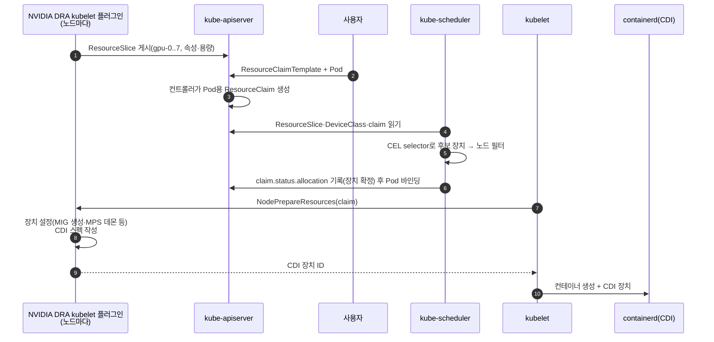
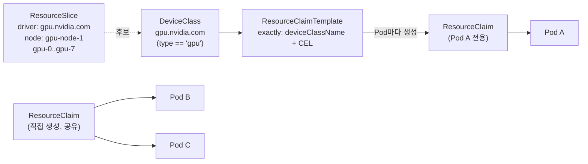

# 05. DRA(Dynamic Resource Allocation)

> [목차로](CURRICULUM.md) · 작성 2026-10-14 · 기준 버전: Kubernetes 1.37 문서(`resource.k8s.io/v1`), DRA Driver for NVIDIA GPUs v0.5.1(2026-10-12), GPU Operator v26.7.2 문서, dra-example-driver v0.5.0
> **[근거]** 출처에 그대로 있는 내용, **[추론]** 여러 출처를 엮어 내린 결론.
> 앞 절: [04. GPU 나눠 쓰기](04-gpu-sharing.md)

## 1. 개념

01~04절의 device plugin 모델에서 GPU는 **이름 붙은 정수**였다. 노드가 `nvidia.com/gpu: 8`을 광고하고, Pod는 `limits`에 개수를 적는다. 그래서 생긴 한계를 04절까지 여러 번 봤다.

- "80GB 이상, Hopper 이상인 GPU"처럼 **속성으로 고르려면** 노드 라벨(03절)을 거쳐야 하고, 라벨은 노드 단위라 GPU 한 장 한 장을 구분하지 못한다.
- 공유는 `replicas`로 숫자를 부풀리는 트릭이었다(04절). 스케줄러는 그게 같은 GPU라는 것을 모른다.
- 설정(MIG 구성, time-slicing)은 **노드 단위**다. 워크로드마다 다르게 줄 수 없다.

DRA는 장치를 **구조화된 객체**로 다룬다. 드라이버가 장치 목록과 속성을 API 객체로 올리고, 사용자는 PVC로 스토리지를 청구하듯 claim으로 장치를 청구하고, 스케줄러가 그 claim을 풀어 장치를 고른 뒤 Pod를 그 장치에 닿는 노드에 놓는다.

**[근거]** Kubernetes 문서는 DRA의 이점을 CEL로 속성 필터링, 여러 컨테이너·Pod가 claim 하나를 참조해 장치 공유, 노드 단위가 아닌 **워크로드 단위 장치 설정**, DeviceClass로 장치 분류, Pod에 개수를 적지 않아도 되는 단순한 요청으로 정리하고, device plugin은 컨테이너별 개수 요청만 되고 공유와 표현식 필터링을 지원하지 않는다고 대비한다. 출처: <https://kubernetes.io/docs/concepts/resource-management/dynamic-resource-allocation/> (2026-10-14 확인)

**[근거]** 기능 상태는 "Stable since Kubernetes v1.35"이고 기능 게이트 `DynamicResourceAllocation`은 잠겨서 꺼지지 않는다. 처음 나온 것은 v1.30이다. 같은 출처.

### 1.1 API 네 가지

모두 `resource.k8s.io/v1` 그룹이다.

| 종류 | 누가 만드나 | 하는 일 | 비유 |
|------|-------------|---------|------|
| `ResourceSlice` | 드라이버(kubelet 플러그인) | 노드(또는 노드 집합)에 붙은 장치 목록과 속성·용량을 올린다 | PV |
| `DeviceClass` | 드라이버 또는 클러스터 관리자 | "이런 장치들"이라는 분류. CEL selector와 설정을 담는다 | StorageClass |
| `ResourceClaim` | 사용자 | 장치 요청. 여러 Pod가 같은 claim을 참조하면 장치를 **공유**한다 | PVC |
| `ResourceClaimTemplate` | 사용자 | Pod마다 claim을 하나씩 찍어 내는 틀. Pod가 지워지면 claim도 지워진다 | StatefulSet의 volumeClaimTemplates |

- **[근거]** ResourceSlice는 드라이버가 관리하는 pool 하나의 장치 전부 또는 일부를 담고, 드라이버의 컨트롤러가 수동 변경을 덮어쓴다. 스케줄러는 pool 이름과 slice 이름의 사전순으로 장치를 평가하고 **first-fit**으로 처음 맞는 장치를 고른다. 출처: <https://kubernetes.io/docs/concepts/resource-management/dynamic-resource-allocation/dra-api/> "ResourceSlice", "Naming and prioritization" (2026-10-14 확인)
- **[근거]** 공유가 필요하거나 claim이 Pod보다 오래 살아야 하면 `ResourceClaim`을 직접 만들고, Pod마다 따로 비슷한 장치가 필요하면(예: 병렬 Job) `ResourceClaimTemplate`을 쓴다. Pod가 직접 참조하는 claim은 **같은 네임스페이스에 미리 있어야** 하고, 없으면 Pod는 스케줄되지 않는다. 같은 출처 "Use cases for ResourceClaims and ResourceClaimTemplates".

### 1.2 device plugin과 무엇이 다른가

| | device plugin(01~04절) | DRA |
|---|---|---|
| 노드가 광고하는 것 | 리소스 이름과 개수(`nvidia.com/gpu: 8`) | 장치 하나하나와 속성(`productName`, `architecture`, `memory`, PCIe root …) |
| 고르는 법 | 개수. 종류는 노드 라벨로 간접 | CEL 식으로 장치 속성을 직접 |
| 누가 장치를 정하나 | 노드에 간 뒤 kubelet이 `Allocate`에서 | **스케줄러가 배치할 때** 장치까지 정해 claim `status`에 적는다 |
| 공유 | `replicas` 숫자 부풀리기(스케줄러는 모름) | claim 하나를 여러 Pod가 참조(API에 드러남) |
| 설정 단위 | 노드(ConfigMap + 노드 라벨) | claim(`config`의 opaque 파라미터) |
| 여러 장치 묶기 | 없음 | `constraints`의 `matchAttribute`(같은 PCIe root 등) |
| 컨테이너에 넣는 방식 | 플러그인 응답(환경변수·장치·마운트, 또는 CDI) | **CDI 필수** |
| 선점(preemption) | 됨 | **안 됨**(아래 [근거]) |

- **[근거]** 스케줄러는 DRA 리소스에 대해 선점을 지원하지 않는다. DRA 장치를 쓰는 Pod는 우선순위가 더 높은 Pod가 와도 밀려나지 않고, 높은 Pod는 장치가 풀릴 때까지 `Pending`이다. 출처: DRA 개념 문서 "Limitations" (2026-10-14 확인)
- **[근거]** DRA 호환 드라이버는 ResourceSlice를 만들고 갱신하며, claim에 따라 장치를 설정해 **CDI로** 컨테이너에 붙인다. 같은 출처 "Types of DRA users".

**[추론]** 선점이 안 된다는 것은 운영에서 크다. 01~03절에서 PriorityClass로 "급한 추론이 실험 잡을 밀어낸다"를 설계했다면, DRA로 옮기는 순간 그 설계는 동작하지 않는다. 우선순위는 09절의 큐(Kueue)에서 잡 단위로 다시 풀어야 한다.

### 1.3 Kubernetes 쪽 DRA 기능 현황

핵심 API는 GA지만 주변 기능은 단계가 제각각이다. 1.34·1.35 클러스터에서는 기본값이 꺼진 것이 많다.

| 기능 게이트 | 무엇 | 단계(기본값) |
|-------------|------|--------------|
| `DRAPrioritizedList` | `firstAvailable`: 1순위 장치가 없으면 2순위로 | 1.34 beta(켜짐) → **1.36 GA** |
| `DRAAdminAccess` | `adminAccess: true`로 사용 중인 장치에 관리 접근(모니터링·점검) | 1.34 beta(켜짐) → **1.36 GA** |
| `DRAExtendedResource` | DeviceClass에 `extendedResourceName`을 달아 옛 `limits: nvidia.com/gpu` 요청을 DRA로 받음 | 1.34 alpha(꺼짐) → 1.36 beta(켜짐) → **1.37 GA** |
| `DRAResourceClaimDeviceStatus` | claim `status`에 드라이버가 장치 상태(네트워크 정보 등) 기록 | 1.33 beta(켜짐) → **1.37 GA** |
| `DRADeviceTaints` | 장치에 taint(고장 GPU 격리) | 1.33 alpha(꺼짐) → 1.36 beta(켜짐) → **1.37 GA** |
| `DRAPartitionableDevices` | 겹치는 파티션을 공유 카운터로 표현(동적 MIG의 바탕) | 1.33 alpha(꺼짐) → **1.36 beta(켜짐)** |
| `DRAConsumableCapacity` | 장치 하나를 용량 단위로 여러 claim에 나눠 줌 | 1.34 alpha(꺼짐) → **1.36 beta(켜짐)** |
| `DRADeviceBindingConditions` | 장치 준비(예: 원격 부착)가 끝날 때까지 바인딩 대기 | 1.34 alpha → **1.36 beta(켜짐)** |
| `DRAWorkloadResourceClaims` | PodGroup 단위 claim(256 Pod 한계 넘기) | 1.36 alpha → **1.37 beta(꺼짐)** |
| `DRAListTypeAttributes` | 리스트 값 속성, CEL `includes()` | 1.36 alpha(꺼짐) |
| `DRADerivedAttributes` | 드라이버마다 다른 속성 이름을 claim 안에서 맞춰 `matchAttribute` | 1.37 alpha(꺼짐) |

출처: kubernetes/website `content/en/docs/reference/command-line-tools-reference/feature-gates/<게이트>.md`의 `stages` (2026-10-14 확인), DRA API 문서 각 절 (2026-10-14 확인)

**[추론]** 목차의 "1.35+ 권장"은 이 표로 보면 더 좁혀진다. 기본 API만 쓰면 1.34.2로 되지만, GPU 나눠 쓰기(`DRAConsumableCapacity`)와 동적 MIG(`DRAPartitionableDevices`)가 기본으로 켜지는 것은 **1.36부터**, 옛 `nvidia.com/gpu` 요청을 그대로 받는 `DRAExtendedResource`가 GA인 것은 **1.37**이다. 1.34는 2026-10-27 EOL이다(목차 전제).

### 1.4 NVIDIA DRA 드라이버 현황

**[근거]** DRA Driver for NVIDIA GPUs는 NVIDIA 조직에서 CNCF로 기증되어 `kubernetes-sigs/dra-driver-nvidia-gpu`로 옮겨졌다. v0.4.0(2026-05-15)부터 SemVer를 쓰고, 이미지는 `registry.k8s.io/dra-driver-nvidia/dra-driver-nvidia-gpu`, Helm 차트는 `oci://registry.k8s.io/dra-driver-nvidia/charts/dra-driver-nvidia-gpu`다(NGC 차트도 계속 나온다). 최신은 v0.5.1(2026-10-12)이다. 출처: <https://github.com/kubernetes-sigs/dra-driver-nvidia-gpu/releases> v0.4.0·v0.5.1 (2026-10-14 확인)

드라이버는 kubelet 플러그인 둘이다.

| 플러그인 | 다루는 것 | DeviceClass |
|----------|-----------|-------------|
| gpu-kubelet-plugin | 전체 GPU / MIG 슬라이스 / VFIO 패스스루 | `gpu.nvidia.com` / `mig.nvidia.com` / `vfio.gpu.nvidia.com` |
| compute-domain-kubelet-plugin | Multi-Node NVLink(GB200·GB300 NVL72)의 IMEX 도메인 | `compute-domain-daemon`, `compute-domain-default-channel` 계열 |

**지원 수준은 출처마다 다르게 적혀 있다.** 이 절에서 가장 조심할 부분이다.

- **[근거]** 드라이버 리포 v0.5.1 README: ComputeDomain은 "공식 지원", GPU 할당 쪽은 "일부 기능을 시험해 볼 수 있지만 **아직 공식 지원이 아니다**. 그래서 Helm 차트에서 GPU kubelet 플러그인은 기본으로 꺼져 있다." 실제로 설치할 때 `--set gpuResourcesEnabledOverride=true`를 줘야 GPU 할당이 켜진다(기본값 `false`). 출처: <https://github.com/kubernetes-sigs/dra-driver-nvidia-gpu/blob/v0.5.1/README.md>, `site/content/docs/install.md` (2026-10-14 확인)
- **[근거]** GPU Operator 문서(DRA Driver v0.5.1 관리 페이지)의 성숙도 표: ComputeDomains, **전체 GPU와 기존(정적) MIG 할당**은 "Generally Available", `ConsumableShares`·`DynamicMIG`·`MPSSupport`·`TimeSlicingSettings`·`NVMLDeviceHealthCheck`·`PassthroughSupport`·`DeviceMetadata`는 Alpha(꺼짐). 출처: <https://docs.nvidia.com/datacenter/cloud-native/gpu-operator/latest/dra-intro-install.html> (2026-10-14 확인)
- **[추론]** 두 문서는 같은 v0.5.1을 두고 GPU 할당의 지위를 다르게 쓴다. README가 GA 표기를 아직 따라잡지 못했을 수도 있고, "GPU Operator가 관리할 때만 GA"라는 뜻일 수도 있다. 운영 판단은 **GPU Operator 경유 + 전체 GPU·정적 MIG만**을 안전선으로 두고, 나머지(공유·동적 MIG)는 alpha로 본다. 04절의 교훈(한 문서만 보고 결론 내지 않기)이 여기서도 그대로다.

드라이버 쪽 기능 게이트(v0.5.1):

| 게이트 | 단계(기본) | 메모 |
|--------|-----------|------|
| `TimeSlicingSettings` | alpha(꺼짐) | time-slice 간격 설정. 공유 claim 자체는 게이트 없이 된다 |
| `MPSSupport` | alpha(꺼짐) | `GpuConfig`·`MigDeviceConfig`에 MPS. **MIG 슬라이스 위 MPS도 된다**(device plugin은 안 됐다, 04절) |
| `DynamicMIG` | alpha(꺼짐) | 요청이 오면 MIG 파티션을 만들고 claim이 풀리면 지운다. K8s 1.34~1.35에선 `DRAPartitionableDevices`를 켜야 함 |
| `ConsumableShares` | alpha(꺼짐) | K8s consumable capacity로 독립 claim끼리 GPU·MIG를 나눔 |
| `NVMLDeviceHealthCheck` | alpha(꺼짐) | 고장 GPU를 slice에 남기고 DeviceTaint를 붙임 |

배타 조합: `DynamicMIG`는 `MPSSupport`·`PassthroughSupport`·`NVMLDeviceHealthCheck`와 같이 못 켠다. `MPSSupport`와 `NVMLDeviceHealthCheck`도 배타다. GPU Operator 문서는 `ConsumableShares`로 용량 공유를 쓰면 MPS를 못 쓴다고 덧붙인다. 출처: 드라이버 `site/content/docs/reference/feature-gates.md`(v0.5.1), GPU Operator DRA 페이지 "DRA Driver Limitations" (2026-10-14 확인)

**[근거]** 요구 조건(GPU 할당): Kubernetes v1.34.2 이상, 드라이버 565 이상(GPU Operator 25.10+는 580 이상), Container Toolkit 1.18.0 이상, CDI가 켜진 런타임(containerd 2.0+·CRI-O 1.27+는 기본), NFD 0.18.2 이상. 출처: 드라이버 `site/content/docs/prerequisites.md`(v0.5.1) (2026-10-14 확인)

**[근거]** GPU Operator로 설치할 때는 `ClusterPolicy`가 아니라 `GPUCluster`(이름은 `gpu-cluster`로 고정된 싱글턴)를 쓰고, 둘은 한 클러스터에 같이 못 있다(02절 1.9). ClusterPolicy에서 GPUCluster로 **제자리 이전은 지원하지 않아** 새 클러스터에서 시작하라고 한다. GPUCluster는 GFD·MIG Manager를 관리하지 않는다. 출처: GPU Operator DRA 페이지 "Overview", "GPUCluster Limitations", "Capability Comparison" (2026-10-14 확인)

**04절에서 남긴 질문의 답.** 04절 3.3에서 "MPS v3의 cgroup 메모리 분할은 DRA 쪽으로 들어올 것"이라고 추론했다. **[근거]** v0.5.1의 MPS 가이드는 `defaultActiveThreadPercentage`·`defaultPinnedDeviceMemoryLimit`·`multiUser`만 설명하고 MPS v3나 cgroup은 언급하지 않는다. 출처: 드라이버 `site/content/docs/guides/mps.md`(v0.5.1) (2026-10-14 확인) **[추론]** 그러니 2026-10-14 기준 그 추론은 확인되지 않았다. 12절이나 최신화 점검 때 다시 본다.

## 2. 그림

할당 흐름. device plugin과 달리 **장치를 고르는 곳이 스케줄러**다.



객체 관계:



## 3. 실습

### 3.1 설치(GPU 있는 클러스터)

두 길이 있다. 섞지 않는다.

```bash
# (가) 새 클러스터 + GPU Operator가 관리 (GPU Operator v26.7.2 문서)
helm upgrade --install gpu-operator nvidia/gpu-operator \
  --version=v26.7.2 -n gpu-operator --create-namespace \
  --set clusterPolicy.deployCR=false \
  --set gpuCluster.deployCR=true \
  --set driver.nvidiaDriverCRD.enabled=true      # 드라이버 사전 설치면 --set driver.enabled=false
# MNNVL 장비가 아니면 ComputeDomain은 끈다
#   --set draDriver.computeDomains.enabled=false

# (나) 드라이버·Toolkit·NFD를 따로 갖춘 클러스터에 단독 설치 (드라이버 v0.5.1)
helm install dra-driver-nvidia-gpu oci://registry.k8s.io/dra-driver-nvidia/charts/dra-driver-nvidia-gpu \
  --version 0.5.1 -n dra-driver-nvidia-gpu --create-namespace \
  --set gpuResourcesEnabledOverride=true \
  --set nvidiaDriverRoot=/run/nvidia/driver       # Operator가 드라이버를 깐 노드면. 호스트 설치면 기본값 /
```

- **[근거]** GPU Operator 문서는 관리형 설치에서 별도의 `dra-driver-nvidia-gpu` Helm 릴리스를 **함께 깔지 말라**고 한다. 출처: GPU Operator DRA 페이지 "Install" (2026-10-14 확인)
- **[근거]** 단독 설치의 `nvidiaDriverRoot` 기본값은 `/`이고, GPU Operator가 드라이버를 관리하면 `/run/nvidia/driver`로 바꿔야 한다. 문서는 "설치 때 가장 흔한 오류"라고 적는다. 출처: 드라이버 `install.md`(v0.5.1) (2026-10-14 확인)

확인:

```bash
kubectl get deviceclasses
# gpu.nvidia.com  mig.nvidia.com  vfio.gpu.nvidia.com  (ComputeDomain 켰으면 compute-domain-* 도)
kubectl get resourceslices -o wide
kubectl get resourceslices -o yaml | yq '.items[].spec.devices[] | [.name, .attributes.productName.string, .capacity.memory.value]'
```

**[근거]** GPU 장치 하나의 속성은 `productName`, `architecture`, `brand`, `cudaComputeCapability`, `cudaDriverVersion`, `driverVersion`, `uuid`, `type`(`gpu`/`mig`/`vfio`), 표준 속성 `resource.kubernetes.io/pciBusID`·`resource.kubernetes.io/pcieRoot`이고, 용량은 `memory`다. 드라이버 이름은 하나(`gpu.nvidia.com`), pool은 노드마다 하나다. 출처: 드라이버 `site/content/docs/reference/resourceslice-attributes.md`(v0.5.1) (2026-10-14 확인)

### 3.2 GPU 한 장씩 따로(Template)

```yaml
apiVersion: resource.k8s.io/v1
kind: ResourceClaimTemplate
metadata:
  name: one-big-gpu
  namespace: ml
spec:
  spec:
    devices:
      requests:
      - name: gpu
        exactly:
          deviceClassName: gpu.nvidia.com
          selectors:
          - cel:
              expression: |-
                device.capacity["gpu.nvidia.com"].memory.compareTo(quantity("80Gi")) >= 0 &&
                device.attributes["gpu.nvidia.com"].cudaComputeCapability.compareTo(semver("9.0.0")) == 0
---
apiVersion: v1
kind: Pod
metadata:
  name: train-0
  namespace: ml
spec:
  restartPolicy: Never
  resourceClaims:
  - name: gpu                       # Pod 안에서 쓰는 이름
    resourceClaimTemplateName: one-big-gpu
  containers:
  - name: cuda
    image: nvcr.io/nvidia/cuda:12.5.0-base-ubuntu22.04
    command: ["nvidia-smi", "-L"]
    resources:
      claims:
      - name: gpu                   # 위 이름을 가리킨다. limits에 nvidia.com/gpu를 쓰지 않는다
```

위 CEL은 "메모리 80Gi 이상이고 compute capability가 정확히 9.0(Hopper)"이다. 식을 짧게 하려면 `productName`이나 `architecture == "Hopper"`로 거르면 된다. **[추론]** 문자열 `productName` 비교는 제품명 표기(예: `NVIDIA H100 80GB HBM3`)가 바뀌면 조용히 0건이 되므로, 세대를 고를 땐 `cudaComputeCapability`나 `architecture`가 덜 깨진다(03절의 `gpu.product` 정확 일치 함정과 같은 이야기).

```bash
kubectl apply -f one-big-gpu.yaml
kubectl get resourceclaims -n ml                  # train-0-gpu-xxxxx  allocated,reserved
kubectl get resourceclaim -n ml <이름> -o jsonpath='{.status.allocation.devices.results}{"\n"}'
# [{"device":"gpu-3","driver":"gpu.nvidia.com","pool":"gpu-node-1","request":"gpu"}]
```

### 3.3 여러 Pod가 GPU 한 장 공유(ResourceClaim)

```yaml
apiVersion: resource.k8s.io/v1
kind: ResourceClaim
metadata:
  name: shared-gpu
  namespace: ml
spec:
  devices:
    requests:
    - name: gpu
      exactly:
        deviceClassName: gpu.nvidia.com
```

Pod 둘이 `resourceClaims: [{name: gpu, resourceClaimName: shared-gpu}]`를 똑같이 적으면 **같은 GPU**를 받고, 둘은 같은 노드로 간다.

- **[근거]** 공유 claim을 쓰면 드라이버는 기본으로 time-slicing으로 나눈다. 간격 조정(`interval: Short/Long` 등)은 `TimeSlicingSettings` alpha 게이트가 필요하다. MPS는 claim의 `config`에 `GpuConfig`(`sharing.strategy: MPS`, `mpsConfig.defaultActiveThreadPercentage`, `defaultPinnedDeviceMemoryLimit`)를 넣고 `MPSSupport` 게이트를 켠다. 출처: 드라이버 `concepts/gpu-allocation.md`, `guides/gpu-allocation/time-slicing.md`, `guides/mps.md`, `demo/specs/quickstart/v1/gpu-test-mps.yaml`(v0.5.1); GPU Operator DRA 페이지 "Capability Comparison" (2026-10-14 확인)
- **[근거]** claim `status.reservedFor`에는 최대 256개만 들어가므로 Pod 단위로는 claim 하나를 256 Pod까지만 공유한다. PodGroup 단위 예약(`DRAWorkloadResourceClaims`, 1.37 beta·기본 꺼짐)이 이 한계를 풀려는 것이다. 출처: DRA API 문서 "Workload ResourceClaims" (2026-10-14 확인)

**[추론]** 04절과 비교하면 공유가 **노드 설정에서 claim으로** 옮겨 왔다. 같은 노드에서 한 팀은 전용 GPU, 다른 팀은 MPS 50%를 받을 수 있다. device plugin에서는 노드 하나가 한 방식으로만 나눴다(04절 흔한 실수 4).

### 3.4 1순위가 없으면 2순위(prioritized list, 1.36 GA)

```yaml
spec:
  spec:
    devices:
      requests:
      - name: gpu
        firstAvailable:
        - name: whole-h100
          deviceClassName: gpu.nvidia.com
          selectors:
          - cel: {expression: 'device.attributes["gpu.nvidia.com"].architecture == "Hopper"'}
        - name: mig-half
          deviceClassName: mig.nvidia.com
          count: 1
```

**[근거]** 스케줄러는 할당 가능한 첫 subrequest를 고르고, 노드 점수에도 고른 순위를 반영한다. 판단은 Pod마다라서 ReplicaSet의 Pod들이 같은 순위를 받는다는 보장이 없다. 출처: DRA API 문서 "Prioritized list" (2026-10-14 확인)

**[추론]** 그래서 분산 학습(06절)처럼 모든 rank가 같은 GPU여야 하는 잡에는 `firstAvailable`을 쓰면 안 된다. 일부 rank만 MIG 반쪽을 받으면 가장 느린 rank에 전체가 묶인다.

### 3.5 GPU와 NIC를 같은 PCIe root로 묶기

```yaml
spec:
  devices:
    requests:
    - name: gpu
      exactly: {deviceClassName: gpu.nvidia.com}
    - name: nic
      exactly: {deviceClassName: <NIC 드라이버의 DeviceClass>}
    constraints:
    - requests: ["gpu", "nic"]
      matchAttribute: resource.kubernetes.io/pcieRoot
```

**[근거]** `resource.kubernetes.io/pcieRoot`는 Kubernetes 표준 장치 속성이고 NVIDIA 드라이버도 이것을 올린다. 드라이버마다 이름이 다르면 1.37 alpha `derivedAttributes`로 claim 안에서 가상 속성을 만들어 맞출 수 있다. 출처: DRA API 문서 "Derived attributes", <https://kubernetes.io/docs/reference/node/dra-standard-device-attributes/>, 드라이버 `resourceslice-attributes.md` (2026-10-14 확인)

**[추론]** 이게 device plugin 모델로는 Topology Manager 힌트에 맡기던 "GPU와 RDMA NIC 짝짓기"를 스케줄러가 직접 하는 길이다. 10·11절에서 Network Operator의 DRA 지원과 함께 다시 본다.

### 3.6 옛 요청(`limits: nvidia.com/gpu`)은 어떻게 되나

**[근거]** DeviceClass에 `extendedResourceName`을 달면 스케줄러는 그 이름의 확장 리소스 요청을 DRA 장치로 채운다. 한 클러스터에서 어떤 노드는 device plugin, 어떤 노드는 DRA로 같은 이름을 제공해도 된다. DeviceClass 이름 앞에 `deviceclass.resource.kubernetes.io/`를 붙인 이름으로는 `extendedResourceName`이 없어도 요청할 수 있다. 이 기능(`DRAExtendedResource`)은 1.37 GA다. 출처: DRA API 문서 "Extended resource allocation by DRA" (2026-10-14 확인)

**[근거]** 여기서 두 설치 방식이 갈린다. 단독 Helm 차트 v0.5.1의 `gpu.nvidia.com` DeviceClass 템플릿은 API가 `resource.k8s.io/v1`이면 `extendedResourceName: nvidia.com/gpu`를 넣는다. 반면 GPU Operator가 관리하는 `gpu.nvidia.com` DeviceClass는 이것을 **넣지 않는다**고 GPU Operator 문서가 명시하고, `deviceclass.resource.kubernetes.io/gpu.nvidia.com`으로 요청하거나 `nvidia.com/gpu`를 단 DeviceClass를 따로 만들라고 한다. 출처: `deployments/helm/dra-driver-nvidia-gpu/templates/deviceclass-gpu.yaml`(v0.5.1), GPU Operator DRA 페이지 "Prerequisites" Note (2026-10-14 확인)

**[추론]** 같은 DRA 드라이버인데 설치 경로에 따라 기존 `nvidia.com/gpu` 매니페스트가 "그냥 돈다"와 "Pending"으로 갈린다. 이전 계획에서 꼭 확인할 점이다.

### 3.7 GPU 없이 확인하는 법

DRA는 device plugin보다 GPU 없이 연습하기가 **쉽다**. 공식 예제 드라이버가 가짜 GPU를 ResourceSlice로 올려 주기 때문이다. 01~04절처럼 노드 status를 패치할 필요가 없다.

**[근거]** `kubernetes-sigs/dra-example-driver`는 모의 GPU를 제공하는 예제 DRA 드라이버이고, kind 위에서 Linux와 Mac 모두 검증된 데모 절차가 있다. 최신 릴리스는 v0.5.0(2026-09-16)이다. 출처: <https://github.com/kubernetes-sigs/dra-example-driver> README, releases (2026-10-14 확인)

```bash
git clone https://github.com/kubernetes-sigs/dra-example-driver.git && cd dra-example-driver
./demo/build-driver.sh                      # Go 1.26+, docker 필요
./demo/clusters/kind/create-cluster.sh
go tool -modfile hack/tools/go.mod helm upgrade -i --create-namespace \
  -n dra-example-driver dra-example-driver deployments/helm/dra-example-driver
kubectl get resourceslice -o yaml           # driver: gpu.example.com, gpu-0.., memory: 80Gi
```

확인할 것:

1. `kubectl get deviceclass`로 예제 클래스 이름을 보고, 3.2의 `deviceClassName`과 CEL의 드라이버 이름을 `gpu.example.com`으로 바꿔 Template + Pod를 만든다. `kubectl get resourceclaim`에서 `allocated,reserved`, `status.allocation`의 장치 이름을 본다.
2. CEL을 `device.capacity["gpu.example.com"].memory.compareTo(quantity("100Gi")) >= 0`로 바꾸면 Pod가 `Pending`이 되고 이벤트에 claim을 만족하는 장치가 없다는 메시지가 나온다. **노드가 아니라 장치에서 걸렸다**는 것을 확인한다.
3. 3.3처럼 ResourceClaim 하나를 Pod 둘이 참조하게 하고, 두 Pod가 같은 노드·같은 장치를 받는지 본다.
4. 클러스터 없이 문법만 볼 때: `kubectl apply --dry-run=server -f claim.yaml`은 API 서버 검증(CEL 컴파일 포함)까지 돈다. 1.34 이상 아무 클러스터에서 된다. CEL 오타는 여기서 바로 잡힌다.
5. 선점이 안 된다는 것도 재현된다. 장치를 다 쓴 상태에서 높은 PriorityClass Pod를 넣으면 기존 Pod를 밀어내지 않고 `Pending`으로 남는다.

## 4. 언제 DRA로 가나

| 상황 | 권장 | 이유 |
|------|------|------|
| 기존 클러스터, device plugin으로 잘 돌고 있다 | 당장 옮기지 않는다 | GPUCluster로 제자리 이전 미지원. 선점 미지원 |
| 새 클러스터, K8s 1.36 이상, 전체 GPU·정적 MIG만 쓴다 | DRA 검토 | GPU Operator 문서 기준 GA 범위 |
| GB200/GB300 NVL72(Multi-Node NVLink) | DRA 필수 | ComputeDomain은 DRA 드라이버에만 있다 |
| 같은 노드에서 워크로드마다 다른 공유 방식 | DRA(단 alpha) | device plugin은 노드 단위 설정뿐 |
| 우선순위 선점에 기대는 운영 | device plugin 유지 또는 큐로 재설계 | DRA는 선점 없음 |

## 5. 흔한 실수

1. **`limits: nvidia.com/gpu`와 claim을 같은 컨테이너에 같이 쓴다.** 한 노드에서 같은 GPU를 device plugin과 DRA가 동시에 나눠 주면 안 된다. GPUCluster와 ClusterPolicy를 같이 못 두는 이유다.
2. **GPU Operator로 깔고 옛 매니페스트가 그대로 돌 거라 본다.** 관리형 `gpu.nvidia.com` DeviceClass엔 `extendedResourceName`이 없다(3.6).
3. **단독 설치에서 `gpuResourcesEnabledOverride=true`를 빠뜨린다.** ComputeDomain만 뜨고 `gpu.nvidia.com` 장치가 ResourceSlice에 안 나온다.
4. **`nvidiaDriverRoot`를 기본값 `/`로 둔다.** Operator가 드라이버를 깐 노드에서는 `/run/nvidia/driver`다.
5. **MIG 모드만 켜고 파티션을 안 만든다.** 정적 MIG에서 그 GPU는 전체 GPU로도, 슬라이스로도 광고되지 않는다(경고 로그만). 파티션을 바꾸면 GPU kubelet 플러그인을 재시작해야 반영된다. 출처: 드라이버 `concepts/gpu-allocation.md` "How static MIG discovery works" (2026-10-14 확인)
6. **직접 만든 ResourceClaim을 다른 네임스페이스에서 참조한다.** PVC처럼 같은 네임스페이스여야 한다.
7. **Template로 만든 claim 이름을 다른 Pod가 참조한다.** 원래 Pod가 지워지면 claim도 사라진다. 공유는 직접 만든 ResourceClaim으로.
8. **PriorityClass 선점 설계를 그대로 가져온다.** DRA 장치에는 선점이 없다.
9. **alpha 게이트를 섞어 켠다.** `DynamicMIG`+`MPSSupport`, `ConsumableShares`+MPS 등은 같이 못 쓴다.
10. **한 문서의 지원 표기만 본다.** 같은 v0.5.1을 README는 "GPU 할당 미공식", GPU Operator 문서는 "GA"로 쓴다(1.4).

## 6. 확인 문제

1. 노드 A·B에 H100이 4장씩 있고 DRA로 운영한다. 낮은 우선순위 학습 Pod가 GPU 8장을 다 쓰는 중에 높은 우선순위 추론 Pod(GPU 1장 claim)가 들어왔다. 무슨 일이 생기나? device plugin 시절과 무엇이 다른가?
2. GPU Operator `GPUCluster`로 새로 구축한 클러스터(K8s 1.37)에 예전 매니페스트(`limits: {nvidia.com/gpu: 1}`)를 올렸더니 `Pending`이다. 왜 그런가, 매니페스트를 안 고치고 해결하려면 무엇을 하나?
3. 한 노드에서 팀 X는 GPU를 통째로, 팀 Y는 GPU 한 장을 MPS로 반씩 나눠 쓰고 싶다. device plugin(04절)으로 왜 어려웠고, DRA로는 어떻게 하나? 2026-10-14 기준 성숙도의 함정은?

<details>
<summary>답</summary>

1. 추론 Pod는 `Pending`으로 남는다. 스케줄러는 DRA 리소스에 대해 선점을 하지 않으므로 학습 Pod를 내보내지 않고, 장치가 풀리거나 누군가 학습 Pod를 지워야 배치된다. device plugin(`nvidia.com/gpu`)에서는 PriorityClass 선점으로 낮은 Pod가 밀려났다. DRA로 옮기면 우선순위는 큐(09절, Kueue)나 운영 절차로 다시 설계해야 한다(추론).
2. 확장 리소스 요청을 DRA로 받으려면 그 이름을 `extendedResourceName`으로 가진 DeviceClass가 있어야 한다. GPU Operator가 관리하는 `gpu.nvidia.com` DeviceClass는 그것을 넣지 않으므로 `nvidia.com/gpu`를 채울 장치가 없다. 매니페스트를 안 고치려면 같은 CEL selector(`device.driver == 'gpu.nvidia.com' && type == 'gpu'`)에 `extendedResourceName: nvidia.com/gpu`를 단 DeviceClass를 따로 만든다(GPU Operator 문서가 안내하는 방법). 매니페스트를 고칠 수 있으면 `deviceclass.resource.kubernetes.io/gpu.nvidia.com: 1`로 요청한다. 1.37에서는 `DRAExtendedResource`가 GA라 게이트는 따로 켤 필요 없다.
3. device plugin의 time-slicing·MPS는 노드의 모든 GPU에 같은 방식이 적용되는 노드 단위 설정이라, 한 노드에서 "전용"과 "MPS 반쪽"을 섞을 수 없었다. DRA에서는 팀 X가 `gpu.nvidia.com` Template(전용), 팀 Y가 `GpuConfig`에 `sharing.strategy: MPS`, `defaultActiveThreadPercentage: 50`을 넣은 공유 ResourceClaim을 쓴다. 함정은 `MPSSupport`가 드라이버 v0.5.1에서 **alpha·기본 꺼짐**이고 `DynamicMIG`·`NVMLDeviceHealthCheck`·`ConsumableShares` 용량 공유와 같이 못 켠다는 점이다. 운영 투입 전에는 GA 범위(전체 GPU·정적 MIG)로 해결할 수 있는지(예: MIG `3g` 둘) 먼저 본다(추론).

</details>

## 7. 이어 볼 것

- 06절: 멀티노드 DDP에서 rank마다 같은 GPU를 받게 하는 법(이 절 3.4의 `firstAvailable`을 쓰면 안 되는 이유)
- 09절: DRA는 선점이 없다. Kueue가 DRA claim을 어떻게 세는지, PodGroup 단위 claim(`DRAWorkloadResourceClaims`)
- 10·11절: GPU와 RDMA NIC를 `pcieRoot`로 묶기, ComputeDomain(Multi-Node NVLink)
- 12절: `NVMLDeviceHealthCheck`와 DeviceTaint로 고장 GPU 격리, DRA 경로의 dcgm-exporter
- 별도 스터디 노트(비공개): GPU·AI·LLM 인프라 커리큘럼의 E1(Device Plugin에서 DRA로)이 같은 주제다. 2026-10-14 현재 미작성이라 이 절이 먼저 나왔다.

## 8. 출처 (모두 2026-10-14 확인)

- Kubernetes, Dynamic Resource Allocation(개념·한계): <https://kubernetes.io/docs/concepts/resource-management/dynamic-resource-allocation/>
- Kubernetes, DRA API Objects(ResourceSlice·Prioritized list·Admin access·Extended resource·Derived attributes·Workload ResourceClaims): <https://kubernetes.io/docs/concepts/resource-management/dynamic-resource-allocation/dra-api/>
- Kubernetes, Allocate Devices to Workloads with DRA: <https://kubernetes.io/docs/tasks/configure-pod-container/assign-resources/allocate-devices-dra/>
- Kubernetes, DRA 표준 장치 속성: <https://kubernetes.io/docs/reference/node/dra-standard-device-attributes/>
- Kubernetes 기능 게이트 단계(소스): <https://github.com/kubernetes/website/tree/main/content/en/docs/reference/command-line-tools-reference/feature-gates>
- Kubernetes v1.34 DRA GA 블로그: <https://kubernetes.io/blog/2025/09/01/kubernetes-v1-34-dra-updates/>
- DRA Driver for NVIDIA GPUs 릴리스(v0.4.0 이전 공지, v0.5.0, v0.5.1): <https://github.com/kubernetes-sigs/dra-driver-nvidia-gpu/releases>
- 같은 드라이버 v0.5.1 문서 소스: README, `site/content/docs/{prerequisites,install}.md`, `concepts/gpu-allocation.md`, `guides/gpu-allocation/time-slicing.md`, `guides/mps.md`, `reference/{feature-gates,resourceslice-attributes}.md`, `deployments/helm/dra-driver-nvidia-gpu/templates/deviceclass-gpu.yaml`, `demo/specs/quickstart/v1/` — <https://github.com/kubernetes-sigs/dra-driver-nvidia-gpu/tree/v0.5.1>
- 드라이버 문서 사이트: <https://dra-driver-nvidia-gpu.sigs.k8s.io/docs/>
- GPU Operator, DRA Driver for NVIDIA GPUs(GPUCluster, 비교표, 성숙도, 한계): <https://docs.nvidia.com/datacenter/cloud-native/gpu-operator/latest/dra-intro-install.html>
- 예제 DRA 드라이버(GPU 없는 실습): <https://github.com/kubernetes-sigs/dra-example-driver>
