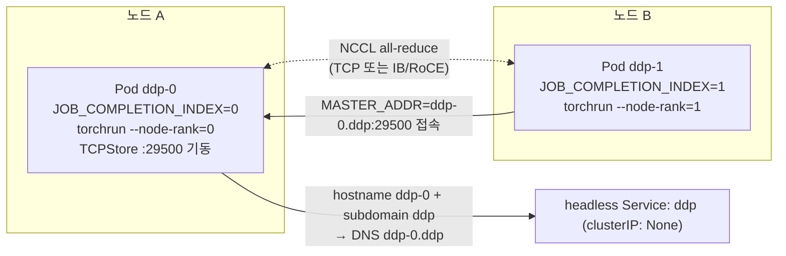
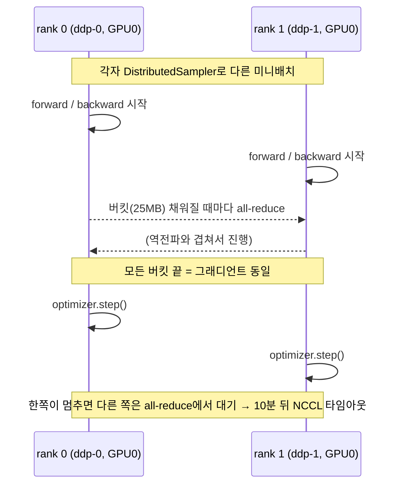

# 06. 멀티노드 분산 학습 기초: DDP·torchrun·rendezvous·NCCL

> [목차로](CURRICULUM.md) · 작성 2026-10-15 · 기준 버전: PyTorch 2.14(문서·`v2.14.0` 소스), NCCL 2.32.3 문서, Kubernetes 1.37 문서, 이미지 `pytorch/pytorch:2.14.1-cuda13.0-cudnn9-runtime`
> **[근거]** 출처에 그대로 있는 내용, **[추론]** 여러 출처를 엮어 내린 결론.
> 앞 절: [05. DRA](05-dra.md)

## 1. 개념

01~05절은 **Pod 하나가 GPU를 받는 법**이었다. 이 절부터는 **여러 Pod(여러 노드)가 GPU를 나눠 들고 한 모델을 같이 학습하는 법**이다. 07(Kubeflow Trainer)·08(KubeRay)·09(Volcano·Kueue)절의 도구는 모두 이 절의 맨손 구성을 자동화한 것이라, 여기서 손으로 한 번 띄워 보면 그 도구들이 무엇을 대신해 주는지 보인다.

### 1.1 병렬화의 종류

| 방식 | 나누는 것 | 각 GPU가 가진 것 | 통신 | 대표 구현 |
|------|-----------|------------------|------|-----------|
| 데이터 병렬(DDP) | 데이터(미니배치) | 모델 전체 사본 | 역전파마다 그래디언트 all-reduce | `DistributedDataParallel` |
| 샤딩 데이터 병렬(FSDP) | 데이터 + 파라미터·그래디언트·옵티마이저 상태 | 모델의 조각 | all-gather·reduce-scatter | FSDP2(`fully_shard`) |
| 텐서 병렬(TP) | 한 층의 행렬 | 층의 일부 | 층마다 all-reduce(빈번) | DTensor TP, Megatron |
| 파이프라인 병렬(PP) | 층 묶음 | 연속된 몇 층 | 단계 사이 점대점 | `torch.distributed.pipelining` |

- **[근거]** PyTorch 분산 개관은 DDP를 모델이 GPU 한 장에 들어갈 때의 기본 선택으로, FSDP2를 모델이 한 장에 안 들어갈 때의 선택으로, TP·PP를 그보다 큰 규모의 선택으로 안내한다. 출처: <https://docs.pytorch.org/tutorials/beginner/dist_overview.html> (2026-10-15 확인)
- **[추론]** 쿠버네티스 쪽에서 보면 네 방식의 차이는 **통신량과 통신 상대**다. DDP는 스텝마다 모델 크기만큼 all-reduce, TP는 층마다 all-reduce라 노드 안(NVLink)에 묶어야 하고, 노드를 넘는 것은 보통 DDP/FSDP 차원이다. 그래서 10절(RDMA)·11절(토폴로지)이 이 절 뒤에 온다.

이 절은 **DDP**만 손으로 띄운다. 나머지는 같은 실행 틀(torchrun + 프로세스 그룹) 위에서 코드만 바뀐다.

### 1.2 DDP가 하는 일

- **[근거]** DDP는 프로세스마다 모델 사본을 두고, 역전파 중 그래디언트를 **버킷 단위로 묶어** all-reduce 해 모든 사본을 같은 값으로 맞춘다. 버킷 기본 크기는 25MB(`_DEFAULT_BUCKET_CAP_MB = 25`)다. 각 프로세스가 다른 데이터를 보게 하려면 `DistributedSampler`를 쓴다. 출처: `torch/nn/parallel/distributed.py` v2.14.0 <https://github.com/pytorch/pytorch/blob/v2.14.0/torch/nn/parallel/distributed.py> (2026-10-15 확인)
- **[근거]** GPU 학습은 프로세스 하나가 GPU 하나를 맡는 구성이 기본이고, 이때 `device_ids=[LOCAL_RANK]`, `output_device=LOCAL_RANK`로 그 프로세스가 쓰는 GPU 하나만 지정해야 한다. 출처: torchrun 문서 "Important Notices" 3번 <https://docs.pytorch.org/docs/2.14/elastic/run.html> (2026-10-15 확인)

### 1.3 rank와 world size

| 변수 | 뜻 | 누가 채우나 |
|------|----|-------------|
| `WORLD_SIZE` | 잡 전체 워커(프로세스) 수 | torchrun |
| `RANK` | 전체 중 내 번호(0..WORLD_SIZE-1) | torchrun |
| `LOCAL_RANK` | 이 노드 안에서 내 번호 → 쓸 GPU 번호 | torchrun |
| `LOCAL_WORLD_SIZE` | 이 노드의 워커 수(`--nproc-per-node`) | torchrun |
| `GROUP_RANK` | 노드(워커 그룹) 번호 | torchrun |
| `MASTER_ADDR`·`MASTER_PORT` | rank 0이 띄운 TCPStore 주소 | torchrun |

- **[근거]** 위 변수는 torchrun이 학습 스크립트에 넣어 주며, 스크립트는 `RANK`를 직접 넘길 필요 없이 `dist.init_process_group(backend="nccl")`만 부르면 된다. 같은 출처 "Environment Variables", "Important Notices" 2번.
- **[근거]** `RANK`는 **안정적이지 않다**. 재시작 사이에 한 노드의 워커가 다른 rank 범위를 받을 수 있으니 `RANK`와 `LOCAL_RANK`의 관계를 하드코딩하지 말라고 문서가 경고한다. 같은 출처 6번.
- **[근거]** torchrun은 모든 노드의 `LOCAL_WORLD_SIZE`가 같다고 가정한다. 같은 출처 5번.

**[추론]** 마지막 줄은 쿠버네티스에서 바로 제약이 된다. 워커 Pod마다 GPU 수를 다르게(예: 8장 노드와 4장 노드 섞기) 주면 torchrun으로는 묶을 수 없다. Pod마다 `nvidia.com/gpu`를 같은 값으로 요청하고 `--nproc-per-node`를 그 값에 맞춘다.

### 1.4 rendezvous: 서로를 어떻게 찾나

여러 노드의 torchrun이 "우리가 한 잡이고, 몇 명이고, 누가 몇 번이다"를 합의하는 단계다.

- **[근거]** torchrun의 `--rdzv-backend` 기본값은 `static`이다(`run.py` v2.14.0의 `default="static"`). 이때는 `--node-rank`·`--master-addr`·`--master-port`로 노드 번호와 rank 0 주소를 사람이 정해 준다. 출처: <https://github.com/pytorch/pytorch/blob/v2.14.0/torch/distributed/run.py> (2026-10-15 확인)
- **[근거]** 멀티노드에서 탄력성·장애 내성을 쓰려면 `--rdzv-id`(잡 고유 id), `--rdzv-backend`(`c10d` 권장, `etcd-v2`, `etcd`는 유지보수 모드), `--rdzv-endpoint`(`host:port`, 포트 생략 시 29400)를 준다. c10d는 별도 서버가 필요 없다. 출처: torchrun 문서 "Note on rendezvous backend", "Deployment" (2026-10-15 확인)
- **[근거]** 워커 `k`명이 실패하면 **전원**을 멈추고 `--max-restarts`까지 다시 띄운다. 노드가 빠지거나 들어오면 기존 워커를 모두 멈추고 새 `RANK`·`WORLD_SIZE`로 다시 시작한다. 에이전트(노드) 실패 시 잡 전체를 실패시킬지(갱 의미론) 노드를 바꿀지는 **잡 관리자의 몫**이다. 같은 출처 "Failure Modes", "Membership Changes".

**[추론]** 쿠버네티스가 "잡 관리자" 자리에 들어간다. 그런데 기본 `Job`은 Pod 하나가 죽으면 그 Pod만 다시 만든다. 다른 rank들은 이미 죽었거나 all-reduce에서 멈춰 있으니, static rendezvous로는 새 Pod가 혼자 들어와서 합류할 방법이 없다. 이 틈이 07절(Trainer)·09절(갱 스케줄링)이 필요한 이유이고, 이 절 실습은 그래서 `backoffLimit: 0`으로 "하나 죽으면 잡 전체 실패"를 택한다.

### 1.5 NCCL이 하는 일

- **[근거]** GPU 멀티프로세스 학습은 NCCL 백엔드에서 가장 성능이 좋아 GPU 학습에 권장되고, CPU 학습엔 Gloo를 쓴다. 출처: torchrun 문서 "Important Notices" 1번, PyTorch distributed 문서 백엔드 안내 <https://docs.pytorch.org/docs/2.14/distributed.html> (2026-10-15 확인)
- NCCL은 GPU 사이 집합 통신(all-reduce, all-gather, reduce-scatter, broadcast)을 구현한다. 노드 안에서는 NVLink·PCIe P2P·공유 메모리, 노드 사이에서는 InfiniBand/RoCE 또는 TCP 소켓을 고른다.
- **[근거]** NCCL은 인터페이스를 자동으로 고르며 기본적으로 `lo`와 `docker*`는 다른 인터페이스가 없을 때만 쓰고, `ib`로 시작하는 인터페이스를 우선한다. `NCCL_SOCKET_IFNAME`을 주면 자동 선택을 건너뛴다(`=eth0`처럼 `=`로 정확히 일치, `^`로 제외). 출처: NCCL 2.32.3 환경 변수 문서 <https://docs.nvidia.com/deeplearning/nccl/user-guide/docs/env.html> (2026-10-15 확인)
- **[근거]** NCCL은 프로세스 사이 통신에 공유 메모리 세그먼트(전통적으로 `/dev/shm`)를 만들고, 부족하면 초기화에 실패하며 `NCCL_DEBUG=WARN`에서 `failed to extend /dev/shm/nccl-...` 경고를 낸다. 컨테이너는 기본 공유 메모리가 작다. 출처: NCCL "Runtime and MPI issues" <https://docs.nvidia.com/deeplearning/nccl/user-guide/docs/troubleshooting/runtime_and_mpi_issues.html> (2026-10-15 확인)
- **[근거]** NCCL 프로세스 그룹의 기본 타임아웃은 **10분**(다른 백엔드는 30분)이고, 타임아웃이 나면 집합 연산을 비동기로 중단하고 프로세스를 죽인다. 출처: `torch/distributed/distributed_c10d.py` v2.14.0 `init_process_group` docstring (2026-10-15 확인)

NCCL 튜닝과 장애는 12절에서, RDMA 경로는 10절에서 다룬다. 알고리즘(ring/tree) 수준의 깊은 내용은 이어 볼 것(7절)의 별도 노트로 잇는다.

## 2. 그림

### 2.1 Indexed Job 2개 Pod가 서로를 찾기까지



### 2.2 한 학습 스텝



## 3. 실습: 일반 `Job`만으로 2노드 DDP

준비물: GPU 노드 2대(각 1장 이상), 01~02절 구성(device plugin 또는 GPU Operator). 03절처럼 GPU 노드 taint가 있으면 toleration을 넣는다.

### 3.1 headless Service + Indexed Job

- **[근거]** Indexed 완료 모드의 Job은 Pod hostname을 `${jobName}-${completionIndex}`로 정한다. 같은 네임스페이스에 Job Pod를 고르는 headless Service를 만들고 Pod 템플릿에 `subdomain: <서비스 이름>`을 넣으면 `<pod-hostname>.<서비스 이름>`으로 서로 부를 수 있다. `job-name` 라벨은 자동으로 붙는다. 출처: <https://kubernetes.io/docs/tasks/job/job-with-pod-to-pod-communication/> (2026-10-15 확인)
- **[근거]** Indexed Job은 각 Pod에 `JOB_COMPLETION_INDEX` 환경 변수로 인덱스를 준다. 출처: <https://kubernetes.io/docs/concepts/workloads/controllers/job/#completion-mode> (2026-10-15 확인)
- **[근거]** subdomain으로 만든 Pod DNS 레코드는 Pod가 **Ready여야** 생긴다. Service에 `publishNotReadyAddresses: true`를 주면 예외다. 출처: <https://kubernetes.io/docs/concepts/services-networking/dns-pod-service/#pod-hostname-and-subdomain-field> (2026-10-15 확인)

```yaml
# ddp-job.yaml
apiVersion: v1
kind: Service
metadata:
  name: ddp
spec:
  clusterIP: None
  publishNotReadyAddresses: true   # 기동 중에도 ddp-0.ddp가 풀리게
  selector:
    job-name: ddp
  ports:
  - name: c10d
    port: 29500
---
apiVersion: v1
kind: ConfigMap
metadata:
  name: ddp-script
data:
  train.py: |
    import os, torch, torch.distributed as dist
    from torch.nn.parallel import DistributedDataParallel as DDP
    from torch.distributed.elastic.multiprocessing.errors import record

    @record
    def main():
        use_cuda = torch.cuda.is_available()
        dist.init_process_group(backend="nccl" if use_cuda else "gloo")
        rank, world = dist.get_rank(), dist.get_world_size()
        local = int(os.environ["LOCAL_RANK"])
        dev = torch.device(f"cuda:{local}") if use_cuda else torch.device("cpu")
        if use_cuda:
            torch.cuda.set_device(dev)
        model = torch.nn.Linear(1024, 1024).to(dev)
        ddp = DDP(model, device_ids=[local] if use_cuda else None)
        opt = torch.optim.SGD(ddp.parameters(), lr=0.01)
        for step in range(20):
            x = torch.randn(64, 1024, device=dev)
            loss = ddp(x).pow(2).mean()
            opt.zero_grad(); loss.backward(); opt.step()
        # 모든 rank의 가중치가 같은지 확인: 합을 all-reduce로 모아 비교
        s = model.weight.detach().sum().reshape(1)
        gathered = [torch.zeros_like(s) for _ in range(world)]
        dist.all_gather(gathered, s)
        print(f"rank={rank}/{world} host={os.uname().nodename} "
              f"weight_sums={[round(g.item(), 4) for g in gathered]}", flush=True)
        dist.destroy_process_group()

    if __name__ == "__main__":
        main()
---
apiVersion: batch/v1
kind: Job
metadata:
  name: ddp
spec:
  completionMode: Indexed
  completions: 2
  parallelism: 2
  backoffLimit: 0                 # 한 rank가 죽으면 잡 전체 실패(1.4 참고)
  template:
    spec:
      subdomain: ddp              # Service 이름과 같아야 한다
      restartPolicy: Never
      affinity:
        podAntiAffinity:          # 두 Pod를 다른 노드에(진짜 노드 간 통신을 보려고)
          requiredDuringSchedulingIgnoredDuringExecution:
          - labelSelector:
              matchLabels: {job-name: ddp}
            topologyKey: kubernetes.io/hostname
      containers:
      - name: trainer
        image: pytorch/pytorch:2.14.1-cuda13.0-cudnn9-runtime
        command: ["bash", "-c"]
        args:
        - |
          torchrun \
            --nnodes=2 --nproc-per-node=1 \
            --node-rank=${JOB_COMPLETION_INDEX} \
            --master-addr=ddp-0.ddp --master-port=29500 \
            /scripts/train.py
        env:
        - {name: NCCL_DEBUG, value: "INFO"}   # 실습용. 운영엔 남기지 않는다(5절)
        resources:
          limits:
            nvidia.com/gpu: 1
        volumeMounts:
        - {name: script, mountPath: /scripts}
        - {name: dshm, mountPath: /dev/shm}
      volumes:
      - name: script
        configMap: {name: ddp-script}
      - name: dshm                  # 컨테이너 기본 /dev/shm은 작다(1.5)
        emptyDir: {medium: Memory, sizeLimit: 2Gi}
```

- 포트 29500은 실습에서 고른 값이다. torchrun의 c10d rendezvous 기본 포트(29400)와는 다른 이야기다.
- **[추론]** `ddp-0`의 torchrun은 `--node-rank=0`이므로 자기 자신에 TCPStore를 띄우고, `ddp-1`은 `ddp-0.ddp:29500`에 접속한다. `ddp-1`이 먼저 떠도 store 접속을 재시도하며 기다리므로 Pod 기동 순서는 맞출 필요가 없다. 다만 기다리는 시간에는 한도가 있으니 이미지 풀이 아주 느린 노드에서는 한쪽만 먼저 끝나 버릴 수 있다(5절 3번).

### 3.2 실행과 기대 출력

```bash
kubectl apply -f ddp-job.yaml
kubectl get pods -l job-name=ddp -o wide          # 두 Pod가 다른 NODE에 있어야 한다
kubectl logs -l job-name=ddp --prefix --tail=-1 | grep -E "rank=|NCCL INFO (Bootstrap|NET/|Channel 00)"
kubectl wait --for=condition=complete job/ddp --timeout=10m
```

기대(형태만, 값은 다르다):

```
[pod/ddp-0-xxxxx/trainer] NCCL INFO NET/Socket : Using [0]eth0:10.x.x.x<0>
[pod/ddp-0-xxxxx/trainer] rank=0/2 host=ddp-0 weight_sums=[3.1416, 3.1416]
[pod/ddp-1-yyyyy/trainer] rank=1/2 host=ddp-1 weight_sums=[3.1416, 3.1416]
```

읽는 법:

1. `rank=0/2`, `rank=1/2`: 두 노드의 프로세스가 하나의 world(크기 2)로 묶였다.
2. `weight_sums`의 두 값이 같다: 다른 데이터로 학습했는데 가중치가 같다는 것은 DDP all-reduce가 돌았다는 증거다. 다르면 DDP가 아니다.
3. `NET/Socket ... eth0`: 노드 간 통신이 Pod 네트워크(TCP)로 갔다. InfiniBand가 있다면 `NET/IB`가 보여야 하고, 그 차이가 10절의 주제다.

### 3.3 c10d rendezvous로 바꿔 보기(탄력 실행)

static은 노드 번호를 사람이 준다. c10d는 rendezvous가 번호를 정한다.

```bash
torchrun --nnodes=2 --nproc-per-node=1 \
  --rdzv-backend=c10d --rdzv-endpoint=ddp-0.ddp:29400 \
  --rdzv-id=${JOB_NAME:-ddp} --max-restarts=3 \
  /scripts/train.py
```

- **[근거]** 이 형태(고정 크기, 실패 3회 허용)와 `--nnodes=1:4`(탄력)가 torchrun 문서의 표준 예다. `HOST_NODE_ADDR`은 학습 클러스터의 아무 노드나 되지만 대역폭이 높은 노드가 좋다. 출처: torchrun 문서 "Usage".
- **[근거]** c10d는 엔드포인트 호스트가 자기 머신인지 hostname과 IP로 비교해 판정하며, CNAME이나 보조 NIC 주소면 거짓 음성이 날 수 있다고 소스 주석이 밝힌다. 출처: `torch/distributed/elastic/rendezvous/utils.py` v2.14.0 `_matches_machine_hostname` <https://github.com/pytorch/pytorch/blob/v2.14.0/torch/distributed/elastic/rendezvous/utils.py> (2026-10-15 확인)
- **[추론]** `--max-restarts`는 **torchrun 안에서** 워커 프로세스를 다시 띄우는 것이지 Pod를 다시 띄우는 것이 아니다. Pod 자체가 죽으면(노드 장애, OOMKilled) 쿠버네티스 쪽 정책(`backoffLimit`, 07절 Trainer의 재시작 정책)이 맡는다. 두 층의 재시작을 섞어 쓰면 "몇 번 재시도했나"를 셀 곳이 둘이 된다.

## 4. GPU 없이 확인하는 법

같은 매니페스트를 kind에서 CPU+Gloo로 돌린다. `train.py`는 CUDA가 없으면 `gloo`로 바뀌게 써 두었다.

```bash
cat <<'EOF' > kind-2w.yaml
kind: Cluster
apiVersion: kind.x-k8s.io/v1alpha4
nodes:
- role: control-plane
- role: worker
- role: worker
EOF
kind create cluster --name ddp --config kind-2w.yaml

# GPU 요청과 NCCL 변수만 빼서 적용
sed -e '/nvidia.com\/gpu/d' -e '/limits:/d' -e '/resources:/d' -e '/NCCL_DEBUG/d' ddp-job.yaml \
  | kubectl apply -f -
kubectl logs -l job-name=ddp --prefix --tail=-1 | grep rank=
```

- 기대: `rank=0/2 ... weight_sums=[a, a]`, `rank=1/2 ... weight_sums=[a, a]`. rendezvous·DNS·rank 배정·all-reduce 흐름은 GPU와 똑같이 검증된다. 검증 못 하는 것은 NCCL 자체(전송 경로, `/dev/shm`, IB)뿐이다.
- 주의: `pytorch/pytorch` CUDA 이미지는 수 GB라 kind 노드마다 풀이 오래 걸린다. 미리 `docker pull` 후 `kind load docker-image pytorch/pytorch:2.14.1-cuda13.0-cudnn9-runtime --name ddp`로 넣어 두면 3.1의 "한쪽만 먼저 끝남"을 피한다. CPU 전용 휠을 깐 작은 이미지를 직접 만들어도 된다.
- 스케줄링만 보려면 01절 4절처럼 노드 status에 `nvidia.com/gpu`를 패치하고 `--dry-run=server`로 Job을 넣어 본다. 다만 이 경우 Pod가 실제로 뜨면 GPU가 없어 CUDA 경로가 실패하니, 스케줄 확인(`kubectl get pods -o wide`) 뒤 바로 지운다.
- 실패를 일부러 내 보기: 한 Pod만 지운다(`kubectl delete pod -l job-name=ddp,batch.kubernetes.io/job-completion-index=1`). `backoffLimit: 0`이라 Job이 `Failed`로 끝나는지, 남은 rank가 무엇을 하다 끝나는지 로그로 본다(확인 문제 2).

## 5. 흔한 실수

1. **headless Service 없이 `subdomain`만 쓴다**(또는 이름이 다르다). `ddp-0.ddp`가 안 풀려 rank 1이 store 접속을 계속 재시도하다 끝난다.
2. **`dnsPolicy: Default`나 `None`을 쓴다.** `<hostname>.<service>` 이름은 클러스터 DNS를 거쳐야 풀린다(Job 문서의 주의).
3. **이미지 풀 시간 차이를 무시한다.** 한쪽 노드에 이미지가 캐시돼 있고 다른 쪽은 수 GB를 받는 중이면 먼저 뜬 쪽의 대기가 끝나 버린다. 미리 받아 두거나 대기 한도를 늘린다.
4. **`/dev/shm`을 키우지 않는다.** 노드 안 다중 GPU에서 `failed to extend /dev/shm/nccl-...`로 초기화가 실패한다(1.5).
5. **`--nproc-per-node`와 GPU 요청이 다르다.** `nvidia.com/gpu: 4`에 `--nproc-per-node=8`이면 없는 GPU를 잡으려다 실패하고, 반대면 GPU가 논다. `gpu`로 주면 보이는 GPU 수만큼 뜬다(torchrun 문서 Note).
6. **노드마다 GPU 수가 다르다.** torchrun은 모든 노드의 `LOCAL_WORLD_SIZE`가 같다고 가정한다(1.3).
7. **`RANK`로 체크포인트 파일명을 정하거나 "rank 0은 늘 ddp-0"이라고 믿는다.** c10d·재시작 뒤에는 바뀐다. 저장은 `RANK==0`일 때 공유 스토리지 한 경로에.
8. **기본 `Job`의 재시도에 기대한다.** 죽은 Pod 하나만 새로 떠도 나머지와 합류하지 못한다(1.4). `backoffLimit: 0`으로 명확히 실패시키고 잡 단위 재시작은 07·09절 도구에 맡긴다.
9. **`NCCL_DEBUG=INFO`나 `NCCL_P2P_DISABLE`, `NCCL_IB_DISABLE` 같은 디버그용 변수를 운영 매니페스트에 남긴다.** NCCL 문서는 "Debugging" 범주의 변수를 운영에 쓰거나 스크립트에 남기지 말라고, 남기면 성능 저하·충돌·hang이 날 수 있다고 적는다(env 문서 서두).
10. **Pod 네트워크 인터페이스를 고정하지 않는다.** Multus 등으로 NIC가 여럿이면 NCCL이 엉뚱한 인터페이스를 고를 수 있다. `NCCL_SOCKET_IFNAME`으로 정하되, 정하는 순간 자동 선택이 꺼진다는 점을 안다(1.5). 10절에서 다시 본다.

## 6. 확인 문제

1. 3.1 매니페스트에서 `publishNotReadyAddresses: true`를 지우고 컨테이너에 readinessProbe(`/healthz` HTTP)를 넣었는데 학습 스크립트는 HTTP를 열지 않는다. 무슨 일이 생기나?
2. 학습 도중 `ddp-1` Pod가 있는 노드가 꺼졌다. `backoffLimit: 0`일 때와 `backoffLimit: 3`일 때 각각 어떻게 끝나나? `ddp-0`은 그동안 무엇을 하나?
3. GPU 8장 노드 2대로 16-way DDP를 하려 한다. Pod 구성(Pod 수, `nvidia.com/gpu`, `--nproc-per-node`)을 두 가지 이상 들고, 각각의 장단점을 말하라.

<details>
<summary>답</summary>

1. Pod가 영원히 Ready가 되지 않으니 subdomain DNS 레코드(`ddp-0.ddp`)가 생기지 않는다(publishNotReadyAddresses가 없으므로). rank 1은 `ddp-0.ddp`를 못 풀어 store 접속을 재시도하다 한도에서 실패하고, rank 0은 rank 1을 기다리다 실패한다. 이름 해석은 Ready 여부에 묶여 있다는 것이 요점이다.
2. `backoffLimit: 0`: `ddp-1` Pod 실패가 곧 Job 실패로, 컨트롤러가 남은 `ddp-0`을 정리하고 Job은 `Failed`가 된다. `backoffLimit: 3`: 컨트롤러가 인덱스 1의 Pod를 새로 만들지만 static rendezvous로 이미 world가 고정돼 있어 합류하지 못한다. 그동안 `ddp-0`은 all-reduce에서 멈춰 있다가 NCCL 기본 타임아웃 10분 뒤 프로세스가 죽고, 그 실패가 다시 재시도를 부른다. 재시도 횟수만 쓰고 진전은 없다(추론). 잡 단위로 전원을 다시 띄우는 것은 07절 Trainer·09절 도구의 역할이다.
3. (가) Pod 2개 × `nvidia.com/gpu: 8` × `--nproc-per-node=8`: 노드 안 8장이 한 Pod에 있어 NVLink·공유 메모리를 쓰기 쉽고 Pod 수가 적다. 대신 노드 하나를 통째로 비워야 스케줄된다. (나) Pod 16개 × `nvidia.com/gpu: 1` × `--nproc-per-node=1`: 빈틈에 끼워 넣기 쉽지만, 같은 노드의 Pod끼리도 Pod 경계를 넘어 통신하게 되고(P2P·공유 메모리 경로를 쓰려면 추가 설정이 필요할 수 있다, 추론) 16개가 동시에 떠야 해서 부분 배치 교착(09절)에 걸리기 쉽다. (다) Pod 4개 × 4장: 중간. 어느 쪽이든 모든 Pod의 GPU 수는 같아야 한다(1.3). 11절의 토폴로지 관점에서는 (가)가 기본이다.

</details>

## 7. 이어 볼 것

- 07절: 이 절의 Service·Indexed Job·`MASTER_ADDR` 주입·재시작을 `TrainJob`(v2)과 `PyTorchJob`(v1)이 어떻게 대신하나
- 08절: Ray Train은 torchrun 대신 Ray가 프로세스와 rendezvous를 맡는다
- 09절: 3번 문제의 (나)처럼 Pod가 여럿일 때 일부만 배치돼 GPU를 쥔 채 기다리는 문제, 갱 스케줄링
- 10절: 3.2의 `NET/Socket`을 `NET/IB`로 바꾸기, `NCCL_SOCKET_IFNAME`·Multus
- 11절: `torchrun --numa-binding`과 kubelet Topology Manager
- 12절: NCCL hang·타임아웃 디버깅, `NCCL_DEBUG_SUBSYS`, NCCL RAS
- 별도 스터디 노트(비공개): Kubeflow 스터디의 Training Operator 장(PyTorchJob과 DDP 예제 스크립트), GPU·AI·LLM 인프라 커리큘럼의 B6(NCCL 알고리즘·nccl-tests)·F2(DDP/FSDP2/DeepSpeed). 2026-10-15 현재 B6·F2는 미작성이다.

## 8. 출처 (모두 2026-10-15 확인)

- PyTorch, torchrun(Elastic Launch): <https://docs.pytorch.org/docs/2.14/elastic/run.html>
- PyTorch, distributed 패키지: <https://docs.pytorch.org/docs/2.14/distributed.html>
- PyTorch, 분산 개관: <https://docs.pytorch.org/tutorials/beginner/dist_overview.html>
- PyTorch, DDP 튜토리얼: <https://docs.pytorch.org/tutorials/intermediate/ddp_tutorial.html>
- PyTorch 소스 v2.14.0: `torch/distributed/run.py`(rdzv 기본값 static), `torch/distributed/distributed_c10d.py`(기본 타임아웃), `torch/nn/parallel/distributed.py`(버킷 25MB), `torch/distributed/elastic/rendezvous/utils.py`(호스트 판정) — <https://github.com/pytorch/pytorch/tree/v2.14.0>
- PyTorch 공식 이미지 태그: <https://hub.docker.com/r/pytorch/pytorch/tags>
- Kubernetes, Job with Pod-to-Pod Communication: <https://kubernetes.io/docs/tasks/job/job-with-pod-to-pod-communication/>
- Kubernetes, Job(Indexed 완료 모드): <https://kubernetes.io/docs/concepts/workloads/controllers/job/#completion-mode>
- Kubernetes, DNS for Services and Pods(hostname·subdomain, Ready 조건): <https://kubernetes.io/docs/concepts/services-networking/dns-pod-service/>
- NCCL 2.32.3, 환경 변수: <https://docs.nvidia.com/deeplearning/nccl/user-guide/docs/env.html>
- NCCL 2.32.3, Runtime and MPI issues(공유 메모리): <https://docs.nvidia.com/deeplearning/nccl/user-guide/docs/troubleshooting/runtime_and_mpi_issues.html>
