# 07. Kubeflow Trainer: TrainJob(v2)와 PyTorchJob·MPIJob(v1)

> [목차로](CURRICULUM.md) · 작성 2026-10-16 · 기준 버전: Kubeflow Trainer v2.3.0(2026-08-07, `v2.3.0` 태그 소스), Training Operator v1.9.4(2026-08-18, `v1.9.4` 태그 소스), JobSet v0.12.0(Trainer 차트 의존성), PyTorch 2.14
> **[근거]** 출처에 그대로 있는 내용, **[추론]** 여러 출처를 엮어 내린 결론.
> 앞 절: [06. 멀티노드 분산 학습 기초](06-multinode-ddp-basics.md)

## 1. 개념

06절에서 손으로 만든 것은 네 가지였다. headless Service, Indexed Job, torchrun에 넘길 노드 수·노드 번호·rank 0 주소, 그리고 "하나 죽으면 전체를 어떻게 할지". Kubeflow Trainer는 이 네 가지를 컨트롤러가 대신 만들어 준다. 이 절은 무엇을 대신해 주는지, v1과 v2가 그 일을 어떻게 다르게 나눴는지를 본다.

### 1.1 두 세대

| | v1: Training Operator | v2: Kubeflow Trainer |
|---|---|---|
| API 그룹 | `kubeflow.org/v1` | `trainer.kubeflow.org/v1alpha1` |
| CRD | 프레임워크마다 하나: `PyTorchJob`·`TFJob`·`MPIJob`·`XGBoostJob`·`PaddleJob`·`JAXJob` | `TrainJob` 하나 + 틀인 `TrainingRuntime`(네임스페이스)·`ClusterTrainingRuntime`(클러스터) |
| 아래에 만드는 것 | 컨트롤러가 Pod·Service를 직접 | **JobSet** 하나(그 안에 Job들) |
| 누가 무엇을 쓰나 | 사용자가 Pod 템플릿 전체를 씀 | 운영자가 런타임을 쓰고, 사용자는 이미지·명령·노드 수·노드당 자원만 씀 |
| 현재 상태(2026-10-16) | `release-1.9` 브랜치에서 유지보수, 최신 v1.9.4 | 최신 v2.3.0, API는 **alpha** |

- **[근거]** v2는 `PyTorchJob`·`TFJob`·`MPIJob` 같은 프레임워크별 CRD를 대체하는 `TrainJob`·`TrainingRuntime`·`ClusterTrainingRuntime`을 들여왔고, 프레임워크별 CRD를 따로 두지 않는다. 출처: 이전 안내 <https://trainer.kubeflow.org/en/latest/operator-guides/migration.html> (2026-10-16 확인)
- **[근거]** README는 "Kubeflow Trainer 프로젝트는 현재 **alpha** 상태이고 API가 바뀔 수 있다", "v1 소스는 `release-1.9` 브랜치에서 유지한다"고 적는다. 출처: <https://github.com/kubeflow/trainer/blob/v2.3.0/README.md> (2026-10-16 확인)
- **[근거]** v1.9.4의 변경은 의존성을 Kubernetes 1.36으로 올린 것과 버그 수정 3건뿐이다. 출처: <https://github.com/kubeflow/trainer/releases/tag/v1.9.4> (2026-10-16 확인)
- **[근거]** v2.3.0은 "v2.0·v2.1·v2.2에서 올리는 경우 그 뒤 버전으로 가기 전에 반드시 v2.3을 먼저 거쳐야 한다"는 BREAKING 변경(CRD를 Helm 차트 템플릿으로 옮김)을 담았다. 출처: <https://github.com/kubeflow/trainer/releases/tag/v2.3.0> (2026-10-16 확인)

**[추론] 새로 시작하면 v2다.** v1은 새 기능 없이 의존성만 따라가고 있고, 이전 안내도 v2 쪽으로만 나 있다. 다만 v2 API가 아직 alpha라 마이너 버전마다 BREAKING 변경이 나온다(2.2에서 `PodTemplateOverrides`→`RuntimePatches`, 2.3에서 CRD 위치). 운영에 올린다면 버전을 고정하고 릴리스 노트의 Breaking Changes 절을 매번 읽는다. 이미 v1을 쓰는 곳은 서두르지 않아도 되지만, 이전 계획은 세워 둔다.

### 1.2 v2의 역할 나누기

- **[근거]** 운영자(플랫폼 관리자)는 `ClusterTrainingRuntime`·`TrainingRuntime`으로 재사용할 틀을 만들고, 사용자(AI 실무자)는 그 틀을 가리키는 `TrainJob`을 만든다. 실무자는 Python SDK로 학습 코드를 `TrainJob`으로 바꾸는 쪽을 권한다. 같은 이전 안내 "Additional information".
- 런타임에는 **ML 정책**(`mlPolicy`: 노드 수 기본값, 프레임워크 종류 `torch`·`mpi` 등)과 **JobSet 템플릿**(`template.spec.replicatedJobs`)이 들어간다.
- `TrainJob`에는 `runtimeRef`(어느 런타임), `trainer`(이미지·명령·인자·환경 변수·`numNodes`·`resourcesPerNode`·`numProcPerNode`), 선택으로 `initializer`(데이터셋·모델 미리 받기), `runtimePatches`, `suspend`, `activeDeadlineSeconds`, `managedBy`가 들어간다. **[근거]** `pkg/apis/trainer/v1alpha1/trainjob_types.go` v2.3.0 <https://github.com/kubeflow/trainer/blob/v2.3.0/pkg/apis/trainer/v1alpha1/trainjob_types.go> (2026-10-16 확인)

### 1.3 06절의 손작업이 어디로 갔나

| 06절에서 손으로 한 것 | v2에서 누가 하나 | 근거 |
|---|---|---|
| headless Service + `subdomain` | JobSet이 잡 이름으로 만든다. Pod 이름은 `<jobset>-<replicatedJob>-<job번호>-<pod번호>.<subdomain>` | JobSet `Network` 필드 주석 |
| `publishNotReadyAddresses: true` | JobSet 기본값이 **true** | 같은 주석 "Defaults to True" |
| Indexed Job, `JOB_COMPLETION_INDEX` | JobSet 안의 Job이 Indexed, 노드 번호는 그 인덱스에서 | torch 플러그인이 `PET_NODE_RANK`를 완료 인덱스 fieldPath로 채움 |
| `--nnodes`·`--nproc-per-node`·`--node-rank` | `PET_NNODES`·`PET_NPROC_PER_NODE`·`PET_NODE_RANK` 주입 | torch 플러그인 |
| `--master-addr`·`--master-port` | `PET_MASTER_ADDR=<trainjob>-node-0-0.<trainjob>`, `PET_MASTER_PORT=29500` | torch 플러그인, `ContainerTrainerPort = 29500` |
| `backoffLimit: 0`으로 "하나 죽으면 전체 실패" | JobSet `failurePolicy`(`maxRestarts`, `restartStrategy`, `rules`)로 **잡 전체 재시작** | 런타임 CRD 스키마 |

- **[근거]** torch 플러그인은 trainer 컨테이너에 `PET_NNODES`·`PET_NPROC_PER_NODE`·`PET_NODE_RANK`를 늘 넣고, torchtune이 아니면 `PET_MASTER_ADDR`·`PET_MASTER_PORT`도 넣는다. 이 다섯 이름은 예약어라 `TrainJob`의 `trainer.env`에 쓰면 웹훅이 거절한다. 출처: `pkg/runtime/framework/plugins/torch/torch.go`, `pkg/constants/constants.go` v2.3.0 <https://github.com/kubeflow/trainer/tree/v2.3.0/pkg> (2026-10-16 확인)
- **[근거]** torchrun은 인자를 주지 않으면 `PET_<인자 이름>` 환경 변수에서 값을 읽고, 명령줄 인자가 있으면 그쪽이 이긴다. 출처: `torch/distributed/argparse_util.py` v2.14.0 <https://github.com/pytorch/pytorch/blob/v2.14.0/torch/distributed/argparse_util.py> (2026-10-16 확인)
- **[근거]** `numProcPerNode`를 비우면 기본값은 `auto`다. `resourcesPerNode`에 GPU가 없으면 CPU 개수(최소 1)로 바꾼다. 같은 `torch.go`의 `EnforceMLPolicy`.
- **[근거]** JobSet은 `enableDNSHostnames`가 켜지면 Pod를 `<jobSet.name>-<replicatedJob.name>-<job-index>-<pod-index>.<subdomain>`으로 부를 수 있게 하고, subdomain 기본값은 JobSet 이름, `publishNotReadyAddresses` 기본값은 true다. 출처: `api/jobset/v1alpha2/jobset_types.go` v0.12.0 <https://github.com/kubernetes-sigs/jobset/blob/v0.12.0/api/jobset/v1alpha2/jobset_types.go> (2026-10-16 확인)
- **[근거]** JobSet은 안의 Job 하나라도 실패로 끝나면 JobSet을 실패로 본다. `failurePolicy.maxRestarts`가 JobSet 재시작 횟수 한도이고, `restartStrategy`는 `Recreate`(기본)·`BlockingRecreate`·`InPlaceRestart`, `rules`에 맞는 규칙이 없으면 `RestartJobSet`을 한다. 출처: `manifests/base/crds/trainer.kubeflow.org_trainingruntimes.yaml` v2.3.0의 `failurePolicy` 설명 (2026-10-16 확인)

**[추론]** 마지막 줄이 06절 확인 문제 2번의 답이다. 기본 Job은 죽은 Pod 하나만 다시 만들어서 static rendezvous에 끼지 못했다. JobSet의 재시작은 **JobSet 전체를 다시 만드는 것**이라 모든 rank가 같이 새로 뜨고 다시 rendezvous한다. 대신 재시작 한 번마다 마지막 체크포인트 이후의 학습이 날아가니, 체크포인트 간격이 곧 재시작 비용이다(12절).

### 1.4 v1은 어떻게 했나

- **[근거]** v1 `PyTorchJob`은 `pytorchReplicaSpecs` 아래 `Master`와 `Worker` 복제본을 따로 쓰고, 각 복제본에 Pod 템플릿 전체와 `restartPolicy`를 쓴다. 출처: 이전 안내의 "Old: PyTorchJob (v1)" 예.
- **[근거]** v1 컨트롤러는 `MASTER_ADDR`·`WORLD_SIZE`·`RANK`와 `PET_NNODES`·`PET_NPROC_PER_NODE`·`PET_MASTER_ADDR` 등을 Pod에 넣는다. 출처: `pkg/controller.v1/pytorch/envvar.go`, `master.go`, `elastic.go` v1.9.4 <https://github.com/kubeflow/trainer/tree/v1.9.4/pkg/controller.v1/pytorch> (2026-10-16 확인)
- **[근거]** v1 문서의 MPI 가이드는 `MPIJob`을 별도 리포 `kubeflow/mpi-operator`의 `v2beta1` 매니페스트로 설치하라고 안내하고, 상태를 beta로 표시한다. 출처: <https://trainer.kubeflow.org/en/latest/legacy-v1/user-guides/mpi.html> (2026-10-16 확인)
- **[근거]** v2에서 MPI는 별도 CRD가 아니라 런타임의 `mlPolicy.mpi`다. 기본 `deepspeed-distributed` 런타임은 `mpiImplementation: OpenMPI`, `sshAuthMountPath: /home/mpiuser/.ssh`, `runLauncherAsNode: true`이고 `launcher`·`node` 두 replicatedJob을 둔다. v2.3.0에서 MPI launcher가 워커 Ready를 기다리게 바뀌었다. 출처: `manifests/base/runtimes/deepspeed_distributed.yaml` v2.3.0, v2.3.0 릴리스 노트 #3748 (2026-10-16 확인)

## 2. 그림

### 2.1 TrainJob 하나가 Pod가 되기까지

```mermaid
flowchart TD
  U[사용자: TrainJob<br/>runtimeRef=torch-distributed<br/>numNodes=2, resourcesPerNode gpu=8] --> W[Trainer 웹훅<br/>예약 env 검사, runtimePatches 병합]
  A[운영자: ClusterTrainingRuntime<br/>mlPolicy.torch + JobSet 템플릿] --> C
  W --> C[Trainer 컨트롤러<br/>torch 플러그인: PET_* 주입<br/>numNodes를 PodSet 수로]
  C --> JS[JobSet trainjob 이름]
  JS --> SVC[headless Service<br/>subdomain=trainjob 이름]
  JS --> J[Job node<br/>Indexed, parallelism=2]
  J --> P0[Pod name-node-0-0<br/>PET_NODE_RANK=0]
  J --> P1[Pod name-node-0-1<br/>PET_NODE_RANK=1]
  P1 -. PET_MASTER_ADDR=name-node-0-0.name:29500 .-> P0
```

### 2.2 실패했을 때: Job 하나 대 JobSet 전체

```mermaid
sequenceDiagram
  participant P1 as Pod rank1
  participant P0 as Pod rank0
  participant J as Job 컨트롤러
  participant JS as JobSet 컨트롤러
  P1->>P1: 노드 장애로 종료
  Note over P0: all-reduce에서 대기
  J->>JS: Job node 실패(backoffLimit 소진)
  alt failurePolicy.maxRestarts 남음
    JS->>J: Job 전체 삭제 후 재생성(Recreate)
    J->>P0: 새 rank0
    J->>P1: 새 rank1
    Note over P0,P1: 다시 rendezvous, 체크포인트에서 재개
  else 한도 소진
    JS-->>JS: JobSet Failed → TrainJob Failed
  end
```



## 3. 실습: 06절의 DDP를 TrainJob으로

### 3.1 설치

```bash
# Kubernetes >= 1.31 필요(설치 문서)
helm install kubeflow-trainer oci://ghcr.io/kubeflow/charts/kubeflow-trainer \
  --namespace kubeflow-system --create-namespace \
  --version 2.3.0 \
  --set runtimes.defaultEnabled=true

kubectl get pods -n kubeflow-system
kubectl get clustertrainingruntimes
```

- **[근거]** 이 명령은 v2.3.0 릴리스 노트 첫머리의 설치 명령 그대로다. 차트는 JobSet(v0.12.0)과 LWS(v0.8.0)를 의존성으로 함께 깔고, JobSet이 이미 있으면 `jobset.install=false`로 꺼야 한다. 기대 출력에는 `jobset-controller-manager`와 Trainer 컨트롤러 Pod가 `Running`으로 보인다. 출처: v2.3.0 릴리스 노트, `charts/kubeflow-trainer/Chart.yaml`·`values.yaml`, 설치 문서 <https://trainer.kubeflow.org/en/latest/operator-guides/installation.html> (2026-10-16 확인)
- **[근거]** `runtimes.defaultEnabled=true`를 주면 post-install 훅이 기본 `ClusterTrainingRuntime`들(`torch-distributed`, `deepspeed-distributed` 등)을 깐다. 안 주면 런타임이 없어서 `runtimeRef`가 가리킬 곳이 없다. 같은 설치 문서.
- 주의: 설치 문서 본문의 예시는 2026-10-16 현재 `VERSION=v2.1.0`으로 남아 있다. 릴리스 노트의 버전을 쓴다.

### 3.2 TrainJob

06절의 `ddp-script` ConfigMap(`train.py`)을 그대로 쓴다. Service와 Job은 만들지 않는다.

```yaml
# trainjob-ddp.yaml
apiVersion: trainer.kubeflow.org/v1alpha1
kind: TrainJob
metadata:
  name: ddp
spec:
  runtimeRef:
    name: torch-distributed          # kind 기본값은 ClusterTrainingRuntime
  trainer:
    numNodes: 2
    image: pytorch/pytorch:2.14.1-cuda13.0-cudnn9-runtime
    command: ["torchrun", "/scripts/train.py"]   # --nnodes 등은 PET_*에서 읽힘
    resourcesPerNode:
      limits:
        nvidia.com/gpu: 1             # numProcPerNode 비우면 auto → 보이는 GPU 수
  runtimePatches:
  - manager: example.com/study       # 이 패치의 주인(생성 후 못 바꿈)
    trainingRuntimeSpec:
      template:
        spec:
          replicatedJobs:
          - name: node
            template:
              spec:
                template:
                  spec:
                    volumes:
                    - name: scripts
                      configMap:
                        name: ddp-script
                    containers:
                    - name: node      # 런타임의 컨테이너 이름과 같아야 한다
                      volumeMounts:
                      - name: scripts
                        mountPath: /scripts
```

```bash
kubectl apply -f trainjob-ddp.yaml
kubectl get trainjob ddp
kubectl get jobset ddp; kubectl get svc ddp
kubectl get jobs,pods -l jobset.sigs.k8s.io/jobset-name=ddp
kubectl get pod ddp-node-0-1 -o jsonpath='{range .spec.containers[0].env[*]}{.name}={.value}{"\n"}{end}' | grep PET_
kubectl logs -l jobset.sigs.k8s.io/jobset-name=ddp --prefix --tail=-1 | grep rank=
```

- 기대: Pod 이름이 `ddp-node-0-0`, `ddp-node-0-1`이고, `PET_MASTER_ADDR=ddp-node-0-0.ddp`, `PET_MASTER_PORT=29500`, `PET_NNODES=2`가 보인다(`PET_NODE_RANK`는 fieldPath라 `value`가 빈칸으로 찍힌다). 로그는 06절과 같은 `rank=0/2`, `rank=1/2`다. 끝나면 `kubectl get trainjob ddp`의 조건이 `Complete`가 된다.
- **[근거]** `runtimePatches`는 사용자·Kueue·웹훅이 `manager` 이름별로 자기 몫의 패치를 하나씩 갖는 구조이고, `manager`는 생성 뒤 바꿀 수 없으며, 웹훅이 모든 항목을 JobSet에 합친다. v2.2에서 `PodTemplateOverrides`를 대체했다(BREAKING). 출처: <https://trainer.kubeflow.org/en/latest/operator-guides/runtime-patches.html>, CHANGELOG-2.2 #3309 (2026-10-16 확인)
- 주의: 위 문서의 예시는 컨테이너 이름을 `trainer`로 적었지만 기본 `torch-distributed` 런타임의 컨테이너 이름은 `node`다(`charts/kubeflow-trainer/files/runtimes/torch-distributed.yaml` v2.3.0). **[추론]** 이름이 다르면 패치가 붙을 컨테이너가 없다. 예시를 복사할 때 런타임 YAML의 이름을 먼저 본다.

### 3.3 잡 단위 재시작과 시한

운영자가 런타임 쪽에 재시작 정책을 둔다. 사용자 TrainJob은 그대로다.

```yaml
# 런타임 일부: spec.template.spec
failurePolicy:
  maxRestarts: 3          # JobSet 전체를 최대 3번 다시 만든다
  restartStrategy: Recreate
```

```bash
# 일시정지·재개(Pod는 지워지고 TrainJob은 남는다)
kubectl patch trainjob ddp --type=merge -p '{"spec":{"suspend":true}}'
kubectl patch trainjob ddp --type=merge -p '{"spec":{"suspend":false}}'
```

- **[근거]** `activeDeadlineSeconds`를 넘기면 Pod를 모두 끝내고 JobSet을 지운 뒤 TrainJob을 `Failed`(reason `DeadlineExceeded`)로 만든다. 타이머는 생성 시각부터 세고, suspend 뒤 resume하면 **resume 시각부터 다시** 센다. 생성 뒤 바꿀 수 없다. `suspend`는 Pod를 끝내되 TrainJob과 설정은 남긴다. 출처: <https://trainer.kubeflow.org/en/latest/user-guides/trainjob-lifecycle.html> (2026-10-16 확인)
- **[추론]** `suspend`는 09절 Kueue가 쓰는 손잡이다. Kueue는 자원이 생길 때까지 TrainJob을 suspend 상태로 두었다가 풀어 준다.

### 3.4 갱 스케줄링 붙이기(09절 예고)

- **[근거]** 런타임의 `podGroupPolicy`로 Coscheduling 플러그인(`coscheduling.scheduleTimeoutSeconds`) 또는 Volcano(`volcano: {}`, 선택으로 `networkTopology`)를 고르면 컨트롤러가 그 스케줄러의 PodGroup을 만든다. Kueue는 Kueue 쪽 문서의 TrainJob 연동을, NVIDIA KAI Scheduler는 Pod 템플릿의 `schedulerName: kai-scheduler`로 붙는다. 출처: <https://trainer.kubeflow.org/en/latest/operator-guides/job-scheduling/overview.html> 및 같은 폴더의 coscheduling·volcano·kai 문서, <https://kueue.sigs.k8s.io/docs/tasks/run/trainjobs/> (2026-10-16 확인)

## 4. GPU 없이 확인하는 법

06절의 kind 2워커 클러스터를 그대로 쓴다.

```bash
helm install kubeflow-trainer oci://ghcr.io/kubeflow/charts/kubeflow-trainer \
  -n kubeflow-system --create-namespace --version 2.3.0 --set runtimes.defaultEnabled=true

# trainjob-ddp.yaml을 복사해 두 곳만 고친다
#   nvidia.com/gpu: 1  →  cpu: "1"
#   numNodes: 2 아래에  numProcPerNode: 1  추가 (auto는 CPU 수로 풀린다)
cp trainjob-ddp.yaml trainjob-ddp-cpu.yaml   # 편집 후
kubectl apply -f trainjob-ddp-cpu.yaml
```

- `train.py`는 CUDA가 없으면 `gloo`로 바뀌게 06절에서 써 두었다. 확인할 것은 세 가지다. Pod 이름과 Service가 저절로 생기는지, `PET_*`가 들어갔는지, 로그의 `weight_sums`가 두 rank에서 같은지.
- 웹훅만 보려면 `kubectl apply --dry-run=server -f trainjob-ddp.yaml`. 예약 변수를 일부러 넣어 거절을 본다:

```bash
kubectl apply --dry-run=server -f - <<'EOF'
apiVersion: trainer.kubeflow.org/v1alpha1
kind: TrainJob
metadata: {name: bad}
spec:
  runtimeRef: {name: torch-distributed}
  trainer:
    env: [{name: PET_NNODES, value: "4"}]
EOF
# 기대: spec.trainer.env ... must not have reserved envs ... [PET_NNODES]
```

- 잡 단위 재시작을 보려면 런타임을 복사해 `failurePolicy.maxRestarts: 1`을 넣은 `TrainingRuntime`을 네임스페이스에 만들고, 학습 중 `kubectl delete pod ddp-node-0-1`을 한다. `kubectl get pods -w`에서 **두 Pod가 모두** 새로 뜨는지 본다. 06절의 기본 Job에선 하나만 새로 떴다.
- GPU 스케줄링만 보려면 01절처럼 노드 status에 `nvidia.com/gpu`를 패치한 뒤 3.2를 그대로 넣고, Pod가 배치되는지만 보고 지운다.

## 5. 흔한 실수

1. **기본 런타임 없이 설치한다.** `runtimes.defaultEnabled=true`(또는 개별 `runtimes.<이름>.enabled=true`)를 빼면 `torch-distributed`가 없어 TrainJob이 만들어지지 않는다.
2. **JobSet을 두 번 깐다.** 클러스터에 JobSet이 이미 있으면 차트의 `jobset.install=false`. 컨트롤러·웹훅이 둘이 된다.
3. **`command`에 `torchrun --nnodes=1 ...`처럼 인자를 직접 쓴다.** 명령줄 인자가 `PET_*`를 이긴다. 노드 2개를 받아 놓고 각자 1노드짜리 학습을 따로 돌린다. `--nnodes`·`--nproc-per-node`·`--node-rank`·`--master-*`는 쓰지 않는다.
4. **`trainer.env`에 `PET_*`나 `MASTER_ADDR`을 넣으려 한다.** `PET_*` 다섯 개는 웹훅이 거절한다. `MASTER_ADDR`은 거절되지 않지만 torchrun은 `PET_MASTER_ADDR`을 본다.
5. **`numProcPerNode`를 비운 채 CPU로 시험한다.** `auto`가 CPU 개수로 풀려 Pod마다 그만큼 프로세스가 뜬다(1.3).
6. **패치의 컨테이너 이름을 문서 예시에서 베낀다.** 기본 torch 런타임은 `node`, 예시 문서는 `trainer`(3.2 주의).
7. **v2 API를 v1처럼 오래 고정해 쓴다고 가정한다.** alpha라 마이너마다 BREAKING이 있고, 2.3은 "다음 버전 전에 반드시 2.3을 거칠 것"을 요구한다.
8. **v1 `PyTorchJob`과 v2를 한 클러스터에서 같은 학습에 섞는다.** 재시작 정책(v1 `restartPolicy`·`backoffLimit` 대 v2 JobSet `failurePolicy`)과 상태 조건이 달라 감시 쪽이 두 벌이 된다. **[추론]**
9. **`activeDeadlineSeconds`가 suspend 시간을 뺀 누적 시간이라고 믿는다.** resume마다 처음부터 다시 센다.
10. **JobSet 재시작을 체크포인트 없이 켠다.** 재시작 한 번이 처음부터 다시 학습이다. `maxRestarts`보다 체크포인트 간격을 먼저 정한다.

## 6. 확인 문제

1. 3.2의 TrainJob에서 `numNodes: 4`로 바꾸면 Pod 이름, `PET_MASTER_ADDR`, `PET_NODE_RANK`는 각각 어떻게 되나?
2. 사용자가 `command: ["torchrun", "--nproc-per-node=8", "/scripts/train.py"]`로 쓰고 `resourcesPerNode`에는 `nvidia.com/gpu: 4`를 줬다. 무슨 일이 생기나? 06절의 같은 실수와 무엇이 같고 다른가?
3. 런타임에 `failurePolicy.maxRestarts: 2`가 있고 학습 중 `ddp-node-0-1`의 노드가 세 번 연달아 꺼졌다. 06절 `backoffLimit: 3` 구성과 진행이 어떻게 다른지, TrainJob은 어떻게 끝나는지 말하라.

<details>
<summary>답</summary>

1. Pod는 `ddp-node-0-0`부터 `ddp-node-0-3`까지 4개(Job 하나, Indexed, 완료 인덱스 0~3). `PET_MASTER_ADDR`은 그대로 `ddp-node-0-0.ddp`(job 번호 0, pod 번호 0). `PET_NODE_RANK`는 각 Pod의 완료 인덱스 0~3, `PET_NNODES=4`. 이름 규칙이 `<jobset>-<replicatedJob>-<job번호>-<pod번호>`라 늘어나는 것은 마지막 자리다.
2. 명령줄 `--nproc-per-node=8`이 `PET_NPROC_PER_NODE`를 이겨 Pod마다 프로세스 8개가 뜨는데 GPU는 4장만 보인다. `LOCAL_RANK` 4~7이 없는 GPU를 잡으려다 실패한다. 06절과 실패 모양은 같다. 다른 점은 고치는 법으로, v2에선 인자를 지우면 `auto`가 GPU 4에 맞춰 준다(`numProcPerNode`를 비웠을 때).
3. 06절은 기본 Job이 죽은 Pod 하나만 다시 만들어 static world에 합류하지 못한 채 재시도만 소모했다. 여기선 첫 장애에 JobSet 전체를 다시 만들어 두 rank가 함께 새로 rendezvous한다(재시작 1). 두 번째도 같다(재시작 2). 세 번째에는 한도를 넘어 JobSet이 실패하고 TrainJob이 `Failed`로 끝난다. 재시작 때마다 마지막 체크포인트 이후의 학습은 잃는다. 노드가 계속 꺼진다면 재시작보다 그 노드를 빼는 일(taint, 12절)이 먼저다(추론).

</details>

## 7. 이어 볼 것

- 08절: KubeRay는 torchrun 대신 Ray가 프로세스와 rendezvous를 맡는다. TrainJob과 언제 갈리나
- 09절: 3.4의 `podGroupPolicy`와 Kueue의 suspend 기반 대기, 부분 배치 교착
- 12절: 체크포인트 간격과 `maxRestarts`, XID로 노드 빼기
- 별도 스터디 노트(비공개): Kubeflow 스터디의 Training Operator 장. v1 `PyTorchJob`·`MPIJob` 예제가 있다. 이 절은 v2 중심이라 그쪽 v1 예제를 다시 적지 않았다.

## 8. 출처 (모두 2026-10-16 확인)

- Kubeflow Trainer 릴리스(v2.3.0, v1.9.4): <https://github.com/kubeflow/trainer/releases>
- Kubeflow Trainer README v2.3.0(alpha 상태, v1 유지 브랜치): <https://github.com/kubeflow/trainer/blob/v2.3.0/README.md>
- 이전 안내(v1→v2): <https://trainer.kubeflow.org/en/latest/operator-guides/migration.html>
- 설치: <https://trainer.kubeflow.org/en/latest/operator-guides/installation.html>
- 런타임: <https://trainer.kubeflow.org/en/latest/operator-guides/runtime.html>
- RuntimePatches: <https://trainer.kubeflow.org/en/latest/operator-guides/runtime-patches.html>
- TrainJob 수명주기(시한·일시정지): <https://trainer.kubeflow.org/en/latest/user-guides/trainjob-lifecycle.html>
- PyTorch 가이드: <https://trainer.kubeflow.org/en/latest/user-guides/pytorch.html>
- 잡 스케줄링(Coscheduling·Volcano·KAI): <https://trainer.kubeflow.org/en/latest/operator-guides/job-scheduling/overview.html>
- v1 문서(PyTorchJob·MPIJob): <https://trainer.kubeflow.org/en/latest/legacy-v1/index.html>
- Kubeflow 컴포넌트 소개: <https://www.kubeflow.org/docs/components/trainer/>
- 소스 v2.3.0: `pkg/apis/trainer/v1alpha1/trainjob_types.go`, `pkg/runtime/framework/plugins/torch/torch.go`, `pkg/constants/constants.go`, `manifests/base/runtimes/`, `charts/kubeflow-trainer/` — <https://github.com/kubeflow/trainer/tree/v2.3.0>
- 소스 v1.9.4: `pkg/controller.v1/pytorch/` — <https://github.com/kubeflow/trainer/tree/v1.9.4/pkg/controller.v1/pytorch>
- JobSet v0.12.0 API: <https://github.com/kubernetes-sigs/jobset/blob/v0.12.0/api/jobset/v1alpha2/jobset_types.go>, 개관 <https://jobset.sigs.k8s.io/docs/overview/>
- Kueue, TrainJob 실행: <https://kueue.sigs.k8s.io/docs/tasks/run/trainjobs/>
- PyTorch v2.14.0 `torch/distributed/argparse_util.py`(PET_ 환경 변수): <https://github.com/pytorch/pytorch/blob/v2.14.0/torch/distributed/argparse_util.py>
