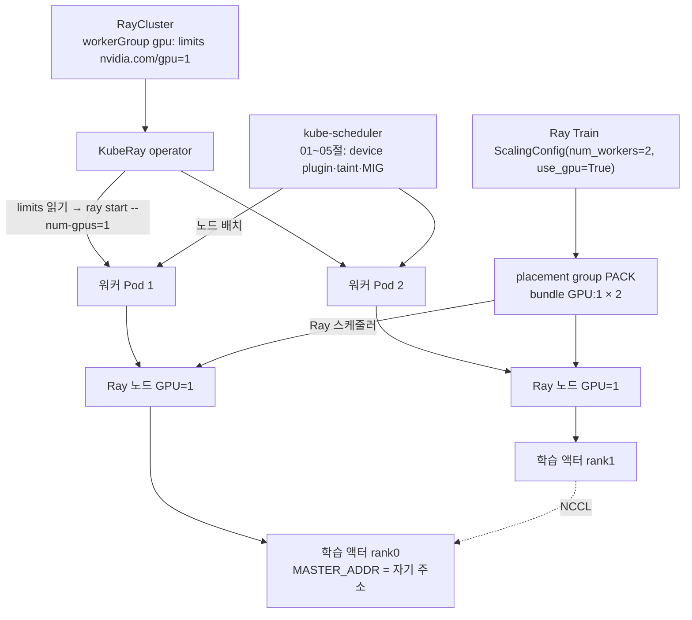
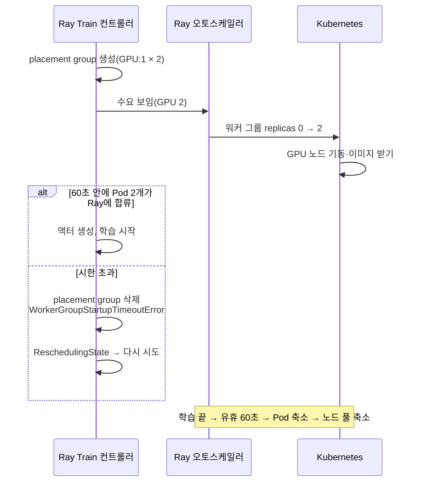

# 08. KubeRay로 분산 학습·추론: GPU 워커 그룹, Ray Train, Ray Serve

> [목차로](CURRICULUM.md) · 작성 2026-10-17 · 기준 버전: KubeRay v1.7.1(2026-09-21, `v1.7.1` 태그 소스), Ray 2.59.0(2026-10-02, `ray-2.59.0` 태그 소스)
> **[근거]** 출처에 그대로 있는 내용, **[추론]** 여러 출처를 엮어 내린 결론.
> 앞 절: [07. Kubeflow Trainer](07-kubeflow-trainer.md)

## 1. 개념

07절의 Trainer는 "노드 수만큼 Pod를 띄우고 torchrun에 주소를 넘겨 주는" 컨트롤러였다. KubeRay는 한 겹을 더 둔다. Kubernetes 위에 **Ray 클러스터**(head Pod 하나 + 워커 Pod 여럿)를 세우고, 학습·추론 프로세스는 Ray가 그 클러스터 안에서 다시 배치한다. 그래서 GPU 스케줄링이 두 번 일어난다. 이 절의 요점은 그 두 번이 어디서 맞물리고 어디서 어긋나는가다.

### 1.1 세 CRD

| CRD | 무엇 | GPU 관점에서 볼 것 |
|---|---|---|
| `RayCluster` | head 그룹 + 워커 그룹들로 된 오래 사는 클러스터 | 워커 그룹마다 Pod 템플릿의 `nvidia.com/gpu` limits, `minReplicas`·`maxReplicas`, 오토스케일러 |
| `RayJob` | RayCluster를 만들고(또는 기존 것을 골라) 잡 하나를 넣은 뒤 정리 | 잡이 끝나면 GPU 클러스터를 지울지(`shutdownAfterJobFinishes`, `deletionStrategy`) |
| `RayService` | RayCluster + Ray Serve 앱, 무중단 업그레이드 | 서빙 replica의 `num_gpus`(분수 가능), 업그레이드 때 GPU가 두 벌 필요한가 |

- **[근거]** API는 `ray.io/v1`이고, v1.7.0에서 `ray.io/v1alpha1` 폐기가 예고됐다. 출처: <https://github.com/ray-project/kuberay/releases/tag/v1.7.0> (2026-10-17 확인)
- **[근거]** `RayJob`의 기본 제출 방식은 `K8sJobMode`(제출용 Kubernetes Job을 따로 만든다)이고, `HTTPMode`·`InteractiveMode`·`SidecarMode`도 있다. 출처: `ray-operator/apis/ray/v1/rayjob_types.go` v1.7.1 `+kubebuilder:default:=K8sJobMode` (2026-10-17 확인)
- 세 CRD의 기본 사용법과 v1.6·v1.7 새 기능(RayCronJob, History Server, 점진 업그레이드)은 별도 KubeRay 스터디 노트에 있다(비공개). 여기서는 GPU와 분산에 걸리는 부분만 본다.

### 1.2 GPU가 Ray에게 보이기까지: 두 겹 스케줄링

1. Kubernetes 스케줄러가 워커 Pod를 GPU 노드에 놓는다. 01~05절의 이야기 그대로다(device plugin, taint, MIG 등).
2. 그 Pod 안에서 `ray start`가 돌며 "이 Ray 노드에는 GPU가 몇 개 있다"고 Ray에 알린다.
3. Ray 스케줄러가 `@ray.remote(num_gpus=1)` 태스크·액터를 GPU가 남은 Ray 노드에 놓고, `CUDA_VISIBLE_DEVICES`를 설정한 뒤 실행한다.

- **[근거]** KubeRay는 컨테이너의 GPU limits를 읽어 `ray start`에 `--num-gpus`를 넣는다. `rayStartParams`에 `num-gpus`를 직접 쓰면 그 값이 이기고, 컨테이너 limits에 GPU가 없어도 Ray는 그만큼 있다고 믿는다. 출처: <https://docs.ray.io/en/latest/cluster/kubernetes/user-guides/gpu.html> "GPUs and Ray", "Overriding Ray GPU capacity" (2026-10-17 확인)
- **[근거]** 이때 GPU 리소스로 인정하는 이름은 두 종류뿐이다. 이름이 `gpu`로 **끝나는** 것(`nvidia.com/gpu`), 그리고 `nvidia.com/mig-<n>g.<m>gb` 꼴의 MIG 이름. 출처: `ray-operator/controllers/ray/utils/resources.go` `IsGPUResourceKey`, `controllers/ray/common/pod.go` `addWellKnownAcceleratorResources` v1.7.1 (2026-10-17 확인)
- **[근거]** 워커 그룹의 `resources` 필드(문자열 맵)는 `rayStartParams`를 덮어쓰지만 **Pod 컨테이너 자원에는 영향이 없다**. 같은 소스의 `raycluster_types.go` 주석. 또 `rayStartParams`의 `num-cpus`·`num-gpus`·`memory`·`resources`와 그룹 `resources`를 **함께 쓰면 오퍼레이터가 거절한다**("please use only one"). 출처: `controllers/ray/utils/validation.go` `validateRayGroupResources` v1.7.1 (2026-10-17 확인)
- **[근거]** KubeRay가 만든 `ray start` 명령은 Ray 컨테이너의 환경 변수 `KUBERAY_GEN_RAY_START_CMD`에 그대로 남는다. 같은 소스의 `pod.go`. 확인할 때 이 값을 본다(3.3, 4절).

**[추론] 이름 규칙이 04·05절과 부딪힌다.** 위 코드를 따라가면 다음 세 경우에 KubeRay는 `--num-gpus`를 채우지 않는다.

| 구성 | 컨테이너가 받는 이름 | `IsGPUResourceKey` | 결과 |
|---|---|---|---|
| time-slicing, `renameByDefault: true`(04절) | `nvidia.com/gpu.shared` | `.shared`로 끝나 거짓 | `--num-gpus` 없음 |
| MIG mixed(04절) | `nvidia.com/mig-1g.10gb` 등 | 정규식에 맞아 참 | 개수가 들어감 |
| DRA `ResourceClaim`(05절) | limits에 GPU 이름 없음 | 볼 것이 없음 | `--num-gpus` 없음 |

`--num-gpus`가 비면 Ray가 Pod 안에서 스스로 장치를 찾는데, 그 결과가 Kubernetes가 붙여 준 장치 수와 같다는 보장은 출처에서 찾지 못했다. 이런 구성이면 `rayStartParams.num-gpus`나 그룹 `resources`로 **직접 적고** 3.3의 방법으로 확인한다. 실측은 하지 않았다.

### 1.3 Ray Train: torchrun이 하던 일을 Ray가 한다

- **[근거]** Ray Train의 워커는 학습 함수를 돌리는 **Ray 액터**다. `ScalingConfig(num_workers=8, use_gpu=True)`는 워커 8개에 GPU를 하나씩 잡고, `resources_per_worker={"GPU": 2}`로 늘리거나 `0.5`처럼 분수로 줄 수 있다. `use_gpu=True`면 `CUDA_VISIBLE_DEVICES`를 맞춰 주고 백엔드 기본값은 NCCL, 아니면 Gloo다. 출처: <https://docs.ray.io/en/latest/train/user-guides/using-accelerators.html> (2026-10-17 확인)
- **[근거]** 워커들은 placement group 하나로 묶여 자리를 잡고, 기본 전략은 `PACK`이다. 출처: `python/ray/air/config.py` ray-2.59.0 `placement_strategy ... = "PACK"` (2026-10-17 확인)
- **[근거]** 프로세스 그룹을 만들 때 Ray Train이 rank 0 워커의 주소와 빈 포트를 구해 모든 워커에 `MASTER_ADDR`·`MASTER_PORT`를 넣고 `init_method="env"`로 `init_process_group`을 부른다. `TorchConfig.timeout_s` 기본값은 **1800초**다. 출처: `python/ray/train/torch/config.py` ray-2.59.0 (2026-10-17 확인)
- **[근거]** Ray 2.59에서 Train V2가 기본으로 켜져 있다(`RAY_TRAIN_V2_ENABLED` 기본 True). V2의 `ScalingConfig`는 `num_workers=(최소, 최대)` 튜플로 탄력 학습을 받고, `label_selector`로 워커를 특정 Ray 노드 라벨에 묶는다. 출처: `python/ray/train/v2/_internal/constants.py`, `python/ray/train/v2/api/config.py` ray-2.59.0 (2026-10-17 확인)
- **[근거]** V2는 placement group이 준비되기를 `RAY_TRAIN_WORKER_GROUP_START_TIMEOUT_S`(기본 **60초**)만 기다리고, 넘기면 placement group을 지우고 `WorkerGroupStartupTimeoutError`를 낸다. 스케줄링 중 실패는 컨트롤러가 `ReschedulingState`로 넘겨 다시 시도한다. 출처: `python/ray/train/v2/_internal/execution/worker_group/worker_group.py`, `.../controller/controller.py` ray-2.59.0 (2026-10-17 확인)

**[추론]** 06·07절과 비교하면, torchrun의 `--nnodes`·`--node-rank`·`--master-addr`와 Trainer의 `PET_*` 주입이 하던 일을 Ray Train은 Ray 액터 수준에서 한다. Kubernetes Pod 수와 학습 world 크기가 따로 논다는 뜻이다. GPU 8장짜리 워커 Pod 2개 위에 `num_workers=16`을 올리면 Pod당 액터 8개가 뜬다. 또 NCCL 타임아웃이 06절의 기본 10분이 아니라 30분이라, 한 rank가 멈췄을 때 알아채는 데 세 배가 걸린다.

**[추론] 60초 시한은 GPU 노드 오토스케일링과 상극이다.** 워커 그룹이 0에서 시작하고 GPU 노드도 클러스터 오토스케일러가 새로 띄우는 구성이면, 노드 기동과 이미지 받기에 60초를 넘기기 쉽다. 시한이 지나면 placement group이 지워지면서 Ray 오토스케일러가 보던 수요도 사라지고, 다시 시도할 때 다시 만들어진다. 노드가 늦게 뜨는 클러스터라면 이 값을 늘려 두는 편이 안전하다. 실측하지 않았다.

### 1.4 Ray Serve와 분수 GPU

- **[근거]** Ray는 분수 자원을 받아 여러 태스크·액터가 GPU 하나를 나눠 쓰게 한다(`num_gpus=0.25`면 넷이 동시에). 다만 "각 태스크가 자기 몫 이상의 가속기 메모리를 쓰지 않게 하는 것은 **사용자의 책임**"이다. 또 GPU 태스크가 끝나도 메모리를 놓지 않는 문제 때문에 GPU 태스크 사이의 워커 프로세스 재사용을 기본으로 끈다. 출처: <https://docs.ray.io/en/latest/ray-core/scheduling/accelerators.html> "Fractional Accelerators" (2026-10-17 확인)
- **[추론]** Ray의 분수 GPU는 04절의 time-slicing과 같은 성격이다. 스케줄러의 장부만 나눌 뿐 메모리·장애 격리가 없다. 다른 점은 장부를 쥔 곳이 Kubernetes가 아니라 Ray라는 것이고, 그래서 Kubernetes 쪽 쿼터·감시에는 "GPU 1장"으로만 보인다. 격리가 필요하면 MIG(04절)로 Pod 단위에서 나눈다.
- Serve 오토스케일링 파라미터 이름 변경(`target_ongoing_requests`, `max_ongoing_requests` 기본값)은 KubeRay 스터디 노트의 2026-10 업데이트에 정리돼 있다(비공개).

### 1.5 오토스케일링과 GPU 비용

- **[근거]** GPU 워커 그룹을 `replicas: 0`, `minReplicas: 0`, `maxReplicas: N`으로 두고 `spec.enableInTreeAutoscaling: true`를 켜면, Ray 오토스케일러가 GPU 수요를 보고 Pod를 늘리고 유휴 시간(기본 60초) 뒤 줄인다. GPU 노드 풀도 따로 오토스케일되게 해야 노드까지 줄어든다. `ray.autoscaler.sdk.request_resources(bundles=[{"GPU": 1}] * 2)`로 미리 늘릴 수 있고, 이 요청은 빈 목록으로 덮어쓸 때까지 유지된다. 출처: <https://docs.ray.io/en/latest/cluster/kubernetes/user-guides/gpu.html> "GPU autoscaling", "Requesting GPUs" (2026-10-17 확인)
- **[근거]** `autoscalerOptions.idleTimeoutSeconds` 기본 60, `upscalingMode`는 `Conservative`(대기 중 워커 Pod 수를 클러스터 크기 이하로 제한)·`Default`·`Aggressive`. `version`을 비우면 Ray 2.47.0 이상은 오토스케일러 v2다. 워커 그룹별 `idleTimeoutSeconds`는 v2에서만 읽고, 그룹 `priority`(높을수록 먼저 늘림)는 v2 + Ray 2.56 이상에서만 듣는다. 출처: `ray-operator/apis/ray/v1/raycluster_types.go` v1.7.1 (2026-10-17 확인)
- **[추론]** `request_resources`로 늘린 GPU 노드는 빈 목록으로 지울 때까지 남는다. 노트북에서 한 번 부르고 잊으면 GPU가 계속 과금된다. 유휴 축소가 안 될 때 가장 먼저 의심할 곳이다.

### 1.6 Kubeflow Trainer와 언제 갈리나

| 상황 | 쪽 | 이유 |
|---|---|---|
| 이미 torchrun 스크립트가 있고, 노드 수·GPU 수가 고정 | Trainer(07절) | 스크립트를 그대로 쓰고 Pod = 노드 = torchrun 하나로 관계가 단순하다 |
| 데이터 전처리(Ray Data)·학습·튜닝·서빙을 한 클러스터에서 이어서 | KubeRay | 같은 Ray 클러스터 안에서 단계 사이에 GPU를 나눠 쓴다 |
| 학습 중 GPU 수가 바뀌어도 이어 가야(탄력) | KubeRay(Train V2 `num_workers` 튜플) | Trainer v2.3은 JobSet 재시작이 기본이다(07절 1.3) |
| GPU 여러 장이 필요한 모델 서빙, 무중단 업그레이드 | KubeRay(`RayService`) | Trainer는 학습 전용이다 |
| Kueue로 팀별 GPU 쿼터를 거는 게 우선 | 둘 다 가능 | Kueue가 `TrainJob`과 `RayJob`·`RayCluster`·`RayService`를 모두 지원한다(09절) |

전부 **[추론]**이다. 근거로 삼은 것은 1.3의 Ray Train 동작, 07절의 JobSet 재시작, Kueue 문서의 지원 목록(<https://docs.ray.io/en/latest/cluster/kubernetes/k8s-ecosystem/kueue.html>, 2026-10-17 확인)이다.

## 2. 그림

### 2.1 두 겹 스케줄링



### 2.2 0에서 늘어나는 GPU 워커와 60초 시한



## 3. 실습: GPU 워커 그룹 RayJob으로 2-워커 DDP

### 3.1 오퍼레이터 설치

```bash
helm repo add kuberay https://ray-project.github.io/kuberay-helm/
helm repo update
helm install kuberay-operator kuberay/kuberay-operator --version 1.7.1
kubectl get pods -l app.kubernetes.io/name=kuberay-operator
```

- 기대: 오퍼레이터 Pod 하나가 `Running`. 갱 스케줄링 연동(`batchScheduler.name`: `volcano`·`yunikorn`·`kai-scheduler`·`scheduler-plugins`)은 이 차트의 값으로 켠다. **[근거]** `helm-chart/kuberay-operator/values.yaml` v1.7.1 (2026-10-17 확인). 쓰는 법은 09절.

### 3.2 학습 스크립트

06절의 `train.py`는 torchrun이 띄우는 전제였다. Ray Train은 프로세스 그룹을 스스로 만들므로 함수 하나로 바꾼다.

```python
# ray_ddp.py
import torch, torch.distributed as dist
import ray.train
from ray.train import ScalingConfig
from ray.train.torch import TorchTrainer, prepare_model, get_device

def train_func():
    device = get_device()
    model = prepare_model(torch.nn.Linear(16, 1))     # DDP로 감싸고 device로 옮긴다
    opt = torch.optim.SGD(model.parameters(), lr=0.1)
    for step in range(20):
        x = torch.randn(32, 16, device=device)
        loss = model(x).pow(2).mean()
        opt.zero_grad(); loss.backward(); opt.step()
    w = sum(p.sum().item() for p in model.parameters())
    print(f"rank={dist.get_rank()}/{dist.get_world_size()} backend={dist.get_backend()} weight_sum={w:.6f}")

use_gpu = torch.cuda.is_available()
TorchTrainer(train_func, scaling_config=ScalingConfig(num_workers=2, use_gpu=use_gpu)).fit()
```

```bash
kubectl create configmap ray-ddp --from-file=ray_ddp.py
```

### 3.3 RayJob

```yaml
# rayjob-ddp.yaml
apiVersion: ray.io/v1
kind: RayJob
metadata:
  name: ray-ddp
spec:
  entrypoint: python /scripts/ray_ddp.py
  runtimeEnvYAML: |
    pip: ["torch==2.14.*"]          # ray:*-gpu 이미지에는 PyTorch가 없다
  shutdownAfterJobFinishes: true    # 끝나면 GPU 클러스터를 지운다
  ttlSecondsAfterFinished: 60
  rayClusterSpec:
    enableInTreeAutoscaling: true
    headGroupSpec:
      rayStartParams: {}
      template:
        spec:
          containers:
          - name: ray-head
            image: rayproject/ray:2.59.0-gpu
            resources:
              limits: {cpu: "2", memory: 8Gi}   # head엔 GPU를 주지 않는다
            volumeMounts: [{name: scripts, mountPath: /scripts}]
          volumes: [{name: scripts, configMap: {name: ray-ddp}}]
    workerGroupSpecs:
    - groupName: gpu
      replicas: 0
      minReplicas: 0
      maxReplicas: 2
      rayStartParams: {}
      template:
        spec:
          tolerations:
          - {key: nvidia.com/gpu, operator: Exists, effect: NoSchedule}   # 03절의 GPU 노드 taint
          containers:
          - name: ray-worker
            image: rayproject/ray:2.59.0-gpu
            resources:
              limits: {cpu: "4", memory: 16Gi, nvidia.com/gpu: "1"}
```

```bash
kubectl apply -f rayjob-ddp.yaml
kubectl get rayjob ray-ddp -w                       # JOB STATUS: PENDING → RUNNING → SUCCEEDED
kubectl get pods -l ray.io/node-type=worker -w      # 0개에서 2개로 늘었다가 사라진다
W=$(kubectl get pods -l ray.io/node-type=worker -o name | head -1)
kubectl get $W -o jsonpath='{.spec.containers[0].env[?(@.name=="KUBERAY_GEN_RAY_START_CMD")].value}'; echo
kubectl logs -l job-name=ray-ddp --tail=-1 | grep rank=
```

- 기대: `KUBERAY_GEN_RAY_START_CMD`에 `--num-gpus=1`이 보인다(limits에서 왔다). 로그에 `rank=0/2 backend=nccl`, `rank=1/2 backend=nccl`이 나오고 두 `weight_sum`이 같다. 끝나면 RayCluster와 워커 Pod가 지워진다.
- 태그 `rayproject/ray:2.59.0-gpu`는 Docker Hub에 있음을 확인했다(2026-10-17). `ray-ml` 이미지는 갱신이 멈췄으니 쓰지 않는다(KubeRay 스터디 노트 2026-10 업데이트).
- 노드 기동이 느린 클러스터면 Ray Train의 시한을 늘린다(1.3). `runtimeEnvYAML`에 `env_vars: {RAY_TRAIN_WORKER_GROUP_START_TIMEOUT_S: "600"}`. **[추론]** 이 변수는 Train 컨트롤러가 읽으므로 잡 전체의 runtime env로 넘기면 닿는다고 보았다. 실측하지 않았다.

### 3.4 Serve에서 GPU 지정(맛보기)

```python
from ray import serve

@serve.deployment(num_replicas=2, ray_actor_options={"num_gpus": 1})
class Embedder:
    def __call__(self, req): ...

# 작은 모델 둘을 GPU 한 장에: ray_actor_options={"num_gpus": 0.5}
# 메모리 상한은 Ray가 걸지 않는다(1.4). 프레임워크 쪽에서 직접 제한한다.
```

## 4. GPU 없이 확인하는 법

kind 클러스터와 01절의 노드 status 패치를 그대로 쓴다.

```bash
kind create cluster --name ray
helm install kuberay-operator kuberay/kuberay-operator --version 1.7.1
NODE=ray-control-plane
kubectl patch node $NODE --subresource=status --type=json \
  -p='[{"op":"add","path":"/status/capacity/nvidia.com~1gpu","value":"2"},
       {"op":"add","path":"/status/capacity/nvidia.com~1gpu.shared","value":"2"}]'
```

1. **이름 규칙 확인(1.2 표).** `rayjob-ddp.yaml`을 RayCluster로 바꿔(`kind: RayCluster`, `spec`은 `rayClusterSpec` 내용, 워커 `replicas: 1`) 두 벌 만든다. 하나는 limits `nvidia.com/gpu: "1"`, 다른 하나는 `nvidia.com/gpu.shared: "1"`. 3.3의 jsonpath로 `KUBERAY_GEN_RAY_START_CMD`를 본다. 기대(추론): 앞쪽에만 `--num-gpus=1`이 있다. 이것이 이 절에서 가장 먼저 해 볼 실험이다.
2. **Ray 장부만 속이기.** 앞쪽 클러스터의 head에서 `kubectl exec -it <head> -- ray status`. 실제 GPU가 없어도 `GPU 0.0/1.0`이 잡혀 있다(Ray는 `--num-gpus`를 믿는다). `@ray.remote(num_gpus=1)` 액터는 그 Pod에 배치되고 `CUDA_VISIBLE_DEVICES=0`을 받지만 `torch.cuda.is_available()`은 거짓이다. **[추론]** 두 겹 장부가 어긋나면 이렇게 "자리는 받았는데 장치가 없는" 상태가 된다.
3. **학습 흐름.** 3.2의 스크립트는 CUDA가 없으면 `use_gpu=False`로 바뀐다. 워커 limits에서 GPU를 빼고 `cpu: "1"`로 3.3을 넣으면 `backend=gloo`로 같은 로그가 나온다. 이때 워커 그룹이 0에서 2로 늘어나는 것까지 볼 수 있다.
4. **스키마와 검증은 다른 곳에서 걸린다.** `kubectl apply --dry-run=server -f rayjob-ddp.yaml`은 CRD 스키마만 본다. `minReplicas: 3`, `maxReplicas: 2`나 `rayStartParams.num-gpus`와 그룹 `resources`를 함께 쓴 경우는 오퍼레이터가 조정(reconcile) 중에 `validation.go`로 거절하므로, dry-run은 통과하고 실제로 넣은 뒤 `kubectl describe rayjob`·`raycluster`의 이벤트에서 보인다. **[추론]** 웹훅을 켜지 않은 기본 설치 기준이다.

## 5. 흔한 실수

1. **head에 GPU를 준다.** head는 GCS·대시보드·오토스케일러가 사는 곳이라 오래 살고, 오토스케일링으로 줄지도 않는다. GPU 한 장이 늘 묶인다. 공식 예시도 head에 `num-gpus: "0"`을 두는 경우가 많다. **[추론]**
2. **GPU 노드 taint에 맞는 toleration을 안 준다.** Ray 문서는 관리형 Kubernetes가 `ExtendedResourceToleration`으로 자동으로 붙여 준다고 하지만, 03절에서 본 대로 이 승인 컨트롤러는 기본으로 꺼져 있다. 워커 Pod가 `Pending`이면 먼저 본다. (같은 문서는 taint를 device plugin이 단다고 적었는데, 03절의 출처대로 taint는 관리자나 클라우드가 단다.)
3. **time-slicing·DRA 구성에서 `num-gpus`를 비워 둔다.** 1.2 표. KubeRay가 채우지 않는다. 채울 때는 `rayStartParams`와 그룹 `resources` 중 한 곳에만.
4. **분수 GPU를 격리로 믿는다.** `num_gpus=0.5` 둘은 메모리를 나눠 갖지 않는다(1.4).
5. **`request_resources`를 지우지 않는다.** GPU 노드가 줄지 않는다(1.5).
6. **Pod 수와 학습 world 크기를 같다고 가정한다.** `num_workers`는 액터 수다. GPU 8장 Pod 2개면 `num_workers=16`, `resources_per_worker={"GPU": 1}`이 맞다. `num_workers=2`면 GPU 14장이 논다.
7. **NCCL 타임아웃을 06절 값으로 기억한다.** Ray Train의 `TorchConfig.timeout_s` 기본값은 1800초다. hang 감지가 늦으면 이 값을 줄인다.
8. **노드가 늦게 뜨는 클러스터에서 0부터 늘린다.** placement group 대기 60초(1.3). 시한을 늘리거나 `minReplicas`를 잡 크기만큼 둔다.
9. **`ray-ml` 이미지·오래된 `rayVersion`을 예제에서 베낀다.** 태그가 지워져 `ImagePullBackOff`가 난다(KubeRay v1.7.1 릴리스 노트).
10. **Ray 2.61로 올리며 토큰 인증을 준비하지 않는다.** Ray 2.61부터 원격 클러스터에도 토큰 인증이 기본으로 켜질 예정이라, 모든 노드와 클라이언트가 같은 토큰을 가져야 한다. KubeRay에선 `spec.authOptions`로 준비한다. 출처: <https://docs.ray.io/en/latest/ray-security/token-auth.html> (2026-10-17 확인)

## 6. 확인 문제

1. GPU 4장짜리 노드 3대에 워커 그룹(`limits nvidia.com/gpu: 4`, `replicas: 3`)을 두고 `ScalingConfig(num_workers=6, use_gpu=True)`로 학습을 띄웠다. 액터는 어떻게 놓이고, 놀고 있는 GPU는 몇 장인가? 기본 placement 전략이 `PACK`이라는 점이 결과에 어떤 영향을 주나?
2. 04절 time-slicing(`renameByDefault: true`, `replicas: 4`)이 켜진 노드에 Ray 서빙 워커를 `nvidia.com/gpu.shared: 1`로 올렸더니 `num_gpus=1` 배포가 영영 대기한다. 원인과 두 가지 고치는 법을 말하라.
3. 같은 2노드 DDP를 07절 TrainJob과 이 절 RayJob으로 돌렸고, 학습 중 rank 1의 노드가 꺼졌다. 두 경우 각각 무엇이 실패를 알아채고, 무엇이 다시 뜨며, 얼마나 지나서 알아채나(타임아웃 기본값 기준)?

<details>
<summary>답</summary>

1. 워커 Pod 3개가 각각 Ray 노드 GPU=4로 등록된다. 번들 6개(GPU:1씩)를 `PACK`이 가능한 한 적은 노드에 모으므로 4 + 2로 두 노드에 놓이고(추론), 세 번째 Pod의 GPU 4장과 두 번째 Pod의 남은 2장, 모두 6장이 논다. `PACK`은 "가능하면 모으고 안 되면 흩는" 전략이라 실패하지는 않는다. 노드 간 통신을 줄이는 데는 유리하지만, 오토스케일링을 켰다면 세 번째 Pod는 유휴 시간 뒤 줄어든다. `num_workers=12`로 쓰는 것이 맞다.
2. 컨테이너 리소스 이름이 `nvidia.com/gpu.shared`라 KubeRay가 GPU로 인식하지 않아 `ray start`에 `--num-gpus`가 없다(1.2). Ray 장부에 GPU가 없거나 Pod가 실제 붙은 장치와 다르게 잡혀, `num_gpus=1` 액터가 놓일 곳이 없다. 고치는 법: 워커 그룹 `rayStartParams: {num-gpus: "1"}` 또는 그룹 `resources: {nvidia.com/gpu: "1"}` 중 **하나만** 직접 적는다(둘 다 쓰면 오퍼레이터가 거절, 1.2). 또는 device plugin을 `renameByDefault: false`로 두어 이름을 `nvidia.com/gpu`로 유지한다. 어느 쪽이든 `KUBERAY_GEN_RAY_START_CMD`로 확인한다. 이 진단은 소스 읽기에서 나온 추론이다.
3. TrainJob: rank 0은 all-reduce에서 멈춰 있다가 NCCL 기본 타임아웃(10분, 06절) 뒤 죽고, rank 1의 Pod 실패는 Job 실패로 이어져 JobSet `failurePolicy`가 JobSet 전체를 다시 만든다(07절). RayJob: Ray가 rank 1 액터가 있던 노드를 잃은 것을 알아채고 Train 컨트롤러가 워커 그룹 전체를 내리고 다시 띄운다(`RestartingState`, 1.3의 같은 컨트롤러). Kubernetes 쪽에선 KubeRay가 사라진 워커 Pod를 새로 만들고, GPU 노드가 새로 떠야 하면 placement group 대기 60초 시한이 걸린다. 남은 rank가 집합 연산에서 막혀 있다면 그 해제는 `timeout_s` 1800초가 상한이다. 실패 감지 경로가 Kubernetes(Pod 실패)냐 Ray(노드·액터 사망)냐가 둘의 차이다. 노드 사망 감지 시간 자체는 출처에서 확인하지 않았다(추론).

</details>

## 7. 이어 볼 것

- 09절: KubeRay의 `batchScheduler`(Volcano·YuniKorn·scheduler-plugins·KAI)와 `ray.io/gang-scheduling-enabled` 라벨, Kueue의 RayJob·RayCluster 지원. Ray placement group은 Ray 안에서만 all-or-nothing이라, Kubernetes 쪽에서 워커 Pod가 일부만 떠서 GPU를 쥔 채 기다리는 문제는 그대로 남는다(추론).
- 10절: Ray Train의 `NCCL_SOCKET_IFNAME`을 runtime env로 넘기는 법(using-accelerators 문서)과 RDMA 보조 네트워크
- 12절: Ray 대시보드·History Server와 dcgm-exporter를 같이 보는 법
- 별도 스터디 노트(비공개): KubeRay 스터디 01~06장(CRD 기본, RayService, 오토스케일링 실습)과 2026-10 업데이트. 이 절은 거기 있는 일반 예제를 다시 적지 않았다.

## 8. 출처 (모두 2026-10-17 확인)

- KubeRay 릴리스(v1.7.1, v1.7.0): <https://github.com/ray-project/kuberay/releases>
- KubeRay 소스 v1.7.1: `ray-operator/apis/ray/v1/raycluster_types.go`, `rayjob_types.go`, `ray-operator/controllers/ray/common/pod.go`, `ray-operator/controllers/ray/utils/resources.go`, `helm-chart/kuberay-operator/values.yaml` — <https://github.com/ray-project/kuberay/tree/v1.7.1>
- Ray 릴리스(2.59.0): <https://github.com/ray-project/ray/releases>
- KubeRay에서 GPU 쓰기: <https://docs.ray.io/en/latest/cluster/kubernetes/user-guides/gpu.html>
- Ray Train 규모·가속기 설정: <https://docs.ray.io/en/latest/train/user-guides/using-accelerators.html>
- Ray Core 가속기·분수 GPU: <https://docs.ray.io/en/latest/ray-core/scheduling/accelerators.html>
- KubeRay + Kueue: <https://docs.ray.io/en/latest/cluster/kubernetes/k8s-ecosystem/kueue.html>
- Ray 토큰 인증: <https://docs.ray.io/en/latest/ray-security/token-auth.html>
- Ray 소스 ray-2.59.0: `python/ray/air/config.py`, `python/ray/train/torch/config.py`, `python/ray/train/v2/api/config.py`, `python/ray/train/v2/_internal/constants.py`, `python/ray/train/v2/_internal/execution/worker_group/worker_group.py`, `python/ray/train/v2/_internal/execution/controller/controller.py` — <https://github.com/ray-project/ray/tree/ray-2.59.0>
- Docker Hub `rayproject/ray` 태그 `2.59.0-gpu`: <https://hub.docker.com/r/rayproject/ray/tags>
