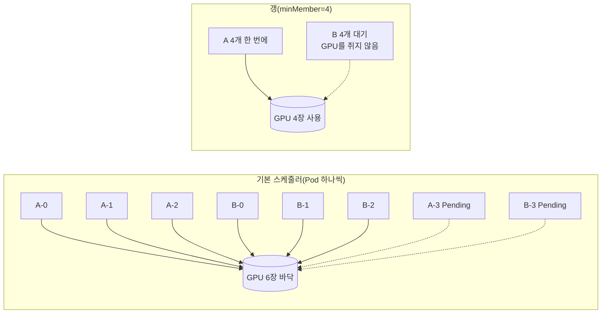
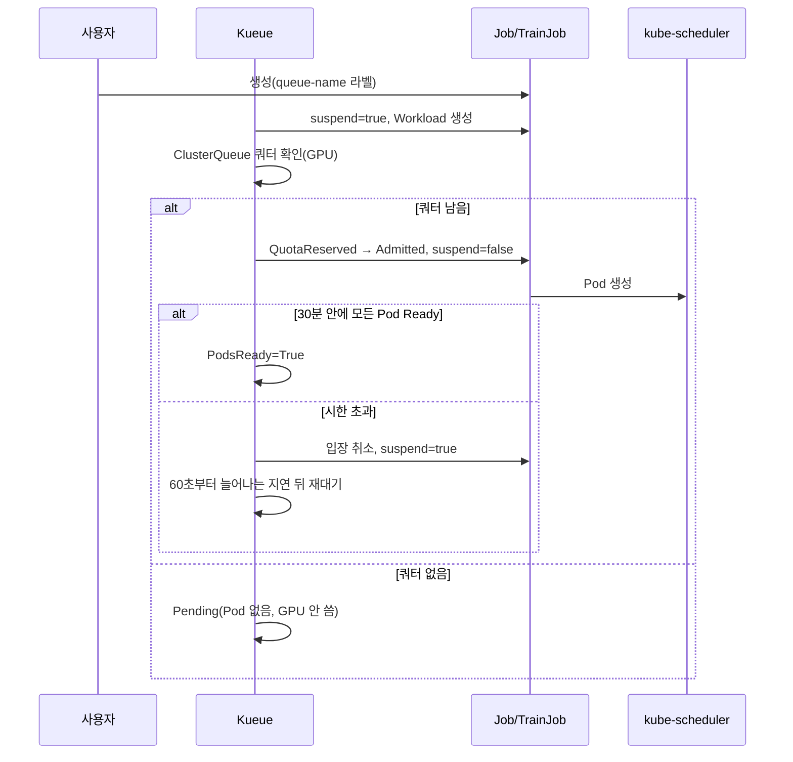

# 09. 갱 스케줄링과 큐: 기본 스케줄러의 Workload API, Volcano, Kueue

> [목차로](CURRICULUM.md) · 작성 2026-10-18 · 기준 버전: Kubernetes 1.37, Kueue v0.20.2(2026-10-15, `v0.20.2` 태그 소스), Volcano v1.16.0(2026-10-14, `v1.16.0` 태그 소스), Kubeflow Trainer v2.3.0, KubeRay v1.7.1
> **[근거]** 출처에 그대로 있는 내용, **[추론]** 여러 출처를 엮어 내린 결론.
> 앞 절: [08. KubeRay](08-kuberay.md)

## 1. 개념

06~08절에서 띄운 분산 잡은 모두 "Pod N개가 **동시에** 떠 있어야 일을 시작한다"는 성질이 있다. rank 하나라도 없으면 나머지는 rendezvous나 all-reduce에서 GPU를 쥔 채 기다린다. 그런데 kube-scheduler는 원래 Pod를 **하나씩** 놓는다. 이 절은 그 어긋남을 메우는 세 갈래를 본다.

| 무엇을 묶나 | 도구 | 한 줄 |
|---|---|---|
| Pod 배치를 한 번에(all-or-nothing) | 기본 스케줄러의 Workload/PodGroup API, Volcano, scheduler-plugins coscheduling, KAI | 노드에 놓는 순간을 묶는다 |
| 잡의 **시작**을 쿼터로(입장 제어) | Kueue | Pod를 아예 만들지 않고 기다리게 한다 |
| 둘 다 | Kueue + 갱 스케줄러, Volcano의 Queue | 입장은 쿼터로, 배치는 갱으로 |

### 1.1 부분 배치 교착

GPU 6장이 비어 있고, GPU 1장짜리 Pod 4개가 필요한 잡 A·B가 동시에 들어왔다고 하자. 기본 스케줄러가 큐에서 번갈아 꺼내 놓으면 A 3개, B 3개가 자리를 잡고 GPU가 바닥난다. A·B 모두 네 번째 Pod를 영영 못 놓고, 놓인 6개는 rendezvous에서 기다리며 GPU를 놓지 않는다. 혼자였다면 둘 다 차례로 끝났을 잡이다. **[추론]** 06절의 static rendezvous와 01절의 "GPU는 오버커밋 없음"을 엮은 결론이다. Kueue 문서도 같은 교착을 적어 둔다: "물리적 자원이 쿼터와 맞지 않으면 이런 잡 한 쌍이 교착될 수 있고, 차례로 놓였다면 끝났을 것이다." **[근거]** <https://kueue.sigs.k8s.io/docs/tasks/manage/setup_wait_for_pods_ready/> (2026-10-18 확인)

기본 스케줄러에 없는 것은 셋이다. 묶음 단위 배치(갱), 팀별 GPU 쿼터와 대기열, 그리고 묶음 단위 선점(rank 하나만 쫓아내면 나머지가 놀 뿐이다). 아래 도구들은 이 셋을 서로 다르게 나눠 맡는다.

### 1.2 기본 스케줄러의 갱: Workload·PodGroup API (1.37 베타, 기본 꺼짐)

- **[근거]** 갱 스케줄링은 Kubernetes 1.37에서 **베타지만 기본으로 꺼져 있다.** `GenericWorkload` 기능 게이트와 `scheduling.k8s.io/v1beta1` API 그룹을 켜야 한다. PodGroup에 모인 Pod 수가 `minCount` 이상이 될 때까지 PreEnqueue에서 붙잡고, 그 뒤 한 번의 PodGroup 스케줄링 주기에서 `minCount`개 이상을 놓을 수 있을 때만 바인딩한다. 못 놓으면 하나도 바인딩하지 않고 unschedulable 큐로 보낸다. 출처: <https://kubernetes.io/docs/concepts/scheduling-eviction/gang-scheduling/> (2026-10-18 확인)
- **[근거]** `Workload`는 정책 틀(`podGroupTemplates`, 최대 8개, spec 전체가 생성 뒤 불변)이고, `PodGroup`은 실행 단위다. Pod는 `spec.schedulingGroup.podGroupName`으로 PodGroup을 가리킨다. 이 흐름을 따르는 내장 컨트롤러는 **Job뿐**이다. 출처: <https://kubernetes.io/docs/concepts/workloads/workload-api/>, <https://kubernetes.io/docs/concepts/workloads/podgroup-api/> (2026-10-18 확인)
- **[근거]** Job 연동은 별도 게이트 `WorkloadWithJob`(1.36부터 **알파**, 기본 꺼짐)이다. 켜면 Job의 `.spec.scheduling`을 Workload·PodGroup으로 옮긴 뒤 Pod를 만든다. `gang.minCount`를 비우면 `.spec.parallelism`이 기본값이고, `.spec.scheduling`은 `gang.minCount`를 빼고 생성 뒤 바꿀 수 없다. `.spec.scheduling`이 없는 Job도 Basic 정책의 Workload·PodGroup이 만들어진다. 출처: <https://kubernetes.io/docs/concepts/workloads/controllers/job/#integrate-with-workload-apis> (2026-10-18 확인)
- **[근거]** 상태 조건 `PodGroupInitiallyScheduled`는 **처음 배치만** 반영하고, 나중에 Pod가 죽거나 쫓겨나도 갱신되지 않는다. 문서의 Note도 실행 중 Pod 수가 `minCount` 아래로 떨어질 수 있다고 적는다. 같은 출처(2026-10-18 확인)
- **[추론]** 그래서 기본 스케줄러의 갱은 "처음에 같이 뜨기"만 보장한다. 학습 중 rank 하나가 죽었을 때 나머지를 정리하는 일은 여전히 Job 재시도·JobSet `failurePolicy`(07절)·Ray Train(08절)의 몫이다. 운영 클러스터에선 게이트 두 개(하나는 알파)를 켜야 하므로, 2026-10 현재 실무의 갱은 아래의 외부 스케줄러가 맡는다고 보는 편이 맞다.

### 1.3 Volcano: 배치 전용 두 번째 스케줄러

- **[근거]** Volcano의 `PodGroup`(`scheduling.volcano.sh/v1beta1`)은 `minMember`, 역할별 `minTaskMember`, `queue`, `priorityClassName`, `minResources`를 가진다. Pod는 주석 `scheduling.k8s.io/group-name`(또는 `scheduling.volcano.sh/group-name`)으로 PodGroup에 붙는다. 출처: `staging/src/volcano.sh/apis/pkg/apis/scheduling/v1beta1/types.go`, `labels.go` v1.16.0 (2026-10-18 확인)
- **[근거]** Helm 차트의 기본 스케줄러 설정은 `actions: "enqueue, allocate, backfill"`이고 플러그인은 `priority`·`gang`·`conformance` / `overcommit`·`drf`·`predicates`·`proportion`·`nodeorder`·`binpack`이다. **`preempt`·`reclaim` 액션이 기본 목록에 없다.** 출처: `installer/helm/chart/volcano/config/volcano-scheduler.conf` v1.16.0 (2026-10-18 확인)
- **[근거]** `overcommit` 플러그인의 기본 배수는 **1.2**다. 소스 주석은 "클러스터 자원이 모자랄 때 스케줄러가 견딜 `pending` Pod의 양"이라고 설명한다(enqueue 단계). 출처: `pkg/scheduler/plugins/overcommit/overcommit.go` v1.16.0 (2026-10-18 확인)
- **[근거]** Volcano `Job`(`batch.volcano.sh/v1alpha1`)에서 `minAvailable`을 비우면 웹훅이 태스크별 `minAvailable`(없으면 `replicas`)의 합으로 채운다. `queue`를 비우면 `default`가 들어간다. 출처: `pkg/webhooks/admission/jobs/mutate/mutate_job.go` v1.16.0 (2026-10-18 확인)
- **[근거]** v1.16.0의 새 기능은 네임스페이스 범위 큐(`NamespaceQueue`), 네임스페이스별 공정 분배(`fairshare` 플러그인, Slurm식 사용량 감쇠), PodGroup 토폴로지 반친화, 독립 배포되는 HyperNode 컨트롤러, 그리고 **`UnschedulableJobCache`**(기본 꺼짐, 놓지 못한 잡의 재평가를 이벤트가 올 때까지 건너뜀, 감시 재시도 기본 5분)다. 출처: <https://github.com/volcano-sh/volcano/releases/tag/v1.16.0> (2026-10-18 확인)
- **[추론]** 기본 설정 그대로면 Volcano는 "갱으로 같이 놓기 + 큐 비례 분배"까지만 하고, 급한 잡이 와도 남의 Pod를 쫓아내지 않는다. 우선순위 선점이나 큐 간 회수를 기대한다면 `actions`에 `preempt`·`reclaim`을 직접 넣어야 한다. 또 1.2배 overcommit 때문에 enqueue를 통과한 잡의 합이 실제 유휴 GPU보다 클 수 있다. 갱이 지켜 주므로 교착은 안 나지만, `Inqueue`인데 오래 `Pending`인 잡은 이 배수부터 의심한다.

### 1.4 Kueue: Pod를 만들기 전에 막는 입장 제어

Kueue는 스케줄러가 아니다. 잡을 `suspend: true`로 붙잡아 두었다가, 쿼터가 남으면 풀어 준다. 실제 노드 배치는 그대로 kube-scheduler(또는 다른 스케줄러)가 한다.

- **[근거]** 구성은 `ResourceFlavor`(노드 종류) → `ClusterQueue`(클러스터 범위 자원 풀·쿼터·공정 분배) → `LocalQueue`(네임스페이스의 입구) → `Workload`(입장 단위)다. 잡은 라벨 `kueue.x-k8s.io/queue-name`으로 LocalQueue를 고른다. 쿼터 예약(quota reservation)은 Pod 스케줄링과 다르다고 문서가 따로 적는다. 출처: <https://kueue.sigs.k8s.io/docs/concepts/> (2026-10-18 확인)
- **[근거]** **v0.20부터 `kueue.x-k8s.io/v1beta1`을 더 이상 서비스하지 않는다.** 업그레이드 전에 매니페스트와 클라이언트를 `v1beta2`로 바꾸고 마이그레이션 스크립트를 돌려야 한다. 출처: <https://github.com/kubernetes-sigs/kueue/releases/tag/v0.20.0> "Actions Required" (2026-10-18 확인)
- **[근거]** `waitForPodsReady`는 **v0.19부터 기본으로 켜져 있다**(timeout 30분, recoveryTimeout 기본은 timeout과 같음). 입장한 Workload의 Pod가 시한 안에 모두 Ready가 되지 않으면 입장을 취소하고 잡을 다시 suspend한 뒤 재대기시킨다. 재대기 지연은 기본 60초에서 시작해 최대 3600초까지 늘고, `blockAdmission` 기본값은 false다. 끄는 게이트 `DisableWaitForPodsReady`는 0.21에서 없앨 예정이다. 출처: v0.19.0 릴리스 노트, `apis/config/v1beta2/defaults.go`·`pkg/features/kube_features.go` v0.20.2 (2026-10-18 확인)
- **[근거]** v0.20에서 알파 `WaitForPodsReadyUnscheduledTimeout`(놓이지 못한 Pod만 짧은 시한으로 재대기)과 `WorkloadLevelWaitForPodsReady`(잡마다 시한)가 생겼다. 출처: `site/content/en/docs/tasks/manage/setup_wait_for_pods_ready.md` v0.20.2 (2026-10-18 확인)
- **[근거]** `ClusterQueue.spec.preemption`의 `withinClusterQueue`·`reclaimWithinCohort`·`borrowWithinCohort.policy` 기본값은 모두 **`Never`**, `queueingStrategy` 기본값은 `BestEffortFIFO`다. 출처: `apis/kueue/v1beta2/clusterqueue_types.go` v0.20.2 (2026-10-18 확인)
- **[근거]** 배포 매니페스트의 기본 통합 목록에는 `batch/job`, `kubeflow.org/mpijob`, `ray.io/rayjob`·`raycluster`·`rayservice`, `jobset.x-k8s.io/jobset`, `trainer.kubeflow.org/trainjob`, `pod`, `deployment`, `statefulset`, `leaderworkerset` 등이 켜져 있고, **`kubeflow.org/pytorchjob`은 주석 처리돼 있다.** 출처: `config/components/manager/controller_manager_config.yaml` v0.20.2 (2026-10-18 확인)
- **[근거]** Topology Aware Scheduling(TAS)은 v0.14부터 베타·기본 켜짐이다. `Topology`가 노드 라벨로 계층(블록·랙·호스트)을 정의하고 `ResourceFlavor.spec.topologyName`이 그것을 가리키며, Pod 템플릿 주석 `kueue.x-k8s.io/podset-required-topology` 또는 `podset-preferred-topology`로 "한 랙 안에" 같은 조건을 건다. 출처: `pkg/features/kube_features.go`, `apis/kueue/v1beta2/topology_types.go`, `site/static/examples/tas/` v0.20.2 (2026-10-18 확인)
- **[추론]** Kueue 혼자서는 "쿼터 안에 들어온 잡만 Pod를 만든다"까지다. 쿼터를 실제 GPU 수와 같게 잡으면 1.1의 교착은 대부분 사라지지만, 노드가 고장 나거나 GPU 노드 taint 때문에 일부 Pod가 못 놓이면 그 잡은 30분(기본 timeout) 동안 GPU를 쥔 채 기다린 뒤에야 물러난다. TAS를 켜면 Kueue가 노드 용량까지 보고 입장시키므로 이 틈이 좁아진다. 배치 순간의 원자성까지 원하면 Kueue 아래에 갱 스케줄러를 둔다.

### 1.5 Trainer·KubeRay와 연동

- **[근거]** Trainer v2.3.0의 `TrainingRuntime.spec.podGroupPolicy`(`mlPolicy`·`template`과 나란히)는 `coscheduling`(scheduler-plugins, `scheduleTimeoutSeconds` 기본 60, `minMember`는 언제나 노드 수)과 `volcano`(`networkTopology`로 HyperNode 연동) 중 하나만 받는다. 출처: `pkg/apis/trainer/v1alpha1/trainingruntime_types.go` v2.3.0 (2026-10-18 확인)
- **[근거]** KubeRay v1.7.1의 `batchScheduler` 구현은 `volcano`, `yunikorn`, `scheduler-plugins`, `kai-scheduler`, 그리고 기본 스케줄러의 Workload API를 쓰는 `kubernetes-was-v1alpha2`다. 갱은 RayCluster 라벨 `ray.io/gang-scheduling-enabled`로 켠다. 출처: `ray-operator/controllers/ray/batchscheduler/`, `utils/constant.go` v1.7.1 (2026-10-18 확인)
- **[근거]** KubeRay가 만드는 Volcano PodGroup의 `minMember`는 오토스케일링이 꺼져 있으면 "원하는 워커 수 + 1(head)", **켜져 있으면 "`minReplicas` 합 + 1"**이다. 출처: `batchscheduler/volcano/volcano_scheduler.go` `calculatePodGroupParams` v1.7.1 (2026-10-18 확인)
- **[추론]** 08절 3.3의 RayJob(`enableInTreeAutoscaling: true`, GPU 그룹 `minReplicas: 0`)에 Volcano 갱을 붙이면 `minMember`가 1, 즉 head만 묶인다. GPU 워커는 갱 밖에서 하나씩 늘어나므로 1.1의 교착이 그대로 남는다. 갱이 필요한 학습 잡이면 오토스케일링을 끄거나 `minReplicas`를 잡 크기로 둔다.
- **[추론]** KubeRay의 WAS 공급자는 `scheduling.k8s.io/v1alpha2`만 등록돼 있고, Kubernetes 1.37 문서는 `v1beta1`을 기준으로 적는다. 1.37 클러스터에서 v1alpha2가 아직 서비스되는지는 확인하지 못했다. 쓰기 전에 `kubectl api-versions | grep scheduling.k8s.io`로 본다.
- **[근거]** Kueue는 `TrainJob`과 `RayJob`·`RayCluster`·`RayService`를 모두 받는다(위 통합 목록). Kueue로 관리하는 `RayService`의 무중단 업그레이드는 v0.20부터 `ElasticJobsViaWorkloadSlices` 게이트와 `kueue.x-k8s.io/elastic-job: "true"` 주석이 필요하다. 출처: v0.20.0 릴리스 노트 (2026-10-18 확인)

### 1.6 무엇을 고르나

| 상황 | 고를 것 | 이유 |
|---|---|---|
| 팀별 GPU 쿼터·대기열이 먼저, 기본 스케줄러는 그대로 | Kueue | 스케줄러를 바꾸지 않고 입장만 막는다. Trainer·KubeRay·JobSet 통합이 넓다 |
| MPI·대형 학습에서 배치 원자성이 꼭 필요 | Volcano(단독 또는 Kueue 아래) | PodGroup 갱이 스케줄러 안에 있다 |
| 랙·스위치 단위로 붙여 놓기 | Kueue TAS 또는 Volcano HyperNode | 둘 다 계층 토폴로지를 안다(11절에서 자세히) |
| 외부 스케줄러를 들이기 어렵고 시험 클러스터 | 기본 스케줄러 Workload API | 1.37 베타, 게이트 둘(하나는 알파). 처음 배치만 보장 |
| Run:ai(KAI)를 이미 쓴다 | KAI | KubeRay가 직접 지원한다. 비교는 별도 Run:ai 가이드 노트(비공개) |

전부 **[추론]**이다. 근거는 위 1.2~1.5의 출처.

## 2. 그림

### 2.1 부분 배치 교착과 갱



### 2.2 Kueue 입장과 waitForPodsReady



## 3. 실습

### 3.1 Kueue로 GPU 쿼터 걸기

```bash
kubectl apply --server-side -f https://github.com/kubernetes-sigs/kueue/releases/download/v0.20.2/manifests.yaml
kubectl -n kueue-system wait deploy/kueue-controller-manager --for=condition=Available --timeout=180s
```

```yaml
# kueue-gpu.yaml
apiVersion: kueue.x-k8s.io/v1beta2      # v0.20부터 v1beta1은 안 받는다
kind: ResourceFlavor
metadata:
  name: gpu-node
spec:
  nodeLabels:
    nvidia.com/gpu.present: "true"      # 03절 GFD 라벨
  tolerations:
  - {key: nvidia.com/gpu, operator: Exists, effect: NoSchedule}
---
apiVersion: kueue.x-k8s.io/v1beta2
kind: ClusterQueue
metadata:
  name: team-a
spec:
  namespaceSelector: {}
  resourceGroups:
  - coveredResources: ["cpu", "memory", "nvidia.com/gpu"]
    flavors:
    - name: gpu-node
      resources:
      - {name: cpu, nominalQuota: 32}
      - {name: memory, nominalQuota: 256Gi}
      - {name: nvidia.com/gpu, nominalQuota: 4}
---
apiVersion: kueue.x-k8s.io/v1beta2
kind: LocalQueue
metadata:
  name: team-a
  namespace: default
spec:
  clusterQueue: team-a
```

```yaml
# ddp-job.yaml — 06절의 Indexed Job을 큐에 넣는다
apiVersion: batch/v1
kind: Job
metadata:
  generateName: ddp-
  labels:
    kueue.x-k8s.io/queue-name: team-a
spec:
  parallelism: 3
  completions: 3
  completionMode: Indexed
  template:
    spec:
      restartPolicy: Never
      containers:
      - name: worker
        image: registry.k8s.io/e2e-test-images/agnhost:2.53
        args: ["pause"]
        resources:
          requests: {cpu: "1", memory: 1Gi}
          limits: {nvidia.com/gpu: "1"}
```

```bash
kubectl apply -f kueue-gpu.yaml
kubectl create -f ddp-job.yaml; kubectl create -f ddp-job.yaml
kubectl get workloads.kueue.x-k8s.io
kubectl get jobs -o custom-columns=NAME:.metadata.name,SUSPEND:.spec.suspend
kubectl get clusterqueue team-a -o jsonpath='{.status.flavorsUsage}'; echo
```

- 기대: 첫 잡의 Workload만 `ADMITTED True`, 두 번째는 `QuotaReserved=False`로 남고 그 Job은 `suspend: true`라 Pod가 하나도 없다. GPU 3장 + 3장이 쿼터 4를 넘기 때문이다. 첫 잡을 지우면 두 번째가 들어온다.

### 3.2 Volcano 갱

```bash
helm repo add volcano-sh https://volcano-sh.github.io/helm-charts && helm repo update
helm install volcano volcano-sh/volcano -n volcano-system --create-namespace --version 1.16.0
```

```yaml
# vc-ddp.yaml
apiVersion: batch.volcano.sh/v1alpha1
kind: Job
metadata:
  name: vc-ddp
spec:
  schedulerName: volcano
  minAvailable: 4          # 비우면 replicas 합(4)이 들어간다
  queue: default
  plugins:
    svc: []                # Pod끼리 찾을 headless Service·hosts
  tasks:
  - name: worker
    replicas: 4
    template:
      spec:
        restartPolicy: Never
        tolerations:
        - {key: nvidia.com/gpu, operator: Exists, effect: NoSchedule}
        containers:
        - name: worker
          image: registry.k8s.io/e2e-test-images/agnhost:2.53
          args: ["pause"]
          resources:
            limits: {nvidia.com/gpu: "1"}
```

```bash
kubectl apply -f vc-ddp.yaml
kubectl get podgroups.scheduling.volcano.sh
kubectl get pods -l volcano.sh/job-name=vc-ddp -o wide
```

- 기대: GPU가 4장 이상 비어 있으면 4개가 한꺼번에 `Running`. 3장뿐이면 4개 모두 `Pending`이고 PodGroup은 `Inqueue` 또는 `Pending`, 이벤트에 갱 조건 미달이 찍힌다. 어느 쪽이든 3개만 뜨는 일은 없다.

### 3.3 Trainer와 KubeRay에 붙이기

```yaml
# TrainingRuntime(07절) 일부: Volcano 갱
spec:
  podGroupPolicy:          # spec 바로 아래(template 안이 아님)
    volcano: {}
---
# RayCluster(08절) 일부: 오퍼레이터를 batchScheduler.name=volcano 로 설치한 뒤
metadata:
  labels:
    ray.io/gang-scheduling-enabled: "true"
    # 오토스케일링을 켜면 minMember = minReplicas 합 + 1 (1.5)
```

## 4. GPU 없이 확인하는 법

01절의 노드 status 패치로 가짜 GPU를 만든다. 세 가지 모두 kind 하나에서 된다.

```bash
kind create cluster --name gang --image kindest/node:v1.37.0
NODE=gang-control-plane
kubectl patch node $NODE --subresource=status --type=json \
  -p='[{"op":"add","path":"/status/capacity/nvidia.com~1gpu","value":"6"}]'
kubectl label node $NODE nvidia.com/gpu.present=true
```

1. **교착 재현(기본 스케줄러).** 3.1의 `ddp-job.yaml`에서 queue 라벨을 빼고 `parallelism: 4`, `completions: 4`로 바꿔 두 번 `create`한다. agnhost는 rendezvous를 하지 않으니 6개가 그냥 `Running`이고 2개가 `Pending`이다. **[추론]** 실제 DDP였다면 이 6개가 1.1처럼 서로를 기다린다. 화면에서 "A 몇 개, B 몇 개"가 섞여 놓인 것을 세어 본다.
2. **Kueue.** 3.1을 그대로. Pod가 없는 상태로 기다리는 것(교착과의 차이)을 `kubectl get pods`로 본다. 노드 status 패치는 kubelet이 덮어쓸 수 있으니 값이 사라지면 다시 넣는다(01절).
3. **기본 스케줄러의 갱.** 게이트를 켠 클러스터를 따로 만든다.

```yaml
# kind-gang.yaml
kind: Cluster
apiVersion: kind.x-k8s.io/v1alpha4
featureGates:
  GenericWorkload: true
  WorkloadWithJob: true
runtimeConfig:
  scheduling.k8s.io/v1beta1: "true"
```

```bash
kind create cluster --name native-gang --image kindest/node:v1.37.0 --config kind-gang.yaml
# 가짜 GPU 3장으로 패치한 뒤, ddp-job.yaml(큐 라벨 없음, parallelism 4)에 다음을 넣어 create
#   spec.scheduling: {schedulingPolicy: {gang: {}}}
kubectl get workloads.scheduling.k8s.io,podgroups.scheduling.k8s.io
kubectl get pods
```

   - 기대(문서 기준, 실측 안 함): Pod 4개가 생기지만 하나도 바인딩되지 않고, PodGroup의 `PodGroupInitiallyScheduled`가 False다. GPU를 4장으로 올리면 넷이 한꺼번에 뜬다. 게이트 이름과 `runtimeConfig` 표기는 1.37 문서 기준이다. `kubectl api-versions | grep scheduling`으로 v1beta1이 보이는지 먼저 확인한다.
4. **스키마만.** `kubectl apply --dry-run=server -f kueue-gpu.yaml`. 일부러 `apiVersion: kueue.x-k8s.io/v1beta1`로 바꿔 넣으면 v0.20.2에서는 `no matches for kind`로 거절돼야 한다(1.4). 옛 블로그 예제를 걸러 내는 가장 싼 방법이다.

## 5. 흔한 실수

1. **Kueue를 갱 스케줄러로 안다.** Kueue는 입장만 막는다. 쿼터는 맞는데 일부 Pod가 못 놓이면 기본 30분을 GPU를 쥔 채 기다린다(1.4). 시한을 잡 성격에 맞게 줄이거나 TAS·갱 스케줄러를 같이 쓴다.
2. **옛 예제의 `kueue.x-k8s.io/v1beta1`을 그대로 붙인다.** v0.20에서 거절된다. 업그레이드 전에 저장된 객체까지 v1beta2로 옮겨야 한다.
3. **`pytorchjob`이 Kueue에 잡힌다고 가정한다.** 기본 배포 설정에서 v1 `kubeflow.org/pytorchjob`은 꺼져 있다. 라벨을 붙여도 그냥 돈다. v2 `TrainJob`은 켜져 있다.
4. **Volcano에서 선점을 기대한다.** 기본 `actions`에 `preempt`·`reclaim`이 없다(1.3).
5. **Pod에 `schedulerName: volcano`를 빠뜨린다.** 일반 Pod·Deployment를 Volcano PodGroup에 넣으려면 `schedulerName`과 `scheduling.k8s.io/group-name` 주석이 둘 다 있어야 한다. 하나라도 없으면 기본 스케줄러가 하나씩 놓는다. **[추론]**
6. **오토스케일링 RayCluster에 갱을 켜고 안심한다.** `minMember`가 `minReplicas`로 계산된다(1.5).
7. **스케줄러 둘이 같은 GPU 노드를 나눠 쓴다.** 기본 스케줄러와 Volcano가 서로의 예약을 모른 채 같은 노드에 놓으면 경쟁이 생긴다. GPU 노드 풀은 한 스케줄러에 맡기고 03절의 taint로 가른다. **[추론]**
8. **`PodGroupInitiallyScheduled=True`를 "지금 다 떠 있다"로 읽는다.** 처음 배치만 반영한다(1.2).
9. **minAvailable을 replicas보다 작게 두고 DDP를 돌린다.** 탄력 학습이 아니면 static world는 전원이 필요하다(06절). 갱이 "일부만" 놓아도 된다고 허락한 셈이 된다.

## 6. 확인 문제

1. GPU 8장 클러스터에 Kueue `ClusterQueue`(GPU `nominalQuota: 8`)를 두고 GPU 4장짜리 3-Pod 잡(합 12장)을 넣었다. 무슨 일이 일어나고, 잡이 시작되게 하려면 무엇을 바꿔야 하나?
2. 08절의 RayJob(오토스케일링 켬, GPU 워커 `minReplicas: 0`, `maxReplicas: 2`)에 Volcano 갱을 붙였다. GPU가 1장만 남은 상황에서 이 잡을 넣으면 어떻게 되나? 의도대로 "두 워커가 다 뜰 때만 시작"하려면?
3. Kubernetes 1.37 기본 스케줄러의 갱으로 4-Pod 학습 Job을 띄웠고 시작은 잘 됐다. 한 시간 뒤 노드 하나가 꺼져 rank 2가 사라졌다. 스케줄러는 무엇을 하고 무엇을 하지 않나? 나머지 rank는 어떻게 정리되나?

<details>
<summary>답</summary>

1. 잡 하나가 쿼터 전체(8)를 넘는 12장을 원하므로 Kueue는 영영 입장시키지 않는다. Workload가 `QuotaReserved=False`(쿼터 부족)로 남고 Pod는 만들어지지 않는다. 클러스터에 GPU가 8장뿐이면 잡을 2-Pod로 줄이거나 Pod당 GPU를 줄여야 한다. 다른 클러스터 GPU가 있다면 cohort에서 빌리기(`borrowingLimit`)나 MultiKueue로 넘기는 길이 있다.
2. `minMember`가 0 + 1 = 1이라 head만 갱에 묶인다. head가 뜨고, Ray 오토스케일러가 워커를 늘리면 워커 Pod 하나는 남은 GPU 1장에 놓이고 하나는 `Pending`. 학습은 placement group 60초 시한(08절)에 걸려 재시도를 반복하고, 놓인 워커는 GPU를 쥔 채 남는다. 오토스케일링을 끄고 `replicas: 2`(그러면 `minMember` 3)로 두거나, `minReplicas: 2`로 둔다.
3. 스케줄러는 새로 생긴 rank 2 대체 Pod를 놓을 뿐, PodGroup 상태(`PodGroupInitiallyScheduled`)는 갱신하지 않고 남은 Pod를 정리하지도 않는다. 대체 Pod를 놓을 때도 "이미 놓인 Pod + 새로 놓을 수 있는 Pod ≥ minCount"이면 놓는다. 나머지 rank는 NCCL 타임아웃(기본 10분, 06절) 뒤 죽고, 재시작은 Job `backoffLimit`·`podFailurePolicy` 또는 JobSet `failurePolicy`(07절)가 맡는다. static rendezvous면 새 Pod 하나만으로는 재합류가 안 되므로 잡 단위 재시작이 필요하다.

</details>

## 7. 이어 볼 것

- 10절: 갱으로 같이 놓인 Pod들이 RDMA 보조 네트워크를 같이 받는가. Volcano Job의 `svc` 플러그인과 Multus.
- 11절: Kueue TAS의 `Topology` 계층, Volcano HyperNode, 기본 스케줄러의 Topology-Aware Workload Scheduling(1.37 문서의 `schedulingConstraints`)을 노드 안 토폴로지(NUMA·NVLink)와 함께.
- 12절: 대기 중인 잡의 원인 보기(Kueue `UnadmittedWorkloadsObservability`, Volcano `UnschedulableJobCache` 디버그 지표).
- 별도 스터디 노트(비공개): NVIDIA Run:ai 가이드의 스케줄러 비교(KAI·Kueue·Volcano), Kubeflow 스터디의 Training Operator 장(v1 `schedulingPolicy`).

## 8. 출처 (모두 2026-10-18 확인)

- Kubernetes 갱 스케줄링: <https://kubernetes.io/docs/concepts/scheduling-eviction/gang-scheduling/>
- Kubernetes Workload API·PodGroup API: <https://kubernetes.io/docs/concepts/workloads/workload-api/>, <https://kubernetes.io/docs/concepts/workloads/podgroup-api/>
- Kubernetes Job의 Workload API 연동: <https://kubernetes.io/docs/concepts/workloads/controllers/job/#integrate-with-workload-apis>
- kind 노드 이미지 `v1.37.0`(2026-08-26): <https://hub.docker.com/r/kindest/node/tags>
- Kueue 릴리스(v0.20.2, v0.20.0, v0.19.0): <https://github.com/kubernetes-sigs/kueue/releases>
- Kueue 개념: <https://kueue.sigs.k8s.io/docs/concepts/> · waitForPodsReady: <https://kueue.sigs.k8s.io/docs/tasks/manage/setup_wait_for_pods_ready/> · TAS: <https://kueue.sigs.k8s.io/docs/concepts/topology_aware_scheduling/>
- Kueue 소스 v0.20.2: `apis/config/v1beta2/defaults.go`, `apis/kueue/v1beta2/clusterqueue_types.go`, `apis/kueue/v1beta2/topology_types.go`, `pkg/features/kube_features.go`, `config/components/manager/controller_manager_config.yaml`, `site/static/examples/` — <https://github.com/kubernetes-sigs/kueue/tree/v0.20.2>
- Volcano 릴리스 v1.16.0: <https://github.com/volcano-sh/volcano/releases/tag/v1.16.0> · 문서: <https://volcano.sh/en/docs/>
- Volcano 소스 v1.16.0: `installer/helm/chart/volcano/config/volcano-scheduler.conf`, `pkg/scheduler/plugins/overcommit/overcommit.go`, `pkg/webhooks/admission/jobs/mutate/mutate_job.go`, `staging/src/volcano.sh/apis/pkg/apis/scheduling/v1beta1/` — <https://github.com/volcano-sh/volcano/tree/v1.16.0>
- Kubeflow Trainer 소스 v2.3.0: `pkg/apis/trainer/v1alpha1/trainingruntime_types.go` — <https://github.com/kubeflow/trainer/tree/v2.3.0>
- KubeRay 소스 v1.7.1: `ray-operator/controllers/ray/batchscheduler/`, `ray-operator/controllers/ray/utils/constant.go` — <https://github.com/ray-project/kuberay/tree/v1.7.1>
- 그 밖의 최신 릴리스(참고): scheduler-plugins v0.35.7, KAI Scheduler v0.18.6 — GitHub 릴리스 페이지
