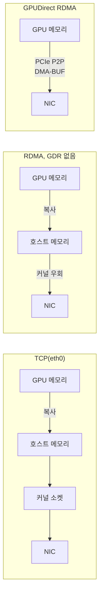
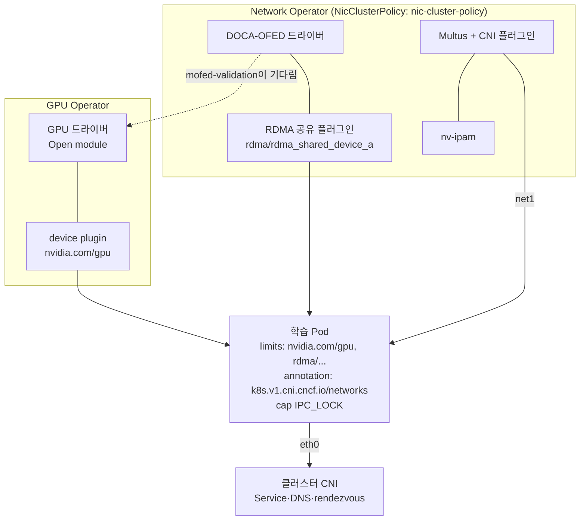

# 10. 노드 간 통신: RDMA·InfiniBand·GPUDirect RDMA와 Network Operator

> [목차로](CURRICULUM.md) · 작성 2026-10-19 · 기준 버전: NVIDIA Network Operator v26.7.1(2026-10-16, `v26.7.1` 태그 소스), GPU Operator v26.7.2(2026-10-14), NCCL 2.32.3 문서, Multus v4.3.1, k8s-rdma-shared-dev-plugin v1.5.4, sriov-network-device-plugin v3.11.0, Kubernetes 1.37
> **[근거]** 출처에 그대로 있는 내용, **[추론]** 여러 출처를 엮어 내린 결론.
> 앞 절: [09. 갱 스케줄링과 큐](09-gang-scheduling-queues.md)

## 1. 개념

06절의 2노드 DDP 로그에는 `NCCL INFO NET/Socket : Using [0]eth0`이 찍혔다. Pod 기본 네트워크(CNI가 만든 `eth0`) 위로 TCP를 탄다는 뜻이다. 이 절의 목표는 그 줄을 `NET/IB`로 바꾸는 것, 그리고 가능하면 GPU 메모리에서 NIC로 CPU를 거치지 않고 바로 보내는 것(GPUDirect RDMA)이다.

### 1.1 왜 TCP로는 부족한가

- 데이터 병렬 학습은 스텝마다 기울기 전체를 all-reduce한다. 노드 사이 링크가 느리면 GPU가 통신을 기다리며 논다. **[추론]** 06절 1.5의 all-reduce 구조에서 나온 결론이다.
- TCP 경로는 GPU 메모리 → (복사) 호스트 메모리 → 커널 소켓 버퍼 → NIC 순으로 간다. 복사와 커널 개입이 매번 끼고, CPU가 그 일을 한다.
- RDMA는 NIC가 상대 메모리에 직접 쓰고 읽는다(커널 우회, 제로 카피). 여기에 GPUDirect RDMA가 붙으면 그 "메모리"가 GPU 메모리가 된다. **[근거]** "GPUDirect RDMA는 GPU와 서드파티 장치(ConnectX NIC·BlueField DPU 등)가 PCI Express로 직접 데이터를 주고받게 하는 기술이다." 출처: GPU Operator "GPUDirect RDMA and GPUDirect Storage" <https://docs.nvidia.com/datacenter/cloud-native/gpu-operator/latest/gpu-operator-rdma.html> (2026-10-19 확인)

### 1.2 InfiniBand와 RoCEv2

| | InfiniBand | RoCEv2 |
|---|---|---|
| 링크 | IB 전용 스위치·케이블 | 일반 이더넷 스위치 |
| 주소 | LID·GUID, Subnet Manager가 배정 | IP(GID가 IP에서 나옴) |
| 손실 대응 | 링크 계층 크레딧 기반 흐름 제어 | 무손실 이더넷 설정(PFC·ECN)에 기댐 |
| Pod에 IP를 주려면 | IPoIB 인터페이스 | macvlan·SR-IOV VF |
| 흔한 고장 | SM 없음, 포트 오류 카운터 | GID 인덱스, PFC/ECN 설정 |

- **[근거]** InfiniBand 패브릭에는 Subnet Manager(SM)가 돌아야 한다. `sminfo`로 확인하고, 없으면 한 노드 이상에서 `opensm` 같은 SM을 띄운다. 포트 오류는 `perfquery -x <lid>`의 `SymbolErrorCounter`·`LinkErrorRecoveryCounter`·`LinkDownedCounter`로 본다. 출처: NCCL "Networking troubleshooting" <https://docs.nvidia.com/deeplearning/nccl/user-guide/docs/troubleshooting/networking_troubleshooting.html> (2026-10-19 확인)
- **[근거]** RoCE 성능 문제는 링크 고장보다 혼잡 제어나 무손실 패브릭 설정에서 오는 경우가 많다. `ethtool -S <nic>`의 drop·pause·PFC 카운터와 스위치의 PFC·ECN·CNP 카운터를 NCCL 설정을 바꾸기 **전에** 본다. 같은 출처(2026-10-19 확인)
- 표의 나머지 칸은 **[추론]**이다(아래 Network Operator 예제의 IPoIB·macvlan 구성과 위 문서를 엮었다). 하드웨어 수준 비교는 별도 GPU·AI·LLM 인프라 커리큘럼 노트(비공개)로 잇는다.

### 1.3 GPUDirect RDMA: DMA-BUF와 nvidia-peermem

GPU 메모리를 NIC에 열어 주는 커널 쪽 길은 두 가지다.

| | DMA-BUF (권장) | nvidia-peermem (레거시) |
|---|---|---|
| GPU 드라이버 | **Open Kernel module 필수** | 지원 드라이버 아무거나 |
| CUDA | 11.7 이상 | 제한 없음 |
| 리눅스 커널 | 5.12 이상 | 제한 없음 |
| NIC 드라이버 | MLNX_OFED/DOCA-OFED **선택**(배포판 inbox 드라이버 가능) | MLNX_OFED/DOCA-OFED **필수** |
| GPU Operator 설정 | 기본값 | `--set driver.rdma.enabled=true` |

- **[근거]** 위 표 전체. "NVIDIA는 nvidia-peermem 커널 모듈보다 DMA-BUF를 권장한다." 호스트에 직접 설치한 NIC 드라이버를 쓰면 `--set driver.rdma.useHostMofed=true`, R570 이전 브랜치 드라이버면 `--set driver.kernelModuleType=open`을 더한다. 출처: GPU Operator v26.7.2 "GPUDirect RDMA and GPUDirect Storage" "Common Prerequisites", "Installing the GPU Operator and Enabling GPUDirect RDMA" (2026-10-19 확인)
- **[근거]** 설치하면 드라이버 DaemonSet에 `mofed-validation` init 컨테이너가 붙어 NIC 커널 드라이버가 필요한 심볼을 내보낼 때까지 기다린다. peermem을 켰을 때만 `nvidia-peermem-ctr` 컨테이너가 추가로 뜬다. 같은 출처 "Verifying the Installation" (2026-10-19 확인)
- **[근거]** NCCL은 `NCCL_DMABUF_ENABLE` 기본값 1로 DMA-BUF 등록을 시도하고, 커널·CUDA·NIC 드라이버가 지원하지 않으면 자동으로 끈다. DMA-BUF 경로에서는 nvidia-peermem이 필요 없다. 출처: NCCL 2.32.3 환경 변수 문서 <https://docs.nvidia.com/deeplearning/nccl/user-guide/docs/env.html>, "GPU troubleshooting" <https://docs.nvidia.com/deeplearning/nccl/user-guide/docs/troubleshooting/gpu_troubleshooting.html> (2026-10-19 확인)
- **[근거]** `NCCL_NET_GDR_LEVEL`은 GPU와 NIC 사이 "최대 거리"로 GPUDirect RDMA를 쓸지 정한다: `LOC`(안 씀), `PIX`(같은 PCI 스위치), `PXB`(PCI 스위치 여러 단), `PHB`(같은 NUMA 노드, CPU 경유), `SYS`. 비우면 NCCL이 알아서 고른다. 같은 env 문서(2026-10-19 확인)
- **[근거]** IOMMU(VT-d)·PCI ACS가 켜져 있으면 PCI 점대점 트래픽이 CPU 루트 컴플렉스로 돌아가 성능이 크게 떨어지거나 hang이 난다. `lspci -vvv | grep ACSCtl`에서 `SrcValid+`가 보이면 의심한다. 출처: NCCL "GPU troubleshooting" (2026-10-19 확인)
- **[추론]** 그래서 GPUDirect RDMA는 "켜는" 설정보다 "GPU와 NIC가 가까이 있는가"가 먼저다. 같은 PCIe 스위치 밑의 GPU-NIC 짝을 고르는 일은 11절(토폴로지 인지 배치)에서 다룬다.

### 1.4 NVIDIA Network Operator가 깔아 주는 것

GPU Operator가 GPU 쪽 스택을 맡듯, Network Operator는 NIC 쪽 스택을 맡는다. 설정은 클러스터에 하나뿐인 `NicClusterPolicy`(`mellanox.com/v1alpha1`) 한 장에 모인다.

- **[근거]** `NicClusterPolicySpec`의 구성 요소: `ofedDriver`(DOCA-OFED 드라이버 컨테이너), `rdmaSharedDevicePlugin`, `sriovDevicePlugin`, `ibKubernetes`(IB PKey·GUID 관리), `secondaryNetwork`(Multus·CNI 플러그인·IPoIB CNI), `nvIpam`, `nicFeatureDiscovery`, `docaTelemetryService`, `nicConfigurationOperator`(NIC 펌웨어 설정), `spectrumXOperator`. 출처: `api/v1alpha1/nicclusterpolicy_types.go` v26.7.1 — <https://github.com/Mellanox/network-operator/tree/v26.7.1> (2026-10-19 확인)
- **[근거]** 컨트롤러는 이름이 **`nic-cluster-policy`인 객체만** 처리한다. 다른 이름으로 만들면 상태를 `ignore`로 두고 "Only instance with name nic-cluster-policy is supported"라고 적는다. 출처: `controllers/nicclusterpolicy_controller.go`, `pkg/consts/consts.go` v26.7.1 (2026-10-19 확인)
- **[근거]** Helm 차트 기본값: `nfd.enabled: true`(Node Feature Discovery 같이 배포), `sriovNetworkOperator.enabled: false`, `maintenanceOperator.enabled: false`. SR-IOV 오퍼레이터의 리소스 접두어는 `nvidia.com`. 차트 `kubeVersion: '>= 1.32.0-0'`. 출처: `deployment/network-operator/values.yaml`·`Chart.yaml` v26.7.1 (2026-10-19 확인)
- **[근거]** `nvIpam`은 cert-manager 같은 인증서 관리가 필요하다(타입 주석). `DevicePluginSpec.useCdi`를 켜도 "Network Operator는 컨테이너 런타임의 CDI를 설정하지 않는다." 같은 타입 파일(2026-10-19 확인)
- **[추론]** GPU Operator도 기본으로 NFD를 배포한다(02절). 두 오퍼레이터를 같은 클러스터에 기본값으로 올리면 NFD가 둘 뜬다. 한쪽(보통 나중에 까는 쪽)의 NFD를 끄고 이미 있는 것을 쓰는 편이 안전하다. 두 문서 모두 이 조합을 한 곳에 적어 두지는 않았다.

### 1.5 Pod가 RDMA를 받는 세 가지 길

| 방식 | 리소스 이름(예) | Pod에 들어오는 것 | 격리 | 맞는 곳 |
|---|---|---|---|---|
| RDMA 공유 장치 플러그인 | `rdma/rdma_shared_device_a` | 같은 HCA를 여러 Pod가 공유 + Multus 보조 인터페이스(macvlan/IPoIB) | 없음(대역폭·QP 공유) | 노드당 학습 Pod 1개, 시작이 쉬움 |
| SR-IOV 장치 플러그인 | `nvidia.com/mlnxnics` | VF 하나를 Pod 전용으로 | VF 단위 | 노드에 여러 잡, 멀티테넌트 |
| host network | (없음) | 노드의 NIC 전부 | 없음 | 시험용. 포트 충돌·보안 문제 |

- **[근거]** 공유 플러그인 설정의 `rdmaHcaMax`는 "이 리소스가 내줄 수 있는 최대 개수"로 **필수**, `resourcePrefix` 기본값은 `rdma`, `periodicUpdateInterval`은 생략 시 60초(0이면 끔). 선택자는 `vendors`·`deviceIDs`·`ifNames`·`linkTypes` 등. 출처: k8s-rdma-shared-dev-plugin v1.5.4 README <https://github.com/Mellanox/k8s-rdma-shared-dev-plugin/tree/v1.5.4> (2026-10-19 확인)
- **[근거]** SR-IOV 장치 플러그인의 `resourcePrefix` 기본값은 **`intel.com`**이고, Mellanox VF에 RDMA를 붙이려면 선택자에 `"isRdma": true`를 준다. 출처: sriov-network-device-plugin v3.11.0 README <https://github.com/k8snetworkplumbingwg/sriov-network-device-plugin/tree/v3.11.0> (2026-10-19 확인)
- **[근거]** rdma-cni는 RDMA 서브시스템의 네트워크 네임스페이스 모드를 `exclusive`로 두라고 권한다(`rdma system set netns exclusive` 또는 `ib_core netns_mode=0`). 바꿀 때는 시스템에 네트워크 네임스페이스가 하나도 없어야 한다. 출처: <https://github.com/k8snetworkplumbingwg/rdma-cni> README (2026-10-19 확인)
- **[추론]** `exclusive` 모드에서는 RDMA 장치가 한 네임스페이스에만 보이므로 SR-IOV VF처럼 Pod마다 장치를 나눠 줄 때 맞고, 하나의 HCA를 여러 Pod가 같이 쓰는 공유 플러그인과는 성격이 반대다. 둘을 한 노드에 섞기 전에 모드부터 정한다. 모드 변경은 "네임스페이스 0개"가 조건이라 사실상 노드 부팅 설정이다.

### 1.6 Multus: Pod에 두 번째 NIC 달기

- **[근거]** Multus는 기본 CNI 뒤에 추가 CNI를 위임해 Pod에 보조 인터페이스를 붙인다. 추가 네트워크는 `NetworkAttachmentDefinition`(NAD)으로 정의하고, Pod 주석 `k8s.v1.cni.cncf.io/networks: <nad>`(다른 네임스페이스면 `<ns>/<nad>`, 이름을 정하려면 `<nad>@<ifname>`, JSON 목록이면 IP 고정 가능)으로 고른다. 보조 인터페이스는 기본으로 `net1`, `net2` 순으로 붙는다. 출처: Multus v4.3.1 `docs/how-to-use.md` <https://github.com/k8snetworkplumbingwg/multus-cni/blob/v4.3.1/docs/how-to-use.md> (2026-10-19 확인)
- **[근거]** Network Operator는 NAD를 직접 쓰지 않아도 되게 `MacvlanNetwork`·`IPoIBNetwork`·`HostDeviceNetwork` CRD를 둔다. 예: `MacvlanNetwork`의 `master`에 RDMA 가능한 넷디바이스를, `ipam`에 `nv-ipam` 풀을 준다. 출처: `example/crs/` v26.7.1 (2026-10-19 확인)
- **[추론]** Pod는 이제 인터페이스가 둘이다. `eth0`(클러스터 CNI, Service·DNS가 탐)과 `net1`(RDMA). torchrun rendezvous는 Service 이름으로 `eth0`을 타도 되지만, NCCL은 "IB 인터페이스 우선" 자동 선택(06절 1.5)이 엇나가면 `eth0`으로 TCP를 탈 수 있다. 그래서 NCCL 쪽만 `net1`·HCA로 고정한다(아래 3.4).

## 2. 그림

### 2.1 데이터 경로: TCP vs RDMA vs GPUDirect RDMA



### 2.2 구성 요소와 Pod



## 3. 실습

GPU·ConnectX NIC가 있는 2노드 기준. 하드웨어가 없으면 4절로 간다.

### 3.1 Network Operator와 NicClusterPolicy

```bash
helm repo add nvidia https://helm.ngc.nvidia.com/nvidia && helm repo update
# GPU Operator가 이미 NFD를 띄웠다면 nfd.enabled=false (1.4)
helm install network-operator nvidia/network-operator -n nvidia-network-operator --create-namespace \
  --version v26.7.1 --set nfd.enabled=false --wait
```

`nic-cluster-policy.yaml`(이름은 바꾸면 안 된다, 1.4). 예제 `example/crs/mellanox.com_v1alpha1_nicclusterpolicy_cr.yaml` v26.7.1을 줄였다.

```yaml
apiVersion: mellanox.com/v1alpha1
kind: NicClusterPolicy
metadata:
  name: nic-cluster-policy
spec:
  ofedDriver:                       # 호스트에 드라이버가 이미 있으면 이 블록을 빼고 GPU Operator에 useHostMofed
    image: doca-driver
    repository: nvcr.io/nvidia/mellanox
    version: doca3.5.0-26.07-0.7.7.0-1
  rdmaSharedDevicePlugin:
    image: k8s-rdma-shared-dev-plugin
    repository: nvcr.io/nvidia/mellanox
    version: network-operator-v26.7.1
    config: |
      {"configList": [{
        "resourceName": "rdma_shared_device_a",
        "rdmaHcaMax": 63,
        "selectors": {"vendors": ["15b3"], "ifNames": ["ens1f0np0"]}
      }]}
  nvIpam:
    image: nvidia-k8s-ipam
    repository: nvcr.io/nvidia/mellanox
    version: network-operator-v26.7.1
    enableWebhook: false
  secondaryNetwork:
    cniPlugins: {image: plugins, repository: nvcr.io/nvidia/mellanox, version: network-operator-v26.7.1}
    multus:     {image: multus-cni, repository: nvcr.io/nvidia/mellanox, version: network-operator-v26.7.1}
```

```bash
kubectl apply -f nic-cluster-policy.yaml
kubectl get nicclusterpolicy nic-cluster-policy -o jsonpath='{.status.state}{"\n"}'   # 기대: ready
kubectl get node <gpu-node> -o jsonpath='{.status.allocatable}' | tr ',' '\n' | grep -E 'rdma|nvidia.com/gpu'
#   "nvidia.com/gpu":"8"
#   "rdma/rdma_shared_device_a":"63"
```

`ifNames`는 노드에서 `ibdev2netdev`(예: `mlx5_0 port 1 ==> ens1f0np0 (Up)`)로 찾는다. 예제는 `deviceIDs`로 골랐지만, 포트가 여럿인 노드에선 이름으로 고르는 편이 어느 포트가 리소스가 됐는지 분명하다 **[추론]**.

### 3.2 GPU Operator를 DMA-BUF로

```bash
# Network Operator가 NIC 드라이버를 깔았을 때(DMA-BUF는 기본값이라 추가 플래그 없음)
helm upgrade --install gpu-operator nvidia/gpu-operator -n gpu-operator --create-namespace --version v26.7.2 --wait
kubectl describe ds -n gpu-operator nvidia-driver-daemonset | grep -A1 -E 'mofed-validation|nvidia-peermem-ctr'
# 기대: mofed-validation 은 있고, nvidia-peermem-ctr 은 없다(DMA-BUF 경로)
```

### 3.3 보조 네트워크와 두 Pod 사이 대역폭

```yaml
apiVersion: nv-ipam.nvidia.com/v1alpha1
kind: IPPool
metadata: {name: rdma-pool, namespace: nvidia-network-operator}
spec:
  subnet: 192.168.100.0/24
  perNodeBlockSize: 32
  gateway: 192.168.100.1
---
apiVersion: mellanox.com/v1alpha1
kind: MacvlanNetwork          # RoCE. IB면 IPoIBNetwork(master: ib 인터페이스)
metadata: {name: rdma-net}
spec:
  networkNamespace: default
  master: ens1f0np0
  mode: bridge
  mtu: 9000                   # 스위치 MTU와 맞춘다
  ipam: '{"type": "nv-ipam", "poolName": "rdma-pool"}'
```

`perftest-pod.yaml`(노드 이름만 바꿔 두 개). GPU Operator 문서의 검증 예제와 같다.

```yaml
apiVersion: v1
kind: Pod
metadata:
  name: perf-1
  annotations: {k8s.v1.cni.cncf.io/networks: rdma-net}
spec:
  nodeSelector: {kubernetes.io/hostname: gpu-node-1}
  restartPolicy: OnFailure
  containers:
  - name: t
    image: mellanox/cuda-perftest
    securityContext: {capabilities: {add: ["IPC_LOCK"]}}   # RDMA 메모리 고정(pin)
    resources:
      limits:   {nvidia.com/gpu: 1, rdma/rdma_shared_device_a: 1}
      requests: {nvidia.com/gpu: 1, rdma/rdma_shared_device_a: 1}
```

```bash
kubectl exec perf-1 -- ip -br addr show net1          # 192.168.100.x
kubectl exec perf-1 -- ib_write_bw --use_cuda=0 --use_cuda_dmabuf -d mlx5_0 -a -F --report_gbits -q 1
kubectl exec perf-2 -- ib_write_bw -n 5000 --use_cuda=0 --use_cuda_dmabuf -d mlx5_0 -a -F --report_gbits -q 1 <perf-1의 net1 IP>
```

- **[근거]** 이 명령과 출력 형식은 GPU Operator 문서의 "Verifying the Installation by Performing a Data Transfer"에서 왔다. 문서 예시는 큰 메시지에서 약 92 Gb/s(100GbE RoCE)다. 출처: GPU Operator v26.7.2 RDMA 문서 (2026-10-19 확인)
- 같은 명령을 `--use_cuda` 없이 돌려 호스트 메모리 대역폭과 비교한다. 둘이 비슷하면 GPUDirect가 일을 하는 것이고, CUDA 쪽만 크게 낮으면 1.3의 거리·ACS부터 본다 **[추론]**.

### 3.4 06절 DDP Job을 RDMA로

06절 `ddp-job.yaml`의 Pod 템플릿에 다음을 더한다.

```yaml
  template:
    metadata:
      annotations: {k8s.v1.cni.cncf.io/networks: rdma-net}
    spec:
      containers:
      - name: trainer
        securityContext: {capabilities: {add: ["IPC_LOCK"]}}
        env:
        - {name: NCCL_SOCKET_IFNAME, value: "=net1"}   # 부트스트랩 소켓도 RDMA 서브넷으로
        - {name: NCCL_IB_HCA, value: "=mlx5_0"}        # 쓸 HCA를 정확히
        - {name: NCCL_DEBUG, value: "INFO"}            # 확인용. 운영엔 남기지 않는다(06절 5)
        resources:
          limits: {nvidia.com/gpu: 1, rdma/rdma_shared_device_a: 1}
```

```bash
kubectl logs -l job-name=ddp --prefix --tail=-1 | grep -E "NCCL INFO (NET/|Using network|GPU Direct|DMA-BUF)"
# 기대: NET/IB 로 시작하는 줄, 그리고 GDR/DMA-BUF 사용 표시. NET/Socket 이 보이면 RDMA를 못 탄 것.
```

- **[근거]** `NCCL_IB_HCA`는 쉼표 목록이고 항목마다 `<hca>[:<port>]` 형식, `^`는 제외, `=`는 정확히 일치(없으면 접두어 일치). 포트를 빼면 그 HCA의 모든 포트를 쓴다. 출처: NCCL 2.32.3 env 문서 (2026-10-19 확인)
- **[근거]** RoCE에서 흔한 오류 `NCCL WARN Call to ibv_modify_qp failed with error Invalid argument`는 잘못된 GID 인덱스 때문이다. NCCL 2.21부터 GID를 동적으로 고르므로 `NCCL_IB_GID_INDEX`를 **설정하지 않는 것**이 맞다. 2.32u1부터 기본값은 `AUTO`이고 잘못된 값은 `AUTO`로 되돌린다. RoCE 패브릭에선 `NCCL_IB_TC`를 벤더 권장값으로 줘야 할 수 있다. 출처: NCCL "Networking troubleshooting", env 문서 (2026-10-19 확인)
- 실제 로그 문구는 NCCL 버전마다 다르다. 위 grep 패턴은 실측하지 않았다 **[추론]**.

갱 스케줄링(09절)과 같이 쓸 때: 갱은 Pod가 "동시에" 놓이게 할 뿐, 보조 네트워크 IP 풀이나 `rdma/...` 리소스가 남는지는 따로 본다. `rdmaHcaMax`가 노드당 Pod 수보다 작으면 갱 전체가 대기한다 **[추론]**.

## 4. GPU 없이 확인하는 법

RDMA 자체(커널 우회, GPUDirect)는 하드웨어 없이는 못 본다. 대신 "스케줄링·리소스 이름·Multus 배선·NCCL 인터페이스 고정"까지는 kind로 검증된다.

1. **리소스 요청만.** 01절처럼 kind 워커 노드 status에 가짜 용량을 패치한다.

```bash
kind create cluster --name rdma --image kindest/node:v1.37.0 --config kind-2workers.yaml
kubectl proxy &   # 8001
for n in rdma-worker rdma-worker2; do
  curl -s -XPATCH -H 'Content-Type: application/json-patch+json' \
    --data '[{"op":"add","path":"/status/capacity/nvidia.com~1gpu","value":"1"},
             {"op":"add","path":"/status/capacity/rdma~1rdma_shared_device_a","value":"1"}]' \
    http://127.0.0.1:8001/api/v1/nodes/$n/status >/dev/null
done
kubectl describe node rdma-worker | grep -A3 Allocatable
```

   - perftest Pod를 노드당 2개 만들면 두 번째가 `Insufficient rdma/rdma_shared_device_a`로 `Pending`이 돼야 한다. `rdmaHcaMax`의 의미(노드당 몇 Pod까지)를 그대로 재현한다. 컨테이너는 실제 장치가 없어 뜨지 못하므로 `image: busybox`, `command: [sleep, "3600"]`으로 바꾼다.
2. **Multus 배선과 NCCL 대신 Gloo.** Multus thick을 깔고 kind 노드의 `eth0` 위에 macvlan NAD를 만든다.

```bash
kubectl apply -f https://raw.githubusercontent.com/k8snetworkplumbingwg/multus-cni/v4.3.1/deployments/multus-daemonset-thick.yml
docker exec rdma-worker ls /opt/cni/bin     # macvlan·host-local 이 없으면 containernetworking/plugins v1.9.1 바이너리를 docker cp
cat <<'EOF' | kubectl apply -f -
apiVersion: k8s.cni.cncf.io/v1
kind: NetworkAttachmentDefinition
metadata: {name: rdma-net}
spec:
  config: '{"cniVersion":"1.0.0","type":"macvlan","master":"eth0","mode":"bridge",
            "ipam":{"type":"host-local","subnet":"192.168.100.0/24"}}'
EOF
```

   - 06절 4절의 CPU(Gloo) 변형 Job에 주석 `k8s.v1.cni.cncf.io/networks: rdma-net`과 `GLOO_SOCKET_IFNAME=net1`을 넣는다. `kubectl exec <pod> -- ip -br addr`에 `net1 192.168.100.x`가 보이고, 학습이 같은 `weight_sums`로 끝나면 "rendezvous는 eth0, 집합 통신은 net1" 배선이 맞다. `GLOO_SOCKET_IFNAME=net9`처럼 없는 이름을 주면 초기화가 실패해야 한다(자가 제대로 재는지 확인하는 대조군).
   - kind 노드 이미지에 macvlan 바이너리가 들어 있는지는 확인하지 못했다. 그래서 `ls`부터 한다 **[추론]**.
3. **스키마만.** CRD를 깔고 `kubectl apply --dry-run=server -f nic-cluster-policy.yaml`. Network Operator CRD만 필요하면 `helm template`으로 뽑은 `crds/`만 apply한다. 이름을 `my-policy`로 바꿔 실제로 적용하면 상태가 `ignore`가 돼야 한다(1.4) — 이건 오퍼레이터가 떠 있어야 보인다.

## 5. 흔한 실수

1. **NicClusterPolicy 이름을 바꾼다.** `nic-cluster-policy`가 아니면 오퍼레이터가 무시하고 아무것도 깔지 않는다(1.4). 오류가 아니라 상태 `ignore`로만 남아 놓치기 쉽다.
2. **`IPC_LOCK`을 빠뜨린다.** RDMA는 메모리를 고정(pin)한다. 공식 예제 Pod가 모두 `capabilities.add: ["IPC_LOCK"]`을 쓴다. NCCL 문서도 컨테이너에서 `--ulimit memlock=-1`을 권한다(`runtime_and_mpi_issues`). **[근거]**
3. **보조 네트워크를 달고 NCCL을 그냥 둔다.** 자동 선택이 `eth0`을 골라 `NET/Socket`으로 돈다. 로그에서 `NET/IB`를 확인하기 전엔 RDMA를 쓴다고 말하지 않는다.
4. **RoCE에서 옛 블로그대로 `NCCL_IB_GID_INDEX=3`을 박는다.** 2.21 이후엔 설정하지 말라는 것이 공식 안내다(3.4).
5. **DMA-BUF를 기대하면서 proprietary 커널 모듈 드라이버를 쓴다.** DMA-BUF는 Open Kernel module이 필수다(1.3). GPU Operator 25.3 이후 `driver.kernelModuleType` 기본값 `auto`에 맡기지 말고 확인한다.
6. **SR-IOV 리소스 이름을 `intel.com/...`으로 잘못 찾는다.** 단독 SR-IOV 장치 플러그인의 기본 접두어는 `intel.com`, Network Operator 차트로 깔면 `nvidia.com`이다(1.5). `kubectl get node -o jsonpath='{.status.allocatable}'`로 실제 이름을 본다.
7. **NFD를 두 번 깐다.** GPU Operator와 Network Operator 모두 기본으로 NFD를 배포한다(1.4).
8. **공식 예제를 그대로 붙인다.** `example/sriov-network/infiniband/sriov-ib-network.yaml` v26.7.1의 `ipam` JSON은 `"poolName": "my-pool",` 뒤에 쉼표가 남아 있어 엄밀한 JSON이 아니다. **[근거]** 파일 원문 · CNI가 이를 받아 주는지는 확인하지 않았다 **[추론]**. 붙이기 전에 `jq .`로 한 번 통과시킨다.
9. **ACS·IOMMU를 안 본다.** GPUDirect가 켜졌는데 느리거나 멈추면 1.3의 ACS부터. 소프트웨어 설정을 바꾸기 전 확인이다.
10. **스위치 MTU와 다른 MTU를 준다.** `MacvlanNetwork.mtu`를 9000으로 줬는데 스위치가 1500이면 큰 메시지만 사라진다. 패브릭 쪽 값과 맞춘다 **[추론]**.

## 6. 확인 문제

1. 2노드 DDP Job에 `rdma-net` 주석과 `rdma/rdma_shared_device_a: 1`을 넣었는데 로그에 `NCCL INFO NET/Socket : Using [0]eth0`이 찍힌다. 의심할 것 세 가지와 각각 확인하는 명령은?
2. 노드마다 GPU 8장, ConnectX 포트 1개다. RDMA 공유 플러그인 `rdmaHcaMax: 4`로 두고 GPU 1장짜리 학습 Pod 8개를 한 노드에 넣으려 한다. 무슨 일이 일어나나? 공유 방식에서 이 숫자를 키우는 것만으로 충분한가?
3. 같은 클러스터의 노드 A는 리눅스 커널 6.8 + Open Kernel module 드라이버 + 배포판 inbox mlx5 드라이버, 노드 B는 커널 5.4 + proprietary 드라이버 + DOCA-OFED다. 두 노드에서 GPUDirect RDMA를 쓰려면 각각 어떤 경로가 가능하고, GPU Operator 설정은 어떻게 갈리나?

<details>
<summary>답</summary>

1. (가) NCCL이 IB 장치를 못 봄: `kubectl exec <pod> -- ls /dev/infiniband`, `ibv_devices`(장치가 안 보이면 RDMA 리소스나 플러그인 문제). (나) 인터페이스 자동 선택이 `eth0`을 고름: `NCCL_SOCKET_IFNAME=net1`·`NCCL_IB_HCA`를 주고 `ip -br addr`로 `net1`이 있는지 본다(Multus 주석 오타나 NAD 네임스페이스가 다르면 `net1`이 아예 없다). (다) 디버그 변수 `NCCL_IB_DISABLE=1`이 남아 있음: `kubectl get pod -o yaml | grep NCCL_`. 그 밖에 `IPC_LOCK` 누락이면 IB 초기화 경고 뒤 소켓으로 떨어질 수 있다(추론).
2. 노드 allocatable의 `rdma/rdma_shared_device_a`가 4라 다섯 번째 Pod부터 `Insufficient rdma/...`로 `Pending`이다. 갱 스케줄링 중이면 잡 전체가 대기한다. `rdmaHcaMax`를 8 이상으로 올리면 배치는 되지만, 공유 방식은 포트 하나의 대역폭과 HCA 자원을 8개 Pod가 나눠 쓴다(격리 없음). 노드 안 8 GPU를 쓰는 학습이라면 보통은 노드당 Pod 1개(GPU 8장)로 묶어 노드 안 통신은 NVLink에 맡기고, 노드 사이만 RDMA를 타게 하는 편이 낫다. GPU마다 NIC가 따로 있는 서버라면 GPU-NIC 짝짓기는 11절.
3. 노드 A: DMA-BUF 조건(커널 ≥5.12, Open module, CUDA ≥11.7)을 만족하고 inbox 드라이버로도 된다. GPU Operator 기본값(DMA-BUF)에 `driver.rdma.useHostMofed=true`(호스트 드라이버 사용). 노드 B: 커널 5.4·proprietary라 DMA-BUF 불가, DOCA-OFED가 있으니 레거시 nvidia-peermem 경로(`driver.rdma.enabled=true`)만 된다. 한 Helm 릴리스의 `driver.rdma.*`는 클러스터 전체 값이라, 실제로는 노드 B의 커널·드라이버를 올려 DMA-BUF로 맞추는 것이 깔끔하다(추론, GPU Operator에 노드 그룹별 드라이버 설정이 있는지는 이 절에서 확인하지 않았다).

</details>

## 7. 이어 볼 것

- 11절: GPU와 NIC가 같은 PCIe 스위치 밑에 있는지(`nvidia-smi topo -m`의 `PIX`/`PXB`), `NCCL_NET_GDR_LEVEL`과 kubelet Topology Manager로 GPU-NIC 짝을 맞추기, Kueue TAS·Volcano HyperNode로 같은 스위치에 놓기.
- 12절: `NCCL_DEBUG_SUBSYS=NET,INIT`, NCCL RAS, IB 포트 카운터와 DOCA Telemetry Service 지표.
- 별도 스터디 노트(비공개): GPU·AI·LLM 인프라 커리큘럼의 네트워크 장(InfiniBand·RoCE·Spectrum-X 하드웨어, nccl-tests). 2026-10-19 현재 미작성 구간이 있다.

## 8. 출처 (모두 2026-10-19 확인)

- NVIDIA GPU Operator v26.7.2, GPUDirect RDMA and GPUDirect Storage: <https://docs.nvidia.com/datacenter/cloud-native/gpu-operator/latest/gpu-operator-rdma.html>
- NVIDIA Network Operator 문서 시작점: <https://docs.nvidia.com/networking/software/cloud-orchestration/index.html>
- Network Operator 릴리스 v26.7.1(2026-10-16): <https://github.com/Mellanox/network-operator/releases/tag/v26.7.1>
- Network Operator 소스 v26.7.1: `api/v1alpha1/nicclusterpolicy_types.go`, `controllers/nicclusterpolicy_controller.go`, `pkg/consts/consts.go`, `deployment/network-operator/values.yaml`·`Chart.yaml`, `example/crs/`, `example/rdma-gpu-test-pod1.yml`, `example/sriov-network/infiniband/` — <https://github.com/Mellanox/network-operator/tree/v26.7.1>
- k8s-rdma-shared-dev-plugin v1.5.4: <https://github.com/Mellanox/k8s-rdma-shared-dev-plugin/tree/v1.5.4>
- sriov-network-device-plugin v3.11.0: <https://github.com/k8snetworkplumbingwg/sriov-network-device-plugin/tree/v3.11.0>
- rdma-cni: <https://github.com/k8snetworkplumbingwg/rdma-cni>
- Multus v4.3.1: <https://github.com/k8snetworkplumbingwg/multus-cni/tree/v4.3.1> (`docs/how-to-use.md`, `deployments/multus-daemonset-thick.yml`)
- containernetworking/plugins v1.9.1: <https://github.com/containernetworking/plugins/releases>
- NCCL 2.32.3 환경 변수: <https://docs.nvidia.com/deeplearning/nccl/user-guide/docs/env.html>
- NCCL 트러블슈팅(Networking·GPU·Runtime and MPI issues): <https://docs.nvidia.com/deeplearning/nccl/user-guide/docs/troubleshooting.html>
- kind 노드 이미지 `v1.37.0`: <https://hub.docker.com/r/kindest/node/tags>
