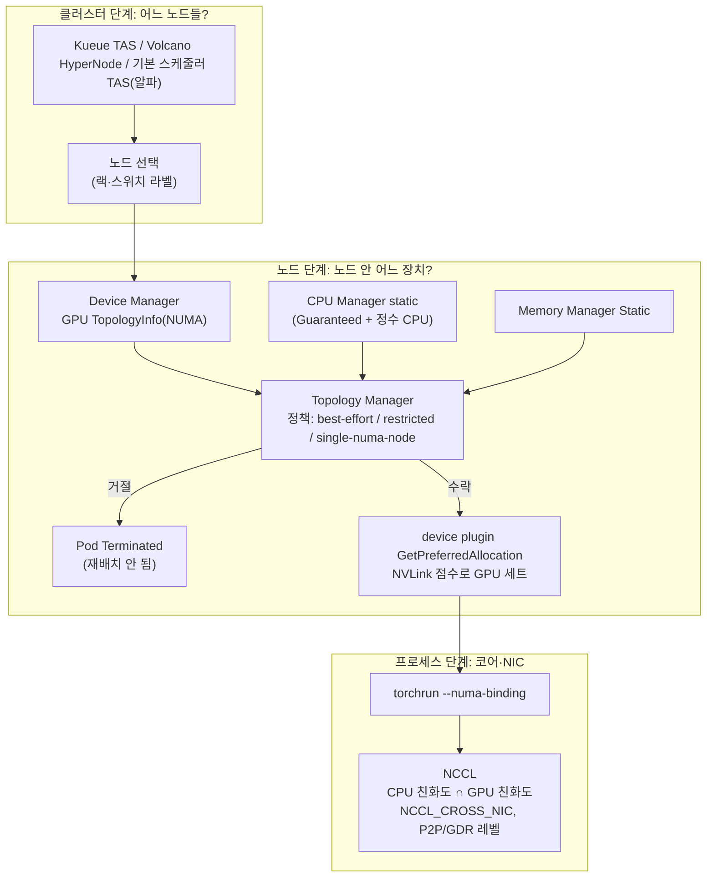

# 11. 토폴로지 인지 배치: NVLink·NUMA·Topology Manager와 랙 단위 배치

> [목차로](CURRICULUM.md) · 작성 2026-10-21 · 기준 버전: Kubernetes 1.37(`v1.37.0` 태그 소스), NVIDIA k8s-device-plugin v0.20.1(`v0.20.1` 태그 소스), go-gpuallocator(main), NCCL 2.32.3 문서, PyTorch 2.14(`v2.14.0` 태그 소스), Kueue v0.20.2, Volcano v1.16.0
> **[근거]** 출처에 그대로 있는 내용, **[추론]** 여러 출처를 엮어 내린 결론.
> 앞 절: [10. 노드 간 통신](10-rdma-gpudirect.md)

## 1. 개념

토폴로지 문제는 두 층에서 생긴다.

- **노드 안**: 같은 서버에 GPU 8장이 있어도 어떤 둘은 NVLink로, 어떤 둘은 CPU 소켓 사이 링크(UPI 등)를 건너 이어진다. CPU 코어·메모리·NIC도 NUMA 노드마다 갈린다. Pod가 "GPU 2장, CPU 16개"를 받았는데 GPU는 소켓 0, CPU는 소켓 1이면 데이터가 매번 소켓을 건넌다.
- **노드 사이**: 같은 리프 스위치 밑의 두 노드와, 스파인을 두 번 건너는 두 노드는 대역폭과 지연이 다르다. 06·09절의 분산 잡은 가장 느린 링크에 맞춰 돈다.

쿠버네티스는 이 두 층을 서로 다른 부품으로 다룬다. 노드 안은 kubelet(Topology Manager, CPU·Memory Manager, device plugin)이, 노드 사이는 스케줄러(Kueue TAS, Volcano HyperNode, 기본 스케줄러의 알파 TAS)가 맡는다. **[추론]** 둘은 서로를 모른다. 이 절의 흔한 실수 대부분이 그 틈에서 나온다.

### 1.1 `nvidia-smi topo -m` 읽기

**[근거]** 행렬 칸의 뜻(nvidia-smi 문서, 2026-10-21 확인):

| 표기 | 뜻 | 대략의 거리 |
|---|---|---|
| `NV#` | NVLink # 가닥으로 직결 | 가장 가깝다 |
| `PIX` | PCIe 스위치 하나를 건넘 | |
| `PXB` | PCIe 스위치 여러 개를 건넘(호스트 브리지는 안 건넘) | |
| `PHB` | PCIe 호스트 브리지(보통 CPU)를 건넘 | |
| `NODE` | 같은 NUMA 노드 안에서 호스트 브리지 사이를 건넘 | |
| `SYS` | NUMA 노드 사이 SMP 링크(QPI/UPI)를 건넘 | 가장 멀다 |

출처: <https://docs.nvidia.com/deploy/nvidia-smi/index.html> "topo" 절(2026-10-21 확인). 같은 문서에 `nvidia-smi topo -mp`(NVLink 대신 PCIe 경로만)도 있다.

- **[근거]** 행렬 오른쪽의 `CPU Affinity`·`NUMA Affinity` 열은 GPU마다 가까운 CPU 목록과 NUMA 노드다. NIC가 PCI 브리지로 쓰이는 시스템에서는 NIC 행이 따로 나온다(같은 문서).
- **[근거]** NCCL도 같은 이름을 쓴다. `NCCL_P2P_LEVEL`과 10절의 `NCCL_NET_GDR_LEVEL`은 `LOC`·`NVL`·`PIX`·`PXB`·`PHB`·`SYS` 중 하나로 "이 거리까지만 P2P(또는 GPUDirect RDMA)를 쓴다"를 정한다. 출처: NCCL 2.32.3 env 문서 <https://docs.nvidia.com/deeplearning/nccl/user-guide/docs/env.html> (2026-10-21 확인)
- **[추론]** 그래서 표를 읽는 법은 "내 Pod가 받은 GPU 쌍, 그리고 GPU-NIC 쌍이 어느 칸에 있나"다. GPU끼리 `NV#`이면 노드 안 통신은 NVLink가 맡고, GPU-NIC가 `PIX`·`PXB`면 GPUDirect RDMA가 제 속도를 낸다. `SYS`가 섞이면 의심한다.
- 하드웨어별 실제 행렬(DGX·HGX 세대별)은 별도 GPU·AI·LLM 인프라 커리큘럼 노트(비공개)로 잇는다.

### 1.2 device plugin이 GPU 몇 번을 고르나

01절에서 본 `GetPreferredAllocation`이 여기서 일을 한다.

- **[근거]** kubelet device manager는 플러그인이 `GetPreferredAllocationAvailable`을 켰을 때만 이 호출을 하고, 결과는 "힌트일 뿐 보장은 아니다." 출처: device plugin 문서 <https://kubernetes.io/docs/concepts/extend-kubernetes/compute-storage-net/device-plugins/> (2026-10-21 확인)
- **[근거]** NVIDIA device plugin v0.20.1은 이 옵션을 항상 켠다(`internal/plugin/server.go`). 가용 장치가 **모두 MIG가 아닌 통 GPU이고 replica(time-slicing) 표시가 없을 때만** go-gpuallocator의 `BestEffortPolicy`로 "정렬된 할당"을 계산한다. 그 밖(time-slicing·MIG)은 `distributed`(기본) 또는 `packed` 탐욕 할당이다. 출처: `internal/rm/nvml_manager.go`의 `getPreferredAllocation`, `internal/rm/devices.go`의 `AlignedAllocationSupported`, `internal/rm/allocate.go` (<https://github.com/NVIDIA/k8s-device-plugin/tree/v0.20.1>, 2026-10-21 확인)
- **[근거]** `BestEffortPolicy`는 GPU 쌍마다 링크 점수를 매긴다. CPU 사이 건넘 10, 같은 CPU 20, 호스트 브리지 30, PCIe 스위치 여러 개 40, 하나 50, 같은 보드 60, NVLink는 가닥당 100(1가닥 100, 2가닥 200 …). 그리고 "점수가 가장 큰 한 세트"를 욕심내지 않고, 노드의 GPU 전체를 요청 크기의 세트로 나눴을 때 **점수 합이 최대인 분할**을 찾은 뒤 그 안에서 가장 좋은 세트를 돌려준다. 출처: <https://github.com/NVIDIA/go-gpuallocator> `gpuallocator/besteffort_policy.go` `calculateGPUPairScore`, `Allocate` 주석(2026-10-21 확인)
- **[추론]** 이 분할 방식 덕에 "2장짜리 Pod 4개"가 차례로 들어와도 NVLink 짝이 덜 쪼개진다. 반대로 time-slicing을 켠 노드에서는 정렬 할당이 꺼진다(replica 표시가 붙으므로). 공유 노드에서 2장 이상을 받는 Pod는 NVLink 짝을 기대하지 말아야 한다.
- **[근거]** 같은 플러그인은 장치를 등록할 때 `/sys/bus/pci/devices/<busID>/numa_node`를 읽어 `TopologyInfo`(NUMA 노드 ID)를 붙인다. MIG 장치는 부모 GPU의 NUMA를 쓴다. 출처: `internal/rm/nvml_devices.go` `GetNumaNode`, `internal/rm/devices.go`(v0.20.1, 2026-10-21 확인). 이 값이 아래 Topology Manager의 힌트 재료다.

### 1.3 kubelet Topology Manager

**[근거]** 아래는 모두 "Control Topology Management Policies on a node" <https://kubernetes.io/docs/tasks/administer-cluster/topology-manager/> (Kubernetes 1.37 문서, 2026-10-21 확인).

- Topology Manager는 kubelet 부품이다(1.27부터 GA). CPU Manager·Memory Manager·Device Manager가 **힌트 제공자(Hint Provider)** 로서 "어느 NUMA 노드 조합이면 내 몫을 줄 수 있다"를 비트마스크로 내고, Topology Manager가 정책에 따라 하나로 합친다.
- 정책 네 가지:

| 정책 | 정렬 못 하면 |
|---|---|
| `none`(기본) | 정렬 안 함 |
| `best-effort` | 선호 힌트를 저장하고 **그래도 받아들인다** |
| `restricted` | 선호 힌트가 아니면 **거절** |
| `single-numa-node` | NUMA 노드 하나로 못 맞추면 **거절** |

- 범위(`topologyManagerScope`)는 `container`(기본, 컨테이너마다 따로 정렬)와 `pod`(Pod 전체를 같은 NUMA 집합에 정렬).
- 거절된 Pod는 `Terminated` 상태가 되고 "admission failure"로 끝난다. **스케줄러는 이 Pod를 다시 배치하지 않는다.** 문서는 ReplicaSet·Deployment 같은 상위 컨트롤러나 외부 루프로 재생성하라고 권한다.
- 알려진 한계: "스케줄러는 토폴로지를 모른다. 노드에 배치된 뒤 Topology Manager 때문에 실패할 수 있다." NUMA 노드가 8개를 넘으면 기본으로 Topology Manager를 켜지 않는다(`max-allowable-numa-nodes`, 1.35 GA, 9 이상 지정 가능하지만 1.37 문서도 권장하지 않음).
- 정책 옵션 `prefer-closest-numa-nodes`(1.32 GA)는 `best-effort`·`restricted`가 NUMA 거리가 짧은 조합을 고르게 한다. 기본은 거리를 모르고 "NUMA 노드 수가 최소인 조합"만 본다.
- CPU 정렬은 CPU Manager `static` 정책, 메모리·hugepages 정렬은 Memory Manager `Static` 정책이 켜져 있어야 의미가 있다.

### 1.4 CPU Manager와 Memory Manager

- **[근거]** CPU Manager `static` 정책은 **Guaranteed QoS이면서 CPU 요청이 정수인 컨테이너에만** 전용 CPU를 준다. 소수 CPU 요청은 Guaranteed여도 공유 풀이다. `static`을 켜려면 `kube-reserved`·`system-reserved`·`reserved-cpus` 중 하나로 0보다 큰 CPU 예약이 필요하다. 정책을 바꿀 때는 드레인 → kubelet 정지 → `/var/lib/kubelet/cpu_manager_state` 삭제 → 재시작. 이 순서를 빼면 kubelet이 "configured policy "static" differs from state checkpoint policy "none"" 오류로 크래시 루프를 돈다. 1.37 문서의 `static` 옵션: `full-pcpus-only`(GA), `distribute-cpus-across-numa`(베타), `strict-cpu-reservation`(GA), `prefer-align-cpus-by-uncorecache`(GA), `align-by-socket`·`distribute-cpus-across-cores`(알파). 출처: <https://kubernetes.io/docs/tasks/administer-cluster/cpu-management-policies/> (2026-10-21 확인)
- **[근거]** Memory Manager는 1.32부터 GA다. `Static` 정책은 Guaranteed Pod의 메모리·hugepages를 NUMA 단위로 보장하고, 켜려면 `reservedMemory`를 설정해야 한다. 출처: <https://kubernetes.io/docs/tasks/administer-cluster/memory-manager/> (2026-10-21 확인)
- **[추론]** 그래서 GPU Pod를 NUMA에 정렬하려면 (1) Guaranteed QoS(모든 컨테이너의 CPU·메모리 requests=limits), (2) 정수 CPU, (3) 노드 kubelet에 CPU Manager `static` + Topology Manager 정책 + (선택) Memory Manager `Static`이 다 맞아야 한다. 하나라도 빠지면 Device Manager의 GPU 힌트만 남고, CPU는 공유 풀에서 아무 데나 돈다.

### 1.5 프로세스 안에서의 정렬: NCCL과 torchrun

kubelet이 cpuset을 정해 줘도, 그 안에서 어떤 프로세스가 어느 코어를 쓰는지는 프로세스 몫이다.

- **[근거]** NCCL은 기본으로 "부모에게 물려받은 CPU 친화도 ∩ GPU에 가까운 CPU"를 쓴다. 교집합이 비면 물려받은 친화도를 그대로 둔다. `NCCL_IGNORE_CPU_AFFINITY=1`이면 GPU 쪽만 보지만, cpuset·cgroup·컨테이너가 막은 CPU는 여전히 못 쓴다. 확인은 `NCCL_DEBUG=INFO NCCL_DEBUG_SUBSYS=INIT,GRAPH,ENV`로 돌려 `ncclTopoGetCpuAffinity: Affinity for GPU ...` 줄을 본다. 출처: NCCL "Performance and tuning — CPU and memory affinity" <https://docs.nvidia.com/deeplearning/nccl/user-guide/docs/troubleshooting/performance_and_tuning.html> (2026-10-21 확인)
- **[근거]** `NCCL_TOPO_FILE`(2.6부터)은 감지 전에 읽을 토폴로지 XML이다. 기본으로 `/var/run/nvidia-topologyd/virtualTopology.xml`이 있으면 읽는다. `NCCL_TOPO_DUMP_FILE`은 NCCL이 본 토폴로지를 XML로 떨군다. Multi-Node NVLink 시스템의 덤프는 NVLink 도메인 전체가 들어가므로 한 호스트 분량으로 잘라야 `NCCL_TOPO_FILE`로 쓸 수 있다. 출처: NCCL 2.32.3 env 문서(2026-10-21 확인)
- **[근거]** `NCCL_CROSS_NIC`는 링·트리가 노드마다 다른 NIC를 써도 되는지 정한다. 0은 항상 같은 NIC(레일 최적화 패브릭, 레일 사이가 느릴 때), 1은 허용(모든 NIC가 같은 스위치), 2(기본)는 같은 NIC를 시도하되 더 빠르면 다른 NIC도. 같은 env 문서(2026-10-21 확인)
- **[근거]** PyTorch 2.14의 `torchrun --numa-binding={node,socket,exclusive,core-complex}`은 **local rank와 같은 번호의 장치**가 있는 NUMA 노드(또는 소켓·L3 묶음)의 CPU에 워커를 묶는다. 묶을 CPU는 `/sys/devices/system/node/node<N>/cpulist`와 **현재 스레드에 허용된 CPU의 교집합**이고, 비면 `RuntimeError("Must bind to a non-empty set of CPU indices")`. 이미지에 `numactl`이 없어도 `RuntimeError("numactl CLI is required for NUMA binding")`. 실패 시 넘어가는 옵션(`should_fall_back_if_binding_fails`) 기본값은 `False`. 출처: `torch/distributed/run.py`, `torch/numa/binding.py` (<https://github.com/pytorch/pytorch/tree/v2.14.0>), 문서 <https://docs.pytorch.org/docs/2.14/elastic/run.html> "NUMA Binding"(2026-10-21 확인)
- **[추론]** 쿠버네티스 Pod 안에서 `--numa-binding=node`는 kubelet이 준 cpuset과 부딪칠 수 있다. Topology Manager 없이 CPU Manager `static`만 켠 노드에서 GPU는 NUMA 1, 전용 CPU는 NUMA 0으로 갈리면 교집합이 비어 워커가 바로 죽는다. Topology Manager를 `single-numa-node`나 `restricted`로 맞추거나, `--numa-binding`을 끄고 NCCL 기본 동작에 맡긴다.

### 1.6 노드 사이: 같은 랙·같은 스위치에 놓기

09절에서 갱 스케줄러로 소개만 한 세 길을 토폴로지 쪽에서 비교한다.

| | Kueue TAS | Volcano 네트워크 토폴로지 | 기본 스케줄러 TAS |
|---|---|---|---|
| 지위(2026-10-21) | 베타(v0.14부터) | 기능 문서 있음(문서 예시는 v1.12.0 설치), 최신 v1.16.0 | 알파(1.36), 기능 게이트 기본 꺼짐 |
| 토폴로지 정의 | `Topology` CR의 계층 = 노드 라벨 키 목록 | `HyperNode` CR 트리(`tier`), 자동 발견(UFM·라벨) | PodGroup의 노드 라벨 키 하나 |
| 잡 쪽 표기 | PodTemplate 주석 `kueue.x-k8s.io/podset-required-topology` / `-preferred-` / `-unconstrained-` | `spec.networkTopology.mode: hard\|soft`, `highestTierAllowed` | `PodGroupTemplate.schedulingConstraints.topology[0].key` |
| 노드 고장 | hot swap(노드 하나 교체, 실패 시 축출) | 문서에 별도 기능 없음(확인 범위 안) | 확인 못 함 |

- **[근거]** Kueue TAS: 노드 라벨로 블록·랙 같은 계층을 정의하고, `ResourceFlavor.spec.topologyName`으로 `Topology`를 가리킨다. `podset-preferred-topology`는 지정 단계에서 안 맞으면 한 단계 위로 올라가며 시도하고, 끝까지 안 맞으면 여러 도메인에 흩어 받아들인다. `podset-required-topology`는 지정 단계의 한 도메인 안이 아니면 받지 않는다. 용량은 Ready이고 schedulable인 노드의 allocatable에서 다른 TAS 워크로드와 DaemonSet 같은 비TAS Pod 사용량을 빼서 센다. 맨 아래 단계가 노드면 Pod마다 nodeSelector를 박아 넣고, 노드가 죽으면 hot swap으로 그 노드 하나만 바꾼다(한 번에 하나, 여럿이면 축출). 출처: <https://kueue.sigs.k8s.io/docs/concepts/topology_aware_scheduling/> (2026-10-21 확인)
- **[근거]** Volcano: `HyperNode`는 스위치(ToR) 하나 같은 성능 도메인이고, `spec.tier`가 낮을수록 안쪽(빠름)이다. 잎 HyperNode의 `members`는 실제 노드(`exactMatch`·`regexMatch`·`labelMatch`), 위쪽은 다른 HyperNode(`exactMatch`만). 잡은 `networkTopology.mode: hard`와 `highestTierAllowed: 2`처럼 쓰고, 맞는 HyperNode가 없으면 `Pending`으로 남는다. 스케줄러 설정에 `network-topology-aware` 플러그인을 켜야 하고, 문서는 `binpack`을 같이 켜라고 권한다. 자동 발견은 UFM(IB)과 노드 라벨을 지원하고 RoCE는 "아직 미지원". 출처: <https://volcano.sh/docs/keyfeatures/networktopologyaware/> (2026-10-21 확인)
- **[근거]** 기본 스케줄러: `TopologyAwareWorkloadScheduling`(1.36 알파, 1.37에서도 알파·기본 꺼짐) 게이트를 켜면 `PodGroupTemplate`·`PodGroup`에 `schedulingConstraints.topology`(최대 1개, `key`는 노드 라벨 키, 변경 불가)를 쓸 수 있다. `TopologyPlacement` 플러그인이 그 라벨 값으로 노드를 묶어 후보 배치를 만들고, `NodeResourcesFit`(배치 채점은 항상 MostAllocated)과 `PodGroupPodsCount`가 점수를 낸다. 1.37 알파 `CompositePodGroup`(게이트 의존: `GenericWorkload`·`TopologyAwareWorkloadScheduling`)은 블록 안의 랙처럼 다단계를 위에서 아래로 나눈다. 출처: <https://kubernetes.io/docs/concepts/scheduling-eviction/topology-aware-scheduling/>, `staging/src/k8s.io/api/scheduling/v1beta1/types.go`·`pkg/features/kube_features.go`(<https://github.com/kubernetes/kubernetes/tree/v1.37.0>) (2026-10-21 확인)
- **[추론]** 세 길 모두 "노드 사이"만 본다. 노드 안에서 어떤 GPU·NIC를 받는지는 여전히 kubelet(1.2~1.4)이나 DRA(05절의 `matchAttribute: resource.kubernetes.io/pcieRoot`) 몫이다. 노드 라벨(랙·블록)은 어느 길이든 누군가 정확히 붙여야 하므로 라벨 관리가 운영 비용이 된다.

## 2. 그림



## 3. 실습

### 3.1 노드의 토폴로지 읽기 (GPU 노드)

```bash
# GPU·NIC 행렬과 CPU/NUMA 친화도
kubectl debug node/<gpu-node> -it --image=nvcr.io/nvidia/cuda:13.0.0-base-ubuntu24.04 -- \
  chroot /host nvidia-smi topo -m
# CPU-NUMA 대응
kubectl debug node/<gpu-node> -it --image=busybox -- chroot /host lscpu --extended=CPU,NODE,SOCKET,CORE | head
# kubelet 설정 확인(정책이 실제로 켜져 있는지)
kubectl get --raw "/api/v1/nodes/<gpu-node>/proxy/configz" | \
  jq '.kubeletconfig | {cpuManagerPolicy, topologyManagerPolicy, topologyManagerScope, memoryManagerPolicy}'
```

기대: `topologyManagerPolicy`가 `none`이면 1.3 이하의 정렬은 하나도 일어나지 않는다. 이미지 태그는 예시이며, 실제로는 노드 드라이버와 맞는 CUDA base 이미지를 쓴다.

### 3.2 kubelet 설정 (노드마다, 드레인 후)

```yaml
# /var/lib/kubelet/config.yaml 의 일부
apiVersion: kubelet.config.k8s.io/v1beta1
kind: KubeletConfiguration
cpuManagerPolicy: static
cpuManagerPolicyOptions:
  full-pcpus-only: "true"
reservedSystemCPUs: "0,1"          # static에는 0보다 큰 CPU 예약이 필요
topologyManagerPolicy: single-numa-node
topologyManagerScope: pod
memoryManagerPolicy: Static
reservedMemory:
  - numaNode: 0
    limits: {memory: 1100Mi}       # kube/system-reserved + 축출 임계와 합이 맞아야 한다
```

순서: `kubectl drain` → kubelet 정지 → `/var/lib/kubelet/cpu_manager_state`(그리고 Memory Manager를 바꿨으면 `memory_manager_state`) 삭제 → 설정 변경 → kubelet 시작. `reservedMemory` 합계 규칙은 Memory Manager 문서의 "Reserved memory configuration"을 따른다.

**[추론]** `single-numa-node` + `pod` 범위는 "GPU 4장 + CPU 32 + 메모리"를 한 소켓에 몰아야 하는 Pod에 맞다. 8장 전부를 받는 Pod는 원래 두 소켓에 걸치므로 `single-numa-node`면 **반드시 거절**된다. 8장 Pod를 같이 돌리는 노드라면 `restricted` + `prefer-closest-numa-nodes`가 현실적이다.

### 3.3 정렬을 받는 Pod

```yaml
apiVersion: v1
kind: Pod
metadata:
  name: numa-aligned
spec:
  restartPolicy: Never
  containers:
  - name: train
    image: nvcr.io/nvidia/pytorch:<태그>
    command: ["bash","-c","nvidia-smi topo -m; cat /sys/fs/cgroup/cpuset.cpus.effective; sleep 600"]
    resources:
      requests: {cpu: "16", memory: 64Gi, nvidia.com/gpu: "2"}
      limits:   {cpu: "16", memory: 64Gi, nvidia.com/gpu: "2"}   # requests=limits, 정수 CPU → Guaranteed
```

확인:

```bash
kubectl get pod numa-aligned -o jsonpath='{.status.qosClass}{"\n"}'     # Guaranteed
kubectl logs numa-aligned | head -20    # 받은 두 GPU 사이가 NV#, cpuset이 그 GPU의 CPU Affinity 안
# 노드에서: kubelet이 기록한 배정
sudo cat /var/lib/kubelet/cpu_manager_state | jq .
```

거절되면 `kubectl get pod`가 `TopologyAffinityError`(Pod 상태 사유, kubelet `pkg/kubelet/cm/topologymanager/topology_manager.go` v1.37.0의 `ErrorTopologyAffinity`)를 보이고 다시 뜨지 않는다. 학습 잡은 Job·JobSet·TrainJob이 Pod를 다시 만든다.

### 3.4 torchrun NUMA 묶기

```bash
torchrun --nnodes=2 --nproc-per-node=8 --numa-binding=node \
  --rdzv-backend=c10d --rdzv-endpoint=$MASTER_ADDR:29400 train.py
# NCCL 쪽 확인
NCCL_DEBUG=INFO NCCL_DEBUG_SUBSYS=INIT,GRAPH,ENV torchrun ... 2>&1 | grep ncclTopoGetCpuAffinity
```

이미지에 `numactl`이 있어야 한다. 8장 Pod라면 CPU를 두 NUMA에 걸쳐 받아야 각 local rank가 제 NUMA의 CPU를 찾는다.

### 3.5 랙 단위로 붙이기 (Kueue TAS)

```yaml
apiVersion: kueue.x-k8s.io/v1beta2
kind: Topology
metadata: {name: dc}
spec:
  levels:
  - nodeLabel: example.com/topology-block
  - nodeLabel: example.com/topology-rack
  - nodeLabel: kubernetes.io/hostname
---
apiVersion: kueue.x-k8s.io/v1beta2
kind: ResourceFlavor
metadata: {name: gpu-tas}
spec:
  nodeLabels: {nvidia.com/gpu.present: "true"}
  topologyName: dc
---
# 잡 쪽(Job·JobSet·TrainJob의 Pod 템플릿)
metadata:
  annotations:
    kueue.x-k8s.io/podset-required-topology: example.com/topology-rack
```

라벨 키(`example.com/...`)는 예시다. 클라우드는 자체 라벨을 주고, 온프레미스는 관리자가 붙인다. 필드 이름은 Kueue v0.20.2의 v1beta2 기준이며 09절의 Kueue 설치를 전제로 한다.

## 4. GPU 없이 확인하는 법

노드 안 정렬(NUMA·NVLink)은 실제 하드웨어 없이는 볼 수 없다. kind 노드는 호스트 CPU를 그대로 보지만 보통 NUMA 노드가 하나라 정렬 효과가 안 난다. 대신 아래는 GPU 없이 된다.

1. **kubelet 설정 읽기 연습.** kind 노드에서 `configz`를 읽어 `topologyManagerPolicy`가 `none`임을 확인하고, `kubeadmConfigPatches`의 `KubeletConfiguration`으로 `cpuManagerPolicy: static`·`reservedSystemCPUs`·`topologyManagerPolicy: best-effort`를 넣어 다시 만든 뒤 바뀐 것을 본다. 3.3의 Pod(GPU 줄만 지운 판)로 QoS가 Guaranteed인지, `/var/lib/kubelet/cpu_manager_state`에 전용 CPU가 기록되는지(`docker exec <kind-node> cat ...`) 확인한다.
2. **CPU Manager 함정 재현.** `reservedSystemCPUs` 없이 `static`을 켜거나, 정책만 바꾸고 상태 파일을 안 지우면 kubelet이 어떻게 실패하는지 `docker exec <node> journalctl -u kubelet`으로 본다.
3. **랙 배치(Kueue TAS).** 01절처럼 kind 워커 4개에 `nvidia.com/gpu` 가짜 용량을 패치하고, 노드 2개씩 `example.com/topology-rack=r1|r2` 라벨을 붙인다. 3.5를 적용한 뒤 GPU 4장(노드당 1장 × 4 Pod)짜리 Job에 `podset-required-topology: example.com/topology-rack`을 달면, 랙당 2장뿐이라 **입장하지 못하고** 대기한다. `preferred`로 바꾸면 두 랙에 흩어 들어간다. `kubectl get workloads -o yaml`의 `topologyAssignment`로 확인. (문서 기준 기대값, 이 절에서 실측하지 않았다.)
4. **기본 스케줄러 TAS(알파).** `featureGates: {GenericWorkload: true, TopologyAwareWorkloadScheduling: true}`와 `runtimeConfig: {"scheduling.k8s.io/v1beta1": "true"}`로 kind를 만든다. 09절 3.x의 Workload·PodGroup 예제에 `schedulingConstraints: {topology: [{key: example.com/topology-rack}]}`를 더해 같은 실험을 한다. 알파라 필드 위치가 바뀔 수 있으니 `kubectl explain podgroup.spec.schedulingConstraints`로 먼저 확인한다.
5. **dry-run.** 3.5의 YAML은 Kueue CRD만 깔린 클러스터에서 `kubectl apply --dry-run=server`로 필드 오타를 잡는다.

## 5. 흔한 실수

1. **Topology Manager만 켜고 CPU Manager는 `none`.** CPU 힌트가 없으니 GPU만 정렬되고 CPU는 공유 풀이다. NUMA 정렬을 기대했다면 1.4의 세 조건을 다 맞춘다.
2. **CPU를 `500m`이나 requests≠limits로 준다.** Guaranteed가 아니거나 정수가 아니면 전용 CPU가 없다. 학습 Pod는 requests=limits, 정수 CPU.
3. **`single-numa-node`에서 8장 Pod.** 두 소켓에 걸친 GPU를 한 NUMA로 못 맞추니 항상 거절이다. 거절된 Pod는 스케줄러가 다시 놓지 않으므로 컨트롤러 없는 맨 Pod는 그대로 죽는다.
4. **"스케줄러가 알아서 맞춰 줄 것."** 기본 스케줄러는 노드 안 NUMA를 모른다. 빈 GPU 수만 보고 놓은 뒤 kubelet이 거절하는 일이 반복될 수 있다. GPU 노드를 정책별로 나누고(03절 라벨) Pod 크기를 노드 NUMA 구조에 맞춘다.
5. **time-slicing 노드에서 NVLink 짝을 기대.** replica가 붙은 장치는 정렬 할당을 건너뛴다(1.2).
6. **kubelet 정책을 상태 파일 정리 없이 바꾼다.** 크래시 루프. 드레인 → 정지 → 상태 파일 삭제 → 재시작.
7. **`--numa-binding`을 켠 이미지에 `numactl`이 없다**, 또는 kubelet cpuset과 GPU NUMA가 어긋나 교집합이 빈다. 둘 다 워커가 시작하자마자 죽는다.
8. **랙 라벨이 틀리거나 일부 노드에 없다.** Kueue·Volcano·기본 스케줄러 모두 라벨을 믿는다. 라벨 없는 노드는 TAS 용량에서 빠지거나 엉뚱한 도메인으로 묶인다.

## 6. 확인 문제

1. 노드는 2소켓, 소켓마다 GPU 4장(소켓 안에서는 NVLink 직결)이다. kubelet은 `topologyManagerPolicy: single-numa-node`, `topologyManagerScope: pod`, CPU Manager `static`. 다음 Pod는 각각 어떻게 되나? (가) GPU 4, CPU 32(정수, Guaranteed) (나) GPU 8, CPU 64 (다) GPU 2, CPU `8500m`
2. 학습 잡 Pod가 `nvidia-smi topo -m`에서 받은 GPU 두 장 사이를 `SYS`로 보인다. 원인 후보 두 가지와 각각 무엇을 확인할지 적어라.
3. GPU 32장짜리 잡을 Kueue로 돌린다. 랙 하나에는 GPU 16장 노드 2대(32장)가 있다. `podset-required-topology: rack`과 `podset-preferred-topology: rack`은 클러스터가 바쁠 때 각각 어떻게 다르게 행동하나? 노드 하나가 학습 중에 죽으면?

<details>
<summary>답</summary>

1. (가) 소켓 하나에 GPU 4·CPU 32를 줄 수 있으면 수락되고, GPU 4장은 NVLink로 이어진 한 소켓 쪽 세트가 된다(노드에 그만큼 비어 있다는 전제). (나) 8장은 두 NUMA에 걸칠 수밖에 없어 `single-numa-node`에서 거절된다. Pod는 Terminated(TopologyAffinityError)이고 스케줄러는 다시 놓지 않는다. `restricted` 노드로 보내거나 4장 Pod 둘로 나눈다. (다) CPU가 소수라 전용 CPU가 없다(공유 풀). CPU 힌트는 기본값이고 GPU 힌트만으로 한 NUMA에 맞춰 수락되지만, CPU는 다른 소켓에서 돌 수 있다(추론).
2. (가) Topology Manager가 `none`이거나 `best-effort`라 GPU 두 장이 다른 소켓에서 왔다: `configz`의 정책 확인, 노드의 빈 GPU가 이미 쪼개져 있었는지 `kubectl describe node`의 할당량과 다른 Pod 확인. (나) 노드에 time-slicing·MIG 설정이 있어 정렬 할당이 꺼졌다: device plugin 설정 ConfigMap에서 `sharing.timeSlicing`, 노드 라벨 `nvidia.com/gpu.replicas`·MIG 전략 확인. 그 밖에 하드웨어 자체가 NVLink 없는 PCIe 서버일 수도 있다(노드에서 `nvidia-smi topo -m` 직접 확인).
3. `required`: 그 랙에 32장이 다 빌 때까지 입장하지 않는다(대기는 길지만 배치는 보장). `preferred`: 랙에 안 맞으면 블록 단위로, 그래도 안 되면 여러 도메인에 흩어 입장한다(빨리 시작하지만 랙 간 통신을 탄다). 노드가 죽으면 TAS hot swap이 같은 도메인에서 대체 노드를 찾는데, 이 잡은 랙을 통째로 쓰니 같은 랙에 대체 노드가 없어 축출·재대기된다. 문서는 이런 경우 `TASFailedNodeReplacementFailFast`나 `waitForPodsReady.recoveryTimeout`으로 무한 대기를 막으라고 한다. 재시작 비용은 체크포인트 주기(12절)가 정한다.

</details>

## 7. 이어 볼 것

- 05절: DRA에서 GPU와 NIC를 `resource.kubernetes.io/pcieRoot`로 묶기(이 절의 Topology Manager 경로를 스케줄러 쪽으로 옮긴 것), ComputeDomain(Multi-Node NVLink).
- 10절: `NCCL_NET_GDR_LEVEL`, GPU-NIC 거리와 GPUDirect RDMA.
- 12절: 토폴로지가 어긋났을 때 지표로 보이는 것(NVLink·PCIe 처리량, `NCCL_DEBUG_SUBSYS=GRAPH`).
- 별도 스터디 노트(비공개): GPU·AI·LLM 인프라 커리큘럼의 서버 내부 토폴로지(NVSwitch·HGX 세대별 행렬).

## 8. 출처 (모두 2026-10-21 확인)

- Kubernetes, Control Topology Management Policies on a node: <https://kubernetes.io/docs/tasks/administer-cluster/topology-manager/>
- Kubernetes, Control CPU Management Policies on the Node: <https://kubernetes.io/docs/tasks/administer-cluster/cpu-management-policies/>
- Kubernetes, Utilizing the NUMA-aware Memory Manager: <https://kubernetes.io/docs/tasks/administer-cluster/memory-manager/>
- Kubernetes, Device Plugins(Topology Manager 연동·`GetPreferredAllocation`): <https://kubernetes.io/docs/concepts/extend-kubernetes/compute-storage-net/device-plugins/>
- Kubernetes, Topology-Aware Workload Scheduling: <https://kubernetes.io/docs/concepts/scheduling-eviction/topology-aware-scheduling/>
- Kubernetes 소스 v1.37.0: `staging/src/k8s.io/api/scheduling/v1beta1/types.go`, `pkg/features/kube_features.go` — <https://github.com/kubernetes/kubernetes/tree/v1.37.0>
- NVIDIA k8s-device-plugin v0.20.1: `internal/rm/nvml_manager.go`, `internal/rm/allocate.go`, `internal/rm/devices.go`, `internal/rm/nvml_devices.go`, `internal/plugin/server.go` — <https://github.com/NVIDIA/k8s-device-plugin/tree/v0.20.1>
- NVIDIA go-gpuallocator: `gpuallocator/besteffort_policy.go` — <https://github.com/NVIDIA/go-gpuallocator>
- nvidia-smi 문서(topo): <https://docs.nvidia.com/deploy/nvidia-smi/index.html>
- NCCL 2.32.3 환경 변수: <https://docs.nvidia.com/deeplearning/nccl/user-guide/docs/env.html>
- NCCL Performance and tuning(CPU and memory affinity): <https://docs.nvidia.com/deeplearning/nccl/user-guide/docs/troubleshooting/performance_and_tuning.html>
- PyTorch 2.14 torchrun(NUMA Binding): <https://docs.pytorch.org/docs/2.14/elastic/run.html>, 소스 `torch/numa/binding.py`·`torch/distributed/run.py` — <https://github.com/pytorch/pytorch/tree/v2.14.0>
- Kueue Topology-Aware Scheduling: <https://kueue.sigs.k8s.io/docs/concepts/topology_aware_scheduling/>
- Volcano Network Topology Aware Scheduling: <https://volcano.sh/docs/keyfeatures/networktopologyaware/>
