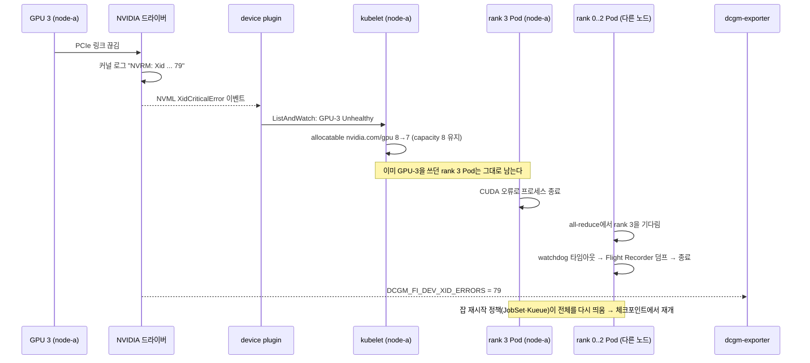
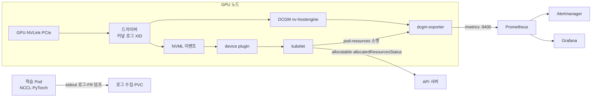

# 12. 관측과 장애 대응: DCGM exporter·XID·NCCL 디버그와 잡 재시작

> [목차로](CURRICULUM.md) · 작성 2026-10-22 · 기준 버전: DCGM Exporter 4.8.4(DCGM 4.6.1, `4.8.4` 태그 소스), GPU Operator v26.7.2(`v26.7.2` 태그 소스), NVIDIA k8s-device-plugin v0.20.1(`v0.20.1` 태그 소스), Kubernetes 1.37(`v1.37.0` 태그 소스), NCCL 2.32.3 문서, PyTorch 2.14(`v2.14.0` 태그 소스)
> **[근거]** 출처에 그대로 있는 내용, **[추론]** 여러 출처를 엮어 내린 결론.
> 앞 절: [11. 토폴로지 인지 배치](11-topology-aware-placement.md)

## 1. 개념

GPU 장애는 세 군데에서 보인다. 각각 보는 도구가 다르고, 서로 자동으로 이어지지 않는다.

| 층 | 무엇이 보이나 | 주 도구 |
|---|---|---|
| 하드웨어·드라이버 | XID, ECC, 행 재배치(row remap), 스로틀링, NVLink 오류 | 커널 로그(`NVRM: Xid`), `nvidia-smi -q`, DCGM |
| 쿠버네티스 | 장치가 `Unhealthy`가 되어 노드 allocatable이 준다, Pod의 장치 상태 | device plugin, kubelet, `allocatedResourcesStatus` |
| 잡 | 분산 학습이 멈추거나(hang) 타임아웃으로 죽는다 | NCCL 로그, PyTorch watchdog·Flight Recorder, 잡 재시작 정책 |

**[추론]** 이 절의 요지는 "한 층에서 본 사건을 다른 층의 이름으로 번역하는 법"이다. 예를 들어 GPU 하나가 버스에서 떨어지면(XID 79) device plugin은 그 장치를 `Unhealthy`로 바꾸지만, 그 장치를 이미 쓰고 있던 학습 Pod는 쫓겨나지 않는다. 다른 노드의 rank들은 NCCL all-reduce에서 기다리다가 PyTorch watchdog 타임아웃(기본 10분, 06절)으로 죽는다. 사건은 하나인데 세 층에 세 가지 모습으로 나타난다.

### 1.1 DCGM과 dcgm-exporter

- **[근거]** dcgm-exporter는 DCGM의 Go API로 GPU 지표를 모아 HTTP `/metrics`(기본 `:9400`)로 내보낸다. 수집 주기 기본값은 30000ms, 수집할 필드는 CSV 파일로 정한다(`-f`, 기본 `/etc/dcgm-exporter/default-counters.csv`). 출처: DCGM Exporter 문서 <https://docs.nvidia.com/datacenter/cloud-native/gpu-telemetry/latest/dcgm-exporter.html> (2026-10-22 확인)
- **[근거]** `-k`(`DCGM_EXPORTER_KUBERNETES`)를 켜면 지표에 Pod를 붙인다. 기본값은 `false`다. GPU Operator v26.7.2의 DaemonSet은 이 값을 `"true"`로 두고, kubelet의 `/var/lib/kubelet/pod-resources` 소켓을 마운트하며, 수집 파일로 `dcp-metrics-included.csv`를 쓴다. 출처: dcgm-exporter `pkg/cmd/app.go`(4.8.4), gpu-operator `assets/state-dcgm-exporter/0800_daemonset.yaml`(v26.7.2) (2026-10-22 확인)
- **[근거]** GPU Operator 기본값으로 dcgm-exporter의 `serviceMonitor.enabled: true`, 수집 간격 `15s`다. Pod 라벨·UID를 지표에 붙이는 `enablePodLabels`·`enablePodUID`는 둘 다 기본 꺼짐이고, 켜면 클러스터 범위 ClusterRole이 생긴다. 라벨 수(카디널리티)는 `podLabelAllowlistRegex`로 묶으라고 적혀 있다. 출처: gpu-operator `deployments/gpu-operator/values.yaml`(v26.7.2, 2026-10-22 확인)
- **[근거]** MIG를 켜면 지표에 `GPU_I_PROFILE`·`GPU_I_ID` 라벨이 붙어 GPU 인스턴스별로 나온다(위 DCGM Exporter 문서). 4.8.4에서는 compute instance 단위 `GPU_CI_ID` 라벨이 추가됐고, DRA로 받은 MIG 장치도 Pod에 귀속된다. 단 **Dynamic MIG로 실행 중에 MIG 배치를 바꾸면 exporter 재시작이 필요하다**. 출처: dcgm-exporter 4.8.4 릴리스 노트 <https://github.com/NVIDIA/dcgm-exporter/releases/tag/4.8.4> (2026-10-22 확인)

### 1.2 기본 수집 지표와 빠진 것

**[근거]** `dcp-metrics-included.csv`(4.8.4)에서 주석이 아닌 줄은 다음뿐이다. 출처: <https://github.com/NVIDIA/dcgm-exporter/blob/4.8.4/etc/dcp-metrics-included.csv> (2026-10-22 확인)

| 분류 | 기본으로 켜진 필드 |
|---|---|
| 클럭·온도·전력 | `DCGM_FI_DEV_SM_CLOCK`, `MEM_CLOCK`, `GPU_TEMP`, `MEMORY_TEMP`, `POWER_USAGE`, `TOTAL_ENERGY_CONSUMPTION` |
| 사용률 | `DCGM_FI_DEV_GPU_UTIL`, `MEM_COPY_UTIL`, `ENC_UTIL`, `DEC_UTIL` |
| 메모리 | `DCGM_FI_DEV_FB_FREE`, `FB_USED`, `FB_RESERVED` |
| 오류 | `DCGM_FI_DEV_XID_ERRORS`, `PCIE_REPLAY_COUNTER`, `UNCORRECTABLE_REMAPPED_ROWS`, `CORRECTABLE_REMAPPED_ROWS`, `ROW_REMAP_FAILURE` |
| NVLink | `DCGM_FI_DEV_NVLINK_BANDWIDTH_TOTAL` |
| 프로파일링(DCP) | `DCGM_FI_PROF_GR_ENGINE_ACTIVE`, `PIPE_TENSOR_ACTIVE`, `DRAM_ACTIVE`, `PCIE_TX_BYTES`, `PCIE_RX_BYTES` |

**[근거]** 같은 파일에서 **주석 처리되어 기본으로 안 나오는 것**: ECC 카운터(`DCGM_FI_DEV_ECC_SBE/DBE_*`), 스로틀링 시간(`DCGM_FI_DEV_POWER_VIOLATION`, `THERMAL_VIOLATION` 등), NVLink 오류 카운터(세대별로 필드 이름이 다름: Hopper 이전 `NVLINK_CRC_FLIT_ERROR_TOTAL` 등, Hopper `NVLINK_CRC_ERROR_TOTAL` 등, Blackwell 이후 `NVLINK_RECOVERY_*_TOTAL`), `DCGM_FI_PROF_SM_ACTIVE`·`SM_OCCUPANCY`, 그리고 exporter 자체 필드 `DCGM_EXP_XID_ERRORS_COUNT`·`DCGM_EXP_XID_ERRORS_TOTAL`·`DCGM_EXP_GPU_HEALTH_STATUS`.

**[추론]** 그래서 "ECC 경보를 걸었는데 한 번도 안 울린다"는 지표가 없어서일 수 있다. 경보 규칙을 쓰기 전에 Prometheus에서 그 이름으로 시계열이 하나라도 있는지부터 본다.

### 1.3 "GPU 사용률"이 말하는 것과 말하지 않는 것

- **[근거]** `nvidia-smi`의 GPU Utilization은 "지난 샘플 기간 중 커널이 **하나라도** GPU에서 돌던 시간의 비율"이고, 샘플 기간은 제품에 따라 1초에서 1/6초다. 출처: nvidia-smi 문서 <https://docs.nvidia.com/deploy/nvidia-smi/index.html> (2026-10-22 확인)
- **[근거]** `DCGM_FI_PROF_SM_ACTIVE`는 "SM에 워프가 하나 이상 배정된 사이클 비율", `DCGM_FI_PROF_PIPE_TENSOR_ACTIVE`는 "텐서(HMMA) 파이프가 활성인 사이클 비율"이다(dcgm-exporter CSV의 설명 문구, 4.8.4).
- **[추론]** 작은 커널 하나가 SM 몇 개만 쓰고 계속 돌아도 `GPU_UTIL`은 100%에 가깝게 나온다. 학습 효율을 보려면 `GPU_UTIL` 말고 `PIPE_TENSOR_ACTIVE`(그리고 필요하면 켠 `SM_ACTIVE`)를 본다. 반대로 "할당은 됐는데 놀고 있는 GPU"를 찾을 때는 `GPU_UTIL`이 0인 시간이 길다는 것만으로 충분하다.

### 1.4 XID 읽기

- **[근거]** XID는 드라이버가 커널 로그에 남기는 GPU 오류 보고다. `NVRM: Xid (0000:03:00): 14, Channel 00000001`에서 `0000:03:00`은 PCI 버스 ID, `14`가 XID 번호, 뒤는 번호별 추가 정보다. 로그에서 `NVRM: Xid`로 찾는다. 출처: Working with Xid Errors <https://docs.nvidia.com/deploy/xid-errors/latest/working-with-xid-errors.html> (2026-10-22 확인)
- **[근거]** XID 카탈로그(<https://docs.nvidia.com/deploy/xid-errors/latest/analyzing-xid-catalog.html>, 2026-10-22 확인)에서 쿠버네티스 운영에 자주 걸리는 번호:

| XID | 이름(카탈로그) | 카탈로그의 즉시 조치 | 뜻(카탈로그 설명 요약) |
|---|---|---|---|
| 13 | Graphics Engine Exception | RESTART_APP | 대개 응용 프로그램 오류(배열 범위 밖 접근 등). 드물게 하드웨어 |
| 31 | GPU memory page fault | RESTART_APP | MMU가 잘못된 주소 접근을 잡음. 대개 응용 버그 |
| 43 | GPU stopped processing | IGNORE | 응용이 소프트웨어 오류로 끝나야 함. GPU는 정상 |
| 45 | Preemptive cleanup | (단독이면 RESTART_FM, 아니면 다른 XID를 따름) | Ctrl-C·SIGKILL·GPU 리셋 등으로 응용이 중단될 때도 찍힘 |
| 48 | Double Bit ECC Error | WORKFLOW_XID_48 | 고칠 수 없는 메모리 오류. GPU 리셋이나 노드 재부팅이 필요 |
| 63 / 64 | 메모리 재배치 이벤트 / 재배치 실패 | IGNORE / RESET_GPU | ECC 처리 과정(행 재배치) |
| 74 | NVLINK Error | WORKFLOW_NVLINK_ERR | NVLink 연결 문제. **상대편 GPU가 죽어서 이쪽이 74를 낼 수도** 있음 |
| 79 | GPU has fallen off the bus | RESTART_BM | PCIe로 GPU에 닿을 수 없음. 대개 하드웨어·링크 |
| 94 | Contained memory error | RESTART_APP | 오류가 한 응용에 갇힘. 그 응용만 재시작, GPU 리셋은 편할 때 |
| 95 | Uncontained memory error | RESET_GPU | 여러 응용에 영향. 응용 재시작 전에 GPU 리셋 필요 |
| 119 / 120 | GSP RPC Timeout / GSP Error | (카탈로그 참조) | GPU 펌웨어(GSP) 쪽 오류 |

- **[근거]** 카탈로그는 XID 13·31에 대해 cuda-gdb나 Compute Sanitizer memcheck로 응용을 먼저 보라고 권한다. XID 74는 "다른 GPU가 고장 나서 연결된 GPU가 따라서 74를 낼 수 있다"고 적는다(같은 카탈로그).
- **[근거]** 진단 묶음은 `sudo nvidia-bug-report.sh`가 만든다. 보통 금방 끝나지만 드물게 느려 최대 한 시간까지 기다리라고 하고, 멈추면 `--safe-mode --extra-system-data`를 쓰라고 한다(Working with Xid Errors 문서).

### 1.5 device plugin은 XID를 어떻게 받나

여기가 쿠버네티스와 하드웨어가 만나는 유일한 자동 연결이다.

- **[근거]** NVIDIA device plugin v0.20.1은 NVML 이벤트(`XidCriticalError`, 단일·이중 비트 ECC)를 구독하다가 `XidCriticalError`가 오면 그 장치를 `Unhealthy`로 보고한다. 단 응용 오류로 보는 **XID 13·31·43·45·68·109는 무시**한다. 이벤트 대기 자체가 실패하면 **모든 장치**를 Unhealthy로 만든다. MIG 장치는 GPU·compute instance ID가 맞는 경우만 해당 MIG 장치를 내린다. 출처: `internal/rm/health.go` <https://github.com/NVIDIA/k8s-device-plugin/blob/v0.20.1/internal/rm/health.go> (2026-10-22 확인)
- **[근거]** 환경 변수 `DP_DISABLE_HEALTHCHECKS`에 `all`(또는 `xids`)을 주면 헬스체크를 끄고, 쉼표로 번호를 주면 그 XID만 추가로 무시한다. `DP_ENABLE_HEALTHCHECKS`에 준 번호는 무시 목록보다 우선해 다시 켠다(같은 파일).
- **[근거]** 한 번 `Unhealthy`가 된 장치는 되돌아오지 않는다. `ListAndWatch`에 "FIXME: there is no way to recover from the Unhealthy state."라는 주석이 있다. 출처: `internal/plugin/server.go`(v0.20.1, 2026-10-22 확인)
- **[근거]** kubelet은 장치가 Unhealthy가 되면 노드의 **allocatable만 줄이고 capacity는 그대로** 둔다. 그 장치를 이미 받은 Pod는 계속 그 장치를 가진다. 장치를 쓰는 코드는 실패하기 시작하고, Pod는 `restartPolicy`가 Always가 아니면 Failed, Always면 크래시 루프에 빠진다. 출처: Kubernetes Device Plugins 문서 "Device plugin and unhealthy devices" <https://kubernetes.io/docs/concepts/extend-kubernetes/compute-storage-net/device-plugins/> (2026-10-22 확인)
- **[근거]** `ResourceHealthStatus` 기능 게이트는 1.31 알파, **1.36부터 베타·기본 켜짐**이다. 켜져 있으면 각 컨테이너 상태에 `allocatedResourcesStatus`가 붙어 배정된 장치마다 `Healthy`/`Unhealthy`/`Unknown`을 보여 준다. 1.36부터는 `message` 필드(`ResourceHealthStatusMessage`, 베타·기본 켜짐)도 있다. 출처: `pkg/features/kube_features.go`, `staging/src/k8s.io/api/core/v1/types.go`의 `ResourceHealth`(v1.37.0), 위 Device Plugins 문서 (2026-10-22 확인)
- **[추론]** 정리하면 (1) 고장 GPU는 **새 Pod에게만** 안 나가고, (2) 이미 쓰던 Pod는 스스로 죽어야 정리되며, (3) GPU를 리셋·교체해도 **device plugin Pod를 재시작하기 전까지** allocatable이 돌아오지 않는다. 노드를 cordon·drain하는 결정은 사람이나 별도 자동화의 몫이다.

### 1.6 DCGM 진단

- **[근거]** `dcgmi diag -r 1|2|3|4`는 짧은 검사부터 긴 하드웨어 검사까지 단계별로 돈다. Hopper 기준 r1은 2.5초 안쪽(software), r2는 8 GPU 시스템에서 10.5분 안쪽(pcie·memory·memory_bandwidth 추가), r3는 35분 안쪽(diagnostic·targeted_stress·targeted_power·nvbandwidth·nccl_tests 추가), r4는 2.25시간 안쪽(memtest·pulse 추가)이다. 높은 단계는 낮은 단계를 포함하고, `-r "pcie,diagnostic"`처럼 검사 이름을 골라 돌릴 수도 있다. 출처: DCGM Diagnostics <https://docs.nvidia.com/datacenter/dcgm/latest/user-guide/dcgm-diagnostics.html> (2026-10-22 확인)
- **[추론]** r2 이상은 GPU에 부하를 걸므로 학습 Pod가 도는 노드에서 돌리지 않는다. 노드를 cordon·drain한 뒤 돌리고, 통과하면 device plugin을 재시작해 allocatable을 되살린다.

### 1.7 NCCL과 PyTorch 쪽 신호

- **[근거]** `NCCL_DEBUG`는 `VERSION`·`WARN`·`ATTN`(2.32부터)·`INFO`·`TRACE`를 받는다. 2.32 이전 판은 `ATTN`을 모르면 디버그 로그를 아예 끄므로, 판이 섞인 곳에서는 `NCCL_DEBUG=WARN NCCL_DEBUG_LEVELS=ATTN`을 쓰라고 한다. `NCCL_DEBUG_SUBSYS` 기본값은 `INIT,BOOTSTRAP,ENV`이고 `NET`·`GRAPH`·`COLL`·`RAS` 등으로 고른다. `NCCL_DEBUG_FILE`은 `%h`(호스트명)·`%p`(PID)를 받으며, 이름이 프로세스마다 다르지 않으면 출력이 사라지거나 깨진다. 출처: NCCL 2.32.3 env 문서 <https://docs.nvidia.com/deeplearning/nccl/user-guide/docs/env.html> (2026-10-22 확인)
- **[근거]** 같은 문서는 "Debugging" 절의 변수들을 운영에서 쓰지 말고, 문제를 푼 뒤에는 지우라고 한다. 남겨 두면 성능 저하·크래시·hang이 날 수 있다.
- **[근거]** PyTorch 2.14 소스 기본값: `TORCH_NCCL_TRACE_BUFFER_SIZE`=2000(Flight Recorder 링 버퍼), `TORCH_NCCL_DUMP_ON_TIMEOUT`=켜짐, `TORCH_NCCL_ENABLE_MONITORING`=켜짐, `TORCH_NCCL_HEARTBEAT_TIMEOUT_SEC`=480(8분), `TORCH_NCCL_ASYNC_ERROR_HANDLING`=3(통신자 abort 없이 프로세스 종료). 출처: `torch/csrc/distributed/c10d/ProcessGroupNCCL.cpp`(v2.14.0), PyTorch ProcessGroupNCCL 환경 변수 문서 <https://docs.pytorch.org/docs/2.14/torch_nccl_environment_variables.html> (2026-10-22 확인)
- **[근거]** Flight Recorder 덤프 기본 위치는 `$XDG_CACHE_HOME` 또는 `$HOME/.cache` 아래 `torch/comm_lib_trace_rank_<rank>`이고, `TORCH_FR_DUMP_TEMP_FILE`(옛 이름 `TORCH_NCCL_DEBUG_INFO_TEMP_FILE`)로 바꾼다. 덤프를 모아 분석하는 `torchfrtrace` 명령이 같이 설치된다. 출처: `torch/csrc/distributed/c10d/FlightRecorder.cpp`, `pyproject.toml`의 `torchfrtrace` 진입점(v2.14.0, 2026-10-22 확인)
- **[추론]** 컨테이너 안 `$HOME/.cache`는 Pod가 다시 만들어지면 사라진다. 타임아웃이 나면 그 Pod는 곧 죽으므로, 덤프를 보려면 PVC나 `hostPath`처럼 Pod보다 오래 사는 볼륨을 `TORCH_FR_DUMP_TEMP_FILE`로 가리켜야 한다.

### 1.8 재시작과 체크포인트

- **[추론]** GPU 장애 대응의 마지막 단계는 "어디서부터 다시 하나"다. 06·07·09절에서 본 재시작 장치들(torchrun `--max-restarts`, Job `podFailurePolicy`·`backoffLimitPerIndex`, JobSet `failurePolicy`, Kueue `waitForPodsReady`, TAS hot swap)은 모두 **처음부터 또는 마지막 체크포인트부터** 다시 돌린다. 잃는 시간은 대략 "체크포인트 주기의 절반 + 재스케줄 대기 + 모델 로드 시간"이다.
- **[추론]** 그래서 체크포인트 주기는 관측 지표로 정한다. 지난 N주간 잡이 장애로 죽은 평균 간격(XID·Unhealthy 이벤트, 잡 실패 수)을 보고, 체크포인트 저장 시간이 그 간격에 비해 무시할 만한 수준이 되도록 고른다.

## 2. 그림

### 2.1 GPU 하나가 버스에서 떨어질 때 (XID 79)



### 2.2 신호가 어디로 흐르나



## 3. 실습

### 3.1 지표가 실제로 나오는지부터

```bash
# GPU Operator 설치 환경 기준
kubectl -n gpu-operator get ds -l app=nvidia-dcgm-exporter
kubectl -n gpu-operator get servicemonitor
# exporter에 직접 붙어서 확인 (포트 9400)
kubectl -n gpu-operator port-forward ds/nvidia-dcgm-exporter 9400:9400 &
curl -s localhost:9400/metrics | grep -E '^DCGM_FI_DEV_(GPU_UTIL|XID_ERRORS|ROW_REMAP_FAILURE)' | head
# Pod 귀속 라벨(pod, namespace, container)이 붙는지
curl -s localhost:9400/metrics | grep DCGM_FI_DEV_GPU_UTIL | grep -o 'pod="[^"]*"' | sort -u
```

기대: GPU를 쓰는 Pod가 있으면 그 GPU의 시계열에 `pod="..."`가 붙는다. 라벨이 비어 있으면 `DCGM_EXPORTER_KUBERNETES`가 꺼졌거나 pod-resources 소켓이 마운트되지 않은 것이다. DaemonSet 이름·라벨은 설치 방식에 따라 다르니 `kubectl -n gpu-operator get ds`로 먼저 본다.

### 3.2 빠진 필드 켜기 (GPU Operator)

```yaml
# custom-dcgm-metrics ConfigMap: 기본 파일 + ECC·스로틀링·XID 카운트
apiVersion: v1
kind: ConfigMap
metadata:
  name: custom-dcgm-metrics
  namespace: gpu-operator
data:
  dcgm-metrics.csv: |
    DCGM_FI_DEV_GPU_UTIL,            gauge,   GPU utilization (in %).
    DCGM_FI_DEV_FB_USED,             gauge,   Framebuffer memory used (in MiB).
    DCGM_FI_DEV_GPU_TEMP,            gauge,   GPU temperature (in C).
    DCGM_FI_DEV_POWER_USAGE,         gauge,   Power draw (in W).
    DCGM_FI_DEV_XID_ERRORS,          gauge,   Value of the last XID error encountered.
    DCGM_EXP_XID_ERRORS_COUNT,       gauge,   XID errors observed during the configured time window.
    DCGM_FI_DEV_ECC_DBE_VOL_TOTAL,   counter, Total number of double-bit volatile ECC errors.
    DCGM_FI_DEV_ROW_REMAP_FAILURE,   gauge,   Whether remapping of rows has failed
    DCGM_FI_DEV_THERMAL_VIOLATION,   counter, Throttling duration due to thermal constraints (in ns).
    DCGM_FI_DEV_POWER_VIOLATION,     counter, Throttling duration due to power constraints (in ns).
    DCGM_FI_PROF_SM_ACTIVE,          gauge,   The ratio of cycles an SM has at least 1 warp assigned.
    DCGM_FI_PROF_PIPE_TENSOR_ACTIVE, gauge,   Ratio of cycles the tensor (HMMA) pipe is active.
```

```bash
# ClusterPolicy가 이 ConfigMap을 쓰게 한다 (values의 dcgmExporter.config.name과 같은 자리)
kubectl patch clusterpolicies.nvidia.com/cluster-policy --type merge \
  -p '{"spec":{"dcgmExporter":{"config":{"name":"custom-dcgm-metrics"}}}}'
```

[근거] values.yaml(v26.7.2)은 `config.name`으로 같은 네임스페이스의 기존 ConfigMap을 가리키고, 키 이름은 `dcgm-metrics.csv`여야 한다고 적는다. [추론] 필드 이름이 GPU 세대에서 지원되지 않으면 해당 시계열만 빠지거나 exporter가 경고를 낸다. 적용 뒤 exporter 로그와 3.1의 `curl`로 다시 확인한다. 4.8.4 릴리스 노트에 따르면 폐기된 PCIe 처리량 필드를 사용자 설정에 남겨 두면 실패하고 `DCGM_FI_PROF_PCIE_TX/RX_BYTES`로 안내한다.

### 3.3 경보 규칙 (PrometheusRule)

```yaml
apiVersion: monitoring.coreos.com/v1
kind: PrometheusRule
metadata:
  name: gpu-health
  namespace: gpu-operator
spec:
  groups:
  - name: gpu-hardware
    rules:
    # XID는 "마지막 값"인 게이지이고 0으로 돌아가지 않는다(아래 주의 (1)).
    # 그래서 `!= 0`이 아니라 "값이 바뀌었거나 새로 생겼다"를 본다. 10분 동안 울리고 꺼진다.
    # 한계: 같은 번호가 다시 나면 못 잡는다. 건수가 필요하면 3.2의 DCGM_EXP_XID_ERRORS_COUNT > 0
    - alert: GpuXidReported
      expr: |
        changes(DCGM_FI_DEV_XID_ERRORS[10m]) > 0
          or (DCGM_FI_DEV_XID_ERRORS unless DCGM_FI_DEV_XID_ERRORS offset 10m)
      labels: {severity: warning}
      annotations:
        summary: "{{ $labels.Hostname }} GPU {{ $labels.gpu }} XID 새로 보고됨 (번호는 DCGM_FI_DEV_XID_ERRORS로 확인)"
    # 노드 재부팅·RMA 후보 번호만 따로 (48 DBE, 79 버스 이탈, 95 비격리 메모리 오류)
    - alert: GpuXidCritical
      expr: DCGM_FI_DEV_XID_ERRORS == 48 or DCGM_FI_DEV_XID_ERRORS == 79 or DCGM_FI_DEV_XID_ERRORS == 95
      labels: {severity: critical}
    - alert: GpuRowRemapFailed
      expr: DCGM_FI_DEV_ROW_REMAP_FAILURE == 1
      labels: {severity: critical}
    # 열 스로틀링: 5분 동안 1분 이상 걸렸으면 (ns 단위 카운터)
    - alert: GpuThermalThrottling
      expr: increase(DCGM_FI_DEV_THERMAL_VIOLATION[5m]) > 60e9
      labels: {severity: warning}
  - name: gpu-kubernetes
    rules:
    # device plugin이 장치를 Unhealthy로 내렸다 (kube-state-metrics 필요)
    - alert: GpuAllocatableBelowCapacity
      expr: |
        kube_node_status_capacity{resource="nvidia_com_gpu"}
          - kube_node_status_allocatable{resource="nvidia_com_gpu"} > 0
      for: 5m
      labels: {severity: warning}
    # 할당은 됐는데 30분째 아무 커널도 안 도는 GPU
    - alert: GpuAllocatedButIdle
      expr: DCGM_FI_DEV_GPU_UTIL{pod!=""} == 0
      for: 30m
      labels: {severity: info}
```

몇 가지 주의.

(1) **`DCGM_FI_DEV_XID_ERRORS`는 0으로 돌아가지 않는다.** 공식 문서에는 리셋 규칙이 없어서 소스로 확인했다. 아래는 DCGM 4.6.1(태그 `v4.6.1`)·dcgm-exporter 4.8.4 소스 판독이며, GPU에서 실측한 것은 아니다(2026-10-22).

- [근거] XID 필드는 주기 갱신 루프가 건너뛰고(`dcgmlib/src/DcgmCacheManager.cpp:13759-13761`, "handled by the NVML event thread"), 값은 NVML `XidCriticalError` 이벤트나 `/dev/kmsg`에서 XID가 왔을 때만 그 번호로 들어간다(같은 파일 7535-7630, 7792-7804, 7883-7895). "이상 없음"을 뜻하는 0이 들어가는 길은 없다.
- [근거] 보존 시간 정리(exporter 기본 `--watch-max-keep-age=10m`)는 새 표본을 넣을 때만 돌고 방금 넣은 최신 표본은 지우지 않는다(`EnforceWatchInfoQuota` 호출처 7149·7246·7300·7355, `sdk/nvidia/nvml/common/timeseries.c`). 그래서 **값은 다음 XID가 덮어쓸 때까지 그대로**다. 같은 번호가 다시 나면 값은 바뀌지 않는다.
- [근거] XID가 한 번도 안 난 GPU는 0이 아니라 **시계열 자체가 없다.** DCGM은 `DCGM_ST_NO_DATA`를 주고(5117-5132), exporter는 상태가 OK가 아니면 그 지표를 내보내지 않는다(`internal/pkg/collector/gpu_collector.go:1022-1050`). DCGM 자체 시험도 XID를 "기본으로는 데이터가 안 생기는 필드"로 둔다(`testing/python3/tests/test_field_values.py:966-976`).
- [근거] **원격 nv-hostengine(GPU Operator 기본)에서는 exporter를 재시작해도 값이 안 지워진다.** exporter 종료가 타는 길(UnwatchFields → `DcgmHostEngineHandler::UnwatchFieldGroup`, 연결 끊김 → `OnConnectionRemoveImpl`의 `clearCache = false`)은 캐시를 지우지 않고, `RemoveEntityFieldWatch`(3747-3813)는 `clearCache` 인자를 로그에만 찍는다. 재시작 뒤 첫 수집부터 예전 번호가 다시 나온다.
- [근거] 시계열이 실제로 지워지는 것은 `ClearWatchInfo` → `timeseries_destroy`(6768-6788)뿐이고, 그 길은 **DCGM 파드(호스트엔진) 재시작**(메모리 캐시), **`EmptyCache` API**(`dcgmEmptyCache`), **GPU 분리·재부착**이다. exporter 4.8.4는 `EmptyCache`를 부르지 않는다.
- [추론] exporter가 엔진을 품는 **내장 모드**(`-r` 없이 실행)에서는 exporter 재시작이 곧 엔진 재시작이라 시계열이 사라진다. 같은 "exporter 재시작"이 배치 방식에 따라 반대 결과이고, 내장 모드에서 경보가 풀리는 것은 고쳐져서가 아니라 증거가 사라진 것이다.
- [추론] 그래서 `DCGM_FI_DEV_XID_ERRORS != 0` 경보는 "지금 XID가 났다"가 아니라 "캐시가 살아 있는 동안 언젠가 났다"를 뜻하고, GPU를 고친 뒤에도 꺼지지 않는다. 위 `GpuXidReported`가 변화 감지 식인 이유다. 건수가 필요하면 3.2처럼 `DCGM_EXP_XID_ERRORS_COUNT`(창 안 건수)나 `_TOTAL`을 켜고 `DCGM_EXP_XID_ERRORS_COUNT > 0`이나 `increase(DCGM_EXP_XID_ERRORS_TOTAL[5m]) > 0`을 쓴다. `GpuXidCritical`(번호 일치)도 같은 이유로 값이 덮이거나 엔진이 재시작될 때까지 계속 울린다. 노드 정리(3.5) 뒤 DCGM 파드 재시작으로 지운다.

[추론] (2) kube-state-metrics는 리소스 이름의 `.`·`/`를 `_`로 바꿔 `nvidia_com_gpu`로 내보내는 것으로 알지만, 판마다 다를 수 있으니 `kube_node_status_capacity`를 먼저 조회해 실제 값을 확인한다. (3) 스로틀링 기준(5분 중 1분)은 예시 값이다.

### 3.4 고장 장치를 Pod 쪽에서 보기

```bash
# 노드 allocatable이 capacity보다 작은가
kubectl get node <gpu-node> -o jsonpath='{.status.capacity.nvidia\.com/gpu}{" / "}{.status.allocatable.nvidia\.com/gpu}{"\n"}'
# device plugin 로그에서 Unhealthy로 내린 이유
kubectl -n gpu-operator logs ds/nvidia-device-plugin-daemonset | grep -E 'XidCriticalError|marked unhealthy'
# Pod의 장치 상태 (ResourceHealthStatus, 1.36+ 기본 켜짐)
kubectl get pod <train-pod> -o jsonpath='{range .status.containerStatuses[*]}{.name}{": "}{.allocatedResourcesStatus}{"\n"}{end}'
# 노드에서 커널 로그 확인
kubectl debug node/<gpu-node> -it --image=busybox -- chroot /host sh -c 'dmesg -T | grep "NVRM: Xid" | tail'
```

### 3.5 노드 정리 순서 (사람이 하는 쪽)

```bash
kubectl cordon <gpu-node>
kubectl drain <gpu-node> --ignore-daemonsets --delete-emptydir-data   # 학습 잡은 체크포인트 뒤 재시작됨
# (노드에서) GPU 리셋 또는 재부팅, 필요하면 진단
kubectl debug node/<gpu-node> -it --image=<dcgm 포함 이미지> -- chroot /host dcgmi diag -r 2
# 통과하면 device plugin을 재시작해 Unhealthy 표시를 지운다
kubectl -n gpu-operator delete pod -l app=nvidia-device-plugin-daemonset --field-selector spec.nodeName=<gpu-node>
kubectl uncordon <gpu-node>
```

[근거] device plugin은 Unhealthy에서 스스로 돌아오지 않는다(1.5). [추론] 그래서 "GPU를 고쳤는데 allocatable이 그대로"는 정상이며 plugin 재시작이 빠진 것이다. `dcgmi`가 노드에 없으면 DCGM 이미지나 GPU Operator가 띄운 DCGM 컨테이너에서 돌린다. 라벨 셀렉터 이름은 설치 방식에 따라 확인한다.

### 3.6 학습 잡에 디버그 설정 넣기

```yaml
# 06절 DDP Job의 컨테이너에 덧붙이는 부분
env:
- name: NCCL_DEBUG
  value: WARN
- name: NCCL_DEBUG_LEVELS        # 2.32+만 인식, 이전 판은 무시하고 WARN 유지
  value: ATTN
- name: NCCL_DEBUG_FILE          # 프로세스마다 다른 이름
  value: /debug/nccl.%h.%p.log
- name: TORCH_FR_DUMP_TEMP_FILE  # Flight Recorder 덤프를 Pod보다 오래 사는 볼륨에
  value: /debug/fr_trace_rank_
volumeMounts:
- name: debug
  mountPath: /debug
volumes:
- name: debug
  persistentVolumeClaim:
    claimName: train-debug       # RWX 필요(여러 노드의 Pod가 같이 씀)
```

문제를 재현할 때만 `NCCL_DEBUG=INFO`와 `NCCL_DEBUG_SUBSYS=INIT,NET,GRAPH`(네트워크·토폴로지 선택 확인)로 올린다. 덤프가 모이면 `torchfrtrace <덤프 폴더>`로 어느 rank가 어느 집합 연산에서 멈췄는지 본다(`torchfrtrace --help`로 판별 옵션 확인).

## 4. GPU 없이 확인하는 법

1. **경보 규칙 단위 시험.** Prometheus의 `promtool test rules`는 가짜 시계열을 넣고 경보가 뜨는지 본다. GPU도 클러스터도 필요 없다. 3.3의 규칙을 `rules.yaml`로 뽑고, 아래처럼 XID가 없다가(시계열 없음, `_`) 79가 생겨 그대로 남는 입력을 준다. 실제 exporter는 XID가 나기 전엔 0이 아니라 아무 시계열도 내보내지 않는다(3.3 주의 (1)).

   ```yaml
   # test.yaml
   rule_files: [rules.yaml]
   evaluation_interval: 1m
   tests:
   - interval: 1m
     input_series:
     - series: 'DCGM_FI_DEV_XID_ERRORS{gpu="3",Hostname="node-a"}'
       values: '_ _ 79x30'          # 0~1분 없음, 2분부터 79가 계속 남음
     alert_rule_test:
     - eval_time: 4m
       alertname: GpuXidCritical
       exp_alerts:
       - exp_labels: {severity: critical, gpu: "3", Hostname: "node-a"}
     - eval_time: 4m                # 새로 생겼으니 울린다
       alertname: GpuXidReported
       exp_alerts:
       - exp_labels: {severity: warning, gpu: "3", Hostname: "node-a"}
         exp_annotations: {summary: "node-a GPU 3 XID 새로 보고됨 (번호는 DCGM_FI_DEV_XID_ERRORS로 확인)"}
     - eval_time: 30m               # 값은 남아 있지만 바뀐 게 없으니 꺼져 있어야 한다
       alertname: GpuXidReported
       exp_alerts: []
   ```

   `promtool test rules test.yaml`. (2026-10-23 promtool 3.15.1로 실측: 3.3의 새 `GpuXidReported` 식으로 이 시험은 SUCCESS. 같은 시험을 옛 식 `DCGM_FI_DEV_XID_ERRORS != 0`에 대면 30분 시점에 `exp:[]`인데 경보가 남아 FAILED가 나서, 시험이 "한 번 나면 계속 울림"을 실제로 가르는 것을 확인했다. 번호가 13→43으로 바뀌는 시계열을 더해도 새 식은 바뀐 시점부터 10분간만 울렸다.) 3.3은 PrometheusRule 형식이니 `spec.groups` 아래만 떼어 `groups:`로 시작하는 파일로 만든다. `for:`가 있는 규칙은 `eval_time`을 조금씩 바꿔 보며 언제부터 뜨는지 확인한다.
2. **Unhealthy 흉내.** 01절처럼 kind 노드에 `nvidia.com/gpu` 용량을 패치하되, `capacity`는 8, `allocatable`은 7로 준다. 8장을 요청하는 Pod는 Pending(`Insufficient nvidia.com/gpu`)이 되고, 3.3의 `GpuAllocatableBelowCapacity` 식을 kube-state-metrics가 깔린 kind에서 조회하면 1이 나온다. 단 kubelet이 노드 상태를 다시 보고하면 패치가 덮일 수 있다(01절의 주의와 같다).
3. **NCCL 없이 hang·타임아웃 보기.** CPU용 `gloo` 백엔드로 06절의 2-Pod torchrun Job을 띄우고, 한 Pod에서 `kill -STOP <python PID>`로 rank 하나를 얼린다. 다른 rank가 집합 연산에서 기다리다 타임아웃으로 죽는지, 그 뒤 Job·JobSet 재시작이 어떻게 도는지 본다. `init_process_group(timeout=timedelta(seconds=60))`처럼 타임아웃을 줄이면 빨리 볼 수 있다. Flight Recorder는 NCCL 프로세스 그룹 기능이라 gloo에서는 덤프가 나오지 않을 수 있다(이 절에서 실측하지 않았다).
4. **dry-run.** 3.2의 ConfigMap과 3.3의 PrometheusRule은 해당 CRD가 깔린 클러스터에서 `kubectl apply --dry-run=server -f`로 필드 오타를 잡는다. PrometheusRule CRD만 필요하면 prometheus-operator의 CRD만 설치한다.

## 5. 흔한 실수

1. **`GPU_UTIL` 100%를 "잘 쓰고 있다"로 읽는다.** 커널이 하나라도 돌면 100%다. 효율은 `PIPE_TENSOR_ACTIVE`·`SM_ACTIVE`로 본다.
2. **기본 CSV에 없는 지표로 경보를 건다.** ECC·스로틀링·NVLink 오류 카운터는 기본 꺼짐이다. 경보가 안 울리는 이유가 "고장이 없어서"가 아닐 수 있다.
3. **`DCGM_FI_DEV_XID_ERRORS`에 `rate()`·`increase()`를 건다.** 마지막 XID 번호를 담은 게이지다. 번호가 커지면 증가로 보이고, 같은 XID가 두 번 나면 아무 변화도 없다. 반대로 `!= 0`만 걸면 **0으로 돌아오지 않아서** GPU를 고친 뒤에도 계속 울린다. exporter를 재시작해도(원격 nv-hostengine이면) 안 지워진다(3.3 주의 (1)).
4. **GPU를 고친 뒤 device plugin을 재시작하지 않는다.** Unhealthy는 스스로 풀리지 않는다.
5. **노드 allocatable만 보고 끝낸다.** 이미 고장 GPU를 가진 Pod는 쫓겨나지 않는다. `allocatedResourcesStatus`나 PodResources API로 그 Pod를 찾아 따로 정리한다.
6. **`DP_DISABLE_HEALTHCHECKS=all`로 "자꾸 GPU가 빠지는 문제"를 끈다.** 증상만 감춘다. 고장 장치에 새 Pod가 계속 배치된다. 특정 XID가 오탐이면 그 번호만 제외하고 이유를 적어 둔다.
7. **`NCCL_DEBUG=INFO`를 이미지나 기본 설정에 박아 둔다.** 문서가 운영에서 쓰지 말라는 디버그 범주다. 로그 양이 커지고 성능에 영향을 줄 수 있다.
8. **판이 섞인 클러스터에서 `NCCL_DEBUG=ATTN`.** 2.32 이전 NCCL은 이 값을 모르면 로그를 아예 끈다. `WARN` + `NCCL_DEBUG_LEVELS=ATTN`으로 쓴다.
9. **Flight Recorder 덤프를 컨테이너 안에 둔다.** 타임아웃 → Pod 종료 → 덤프 소멸. PVC로 뺀다.
10. **XID 74 하나만 보고 그 GPU를 교체한다.** 상대편 GPU 고장의 결과일 수 있다. 같은 시각 같은 노드의 다른 XID부터 본다.
11. **학습 중인 노드에서 `dcgmi diag -r 3`.** 부하 검사라 잡을 방해하고 결과도 흐려진다. drain 뒤에 돌린다.

## 6. 확인 문제

1. 8-GPU 노드에서 `kubectl describe node`가 `Capacity: nvidia.com/gpu: 8`, `Allocatable: nvidia.com/gpu: 7`을 보인다. 운영자가 GPU를 리셋했고 `nvidia-smi`도 8장을 다 보여 준다. 그런데 하루가 지나도 allocatable이 7이다. 왜이고, 무엇을 하면 되나? 리셋 전에 그 GPU를 쓰던 Pod는 어떻게 됐을까?
2. 32-GPU 분산 학습이 매번 몇 시간 뒤 "Watchdog caught collective operation timeout"으로 죽는다. 어느 rank가 원인인지 찾기 위해 Pod 스펙에 무엇을 넣고, 죽은 뒤 어디서 무엇을 보나? DCGM 지표에서는 무엇을 같이 보나?
3. Grafana에서 어떤 팀의 GPU 사용률(`DCGM_FI_DEV_GPU_UTIL`)이 항상 95% 이상인데, 같은 모델을 다른 팀이 돌리면 학습 속도가 두 배다. 이 차이를 설명할 수 있는 지표와, 그 지표가 기본 설정에서 나오는지 적어라.

<details>
<summary>답</summary>

1. NVIDIA device plugin은 Unhealthy로 내린 장치를 되돌리는 경로가 없다(v0.20.1 `server.go` 주석). 그 노드의 device plugin Pod를 재시작해야 장치를 다시 Healthy로 등록하고 allocatable이 8로 돌아온다. 그 전에 진단(`dcgmi diag -r 2` 이상)으로 정말 고쳐졌는지 확인한다. 고장 GPU를 쓰던 Pod는 kubelet이 쫓아내지 않으므로 그 장치를 계속 가진 채 CUDA 오류로 죽었을 것이다(`restartPolicy`가 Always면 크래시 루프, 아니면 Failed). 1.36 이상이면 그 Pod의 `allocatedResourcesStatus`에 Unhealthy가 남는다.
2. `TORCH_FR_DUMP_TEMP_FILE`을 PVC 경로로 두고(Flight Recorder는 2.14에서 기본 켜짐, 버퍼 2000), `NCCL_DEBUG=WARN`(+`NCCL_DEBUG_LEVELS=ATTN`), `NCCL_DEBUG_FILE=/debug/nccl.%h.%p.log`. 죽은 뒤 모든 rank의 덤프를 `torchfrtrace`로 모아 어느 rank가 어느 집합 연산에 들어가지 않았는지 본다. 그 rank의 노드에서 같은 시각 `DCGM_FI_DEV_XID_ERRORS`, 노드 allocatable 감소, 스로틀링(`THERMAL_VIOLATION`, 켜 두었다면), NVLink·PCIe 오류를 확인한다. 하드웨어 신호가 없으면 데이터 로더 정지나 특정 rank만 다른 코드 경로를 탄 경우(desync)를 의심한다.
3. `GPU_UTIL`은 "커널이 하나라도 돈 시간 비율"이라 작은 커널만 돌아도 높다. `DCGM_FI_PROF_PIPE_TENSOR_ACTIVE`(기본 켜짐)와 `DCGM_FI_PROF_SM_ACTIVE`(기본 꺼짐, CSV에서 켜야 함)를 비교하면 텐서 코어를 얼마나 쓰는지, SM을 얼마나 채우는지가 갈린다. 혼합 정밀도를 안 쓰거나 배치가 작으면 텐서 파이프 비율이 낮게 나온다(추론). `DRAM_ACTIVE`(기본 켜짐)가 높고 텐서가 낮으면 메모리 대역폭에 묶인 것이다.

</details>

## 7. 이어 볼 것

- 01절: device plugin의 `ListAndWatch`, 장치 상태 보고의 출발점.
- 02절: GPU Operator의 dcgm·dcgm-exporter·validator 구성과 기동 순서.
- 06·07·09절: torchrun 재시작, JobSet `failurePolicy`, Kueue `waitForPodsReady`·TAS hot swap. 이 절의 "어디서부터 다시 하나"가 이어지는 곳.
- 10·11절: `NCCL_DEBUG_SUBSYS=NET,GRAPH`로 IB·GPUDirect·토폴로지 선택이 기대대로 됐는지 읽기.
- 이 리포의 [`../k8s-logging-monitoring/`](../k8s-logging-monitoring/): Prometheus·Alertmanager·로그 수집 일반.
- 별도 스터디 노트(비공개): GPU·AI·LLM 인프라 커리큘럼의 관측·장애 패턴 장(H1·H2). 하드웨어 진단 도구는 그쪽에서 더 깊게 다룬다.

## 8. 출처 (모두 2026-10-22 확인)

- NVIDIA DCGM Exporter 문서: <https://docs.nvidia.com/datacenter/cloud-native/gpu-telemetry/latest/dcgm-exporter.html>
- NVIDIA GPU Telemetry, Setting up Prometheus: <https://docs.nvidia.com/datacenter/cloud-native/gpu-telemetry/latest/kube-prometheus.html>
- dcgm-exporter 4.8.4 소스·릴리스: `etc/default-counters.csv`, `etc/dcp-metrics-included.csv`, `pkg/cmd/app.go` — <https://github.com/NVIDIA/dcgm-exporter/tree/4.8.4>, <https://github.com/NVIDIA/dcgm-exporter/releases/tag/4.8.4>
- GPU Operator v26.7.2 소스: `deployments/gpu-operator/values.yaml`, `assets/state-dcgm-exporter/0800_daemonset.yaml` — <https://github.com/NVIDIA/gpu-operator/tree/v26.7.2>
- NVIDIA DCGM Diagnostics: <https://docs.nvidia.com/datacenter/dcgm/latest/user-guide/dcgm-diagnostics.html>
- NVIDIA Xid Errors(Working with·Catalog): <https://docs.nvidia.com/deploy/xid-errors/latest/working-with-xid-errors.html>, <https://docs.nvidia.com/deploy/xid-errors/latest/analyzing-xid-catalog.html>
- nvidia-smi 문서(Utilization·Clocks Event Reasons): <https://docs.nvidia.com/deploy/nvidia-smi/index.html>
- NVIDIA k8s-device-plugin v0.20.1: `internal/rm/health.go`, `internal/plugin/server.go` — <https://github.com/NVIDIA/k8s-device-plugin/tree/v0.20.1>
- Kubernetes Device Plugins(unhealthy devices, allocatedResourcesStatus): <https://kubernetes.io/docs/concepts/extend-kubernetes/compute-storage-net/device-plugins/>
- Kubernetes 소스 v1.37.0: `pkg/features/kube_features.go`(ResourceHealthStatus), `staging/src/k8s.io/api/core/v1/types.go`(ResourceHealth) — <https://github.com/kubernetes/kubernetes/tree/v1.37.0>, KEP-4680 <https://kep.k8s.io/4680>
- NCCL 2.32.3 환경 변수: <https://docs.nvidia.com/deeplearning/nccl/user-guide/docs/env.html>
- PyTorch 2.14 ProcessGroupNCCL 환경 변수: <https://docs.pytorch.org/docs/2.14/torch_nccl_environment_variables.html>, 소스 `torch/csrc/distributed/c10d/ProcessGroupNCCL.cpp`·`FlightRecorder.cpp`, `pyproject.toml` — <https://github.com/pytorch/pytorch/tree/v2.14.0>
- Prometheus, Unit testing for rules: <https://prometheus.io/docs/prometheus/latest/configuration/unit_testing_rules/>
