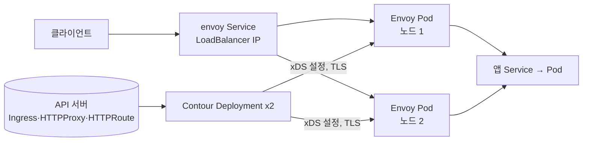

# 02. Contour (Envoy 인그레스)

> 커리큘럼: [CURRICULUM.md](CURRICULUM.md) · 앞 절: [01. Cert Manager](01-cert-manager.md) · 작성 2026-10-30
> 등급: **[근거]** 출처에 그대로 있는 것, **[추론]** 여러 출처를 엮어 직접 내린 결론.
> 기준 판: VKS Add-ons `3.8.0+20261021` (9.1 VKS Add-ons Release Notes, 2026-10-30 확인, 페이지 표기 Last Updated October 26, 2026). 판 호환은 이 문서에서 정리하지 않는다. [공식 호환 매트릭스](https://interopmatrix.broadcom.com/)와 릴리스 노트를 직접 볼 것.

Contour 는 클러스터 밖에서 들어오는 HTTP(S) 트래픽을 받아 Service 로 나눠 주는 인그레스 컨트롤러다. VKS 애드온 가운데 cert-manager 다음으로 깔고, ExternalDNS·Harbor 같은 애드온이 그 위에 올라간다.

---

## 1. 무엇을 하는가

- [근거] Contour 는 Envoy 리버스 HTTP 프록시를 포함하는 쿠버네티스 인그레스 컨트롤러이고, ExternalDNS·Prometheus·Harbor 같은 다른 패키지와 함께 쓰는 일이 많다. (Contour Package Reference, 9.0)
- [근거] 패키지가 까는 구성 요소는 둘이다. (같은 출처)

| 구성 요소 | 종류 | 개수 | 하는 일 |
|---|---|---|---|
| Envoy | DaemonSet | 노드마다 하나 | 실제 트래픽을 받는 고성능 리버스 프록시(데이터 플레인) |
| Contour | Deployment | 2 | Envoy 에 설정을 내려 주는 관리 서버(컨트롤 플레인) |

- [근거] Contour 가 읽는 라우팅 리소스는 세 갈래다. 쿠버네티스 표준 `Ingress`, Contour 자체 CRD 인 `HTTPProxy`, 그리고 Gateway API(`GatewayClass`·`Gateway`·`HTTPRoute`)다. Gateway API 는 Contour 패키지 1.26.1 이상에서 쓸 수 있다. (Contour Package Reference 의 Gateway API support 절, 9.0)
- [근거] Contour 와 Envoy 사이 통신은 TLS 로 보호되고, 그 CA·리프 인증서의 수명은 values 의 `certificates.*` 로 정한다(CA 기본 8760h, 리프 기본 720h). (같은 출처)

[추론] Envoy 는 각 노드에서 Pod 로 뜨고, 기본 values 가 `envoy.hostPorts.enable: true`(80·443)이라 노드 주소의 80·443 으로도 받는다. 설치 문서가 「Envoy Pod 는 자기가 도는 워커 노드의 IP 를 쓴다」고 적은 것은 이 hostPort 를 두고 한 말로 읽힌다. 실제 Pod IP 가 노드 IP 와 같아지는 것은 `envoy.hostNetwork: true` 일 때다.



### 판과 지원 등급 (3.8.0+20261021 기준)

- [근거] 3.8.0+20261021 지원 표에 Contour 는 **`1.33.7+vmware.1-vks.1` 한 판**이고, 등급은 **Ecosystem** 이며, Kubernetes 1.33~1.37 VKr 모두에 「Yes」다. 업그레이드는 1.32.0+vmware.1-vks.1 과 1.33.0·1.33.1·1.33.2·1.33.4·1.33.5 계열에서 매끄럽게 올라간다고 적혀 있다. 이 판에서 바뀐 것은 Go 의존성과 베이스 이미지 취약점 수정이다. (9.1 VKS Add-ons Release Notes, 2026-10-30 확인)
- [근거] Ecosystem 등급의 뜻: Broadcom 이 큐레이션해 VKS 기반 호환성만 검증한 오픈소스 패키지다. Broadcom 지원은 **패키징·서명·생명주기(설치·업그레이드) 문제까지**이고, 런타임 버그·보안 패치·기능 요청은 업스트림 커뮤니티가 다룬다. (같은 출처의 VKS Add-ons Support Tiers)
- [근거] 그 앞 판들은 1.33.5+vmware.2-vks.1(3.7.0+20260924, 「Kubernetes 1.33~1.36 에서 시험」), 1.33.5+vmware.1-vks.1, 1.33.4+vmware.1-vks.1, 1.33.2+vmware.1-vks.1(「1.32~1.35 에서 시험」) 순이다. (같은 출처)
- [근거] 업스트림 호환 표에서 Contour 1.33.7 은 Envoy 1.38.4 와 함께 **Kubernetes 1.34·1.33·1.32 에서** 시험됐고 Gateway API 1.3.0 을 구현한다. main 브랜치는 Envoy 1.40.2·Kubernetes 1.37·1.36·1.35 로 시험한다. (Contour Compatibility Matrix, 2026-10-30 확인)
- [근거] 업스트림 정식 릴리스는 v1.33.0(2025-09-09) 이후 2026-10-30 까지 1.33.x 패치만 나왔고 최근 것은 v1.33.7(2026-09-07)이다. v1.34 태그는 없다. (GitHub projectcontour/contour releases, 2026-10-30 확인)
- [추론] 그러니 **Kubernetes 1.35~1.37 위의 Contour 1.33.7 은 업스트림 CI 가 아니라 Broadcom 검증만 거친 조합**이다. 그런데 Ecosystem 등급이라 그 조합에서 런타임 버그가 나면 Broadcom 이 아니라 업스트림에 기대야 한다. 1.35 이상 VKr 에서 Contour 를 쓸 계획이면 이 빈틈을 미리 알고 고른다.

## 2. VKS 에서 어떻게 들어가는가

두 경로의 공통 바탕은 [00절](00-repository-and-install-paths.md)에, Carvel 기초는 [`../carvel-kapp.md`](../carvel-kapp.md)에 있다. 여기서는 Contour 에 특유한 것만 적는다.

| | 레거시 패키지 | Add-on Management (VCF CLI) | Add-on Management (kubectl) |
|---|---|---|---|
| 컨텍스트 | 워크로드 클러스터 | Supervisor, 클러스터 네임스페이스 | Supervisor, 클러스터 네임스페이스 |
| 패키지·애드온 이름 | `contour.kubernetes.vmware.com` | `contour` | `addonRef.name: contour` |
| 판 지정 | `-v 1.32.0+vmware.1-vks.1` | `--addon-release-name contour.kubernetes.vmware.com.1.33.1-vmware.1-vks.1` | `releaseFilter.ref.name` 에 같은 AddonRelease 이름 |
| 설정값 | `--values-file` | `--values-config-file` | `AddonConfig.spec.values` |
| PackageInstall·AddonInstall 위치 | 새 네임스페이스 `contour` | 클러스터 네임스페이스 | 클러스터 네임스페이스 |
| 구성 요소가 뜨는 곳 | `tanzu-system-ingress` | 같음 | 같음 |

근거: [근거] Install Contour Package, Install Contour Addon using VCF CLI, Install Contour Addon using Kubectl (모두 9.0, 2026-10-30 확인). 표로 묶은 것은 [추론].

- [근거] 패키지 이름이 판에 따라 다르다. **1.30.3 이후는 `contour.kubernetes.vmware.com`**, 그 전은 `contour.tanzu.vmware.com` 으로 찾는다. (Install Contour Package, 9.0)
- [근거] Add-on Management 로 깔 수 있는 것은 **Contour 1.33.0 부터**다. (Install Contour Addon using VCF CLI, 9.0)
- [근거] values 의 `namespace`(기본 `tanzu-system-ingress`)는 Contour·Envoy Pod 가 도는 곳이고, 패키지(PackageInstall)를 두는 곳과 다르다. (Contour Package Reference, 9.0)
- [근거] 처음 깐 뒤 Contour 설정을 바꾸면 「Update a Package」 절차로 클러스터에 다시 반영해야 한다. (같은 출처)
- [근거] Supervisor 자체에 까는 「Installing Contour as a Supervisor Service」는 별도 문서다. 이 절은 VKS 워크로드 클러스터 안에 까는 애드온만 다룬다. (9.1 문서 목차, 2026-10-30 확인)

## 3. 실습

> 이름(`wl-antrea`, `test-ns`, `contour`)은 공식 문서의 예시 값이다. 판은 자기 환경의 `vcf addon available list contour` 나 `vcf package available get` 출력에서 고른다. 아래 판 번호는 문서 예시 그대로이고 3.8.0+20261021 의 판(1.33.7)이 아니다.
> cert-manager 가 먼저 깔려 있어야 한다([01절](01-cert-manager.md)). 공식 VCF CLI 예시의 `vcf addon install list` 출력에도 cert-manager 가 먼저 READY 로 나온다.

### 3.1 values 파일 만들기

```bash
# Add-on 경로(Supervisor 컨텍스트)
vcf context use supervisor:test-ns
vcf addon available list contour
vcf addon available get contour -v 1.33.1+vmware.1-vks.1 -o contour-data-values.yaml

# 레거시 경로(워크로드 클러스터 컨텍스트)
vcf package available get contour.kubernetes.vmware.com -n tkg-system
vcf package available get contour.kubernetes.vmware.com/1.32.0+vmware.1-vks.1 \
  --default-values-file-output contour-data-values.yaml -n tkg-system
```

[근거] 세 설치 문서가 공통으로 고치라고 하는 곳은 하나다. **Envoy Service 를 `LoadBalancer` 로** 바꿔 클러스터 밖에서 들어오게 한다. 기본값은 vSphere 에서 `NodePort` 다. (Contour Package Reference, 9.0)

```yaml
infrastructure_provider: vsphere
namespace: tanzu-system-ingress
contour:
  configFileContents: {}
  useProxyProtocol: false
  replicas: 2
  pspNames: "vmware-system-restricted"
  logLevel: info
envoy:
  service:
    type: LoadBalancer
    annotations: {}
    externalTrafficPolicy: Cluster
    disableWait: false
  hostPorts:
    enable: true
    http: 80
    https: 443
  hostNetwork: false
  terminationGracePeriodSeconds: 300
  logLevel: info
certificates:
  caDuration: 8760h
  caRenewBefore: 720h
  leafDuration: 720h
  leafRenewBefore: 360h
```

자주 만지는 키 (모두 [근거] Contour Package Reference 설정표):

| 키 | 기본값 | 메모 |
|---|---|---|
| `envoy.service.type` | vSphere 에선 NodePort | LoadBalancer·NodePort·ClusterIP |
| `envoy.service.loadBalancerIP` | 없음 | `Service.spec.loadBalancerIP` 를 채운다. 쿠버네티스 1.24 부터 deprecated 라 문서는 제공자 어노테이션을 권한다 |
| `envoy.service.externalTrafficPolicy` | Cluster | Local 로 하면 클라이언트 원 IP 보존 [추론: 쿠버네티스 Service 일반 동작] |
| `envoy.workload.type` | DaemonSet | Deployment 로 바꾸면 `envoy.workload.replicas`(기본 2) |
| `envoy.service.loadBalancerTLSTermination` | false | true 면 LB 에서 TLS 를 끊고 443→Envoy 8080 으로 보냄, http 포트 항목은 빠짐 |
| `contour.configFileContents` | 없음 | Contour 설정 파일 내용. ConfigMap 으로 만들어 Pod 에 마운트 |
| `contour.disableGRPCRoutes` | true | GRPCRoute 를 쓰려면 false, 클러스터의 gateway-api 패키지가 v1.2.0 이상이어야 함(1.31.1+) |
| `envoy.bootstrap.overloadManger.*` | 0(제한 없음) | 힙·하류 연결 수 상한(1.31.1+). 키 철자가 `overloadManger` 로 적혀 있다 |
| `nsLimitRange.*` | 요청 128m·256Mi | 1.33.0+ 에서 생김 |

TLS 1.3 만 받게 하는 문서 예시:

```yaml
contour:
  configFileContents:
    tls:
      minimum-protocol-version: "1.3"
      maximum-protocol-version: "1.3"
```

[근거] 위 예시 모양은 참조 문서 그대로다(문서는 따옴표 없이 `1.3`). [추론] YAML 에서 `1.3` 은 숫자로 읽히므로 Contour 설정 파일의 문자열 칸에 넣을 땐 따옴표로 감싸는 편이 안전하다. 실제로 반영됐는지는 3.5 의 ConfigMap 으로 확인한다.

### 3.2 Add-on 방식, VCF CLI

```bash
vcf cluster list -A
vcf context use supervisor:test-ns

vcf addon install create contour --cluster-name wl-antrea -n test-ns \
  --addon-release-name contour.kubernetes.vmware.com.1.33.1-vmware.1-vks.1 \
  --values-config-file contour-data-values.yaml

vcf addon install list -n test-ns --cluster-name wl-antrea
# 기대: cert-manager ... READY True / contour ... PAUSED false READY True DELETE/UPGRADE Allowed
vcf addon install get contour --cluster-name wl-antrea -n test-ns \
  | jq -r '.status.conditions[] | select(.type=="Ready") | .status'
# 기대: True
```

[근거] Install Contour Addon using VCF CLI(9.0). 지울 때는 `vcf addon install delete contour --cluster-name wl-antrea -n test-ns -y` 이고, 출력에 `AddonInstall contour-wl-antrea` → `ClusterAddon wl-antrea-contour` → `AddonConfig wl-antrea-contour` 순으로 지운다고 나온다.

### 3.3 Add-on 방식, kubectl

```yaml
# addonConfig-contour.yaml — 이름은 반드시 <클러스터 이름>-<애드온 이름>
apiVersion: addons.kubernetes.vmware.com/v1alpha1
kind: AddonConfig
metadata:
  name: wl-antrea-contour
  namespace: test-ns
  annotations:
    clusteraddon.addons.kubernetes.vmware.com/owned-for-deletion: "true"
spec:
  values:
    envoy:
      service:
        type: LoadBalancer
---
# addoninstall-contour.yaml — 문서 예시 이름은 <애드온 이름>-<클러스터 이름>
apiVersion: addons.kubernetes.vmware.com/v1alpha1
kind: AddonInstall
metadata:
  name: contour-wl-antrea
  namespace: test-ns
spec:
  releaseFilter:
    ref:
      name: contour.kubernetes.vmware.com.1.33.1-vmware.1-vks.1
      namespace: vmware-system-vks-public
  addonRef:
    name: contour
  clusters:
  - selector:
      matchLabels:
        cluster.x-k8s.io/cluster-name: wl-antrea
```

```bash
kubectl config use-context supervisor:test-ns
kubectl get addonreleases -n vmware-system-vks-public | grep contour
kubectl apply -f addonConfig-contour.yaml
kubectl apply -f addoninstall-contour.yaml
kubectl get clusteraddon
# 기대: wl-antrea-contour  wl-antrea  contour  contour-wl-antrea  contour.kubernetes.vmware.com.1.33.1-vmware.1-vks.1  True
```

- [근거] 위 YAML 과 이름 규칙은 Install Contour Addon using Kubectl(9.0) 예시다. 문서는 `spec.values` 아래에 주석만 두고 3.1 의 values 를 붙이라고 한다. 여기서는 바꾸는 키 하나만 넣었다 [추론: AddonConfig 는 기본값 위에 덮어쓰는 값이라는 00절 설명에 기댐].
- [근거] 지울 때는 `kubectl delete -f addoninstall-contour.yaml` 뒤 AddonInstall·AddonConfig·ClusterAddon 이 모두 사라졌는지 `kubectl get ... | grep contour` 로 본다. (같은 출처)

### 3.4 레거시 방식

```bash
kubectl create ns contour
vcf package install contour -p contour.kubernetes.vmware.com \
  -v 1.32.0+vmware.1-vks.1 --values-file contour-data-values.yaml -n contour
vcf package installed list -n contour
# 기대: contour  contour.kubernetes.vmware.com  1.32.0+vmware.1-vks.1  Reconcile succeeded

# 지우기
vcf package installed delete contour -y -n contour
```

[근거] Install Contour Package(9.0).

### 3.5 깔린 뒤 확인 (워크로드 클러스터 컨텍스트)

```bash
kubectl -n tanzu-system-ingress get all
# 기대: deployment contour 2/2, daemonset envoy DESIRED=READY=워커 수,
#       service/contour ClusterIP 8001/TCP,
#       service/envoy LoadBalancer EXTERNAL-IP 있음, 80:<노드포트>/TCP,443:<노드포트>/TCP
#       envoy Pod 는 2/2(envoy + shutdown-manager)

kubectl -n tanzu-system-ingress get cm -o name           # configFileContents 가 들어간 ConfigMap 찾기
kubectl -n tanzu-system-ingress get secret | grep -i -e contour -e envoy   # Contour↔Envoy TLS 인증서
```

- [근거] 세 설치 문서의 기대 출력이 첫 명령의 모양이다. Envoy Pod 가 2/2 인 것과 설정표의 `shutdownManager` 자원 키가 맞물린다.
- [추론] 두·세 번째 명령의 결과 이름은 문서에 없다. 처음 볼 때는 이름을 짐작하지 말고 목록에서 고른다.

그다음 실제로 트래픽이 지나가는지 본다. Contour 자체 CRD 인 HTTPProxy 로 한 번, Gateway API 로 한 번이다.

```yaml
# demo.yaml
apiVersion: apps/v1
kind: Deployment
metadata: {name: echo, namespace: default}
spec:
  replicas: 1
  selector: {matchLabels: {app: echo}}
  template:
    metadata: {labels: {app: echo}}
    spec:
      containers:
      - name: echo
        image: registry.k8s.io/e2e-test-images/agnhost:2.53
        args: ["netexec", "--http-port=8080"]
---
apiVersion: v1
kind: Service
metadata: {name: echo, namespace: default}
spec:
  selector: {app: echo}
  ports: [{port: 80, targetPort: 8080}]
---
apiVersion: projectcontour.io/v1
kind: HTTPProxy
metadata: {name: echo, namespace: default}
spec:
  virtualhost:
    fqdn: echo.example.test
  routes:
  - conditions: [{prefix: /}]
    services: [{name: echo, port: 80}]
```

```bash
kubectl apply -f demo.yaml
kubectl get httpproxy echo        # STATUS valid 를 기다린다
LB=$(kubectl -n tanzu-system-ingress get svc envoy -o jsonpath='{.status.loadBalancer.ingress[0].ip}')
curl -s -H 'Host: echo.example.test' "http://$LB/hostname"   # echo Pod 이름이 나오면 성공
```

[근거] HTTPProxy 의 `virtualhost.fqdn`·`routes[].conditions.prefix`·`services` 모양은 업스트림 HTTPProxy 문서를 따랐다(루트 `k8s-addon.sh` 의 Contour 예시도 같은 모양). agnhost `netexec` 의 `/hostname` 경로는 쿠버네티스 e2e 이미지 문서를 따랐다. [추론] 이 실습 묶음 자체를 VKS 에서 돌려 보지는 않았다.

Gateway API 로 붙일 때의 흐름은 참조 문서 그대로 따른다. [근거] Contour 패키지는 Gateway API 를 **정적 프로비저닝(static provisioning)** 으로 설정하고, 리스너 포트는 80(HTTP)·443(HTTPS) 두 개까지만 지원한다. (Contour Package Reference, 9.0)

```yaml
kind: GatewayClass
apiVersion: gateway.networking.k8s.io/v1
metadata: {name: contour}
spec:
  controllerName: projectcontour.io/gateway-controller
---
kind: Gateway
apiVersion: gateway.networking.k8s.io/v1
metadata: {name: contour-gateway, namespace: tanzu-system-ingress}
spec:
  gatewayClassName: contour
  listeners:
  - name: http
    protocol: HTTP
    port: 80
    allowedRoutes: {namespaces: {from: All}}
```

```yaml
# 그다음 values 에 이 Gateway 를 가리키게 하고 패키지를 업데이트한다
contour:
  configFileContents:
    gateway:
      gatewayRef:
        name: contour-gateway
        namespace: tanzu-system-ingress
```

```bash
kubectl describe gateway contour-gateway -n tanzu-system-ingress
# 기대: Accepted True, Programmed True, 주소(IP) 있음
# 그 뒤 parentRefs 로 contour-gateway 를 가리키는 HTTPRoute 를 만들고 Accepted True 를 본다
```

[근거] 위 세 단계와 「Gateway 를 쓰면서 TLS Ingress 도 받으려면 http·https 리스너를 둘 다 둔다」는 주의는 Contour Package Reference(9.0)의 Gateway API support 절이다. Gateway API 개념은 루트 [`../istio-gateway-api.md`](../istio-gateway-api.md)에 있다.

## 4. 업스트림 Helm 설치와 다른 점

업스트림 차트로 직접 까는 방법은 루트 [`../k8s-addon.sh`](../k8s-addon.sh)의 「10. Contour」(`addon_contour`, 차트 `projectcontour/contour`, 네임스페이스 `projectcontour`)에 있다. 여기서는 차이만 적는다.

1. [근거] 구성 요소가 뜨는 네임스페이스가 다르다. VKS 패키지는 `tanzu-system-ingress`, 루트 스크립트 기본값은 `projectcontour` 다. (Contour Package Reference; `k8s-addon.sh`)
2. [근거] values 키가 다르다. VKS 쪽은 `envoy.workload.*`, `envoy.hostPorts.*`, `certificates.*`, `nsLimitRange.*`, `contour.configFileContents` 같은 자체 키를 쓰고, 지원 범위는 Broadcom 문서에 실린 키까지다. 문서에 없는 값을 넣으려고 만든 ytt 오버레이는 지원 밖이다. (9.1 Release Notes 의 Out of Scope 절) ytt 오버레이 자체는 [`../carvel-ytt-for-kapp.md`](../carvel-ytt-for-kapp.md).
3. [근거] Envoy Service 기본 종류가 vSphere 에서 NodePort 다. 그래서 공식 문서는 설치 전에 LoadBalancer 로 바꾸게 한다. (Contour Package Reference)
4. [근거] Gateway API 는 정적 프로비저닝으로만 설정되고 리스너는 80·443 까지다. (같은 출처) [추론] 업스트림의 동적 프로비저닝(Gateway 마다 Envoy 를 따로 띄우는 Gateway provisioner)은 이 패키지로는 쓸 수 없다고 본다.
5. [근거] Contour 는 Ecosystem 등급이라 런타임 버그·보안 패치는 업스트림 몫이다. 이 점에서 지원 범위가 Helm 직접 설치와 크게 다르지 않고, 다른 것은 설치·업그레이드 경로를 Broadcom 이 받쳐 준다는 점이다. (9.1 Release Notes 의 Support Tiers)
6. [추론] 같은 클러스터에 Helm 판 Contour 와 VKS 판을 함께 두면 CRD(HTTPProxy 등)와 IngressClass 가 겹친다. 하나만 깐다.

## 5. 흔한 실수

1. **Envoy Service 를 기본값(NodePort)으로 두고 외부 IP 를 기다리기.** [근거] vSphere 기본값은 NodePort 다. LoadBalancer 로 바꿔야 EXTERNAL-IP 가 생긴다.
2. **옛 패키지 이름으로 찾기.** [근거] 1.30.3 이후 판은 `contour.kubernetes.vmware.com` 이다. `contour.tanzu.vmware.com` 으로 찾으면 새 판이 안 보인다.
3. **1.33.0 미만 판을 Add-on Management 로 깔려고 하기.** [근거] Add-on 경로는 1.33.0 부터다.
4. **values 를 바꾸고 그대로 두기.** [근거] 처음 설치 뒤 바꾼 설정은 Update a Package 절차로 다시 반영해야 한다.
5. **VCF CLI 문서의 「Where:」 설명을 그대로 믿기.** [근거] Install Contour Addon using VCF CLI 의 설명은 `wl-antrea` 를 「VKS cluster namespace」, `test-ns` 를 「guest cluster name」으로 적었다. 같은 문서의 `vcf cluster list -A` 출력에서는 `wl-antrea` 가 클러스터 이름이고 `test-ns` 가 네임스페이스다. [추론] 설명 줄이 서로 뒤바뀐 것이다. 명령은 출력 쪽에 맞춰 `--cluster-name <클러스터> -n <네임스페이스>` 로 쓴다.
6. **설치 문서의 예시 IP 를 결과로 읽기.** [근거] 같은 문서가 본문에는 외부 IP 를 `192.168.112.1` 로, 바로 위 출력에는 `192.168.130.7` 로 적었다. [추론] 레거시 문서의 문장을 옮겨 온 흔적이다. 자기 환경의 `kubectl get svc envoy` 값만 본다.
7. **AddonConfig 와 AddonInstall 이름 순서를 같게 짓기.** [근거] Contour kubectl 문서는 AddonConfig 를 `<클러스터>-<애드온>`(`wl-antrea-contour`), AddonInstall 을 `<애드온>-<클러스터>`(`contour-wl-antrea`)로 짓는다. AddonConfig 이름 규칙만 「must」로 적혀 있다. [추론] 01절의 cert-manager kubectl 문서는 AddonInstall 도 `<클러스터>-<애드온>` 으로 지었으니, 지울 때는 `kubectl get addoninstall -n <ns>` 로 실제 이름을 확인한다.
8. **GRPCRoute 를 켜고 gateway-api 판을 안 보기.** [근거] `contour.disableGRPCRoutes: false` 는 클러스터의 gateway-api 패키지가 v1.2.0 이상이어야 한다.
9. **Ecosystem 등급인데 런타임 장애를 Broadcom 지원으로 풀려고 하기.** [근거] Ecosystem 은 패키징·서명·생명주기까지만 Broadcom 이 받는다. [추론] 운영 중 장애 대비책(업스트림 이슈 추적, 대체 인그레스)은 따로 마련해 둔다.

## 6. 확인 문제

1. Contour 패키지가 까는 두 구성 요소의 쿠버네티스 리소스 종류와 기본 개수는? Envoy Pod 가 `2/2` 로 보이는 이유는?
<details><summary>답</summary>

Envoy 는 DaemonSet(노드마다 하나), Contour 는 Deployment(2개). Envoy Pod 안에 envoy 컨테이너와 shutdown-manager 컨테이너가 함께 있어 2/2 다. [근거] Contour Package Reference 의 구성 요소 표와 `envoy.workload.resources.shutdownManager.*` 키, 설치 문서의 기대 출력.
</details>

2. 3.8.0+20261021 의 Contour 판과 지원 등급은 무엇이고, 그 등급에서 런타임 버그가 나면 누가 고치는가?
<details><summary>답</summary>

`1.33.7+vmware.1-vks.1`, Ecosystem 등급. Broadcom 지원은 패키징·서명·생명주기까지이고 런타임 버그와 보안 패치는 업스트림 커뮤니티 몫이다. [근거] 9.1 VKS Add-ons Release Notes.
</details>

3. Gateway API 로 Contour 를 쓸 때 VKS 패키지가 업스트림 설치와 다르게 묶어 둔 제약 두 가지는?
<details><summary>답</summary>

정적 프로비저닝 방식으로만 설정되고, 리스너 포트는 80(HTTP)과 443(HTTPS) 두 개까지만 지원한다. 그래서 Gateway 를 쓰면서 TLS Ingress 도 받으려면 Gateway 에 http·https 리스너를 둘 다 둔다. [근거] Contour Package Reference 의 Gateway API support 절.
</details>

## 7. 출처 (모두 2026-10-30 확인)

- VKS Add-ons Release Notes (9.1, Last Updated October 26, 2026): <https://techdocs.broadcom.com/us/en/vmware-cis/vcf/vcf-service-administration-and-development/9-1/release-notes/vks-addons-release-notes.html>
- Install Contour (9.0, Last Updated October 6, 2026): <https://techdocs.broadcom.com/us/en/vmware-cis/vcf/vcf-service-administration-and-development/9-0/managing-vsphere-kuberenetes-service-clusters-and-workloads/installing-standard-packages-on-tkg-service-clusters/installing-standard-packages-on-tkg-cluster-using-tkr-for-vsphere-8-x/install-contour-with-envoy(1).html>
- Install Contour Package (9.0): <https://techdocs.broadcom.com/us/en/vmware-cis/vcf/vcf-service-administration-and-development/9-0/managing-vsphere-kuberenetes-service-clusters-and-workloads/installing-standard-packages-on-tkg-service-clusters/installing-standard-packages-on-tkg-cluster-using-tkr-for-vsphere-8-x/install-contour-with-envoy(1)/install-contour-with-envoy.html>
- Install Contour Addon using VCF CLI (9.0): <https://techdocs.broadcom.com/us/en/vmware-cis/vcf/vcf-service-administration-and-development/9-0/managing-vsphere-kuberenetes-service-clusters-and-workloads/installing-standard-packages-on-tkg-service-clusters/installing-standard-packages-on-tkg-cluster-using-tkr-for-vsphere-8-x/install-contour-with-envoy(1)/install-contour-with-envoy-addon.html>
- Install Contour Addon using Kubectl (9.0): <https://techdocs.broadcom.com/us/en/vmware-cis/vcf/vcf-service-administration-and-development/9-0/managing-vsphere-kuberenetes-service-clusters-and-workloads/installing-standard-packages-on-tkg-service-clusters/installing-standard-packages-on-tkg-cluster-using-tkr-for-vsphere-8-x/install-contour-with-envoy(1)/install-contour-addon-using-kubectl.html>
- Contour Package Reference (9.0): <https://techdocs.broadcom.com/us/en/vmware-cis/vcf/vcf-service-administration-and-development/9-0/managing-vsphere-kuberenetes-service-clusters-and-workloads/installing-standard-packages-on-tkg-service-clusters/standard-package-reference/contour-package-reference.html>
- Contour Compatibility Matrix: <https://projectcontour.io/resources/compatibility-matrix/>
- Contour 릴리스 목록: <https://github.com/projectcontour/contour/releases>
- Contour 설정 파일: <https://projectcontour.io/docs/main/configuration/#configuration-file>
- Contour HTTPProxy: <https://projectcontour.io/docs/main/config/fundamentals/>
- Gateway API HTTP routing: <https://gateway-api.sigs.k8s.io/guides/http-routing/>
- Broadcom 호환 매트릭스: <https://interopmatrix.broadcom.com/>
