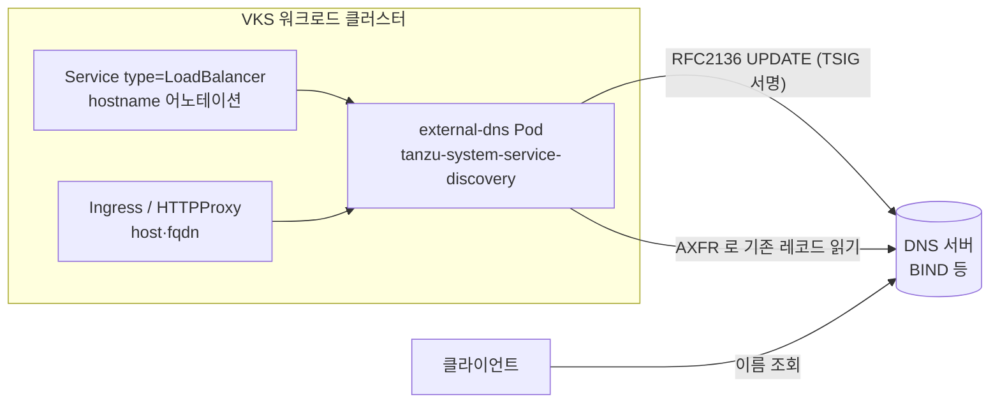

# 03. ExternalDNS

> 커리큘럼: [CURRICULUM.md](CURRICULUM.md) · 앞 절: [02. Contour](02-contour.md) · 작성 2026-10-30
> 등급: **[근거]** 출처에 그대로 있는 것, **[추론]** 여러 출처를 엮어 직접 내린 결론.
> 기준 판: VKS Add-ons `3.8.0+20261021` (9.1 VKS Add-ons Release Notes, 2026-10-30 확인, 페이지 표기 Last Updated October 26, 2026). 판 호환은 이 문서에서 정리하지 않는다. [공식 호환 매트릭스](https://interopmatrix.broadcom.com/)와 릴리스 노트를 직접 볼 것.

ExternalDNS 는 클러스터 안의 Service·Ingress·HTTPProxy 에 적힌 호스트 이름을 읽어 바깥 DNS 서버에 A·CNAME 레코드를 대신 만들어 준다. [02절](02-contour.md)에서 Contour 로 외부 IP 를 받았다면, 그 IP 에 이름을 붙이는 일이 이 절이다.

---

## 1. 무엇을 하는가

- [근거] ExternalDNS 는 노출된 쿠버네티스 Service 와 Ingress 를 DNS 제공자와 동기화한다. 패키지가 까는 것은 `external-dns` Deployment 하나(레플리카 1)다. (ExternalDNS Package Reference, 9.0)
- [근거] 동작은 주기적인 맞추기다. `--interval`(기본 1m)마다 `--source` 로 고른 리소스에서 원하는 레코드 목록을 만들고, 제공자에 있는 레코드와 비교해 고친다. 어떤 레코드를 자기가 만들었는지는 `--registry=txt` 일 때 소유권 TXT 레코드(`--txt-owner-id`)로 기억한다. (업스트림 flags, v0.22.0)
- [근거] `--policy` 는 고치는 범위를 정한다. `sync` 는 만들고 지우기까지, `upsert-only` 는 만들고 고치기만, `create-only` 는 만들기만 한다. (같은 출처)



### 지원하는 DNS 제공자

- [근거] 참조 문서는 「AWS(Route 53), Azure DNS, RFC2136 호환 DNS 서버(BIND 등)로 검증했다」고 적는다. 0.21.0 부터는 업스트림에 있는 NS1·Pihole·PowerDNS 를 지원 제공자 목록에서 뺐다. (ExternalDNS Package Reference, 9.0)
- [근거] 그런데 같은 9.0 문서 세트의 Install ExternalDNS Package 는 「RFC2136 호환 DNS 서버(BIND 등)로 검증했다」고 하나만 적는다. (Install ExternalDNS Package, 9.0)
- [추론] 온프레미스 VKS 에서 가장 흔한 조합은 사내 BIND 같은 RFC2136 서버다. 아래 실습도 RFC2136 기준이다. Route 53·Azure DNS 를 쓸 땐 참조 문서의 검증 범위가 설치 문서보다 넓게 적혀 있다는 점을 알고, 지원 범위를 공식 지원 창구로 한 번 더 확인한다.

### 판과 지원 등급 (3.8.0+20261021 기준)

- [근거] 3.8.0+20261021 지원 표에서 External DNS 는 **`0.22.0+vmware.1-vks.1` 한 판**이고 등급은 **Product** 다. Kubernetes 1.33~1.37 VKr 모두에 「Yes」다. 0.18.0+vmware.2, 0.20.0+vmware.1·2, 0.21.0+vmware.1·2·3 에서 매끄럽게 올라간다고 적혀 있다. 이 판의 변경 내용은 업스트림 릴리스 노트 링크뿐이다. (9.1 VKS Add-ons Release Notes, 2026-10-30 확인)
- [근거] Product 등급은 Broadcom 이 배포·생명주기뿐 아니라 **런타임 문제 해결까지** 지원한다. 단 범위는 Broadcom 공식 문서에 실린 설정값까지다. (같은 출처의 Support Tiers) 02절의 Contour(Ecosystem)와 다르다.
- [근거] 판별로 바뀐 것 (모두 같은 릴리스 노트):

| VKS 판 | ExternalDNS 판 | 바뀐 것 |
|---|---|---|
| 3.5.0+20251022 | 0.18.0+vmware.1-vks.1 | Add-on Management 지원 시작, 네임스페이스 LimitRange·컨테이너 자원 설정 |
| 3.5.0+20251218 | 0.18.0+vmware.2-vks.1 | Kubernetes 1.31~1.34 에서 시험 |
| 3.6.0+20260211 | 0.20.0+vmware.1-vks.1 | Kubernetes 1.32~1.35 에서 시험 |
| 3.7.0+20260618 | 0.21.0+vmware.1-vks.1 | Kubernetes 1.34 이상에서 priority class 설정 |
| 3.7.0+20260723 | 0.21.0+vmware.2-vks.1 | TSIG 알고리즘 목록에서 HMAC-SHA1 제거, `rfc2136.tsigSecret` 값 도입 |
| 3.7.0+20260827 | 0.21.0+vmware.3-vks.1 | (설명 없음) |
| 3.8.0+20261021 | 0.22.0+vmware.1-vks.1 | (설명 없음, 업스트림 노트 링크) |

### 0.22.0 으로 올릴 때 업스트림이 경고한 두 가지

- [근거] 업스트림 v0.22.0(2026-08-20) 릴리스 노트는 「업그레이드 전 조치 필요」로 두 가지를 적었다. 첫째, 기본 어노테이션 접두어가 `external-dns.alpha.kubernetes.io/` 에서 **`external-dns.kubernetes.io/` 로 바뀌었고 옛 접두어로 돌아가는 대체 동작이 없다.** 노트는 「이 변경으로 DNS 레코드가 **모두 지워질 수** 있다」고 경고하고, 어노테이션을 옮기거나 `--annotation-prefix=external-dns.alpha.kubernetes.io/` 를 주라고 한다. 둘째, 그 사고를 막으려고 **`--policy` 가 기본값 없는 필수 플래그가 됐다.** (GitHub kubernetes-sigs/external-dns v0.22.0 release, 2026-10-30 확인)
- [근거] 소스로도 확인된다. v0.21.0 의 `DefaultAnnotationPrefix` 는 `external-dns.alpha.kubernetes.io/`, v0.22.0 은 `external-dns.kubernetes.io/` 다. v0.22.0 검증 코드는 `--policy` 가 비어 있으면 `--policy must be set explicitly` 오류를 낸다. (`source/annotations/annotations.go`, `pkg/apis/externaldns/validation/validation.go`, 각 태그)
- [근거] Broadcom 9.0 참조 문서의 RFC2136 예시 values 에는 `--policy` 가 없고, 9.1 릴리스 노트의 0.22.0 항목은 이 두 변경을 따로 적지 않는다. 9.1 문서 세트의 ExternalDNS 참조 페이지(9.0 주소를 9-1 로 바꾼 것)는 404 다. (2026-10-30 확인)
- [추론] VMware 빌드가 이 두 동작을 바꿔 두었는지는 공개 문서로 알 수 없다. 그래서 0.22.0 판을 쓰거나 0.21.x 에서 올릴 때는 **`--policy` 와 `--annotation-prefix` 를 values 에 직접 적고**, 먼저 `--dry-run` 으로 로그를 본 뒤 켠다. 업스트림이 권하는 순서도 같다(Version update playbook).

## 2. VKS 에서 어떻게 들어가는가

두 경로의 공통 바탕은 [00절](00-repository-and-install-paths.md)에, Carvel 기초는 [`../carvel-kapp.md`](../carvel-kapp.md)에 있다. 여기서는 ExternalDNS 에 특유한 것만 적는다.

| | 레거시 패키지 | Add-on Management (VCF CLI) | Add-on Management (kubectl) |
|---|---|---|---|
| 컨텍스트 | 워크로드 클러스터 | Supervisor, 클러스터 네임스페이스 | Supervisor, 클러스터 네임스페이스 |
| 패키지·애드온 이름 | `external-dns.kubernetes.vmware.com` | `external-dns` | `addonRef.name: external-dns` |
| 판 지정 | `--version 0.18.0+vmware.1-vks.1` | `--addon-release-name external-dns.kubernetes.vmware.com.0.18.0-vmware.2-vks.1` | `releaseFilter.ref.name` 에 같은 AddonRelease 이름 |
| 설정값 | `--values-file` | `--values-config-file` | `AddonConfig.spec.values` |
| PackageInstall·AddonInstall 위치 | 새 네임스페이스(문서 예시 `external-dns-ns`) | 클러스터 네임스페이스 | 클러스터 네임스페이스 |
| Pod 가 뜨는 곳 | `tanzu-system-service-discovery` | 같음 | 같음 |

근거: [근거] Install ExternalDNS Package, Install ExternalDNS Addon Using VCF CLI, Install ExternalDNS Addon Using Kubectl (모두 9.0, 2026-10-30 확인). 표로 묶은 것은 [추론].

- [근거] 패키지 이름이 판에 따라 다르다. **0.16.1 이후는 `external-dns.kubernetes.vmware.com`**, 그 전은 `external-dns.tanzu.vmware.com` 으로 찾는다. (Install ExternalDNS Package, 9.0)
- [근거] Add-on Management 로 깔 수 있는 것은 **0.18.0 부터**다. (Install ExternalDNS Addon Using VCF CLI, 9.0; 3.5.0+20251022 릴리스 노트)
- [근거] 레거시 경로에서 `--namespace` 를 안 주면 VCF CLI 는 `tanzu-system-service-discovery` 에 패키지를 두는데, 문서는 **그 네임스페이스에 패키지를 설치하지 말라**고 한다. 그곳은 Pod 가 뜨는 자리다. (Install ExternalDNS Package, 9.0)
- [근거] 사전 조건은 `--source=contour-httpproxy` 를 쓸 때만 Contour 패키지가 먼저 깔려 있어야 한다는 것이다. Service·Ingress 만 볼 거라면 필요 없다. (Install ExternalDNS Package; Package Reference 예시 주석)

## 3. 실습

> 이름(`wl-antrea`, `test-ns`, `external-dns-ns`)은 공식 문서의 예시 값이다. 판은 자기 환경의 `vcf addon available list external-dns` 나 `vcf package available get` 출력에서 고른다. 아래 판 번호는 문서 예시 그대로이고 3.8.0+20261021 의 판(0.22.0)이 아니다.
> DNS 서버 주소·영역·TSIG 키 이름과 값은 자리표시자다. 실제 값을 문서나 Git 에 남기지 않는다.

### 3.1 DNS 서버 쪽 준비 (RFC2136, BIND 예)

ExternalDNS 가 레코드를 고치려면 DNS 서버가 그 영역에 대해 **TSIG 로 서명된 동적 업데이트**와(`sync`·`upsert-only` 로 기존 레코드를 읽으려면) **AXFR** 를 허용해야 한다.

```bash
# BIND 9.13 이상: TSIG 키 만들기 (키 이름 externaldns-key 는 예시)
tsig-keygen -a hmac-sha256 externaldns-key > externaldns-key.conf
```

```text
# named.conf 의 해당 영역에 넣는 모양 (예시)
include "externaldns-key.conf";
zone "<DNS-ZONE>" {
  type primary;
  file "<영역 파일>";
  allow-transfer { key "externaldns-key"; };
  update-policy { grant externaldns-key zonesub ANY; };
};
```

- [근거] 키 생성 명령, `allow-transfer`·`update-policy` 모양, 「`sync` 정책에서는 AXFR 가 있어야 기존 레코드를 읽는다」는 설명은 업스트림 RFC2136 튜토리얼이다. (external-dns docs/tutorials/rfc2136.md)
- [근거] VKS 0.21.0+vmware.2 부터 TSIG 알고리즘 목록에서 HMAC-SHA1 이 빠졌다. 키는 `hmac-sha256` 이상으로 만든다. (9.1 릴리스 노트, 3.7.0+20260723)

### 3.2 values 파일 만들기

```bash
# Add-on 경로(Supervisor 컨텍스트)
vcf context use supervisor:test-ns
vcf addon repo list
vcf addon available list external-dns
vcf addon available get external-dns -v 0.18.0+vmware.2-vks.1 -o external-dns-data-values.yaml

# 레거시 경로(워크로드 클러스터 컨텍스트)
vcf package available get external-dns.kubernetes.vmware.com -n tkg-system
vcf package available get external-dns.kubernetes.vmware.com/0.18.0+vmware.1-vks.1 \
  --default-values-file-output external-dns-data-values.yaml -n tkg-system
```

RFC2136 용으로 고친 values. 참조 문서 예시를 바탕으로, 0.22.0 대비 두 줄(`--policy`, `--annotation-prefix`)을 더했다.

```yaml
#! TLS 를 켠 BIND 와 붙을 때만(0.16.1+)
#tlsConfig:
#  tls_enable: true
#  ca_crt: "<DNS 서버 인증서를 발급한 CA, base64 한 줄>"
nsLimitRange:
  defaultRequests:
    cpu: "60m"
    memory: "80Mi"
#! 0.21.0+: TSIG 값은 args 대신 여기에. 패키지가 Secret 을 만들어 환경변수로 넣는다
rfc2136:
  tsigSecret: "<TSIG-SHARED-SECRET>"
deployment:
  args:
  - --registry=txt
  - --txt-owner-id=<클러스터마다 다른 이름>
  - --txt-prefix=external-dns-
  - --provider=rfc2136
  - --rfc2136-host=<DNS-서버-주소>
  - --rfc2136-port=53
  - --rfc2136-zone=<DNS-ZONE>
  - --rfc2136-tsig-secret-alg=hmac-sha256
  - --rfc2136-tsig-keyname=externaldns-key
  - --rfc2136-tsig-axfr
  - --source=service
  - --source=ingress
  - --source=contour-httpproxy
  - --domain-filter=<DNS-ZONE>
  - --policy=upsert-only
  - --annotation-prefix=external-dns.alpha.kubernetes.io/
  - --dry-run
```

- [근거] `rfc2136.tsigSecret` 을 주면 패키지가 쿠버네티스 Secret 을 만들고 `EXTERNAL_DNS_RFC2136_TSIG_SECRET` 환경변수로 넣는다. 인자로 넣은 키는 `kubectl get pod -o yaml`, `/proc/<pid>/cmdline`, 감사 로그, GitOps 리포에 그대로 남기 때문이다. **`--rfc2136-tsig-secret` 인자와 둘 다 주지 말 것.** (ExternalDNS Package Reference, 9.0)
- [근거] 업스트림은 모든 플래그를 `EXTERNAL_DNS_<플래그>` 환경변수로 받을 수 있다. 위 환경변수가 동작하는 바탕이다. (v0.22.0 `types.go` 의 `DefaultEnvars`)
- [근거] `--txt-prefix` 는 TXT 소유권 레코드를 CNAME 과 구분하려고 붙인다(참조 문서 주석). `--rfc2136-tsig-axfr` 는 v0.22.0 에서 deprecated 이고 `--rfc2136-axfr` 로 바뀌었다. 옛 플래그도 여전히 받는다. (업스트림 v0.22.0 릴리스 노트·flags)
- [추론] `--policy=upsert-only` 는 처음 켤 때 기존 레코드를 지우지 않는 쪽을 고른 것이다. 지우기까지 맡기려면 동작을 확인한 뒤 `sync` 로 바꾼다. `--annotation-prefix` 는 0.22.0 에서도 옛 어노테이션을 그대로 읽게 하는 줄이다. 처음부터 새 접두어로 쓸 거면 이 줄을 빼고 어노테이션을 `external-dns.kubernetes.io/` 로 쓴다. **`--dry-run` 은 로그를 확인한 뒤 지운다.**
- [근거] `--annotation-prefix` 는 업스트림 v0.20.0 의 flags 문서부터 나오고 v0.18.0 문서에는 없다. 0.21 이하의 `--policy` 기본값은 `sync` 다. (각 태그의 docs/flags.md, `types.go`) [추론] 그래서 0.18.x 판에는 `--annotation-prefix` 줄을 넣지 않는다(모르는 플래그로 시작이 막힐 수 있다). 0.20~0.21 에서는 그 줄이 기본값과 같다.
- [추론] `--txt-owner-id` 를 클러스터마다 다르게 두는 이유: 같은 영역을 여러 클러스터가 함께 쓰면 소유권 TXT 로 서로의 레코드를 건드리지 않는다. 같은 값을 쓰면 한 클러스터가 다른 클러스터의 레코드를 자기 것으로 보고 지울 수 있다(`sync` 일 때).

자주 만지는 키 (모두 [근거] ExternalDNS Package Reference 설정표):

| 키 | 기본값 | 메모 |
|---|---|---|
| `externalDns.namespace` | `tanzu-system-service-discovery` | Pod 가 뜨는 곳(0.16.1+) |
| `externalDns.deployment.args` | `[]` | **필수.** ExternalDNS 명령줄 인자 전체 |
| `externalDns.deployment.env`·`volumes`·`volumeMounts` | `[]` | 제공자 자격 파일을 넣을 때 |
| `externalDns.deployment.resources.requests.*` | cpu 100m·memory 128Mi | 0.18.0+ |
| `externalDns.tlsConfig.tls_enable`·`ca_crt` | false·"" | RFC2136 서버와 TLS(0.16.1+), CA 는 base64 한 줄 |
| `externalDns.priorityClassName` | "" | 0.21.0+ 에서 Kubernetes 1.34 이상이면 값을 안 줄 때 `vmware-system-important` |
| `externalDns.nsLimitRange.*` | 요청 100m·128Mi | 0.18.0+ |
| `externalDns.rfc2136.tsigSecret` | "" | 0.21.0+ |

[근거] 설정표는 키를 `externalDns.` 아래로 적는데, 같은 문서의 예시 values 는 `deployment:`·`rfc2136:`·`nsLimitRange:` 를 맨 위에 둔다. [추론] 어느 모양이 맞는지는 3.2 처음에 뽑은 기본 values 파일(`vcf addon available get ... -o`)의 최상위 키를 보고 그대로 따른다. 설정표의 접두어만 보고 `externalDns:` 로 한 번 더 감싸지 않는다.

### 3.3 Add-on 방식, VCF CLI

```bash
vcf cluster list -A
vcf context use supervisor:test-ns

vcf addon install create external-dns --cluster-name wl-antrea -n test-ns \
  --addon-release-name external-dns.kubernetes.vmware.com.0.18.0-vmware.2-vks.1 \
  --values-config-file external-dns-data-values.yaml -y
# 기대: Addon 'external-dns' is being installed in the cluster wl-antrea

vcf addon install list --cluster-name wl-antrea -n test-ns
# 기대: external-dns  test-ns  external-dns.kubernetes.vmware.com.0.18.0-vmware.2-vks.1  false  True  Allowed
```

[근거] Install ExternalDNS Addon Using VCF CLI(9.0). 지울 때는 `vcf addon install delete external-dns --cluster-name wl-antrea -n test-ns -y` 이고, 출력에 `AddonInstall external-dns-wl-antrea` → `ClusterAddon wl-antrea-external-dns` → `AddonConfig wl-antrea-external-dns` 순으로 지운다고 나온다.

values 를 바꿀 때(예: `--dry-run` 을 지울 때):

```bash
vcf addon install update external-dns --cluster-name wl-antrea -n test-ns \
  --values-config-file external-dns-data-values.yaml -y
```

[근거] `addon install update` 모양은 참조 문서의 Known Issues 예시에 있다.

### 3.4 Add-on 방식, kubectl

```yaml
# addonconfig.yaml — 이름은 반드시 <클러스터 이름>-<애드온 이름>
apiVersion: addons.kubernetes.vmware.com/v1alpha1
kind: AddonConfig
metadata:
  name: wl-antrea-external-dns
  namespace: test-ns
  annotations:
    clusteraddon.addons.kubernetes.vmware.com/owned-for-deletion: "true"
spec:
  values:
    # 3.2 의 external-dns-data-values.yaml 내용을 여기에 붙인다
---
# addoninstall.yaml — 문서 예시 이름은 test-external-dns
apiVersion: addons.kubernetes.vmware.com/v1alpha1
kind: AddonInstall
metadata:
  name: test-external-dns
  namespace: test-ns
spec:
  releaseFilter:
    ref:
      name: external-dns.kubernetes.vmware.com.0.18.0-vmware.2-vks.1
      namespace: vmware-system-vks-public
  addonRef:
    name: external-dns
  clusters:
  - selector:
      matchLabels:
        cluster.x-k8s.io/cluster-name: wl-antrea
```

```bash
kubectl config use-context supervisor:test-ns
kubectl get addonreleases -n vmware-system-vks-public | grep external-dns
kubectl apply -f addonconfig.yaml
kubectl apply -f addoninstall.yaml
kubectl get addonconfig
# 기대: wl-antrea-external-dns  external-dns.kubernetes.vmware.com.0.18.0---vmware.2-vks.1  wl-antrea  True
kubectl get clusteraddon
# 기대: wl-antrea-external-dns  wl-antrea  external-dns  test-external-dns  ...  True
```

- [근거] 위 YAML·이름 규칙·기대 출력은 Install ExternalDNS Addon Using Kubectl(9.0) 예시다. AddonConfigDefinition 이름에는 판의 `+` 자리가 `---` 로 들어간다(`0.18.0---vmware.2-vks.1`).
- [근거] 지울 때는 `kubectl delete -f addoninstall.yaml` 뒤 AddonInstall·AddonConfig·ClusterAddon 이 모두 사라졌는지 `kubectl get ... -n test-ns | grep external-dns` 로 본다. (같은 출처)
- [추론] **AddonConfig 에 TSIG 값이 평문으로 들어간다.** 이 YAML 을 Git 에 올리지 않는다. Supervisor 네임스페이스에서 AddonConfig 를 읽을 수 있는 사람은 그 값을 볼 수 있다는 점도 같이 생각한다.

### 3.5 레거시 방식

```bash
kubectl create ns external-dns-ns
kubectl label namespace external-dns-ns pod-security.kubernetes.io/enforce=privileged
vcf context use wl-antrea-ctx:wl-antrea
vcf package install external-dns -p external-dns.kubernetes.vmware.com \
  --version 0.18.0+vmware.1-vks.1 --namespace external-dns-ns \
  --values-file external-dns-data-values.yaml
vcf package installed list -n external-dns-ns
# 기대: STATUS Reconcile succeeded

# 지우기
vcf package installed delete external-dns -y -n external-dns-ns
```

[근거] Install ExternalDNS Package(9.0). 문서는 두 번째 줄을 「새 네임스페이스에 Pod 시작 권한을 주는 PSP 활성화」라고 설명한다.

### 3.6 깔린 뒤 확인 (워크로드 클러스터 컨텍스트)

```bash
kubectl get all -n tanzu-system-service-discovery
# 기대: deployment.apps/external-dns 1/1, pod/external-dns-... 1/1 Running
kubectl logs -n tanzu-system-service-discovery deploy/external-dns --tail=50
```

[근거] 기대 출력은 세 설치 문서가 같다. kubectl 문서는 이 단계에서 「오류 로그가 없는지 확인」하라고 한다.

그다음 실제로 레코드가 생기는지 본다. 02절에서 만든 `echo` 를 그대로 쓴다.

```bash
# (1) Service 로: LoadBalancer Service 에 이름 붙이기
kubectl -n default expose deploy echo --name echo-lb --type LoadBalancer --port 80 --target-port 8080
kubectl -n default annotate svc echo-lb \
  external-dns.alpha.kubernetes.io/hostname=echo-lb.<DNS-ZONE>
# --annotation-prefix 를 빼고 0.22.0 기본값을 쓰면 external-dns.kubernetes.io/hostname

# (2) HTTPProxy 로: 02절의 echo HTTPProxy 의 fqdn 을 영역 안 이름으로
kubectl -n default patch httpproxy echo --type merge \
  -p '{"spec":{"virtualhost":{"fqdn":"echo.<DNS-ZONE>"}}}'

# 로그 확인: --dry-run 동안에는 "would" 류 문구로 바꿀 내용만 찍힌다
kubectl logs -n tanzu-system-service-discovery deploy/external-dns --tail=50 | grep -i -e echo -e create -e update

# --dry-run 을 values 에서 지우고 3.3 의 update 로 반영한 뒤
dig +short echo-lb.<DNS-ZONE> @<DNS-서버-주소>      # envoy 가 아닌 echo-lb 의 EXTERNAL-IP
dig +short echo.<DNS-ZONE> @<DNS-서버-주소>         # 02절 envoy Service 의 EXTERNAL-IP
dig +short TXT external-dns-echo-lb.<DNS-ZONE> @<DNS-서버-주소>   # 소유권 TXT
```

- [근거] Service 의 `hostname` 어노테이션, Ingress·HTTPProxy 의 호스트 이름을 읽는 동작, 소유권 TXT 는 업스트림 문서(annotations, sources, registry/txt)를 따른다. HTTPProxy 는 `status.loadBalancer.ingress` 의 주소로 레코드를 만든다(업스트림 `source/contour_httpproxy.go`, v0.22.0). [추론] Contour 가 그 칸에 Envoy Service 의 외부 IP 를 적으므로 결과는 Envoy 의 IP 다.
- [추론] 이 실습 묶음 자체를 VKS 에서 돌려 보지는 않았다. TXT 레코드 이름은 `--txt-prefix` 와 판에 따라 레코드 종류 접두어(`a-`, `cname-`)가 더 붙을 수 있으니, 이름을 짐작하지 말고 `dig AXFR` 이나 DNS 서버의 영역 파일에서 실제 이름을 본다.

## 4. 업스트림 Helm 설치와 다른 점

루트 [`../k8s-addon.sh`](../k8s-addon.sh)의 오픈소스 15종에는 **ExternalDNS 가 없다**(2026-10-30 확인). 업스트림 설치는 [external-dns Helm 차트](https://kubernetes-sigs.github.io/external-dns/latest/charts/external-dns/) 문서를 직접 본다. 여기서는 차이만 적는다.

1. [근거] 설정 방식이 다르다. VKS 패키지는 ExternalDNS 인자를 `deployment.args` 목록으로 통째로 넘긴다(필수). 업스트림 차트는 `provider`·`sources`·`policy`·`txtOwnerId` 같은 구조화된 값을 둔다. (ExternalDNS Package Reference; 업스트림 차트 문서)
2. [근거] 지원 제공자가 좁다. Broadcom 은 Route 53·Azure DNS·RFC2136 으로 검증했고 NS1·Pihole·PowerDNS 를 뺐다. 업스트림이 지원하는 다른 제공자는 「문서에 없는 설정」이라 지원 밖이다. (Package Reference; 9.1 Release Notes 의 Out of Scope)
3. [근거] TSIG 비밀값을 Secret+환경변수로 넣는 `rfc2136.tsigSecret` 은 VKS 패키지의 값이다(0.21.0+). (Package Reference) [추론] 업스트림 차트에서는 직접 Secret 을 만들고 `env` 로 `EXTERNAL_DNS_RFC2136_TSIG_SECRET` 을 넣어 같은 효과를 낸다.
4. [근거] VKS 패키지는 네임스페이스 LimitRange(`nsLimitRange`)와, Kubernetes 1.34 이상에서 기본 `vmware-system-important` priority class 를 붙인다. (Package Reference)
5. [근거] ExternalDNS 는 Product 등급이라 런타임 문제까지 Broadcom 이 지원한다. 단 공식 문서에 실린 인자·값까지다. (9.1 Release Notes 의 Support Tiers)
6. [추론] 업스트림 판이 VKS 판보다 앞서 간다. 2026-10-30 현재 업스트림 최신 정식판은 v0.24.0(2026-10-23)이고 VKS 3.8.0 은 0.22.0 이다. 업스트림 문서는 `latest` 가 아니라 **VKS 가 쓰는 판의 태그**(예: v0.22.0)로 읽는다. 예: `--rfc2136-axfr` 는 v0.22.0 에서 처음 생겼다. (GitHub releases, 2026-10-30 확인)

## 5. 흔한 실수

1. **0.22.0 으로 올리면서 `--policy` 를 안 적기.** [근거] 업스트림 0.22.0 은 `--policy` 가 비어 있으면 시작하지 않는다. Broadcom 참조 문서 예시에는 이 인자가 없다. [추론] VMware 빌드가 기본값을 넣어 두었는지는 공개 문서로 알 수 없으니 직접 적는다.
2. **어노테이션 접두어 변경을 모르고 `sync` 로 올리기.** [근거] 0.22.0 은 기본 접두어를 `external-dns.kubernetes.io/` 로 바꿨고 옛 접두어로 돌아가지 않는다. 업스트림은 「모든 DNS 레코드가 지워질 수 있다」고 경고한다. [추론] 옛 `external-dns.alpha.kubernetes.io/hostname` 을 쓰던 Service 는 0.22.0 에서 원하는 레코드 목록에서 빠지고, `sync` 는 그 레코드를 지운다.
3. **TSIG 키를 `deployment.args` 에 그대로 두기.** [근거] 인자는 Pod 스펙·프로세스 명령줄·감사 로그·GitOps 리포에 노출된다. 0.21.0+ 에서는 `rfc2136.tsigSecret` 을 쓰고 둘을 함께 쓰지 않는다.
4. **HMAC-SHA1 키를 계속 쓰기.** [근거] 0.21.0+vmware.2 부터 TSIG 알고리즘 목록에서 빠졌다.
5. **패키지를 `tanzu-system-service-discovery` 에 설치하기.** [근거] 레거시 경로에서 `--namespace` 를 빼면 그렇게 되고, 문서는 하지 말라고 한다.
6. **CA 를 바꾸고 Pod 가 알아서 바뀌길 기다리기.** [근거] 알려진 문제다. `tlsConfig.ca_crt` 를 바꿔 update 해도 기존 Pod 는 옛 CA 로 CrashLoopBackOff 에 빠진다. Pod 를 직접 지우면 kapp 이 새로 만든다. (Package Reference 의 Known Issues)
7. **Contour 없이 `--source=contour-httpproxy` 를 넣기.** [근거] 이 소스는 Contour 패키지가 먼저 깔려 있어야 한다.
8. **레거시 설치 문서의 PSP 라벨을 Pod 쪽 설정으로 읽기.** [근거] 문서는 `external-dns-ns` 에 `pod-security.kubernetes.io/enforce=privileged` 를 붙이는데, 같은 문서의 출력에서 `external-dns-ns` 에는 리소스가 없고 Pod 는 `tanzu-system-service-discovery` 에 뜬다. [추론] 이 라벨은 Pod 가 뜨는 네임스페이스에는 닿지 않는다. Pod 가 PSA 로 막히면 `tanzu-system-service-discovery` 의 라벨을 본다.
9. **참조 문서의 이미지 태그를 판으로 읽기.** [근거] 설정표의 `externalDns.image.tag` 기본값은 `v0.18.1_vmware.1` 로 적혀 있다(2026-10-30 확인, Last Updated October 6, 2026). [추론] 지원 표의 판(3.8.0 은 0.22.0)과 맞지 않는 옛 값이다. 실제 판은 `vcf addon install list` 의 ADDONRELEASENAME 으로 본다.

## 6. 확인 문제

1. RFC2136 제공자에서 TSIG 비밀값을 넘기는 두 방법은 무엇이고, VKS 문서가 한쪽을 권하는 이유는?
<details><summary>답</summary>

`deployment.args` 의 `--rfc2136-tsig-secret=` 인자와, 0.21.0 부터 생긴 `rfc2136.tsigSecret` 값이다. 뒤쪽은 패키지가 Secret 을 만들어 `EXTERNAL_DNS_RFC2136_TSIG_SECRET` 환경변수로 넣으므로 Pod 스펙·`/proc/<pid>/cmdline`·감사 로그·GitOps 리포에 키가 남지 않는다. 둘을 함께 쓰면 안 된다. [근거] ExternalDNS Package Reference.
</details>

2. 0.21.x 를 쓰던 클러스터를 3.8.0+20261021 의 0.22.0 으로 올리기 전에 values 에 무엇을 확인해야 하는가? 두 가지.
<details><summary>답</summary>

`--policy` 를 직접 적는다(업스트림 0.22.0 은 기본값이 없다). 어노테이션 접두어가 `external-dns.kubernetes.io/` 로 바뀌었으니 옛 `external-dns.alpha.kubernetes.io/` 어노테이션을 옮기거나 `--annotation-prefix=external-dns.alpha.kubernetes.io/` 를 준다. 그리고 `--dry-run` 으로 먼저 본다. [근거] 업스트림 v0.22.0 릴리스 노트, [추론] VMware 빌드도 같다고 보고 대비.
</details>

3. ExternalDNS 의 지원 등급은 무엇이고, 02절 Contour 와 지원 범위가 어떻게 다른가?
<details><summary>답</summary>

ExternalDNS 는 Product, Contour 는 Ecosystem 이다. Product 는 배포·생명주기에 더해 런타임 문제 해결까지 Broadcom 이 지원하고(공식 문서에 실린 설정까지), Ecosystem 은 패키징·서명·생명주기까지만 지원하고 런타임 버그는 업스트림 몫이다. [근거] 9.1 VKS Add-ons Release Notes 의 Support Tiers 와 3.8.0+20261021 지원 표.
</details>

## 7. 출처 (모두 2026-10-30 확인)

- VKS Add-ons Release Notes (9.1, Last Updated October 26, 2026): <https://techdocs.broadcom.com/us/en/vmware-cis/vcf/vcf-service-administration-and-development/9-1/release-notes/vks-addons-release-notes.html>
- Install ExternalDNS (9.0, Last Updated October 6, 2026): <https://techdocs.broadcom.com/us/en/vmware-cis/vcf/vcf-service-administration-and-development/9-0/managing-vsphere-kuberenetes-service-clusters-and-workloads/installing-standard-packages-on-tkg-service-clusters/installing-standard-packages-on-tkg-cluster-using-tkr-for-vsphere-8-x/install-externaldns.html>
- Install ExternalDNS Package (9.0): <https://techdocs.broadcom.com/us/en/vmware-cis/vcf/vcf-service-administration-and-development/9-0/managing-vsphere-kuberenetes-service-clusters-and-workloads/installing-standard-packages-on-tkg-service-clusters/installing-standard-packages-on-tkg-cluster-using-tkr-for-vsphere-8-x/install-externaldns/install-externaldns.html>
- Install ExternalDNS Addon Using VCF CLI (9.0): <https://techdocs.broadcom.com/us/en/vmware-cis/vcf/vcf-service-administration-and-development/9-0/managing-vsphere-kuberenetes-service-clusters-and-workloads/installing-standard-packages-on-tkg-service-clusters/installing-standard-packages-on-tkg-cluster-using-tkr-for-vsphere-8-x/install-externaldns/install-externaldns-addon.html>
- Install ExternalDNS Addon Using Kubectl (9.0): <https://techdocs.broadcom.com/us/en/vmware-cis/vcf/vcf-service-administration-and-development/9-0/managing-vsphere-kuberenetes-service-clusters-and-workloads/installing-standard-packages-on-tkg-service-clusters/installing-standard-packages-on-tkg-cluster-using-tkr-for-vsphere-8-x/install-externaldns/install-externaldns-addon-using-kubectl.html>
- ExternalDNS Package Reference (9.0, Last Updated October 6, 2026): <https://techdocs.broadcom.com/us/en/vmware-cis/vcf/vcf-service-administration-and-development/9-0/managing-vsphere-kuberenetes-service-clusters-and-workloads/installing-standard-packages-on-tkg-service-clusters/standard-package-reference/externaldns-package-reference.html>
- ExternalDNS v0.22.0 릴리스 노트: <https://github.com/kubernetes-sigs/external-dns/releases/tag/v0.22.0>
- ExternalDNS 릴리스 목록: <https://github.com/kubernetes-sigs/external-dns/releases>
- ExternalDNS 플래그(v0.22.0): <https://github.com/kubernetes-sigs/external-dns/blob/v0.22.0/docs/flags.md>
- RFC2136 튜토리얼: <https://github.com/kubernetes-sigs/external-dns/blob/master/docs/tutorials/rfc2136.md>
- 어노테이션 접두어 소스: <https://github.com/kubernetes-sigs/external-dns/blob/v0.22.0/source/annotations/annotations.go>
- Version update playbook: <https://kubernetes-sigs.github.io/external-dns/latest/docs/version-update-playbook/>
- Broadcom 호환 매트릭스: <https://interopmatrix.broadcom.com/>
