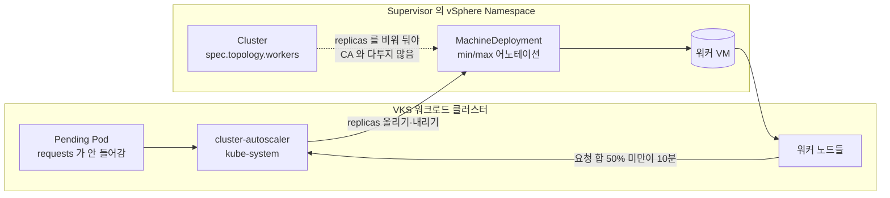

# 04. Cluster Autoscaler

> 커리큘럼: [CURRICULUM.md](CURRICULUM.md) · 앞 절: [03. ExternalDNS](03-externaldns.md) · 작성 2026-10-31
> 등급: **[근거]** 출처에 그대로 있는 것, **[추론]** 여러 출처를 엮어 직접 내린 결론.
> 기준 판: VKS Add-ons `3.8.0+20261021` (9.1 VKS Add-ons Release Notes, 2026-10-31 확인). 판 호환은 이 문서에서 정리하지 않는다. [공식 호환 매트릭스](https://interopmatrix.broadcom.com/)와 릴리스 노트를 직접 볼 것.

Cluster Autoscaler(CA)는 자리가 없어 `Pending` 으로 남은 Pod 를 보고 워커 노드를 늘리고, 한동안 놀고 있는 노드를 줄인다. VKS 에서는 노드 하나가 Supervisor 위의 VM 하나이므로, CA 가 바꾸는 값은 결국 Cluster API `MachineDeployment` 의 `replicas` 다.

루트 [`../vks-cluster-management.md`](../vks-cluster-management.md) 8장에 동작 그림·설치 방법 표·업그레이드 순서·삭제 명령이 이미 있다. 이 절은 그 위에서 **판 고르기, values 하나하나의 뜻, 0 까지 줄이기, 왜 노드가 안 줄어드는가**를 더 판다.

---

## 1. 무엇을 하는가

- [근거] VKS Cluster Autoscaler 는 쿠버네티스 Cluster Autoscaler 의 구현이다. 노드를 늘리고 줄이는 것을 모두 지원하고, 여러 영역(zone)을 쓰는 Supervisor 에서는 특정 가용 영역에 배정된 노드 풀을 따로 늘리고 줄일 수 있다. VKS 클러스터 안에서 Deployment 로 돌고 서비스 계정 자격으로 동작한다. (About Cluster Autoscaling, 9.0, Last Updated October 6, 2026)
- [근거] 업스트림 Cluster API 제공자는 `MachineSet`·`MachineDeployment`·`MachinePool` 가운데 **min·max 두 어노테이션을 모두 가진 것만** 노드 그룹으로 본다. (kubernetes/autoscaler `cloudprovider/clusterapi/README.md`, master 15942cb7, 2026-10-31 확인)
- [근거] 늘리는 조건은 「스케줄할 자리가 없어 Pending 인 Pod」이고, 줄이는 조건은 노드 위 Pod 의 CPU·메모리 **요청 합**이 할당 가능량의 `scale-down-utilization-threshold`(기본 0.5)보다 작은 상태가 `scale-down-unneeded-time`(기본 10m) 동안 이어지는 것이다. 실사용률이 아니라 **요청(requests)** 으로 계산한다. (업스트림 FAQ, 같은 커밋)



### 판과 지원 등급 (3.8.0+20261021 기준)

- [근거] 이 판에서 Cluster Autoscaler 는 **Product** 등급이고, 판이 Kubernetes 마이너마다 하나씩 따로 있다. 다른 애드온처럼 한 판이 여러 VKr 에 「Yes」인 모양이 아니다. (9.1 VKS Add-ons Release Notes, 지원 표)

| 애드온 판 | 맞는 VKr | 비고 |
|---|---|---|
| `1.37.0+vmware.1-vks.1` | 1.37 | 새로 들어옴. **VKS 3.8.0 이상 필요** |
| `1.36.1+vmware.2-vks.1` | 1.36 | |
| `1.35.2+vmware.1-vks.1` | 1.35 | |
| `1.34.2+vmware.4-vks.1` | 1.34 | |
| `1.33.0+vmware.4-vks.1` | 1.33 | 3.7.0 묶음부터 같은 판 |

- [근거] 앞 묶음들의 변화: 3.7.0+20260723 은 1.36.0+vmware.2·1.35.1·1.34.2+vmware.3·1.33.0+vmware.4 를 「Vulnerability Fixing」으로, 다음 묶음은 1.36.1+vmware.1 을 「Smooth upgrade from any prior versions」로 실었다. (같은 출처)
- [근거] 업스트림 쪽은 GitHub Release 로 나온 최신이 `cluster-autoscaler-1.36.1`(2026-07-23)이고, `cluster-autoscaler-1.37.0` 은 **태그만 있고 Release 항목은 없다.** (`gh api repos/kubernetes/autoscaler/releases`, `git/matching-refs/tags/cluster-autoscaler-1.37`, 2026-10-31 확인)
- [추론] VMware 판 번호의 앞부분(1.37.0, 1.34.2)은 업스트림 태그와 같은 줄이지만 같은 패치 판이라고 단정할 수 없다. 업스트림에는 1.34.5·1.33.6 까지 나왔는데 VKS 는 1.34.2·1.33.0 에 `vmware.N` 을 올려 고친다. 업스트림 패치 내용이 들어갔는지는 Broadcom 노트로만 알 수 있다.

### 왜 마이너 판이 꼭 맞아야 하나

- [근거] 패키지 마이너 판과 VKr 마이너 판은 1:1 이다. 문서 예시는 「VKr 1.27.11 이면 오토스케일러 v1.27.2」이고, 안 맞으면 **패키지 reconcile 이 실패한다.** (About Cluster Autoscaling, 9.0)
- [근거] 업스트림도 Kubernetes 1.12 부터 CA 판 번호를 쿠버네티스 마이너에 맞추고, 패치 판까지 같을 필요는 없지만 **클러스터 마이너에 맞는 CA 중 가장 새 패치**를 쓰라고 권한다. 새 마이너 CA 는 쿠버네티스 출시 뒤 한 달 안에 나온다고 적는다. (업스트림 `cluster-autoscaler/README.md` Releases 절)
- [추론] 마이너를 맞추는 까닭은 CA 가 스케줄러의 판단을 흉내 내(FAQ 의 「CA simulates kube-scheduler behavior」) 그 판의 스케줄링 규칙을 따라가야 하기 때문이다.
- [추론] 그래서 CA 는 「클러스터 업그레이드와 함께 움직이는 애드온」이다. cert-manager·Contour 처럼 한 판을 깔아 두고 따로 올리는 것이 아니라, VKr 을 올릴 때마다 CA 판도 바꿔야 한다. 아래 4절이 그 흐름이다.

## 2. VKS 에서 어떻게 들어가는가

두 경로의 공통 바탕은 [00절](00-repository-and-install-paths.md)에, Carvel 기초는 [`../carvel-kapp.md`](../carvel-kapp.md)에 있다. CA 는 다른 애드온과 설치 모양이 꽤 다르다.

| | Add-on Management (VKS 3.5+) | 레거시 패키지 (kubectl) | 레거시 패키지 (VCF CLI) |
|---|---|---|---|
| 켜는 방법 | **Cluster 라벨** `addon.addons.kubernetes.vmware.com/cluster-autoscaler` | `PackageInstall` 적용 | `vcf package install` |
| 설치 리소스 | VKS 가 미리 둔 **내장 AddonInstall** | PackageInstall `autoscaler` | PackageInstall `cluster-autoscaler-pkgi` |
| 리소스가 있는 곳 | Supervisor (`vmware-system-vks-public` 에 AddonRelease·AddonInstall) | 워크로드 클러스터 `tkg-system` | 워크로드 클러스터 `tkg-system` |
| 판 고르기 | VKr 에 맞춰 **자동** | `versionSelection.constraints` 직접 | `--version` 직접 |
| VKr 업그레이드 때 | 자동으로 따라 올라감 | 멈춤 → 업그레이드 → 판 바꾸기 → 재개 | 같음 |
| Pod 가 뜨는 곳 | `kube-system` | `kube-system` | `kube-system` |

근거: [근거] Install Cluster Autoscaler with Add on Management, Install Cluster Autoscaler Using Kubectl, Install Cluster Autoscaler by Using VCF CLI, Upgrade Autoscaled Cluster with Add on Management (모두 9.0, 2026-10-31 확인). 표로 묶은 것은 [추론].

- [근거] Add-on Management 에서는 **VKS 에 cluster-autoscaler 용 AddonInstall 이 미리 들어 있다.** 사용자가 AddonInstall 을 만드는 게 아니라 Cluster 에 라벨을 붙여 켠다. ClusterClass 판이 **v3.5.0 미만**이면 `addon.addons.kubernetes.vmware.com/cluster-autoscaler: managed` 를 직접 붙이고, **v3.5.0 이상**이면 VKS 가 `...: automatic` 을 알아서 붙인다. (Install Cluster Autoscaler with Add on Management, 9.0)
- [근거] 끌 때는 라벨을 `unmanaged` 로 바꾼다. 그러면 대상 클러스터에서 패키지가 자동으로 지워진다. (Delete Cluster Autoscaler, 9.0)
- [추론] 03절까지는 「Supervisor 에 AddonInstall 을 하나 만든다」가 Add-on 경로의 기본이었다. CA 는 「라벨로 내장 AddonInstall 의 대상이 된다」여서, ClusterClass v3.5.0 이상 클러스터는 **min·max 어노테이션만 붙이면 CA 가 이미 깔려 있을 수 있다.** 레거시 PackageInstall 을 또 만들면 같은 클러스터에 CA 가 둘 뜬다. 깔기 전에 아래 확인 명령부터 친다.
- [근거] 레거시 경로의 PackageInstall 이름이 문서마다 다르다. kubectl 문서는 `autoscaler`, VCF CLI 설치·업그레이드·삭제 문서는 `cluster-autoscaler-pkgi` 다. (각 문서)
- [근거] 9.1 문서 세트의 About Cluster Autoscaling(9.0 주소의 `9-0` 을 `9-1` 로 바꾼 것)은 404 이고, 9.0 목차에 있는 「Install Cluster Autoscaler by Using VCF CLI」 링크는 실제 주소가 `install-cluster-autoscaler-using-tanzu-cli.html` 이다. CA 전용 Package Reference 페이지는 표준 패키지 참조 목차에 없다(추측 주소 404). (curl, 2026-10-31)

## 3. 실습

### 3-1. 이미 켜져 있는지 먼저 본다 (Supervisor 컨텍스트)

```bash
# 내장 AddonRelease·AddonInstall 확인 (공식 문서 명령)
kubectl get addonreleases -n vmware-system-vks-public | grep cluster-autoscaler
kubectl get addoninstall  -n vmware-system-vks-public | grep cluster-autoscaler

# 내 클러스터에 라벨이 붙어 있는지
kubectl get cluster <클러스터> -n <vSphere-Namespace> \
  -o jsonpath='{.metadata.labels.addon\.addons\.kubernetes\.vmware\.com/cluster-autoscaler}{"\n"}'
# managed / automatic → Add-on 경로로 관리됨, unmanaged → 꺼짐, 빈 값 → 라벨 없음
```

```bash
# 워크로드 클러스터 컨텍스트: CA 가 실제로 떠 있는지, 몇 개인지
kubectl get deploy -n kube-system | grep -i autoscaler
kubectl get pkgi -A | grep -i autoscaler     # 레거시 경로로 깐 흔적
```

### 3-2. Add-on 경로로 켜기 (새 클러스터, Supervisor 에 적용)

공식 예시를 줄인 것이다. 핵심은 **워커 `replicas` 를 비우고 어노테이션 둘을 단다**는 것이다.

```yaml
apiVersion: cluster.x-k8s.io/v1beta2
kind: Cluster
metadata:
  name: cluster0
  namespace: test
  labels:
    # ClusterClass v3.5.0 미만일 때만 필요. v3.5.0 이상이면 VKS 가 automatic 을 붙인다
    addon.addons.kubernetes.vmware.com/cluster-autoscaler: managed
spec:
  topology:
    classRef:
      name: builtin-generic-v3.5.0
      namespace: vmware-system-vks-public
    version: v1.33.1+vmware.1-fips      # kubectl get kr 로 실제 이름을 볼 것
    controlPlane:
      replicas: 1
    workers:
      machineDeployments:
      - class: node-pool
        name: node-pool-1
        # replicas: 를 쓰지 않는다
        metadata:
          annotations:
            cluster.x-k8s.io/cluster-api-autoscaler-node-group-min-size: "0"
            cluster.x-k8s.io/cluster-api-autoscaler-node-group-max-size: "2"
```

- [근거] 기존 클러스터에 켤 때는 같은 라벨(필요할 때)과 어노테이션을 넣고 **워커의 `replicas` 를 지운다.** (Install Cluster Autoscaler with Add on Management, 9.0)
- [근거] 업스트림도 ClusterClass 를 쓰면 Topology 컨트롤러가 `spec.topology.workers.machineDeployments[].replicas` 로 MachineDeployment 를 맞추려 하므로, CA 를 쓰려면 이 칸을 비워 두라고 한다. (업스트림 clusterapi README 「Autoscaling with ClusterClass and Managed Topologies」)
- [근거] 새 클러스터는 min 값으로 만들어진다. (Install Cluster Autoscaler Using Kubectl, 9.0)

### 3-3. 레거시 경로 (워크로드 클러스터에 적용)

```yaml
# autoscaler.yaml — 공식 예시 구조. 판은 VKr 마이너에 맞춰 바꾼다
apiVersion: v1
kind: ServiceAccount
metadata: { name: autoscaler-sa, namespace: tkg-system }
---
apiVersion: rbac.authorization.k8s.io/v1
kind: ClusterRoleBinding
metadata: { name: autoscaler-role-binding }
roleRef: { apiGroup: rbac.authorization.k8s.io, kind: ClusterRole, name: cluster-admin }
subjects: [{ kind: ServiceAccount, name: autoscaler-sa, namespace: tkg-system }]
---
apiVersion: packaging.carvel.dev/v1alpha1
kind: PackageInstall
metadata: { name: autoscaler, namespace: tkg-system }
spec:
  serviceAccountName: autoscaler-sa
  packageRef:
    refName: cluster-autoscaler.kubernetes.vmware.com
    versionSelection:
      constraints: 1.33.0+vmware.4-vks.1     # VKr 1.33 일 때 (3.8.0+20261021 표)
  values:
  - secretRef: { name: autoscaler-data-values }
---
apiVersion: v1
kind: Secret
metadata: { name: autoscaler-data-values, namespace: tkg-system }
stringData:
  values.yml: |
    ---
    arguments:
      ignoreDaemonsetsUtilization: true
      maxNodeProvisionTime: 15m
      maxNodesTotal: 0
      metricsPort: 8085
      scaleDownDelayAfterAdd: 10m
      scaleDownDelayAfterDelete: 10s
      scaleDownDelayAfterFailure: 3m
      scaleDownUnneededTime: 10m
    clusterConfig:
      clusterName: "gc1"          # Supervisor 쪽 Cluster 이름
      clusterNamespace: "cluster" # 그 Cluster 가 있는 vSphere Namespace
    paused: false
```

```bash
kubectl apply -f autoscaler.yaml
kubectl get pkgi -A | grep autoscaler          # Reconcile succeeded 를 기다린다
kubectl get pods -n kube-system | grep autoscaler

# VCF CLI 로는 기본 values 를 뽑아 고친 뒤 설치
vcf package available get cluster-autoscaler.kubernetes.vmware.com/1.33.0+vmware.4-vks.1 \
  -n tkg-system --default-values-file-output values.yaml
vcf package install cluster-autoscaler-pkgi -n tkg-system \
  --package cluster-autoscaler.kubernetes.vmware.com --version 1.33.0+vmware.4-vks.1 \
  --values-file values.yaml
```

### values 칸의 뜻 (업스트림 플래그와 대조)

| VKS values | 업스트림 플래그 | 업스트림 기본값 | 문서 예시 값 | 뜻 |
|---|---|---|---|---|
| `scaleDownUnneededTime` | `--scale-down-unneeded-time` | 10m0s | 10m | 이만큼 놀아야 줄일 후보 |
| `scaleDownDelayAfterAdd` | `--scale-down-delay-after-add` | 10m0s | 10m | 늘린 뒤 줄이기 판단을 쉬는 시간 |
| `scaleDownDelayAfterDelete` | `--scale-down-delay-after-delete` | 0s | **10s** | 지운 뒤 다음 줄이기까지 |
| `scaleDownDelayAfterFailure` | `--scale-down-delay-after-failure` | 3m0s | 3m | 줄이기 실패 뒤 쉬는 시간 |
| `maxNodeProvisionTime` | `--max-node-provision-time` | 15m0s | 15m | 새 노드가 이 안에 Ready 가 안 되면 실패로 봄 |
| `maxNodesTotal` | `--max-nodes-total` | (빈 칸) | 0 | 전체 노드 상한 |
| `ignoreDaemonsetsUtilization` | `--ignore-daemonsets-utilization` | (빈 칸) | true | 사용률 계산에서 DaemonSet Pod 를 뺌 |
| `metricsPort` | (CA 메트릭 포트) | | 8085 | Prometheus 수집 포트 |

근거: [근거] 업스트림 FAQ 「What are the parameters to CA?」 표(master 15942cb7)와 Install Cluster Autoscaler Using Kubectl(9.0) 예시. 칸 이름 대응은 [추론](이름이 플래그를 카멜케이스로 바꾼 꼴이고 Broadcom 은 대응표를 따로 싣지 않았다).

- [추론] `maxNodesTotal: 0` 은 상한 없음으로 읽힌다(업스트림 기본값이 비어 있고 0 이 기본 정수값). 실제 상한은 MachineDeployment 마다 다는 max 어노테이션이 건다.
- [추론] `ignoreDaemonsetsUtilization: true` 는 노드마다 도는 DaemonSet(CNI·로그 수집·CSI 등)의 요청을 빼고 계산하므로, 업스트림 기본보다 노드가 **더 잘 줄어든다.**

### 3-4. 늘어나는지 시험하기

```bash
# 공식 문서의 시험 앱 대신, 요청만 크게 잡는 pause 컨테이너로도 충분하다
kubectl create ns ca-test
kubectl -n ca-test create deployment fill --image=registry.k8s.io/pause:3.10 --replicas=1
kubectl -n ca-test set resources deployment fill --requests=cpu=500m,memory=256Mi
kubectl -n ca-test scale deployment fill --replicas=30   # 노드가 모자랄 만큼

kubectl -n ca-test get pods --field-selector=status.phase=Pending
kubectl -n kube-system logs deploy/cluster-autoscaler --tail=50 | grep -iE "scale.?up|expand"
kubectl get nodes -w

# 줄어드는지: 다시 1 로 내리고 scaleDownUnneededTime(10m) + 여유를 기다린다
kubectl -n ca-test scale deployment fill --replicas=1
```

```bash
# Supervisor 쪽에서 실제로 replicas 가 움직였는지
kubectl get machinedeployment -n <vSphere-Namespace> \
  -o custom-columns=NAME:.metadata.name,REPLICAS:.spec.replicas,READY:.status.readyReplicas
```

- [근거] 공식 시험 절차는 CPU 요청 500m 짜리 Deployment 를 만들고 레플리카를 늘려 워커가 늘어나는지 보는 것이다. (Test Cluster Autoscaler, 9.0) 위 `pause` 판은 그 절차를 같은 원리로 줄인 것이다 [추론].

### GPU 없이·클러스터 없이 확인하는 법

- [추론] VKS 가 없으면 업스트림 [Cluster API 의 Docker 제공자(CAPD)](https://cluster-api.sigs.k8s.io/user/quick-start)로 kind 위에 관리 클러스터를 만들고 업스트림 Helm 차트의 `clusterapi` 모드로 CA 를 띄워 같은 어노테이션을 시험할 수 있다. 어노테이션·`replicas` 비우기·로그 읽기는 그대로 연습되고, VKS 라벨·AddonInstall 은 연습되지 않는다.
- [추론] YAML 만 볼 때는 `kubectl apply --dry-run=server -f cluster.yaml` 로 Supervisor 가 어노테이션·라벨을 받아 주는지 확인한다(클러스터를 실제로 바꾸지 않는다).

## 4. VKr 을 올릴 때 (CA 에만 있는 흐름)

- [근거] **Add-on 경로**: VKS 가 VKr 마이너에 맞춰 CA 판을 자동으로 올린다. 맞는 판이 없으면 **업그레이드 사전 점검이 실패해 클러스터 업그레이드가 막힌다.** (Upgrade Autoscaled Cluster with Add on Management, 9.0)
- [근거] **레거시 경로**: ① values Secret 의 `paused: true` 로 CA 를 멈추고 ② VKr 을 올리고 ③ PackageInstall 판을 새 마이너로 바꾸면서 `paused: false` 로 되돌린다. (Upgrade Autoscaled Cluster Using Kubectl / Using VCF CLI, 9.0)
- [추론] 멈추는 까닭은 롤링 업그레이드 동안 노드가 빠지고 새로 붙는 것을 CA 가 「늘리기·줄이기 대상」으로 오해하지 않게 하려는 것이다. 또 업그레이드 직후엔 CA(옛 마이너)와 VKr(새 마이너)이 어긋난 상태라 위 1절의 reconcile 실패 조건에 바로 걸린다.
- [추론] 그래서 레거시 경로를 쓰는 클러스터는 업그레이드 절차서에 「CA 멈춤」과 「CA 판 바꾸기」 두 줄이 항상 들어가야 한다. 가능하면 Add-on 경로로 옮기는 게 이 손일을 없앤다(옮기는 방법은 [00절](00-repository-and-install-paths.md)).

## 5. 0 까지 줄이기와 노드 풀별 설정

- [근거] VKS 3.2 이하는 0 으로 줄이거나 0 에서 늘리지 못한다. **VKS 3.3 이상 + VKr 1.31.4 이상**에서 된다. VKr 1.30 미만은 min 과 max 를 같게 둘 수 없다. (About Cluster Autoscaling, 9.0)
- [근거] 0 에서 늘릴 때는 노드가 하나도 없으니 CA 가 「새 노드에 어떤 라벨·taint 가 붙을지」를 알 수 없다. `nodeSelector`·toleration 이 있는 Pod 를 위해 MachineDeployment 에 `capacity.cluster-autoscaler.kubernetes.io/labels`·`.../taints` 어노테이션을 단다. Broadcom 예시는 Windows 풀에 `kubernetes.io/os=windows` 라벨과 `os=windows:NoSchedule` taint 를 적는다. 라벨·taint 가 Pod 요구와 **정확히** 맞아야 하고, 틀리면 스케줄 실패나 노드 생성 문제가 난다. (About Cluster Autoscaling, 9.0)
- [근거] 업스트림은 같은 목적의 `capacity.cluster-autoscaler.kubernetes.io/cpu`·`memory`(최소 이 둘), `ephemeral-disk`, `maxPods`(없으면 110), `gpu-type`·`gpu-count`, DRA 용 `dra-driver` 어노테이션도 정의한다. 어노테이션은 인프라 제공자가 주는 용량 정보보다 우선한다. (업스트림 clusterapi README 「Scale from zero support」)
- [근거] 업스트림은 노드 그룹별로 `cluster.x-k8s.io/autoscaling-options-scaledownunneededtime` 같은 어노테이션으로 전역 값을 덮어쓸 수 있다고 적는다. (같은 README 「Per-NodeGroup autoscaling options」)
- [추론] Broadcom 문서는 labels·taints 두 capacity 어노테이션만 싣는다. cpu·memory·gpu capacity 어노테이션과 노드 그룹별 options 어노테이션은 Broadcom 문서에 없으므로, Product 등급이어도 **지원 범위 밖**이다(릴리스 노트 Support Tiers 의 「문서에 실린 파라미터만」). 쓰기 전에 VKS 의 인프라 제공자가 용량을 알려 주는지(VM 클래스로 알 수 있는지)부터 시험한다.

### GPU 노드 풀에서

- [근거] 업스트림은 GPU 노드에서 device plugin 이 GPU 자원을 늦게 알리면 CA 가 쓸데없이 여러 번 늘릴 수 있다고 경고하고, kubelet `--node-labels` 로 `cluster-api/accelerator=<종류>` 라벨을 미리 붙이라고 권한다. (업스트림 clusterapi README 「Special note on GPU instances」)
- [근거] 줄일 때도 GPU 노드는 따로 `--scale-down-gpu-utilization-threshold` 를 본다. (같은 README의 노드 그룹별 options 목록)
- [추론] GPU 풀을 0 까지 줄이면 첫 GPU Pod 는 VM 생성 + 드라이버·Operator 준비 시간을 통째로 기다린다. `maxNodeProvisionTime`(15m)보다 길면 CA 가 실패로 보고 다른 풀을 찾거나 백오프한다. GPU 노드 고르기는 [`../gpu/03-gpu-node-selection.md`](../gpu/03-gpu-node-selection.md), GPU Operator 준비 과정은 [`../gpu/02-gpu-operator.md`](../gpu/02-gpu-operator.md)와 잇는다.

## 6. 업스트림 Helm 설치와 다른 점

| | VKS 애드온 | 업스트림 (Helm 차트 `cluster-autoscaler`) |
|---|---|---|
| 판 | VKr 마이너당 VMware 빌드 하나 | 업스트림 태그 아무거나 |
| 관리 클러스터 연결 | VKS 가 `clusterConfig` 로 처리 | kubeconfig 두 개 등 다섯 가지 연결 방식 중 골라 직접 설정 |
| 켜고 끄기 | Cluster 라벨 (Add-on) | Helm release |
| VKr 업그레이드 | Add-on 이면 자동, 아니면 멈춤·판 바꾸기 | 직접 |
| 설정 범위 | 문서에 실린 `arguments` 만 지원 | 모든 플래그 |

근거: [근거] 업스트림 README 「Connecting cluster-autoscaler to Cluster API management and workload Clusters」의 다섯 가지 배치와 위 Broadcom 문서들. 표로 묶은 것은 [추론].

- [추론] 루트 [`../k8s-addon.sh`](../k8s-addon.sh)는 Cluster Autoscaler 를 깔지 않는다(오픈소스 15종에 없음). 업스트림으로 연습하려면 위 「GPU 없이·클러스터 없이 확인하는 법」의 CAPD 경로를 쓴다.

## 7. 흔한 실수

1. **워커 `replicas` 를 남겨 둔다.** [근거] Topology 컨트롤러가 그 값으로 MachineDeployment 를 계속 되돌려 CA 와 다툰다. 업스트림 README 와 Broadcom 문서 모두 지우라고 한다.
2. **어노테이션을 하나만 단다.** [근거] min·max 둘 다 있어야 노드 그룹으로 인식된다(업스트림 README). 하나만 있으면 오류 없이 무시된다 [추론].
3. **판을 클러스터 VKr 이 아니라 「제일 새 판」으로 고른다.** [근거] 마이너가 안 맞으면 reconcile 실패다. VKr 1.33 클러스터에 `1.37.0+vmware.1-vks.1` 을 넣으면 안 된다.
4. **레거시로 깐 CA 를 멈추지 않고 VKr 을 올린다.** [근거] 문서가 요구하는 순서는 멈춤 → 업그레이드 → 판 바꾸기 → 재개다.
5. **Add-on 이 이미 켠 클러스터에 레거시 PackageInstall 을 또 만든다.** [추론] ClusterClass v3.5.0 이상은 라벨이 자동으로 붙는다. 3-1 확인부터.
6. **노드가 안 줄어든다고 CA 를 의심한다.** [근거] 업스트림 FAQ 가 꼽는 줄이기 방해 Pod: 빡빡한 PodDisruptionBudget, PDB 없는 `kube-system` Pod, 컨트롤러 없이 만든 Pod, 로컬 저장소를 쓰는 Pod(`safe-to-evict-local-volumes` 로 풀 수 있음), 다른 곳에 옮길 자리가 없는 Pod(`hostPort`·nodeSelector 포함), `cluster-autoscaler.kubernetes.io/safe-to-evict: "false"` 가 붙은 Pod. 또 판단 기준이 실사용률이 아니라 **요청**이라, 요청을 크게 잡은 Pod 하나가 노드를 붙잡는다.
7. **min 보다 적거나 max 보다 많은 상태를 CA 가 고쳐 줄 거라 믿는다.** [근거] CA 는 범위를 강제하지 않는다. 범위 밖이면 그 그룹을 늘리지도 줄이지도 않는다(`--enforce-node-group-min-size` 로만 바꿀 수 있음). (업스트림 README Note)
8. **공식 문서 예시를 그대로 친다.** [근거] 9.0 문서 안에 그대로 치면 틀리는 곳이 셋 있다. Test 문서는 레플리카를 `spec.selector.replicas` 에서 늘리라고 적었지만 Deployment 의 칸은 `spec.replicas` 다. VCF CLI 업그레이드 문서의 `vcf package available get` 예시 판은 `1.34.0+vmware.1-vks.11`(끝이 11)인데 같은 문서의 설치 명령은 `vks.1` 이다. kubectl 설치 문서의 `PackageRepository` 예시는 3.5.0 저장소(`.../packages/2025.10.22/vks-standard-packages:3.5.0-20251022`)라 1.37 판이 없다 — 저장소 주소는 릴리스 노트의 최신 묶음으로 바꾼다. (각 문서, 2026-10-31 확인)
9. **예시의 `cluster-admin` 바인딩을 그대로 둔다.** [근거] kubectl 설치 예시는 PackageInstall 서비스 계정에 `cluster-admin` 을 준다. [추론] 이것은 kapp-controller 가 패키지를 깔 때 쓰는 계정이다. 운영에서는 조직의 RBAC 기준에 맞는지 따로 검토한다(Broadcom 은 더 좁은 권한 예시를 싣지 않는다).

## 8. 확인 문제

1. VKr 1.35 클러스터를 1.36 으로 올리려 한다. CA 는 레거시 PackageInstall `autoscaler` 로 깔려 있다. 3.8.0+20261021 기준으로 업그레이드 전후에 CA 에 할 일을 순서대로, 넣을 판 번호까지 적어라.
2. ClusterClass `builtin-generic-v3.5.0` 으로 만든 클러스터의 워커 풀에 min `"0"`·max `"4"` 어노테이션을 달았는데 노드 수가 3 에서 움직이지 않는다. 의심할 곳 두 가지를 적어라.
3. 밤마다 노드 5개 중 2개가 거의 비어 있는데 줄지 않는다. `kubectl describe` 로 확인할 Pod 속성 네 가지를 업스트림 FAQ 기준으로 적어라.

<details>
<summary>풀이</summary>

1. ① values Secret `paused: true` 적용 ② VKr 1.36 으로 업그레이드 ③ PackageInstall `constraints: 1.36.1+vmware.2-vks.1` 로 바꾸고 `paused: false` 적용 ④ `kube-system` 의 CA Pod Running·로그 확인. (Add-on 경로였다면 VKS 가 자동으로 하고, 맞는 판이 없으면 사전 점검이 막는다.)
2. 워커 `machineDeployments[].replicas: 3` 이 Cluster 에 남아 Topology 컨트롤러가 되돌리고 있는지, CA 가 실제로 떠 있는지(Add-on 라벨 `automatic`/`managed` 와 `kube-system` Deployment). 0 으로 줄이기는 VKS 3.3+·VKr 1.31.4+ 조건도 본다.
3. PodDisruptionBudget 이 빡빡한지, `kube-system` Pod 인데 PDB 가 없는지, 컨트롤러 없이 만든 Pod 인지, 로컬 저장소(emptyDir 등)를 쓰는지, `safe-to-evict: "false"` 어노테이션, 옮길 자리가 없게 만드는 nodeSelector·`hostPort`, 그리고 requests 가 큰지(사용률은 요청 기준).

</details>

---

## 출처 (모두 2026-10-31 확인)

- Broadcom TechDocs, VCF 9.0 「Autoscaling VKS Clusters」 아래 문서 (Last Updated October 6, 2026)
  - [About Cluster Autoscaling](https://techdocs.broadcom.com/us/en/vmware-cis/vcf/vcf-service-administration-and-development/9-0/managing-vsphere-kuberenetes-service-clusters-and-workloads/autoscaling-tkg-service-clusters/about-cluster-autoscaling.html)
  - [Install Cluster Autoscaler with Add on Management](https://techdocs.broadcom.com/us/en/vmware-cis/vcf/vcf-service-administration-and-development/9-0/managing-vsphere-kuberenetes-service-clusters-and-workloads/autoscaling-tkg-service-clusters/install-autoscaler-with-add-on-management.html)
  - [Install Cluster Autoscaler Using Kubectl](https://techdocs.broadcom.com/us/en/vmware-cis/vcf/vcf-service-administration-and-development/9-0/managing-vsphere-kuberenetes-service-clusters-and-workloads/autoscaling-tkg-service-clusters/install-cluster-autoscaler-using-kubectl.html)
  - [Install Cluster Autoscaler by Using VCF CLI](https://techdocs.broadcom.com/us/en/vmware-cis/vcf/vcf-service-administration-and-development/9-0/managing-vsphere-kuberenetes-service-clusters-and-workloads/autoscaling-tkg-service-clusters/install-cluster-autoscaler-using-tanzu-cli.html)
  - [Upgrade Autoscaled Cluster with Add on Management](https://techdocs.broadcom.com/us/en/vmware-cis/vcf/vcf-service-administration-and-development/9-0/managing-vsphere-kuberenetes-service-clusters-and-workloads/autoscaling-tkg-service-clusters/upgrade-autoscaler-with-add-on-management.html)
  - [Upgrade Autoscaled Cluster Using Kubectl](https://techdocs.broadcom.com/us/en/vmware-cis/vcf/vcf-service-administration-and-development/9-0/managing-vsphere-kuberenetes-service-clusters-and-workloads/autoscaling-tkg-service-clusters/upgrade-autoscaled-cluster-using-kubectl.html)
  - [Upgrade Autoscaled Cluster Using VCF CLI](https://techdocs.broadcom.com/us/en/vmware-cis/vcf/vcf-service-administration-and-development/9-0/managing-vsphere-kuberenetes-service-clusters-and-workloads/autoscaling-tkg-service-clusters/upgrade-autoscaled-cluster-using-the-tanzu-cli.html)
  - [Test Cluster Autoscaler](https://techdocs.broadcom.com/us/en/vmware-cis/vcf/vcf-service-administration-and-development/9-0/managing-vsphere-kuberenetes-service-clusters-and-workloads/autoscaling-tkg-service-clusters/test-cluster-autoscaler.html)
  - [Delete Cluster Autoscaler](https://techdocs.broadcom.com/us/en/vmware-cis/vcf/vcf-service-administration-and-development/9-0/managing-vsphere-kuberenetes-service-clusters-and-workloads/autoscaling-tkg-service-clusters/delete-cluster-autoscaler.html)
- [VKS Add-ons Release Notes (9.1)](https://techdocs.broadcom.com/us/en/vmware-cis/vcf/vcf-service-administration-and-development/9-1/release-notes/vks-addons-release-notes.html) — 3.8.0+20261021 지원 표·Support Tiers
- kubernetes/autoscaler (master `15942cb7`): [CA README](https://github.com/kubernetes/autoscaler/blob/master/cluster-autoscaler/README.md), [Cluster API 제공자 README](https://github.com/kubernetes/autoscaler/blob/master/cluster-autoscaler/cloudprovider/clusterapi/README.md), [FAQ](https://github.com/kubernetes/autoscaler/blob/master/cluster-autoscaler/FAQ.md), [Releases](https://github.com/kubernetes/autoscaler/releases)
- [Cluster API Book — Autoscaling](https://cluster-api.sigs.k8s.io/tasks/automated-machine-management/autoscaling)
