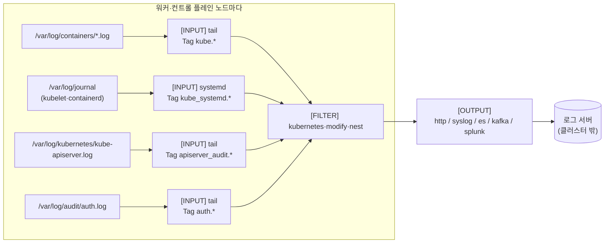

# 06. Fluent Bit

> 커리큘럼: [CURRICULUM.md](CURRICULUM.md) · 앞 절: [05. Prometheus](05-prometheus.md) · 작성 2026-10-31
> 등급: **[근거]** 출처에 그대로 있는 것, **[추론]** 여러 출처를 엮어 직접 내린 결론.
> 기준 판: VKS Add-ons `3.8.0+20261021` (9.1 VKS Add-ons Release Notes, 페이지 표기 Last Updated October 26, 2026, 2026-10-31 확인). 판 호환은 이 문서에서 정리하지 않는다. [공식 호환 매트릭스](https://interopmatrix.broadcom.com/)와 릴리스 노트를 직접 볼 것.

VKS 의 Fluent Bit 애드온은 **노드마다 하나씩 뜨는 로그 수집·전달기(DaemonSet)** 다. 로그를 저장하거나 검색하는 기능은 없다. 받을 쪽(Syslog·HTTP·Elasticsearch·Kafka·Splunk, 또는 VCF Operations for Logs)이 따로 있어야 한다.

이 절의 중심은 세 가지다. 첫째, values 가 YAML 이 아니라 **Fluent Bit 클래식 설정 문자열**을 그대로 품는다는 점. 둘째, 3.7.0 묶음에서 **Fluent Bit 4.x → 5.x 메이저 판이 바뀌었다**는 점. 셋째, 공식 예시를 그대로 붙이면 안 되는 자리들. 로그 수집 구조 자체(노드 수집기 대 사이드카, 구조화 로그)는 루트 [`../k8s-logging-monitoring/02_logging_best_practices.md`](../k8s-logging-monitoring/02_logging_best_practices.md)를 본다.

---

## 1. 무엇을 하는가



[근거] 위 네 입력은 Fluent Bit Package Reference 의 「VCF Operations for Logs 로 보내는 예시」가 모으는 로그 종류(컨테이너 로그, API 서버 감사 로그, 리눅스 데몬 로그, 리눅스 인증 로그)와 경로다. 그림으로 옮긴 것은 [추론].

| 구성 요소 | 리소스 | 복제 수 | 하는 일 |
|---|---|---|---|
| Fluent Bit | DaemonSet | 문서 예시 6 | 로그 수집·가공·전달 |

- [근거] 패키지가 까는 컨테이너는 위 하나다. 이미지는 패키지 저장소에 지정된 공개 레지스트리에서 받는다. 받을 쪽으로 지원한다고 적힌 서버는 Syslog, HTTP, Elastic Search, Kafka, Splunk 다. (Fluent Bit Package Reference, 9.0, Last Updated October 6, 2026)
- [추론] 표의 「6」은 DaemonSet 이라 고정값이 아니다. Add-on 설치 문서의 예시 클러스터 `wl-antrea` 는 컨트롤 플레인 3·워커 3 이고 Pod 가 6개 떴다. 즉 **컨트롤 플레인 노드에도 뜬다.** API 서버 감사 로그(`/var/log/kubernetes/kube-apiserver.log`)는 컨트롤 플레인 노드에만 있으니 이 배치가 맞다.
- [근거] 구성 요소가 뜨는 네임스페이스는 `tanzu-system-logging` 이다(values 의 `namespace` 기본값과 설치 문서의 확인 명령). (Package Reference, Install Fluent Bit Addon using VCF CLI, 9.0)

### 판과 지원 등급 (3.8.0+20261021 기준)

- [근거] 3.8.0+20261021 에서 Fluent Bit 는 **Product** 등급이고 `5.1.2+vmware.1-vks.1` **한 판**이며, 지원 표의 VKr 다섯 칸(1.33~1.37) 모두 「Yes」다. 변경 내용은 「Base images bump to address vulnerabilities」, 업그레이드 경로는 「Smooth upgrade from v4.0.8」이다. (9.1 VKS Add-ons Release Notes)
- [근거] Product 등급은 Broadcom 글로벌 지원이 설치·수명 주기·런타임 문제를 모두 받는다. (같은 출처의 Support Tiers)
- [근거] 업스트림 v5.1.2 는 2026-09-05 에 나왔고, 2026-10-31 현재 업스트림 최신은 v5.1.5(2026-10-21)다. (`gh release list -R fluent/fluent-bit`, 2026-10-31)

묶음마다 Fluent Bit 애드온 판이 어떻게 움직였는지 (모두 같은 9.1 릴리스 노트):

| 묶음 | Fluent Bit 애드온 판 | 눈에 띄는 변화 |
|---|---|---|
| 3.5.0+20251022 | 4.0.8+vmware.1-vks.1 | **Add-on Management 지원 시작**, 네임스페이스 LimitRange 설정, 컨테이너 단위 cpu·memory 설정. 알려진 문제: 레거시 → Add-on 이전 때 `podAnnotations: null` 오류 |
| 3.5.0+20251218 | 4.1.1+vmware.1-vks.1 | 4.0.8+vmware.2 에서 매끄러운 업그레이드 |
| 3.6.0+20260211 | 4.2.2+vmware.1-vks.1 | **kapp 이 패키지를 고치면 설정을 자동으로 다시 읽음(hot reload)** |
| 3.6.0+20260416 | 4.2.3+vmware.1-vks.1 | 기반 이미지 취약점 수정 |
| 3.7.0+20260618 | **5.0.5+vmware.1-vks.1** | **5.x 로 메이저 판 변경**, Kubernetes 1.34 이상에서 기본 PriorityClass 지정, 4.2.2 에서 매끄러운 업그레이드 |
| 3.7.0+20260723 | 5.0.7+vmware.1-vks.1 | 취약점 수정, 「v4.x 에서」 매끄러운 업그레이드 |
| 3.7.0+20260827 | 5.0.9+vmware.1-vks.1 | 취약점 수정, 「4.0.x 에서 5.0.9 로」 매끄러운 업그레이드 |
| 3.7.0+20260924 | 5.0.9+vmware.1-vks.1 | 변화 없음(지원 표에만 나옴) |
| 3.8.0+20261021 | 5.1.2+vmware.1-vks.1 | 기반 이미지 취약점 수정 |

- [근거] 3.6.0 묶음까지는 지원 표에 판이 여럿(4.2.3·4.2.2·4.1.1 …) 올라 있었는데, 3.7.0 이후 표에는 한 판만 있다. (같은 출처)
- [추론] 「매끄러운 업그레이드」는 **패키지 설치가 실패하지 않는다**는 뜻이지 **사용자 설정 문자열이 5.x 에서 똑같이 동작한다**는 뜻이 아니다. values 안의 `[OUTPUT]`·`[FILTER]` 는 사용자가 쓴 것이라 업스트림 5.0 업그레이드 노트(아래 4절)를 직접 대조해야 한다.

## 2. VKS 에서 어떻게 들어가는가

두 경로의 공통 바탕은 [00절](00-repository-and-install-paths.md)에, Carvel 기초는 [`../carvel-kapp.md`](../carvel-kapp.md)에 있다.

| | 레거시 패키지 (VCF CLI) | Add-on Management (VCF CLI) | Add-on Management (kubectl) |
|---|---|---|---|
| 컨텍스트 | 워크로드 클러스터 | Supervisor, 클러스터 네임스페이스 | Supervisor, 클러스터 네임스페이스 |
| 패키지·애드온 이름 | `fluent-bit.kubernetes.vmware.com` | `fluent-bit` | `addonRef.name: fluent-bit` |
| 판 지정 | `--version <판>` | `--addon-release-name fluent-bit.kubernetes.vmware.com.4.2.2-vmware.1-vks.1` | **`AddonConfig`** 의 `spec.releaseFilter.ref.name` |
| 설정값 | `--values-file` | `--values-config-file` | `AddonConfig.spec.values` |
| PackageInstall·AddonInstall 위치 | 새 네임스페이스(문서 예시 `fluent-bit`) | 클러스터 네임스페이스 | 클러스터 네임스페이스 |
| 구성 요소가 뜨는 곳 | `tanzu-system-logging` | 같음 | 같음 |

근거: [근거] Install Fluent Bit Package, Install Fluent Bit Addon using VCF CLI, Install Fluent Bit Addon using Kubectl (모두 9.0, 2026-10-31 확인). 표로 묶은 것은 [추론].

- [근거] 패키지 이름이 판에 따라 다르다. **Fluent Bit 4.0.x 이후는 `fluent-bit.kubernetes.vmware.com`**, 그 전은 `fluent-bit.tanzu.vmware.com` 이다. 4.0.x 이후로 설치할 때는 `-p fluent-bit.kubernetes.vmware.com` 을 꼭 적으라고 한다. (Install Fluent Bit Package, 9.0)
- [근거] 레거시 경로에서 **`tanzu-system-logging` 에 패키지를 깔지 말라**고 한다. 구성 요소 네임스페이스와 부딪혀 패키지 삭제가 실패할 수 있다는 이유다. (같은 출처)
- [근거] Add-on 경로의 kubectl 방식에서 `AddonConfig` 이름은 `<클러스터 이름>-<애드온 이름>`(예: `wl-antrea-fluent-bit`), `AddonInstall` 이름은 `<애드온 이름>-<클러스터 이름>`(예: `fluent-bit-wl-antrea`)이다. (Install Fluent Bit Addon using Kubectl, 9.0)
- [근거] Fluent Bit 의 kubectl 문서는 판(`releaseFilter`)을 **AddonConfig** 에 적고 AddonInstall 에는 `addonRef`·`clusters` 만 둔다. [05절](05-prometheus.md)의 Prometheus kubectl 문서는 `releaseFilter` 를 AddonInstall 에 적는다. [추론] 두 문서가 서로 다른 자리를 보여 주므로, 자기 환경에서 `kubectl explain addonconfig.spec` 와 `kubectl explain addoninstall.spec` 로 두 칸이 실제로 있는지 먼저 본다. 판이 의도와 다르게 깔렸으면 `kubectl get clusteraddon -n <ns>` 의 RELEASE 칸으로 확인한다.
- [근거] 원하는 판이 내장 Add-on 저장소에 없으면 「Update an Add-on Repository Install」 절차로 저장소를 바꾼다. (Install Fluent Bit Addon using VCF CLI 의 Prerequisites) 저장소 이야기는 [00절](00-repository-and-install-paths.md).

### values 의 생김새

[근거] values 의 핵심 칸 다섯은 모두 **String** 이다: `fluent_bit.config.service`, `inputs`, `filters`, `outputs`, `parsers` (그 밖에 `streams`, `plugins`). 각 문자열에는 Fluent Bit 의 `[INPUT]`·`[OUTPUT]` 같은 클래식 설정 문법을 그대로 넣는다. (Fluent Bit Package Reference 의 파라미터 표, 9.0)

[추론] 그래서 YAML 검사기는 이 안을 보지 않는다. 들여쓰기가 틀리거나 키 이름이 틀려도 `kubectl apply` 와 패키지 reconcile 은 통과하고, Fluent Bit Pod 가 뜰 때 비로소 실패하거나 조용히 그 값을 무시한다. values 를 바꾼 뒤에는 꼭 Pod 로그를 본다(3.5 절).

[근거] 업스트림 클래식 설정 규칙: 섹션 안의 키와 주석은 들여써야 하고, **줄 끝 주석은 지원하지 않으며 줄 전체 주석만 된다**. (Fluent Bit 공식 매뉴얼, Classic mode: Format and schema, 2026-10-31 확인) 이 규칙이 5절의 첫 번째 실수와 이어진다.

## 3. 실습

> 이름(`wl-antrea`, `test-ns`, `fluent-bit`)과 판 `4.2.2+vmware.1-vks.1` 은 공식 문서의 예시 값이다. 3.8.0+20261021 의 판은 `5.1.2+vmware.1-vks.1` 이다. 자기 환경의 `vcf addon available list fluent-bit` 출력에서 고른다.
> 받을 쪽 로그 서버 주소는 `<LOG_HOST>` 로 비워 두었다.

### 3.1 values 파일 만들기

```bash
# 레거시 경로 — 판 목록 (4.0.x 이후 이름)
vcf package available list fluent-bit.kubernetes.vmware.com -n tkg-system
kubectl -n tkg-system get packages | grep fluent-bit   # kubectl 로 볼 때
vcf package available get fluent-bit.kubernetes.vmware.com/<판> \
  --default-values-file-output fluent-bit-data-values.yaml

# Add-on 경로 — 판 목록
vcf context use supervisor:test-ns
vcf addon available list fluent-bit
```

[근거] Install Fluent Bit Package, Install Fluent Bit Addon using VCF CLI (9.0). [추론] Add-on 경로의 기본값 파일은 [05절](05-prometheus.md) 3.1 처럼 `vcf addon available get fluent-bit -v <판> -o fluent-bit-data-values.yaml` 로 받는 형태일 것이다. Fluent Bit 문서에는 이 명령이 없고 Package Reference 의 예시로 대신한다.

처음 손볼 값만 추린 예 (Syslog 로 보내기, 공식 Data Values 예시를 바탕으로):

```yaml
namespace: tanzu-system-logging
fluent_bit:
  config:
    outputs: |
      [OUTPUT]
          Name                syslog
          Match               *
          Host                <LOG_HOST>
          # TCP 는 6514, UDP 는 514 (줄 끝에 주석을 달지 않는다)
          Port                6514
          Mode                tcp
          Syslog_Message_key  message
  daemonset:
    podAnnotations: {}          # null 로 두지 않는다 (5절 4번)
    resources:
      requests:
        cpu: 200m
        memory: 256Mi
```

- [근거] Syslog·HTTP·Elasticsearch·Kafka·Splunk 다섯 가지 `[OUTPUT]` 예시가 Package Reference 의 「Fluent Bit Data Values」 절에 있다. 위 Syslog 예는 그중 하나를 들여쓰기와 주석 위치만 바꿔 옮긴 것이다. (Package Reference, 9.0)
- [근거] `daemonset.resources.requests` 기본값은 cpu `200m`·memory `256Mi`, limits 기본값은 빈 문자열이다. `nsLimitRange.defaultRequests` 도 같은 값이다. (같은 출처의 파라미터 표)
- [추론] `outputs` 만 적으면 inputs·filters·parsers 는 기본값이 쓰일 것으로 보이지만, 문서는 기본 입력·필터·파서를 「`default-values.yaml` 을 받아서 보라」고만 한다. 받은 기본값 파일에서 네 문자열을 직접 확인한 뒤 바꿀 칸만 덮는다.

VCF Operations for Logs 로 보낼 때(공식 예시의 출력 부분, 주석을 줄 위로 올림):

```yaml
fluent_bit:
  config:
    outputs: |
      [OUTPUT]
          # http 출력 = VCF Operations for Logs 의 CFAPI
          Name            http
          Match           *
          Host            <LOG_HOST>
          # TLS 는 9543, 평문은 9000
          Port            9543
          URI             api/v2/events
          Format          json
          tls             on
          tls.verify      off
          json_date_key   timestamp
```

[근거] 포트 9543(TLS)·9000(평문), `URI api/v2/events`, `json_date_key timestamp` 는 Package Reference 의 「VCF Operations for Logs」 예시 값이다. 같은 문서의 TLS 절 예시는 `URI /api/logs` 와 `Header Content-Type application/json` 을 쓴다. [추론] 한 문서 안의 두 예시가 URI 를 다르게 적으므로, 받을 쪽 제품 문서의 수집 API 경로로 확인한다.

### 3.2 TLS 인증서 검증 켜기

```bash
# 워크로드 클러스터 컨텍스트. 키 이름 tls_http.crt 가 Pod 안 파일 이름이 된다
kubectl create secret generic tls-ca-cert \
  --from-file=tls_http.crt=./ca.pem -n tanzu-system-logging
```

```yaml
fluent_bit:
  daemonset:
    secretName: tls-ca-cert
  config:
    outputs: |
      [OUTPUT]
          Name          http
          Match         *
          Host          <LOG_HOST>
          Port          9543
          URI           <받을 쪽 수집 경로>
          Format        json
          tls           on
          tls.verify    on
          tls.ca_file   /etc/ssl/certs/tls_http.crt
          Retry_Limit   False
```

- [근거] Secret 의 **키 이름**(`tls_http.crt`)이 Pod 안 `/etc/ssl/certs/` 아래 파일 이름이 된다. `tls.ca_file` 을 쓰면 `daemonset.secretName` 이 필요하다. 성공하면 Pod 로그에 `HTTP status=200` 이 보이고 `no upstream connections available` 같은 오류가 없어야 한다. (Package Reference 의 「Fluent Bit TLS Configuration」, 9.0)
- [근거] 문서는 이 기능을 「Fluent Bit 4.0.x 이상에서 TLS 지원」이라고 적는다. [추론] 업스트림 Fluent Bit 의 TLS 출력은 그보다 오래된 기능이므로, 이 문장은 **패키지가 Secret 을 마운트해 주는 `secretName` 칸이 4.0.x 패키지부터 생겼다**는 뜻으로 읽는 편이 맞다.
- [추론] Secret 은 values 밖에서 만든 리소스라 애드온을 지워도 남고, 인증서를 갈아도 패키지가 알지 못한다. 교체 뒤에는 DaemonSet 을 재시작해 새 파일을 읽게 한다(`kubectl -n tanzu-system-logging rollout restart ds/fluent-bit`, DaemonSet 이름은 먼저 `kubectl get ds -n tanzu-system-logging` 으로 확인).

### 3.3 Add-on 방식, VCF CLI

```bash
vcf cluster list -A
vcf context use supervisor:test-ns
vcf addon install create fluent-bit --cluster-name wl-antrea -n test-ns \
  --addon-release-name fluent-bit.kubernetes.vmware.com.4.2.2-vmware.1-vks.1 \
  --values-config-file fluent-bit-data-values.yaml -y

vcf addon install list --cluster-name wl-antrea -n test-ns
# 기대: fluent-bit  test-ns  false  True  Allowed

# 지우기 (AddonInstall fluent-bit-wl-antrea → ClusterAddon wl-antrea-fluent-bit → AddonConfig 순)
vcf addon install delete fluent-bit --cluster-name wl-antrea -n test-ns -y
```

[근거] Install Fluent Bit Addon using VCF CLI (9.0).

### 3.4 Add-on 방식, kubectl

```yaml
# addonconfig.yaml — 이름은 <cluster-name>-<addon-name>
apiVersion: addons.kubernetes.vmware.com/v1alpha1
kind: AddonConfig
metadata:
  name: wl-antrea-fluent-bit
  namespace: test-ns
  annotations:
    clusteraddon.addons.kubernetes.vmware.com/owned-for-deletion: "true"
spec:
  clusterName: wl-antrea
  releaseFilter:
    ref:
      name: fluent-bit.kubernetes.vmware.com.4.2.2-vmware.1-vks.1
      namespace: vmware-system-vks-public
  values:
    # 3.1 의 fluent-bit-data-values.yaml 내용을 여기에
---
# addoninstall.yaml — 이름은 <addon-name>-<cluster-name>
apiVersion: addons.kubernetes.vmware.com/v1alpha1
kind: AddonInstall
metadata:
  name: fluent-bit-wl-antrea
  namespace: test-ns
spec:
  addonRef:
    name: fluent-bit
  clusters:
    - selector:
        matchLabels:
          cluster.x-k8s.io/cluster-name: wl-antrea
```

```bash
kubectl config use-context supervisor:test-ns
kubectl get addonreleases -n vmware-system-vks-public | grep fluent-bit
kubectl apply -f addonconfig.yaml
kubectl get addonconfig -n test-ns
kubectl apply -f addoninstall.yaml
kubectl get clusteraddon -n test-ns
# 기대: wl-antrea-fluent-bit  wl-antrea  fluent-bit  fluent-bit-wl-antrea  fluent-bit.kubernetes.vmware.com.4.2.2-vmware.1-vks.1  True

# 지우기: AddonInstall 을 지우면 ClusterAddon·AddonConfig 도 사라져야 한다
kubectl delete -f addoninstall.yaml
kubectl get addoninstall,addonconfig,clusteraddon -n test-ns | grep fluent-bit   # 기대: 0줄
```

[근거] Install Fluent Bit Addon using Kubectl (9.0). 원문은 `name: fluent-bit# Install this addon` 처럼 공백이 빠져 있고 들여쓰기가 페이지에서 무너져 있어 위처럼 다시 맞췄다 [추론]. 지운 뒤 확인을 한 줄로 묶은 것도 [추론].

### 3.5 레거시 방식

```bash
# 워크로드 클러스터 컨텍스트
kubectl create ns fluent-bit
vcf package install fluent-bit -p fluent-bit.kubernetes.vmware.com \
  --version <판> --values-file fluent-bit-data-values.yaml -n fluent-bit
vcf package installed list -n fluent-bit
vcf package installed get fluent-bit -n fluent-bit

# 지우기
vcf package installed delete fluent-bit -y -n fluent-bit
```

[근거] Install Fluent Bit Package (9.0).

### 3.6 깔린 뒤 확인 (워크로드 클러스터 컨텍스트)

```bash
kubectl get ds,pod -n tanzu-system-logging -o wide
# 기대: DESIRED = CURRENT = READY = 노드 수 (컨트롤 플레인 포함)

POD=$(kubectl get pod -n tanzu-system-logging -o name | head -1)
kubectl logs -n tanzu-system-logging "$POD" --tail=50
# 기대: [error] 줄 없음. TLS 를 켰다면 "HTTP status=200"

# 내장 HTTP 서버(service 의 HTTP_Server On, 2020 포트)로 처리량 보기 [추론]
kubectl -n tanzu-system-logging port-forward "$POD" 2020:2020 &
curl -s localhost:2020/api/v1/metrics | jq '.output'
# output 플러그인별 proc_records·errors·retries_failed 가 늘어나는지 본다
```

- [근거] DaemonSet Pod 목록과 「오류 로그가 없는지 확인하라」는 Add-on 설치 문서 두 쪽의 마지막 단계다. Pod 이름은 `fluent-bit-xxxxx` 형식이다. (9.0)
- [근거] Package Reference 의 예시 `[Service]` 는 `HTTP_Server On`, `HTTP_Listen 0.0.0.0`, `HTTP_Port 2020` 이다.
- [추론] `/api/v1/metrics` 경로와 그 JSON 의 `output`·`proc_records`·`errors`·`retries_failed` 칸은 업스트림 매뉴얼의 Monitoring 절 기준이다. 이번 회차에 실제 Pod 로 재지는 않았다.
- [추론] 레거시 문서의 확인 명령 `kubectl -n fluent-bit get all` 은 PackageInstall 이 있는 네임스페이스를 보는데, `get all` 은 PackageInstall 을 보여 주지 않고 DaemonSet 은 `tanzu-system-logging` 에 있다. 이 명령으로는 거의 아무것도 안 나오는 게 정상이다. 위처럼 `tanzu-system-logging` 을 본다.

### 3.7 클러스터 없이 확인하는 법

[추론] VKS 가 없어도 values 의 **설정 문자열**은 업스트림 Fluent Bit 로 미리 검사할 수 있다. values 에서 `service`·`inputs`·`filters`·`outputs`·`parsers` 문자열을 꺼내 한 파일(`fluent-bit.conf`)과 `parsers.conf` 로 합친 뒤 업스트림 이미지로 `--dry-run` 을 돌린다.

```bash
yq '.fluent_bit.config.service, .fluent_bit.config.inputs, .fluent_bit.config.filters, .fluent_bit.config.outputs' \
  fluent-bit-data-values.yaml > fluent-bit.conf
yq '.fluent_bit.config.parsers' fluent-bit-data-values.yaml > parsers.conf
docker run --rm -v "$PWD":/fluent-bit/etc:ro fluent/fluent-bit:5.1.2 \
  -c /fluent-bit/etc/fluent-bit.conf --dry-run
# 기대: "configuration test is successful"
```

[추론] `--dry-run` 옵션은 업스트림 Fluent Bit 의 설정 검사 기능이다. 이번 회차의 실행 환경에는 docker 가 없어 위 명령을 실제로 돌리지 못했다. 경로(`/var/log/containers` 등)가 없는 노트북에서는 tail 입력이 파일을 못 찾아도 설정 문법 검사는 따로 된다고 보지만, 이것도 재 본 것은 아니다. kind 클러스터에 업스트림 Helm 차트([`../k8s-addon.sh`](../k8s-addon.sh) 6번)를 깔고 같은 `[OUTPUT]` 문자열을 넣어 보는 것이 그다음 단계다.

## 4. 업스트림과 다른 점, 그리고 5.x 업그레이드

### 업스트림 Helm 차트와 비교

| | VKS Fluent Bit 애드온 | 업스트림 `fluent/fluent-bit` 차트 (루트 [`../k8s-addon.sh`](../k8s-addon.sh) 6번) |
|---|---|---|
| 설정 넣는 곳 | `fluent_bit.config.{service,inputs,filters,outputs,parsers}` 문자열 | 차트의 `config.*` 문자열 (스크립트는 `--set config.outputs=...`) |
| 네임스페이스 | 구성 요소 `tanzu-system-logging` 고정, 패키지는 따로 | 사용자가 정함 (스크립트 기본 `logging`) |
| 기본 리소스 | requests 200m/256Mi, limits 없음 | 스크립트가 requests 50m/64Mi, limits 200m/128Mi 를 넣음 |
| 컨트롤 플레인 노드 | 문서 예시상 뜸 | 스크립트가 control-plane toleration 을 넣어서 뜨게 함 |
| 네임스페이스 LimitRange | `nsLimitRange` 로 함께 만듦 | 없음 |
| TLS CA 마운트 | `daemonset.secretName` → `/etc/ssl/certs/` | 차트의 일반 볼륨 값 |
| 지원 | Product 등급 | 커뮤니티 |

근거: [근거] Package Reference 파라미터 표(9.0), 루트 `k8s-addon.sh` 의 `addon_fluentbit`(2026-10-31 읽음). 차트의 볼륨 값 이름은 [추론](차트 README 를 이번에 다시 확인하지 않음).

- 업스트림 설치 방법은 [`../k8s-addon.sh`](../k8s-addon.sh) 6번 메뉴를 그대로 쓴다. 여기로 옮겨 적지 않는다.
- [추론] 업스트림 스크립트의 limits 128Mi 는 VKS 기본 requests 256Mi 보다 작다. 한쪽에서 쓰던 리소스 값을 다른 쪽으로 옮기면 OOMKill(작게 옮길 때)이나 노드 자원 낭비(크게 옮길 때)가 난다. tail 입력의 `Mem_Buf_Limit 50MB` 가 입력마다 붙는다는 점까지 같이 따진다.

### 4.x → 5.x 에서 사용자가 챙길 것

[근거] VKS 는 3.7.0+20260618 에서 Fluent Bit 를 4.2.x → 5.0.5 로 올렸고, 3.8.0+20261021 은 5.1.2 다(1절 표). 업스트림 Upgrade notes 가 5.0·5.1 에서 사용자가 볼 것으로 꼽은 것 중 VKS 사용자에게 걸릴 만한 것만 추린다. (Fluent Bit 공식 매뉴얼 Upgrade notes, 2026-10-31 확인)

| 판 | 바뀐 점 | VKS 에서 걸리는 경우 [추론] |
|---|---|---|
| 5.0 | 내부 메트릭 `fluentbit_hot_reloaded_times` 가 gauge → **counter** | 3.6.0+20260211 부터 kapp 변경 때 hot reload 가 돈다. 이 메트릭으로 대시보드·경보를 만들었으면 `delta()` 대신 `increase()`·`rate()` 로 바꾼다 |
| 5.0.4 | `forward` 출력의 `retain_metadata_in_forward_mode` 기본값이 **true** 로 바뀜. Fluentd 수신기는 이 형식을 이해하지 못해 경고와 함께 이벤트를 거부 | 공식 예시에는 forward 출력이 없지만, 클러스터 밖 **Fluentd 집계기로 보내던 사람**은 5.0.5 로 올라가는 순간 로그가 끊긴다. 명시적으로 `false` 를 적는다 |
| 5.0 | `rewrite_tag` 같은 emitter 필터가 filesystem 저장소를 쓸 때 `storage.pause_on_chunks_overlimit` 를 자동으로 켬 | 기본 values 는 filesystem 저장소를 안 쓴다. 직접 켰다면 한도에서 입력이 멈출 수 있다 |
| 5.0 | HTTP 계열 **입력**의 설정 이름이 `http_server.*` 로 통일(옛 이름은 별칭으로 계속 받음) | 기본 values 에는 HTTP 입력이 없다. 직접 넣었다면 새 이름으로 옮겨 둔다 |
| 5.1 | Syslog 출력 `mode` 가 `tls`·`dtls` 도 받음(기존 `tcp` + `tls on` 조합은 그대로 동작) | 3.1 의 Syslog 예시는 영향 없음 |
| 5.1 | 모든 입력이 자기 수집 속도를 재서 `fluentbit_input_rate_bytes`·`fluentbit_input_rate_records` 메트릭을 냄. 속도 제한(rate gate)은 켜야 동작 | 할 일 없음. 메트릭 이름이 늘어날 뿐 |

[추론] 위 여섯 줄 가운데 Broadcom 릴리스 노트에 적힌 것은 하나도 없다. VKS 릴리스 노트는 업스트림 노트로 링크만 하므로, 메이저 판이 바뀌는 묶음(이번엔 3.7.0+20260618)으로 올리기 전에 자기 values 의 `[OUTPUT] Name` 목록을 뽑아 업스트림 Upgrade notes 와 한 줄씩 대조한다.

## 5. 흔한 실수

1. **공식 예시의 줄 끝 주석을 그대로 붙인다.** [근거] Package Reference 의 VCF Operations for Logs 예시에는 `Name http # http indicates the use of the CFAPI protocol.`, `Host ... # VCF Operation host`, `Port 9543 # CFAPI port ...`, `tls on # Enable TLS; ...` 처럼 값 뒤에 주석이 붙어 있다. TLS 절 예시에도 `Port 9543 # update the port ...`, `tls.verify on # enable ...` 가 있다. 업스트림 클래식 설정 규칙은 「줄 끝 주석은 지원하지 않는다」이다. [추론] 그러면 `#` 뒤 글자가 값의 일부로 읽혀, 플러그인 이름을 못 찾거나 포트·불린 값이 틀어질 수 있다. 실제 동작은 이번에 재지 못했으므로, 붙이기 전에 주석을 줄 위로 올리고 3.7 의 `--dry-run` 으로 검사한다.
2. **패키지를 `tanzu-system-logging` 에 깐다.** [근거] 문서가 하지 말라고 한다. 삭제가 실패할 수 있다. PackageInstall 은 따로 만든 네임스페이스(`fluent-bit` 등)에.
3. **옛 패키지 이름으로 찾는다.** [근거] 4.0.x 이후는 `fluent-bit.kubernetes.vmware.com`. `fluent-bit.tanzu.vmware.com` 으로 찾으면 옛 판만 나온다.
4. **`podAnnotations:` 를 비워 둔다.** [근거] 4.0.8+vmware.1-vks.1 의 알려진 문제: 레거시 → Add-on 이전 때 VCF CLI 가 `podAnnotations: Invalid value: "null"` 로 실패한다. 처방은 `podAnnotations: {}`. [추론] 받은 기본값 파일에서 빈 맵이어야 할 칸(`podAnnotations`, `resources`)이 값 없이 끝나 있으면 모두 `{}` 로 적는다.
5. **values 를 바꾸고 reconcile 성공만 본다.** [추론] 설정 칸이 문자열이라 패키지는 성공해도 Fluent Bit 가 그 설정을 거부할 수 있다. 3.6 처럼 Pod 로그와 output 메트릭을 본다. 3.6.0+20260211(4.2.2) 이후는 [근거] kapp 이 패키지를 고치면 설정을 자동으로 다시 읽으므로, 잘못된 설정이 **이미 돌던 Pod 에** 들어간다는 점도 기억한다.
6. **5.x 로 올리면서 Fluentd 집계기를 잊는다.** [근거] 5.0.4 부터 forward 출력 기본값이 바뀌어 Fluentd 가 이벤트를 거부한다. [추론] VKS 로는 3.7.0+20260618(5.0.5) 이상으로 올리는 순간이다. `retain_metadata_in_forward_mode false` 를 먼저 넣고 올린다.
7. **`tls.verify off` 를 그대로 운영에 둔다.** [근거] 공식 예시 여러 곳이 `tls.verify off` 다. TLS 절이 `secretName`·`tls.ca_file`·`tls.verify on` 으로 검증을 켜는 방법을 따로 보여 준다. [추론] 예시는 연결 시험용이고, 운영에서는 3.2 처럼 CA 를 넣어 켠다.
8. **감사 로그 경로를 OS 와 안 맞춘다.** [근거] 예시는 Ubuntu 노드 기준 `/var/log/audit/auth.log` 이고 Photon 노드는 `/var/log/audit/audit.log` 로 바꾸라고 주석에 적혀 있다. [추론] 경로가 틀려도 tail 입력은 오류 없이 아무것도 안 읽는다. 받는 쪽에서 「Linux Auth Logs」 텍스트가 붙은 레코드가 오는지로 확인한다.
9. **비밀번호·토큰을 values 에 평문으로 둔다.** [근거] Elasticsearch 예시는 `HTTP_Passwd`, Splunk 예시는 `splunk_token` 을 `[OUTPUT]` 문자열에 바로 적는다. [추론] Add-on 경로면 이 값이 Supervisor 의 `AddonConfig.spec.values` 에 남는다. AddonConfig 를 읽을 수 있는 사람은 토큰도 읽는다. `daemonset.env` 로 Secret 을 환경변수로 넣고 설정에서 `${변수}` 로 부르는 방법을 먼저 검토한다(업스트림 매뉴얼의 환경변수 치환 기능, 이번에 VKS 에서 재 본 것은 아님).
10. **공식 문서 예시를 그대로 친다.** [근거] 9.0 문서 안에 서로 어긋나거나 낡은 곳이 있다(모두 2026-10-31 확인).
    - 파라미터 표는 기본 출력을 「Aria Operations for Logs 로 보내는 HTTP」라 적고, 예시 절은 같은 제품을 「VCF Operations for Logs」라 부른다. [추론] 이름만 바뀐 같은 제품이다.
    - VCF Operations for Logs 예시는 `URI api/v2/events`, TLS 절 예시는 `URI /api/logs` 다.
    - Fluent Bit kubectl 문서는 `releaseFilter` 를 AddonConfig 에, Prometheus kubectl 문서는 AddonInstall 에 적는다(2절).
    - 레거시 문서의 확인 명령 `kubectl -n fluent-bit get all` 은 DaemonSet 이 있는 네임스페이스가 아니다(3.6).
    - 예시 판 `4.2.2+vmware.1-vks.1` 은 3.8.0+20261021 의 `5.1.2+vmware.1-vks.1` 보다 메이저 판 하나가 옛것이다.

## 6. 확인 문제

1. 팀이 Package Reference 의 VCF Operations for Logs 예시를 values 에 그대로 붙여 깔았다. `vcf addon install list` 는 `READY True` 인데 로그가 안 온다. 가장 먼저 의심할 곳과 확인 순서를 근거와 함께 적어라.
2. 3.6.0 묶음의 Fluent Bit 4.2.3 으로 클러스터 밖 Fluentd 집계기에 `forward` 출력을 쓰고 있다. 3.8.0+20261021 로 올리기 전에 values 에 넣을 한 줄과 그 이유, 그리고 Broadcom 릴리스 노트만 보고는 이것을 알 수 없는 이유를 적어라.
3. 레거시 패키지로 깐 Fluent Bit 를 지우려는데 실패한다. 설치 때 무엇을 잘못했을 가능성이 큰지, 그리고 처음부터 어떻게 깔았어야 하는지 명령 두 줄로 적어라.

<details>
<summary>풀이</summary>

1. values 의 `[OUTPUT]` 문자열. 예시에 `Name http # ...`, `Port 9543 # ...`, `tls on # ...` 같은 줄 끝 주석이 있는데 업스트림 클래식 설정은 줄 끝 주석을 지원하지 않는다. 설정 칸이 문자열이라 패키지 reconcile 은 성공한다. 확인 순서: `kubectl logs -n tanzu-system-logging <fluent-bit Pod>` 에서 [error] 줄 → `port-forward` 로 2020 포트의 output 메트릭(errors·retries) → 주석을 줄 위로 올린 설정을 `--dry-run` 으로 검사한 뒤 다시 적용. 그다음에야 받을 쪽 URI·포트(9543/9000)·TLS 를 본다.
2. `[OUTPUT]` 의 forward 섹션에 `retain_metadata_in_forward_mode false`. 업스트림 5.0.4 부터 기본값이 true 로 바뀌었고 Fluentd 수신기는 그 형식을 이해하지 못해 이벤트를 거부한다. VKS 는 3.7.0+20260618 에서 5.0.5 로 올렸으므로 3.8.0(5.1.2)도 해당한다. Broadcom 릴리스 노트는 Fluent Bit 칸에 취약점 수정·업그레이드 경로만 적고 업스트림 노트로 링크만 하기 때문에, 업스트림 Upgrade notes 를 직접 봐야 한다.
3. PackageInstall 을 구성 요소 네임스페이스인 `tanzu-system-logging` 에 깔았을 가능성이 크다(문서가 삭제 실패를 경고한다). 처음부터: `kubectl create ns fluent-bit` → `vcf package install fluent-bit -p fluent-bit.kubernetes.vmware.com --version <판> --values-file fluent-bit-data-values.yaml -n fluent-bit`.

</details>

---

## 7. 출처 (모두 2026-10-31 확인)

- Broadcom TechDocs, VCF 9.0 (모두 Last Updated October 6, 2026)
  - [Install Fluent Bit](https://techdocs.broadcom.com/us/en/vmware-cis/vcf/vcf-service-administration-and-development/9-0/managing-vsphere-kuberenetes-service-clusters-and-workloads/installing-standard-packages-on-tkg-service-clusters/installing-standard-packages-on-tkg-cluster-using-tkr-for-vsphere-8-x/install-fluent-bit.html) (하위 세 쪽의 목차)
  - [Install Fluent Bit Package](https://techdocs.broadcom.com/us/en/vmware-cis/vcf/vcf-service-administration-and-development/9-0/managing-vsphere-kuberenetes-service-clusters-and-workloads/installing-standard-packages-on-tkg-service-clusters/installing-standard-packages-on-tkg-cluster-using-tkr-for-vsphere-8-x/install-fluent-bit/install-fluent-bit-package.html)
  - [Install Fluent Bit Addon using VCF CLI](https://techdocs.broadcom.com/us/en/vmware-cis/vcf/vcf-service-administration-and-development/9-0/managing-vsphere-kuberenetes-service-clusters-and-workloads/installing-standard-packages-on-tkg-service-clusters/installing-standard-packages-on-tkg-cluster-using-tkr-for-vsphere-8-x/install-fluent-bit/install-fluent-bit-addon.html)
  - [Install Fluent Bit Addon using Kubectl](https://techdocs.broadcom.com/us/en/vmware-cis/vcf/vcf-service-administration-and-development/9-0/managing-vsphere-kuberenetes-service-clusters-and-workloads/installing-standard-packages-on-tkg-service-clusters/installing-standard-packages-on-tkg-cluster-using-tkr-for-vsphere-8-x/install-fluent-bit/install-fluent-bit-addon-using-kubectl.html)
  - [Fluent Bit Package Reference](https://techdocs.broadcom.com/us/en/vmware-cis/vcf/vcf-service-administration-and-development/9-0/managing-vsphere-kuberenetes-service-clusters-and-workloads/installing-standard-packages-on-tkg-service-clusters/standard-package-reference/fluent-bit-package-reference.html)
- [VKS Add-ons Release Notes (9.1)](https://techdocs.broadcom.com/us/en/vmware-cis/vcf/vcf-service-administration-and-development/9-1/release-notes/vks-addons-release-notes.html) — 3.5.0+20251022 ~ 3.8.0+20261021 의 Fluent Bit 칸, 지원 표, Support Tiers, 4.0.8 알려진 문제 (Last Updated October 26, 2026)
- Fluent Bit 공식 매뉴얼
  - [Upgrade notes](https://docs.fluentbit.io/manual/installation/upgrade-notes) — v5.0·v5.1 절
  - [Classic mode: Format and schema](https://docs.fluentbit.io/manual/administration/configuring-fluent-bit/classic-mode/format-schema) — 「End-of-line comments aren't supported」
- [Fluent Bit 업스트림 v5.1.2 릴리스](https://github.com/fluent/fluent-bit/releases/tag/v5.1.2) (2026-09-05 공개), [릴리스 목록](https://github.com/fluent/fluent-bit/releases) (최신 v5.1.5, 2026-10-21)
