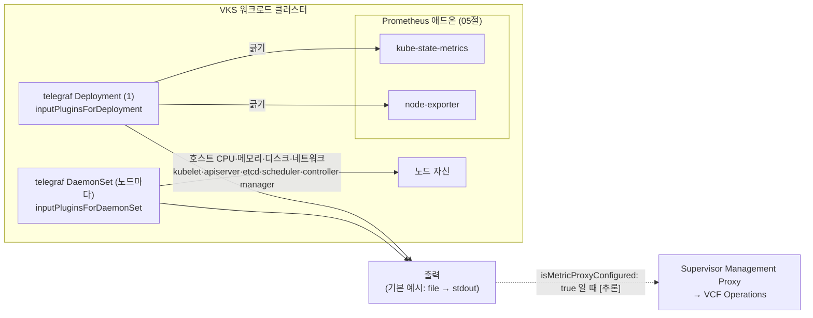

# 07. Telegraf

> 커리큘럼: [CURRICULUM.md](CURRICULUM.md) · 앞 절: [06. Fluent Bit](06-fluent-bit.md) · 작성 2026-10-31
> 등급: **[근거]** 출처에 그대로 있는 것, **[추론]** 여러 출처를 엮어 직접 내린 결론.
> 기준 판: VKS Add-ons `3.8.0+20261021` (9.1 VKS Add-ons Release Notes, 페이지 표기 Last Updated October 26, 2026, 2026-10-31 확인). 판 호환은 이 문서에서 정리하지 않는다. [공식 호환 매트릭스](https://interopmatrix.broadcom.com/)와 릴리스 노트를 직접 볼 것.

VKS 의 Telegraf 애드온은 **메트릭을 모아서 어딘가로 밀어 보내는(push) 에이전트**다. 저장도, 질의도, 경보도 하지 않는다. VKS 에서 이 애드온이 있는 가장 큰 이유는 **VCF Operations 가 VKS 클러스터를 모니터링할 때 Prometheus 와 함께 요구하는 짝**이라는 점이다.

이 절의 중심은 세 가지다. 첫째, [05절 Prometheus](05-prometheus.md)와 무엇이 다르고 왜 둘이 같이 깔리는가. 둘째, values 가 Fluent Bit 와 달리 **구조화된 YAML** 이라 Telegraf 설정 문법을 직접 쓰지 않는다는 점. 셋째, 3.7.0+20260723(1.39.1)에서 **웹훅 플러그인 폐기와 TLS 1.2 최소화**로 「조건부 조치 필요」가 붙었다는 점.

---

## 1. 무엇을 하는가



[근거] Telegraf Package Reference 의 「Telegraf Components」 표:

| 리소스 | 종류 | 복제 수 | 하는 일 |
|---|---|---|---|
| `telegraf` | Deployment | 1 | kube-state-metrics·node-exporter 같은 서비스 엔드포인트에서 메트릭을 긁는다 |
| `telegraf` | DaemonSet | 여럿 | 컨트롤 플레인과 리눅스 워커 노드 각각에서 메트릭을 긁는다 |
| `telegraf-cm-deployment` | ConfigMap | 1 | Deployment 용 Telegraf 설정 |
| `telegraf-cm-ds` | ConfigMap | 1 | DaemonSet 용 Telegraf 설정 |

(Telegraf Package Reference, 9.0, Last Updated October 6, 2026, 2026-10-31 확인)

- [근거] 구성 요소가 뜨는 네임스페이스 기본값은 `tanzu-system-telegraf` 다(values 의 `namespace`). Add-on 설치 문서의 확인 출력에는 이 네임스페이스에 Deployment Pod 1개(`telegraf-67945546d5-...`)와 DaemonSet Pod 2개가 보인다. 예시 클러스터는 컨트롤 플레인 1·워커 1 이다. (Install Telegraf Addon using VCF CLI, 9.0)
- [근거] Deployment 쪽 입력 플러그인 이름은 `kube_state_metrics`, `node_exporter_metrics`, `dcgm_exporter_metrics` 세 가지다. DaemonSet 쪽은 `hostMem`, `hostCPU`, `hostDisk`, `hostDiskIO`, `hostNet`, `hostNetStat`, `kube_apiserver_metrics`, `etcd_metrics`, `kube_controller_manager_metrics`, `kube_scheduler_metrics`, `kubelet_metrics`, 그리고 네 구성 요소의 `*_healthz` 다. (Package Reference 의 파라미터 표)
- [추론] Deployment 가 긁는 kube-state-metrics·node-exporter 는 **Telegraf 패키지가 깔지 않는다.** 05절의 Prometheus 패키지가 까는 구성 요소다. Prometheus 없이 Telegraf 만 깔면 Deployment 는 긁을 대상이 없다. `dcgm_exporter_metrics` 도 GPU 노드에 DCGM exporter 가 따로 있어야 의미가 있다(GPU Operator 쪽 이야기는 [`../gpu/`](../gpu/)).

### Prometheus 와 무엇이 다른가

| | Telegraf 애드온 | Prometheus 애드온 ([05절](05-prometheus.md)) |
|---|---|---|
| 하는 일 | 모으고 가공해 **밖으로 보낸다** | 모으고 **저장하고 질의·경보**한다 |
| 저장소 | 없음 | 시계열 DB(PVC) |
| 질의 언어 | 없음 | PromQL |
| 모으는 방식 | 입력 플러그인(긁기·호스트 직접 읽기) | 대상 엔드포인트 긁기(pull) |
| VCF Operations 연동 | 메트릭을 프록시로 보낸다 [추론] | 같이 요구된다 [근거] |

근거: [근거] 「Telegraf is an agent for collecting, processing, aggregating, and writing metrics, logs, and other arbitrary data」(Package Reference), 「addons such as Telegraf and Prometheus that are required for monitoring VKS Clusters」(Monitoring VKS Clusters Using VCF Operations, 9.0 문서 세트, 2026-10-31 확인). 표로 묶은 것은 [추론].

- [근거] Broadcom KB 428124 는 VKS 의 Telegraf 에이전트가 메트릭을 보고할 때 cloud proxy 와 supervisor-management-proxy 에 `POST /arc/tkgs/metric` 요청이 찍히는 것을 보여 준다. [추론] 즉 VCF Operations 쪽 경로에서 Telegraf 는 **밀어 보내는 쪽**이고, 그 출력 설정은 values 의 `isMetricProxyConfigured`(또는 9.1 이전 판의 `endpointIP`·`endpointPort`, 5절 9번)가 바꾼다. 패키지 참조 문서의 파라미터 표에는 file 출력만 나오고 이 출력의 모양은 적혀 있지 않다.
- [추론] 혼자 쓰는 클러스터에서 「대시보드를 보고 싶다」면 Telegraf 가 아니라 Prometheus(+ 별도 Grafana)다. Telegraf 는 받을 쪽(VCF Operations, InfluxDB 등)이 있을 때 쓴다.

### 판과 지원 등급 (3.8.0+20261021 기준)

- [근거] 3.8.0+20261021 에서 Telegraf 는 **Product** 등급이고 `1.39.3+vmware.2-vks.1` **한 판**이며, 지원 표의 VKr 다섯 칸(1.33~1.37) 모두 「Yes」다. 변경 내용은 「Go dependencies and base images bump to address vulnerabilities」. (9.1 VKS Add-ons Release Notes)
- [근거] 업스트림 Telegraf v1.39.3 은 2026-08-10 에 나왔고, 2026-10-31 현재 업스트림 최신은 v1.40.2(2026-10-12)다. (`gh release list -R influxdata/telegraf`, 2026-10-31)

묶음마다 Telegraf 애드온 판이 어떻게 움직였는지 (모두 같은 9.1 릴리스 노트):

| 묶음 | Telegraf 애드온 판 | 눈에 띄는 변화 |
|---|---|---|
| 3.5.0+20251022 | 1.35.4+vmware.1-vks.1 (1.34.4+vmware.3 도 표에 있음) | **Add-on Management 지원 시작**, 네임스페이스 LimitRange, 컨테이너 단위 cpu·memory 설정 |
| 3.5.0+20251218 | 1.36.4+vmware.1-vks.1, 1.35.4+vmware.2-vks.1 | 취약점 수정 |
| 3.6.0+20260211 | 1.37.1+vmware.1-vks.1 | 취약점 수정, 1.36.4 에서 매끄러운 업그레이드 |
| 3.6.0+20260416 | 1.37.3+vmware.1-vks.1 | 1.37.1 에서 매끄러운 업그레이드 |
| 3.7.0+20260618 | 1.38.4+vmware.1-vks.1 | Kubernetes 1.34 이상에서 PriorityClass 지정 |
| 3.7.0+20260723 | **1.39.1+vmware.1-vks.1** | **Artifactory Webhook·GitHub Webhooks 플러그인 폐기(SHA-1 사용), 최소 TLS 1.2**. 「조건부 조치 필요」 |
| 3.7.0+20260827 | 1.39.2+vmware.1-vks.1 | Go 의존성·Photon 기반 이미지 취약점 수정 |
| 3.7.0+20260924 | 1.39.3+vmware.1-vks.1 | Go 의존성 취약점 수정 |
| 3.8.0+20261021 | 1.39.3+vmware.2-vks.1 | Go 의존성·기반 이미지 취약점 수정 |

- [근거] 3.6.0+20260320 과 3.6.0+20260521 의 What's New 에는 Telegraf 칸이 없고, 지원 표에만 각각 1.37.1·1.36.4, 1.37.3·1.37.1 두 판이 있다. 3.7.0 이후 표에는 한 판씩만 있다. (같은 출처)
- [근거] 3.7.0+20260723 이후 묶음의 업그레이드 경로 문구는 모두 같다: 「폐기된 웹훅 플러그인을 안 쓰고 환경이 이미 TLS 1.2 이상이면 1.36.4+vmware.1-vks.1 이상에서 매끄럽게 업그레이드. 그렇지 않으면 data values 에서 폐기 플러그인을 지우거나 TLS 설정을 올린 뒤 다시 설치·업그레이드.」 (같은 출처)

## 2. VKS 에서 어떻게 들어가는가

두 경로의 공통 바탕은 [00절](00-repository-and-install-paths.md)에, Carvel 기초는 [`../carvel-kapp.md`](../carvel-kapp.md)에 있다.

| | 레거시 패키지 (VCF CLI) | Add-on Management (VCF CLI) | Add-on Management (kubectl) | 자동 모니터링 (9.1) |
|---|---|---|---|---|
| 누가 만드나 | 사용자 | 사용자 | 사용자 | VKS 가 Cluster 라벨을 보고 |
| 컨텍스트 | 워크로드 클러스터 | Supervisor, 클러스터 네임스페이스 | Supervisor, 클러스터 네임스페이스 | 클러스터 스펙 |
| 패키지·애드온 이름 | `telegraf.kubernetes.vmware.com` | `telegraf` | `addonRef.name: telegraf` | (Telegraf·Prometheus 함께) |
| 판 지정 | `-v <판>` | `vcf addon available list telegraf` 로 고름 | 문서 예시엔 판 칸 없음 | 저장소가 정함 [추론] |
| 설정값 | `--values-file` | `--values-config-file` | `AddonConfig.spec.values` | 자동 구성 |
| PackageInstall 위치 | 새 네임스페이스(문서 예시 `telegraf-installed`) | 클러스터 네임스페이스 | 클러스터 네임스페이스 | — |
| 구성 요소가 뜨는 곳 | `tanzu-system-telegraf` | 같음 | 같음 | 같음 [추론] |

근거: [근거] Install Telegraf Package, Install Telegraf Addon using VCF CLI, Install Telegraf Addon using Kubectl, Monitoring VKS Clusters Using VCF Operations (모두 9.0 문서 세트, Last Updated October 6, 2026, 2026-10-31 확인). 표로 묶은 것은 [추론].

- [근거] 패키지 이름이 판에 따라 다르다. **Telegraf 1.34.x 이상은 `telegraf.kubernetes.vmware.com`**, 그 전은 `telegraf.tanzu.vmware.com` 이다. (Install Telegraf Package, 9.0)
- [근거] 레거시 경로에서 **`tanzu-system-telegraf` 에 패키지를 깔지 말라**고 한다. 구성 요소 네임스페이스와 부딪혀 패키지 삭제가 실패할 수 있다. (같은 출처) 06절 Fluent Bit 의 `tanzu-system-logging` 과 같은 경고다.
- [근거] Add-on 경로의 이름 규칙은 다른 애드온과 같다. `AddonConfig` 는 `<클러스터 이름>-<애드온 이름>`(예: `wl-antrea-telegraf`), `AddonInstall` 은 `<애드온 이름>-<클러스터 이름>`(예: `telegraf-wl-antrea`). (Install Telegraf Addon using Kubectl, 9.0)

### 9.1 자동 모니터링 경로

[근거] VCF 9.1 은 새로 만드는 VKS 클러스터의 모니터링을 기본으로 켜고, VKS 3.5 의 Add-on Management 위에서 **Telegraf·Prometheus 애드온을 자동으로 설치·구성**한다. 사전 조건은 Supervisor 에 Metrics Aggregator VCF Service 가 있고, Telegraf·Prometheus 용 `AddonRepository`·`Addon`·`AddonConfigDefinition` 이 있는 것이다. 켜고 끄는 스위치는 Cluster 라벨 `addons.kubernetes.vmware.com/automated-monitoring` 이다. (Monitoring VKS Clusters Using VCF Operations)

```yaml
apiVersion: cluster.x-k8s.io/v1beta2
kind: Cluster
metadata:
  labels:
    addons.kubernetes.vmware.com/automated-monitoring: enabled
```

- [근거] 9.0 에서 모니터링하던(레거시 패키지로 Telegraf·Prometheus 를 깔아 둔) 클러스터는 두 패키지를 Add-on 관리로 옮겨야 하고, Telegraf 를 옮길 때는 `endpointIP`·`endpointPort`(Metrics Aggregator 서비스 네임스페이스의 `workload-metrics-loadbalancer` 주소·포트)와 `domainName` 을 values 로 준다. (같은 출처, 옮기는 절차는 [00절](00-repository-and-install-paths.md)의 Migrate a Legacy Package Add-on)
- [추론] 04절 Cluster Autoscaler 처럼 **사용자가 AddonInstall 을 만드는 대신 라벨로 켜는 경로**다. 9.1 에서 새로 만든 클러스터라면 Telegraf 를 손으로 깔기 전에 이미 깔려 있는지부터 본다(3.6).

## 3. 실습

> 이름(`wl-antrea`, `test-ns`, `telegraf-installed`)과 판 `1.35.4+vmware.1-vks.1` 은 공식 문서의 예시 값이다. 3.8.0+20261021 의 판은 `1.39.3+vmware.2-vks.1` 이다. 자기 환경의 `vcf addon available list telegraf` 출력에서 고른다.

### 3.1 values 파일 만들기

```bash
# 레거시 경로 — 판 목록 (1.34.x 이상 이름). 문서는 여기서 "get" 이라 적었다(5절 10번)
vcf package available list telegraf.kubernetes.vmware.com -n tkg-system
kubectl -n tkg-system get packages | grep telegraf
vcf package available get telegraf.kubernetes.vmware.com/<판> \
  --default-values-file-output telegraf-data-values.yaml

# Add-on 경로 — 판 목록과 기본값
vcf context use supervisor:test-ns
vcf addon available list telegraf
vcf addon available get telegraf -v <판> -o telegraf-data-values.yaml
```

[근거] Install Telegraf Package, Install Telegraf Addon using VCF CLI (9.0). 레거시 첫 줄을 `list` 로 바꾼 것은 [추론].

처음 손볼 값만 추린 예 (공식 Data Values 예시를 바탕으로):

```yaml
namespace: tanzu-system-telegraf
createNamespace: true
domainName: cluster.local          # 클러스터 서비스 도메인
isMetricProxyConfigured: false     # VCF Operations 로 보낼 때 true
global_tags:
  tkc_cluster: "test-cluster"      # 모든 메트릭에 붙는 태그
agent:
  interval: 300s                   # 기본값. 공식 예시는 120s
cpOnlyforDaemonSet: false          # true 면 DaemonSet 이 컨트롤 플레인에만
inputPluginsForDaemonSet:
  hostNetStat:
    enabled: false                 # 필요 없는 입력은 끈다
outputPlugins:
  file:
    enabled: true
    files: ["stdout"]
    namepass: ["*"]
```

- [근거] 파라미터 이름·종류·기본값(`namespace` = `tanzu-system-telegraf`, `createNamespace` = true, `isMetricProxyConfigured` = false, `domainName` = `cluster.local`, `agent.interval` = 300s, `cpOnlyforDaemonSet` = false, 입력 플러그인 `enabled` = true, `outputPlugins.file.enabled` = true)은 Package Reference 의 표다. 공식 예시는 `agent.interval: 120s` 와 `global_tags`(`tkc_cluster`·`user`), file 출력 하나만 쓴다.
- [근거] 입력 플러그인마다 Deployment 쪽은 `kubernetes_services`·`name_prefix`·`namepass`, DaemonSet 쪽은 `fieldinclude`·`fieldexclude`·`namepass`·`namedrop` 으로 거른다. (같은 표)
- [추론] Fluent Bit(06절)는 values 에 설정 **문자열**을 그대로 넣었다. Telegraf 는 반대로 values 가 구조화된 YAML 이고 패키지가 그것으로 `telegraf-cm-deployment`·`telegraf-cm-ds` ConfigMap 의 TOML 을 만든다. 그래서 키 이름을 틀리면 YAML 은 통과하고 그 값만 조용히 무시될 수 있다. 바꾼 뒤에는 렌더된 ConfigMap 을 직접 본다(3.6).
- [추론] 위 YAML 의 `hostNetStat: enabled: false` 는 표의 `inputPluginsForDaemonSet.<pluginName>.enabled` 를 펼친 모양이다. 받은 기본값 파일의 들여쓰기와 같은지 확인한 뒤 쓴다.

### 3.2 Add-on 방식, VCF CLI

```bash
vcf cluster list -A | grep wl-antrea
vcf context use supervisor:test-ns
vcf addon install create telegraf --cluster-name wl-antrea -n test-ns \
  --values-config-file telegraf-data-values.yaml -y

vcf addon install list --cluster-name wl-antrea -n test-ns
# 기대: telegraf  test-ns  false  True  Allowed

# 지우기 (AddonInstall telegraf-wl-antrea → ClusterAddon wl-antrea-telegraf → AddonConfig 순)
vcf addon install delete telegraf --cluster-name wl-antrea -n test-ns
```

[근거] Install Telegraf Addon using VCF CLI (9.0). 원문의 설치 명령에는 `--values-config-file` 이 없다(5절 10번). 06절 Fluent Bit 문서와 같은 모양으로 넣은 것은 [추론].

### 3.3 Add-on 방식, kubectl

```yaml
# addonconfig.yaml — 이름은 <cluster-name>-<addon-name>
apiVersion: addons.kubernetes.vmware.com/v1alpha1
kind: AddonConfig
metadata:
  name: wl-antrea-telegraf
  namespace: test-ns
  annotations:
    clusteraddon.addons.kubernetes.vmware.com/owned-for-deletion: "true"
spec:
  clusterName: wl-antrea
  values:
    # 3.1 의 telegraf-data-values.yaml 내용을 여기에
---
# addoninstall.yaml — 이름은 <addon-name>-<cluster-name>
apiVersion: addons.kubernetes.vmware.com/v1alpha1
kind: AddonInstall
metadata:
  name: telegraf-wl-antrea
  namespace: test-ns
spec:
  addonRef:
    name: telegraf
  clusters:
    - selector:
        matchLabels:
          cluster.x-k8s.io/cluster-name: wl-antrea
```

```bash
kubectl config use-context supervisor:test-ns
kubectl get addonreleases -n vmware-system-vks-public | grep telegraf
kubectl apply -f addonconfig.yaml
kubectl get addonconfig -n test-ns
kubectl apply -f addoninstall.yaml
kubectl get clusteraddon -n test-ns
# 기대: wl-antrea-telegraf  wl-antrea  telegraf  telegraf-wl-antrea  telegraf.kubernetes.vmware.com.<판>  True

# 지우기
kubectl delete -f addoninstall.yaml
kubectl get addoninstall,addonconfig,clusteraddon -n test-ns | grep telegraf   # 기대: 0줄
```

- [근거] Install Telegraf Addon using Kubectl (9.0). 원문은 `name: telegraf# Install this addon` 처럼 공백이 빠져 있고, `kubectl get clusteraddon` 에 `-n` 이 없다. 위처럼 맞춘 것은 [추론].
- [근거] 이 문서의 AddonConfig·AddonInstall 예시에는 판을 고르는 `releaseFilter` 가 **어디에도 없다**. [추론] 그러면 저장소가 정한 판이 깔린다. 06절(AddonConfig 에 둠)·05절(AddonInstall 에 둠)과 문서마다 자리가 다르므로, 판을 고정하려면 `kubectl explain addonconfig.spec` 와 `kubectl explain addoninstall.spec` 로 칸을 먼저 확인하고, 깔린 뒤 `clusteraddon` 의 RELEASE 칸으로 확인한다.

### 3.4 레거시 방식

```bash
# 워크로드 클러스터 컨텍스트
kubectl create ns telegraf-installed
vcf package install telegraf -p telegraf.kubernetes.vmware.com -v <판> \
  --values-file telegraf-data-values.yaml -n telegraf-installed
vcf package installed list telegraf -n telegraf-installed
# 기대: telegraf  telegraf.kubernetes.vmware.com  <판>  Reconcile succeeded

# 지우기
vcf package installed delete telegraf -n telegraf-installed
kubectl delete ns telegraf-installed
```

[근거] Install Telegraf Package (9.0).

### 3.5 9.1 자동 모니터링을 끄기

```bash
# Supervisor 컨텍스트
kubectl label cluster wl-antrea -n test-ns \
  addons.kubernetes.vmware.com/automated-monitoring=Disabled --overwrite
```

[근거] 「모니터링을 원하지 않으면 라벨을 `Disabled` 로 둔다」(Monitoring VKS Clusters Using VCF Operations). [추론] 이 문서는 켤 때 YAML 예시에 소문자 `enabled`, 마법사 설명에 `Enabled`, 끌 때 `Disabled` 를 쓴다. 대소문자를 구분하는지는 문서에 없다(5절 9번). 라벨을 바꾼 뒤 `kubectl get clusteraddon -n test-ns | grep -E 'telegraf|prometheus'` 로 실제로 빠지는지 본다. 이번 회차에 실제 클러스터로 재지는 않았다.

### 3.6 깔린 뒤 확인 (워크로드 클러스터 컨텍스트)

```bash
kubectl get deploy,ds,pod,cm -n tanzu-system-telegraf -o wide
# 기대: Deployment telegraf 1/1, DaemonSet telegraf DESIRED = 노드 수(cpOnlyforDaemonSet=false 일 때),
#       ConfigMap telegraf-cm-deployment, telegraf-cm-ds

# values 가 실제 설정에 들어갔는지: 렌더된 TOML 을 본다 [추론]
kubectl get cm telegraf-cm-ds -n tanzu-system-telegraf -o jsonpath='{.data}' | head -c 2000

# 받을 대상이 있는지 (Deployment 가 긁는 쪽, 05절 Prometheus 가 깔았을 때)
kubectl get svc -A | grep -E 'kube-state-metrics|node-exporter'

# file → stdout 출력이면 메트릭이 Pod 로그로 나온다
kubectl logs -n tanzu-system-telegraf deploy/telegraf --tail=20
```

- [근거] 리소스 이름(Deployment·DaemonSet `telegraf`, ConfigMap 두 개)은 Package Reference 의 구성 요소 표, Pod 목록 확인은 Add-on 설치 문서 두 쪽의 마지막 단계다.
- [추론] ConfigMap 의 키 이름(`telegraf.conf` 등)과 kube-state-metrics·node-exporter 의 Service 이름은 이번 회차에 실제 클러스터로 재지 않았다. 위 명령은 이름을 몰라도 보이게 짰다.
- [추론] 기본 예시처럼 file 출력이 `stdout` 이면 `agent.interval` 마다 모든 메트릭이 Pod 로그로 쏟아진다. 06절 Fluent Bit 가 그 로그를 다시 모아 로그 서버로 보낼 수 있다는 점까지 계산한다(5절 4번).

### 3.7 클러스터 없이 확인하는 법

[추론] values 가 구조화 YAML 이라 Fluent Bit 처럼 「values 의 설정 문자열을 꺼내 dry-run」 하는 방법은 쓸 수 없다. 대신 두 가지를 할 수 있다.

1. 깔린 클러스터의 `telegraf-cm-ds`·`telegraf-cm-deployment` 에서 TOML 을 꺼내 업스트림 Telegraf 로 검사한다.

```bash
kubectl get cm telegraf-cm-ds -n tanzu-system-telegraf -o json \
  | jq -r '.data | to_entries[0].value' > telegraf-ds.conf
docker run --rm -v "$PWD/telegraf-ds.conf":/etc/telegraf/telegraf.conf:ro \
  telegraf:1.39 telegraf --config /etc/telegraf/telegraf.conf --test --test-wait 5
```

2. 업스트림 Telegraf 의 `--test`(한 번 모아 stdout 에 찍고 끝냄)로 입력 플러그인의 모양을 노트북에서 먼저 익힌다. 노드 파일을 읽는 host 계열 입력은 컨테이너 안의 값을 읽는다는 점을 감안한다.

[추론] `--test`·`--test-wait` 는 업스트림 Telegraf 의 명령행 옵션이다. 이번 회차의 실행 환경에는 docker 와 VKS 클러스터가 없어 위 명령을 실제로 돌리지 못했다. ConfigMap 의 첫 키가 설정 파일이라는 것도 확인하지 않은 가정이다.

## 4. 업스트림 Helm 설치와 다른 점

[근거] 루트 [`../k8s-addon.sh`](../k8s-addon.sh) 에는 Telegraf 메뉴가 없다(2026-10-31 `grep -i telegraf` 0건). 업스트림은 InfluxData 의 Helm 차트를 쓴다. Deployment 형 `telegraf` 차트(1.8.78)와 DaemonSet 형 `telegraf-ds` 차트(1.1.57)가 따로 있고 둘 다 appVersion 1.40.2 다. (`influxdata/helm-charts` 의 `charts/*/Chart.yaml`, 2026-10-31 확인)

| | VKS Telegraf 애드온 | 업스트림 `influxdata/telegraf`·`telegraf-ds` 차트 |
|---|---|---|
| 형태 | Deployment + DaemonSet 을 한 패키지로 | 차트 두 개로 나뉨 |
| 설정 넣는 곳 | 미리 정한 입력 플러그인 이름별 `enabled`·거르기 값 | 차트 values 로 Telegraf 설정을 직접 [추론] |
| 출력 | 표에 나온 것은 file 하나, VCF Operations 는 `isMetricProxyConfigured` | 사용자가 고름 [추론] |
| 판 | 1.39.3+vmware.2-vks.1 (업스트림 1.39.3 기반) | appVersion 1.40.2 |
| 지원 | Product 등급 | 커뮤니티 |

- [추론] VKS 애드온은 「모든 Telegraf 플러그인을 쓰는 범용 설치」가 아니라 **정해진 입력 몇 가지를 켜고 끄는 모양**이다. 파라미터 표에 없는 입력·출력 플러그인을 넣을 칸은 문서에 없다. 그런 요구가 있으면 업스트림 차트를 따로 쓰는 쪽이 맞고, 그때는 VKS 지원 범위 밖이 된다.
- [추론] 업스트림 쪽 판이 1.40 으로 앞서 있다. 업스트림 문서를 보고 쓴 설정이 1.39 패키지에서 안 될 수 있으니, 업스트림 문서는 `release-1.39` 가지를 본다. Broadcom 참조 문서의 링크는 아직 `release-1.35` 가지를 가리킨다(5절 10번).

## 5. 흔한 실수

1. **Prometheus 없이 Telegraf 만 깐다.** [근거] Deployment 는 kube-state-metrics·node-exporter 같은 서비스 엔드포인트를 긁는다. [추론] 둘은 05절 Prometheus 패키지의 구성 요소다. Telegraf 만 깔면 Pod 는 Running 인데 Deployment 쪽 메트릭이 비고, VCF Operations 대시보드도 반쪽이 된다. VCF Operations 모니터링 문서도 둘을 함께 요구한다.
2. **패키지를 `tanzu-system-telegraf` 에 깐다.** [근거] 문서가 하지 말라고 한다. 삭제가 실패할 수 있다.
3. **옛 패키지 이름으로 찾는다.** [근거] 1.34.x 이상은 `telegraf.kubernetes.vmware.com`. `telegraf.tanzu.vmware.com` 으로 찾으면 옛 판만 나온다.
4. **기본 예시의 file → stdout 출력을 운영에 그대로 둔다.** [근거] 공식 예시와 기본값은 file 출력을 켜 둔다. [추론] 모든 메트릭이 interval 마다 컨테이너 로그로 나가고, Fluent Bit(06절)가 노드 로그를 모으고 있으면 로그 서버까지 메트릭 덩어리가 실려 간다. 받을 쪽이 정해지면 file 출력을 끄거나 `namepass` 로 좁힌다.
5. **1.39.1 이후로 올리면서 웹훅 플러그인·TLS 를 안 본다.** [근거] 3.7.0+20260723(1.39.1)부터 Artifactory Webhook·GitHub Webhooks 플러그인이 SHA-1 때문에 폐기됐고 최소 TLS 가 1.2 로 올랐다. 해당하면 values 에서 지우거나 TLS 설정을 올린 뒤 재설치·업그레이드하라고 한다. [근거] 업스트림 v1.39.0(2026-06-08)에도 「`common.tls` Set default minimum TLS version explicitly」(#18910)가 있다. [추론] 웹훅 플러그인은 VKS 파라미터 표의 입력 이름 목록에 없으므로, 문제가 되는 것은 표 밖의 방법으로 플러그인을 넣었거나 TLS 1.0·1.1 끝점을 긁던 경우다. 업스트림 쪽 폐기 내역은 이번 회차에 확인하지 않았다.
6. **9.1 새 클러스터에 손으로 또 깐다.** [근거] 9.1 은 새 클러스터의 모니터링을 기본으로 켜고 Telegraf·Prometheus 를 자동 설치한다. [추론] 이미 자동 경로로 깔린 클러스터에 레거시 PackageInstall 을 또 만들면 두 설치가 같은 `tanzu-system-telegraf` 리소스를 두고 부딪칠 수 있다. 먼저 `kubectl get clusteraddon -n <ns>` 와 Cluster 라벨을 본다.
7. **VCF Operations 대시보드가 비는데 Telegraf 만 본다.** [근거] KB 428124: VCF Operations 9.0.x 에서 cloud proxy 가 「Application Monitoring 고가용성」이 켜진 Collector Group 에 있으면, Telegraf 의 `POST /arc/tkgs/metric` 이 HTTP 406 으로 거부되고 대시보드에 데이터가 안 뜬다. 처방은 그 Collector Group 의 고가용성 체크를 끄는 것이다. [추론] Telegraf Pod 로그만 보면 원인이 안 보인다. supervisor-management-proxy Pod 로그의 응답 코드부터 본다.
8. **`cpOnlyforDaemonSet` 의 뜻을 거꾸로 읽는다.** [근거] true 면 DaemonSet 이 **컨트롤 플레인 노드에서만** 돈다. 기본값 false 는 컨트롤 플레인과 리눅스 워커 모두. [추론] 워커 노드 호스트 메트릭이 갑자기 사라졌으면 이 값부터 본다.
9. **9.1 모니터링 문서의 라벨·values 를 그대로 믿는다.** [근거] 같은 문서가 라벨 값을 `enabled`(YAML)·`Enabled`(마법사)·`Disabled`(끌 때)로 섞어 쓰고, 레거시 이전 때 주라는 `endpointIP`·`endpointPort` 는 9.0 Package Reference 의 파라미터 표에 없다. [추론] 라벨은 붙인 뒤 clusteraddon 으로 결과를 확인하고, values 칸은 자기 판의 기본값 파일(`vcf addon available get telegraf -v <판>`)에 그 키가 있는지 먼저 본다.
10. **공식 문서 예시를 그대로 친다.** [근거] 9.0 문서 안에 서로 어긋나거나 틀린 곳이 있다(모두 2026-10-31 확인).
    - 레거시 문서가 판 목록을 보는 명령을 `vcf package available get telegraf.tanzu.vmware.com -n tkg-system` 이라 적었다. [추론] 목록은 `list` 이고 이름도 옛것이다(3.1).
    - VCF CLI Add-on 문서는 values 파일을 만들게 해 놓고 `vcf addon install create telegraf --cluster-name wl-antrea -y -n test-ns` 에 `--values-config-file` 을 안 붙였다. [추론] 이대로 치면 만든 values 가 안 들어간다.
    - 같은 문서의 삭제 출력 예시가 「AddonConfig wl-antrea under namespace argocd-instance-2 has been deleted」로, 앞의 이름(`wl-antrea-telegraf`, `test-ns`)과 맞지 않는다.
    - kubectl Add-on 문서가 기본값 파일을 레거시 명령 `vcf package available get ... --default-values-file-output` 으로 받게 한다. AddonConfig 확인 출력에는 `1.35.1---vmware.1-vks.1`, ClusterAddon 출력에는 `1.35.4-vmware.1-vks.1` 이 찍혀 있다.
    - Package Reference 의 `agent.interval` 기본값은 300s 인데 예시는 120s 다. `namedrop` 설명이 「The inverse of namedrop」으로 자기 자신을 가리킨다(뜻은 `namepass` 의 반대). 설정 링크가 `release-1.35` 가지를 가리킨다.

## 6. 확인 문제

1. 팀이 VKS 클러스터에 Telegraf 애드온만 깔고 「Prometheus 는 안 쓴다」고 한다. Pod 는 모두 Running 인데 VCF Operations 의 VKS 대시보드에서 일부 위젯이 비어 있다. 무엇이 빠졌을 가능성이 크고, 어떻게 확인하는지 근거와 함께 적어라.
2. 3.6.0 묶음의 Telegraf 1.37.3 을 쓰던 클러스터를 3.8.0+20261021 로 올리려 한다. 릴리스 노트가 「조건부 조치 필요」라고 한 두 조건과, 해당할 때 할 일을 적어라.
3. 공식 VCF CLI 문서대로 `vcf addon available get telegraf -v <판> -o telegraf-data-values.yaml` 로 파일을 만들어 `agent.interval` 을 60s 로 고친 뒤, 문서의 설치 명령을 그대로 쳤다. 깔린 Telegraf 의 수집 간격은 얼마일 가능성이 크고, 왜 그런지, 무엇으로 확인하는지 적어라.

<details>
<summary>풀이</summary>

1. Prometheus 애드온. Telegraf Deployment 는 kube-state-metrics·node-exporter 서비스 엔드포인트를 긁는데, 둘은 Prometheus 패키지가 까는 구성 요소다. VCF Operations 모니터링 문서도 Telegraf 와 Prometheus 를 함께 요구한다. 확인: `kubectl get svc -A | grep -E 'kube-state-metrics|node-exporter'` 가 비었는지, `kubectl get clusteraddon -n <ns>` 에 prometheus 가 있는지. 그다음 VCF Operations 9.0.x 라면 KB 428124 의 HTTP 406(Collector Group 고가용성)도 본다.
2. 폐기된 Artifactory Webhook·GitHub Webhooks 플러그인을 쓰는 경우, 그리고 최소 TLS 가 1.2 보다 낮은 경우. 해당하면 data values 에서 폐기 플러그인을 지우거나 TLS 설정을 올린 뒤 재설치·업그레이드한다. 둘 다 아니면 1.36.4+vmware.1-vks.1 이상에서 매끄럽게 올라간다(3.7.0+20260723 이후 묶음의 업그레이드 경로 문구).
3. 기본값 300s 일 가능성이 크다. 문서의 `vcf addon install create telegraf --cluster-name wl-antrea -y -n test-ns` 에는 `--values-config-file` 이 없어서 만든 파일이 안 들어간다. 확인은 워크로드 클러스터의 `telegraf-cm-ds`·`telegraf-cm-deployment` ConfigMap 에 렌더된 `interval` 값. 고치려면 `--values-config-file telegraf-data-values.yaml` 을 붙여 다시 만들거나 AddonConfig 의 values 를 고친다.

</details>

---

## 7. 출처 (모두 2026-10-31 확인)

- Broadcom TechDocs, VCF 9.0 문서 세트 (모두 Last Updated October 6, 2026)
  - [Install Telegraf](https://techdocs.broadcom.com/us/en/vmware-cis/vcf/vcf-service-administration-and-development/9-0/managing-vsphere-kuberenetes-service-clusters-and-workloads/installing-standard-packages-on-tkg-service-clusters/installing-standard-packages-on-tkg-cluster-using-tkr-for-vsphere-8-x/install-telegraf.html) (하위 세 쪽의 목차)
  - [Install Telegraf Package](https://techdocs.broadcom.com/us/en/vmware-cis/vcf/vcf-service-administration-and-development/9-0/managing-vsphere-kuberenetes-service-clusters-and-workloads/installing-standard-packages-on-tkg-service-clusters/installing-standard-packages-on-tkg-cluster-using-tkr-for-vsphere-8-x/install-telegraf/install-telegraf-package.html)
  - [Install Telegraf Addon using VCF CLI](https://techdocs.broadcom.com/us/en/vmware-cis/vcf/vcf-service-administration-and-development/9-0/managing-vsphere-kuberenetes-service-clusters-and-workloads/installing-standard-packages-on-tkg-service-clusters/installing-standard-packages-on-tkg-cluster-using-tkr-for-vsphere-8-x/install-telegraf/install-telegraf-addon.html)
  - [Install Telegraf Addon using Kubectl](https://techdocs.broadcom.com/us/en/vmware-cis/vcf/vcf-service-administration-and-development/9-0/managing-vsphere-kuberenetes-service-clusters-and-workloads/installing-standard-packages-on-tkg-service-clusters/installing-standard-packages-on-tkg-cluster-using-tkr-for-vsphere-8-x/install-telegraf/install-telegraf-kubectl.html)
  - [Telegraf Package Reference](https://techdocs.broadcom.com/us/en/vmware-cis/vcf/vcf-service-administration-and-development/9-0/managing-vsphere-kuberenetes-service-clusters-and-workloads/installing-standard-packages-on-tkg-service-clusters/standard-package-reference/telegraf-package-reference.html)
  - [Monitoring VKS Clusters Using VCF Operations](https://techdocs.broadcom.com/us/en/vmware-cis/vcf/vcf-service-administration-and-development/9-0/managing-vsphere-kuberenetes-service-clusters-and-workloads/operating-tkg-service-clusters/monitoring-vks-clusters-using-vcf-operations.html) — 9.0 경로에 있지만 본문은 VCF 9.1 의 자동 모니터링을 설명한다
- [VKS Add-ons Release Notes (9.1)](https://techdocs.broadcom.com/us/en/vmware-cis/vcf/vcf-service-administration-and-development/9-1/release-notes/vks-addons-release-notes.html) — 3.5.0+20251022 ~ 3.8.0+20261021 의 Telegraf 칸, 지원 표, Support Tiers (Last Updated October 26, 2026)
- [Broadcom KB 428124: VKS dashboards not loading metrics](https://knowledge.broadcom.com/external/article/428124/vks-dashboards-not-loading-metrics.html) — VCF Operations 9.0.x, HTTP 406
- Telegraf 업스트림
  - [v1.39.0 릴리스](https://github.com/influxdata/telegraf/releases/tag/v1.39.0) (2026-06-08, #18910), [v1.39.3](https://github.com/influxdata/telegraf/releases/tag/v1.39.3) (2026-08-10), [릴리스 목록](https://github.com/influxdata/telegraf/releases) (최신 v1.40.2, 2026-10-12)
  - [influxdata/helm-charts](https://github.com/influxdata/helm-charts/tree/master/charts) — `telegraf` 1.8.78, `telegraf-ds` 1.1.57 (appVersion 1.40.2)
