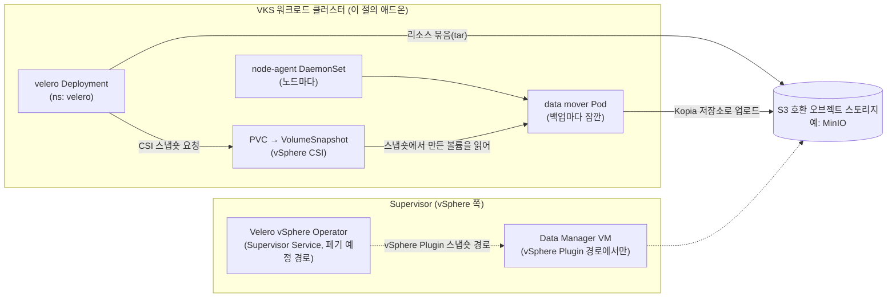

# 08. Velero

> 커리큘럼: [CURRICULUM.md](CURRICULUM.md) · 앞 절: [07. Telegraf](07-telegraf.md) · 작성 2026-11-01
> 등급: **[근거]** 출처에 그대로 있는 것, **[추론]** 여러 출처를 엮어 직접 내린 결론.
> 기준 판: VKS Add-ons `3.8.0+20261021` (9.1 VKS Add-ons Release Notes, 2026-11-01 확인). 판 호환은 이 문서에서 정리하지 않는다. [공식 호환 매트릭스](https://interopmatrix.broadcom.com/)와 릴리스 노트를 직접 볼 것.

VKS 의 Velero 애드온은 **워크로드 클러스터 안에 Velero 서버와 node-agent 를 까는 패키지**다. 쿠버네티스 리소스(YAML)를 S3 호환 오브젝트 스토리지에 묶어 올리고, 영구 볼륨 데이터는 CSI 스냅숏을 떠서 같은 스토리지로 옮긴다.

Velero 자체의 개념(백업 대상 지정, 복구, 한계)은 루트 [`../velero-csi-backup/`](../velero-csi-backup/)에 있다. 특히 [`02_velero_backup_restore.md`](../velero-csi-backup/02_velero_backup_restore.md)(백업·복구 명령)와 [`03_csi_snapshot_vsphere.md`](../velero-csi-backup/03_csi_snapshot_vsphere.md)(VolumeSnapshotClass, vSphere CSI 스냅숏)를 먼저 읽는다. 이 절은 그 위에서 세 가지만 판다. 첫째, **Supervisor 쪽 Velero(Velero vSphere Operator)와 VKS 클러스터 안의 Velero 애드온은 다른 물건**이라는 점. 둘째, 3.8.0+20261021 은 Velero **1.18 한 줄**만 주고, 업스트림에서 1.17 에 Restic 백업이 없어졌다는 점. 셋째, 공식 문서끼리 서로 어긋나는 곳이 많아 예시를 그대로 치면 안 된다는 점.

---

## 1. 무엇을 하는가



[근거] Velero 는 상태 없는 워크로드에서는 Deployment·StatefulSet·Pod·Service·Secret·ConfigMap 같은 리소스만, 상태 있는 워크로드에서는 영구 볼륨 데이터까지 백업한다. 볼륨 데이터를 백업하는 방법은 셋이다. (Backing Up and Restoring VKS Cluster Workloads, 9.0, Last Updated October 6, 2026)

| 방법 | 동작 | 공식 권고 |
|---|---|---|
| CSI 스냅숏 | CSI 스냅숏을 뜨고 그 데이터를 오브젝트 스토리지로 옮긴다(Velero 1.12+) | **권장.** CNS 블록 볼륨용 |
| File System Backup | 살아 있는 파일 시스템을 읽어 올린다. 1.12 부터 기본 업로더가 Restic → Kopia, 1.15 에서 Restic 폐기 예고 | CNS 파일 볼륨·NFS 같은 비블록 볼륨용 |
| vSphere Plugin 스냅숏 | vSphere 고유 스냅숏을 뜨고 Data Manager 가 옮긴다 | 일부 경우에만 |

[근거] 같은 페이지의 비교 표: CSI 스냅숏과 vSphere Plugin 은 crash-consistent, File System Backup 은 아니다. 중복 제거·암호화·병렬 처리는 CSI 스냅숏과 File System Backup 만 된다. vSphere Plugin 은 CBT 를 안 써서 **매번 전체 백업**이고(500GB 볼륨이면 매번 500GB), 백업 저장소가 없어 데이터를 그대로 쓴다. CSI 스냅숏은 스냅숏에서 볼륨을 완전 복제한 뒤 읽으므로 큰 볼륨에서 오래 걸리고(복제 처리량 1GB/s), 백업이 끝날 때까지 그만큼 저장 공간이 더 든다.

[근거] **한 Velero 설치에서 CSI 스냅숏과 vSphere Plugin 스냅숏을 함께 켤 수 없다.** 방법에 따라 깔 Velero 판도 다르다. (Version Matrix for Velero, 9.0)

### Supervisor 쪽 Velero 와 무엇이 다른가

| | Velero 애드온 (이 절) | Velero vSphere Operator + Velero Plugin for vSphere |
|---|---|---|
| 깔리는 곳 | VKS 워크로드 클러스터 | Supervisor (Supervisor Service) |
| 설치 수단 | `vcf addon install` / `vcf package install` | vSphere Client 의 Services 탭 → `velero-vsphere install` |
| 볼륨 데이터 | CSI 스냅숏 + data mover, 또는 Kopia FS 백업 | vSphere 스냅숏 + Data Manager VM |
| 백업 대상 | 그 클러스터의 워크로드 | vSphere Pod, 그리고 (VKS 쪽에 Velero 를 따로 깔아) VKS 워크로드 |
| 공식 위치 | 「Backing Up and Restoring VKS Cluster Workloads」 | 「Installing and Configuring the Velero Plugin for vSphere on a Supervisor」 |

- [근거] 설치 방법은 세 가지다. 표준 패키지(**Velero 1.16 이상에서 권장**), Velero CLI(1.15 이하에서 권장), Supervisor 의 Velero vSphere Operator(**Deprecated**). 앞의 둘은 CSI 스냅숏·vSphere Plugin 스냅숏을 다 켤 수 있고, Operator 경로는 vSphere Plugin 스냅숏만 된다. (Methods for Installing Velero on VKS Clusters, 9.0)
- [근거] Supervisor 쪽 설치 문서는 Velero Plugin for vSphere `1.8.0-embedded+24696422`(1.8 접두어 판)에만 해당하고, Velero vSphere Operator 를 **core Supervisor Service**(vCenter 에 미리 등록)로 켠 뒤 `velero-vsphere` CLI 로 설치한다. 사전에 Data Manager VM 을 OVA 로 배포한다. (9.1 vSphere Supervisor Installation and Configuration, Last Updated October 29, 2026)
- [근거] Data Manager 에 대해 Broadcom 문서와 업스트림 README 가 같은 경고를 단다: 「기능 시험만 했고 규모를 감당하도록 만들지 않았으며 성능을 약속하지 않는다. 업무상 중요한 애플리케이션을 운영 환경에서 백업하는 용도가 아니다.」
- [근거] Supervisor 백업(vCenter 백업 기능)으로는 VKS **노드 VM** 만 되살린다. 그 위의 워크로드는 따로 백업하고 노드 복구 뒤에 복원해야 한다. (Backing Up and Restoring VKS Clusters and Workloads, 9.1 Supervisor 문서)
- [근거] 업스트림 `velero-plugin-for-vsphere` 의 guest 클러스터 호환 표에서 플러그인 1.6.0 은 vSphere 9.0.2·9.1.0.0 / Kubernetes 1.33 에서 **Velero 1.15.2** 와 짝지어 있다. (docs/guest.md, 2026-11-01 확인)
- [추론] 즉 VKS 클러스터에서 vSphere Plugin 스냅숏을 쓰려면 3.8.0+20261021 의 1.18 애드온이 아니라 Velero CLI 로 1.15 를 까는 옛 경로(Archived Velero Versions → Velero 1.15)로 가야 한다. 새로 설계한다면 공식 권고대로 **CSI 스냅숏 + 애드온** 경로가 기본이다. 이 절의 나머지는 그 경로만 다룬다.

### 판과 지원 등급 (3.8.0+20261021 기준)

- [근거] 3.8.0+20261021 에서 Velero 는 **Product** 등급이고 **`1.18.4+vmware.1-vks.1` 한 판**이며, 지원 표의 VKr 다섯 칸(1.33~1.37) 모두 「Yes」다. What's New 의 내용은 「Smooth upgrade from 1.18.3+vmware.1-vks.1」뿐이다. (9.1 VKS Add-ons Release Notes)
- [근거] 업스트림 v1.18.4 는 2026-09-28 에 나왔고 2026-11-01 현재 업스트림 최신이다. 업스트림 README 의 호환 표에서 1.18 은 Kubernetes 1.33.7·1.34.1·1.35.0 에서 시험했다. (`gh release list -R vmware-tanzu/velero`, README, 2026-11-01)
- [추론] VKr 1.36·1.37 의 「Yes」는 Broadcom 이 따로 검증한 범위이고 업스트림 시험 범위 밖이다. 문제가 나면 업스트림 이슈보다 Broadcom 지원 쪽으로 간다.

묶음마다 Velero 애드온 판이 어떻게 움직였는지 (모두 같은 9.1 릴리스 노트):

| 묶음 | 지원 표의 Velero 판 | 눈에 띄는 변화 |
|---|---|---|
| 3.5.0+20251022 | 1.17.0, 1.16.2+vmware.1, 1.16.1+vmware.1 | What's New 에 Velero 칸 없음 |
| 3.5.0+20251218 | 1.17.1, 1.17.0, 1.16.2+vmware.2 | 1.17.1: privileged fs-backup Pod 선택, BackupPVC 어노테이션. **1.16.1+vmware.1 은 Packages Removed** |
| 3.6.0+20260211 | 1.17.2+vmware.1 외 1.17.x·1.16.2 여러 판 | 취약점 수정 |
| 3.6.0+20260416 | 1.17.2+vmware.2, 1.16.2+vmware.4 외 | 취약점 수정 |
| 3.7.0+20260618 | **1.18.1+vmware.1**, 1.17.2+vmware.3 | **1.18 첫 등장.** Kubernetes 1.34 이상에서 PriorityClass 지정. 1.16 이 표에서 사라짐 |
| 3.7.0+20260723 | 1.18.2+vmware.1 | VGS 정리 건너뛰기, `includedNamespaces ["*"]` 성능 회귀 수정, Kopia 스냅숏이 새던 문제 수정. **1.17 이 표에서 사라짐** |
| 3.7.0+20260827 | 1.18.2+vmware.2 | Go 의존성·Photon 기반 이미지 취약점 수정 |
| 3.7.0+20260924 | 1.18.3+vmware.1 | 리소스 정책의 세밀한 백업·복구 필터, `--global-backup-volume-policies-configmap` 서버 플래그 |
| 3.8.0+20261021 | 1.18.4+vmware.1 | 1.18.3 에서 매끄러운 업그레이드 |

- [근거] 3.6.0+20260320 과 3.6.0+20260521 의 What's New 에는 Velero 칸이 없다. 3.7.0 이후 묶음에는 「Packages Removed」 절 자체가 없다. (같은 출처)
- [추론] 그래서 1.16·1.17 은 「제거」 공지 없이 지원 표에서만 빠졌다. 1.17 이하를 쓰던 클러스터는 저장소를 3.7.0+20260723 이후로 올리기 **전에** 1.18 로 올려 둔다. 3.5.0 의 Packages Removed 절이 「깔려 있으면 저장소를 올리기 전에 새 판으로 올리라」고 한 것과 같은 이치다.

## 2. VKS 에서 어떻게 들어가는가

두 경로의 공통 바탕은 [00절](00-repository-and-install-paths.md)에, Carvel 기초는 [`../carvel-kapp.md`](../carvel-kapp.md)에 있다.

| | 레거시 패키지 (VCF CLI) | Add-on Management (VCF CLI) | Add-on Management (kubectl) |
|---|---|---|---|
| 공식 안내 판 | Velero 1.16 문서 | Velero 1.17·1.18 문서 | 문서 없음 [추론] |
| 컨텍스트 | 워크로드 클러스터 | Supervisor, 클러스터 네임스페이스 | Supervisor, 클러스터 네임스페이스 |
| 패키지·애드온 이름 | `velero.kubernetes.vmware.com` | `velero` | `addonRef.name: velero` |
| 판 지정 | `--version 1.16.2+vmware.3-vks.1` | `--addon-release-name velero.kubernetes.vmware.com.1.18.1-vmware.1` | `releaseFilter.ref.name` [추론] |
| 설정값 | `--values-file` | `--values-config-file` | `AddonConfig.spec.values` |
| PackageInstall 위치 | 새 네임스페이스(문서 예시 `velero-package`) | 클러스터 네임스페이스 | 클러스터 네임스페이스 |
| 구성 요소가 뜨는 곳 | values 의 `namespace`, 기본 `velero` | 같음 | 같음 |

근거: [근거] Install Velero 1.16 on VKS Cluster through the Standard Package, Install Velero 1.17/1.18 on VKS Cluster through VCF CLI, Uninstall Velero 1.18 (모두 9.0, Last Updated October 6, 2026, 2026-11-01 확인). 표로 묶은 것은 [추론].

- [근거] Add-on 경로의 이름 규칙은 다른 애드온과 같다. 삭제 출력에 `AddonInstall velero-wl-antrea`, `ClusterAddon wl-antrea-velero`, `AddonConfig wl-antrea-velero` 가 찍힌다. (Uninstall Velero 1.18)
- [근거] 사전 조건: S3 호환 오브젝트 스토리지, vSphere 9.0 이상, VKr 1.26.5 이상, 볼륨 스냅숏을 지원하는 CSI 드라이버로 만든 PV. 오브젝트 스토리지로는 Supervisor Service 로 켤 수 있는 MinIO 를 예로 든다. (Install Velero 1.18, Setup Object Storage for Velero)
- [근거] Velero CLI 는 **VMware 가 낸 판**을 써야 지원 대상이고, CLI 판이 설치한 Velero 판과 맞아야 한다. 판 표기의 `_` 를 `+` 로 바꿔 읽는다(`v1.18.1_vmware.1` → `v1.18.1+vmware.1`). Git commit 끝의 `-modified` 는 FIPS 관련 변경 때문이다. (Install Velero CLI 1.18 on VKS Clusters)

### 판 고르기와 업그레이드

- [근거] 1.17 → 1.18 은 `vcf addon install update velero --cluster-name wl-antrea -n test-ns --version 1.18.1+vmware.1 -y` 한 줄이다. 사전 조건은 1.17.x 가 깔려 있는 것. (Upgrade Velero from Version 1.17 to 1.18)
- [근거] 업스트림 1.17 → 1.18 업그레이드 문서는 CLI 를 먼저 올리고, `velero install --crds-only --dry-run -o yaml | kubectl apply -f -` 로 **CRD 를 먼저 갱신**한 뒤 이미지를 바꾸라고 한다. (velero.io v1.18 Upgrading to Velero 1.18)
- [추론] 애드온은 values 의 `installCRD: true`(기본값)로 CRD 를 패키지가 관리하므로 이 단계를 따로 하지 않아도 되는 것으로 읽힌다. 다만 Broadcom 업그레이드 문서에 CRD 이야기는 없다. 올린 뒤 `kubectl get crd datauploads.velero.io -o yaml` 의 스키마 판을 본다. 손으로 관리하는 CLI 는 따로 올려야 한다.
- [근거] 1.15(Velero CLI 설치) → 1.16(패키지) 은 제자리 업그레이드가 아니다. Schedule·BackupStorageLocation·Secret·ConfigMap 을 YAML 로 떠 두고, `velero uninstall` 로 지운 뒤 패키지로 새로 깔고, 그 설정을 values 에 옮겨 적고 Schedule 등을 다시 만든다. (Upgrade Velero from Version 1.15 to 1.16)
- [추론] 오브젝트 스토리지의 백업 자체는 지워지지 않는다. 새 Velero 가 같은 BSL 을 보면 Backup 목록을 다시 동기화한다. 다시 깐 뒤 `velero backup get` 으로 예전 백업이 보이는지 먼저 본다.

## 3. 실습

> 이름(`wl-antrea`, `test-ns`, `velero-package`)과 판 `1.18.1+vmware.1` 은 공식 문서의 예시 값이다. 3.8.0+20261021 의 판은 `1.18.4+vmware.1-vks.1` 이다. 자기 환경의 `vcf addon available list velero` 출력에서 고른다. 버킷 이름·주소·키는 모두 자리표시자다.

### 3.1 values 파일 만들기

```bash
# Add-on 경로 — 판 목록과 기본값 (Supervisor 컨텍스트)
vcf context use supervisor:test-ns
vcf addon available list velero
vcf addon available get velero -v <판> -o velero-data-values.yaml   # [추론] 07절과 같은 모양

# 레거시 경로 — 판 목록 (워크로드 클러스터 컨텍스트)
vcf package available get velero.kubernetes.vmware.com
```

[근거] 앞의 `list`, 레거시 `get` 은 Install Velero 1.18 / 1.16 문서 그대로다. 기본값 파일을 받는 `available get ... -o` 는 Velero 문서에는 없어 다른 애드온 문서에서 가져온 [추론]이다.

처음 손볼 값만 추린 예 (공식 최소 구성과 Package Reference 를 바탕으로):

```yaml
namespace: velero
backupStorageLocation:
  provider: aws                      # 지원 값은 aws 하나
  bucket: example-velero-backups     # 필수
  prefix: wl-antrea                  # 클러스터마다 나눠 두면 섞이지 않는다 [추론]
  config:
    region: "minio"
    s3ForcePathStyle: "true"
    s3Url: "https://<minio-host>:9000"
  caCert: |                          # 자체 서명 인증서 MinIO 라면
    -----BEGIN CERTIFICATE-----
    <CA 인증서>
    -----END CERTIFICATE-----
  credential: |
    [default]
    aws_access_key_id=<ACCESS_KEY>
    aws_secret_access_key=<SECRET_KEY>
features:
  - EnableCSI                        # 기본값. CSI 스냅숏 경로
nodeAgent:
  enableOnLinux: true                # data mover·FS 백업에 필요
  privileged: false                  # 블록 모드 볼륨을 백업하려면 true
  config:
    loadConcurrency:
      globalConfig: 1                # 노드당 동시 data mover 수
    backupPVC:                       # VCF 9.1 의 linked clone (3.3 참고)
    - originalStorageClass: <StorageClassName>
      annotations:
        csi.vsphere.volume/fast-provisioning: "true"
```

- [근거] 키 이름과 기본값(`provider` = aws, `bucket` 필수, `features` = `[EnableCSI]`, `velero.resources` 요청 500m/128Mi·제한 1000m/512Mi, `nodeAgent.enableOnLinux` = true, `nodeAgent.privileged` = false 이며 「블록 디바이스 백업에 필요」, `loadConcurrency.globalConfig` = 1, `dataMoverPrepareTimeout` = 30m, `backupRepository.config.cacheLimitMB` = 5000, `nsLimitRange.defaultRequests` = 250m/128Mi, `installCRD` = true)은 Velero Package Reference(1.18) 의 표다. `velero.plugins` 는 「AWS 플러그인은 기본 포함이니 적지 말라」고 한다.
- [근거] `backupPVC` 의 `csi.vsphere.volume/fast-provisioning` 은 1.18 백업 문서의 권고다. VCF 9.1 의 블록 볼륨 linked clone 으로 스냅숏에서 볼륨을 만들 때 전체 복사를 하지 않는다. 단 linked clone 볼륨과 원본이 **다른 노드**에 있어야 해서, 워커가 1대이거나 data mover Pod 수가 워커 수를 크게 넘으면 끄라고 한다.
- [추론] 위 YAML 의 `prefix`·`caCert` 는 선택 값이다. 버킷 하나를 여러 클러스터가 같이 쓰면서 `prefix` 를 안 주면, 한 클러스터의 Velero 가 다른 클러스터의 백업까지 목록에 동기화한다.

### 3.2 Add-on 방식, VCF CLI

```bash
vcf cluster list -A | grep wl-antrea
vcf context use supervisor:test-ns
vcf addon install create velero --cluster-name wl-antrea -n test-ns \
  --addon-release-name velero.kubernetes.vmware.com.<판의 + 를 - 로> \
  --values-config-file velero-data-values.yaml -y
# 기대: Addon 'velero' is being installed in the cluster wl-antrea

vcf addon install list --cluster-name wl-antrea -n test-ns
# 기대: velero  test-ns  velero.kubernetes.vmware.com.<판>  false  True  Allowed

# 판 올리기 / 지우기
vcf addon install update velero --cluster-name wl-antrea -n test-ns --version <새 판> -y
vcf addon install delete velero --cluster-name wl-antrea -n test-ns -y
```

[근거] Install / Verify / Upgrade / Uninstall Velero 1.18 (9.0). 설치는 `--addon-release-name`, 업그레이드는 `--version` 으로 판을 받는다(5절 10번).

kubectl 로 하려면 [01절](01-cert-manager.md) 3.3 과 같은 모양으로 `AddonConfig wl-antrea-velero` 와 `AddonInstall velero-wl-antrea`(`addonRef.name: velero`)를 만든다. [추론] Velero 용 kubectl 설치 문서는 9.0 목차에 없다. 이름은 위 삭제 출력에서, 칸은 01절에서 가져왔으므로 `kubectl explain addoninstall.spec` 으로 먼저 확인한다.

### 3.3 레거시 방식

```bash
# 워크로드 클러스터 컨텍스트
kubectl create namespace velero-package
vcf package install velero --namespace velero-package \
  --package velero.kubernetes.vmware.com --version <판> \
  --values-file velero-data-values.yaml
vcf package installed list -n velero-package
# 기대: velero  velero.kubernetes.vmware.com  <판>  Reconcile succeeded [추론]
```

[근거] Install Velero 1.16 on VKS Cluster through the Standard Package (9.0). 1.17·1.18 문서는 이 경로를 더 안내하지 않는다. [근거] 3.8.0+20261021 노트는 「원래 패키지 방식도 여전히 된다」고 하고 저장소를 `.../3.8.0-20261021/vks-addons:3.8.0-20261021` 로 적는다.

### 3.4 깔린 뒤 확인 (워크로드 클러스터 컨텍스트)

```bash
vcf context use wl-antrea-ctx:wl-antrea
kubectl -n velero get pod
# 기대: velero-<hash> 1/1 Running, node-agent-<hash> 가 워커 수만큼 Running

kubectl -n velero get backupstoragelocation
# 기대: default  Available  <몇 초>  <나이>  true

# 서버가 어떤 플래그로 떴는지: 업로더, data mover 기본값 [추론]
kubectl -n velero get deploy velero \
  -o jsonpath='{.spec.template.spec.containers[0].args}'; echo
# 볼 것: --features=EnableCSI, --uploader-type=kopia, --default-snapshot-move-data(있는지)

velero version            # Client 와 Server 판이 같은 줄인지
kubectl get volumesnapshotclass   # CSI 스냅숏에 쓸 클래스가 있는지 (09절)
```

[근거] Pod·BSL 확인과 기대 출력은 Verify the Velero 1.18 Installation(예시는 워커 3대에 node-agent 3개). 서버 인자 확인은 [추론]이다. 패키지가 `--default-snapshot-move-data` 를 켜는지는 Broadcom 문서에 적혀 있지 않다(5절 4번).

### 3.5 백업과 복구 한 바퀴

```bash
kubectl create ns test-app && kubectl -n test-app create deploy web --image=nginx
velero backup create bk-stateless --include-namespaces test-app --wait
velero backup create bk-csi --include-namespaces test-app --snapshot-volumes --snapshot-move-data --wait
velero backup describe bk-csi --details    # Phase: Completed, 볼륨마다 DataUpload 가 Completed 인지
kubectl -n velero get datauploads          # CSI 데이터 이동이 실제로 일어났는지 [추론]

kubectl delete ns test-app
velero restore create rs-csi --from-backup bk-csi --wait
kubectl -n test-app get deploy,pvc
```

- [근거] 상태 없는 백업, `--snapshot-volumes`, `--default-volumes-to-fs-backup`, `velero schedule create ... --schedule="0 */6 * * *"`, `velero restore create --from-backup` 은 1.18 백업 문서의 명령이다.
- [근거] 업스트림은 CSI 스냅숏 데이터를 오브젝트 스토리지로 옮기려면 백업마다 `--snapshot-move-data` 를 주거나 서버를 `--default-snapshot-move-data` 로 띄우라고 한다. (velero.io v1.18 CSI Snapshot Data Movement) Broadcom 1.15 CLI 설치 문서는 서버에 `--default-snapshot-move-data` 를 줬다.
- [추론] 그래서 위에서는 `--snapshot-move-data` 를 명시했다. 공식 1.18 문서처럼 `--snapshot-volumes` 만 주면, 서버 기본값에 따라 스냅숏이 vSphere 데이터스토어에만 남고 오브젝트 스토리지에는 안 올라갈 수 있다. 그 백업은 클러스터·데이터스토어가 함께 사라지면 못 쓴다. `datauploads` 가 비어 있으면 이 경우다.
- 백업 대상 고르기, 일부 리소스 복구, 복구 시 주의점은 [`../velero-csi-backup/02_velero_backup_restore.md`](../velero-csi-backup/02_velero_backup_restore.md)·[`04_restore_scenarios.md`](../velero-csi-backup/04_restore_scenarios.md)에 있어 옮기지 않는다.

### 3.6 클러스터 없이 확인하는 법

[근거] 업스트림 Velero CLI 는 `velero install ... --dry-run -o yaml` 로 깔릴 리소스를 출력만 한다. 이번 회차에 업스트림 v1.18.4 darwin-arm64 바이너리(CHECKSUM 대조)로 직접 돌려 보았다(2026-11-01). 접속할 API 서버가 없어도 되지만 **kubeconfig 는 있어야** 한다. 없으면 `fail to create go-client error finding Kubernetes API server config` 로 끝난다. 아무 데도 안 닿는 가짜 kubeconfig 를 주면 된다.

```bash
cat > kc-dummy <<'EOF'
apiVersion: v1
kind: Config
clusters: [{name: d, cluster: {server: "https://127.0.0.1:1"}}]
users: [{name: d, user: {token: "placeholder"}}]
contexts: [{name: d, context: {cluster: d, user: d}}]
current-context: d
EOF
printf '[default]\naws_access_key_id=<ACCESS_KEY>\naws_secret_access_key=<SECRET_KEY>\n' > cred

KUBECONFIG=./kc-dummy velero install --provider aws \
  --plugins velero/velero-plugin-for-aws:v1.14.4 \
  --bucket example-velero-backups --secret-file ./cred \
  --use-node-agent --default-snapshot-move-data --features=EnableCSI \
  --backup-location-config region=minio,s3ForcePathStyle=true,s3Url=http://minio.velero.svc:9000 \
  --use-volume-snapshots=false --dry-run -o yaml > velero-dryrun.yaml

grep -E '^  kind:' velero-dryrun.yaml | sort | uniq -c
# 실측: BackupStorageLocation 1, ClusterRoleBinding 1, CustomResourceDefinition 13,
#       DaemonSet 1, Deployment 1, Namespace 1, Secret 1, ServiceAccount 1
grep -E -- '- --(features|default-snapshot-move-data|uploader-type)' velero-dryrun.yaml
# 실측: --features=EnableCSI / --default-snapshot-move-data=true / --uploader-type=kopia

KUBECONFIG=./kc-dummy velero install --provider aws --bucket b --secret-file ./cred \
  --uploader-type=restic --dry-run -o yaml
# 실측: velero: invalid uploader type 'restic', valid type: 'kopia'
```

- [추론] 이 출력은 **업스트림** 설치의 모양이다. VKS 패키지가 같은 인자를 쓰는지는 3.4 의 `args` 로 실제 클러스터에서 대조한다. 그래도 CRD 13개(`datauploads`·`datadownloads`·`backuprepositories` 포함)와 Restic 거부는 1.18 공통이다.
- [추론] 동작까지 보려면 kind 클러스터에 MinIO 를 띄우고 위 명령에서 `--dry-run` 을 빼서 깐다. kind 의 기본 StorageClass 는 CSI 스냅숏을 지원하지 않으므로 이 경로로는 `--default-volumes-to-fs-backup`(Kopia) 까지만 시험된다. 이번 회차의 실행 환경에는 docker·kind 가 없어 이 부분은 돌리지 못했다. 루트 [`../k8s-addon.sh`](../k8s-addon.sh) 의 `addon_velero_minio` 가 MinIO+Velero 를 Helm 으로 까는 예다(4절).
- [추론] 패키지 values 를 Carvel 로 렌더해 보는 방법(`imgpkg pull` 후 `ytt`)도 있지만, 패키지 번들 주소와 템플릿 구조가 공개 문서에 없어 이번 회차에 확인하지 않았다.

## 4. 업스트림 Helm 설치와 다른 점

[근거] 업스트림 Helm 설치는 루트 [`../k8s-addon.sh`](../k8s-addon.sh) 의 `addon_velero_minio` 함수에 있다. `vmware-tanzu/velero` 차트를 판 고정 없이 깔고, AWS 플러그인 `velero-plugin-for-aws:v1.9.0` 을 initContainer 로 넣고, `deployNodeAgent=true` 로 node-agent 를 켠다. 2026-11-01 현재 그 차트는 `12.2.2`(appVersion 1.18.2)다. (`vmware-tanzu/helm-charts` 의 `charts/velero/Chart.yaml`)

| | VKS Velero 애드온 | 업스트림 Helm 차트 |
|---|---|---|
| 판 | 1.18.4+vmware.1-vks.1 (업스트림 1.18.4 기반, FIPS 변경) | 차트 12.2.2 / appVersion 1.18.2 |
| AWS 플러그인 | 기본 포함, values 에 적지 않음 | `initContainers` 로 직접, 판도 직접 맞춤 |
| BSL | `backupStorageLocation` 한 개, provider 는 aws 만 | `configuration.backupStorageLocation[]` 여럿 |
| node-agent·data mover 설정 | `nodeAgent.config.*` 가 node-agent ConfigMap 으로 [추론] | 차트 values 나 ConfigMap 을 직접 |
| 네임스페이스 LimitRange | `nsLimitRange` 로 함께 만듦 | 없음 [추론] |
| 지원 | Product 등급, VMware CLI 써야 지원 | 커뮤니티 |

- [근거] AWS 플러그인과 Velero 의 짝은 v1.14.x ↔ 1.18.x, v1.13.x ↔ 1.17.x, …, v1.9.x ↔ 1.13.x 다. (`velero-plugin-for-aws` README 호환 표)
- [추론] 그래서 `k8s-addon.sh` 처럼 차트 판을 안 박고 플러그인만 v1.9.0 으로 박아 두면, 오늘 깔리는 1.18 서버와 1.13 짝 플러그인이 만난다. 업스트림으로 실습할 때는 차트 `--version` 과 플러그인 판을 같이 박는다. 같은 스크립트가 `volumeSnapshotLocation` 을 `provider=aws` 로 만드는데, vSphere 에서는 쓰이지 않는 설정이다. 스크립트는 이 절에서 고치지 않는다.
- [추론] 애드온은 「Velero 전체」가 아니라 S3 호환 BSL 하나 + CSI(또는 Kopia FS) 경로로 좁혀 둔 모양이다. Azure·GCP BSL 이나 BSL 여러 개가 필요하면 values 칸이 없다. 그때는 깔린 뒤 BSL CR 을 손으로 더하는 방법(1.15→1.16 업그레이드 문서가 「기본 외 BSL 은 다시 만들라」고 한 것)을 쓴다.

## 5. 흔한 실수

1. **Supervisor 의 Velero vSphere Operator 를 켜면 VKS 클러스터도 백업된다고 여긴다.** [근거] Operator 경로는 폐기 예정이고 vSphere Plugin 스냅숏만 되며, VKS 워크로드를 백업하려면 그 클러스터 안에도 Velero 가 있어야 한다. Supervisor(vCenter) 백업은 노드 VM 만 되살린다. [추론] VKS 워크로드는 이 절의 애드온으로 클러스터마다 따로 깐다.
2. **Data Manager 로 운영 백업을 한다.** [근거] Broadcom 문서와 업스트림 README 모두 「업무상 중요한 운영 애플리케이션용이 아니다」라고 적었다.
3. **CSI 와 vSphere Plugin 을 한 Velero 에 같이 켠다.** [근거] 한 설치에서 둘을 함께 켤 수 없다. [근거] 업스트림 guest 호환 표에서 vSphere Plugin 1.6.0 은 Velero 1.15.2 와 짝이다. [추론] 1.18 애드온에 vSphere 플러그인 이미지를 `velero.plugins` 로 얹는 것은 문서가 받쳐 주지 않는 조합이다.
4. **`--snapshot-volumes` 만으로 오브젝트 스토리지까지 갔다고 믿는다.** [근거] 업스트림은 데이터 이동에 `--snapshot-move-data`(또는 서버 `--default-snapshot-move-data`)를 요구한다. 1.18 Broadcom 백업 문서의 명령에는 둘 다 없고, Package Reference 에도 그 칸이 없다. [추론] 3.4 의 `args` 와 3.5 의 `datauploads` 로 확인하기 전에는 「데이터가 S3 에 있다」고 쓰지 않는다.
5. **Restic 으로 FS 백업을 하려 한다.** [근거] Broadcom 개요는 「1.12 에서 기본 업로더가 Kopia, 1.15 에서 Restic 폐기 예고」까지만 적었다. 업스트림 1.17.0 은 Breaking change 로 Restic 경로의 **백업을 없앴고** `--uploader-type=restic` 은 유효하지 않으며, 옛 Restic 백업에서의 복구는 **v1.19 까지만** 된다. 3.6 실측도 `invalid uploader type 'restic'` 이다. [추론] 3.8.0+20261021 은 1.18 만 주므로 Restic 백업은 VKS 애드온으로 만들 수 없다. 옛 Restic 백업이 있으면 1.19 로 가기 전에 Kopia 로 새로 떠 둔다.
6. **CSI 플러그인을 따로 넣는다.** [근거] 업스트림 1.14.0 Breaking change: CSI 플러그인이 Velero 본체에 합쳐졌고 `--plugins` 로 넣지 말라. Broadcom 버전 표는 이를 「v1.15 부터」라고 적었고, 정작 Archived 1.15 CLI 설치 문서는 `velero-plugin-for-csi` 를 `--plugins` 에 넣는다(10번). [추론] 1.18 에서는 `features: [EnableCSI]` 만으로 된다.
7. **블록 모드 볼륨에서 `nodeAgent.privileged` 를 그대로 둔다.** [근거] 기본 false 이고 「블록 디바이스 백업에 필요」하다고 적혀 있다. 비교 표의 CSI 「Block mode backup: yes*」도 블록 모드 볼륨만이라는 단서가 붙는다.
8. **node-agent 를 끄고 CSI 데이터 이동을 기대한다.** [근거] 업스트림은 내장 data mover 에 node-agent 가 꼭 있어야 한다고 하고, 1.18.3 부터 「data mover 를 요청했는데 node-agent Pod 가 없으면 백업 검증을 실패시킨다」(#10360). [추론] `nodeAgent.enableOnLinux: false` 로 두면 CSI 데이터 이동 백업이 바로 FailedValidation 이 된다.
9. **워커 1대 클러스터에 linked clone 을 켠다.** [근거] 1.18 백업 문서가 그 경우 끄라고 한다(원본과 다른 노드 필요). 이 권고는 9.0 문서 세트 안에 있지만 기능은 **VCF 9.1** 의 것이다.
10. **공식 문서 예시를 그대로 친다.** [근거] 문서 안팎에서 서로 어긋나는 곳(모두 2026-11-01 확인):
    - **Version Matrix for Velero** 의 CSI 표는 맨 위가 `v1.17.2_vmware.1`(Kubernetes 1.31~1.34)이고 **1.18 줄이 없다.** 같은 목차에는 Velero 1.18 쪽이 있고, 3.8.0+20261021 은 1.18.4 하나(1.33~1.37)만 준다.
    - 같은 표가 「CSI 플러그인은 v1.15 부터 통합」이라 적었다(업스트림은 1.14). 설치 문서의 사전 조건 「VKr 1.26.5 이상」도 표의 검증 범위(1.31 이상)와 맞지 않는다.
    - 1.18 설치는 `--addon-release-name velero.kubernetes.vmware.com.1.18.1-vmware.1`, 업그레이드는 `--version 1.18.1+vmware.1` 이다. 예시 출력의 VERSION 칸에는 `-vks.1` 꼬리가 없는데 릴리스 노트의 판은 모두 `...-vks.1` 이다.
    - 1.18 CLI 설치 문서는 CLI 를 「vSphere Kubernetes Service **3.7.0**+v1.36」 다운로드 페이지에서 받으라고 한다.
    - Package Reference 의 예시는 `nodeAgent.config.cachePVC`, 표의 예시는 `nodeAgent.cachePVC` 다. 예시에 있는 `velero.enableVcfPlugin`·`vks_cluster_version`·`resourcePolicies` 는 표에 설명이 없다. credential 예시에 자리표시자 대신 MinIO 기본 계정 값을 그대로 적었다.
    - 릴리스 노트: 3.7.0+20260618 의 1.17.2+vmware.3 은 「1.16.4+vmware.1-vks.1 에서 매끄러운 업그레이드」라 적었지만 1.16.4 는 어느 지원 표에도 없다. 3.7.0+20260723 의 1.18.2+vmware.1 은 「1.18.1+vmware.2-vks.1 에서」라 적었지만 앞 묶음은 1.18.1+vmware.1 이다. 1.16·1.17 은 Packages Removed 없이 표에서 빠졌다.
    - Supervisor 쪽 Step 4 는 Operator 1.8 을 고르라면서 예시 설정의 이미지는 `velero-plugin-for-vsphere:v1.6.0`·`velero-plugin-for-aws:v1.6.1` 이다. Step 5 는 `s3-credentials` 파일을 만들게 해 놓고 명령은 `--secret-file ~/.aws/credentials` 를 쓴다. 확인 출력의 판은 `v1.13.2_vmware.3` 이다.
    - Archived 1.15 CLI 설치 문서(CSI)가 `velero-plugin-for-csi` 를 `--plugins` 에 넣는다. 같은 판의 vSphere Plugin 문서는 Namespace 를 `kubectl apply -n velero` 로 만든다.

## 6. 확인 문제

1. 운영팀이 「Supervisor 에 Velero vSphere Operator 를 켰고 Data Manager VM 도 배포했으니 VKS 클러스터 `wl-antrea` 의 StatefulSet 도 백업되고 있다」고 한다. 이 말에서 틀린 곳 두 가지와, 3.8.0+20261021 기준으로 권장 경로를 근거와 함께 적어라.
2. 3.6.0 묶음에서 Velero 1.17.2 애드온으로 `--default-volumes-to-fs-backup` 백업을 매일 돌리고 있다. 예전 1.13 시절의 Restic 백업도 버킷에 남아 있다. 저장소를 3.8.0+20261021 로 올리고 1.18.4 로 가려 할 때 순서와, 옛 Restic 백업에 대해 미리 할 일을 적어라.
3. 공식 1.18 문서대로 `velero backup create bk1 --include-namespaces test-app --snapshot-volumes --wait` 를 돌렸더니 `Completed` 가 떴다. 「PV 데이터가 MinIO 에 있다」고 보고하기 전에 무엇을 확인해야 하고, 왜 그런지 적어라.

<details>
<summary>풀이</summary>

1. (가) Operator 경로는 폐기 예정이고 vSphere Plugin 스냅숏만 된다. VKS 워크로드를 백업하려면 그 클러스터 안에도 Velero 가 따로 깔려 있어야 한다. Supervisor·vCenter 백업은 노드 VM 만 되살린다. (나) Data Manager 는 「업무상 중요한 운영 애플리케이션용이 아니다」. 권장 경로는 `wl-antrea` 에 Velero 애드온 `1.18.4+vmware.1-vks.1` 을 Add-on Management 로 깔고 CSI 스냅숏 방법을 쓰는 것(Methods 문서의 「표준 패키지, 1.16 이상 권장」, 개요의 「CSI 스냅숏 권장」).
2. 1.17 이하는 3.7.0+20260723 부터 지원 표에서 빠졌으므로, 저장소를 올리기 전에 3.7.0+20260618 처럼 1.18 과 1.17 이 같이 있는 묶음에서 1.18 로 먼저 올린다(1.18.1 은 1.17.2+vmware.2 에서 매끄러운 업그레이드). 그다음 1.18.4 까지 올린다. FS 백업은 1.12 부터 기본이 Kopia 라 계속 돈다. 옛 Restic 백업은 업스트림 기준 v1.19 까지만 복구된다. 지켜야 할 백업이면 1.18 일 때 복구해 Kopia 나 CSI 로 다시 떠 두고, 보존 기한을 다시 정한다.
3. `velero backup describe bk1 --details` 의 볼륨 항목과 `kubectl -n velero get datauploads` 를 본다. 그리고 `velero` Deployment 의 `args` 에 `--default-snapshot-move-data` 가 있는지 본다. 업스트림에서 CSI 스냅숏 데이터를 오브젝트 스토리지로 옮기려면 `--snapshot-move-data` 나 서버 기본값이 필요한데, 공식 1.18 명령에는 그게 없고 Package Reference 에도 칸이 없다. DataUpload 가 없으면 스냅숏은 vSphere 데이터스토어에만 있다. 다음 백업부터는 `--snapshot-move-data` 를 명시한다.

</details>

---

## 7. 출처 (모두 2026-11-01 확인)

- Broadcom TechDocs, VCF 9.0 「Managing vSphere Kubernetes Service Clusters and Workloads」 (모두 Last Updated October 6, 2026).
  - [Backing Up and Restoring VKS Cluster Workloads](https://techdocs.broadcom.com/us/en/vmware-cis/vcf/vcf-service-administration-and-development/9-0/managing-vsphere-kuberenetes-service-clusters-and-workloads/backup-and-restore-workloads-using-the-velero-plugin-for-vsphere.html) — 세 방법 비교 표
  - [Version Matrix for Velero](https://techdocs.broadcom.com/us/en/vmware-cis/vcf/vcf-service-administration-and-development/9-0/managing-vsphere-kuberenetes-service-clusters-and-workloads/backup-and-restore-workloads-using-the-velero-plugin-for-vsphere/version-matrix-for-velero.html), [Methods for Installing Velero on VKS Clusters](https://techdocs.broadcom.com/us/en/vmware-cis/vcf/vcf-service-administration-and-development/9-0/managing-vsphere-kuberenetes-service-clusters-and-workloads/backup-and-restore-workloads-using-the-velero-plugin-for-vsphere/methods-for-installaing-velero.html), [Setup Object Storage for Velero](https://techdocs.broadcom.com/us/en/vmware-cis/vcf/vcf-service-administration-and-development/9-0/managing-vsphere-kuberenetes-service-clusters-and-workloads/backup-and-restore-workloads-using-the-velero-plugin-for-vsphere/setup-obeject-storage-for-velero.html)
  - [Velero 1.18](https://techdocs.broadcom.com/us/en/vmware-cis/vcf/vcf-service-administration-and-development/9-0/managing-vsphere-kuberenetes-service-clusters-and-workloads/backup-and-restore-workloads-using-the-velero-plugin-for-vsphere/velero-18.html) 아래: [Install Velero CLI 1.18](https://techdocs.broadcom.com/us/en/vmware-cis/vcf/vcf-service-administration-and-development/9-0/managing-vsphere-kuberenetes-service-clusters-and-workloads/backup-and-restore-workloads-using-the-velero-plugin-for-vsphere/velero-18/install-velero-cli-18-on-clusters.html), [Install Velero 1.18 through VCF CLI](https://techdocs.broadcom.com/us/en/vmware-cis/vcf/vcf-service-administration-and-development/9-0/managing-vsphere-kuberenetes-service-clusters-and-workloads/backup-and-restore-workloads-using-the-velero-plugin-for-vsphere/velero-18/install-velero-18-on-cluster-through-the-standard-package.html), [Verify](https://techdocs.broadcom.com/us/en/vmware-cis/vcf/vcf-service-administration-and-development/9-0/managing-vsphere-kuberenetes-service-clusters-and-workloads/backup-and-restore-workloads-using-the-velero-plugin-for-vsphere/velero-18/verify-the-velero-18-installation-on-a-cluster.html), [Upgrade 1.17 → 1.18](https://techdocs.broadcom.com/us/en/vmware-cis/vcf/vcf-service-administration-and-development/9-0/managing-vsphere-kuberenetes-service-clusters-and-workloads/backup-and-restore-workloads-using-the-velero-plugin-for-vsphere/velero-18/upgrade-velero-from-version-17-to-18-on-a-cluster(1).html), [Uninstall](https://techdocs.broadcom.com/us/en/vmware-cis/vcf/vcf-service-administration-and-development/9-0/managing-vsphere-kuberenetes-service-clusters-and-workloads/backup-and-restore-workloads-using-the-velero-plugin-for-vsphere/velero-18/uninstall-velero-18-from-a-cluster.html), [Backup and Restore Workloads by Using Velero 1.18](https://techdocs.broadcom.com/us/en/vmware-cis/vcf/vcf-service-administration-and-development/9-0/managing-vsphere-kuberenetes-service-clusters-and-workloads/backup-and-restore-workloads-using-the-velero-plugin-for-vsphere/velero-18/backup-and-restore-workloads-on-clusters-by-using-velero-18(1).html), [Velero Package Reference](https://techdocs.broadcom.com/us/en/vmware-cis/vcf/vcf-service-administration-and-development/9-0/managing-vsphere-kuberenetes-service-clusters-and-workloads/backup-and-restore-workloads-using-the-velero-plugin-for-vsphere/velero-18/velero-package-reference(1).html)
  - Velero 1.16·1.17 쪽: [Install Velero 1.16 through the Standard Package](https://techdocs.broadcom.com/us/en/vmware-cis/vcf/vcf-service-administration-and-development/9-0/managing-vsphere-kuberenetes-service-clusters-and-workloads/backup-and-restore-workloads-using-the-velero-plugin-for-vsphere/velero-116/install-velero-116-on--cluster-through-the-standard-package.html), [Upgrade 1.15 → 1.16](https://techdocs.broadcom.com/us/en/vmware-cis/vcf/vcf-service-administration-and-development/9-0/managing-vsphere-kuberenetes-service-clusters-and-workloads/backup-and-restore-workloads-using-the-velero-plugin-for-vsphere/velero-116/upgrade-velero-from-version-115-to-116-on-a--cluster.html), [Install Velero 1.17 through VCF CLI](https://techdocs.broadcom.com/us/en/vmware-cis/vcf/vcf-service-administration-and-development/9-0/managing-vsphere-kuberenetes-service-clusters-and-workloads/backup-and-restore-workloads-using-the-velero-plugin-for-vsphere/velero-117/install-velero-addon-using-vcf-cli(2).html)
  - [Archived Velero Versions](https://techdocs.broadcom.com/us/en/vmware-cis/vcf/vcf-service-administration-and-development/9-0/managing-vsphere-kuberenetes-service-clusters-and-workloads/backup-and-restore-workloads-using-the-velero-plugin-for-vsphere/archived-velero-versions.html) → Velero 1.15 의 [CSI 설치](https://techdocs.broadcom.com/us/en/vmware-cis/vcf/vcf-service-administration-and-development/9-0/managing-vsphere-kuberenetes-service-clusters-and-workloads/backup-and-restore-workloads-using-the-velero-plugin-for-vsphere/archived-velero-versions/velero-1-15/install-velero-115-with-csi-snapshot-enabled-of-tkg-cluster-through-the-velero-cli.html)·[vSphere Plugin 설치](https://techdocs.broadcom.com/us/en/vmware-cis/vcf/vcf-service-administration-and-development/9-0/managing-vsphere-kuberenetes-service-clusters-and-workloads/backup-and-restore-workloads-using-the-velero-plugin-for-vsphere/archived-velero-versions/velero-1-15/install-velero-115-with-vsphere-plugin-snapshot-enabled-on-tkg-clusters-through-velero-cli(1).html)
  - [Standard Packages for VKS Clusters](https://techdocs.broadcom.com/us/en/vmware-cis/vcf/vcf-service-administration-and-development/9-0/managing-vsphere-kuberenetes-service-clusters-and-workloads/installing-standard-packages-on-tkg-service-clusters/standard-packages-for-tkg-service-clusters.html) — Velero 의 Instructions 칸이 위 「Backing Up and Restoring VKS Cluster Workloads」로 간다
- Broadcom TechDocs, VCF 9.1 vSphere Supervisor Installation and Configuration (Last Updated October 29, 2026)
  - [Installing and Configuring the Velero Plugin for vSphere on a Supervisor](https://techdocs.broadcom.com/us/en/vmware-cis/vcf/vcf-9-0-and-later/9-1/vsphere-supervisor-installation-and-configuration/backing-up-and-restoring-vsphere-supervisor/installing-and-configuring-the-velero-plugin-for-vsphere-on-a-supervisor.html), [Install and Configure the Velero Plugin Version 1.8.x](https://techdocs.broadcom.com/us/en/vmware-cis/vcf/vcf-9-0-and-later/9-1/vsphere-supervisor-installation-and-configuration/backing-up-and-restoring-vsphere-supervisor/installing-and-configuring-the-velero-plugin-for-vsphere-on-a-supervisor/install-and-configure-the-velero-plugin.html) 과 그 아래 Step 2·4·5
  - [Backing Up and Restoring VKS Clusters and Workloads](https://techdocs.broadcom.com/us/en/vmware-cis/vcf/vcf-9-0-and-later/9-1/vsphere-supervisor-installation-and-configuration/backing-up-and-restoring-vsphere-supervisor/backing-up-and-restoring-tkg-service-clusters-and-workloads.html)
- [VKS Add-ons Release Notes (9.1)](https://techdocs.broadcom.com/us/en/vmware-cis/vcf/vcf-service-administration-and-development/9-1/release-notes/vks-addons-release-notes.html) — 3.5.0+20251022 ~ 3.8.0+20261021 의 Velero 칸, 지원 표, Packages Removed
- Velero 업스트림
  - 릴리스: [v1.14.0](https://github.com/vmware-tanzu/velero/releases/tag/v1.14.0) (2024-06-18, CSI 플러그인 통합), [v1.15.0](https://github.com/vmware-tanzu/velero/releases/tag/v1.15.0) (2024-11-06, Restic 폐기 예고), [v1.17.0](https://github.com/vmware-tanzu/velero/releases/tag/v1.17.0) (2025-09-15, Restic 백업 제거), [v1.18.0](https://github.com/vmware-tanzu/velero/releases/tag/v1.18.0) (2026-03-06), [v1.18.3](https://github.com/vmware-tanzu/velero/releases/tag/v1.18.3) (2026-09-21, #10360), [v1.18.4](https://github.com/vmware-tanzu/velero/releases/tag/v1.18.4) (2026-09-28)
  - [README 호환 표](https://github.com/vmware-tanzu/velero#velero-compatibility-matrix), [Upgrading to Velero 1.18](https://velero.io/docs/v1.18/upgrade-to-1.18/), [CSI Snapshot Data Movement](https://velero.io/docs/v1.18/csi-snapshot-data-movement/), [CSI Snapshot Support](https://velero.io/docs/v1.18/csi/)
  - [velero-plugin-for-aws 호환 표](https://github.com/vmware-tanzu/velero-plugin-for-aws#compatibility), [velero-plugin-for-vsphere README](https://github.com/vmware-tanzu/velero-plugin-for-vsphere)·[docs/guest.md](https://github.com/vmware-tanzu/velero-plugin-for-vsphere/blob/main/docs/guest.md), [helm-charts `charts/velero`](https://github.com/vmware-tanzu/helm-charts/tree/main/charts/velero) (12.2.2)

다음 절 [09. vSphere PV CSI Webhook](CURRICULUM.md) 은 이 절의 CSI 스냅숏이 기대는 VolumeSnapshot 쪽(웹훅, 스냅숏 클래스)을 다룬다.
