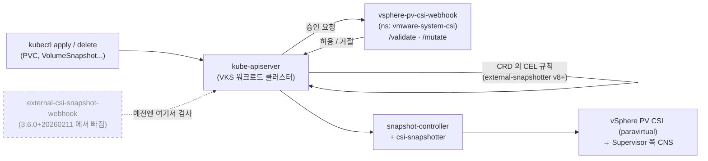

# 09. vSphere PV CSI Webhook (와 빠진 스냅숏 검증 웹훅)

> 커리큘럼: [CURRICULUM.md](CURRICULUM.md) · 앞 절: [08. Velero](08-velero.md) · 작성 2026-11-01
> 등급: **[근거]** 출처에 그대로 있는 것, **[추론]** 여러 출처를 엮어 직접 내린 결론.
> 기준 판: VKS Add-ons `3.8.0+20261021` (9.1 VKS Add-ons Release Notes, Last Updated October 26, 2026, 2026-11-01 확인). 판 호환은 이 문서에서 정리하지 않는다. [공식 호환 매트릭스](https://interopmatrix.broadcom.com/)와 릴리스 노트를 직접 볼 것.

이 애드온은 VKS 클러스터 안에서 **PVC·스냅숏 요청을 받아 「vSphere 에서 안 되는 일」을 미리 거절하는 승인 웹훅**이다. 스냅숏을 뜨는 주체(CSI 드라이버, snapshot-controller)는 따로 있고, 이 웹훅은 그 앞에서 문지기 노릇만 한다.

CSI 스냅숏 자체(VolumeSnapshotClass, VolumeSnapshot, 스냅숏에서 PVC 복원)는 루트 [`../velero-csi-backup/03_csi_snapshot_vsphere.md`](../velero-csi-backup/03_csi_snapshot_vsphere.md)에 있다. 이 절은 세 가지만 판다. 첫째, 공식 문서는 스냅숏 전제로 웹훅 **두 개**를 깔라고 하는데, 그중 External CSI Snapshot Validation Webhook 은 `3.6.0+20260211` 저장소에서 빠졌다는 점. 둘째, 남은 vSphere PV CSI Webhook 이 실제로 무엇을 거절하는지(업스트림 소스로 확인). 셋째, 설치 문서의 네임스페이스·단계 번호가 서로 맞지 않는 곳.

---

## 1. 무엇을 하는가



- [근거] vSphere pvCSI 웹훅은 CSI 승인 요청에 답하는 call-back 구성 요소로, PVC·PV·StorageClass 같은 쿠버네티스 객체를 검증한다. Supervisor 에는 자동으로 깔리고, 이 설치 문서는 VKS 클러스터에만 해당한다. (Install and Deploy the vSphere pvCSI Webhook, 9.0, Last Updated October 6, 2026)
- [근거] External CSI snapshot webhook 은 오픈소스 구성 요소로, 볼륨 스냅숏 객체를 검증한다. 이것도 Supervisor 에는 자동으로 깔린다. (Install and Deploy External CSI Snapshot Webhook, 9.0)
- [근거] 「CSI snapshot 기능은 VKS 패키지로 제공된다」. 요구 사항은 표준 패키지 저장소 v2023.9.19 이상, cert-manager 패키지, vsphere-pv-csi-webhook, external-csi-snapshot-webhook 넷이다. 환경 조건은 vSphere 8.0 Update 2 이상, CSI 스냅숏을 지원하는 VKr(8.0.2 이상에서 v1.26.5 이상). (Creating Snapshots in a VKS Cluster, 9.0)

### 웹훅이 실제로 거절하는 것 (업스트림 소스)

VKS 의 웹훅은 업스트림 [kubernetes-sigs/vsphere-csi-driver](https://github.com/kubernetes-sigs/vsphere-csi-driver) 의 `pkg/syncer/admissionhandler` 에서 「Guest」 클러스터 갈래로 도는 코드다. 아래는 업스트림 `v3.8.0`(2026-10-20) 태그를 읽은 것이다.

| 요청 | 거절 조건 | 거절 문구 |
|---|---|---|
| PVC 크기 늘리기(Update) | 그 PVC 로 만든 VolumeSnapshot 이 있을 때 | `Expanding volume with snapshots is not allowed` |
| PVC 삭제 | 스냅숏이 있고, PV 의 reclaimPolicy 가 `Delete` 일 때 | `Deleting volume with snapshots is not allowed` |
| VolumeSnapshotClass·VolumeSnapshot·VolumeSnapshotContent | 드라이버가 `csi.vsphere.vmware.com` 인데 블록 볼륨 스냅숏 기능이 꺼져 있을 때 | `CSI Snapshot feature is not supported for vSphere driver on either Supervisor cluster or Guest cluster. ...` |
| VolumeSnapshot 삭제 | linked clone 기능이 켜져 있고 그 스냅숏으로 만든 linked clone PVC 가 있을 때 | `deleting volumesnapshot from which linked clones are created is not allowed. ...` |
| linked clone PVC 만들기 | 원본 스냅숏이 준비 안 됨, StorageClass 가 없거나 다름 등 | 여러 문구 |

- [근거] 검증은 `/validate`, 변경은 `/mutate` 경로에 붙는다. 변경 웹훅은 PVC 생성 때 linked clone 주석(`csi.vsphere.volume/fast-provisioning`)이 있으면 `linked-clone` 라벨을 붙이는 일만 한다. (`pvcsi_admissionhandler.go`, `validatepvc.go`, `validatesnapshotoperation.go`, `common/constants.go`, v3.8.0)
- [근거] PVC 검사는 RWO 블록 볼륨에만 걸린다. 파일 볼륨이면 그냥 통과시킨다. 네임스페이스가 지워지는 중이면 PVC·스냅숏 삭제를 통과시킨다. (`validatepvc.go`, v3.8.0)
- [근거] 스냅숏 목록이나 reclaimPolicy 를 읽다가 **오류가 나면 거절하지 않고 통과시킨다**(코드 주석 「skip validation if there is any error ...」). (같은 파일)
- [근거] VolumeSnapshot 검사는 `volumeSnapshotClassName` 이 적혀 있을 때만 클래스를 찾아 본다. 코드 주석은 「지금 vSphere 드라이버의 스냅숏 클래스는 default 로 표시되지 않는다」고 적는다. (`validatesnapshotoperation.go`, v3.8.0)
- [근거] Broadcom 문서의 제한 사항과 겹친다: 스냅숏이 딸린 볼륨은 지우거나 늘릴 수 없으니 스냅숏부터 지울 것. 블록 볼륨만 스냅숏·복원이 되고 vSphere 파일 볼륨은 안 된다. (Creating Snapshots in a VKS Cluster, Guidelines and Limitations)

[추론] 그러니 이 웹훅이 없으면 위 요청이 API 단계에서 막히지 않고, 아래 CSI 드라이버·CNS 단계까지 내려가 실패하거나 PVC 가 `Resizing`·`Terminating` 에 머무는 식으로 늦게 드러난다. 웹훅은 「안 되는 일을 빨리, 읽을 수 있는 문구로 거절」하는 장치다. VKS 클러스터에서 그 증상을 직접 재 보지는 못했다(6절 참고).

### 스냅숏 검증 웹훅은 왜 빠졌나

- [근거] External CSI Snapshot Validation Webhook `7.0.1+vmware.1-tkg.1`·`6.1.0+vmware.1-tkg.6` 은 `3.6.0+20260211` 의 「Packages Removed」 목록에 있다. 그 뒤 판의 지원 표 어디에도 없다. 같은 목록에 vSphere PV CSI Webhook `3.5.0+vmware.3-vks.1` 도 있지만, 이쪽은 옛 판 하나가 빠진 것이고 패키지는 남았다. (9.1 VKS Add-ons Release Notes)
- [근거] 업스트림 external-snapshotter 는 v8.0.0(2024-05-23)에서 VolumeSnapshot·VolumeSnapshotContent 검증을 CRD 의 CEL 검증 규칙으로 옮기고 웹훅을 폐기 예고했고, v8.2.0(2024-12-10)에서 웹훅을 없앴다. 웹훅이 막던 「한 드라이버에 default VolumeSnapshotClass 가 여러 개」인 경우는, 이제 만들 때가 아니라 **동적 프로비저닝 때** 오류가 난다. ([v8.0.0](https://github.com/kubernetes-csi/external-snapshotter/releases/tag/v8.0.0), [v8.2.0](https://github.com/kubernetes-csi/external-snapshotter/releases/tag/v8.2.0) 릴리스 노트)
- [근거] v8.4.0 CRD 의 CEL 규칙: VolumeSnapshot 은 `persistentVolumeClaimName`·`volumeSnapshotContentName` 중 정확히 하나, 둘 다 바꿀 수 없음, `volumeSnapshotClassName` 은 빈 문자열 금지. VolumeSnapshotContent 는 `volumeHandle`·`snapshotHandle` 중 정확히 하나, 둘 다 불변, `sourceVolumeMode` 불변, `volumeSnapshotRef` 는 name·namespace 둘 다. VolumeSnapshotClass CRD 에는 CEL 규칙이 없다. ([client/config/crd](https://github.com/kubernetes-csi/external-snapshotter/tree/v8.4.0/client/config/crd), v8.4.0)
- [추론] Broadcom 은 뺀 이유를 적지 않았다. 업스트림이 웹훅을 없앤 흐름과 시기가 맞으니, 새 VKr 의 스냅숏 CRD 가 CEL 규칙을 갖는 판이라 따로 웹훅이 필요 없어졌다고 읽는 게 자연스럽다. 확인하려면 클러스터에서 CRD 에 `x-kubernetes-validations` 가 있는지 본다(3.4).

### 판과 지원 등급 (3.8.0+20261021 기준)

[근거] 지원 표의 vSphere PV CSI Webhook 은 **`3.9.0+vmware.1-vks.1` 한 판**, Product 등급, Kubernetes v1.33~v1.37 VKr 다섯 칸 모두 Yes. 바뀐 점은 「K8s 업데이트, Go 의존성·기본 이미지 갱신(취약점)」이고 업그레이드 경로는 「3.8.0+vmware.3-vks.1 에서 매끄러운 업그레이드」다. (9.1 VKS Add-ons Release Notes)

| 저장소 판 | 새로 들어온 웹훅 판 | 적힌 변화 |
|---|---|---|
| 3.5.0+20251022 | 3.6.0+vmware.1-vks.1 | Add-on Management 지원, linked clone 볼륨 지원을 위한 배포 변경, LimitRange·기본 requests 설정 |
| 3.5.0+20251218 | 3.6.0+vmware.2-vks.1 | 취약점 갱신 |
| 3.6.0+20260211 | 3.7.0+vmware.1-vks.1 | 취약점 갱신 (같은 판에서 스냅숏 검증 웹훅 제거) |
| 3.6.0+20260416 | 3.7.0+vmware.2-vks.1 | 취약점 갱신 |
| 3.7.0+20260618 | 3.8.0+vmware.1-vks.1 | Kubernetes v1.34 이상에서 priority class 설정 지원 |
| 3.7.0+20260723 | 3.8.0+vmware.2-vks.1 | 취약점 갱신 |
| 3.7.0+20260827 | 3.8.0+vmware.3-vks.1 | 취약점 갱신 |
| 3.8.0+20261021 | 3.9.0+vmware.1-vks.1 | K8s 업데이트, 취약점 갱신 |

근거: [근거] 각 판의 What's New 와 지원 표(9.1 VKS Add-ons Release Notes). 표로 묶은 것은 [추론]. 3.7.0+20260924 에는 웹훅의 새 판이 없다.

---

## 2. VKS 에서 어떻게 들어가는가

두 경로의 공통 바탕은 [00절](00-repository-and-install-paths.md)에, Carvel 기초는 [`../carvel-kapp.md`](../carvel-kapp.md)에 있다.

| | 레거시 패키지 (VCF CLI) | Add-on Management |
|---|---|---|
| 공식 안내 | Deploy vSphere pvCSI Webhook (9.0) | 이 웹훅 전용 문서 없음 |
| 컨텍스트 | 워크로드 클러스터 [추론] | Supervisor, 클러스터 네임스페이스 |
| 패키지·애드온 이름 | `vsphere-pv-csi-webhook.tanzu.vmware.com` | `vsphere-pv-csi-webhook` |
| 설치 네임스페이스 | `vsphere-pv-csi` 패키지와 같은 곳, 보통 `vmware-system-csi` | VKS 가 정함 [추론] |
| 확인 | `kubectl get apps -A` 가 `Reconcile Succeeded` | `ClusterAddon` 상태 |

- [근거] 레거시 경로: 저장소가 없으면 `vcf package repository add <이름> --url <저장소> --namespace tkg-system`, 그다음 `vcf package available list vsphere-pv-csi-webhook.tanzu.vmware.com -A` 로 판을 보고 `vcf package install vsphere-pv-csi-webhook --package vsphere-pv-csi-webhook.tanzu.vmware.com --version <판> --namespace <대상>`. 대상 네임스페이스는 **vsphere-pv-csi 패키지가 깔린 네임스페이스와 같아야 하고** 미리 있어야 한다(예: `kubectl create namespace vmware-system-csi`). (Prepare / Deploy vSphere pvCSI Webhook, 9.0)
- [근거] 패키지 이름 접미어가 다른 애드온의 `.kubernetes.vmware.com` 이 아니라 **`.tanzu.vmware.com`** 이다. 스냅숏 검증 웹훅도 `external-csi-snapshot-webhook.tanzu.vmware.com` 이었다. (같은 문서들)
- [근거] Add-on Management 의 애드온 목록 예시에 `vsphere-pv-csi-webhook` 이 있다. (View Available Add-ons Using Kubectl, 9.0, [00절](00-repository-and-install-paths.md) 2절에 정리) 3.6.0+vmware.1-vks.1 에서 「Add-on management system 지원」이 들어왔다. (9.1 릴리스 노트)
- [근거] Standard Packages 표의 이 패키지 Instructions 칸은 「Creating Snapshots in a VKS Cluster」로 간다. Package Reference(values 표)는 「Standard Package Reference」 목차에 없다. (Standard Packages for VKS Clusters, Standard Package Reference, 9.0)

### 판 고르기와 업그레이드

- [근거] 3.8.0+20261021 에는 한 판만 있으니 고를 것이 없다. 3.8.0+vmware.3-vks.1 에서 바로 올릴 수 있다. (9.1 릴리스 노트)
- [근거] 저장소에서 빠질 판이 깔려 있으면, 저장소를 올리기 **전에** 패키지를 새 판으로 올리라고 한다(3.5.0+20251022 의 Packages Removed 안내 문장). (같은 출처)
- [추론] 이 웹훅은 PVC 를 다루는 모든 요청 앞에 서므로, 업그레이드 중 파드가 잠깐 없을 때의 동작은 웹훅 설정의 `failurePolicy` 에 달렸다. 문서에 값이 없으니 3.4 의 명령으로 클러스터에서 직접 본다.

---

## 3. 실습

### 3.1 판과 설정 칸 보기

```bash
# 레거시 경로 (워크로드 클러스터 컨텍스트)
vcf package available list vsphere-pv-csi-webhook.tanzu.vmware.com -A
# 기대: 3.9.0+vmware.1-vks.1 (저장소가 3.8.0+20261021 일 때) [추론]
vcf package available get vsphere-pv-csi-webhook.tanzu.vmware.com/3.9.0+vmware.1-vks.1 \
  --values-schema -n tkg-system
# Package Reference 가 없으니 설정 칸은 여기서 본다 [추론]

# Add-on 경로 (Supervisor 컨텍스트)
kubectl get addonreleases -n vmware-system-vks-public \
  -l addon.kubernetes.vmware.com/addon-name=vsphere-pv-csi-webhook
```

[추론] 릴리스 노트가 말하는 LimitRange·기본 requests·priority class 설정이 values 의 어떤 키인지는 공개 문서에 없다. 위 `--values-schema` 출력으로 키 이름을 확인한 뒤에만 values 파일을 만든다. 여기서 키를 지어내지 않는다.

### 3.2 레거시 방식으로 깔기 (워크로드 클러스터 컨텍스트)

```bash
kubectl get ns vmware-system-csi            # vsphere-pv-csi 가 도는 곳인지 먼저 확인
vcf package installed list -A | grep -i csi # vsphere-pv-csi 패키지의 네임스페이스 확인 [추론]

vcf package install vsphere-pv-csi-webhook \
  --package vsphere-pv-csi-webhook.tanzu.vmware.com \
  --version 3.9.0+vmware.1-vks.1 \
  --namespace vmware-system-csi

vcf package installed get vsphere-pv-csi-webhook --namespace vmware-system-csi
kubectl get apps -A | grep pv-csi-webhook
# 기대: vsphere-pv-csi-webhook ... Reconcile succeeded
kubectl get app vsphere-pv-csi-webhook -n vmware-system-csi -o yaml   # 실패면 status 를 본다
```

[근거] 명령 모양은 Deploy vSphere pvCSI Webhook(9.0) 그대로이고, `--version`·`--namespace` 에 값만 넣었다.

### 3.3 Add-on 방식 (Supervisor 컨텍스트)

```yaml
# addoninstall-pvcsi-webhook.yaml  (클러스터 네임스페이스 test-ns 에 만든다)
apiVersion: addons.kubernetes.vmware.com/v1alpha1
kind: AddonInstall
metadata:
  name: wl-antrea-vsphere-pv-csi-webhook
  namespace: test-ns
spec:
  addonRef:
    name: vsphere-pv-csi-webhook
  clusters:
  - selector:
      matchLabels:
        cluster.x-k8s.io/cluster-name: wl-antrea
```

```bash
kubectl apply -f addoninstall-pvcsi-webhook.yaml
kubectl get clusteraddon -n test-ns | grep pv-csi-webhook
```

[추론] 뼈대는 [00절](00-repository-and-install-paths.md) 2절의 AddonInstall 예시(Install an Add-on Using Kubectl, 9.0)에서 `addonRef.name` 만 바꿨다. 이 웹훅용 Add-on 설치 문서는 9.0 목차에 없으므로 `kubectl explain addoninstall.spec` 으로 먼저 확인한다. VCF CLI 를 쓰면 [08절](08-velero.md) 3.2 처럼 `vcf addon install create vsphere-pv-csi-webhook --cluster-name wl-antrea -n test-ns ...` 모양이 된다. AddonRelease 이름은 3.1 의 출력에서 가져온다.

### 3.4 깔린 뒤 확인 (워크로드 클러스터 컨텍스트)

```bash
kubectl get pods -n vmware-system-csi | grep -i webhook
# 기대: vsphere-pv-csi-webhook-<hash> Running

# 어떤 웹훅 설정이 걸렸는지, 실패하면 막는지(failurePolicy) [추론]
kubectl get validatingwebhookconfigurations,mutatingwebhookconfigurations | grep -i -E "csi|snapshot"
kubectl get validatingwebhookconfiguration <위에서 찾은 이름> \
  -o jsonpath='{range .webhooks[*]}{.name}{"\t"}{.failurePolicy}{"\t"}{.rules[*].resources}{"\n"}{end}'

# 스냅숏 CRD 가 CEL 규칙을 갖는지 (스냅숏 검증 웹훅이 필요 없는지)
kubectl get crd volumesnapshots.snapshot.storage.k8s.io \
  -o jsonpath='{.metadata.annotations.snapshot\.storage\.kubernetes\.io/bundle-version}{"\n"}'
kubectl get crd volumesnapshots.snapshot.storage.k8s.io -o yaml | grep -c "x-kubernetes-validations"
# 기대: 판이 v8.x 이고 개수가 0 보다 크다 [추론]

kubectl get volumesnapshotclass
# 기대(문서 예시): volumesnapshotclass-delete  csi.vsphere.vmware.com  Delete
```

### 3.5 거절을 눈으로 보기

공식 예시(Create a Dynamically Provisioned Snapshot, Restore a Volume Snapshot, 9.0)의 PVC·스냅숏을 그대로 쓴다. StorageClass 이름(`gc-storage-profile`)은 자기 환경의 `kubectl get sc` 결과로 바꾼다.

```bash
cat <<'EOF' | kubectl apply -f -
apiVersion: v1
kind: PersistentVolumeClaim
metadata:
  name: example-raw-block-pvc
spec:
  volumeMode: Block
  accessModes: ["ReadWriteOnce"]
  resources: {requests: {storage: 1Gi}}
  storageClassName: gc-storage-profile
---
apiVersion: snapshot.storage.k8s.io/v1
kind: VolumeSnapshot
metadata:
  name: example-raw-block-snapshot
spec:
  volumeSnapshotClassName: volumesnapshotclass-delete
  source:
    persistentVolumeClaimName: example-raw-block-pvc
EOF
kubectl get volumesnapshot example-raw-block-snapshot   # READYTOUSE true 까지 기다린다

# 1) 스냅숏이 딸린 PVC 늘리기
kubectl patch pvc example-raw-block-pvc -p '{"spec":{"resources":{"requests":{"storage":"2Gi"}}}}'
# 기대: admission webhook ... denied the request: Expanding volume with snapshots is not allowed [추론]

# 2) 스냅숏이 딸린 PVC 지우기 (reclaimPolicy Delete)
kubectl delete pvc example-raw-block-pvc
# 기대: ... Deleting volume with snapshots is not allowed [추론]

# 정리: 스냅숏부터, 그다음 PVC
kubectl delete volumesnapshot example-raw-block-snapshot
kubectl delete pvc example-raw-block-pvc
```

[추론] 기대 문구는 업스트림 v3.8.0 소스의 상수다. VKS 의 3.9.0+vmware.1-vks.1 이미지가 같은 문구를 내는지는 클러스터에서 확인하지 못했다.

### 3.6 클러스터 없이 확인하는 법

웹훅이 무엇을 거절하는지와 스냅숏 CRD 의 CEL 규칙은 소스만으로 볼 수 있다. 이 절은 아래 명령으로 확인했다(2026-11-01, 맥 미니, 클러스터 없음).

```bash
R=https://raw.githubusercontent.com/kubernetes-sigs/vsphere-csi-driver/v3.8.0/pkg/syncer/admissionhandler
curl -s $R/validatepvc.go | grep -n 'ErrorMessage *='
# 실측: ExpandVolumeWithSnapshotErrorMessage = "Expanding volume with snapshots is not allowed"
#       DeleteVolumeWithSnapshotErrorMessage = "Deleting volume with snapshots is not allowed" 외 2줄
curl -s $R/pvcsi_admissionhandler.go | grep -n 'WebhookPath *='
# 실측: PVCSIValidationWebhookPath = "/validate", PVCSIMutationWebhookPath = "/mutate"

S=https://raw.githubusercontent.com/kubernetes-csi/external-snapshotter/v8.4.0/client/config/crd
curl -s $S/snapshot.storage.k8s.io_volumesnapshots.yaml | grep -c 'rule:'
# 실측: 6
curl -s $S/snapshot.storage.k8s.io_volumesnapshotclasses.yaml | grep -c 'rule:'
# 실측: 0
```

---

## 4. 업스트림 설치와 다른 점

루트 [`../k8s-addon.sh`](../k8s-addon.sh)에는 이 두 웹훅이 없다. 업스트림에서 비교할 대상은 Helm 차트가 아니라 매니페스트다.

| | VKS 애드온 | 업스트림 |
|---|---|---|
| vSphere 웹훅 | Guest(paravirtual) 갈래, 패키지로 배포 | vsphere-csi-driver 저장소의 매니페스트. Vanilla 클러스터는 같은 바이너리가 다른 갈래(`/validate` 하나)로 돈다 |
| 스냅숏 검증 | 3.6.0+20260211 부터 패키지 없음 | v8.2.0 부터 웹훅 없음, CRD 의 CEL 규칙 |
| 인증서 | 전제 조건에 cert-manager 패키지 | 업스트림 웹훅 예시는 직접 만든 인증서 Secret |
| snapshot-controller·CRD | VKr 에 들어 있다 [추론] | 사용자가 따로 깐다 |

- [근거] 업스트림 웹훅 코드는 클러스터 종류(`Workload`=Supervisor, `Guest`=VKS, `Vanilla`)를 보고 갈래를 고른다. Guest 갈래만 linked clone·PVC 변경 웹훅을 띄운다. (`admissionhandler.go`, v3.8.0)
- [근거] Broadcom 문서의 전제 조건에 cert-manager 패키지가 있다. (Creating Snapshots in a VKS Cluster) cert-manager 는 [01절](01-cert-manager.md).
- [추론] snapshot-controller 와 스냅숏 CRD 가 VKr 에 들어 있다는 것은, 설치 문서가 그 둘을 깔라는 단계를 두지 않고 `kubectl get volumesnapshotclass` 에 기본 클래스가 이미 있다고 보여 주는 데서 읽었다. 업스트림 vanilla 클러스터라면 [`../velero-csi-backup/03_csi_snapshot_vsphere.md`](../velero-csi-backup/03_csi_snapshot_vsphere.md)의 필수 구성 요소를 직접 깐다.

---

## 5. 흔한 실수

1. **빠진 스냅숏 검증 웹훅을 찾느라 시간을 쓴다.** 9.0 「Creating Snapshots」의 Requirements 는 아직 external-csi-snapshot-webhook 설치를 요구하고 설치 문서도 남아 있지만, 그 패키지는 3.6.0+20260211 에서 빠졌다. 3.8.0+20261021 저장소에서 `vcf package available list` 에 안 나오는 게 정상이다. [근거] 릴리스 노트 Packages Removed, [추론] 문서가 못 따라간 것.
2. **웹훅을 다른 네임스페이스에 깐다.** 문서는 대상 네임스페이스가 vsphere-pv-csi 패키지와 같아야 한다고 하면서, 같은 문단에서 `--namespace` 를 빼면 「기본 네임스페이스, 예를 들어 `vmware-system-csi`」에 깔린다고 쓴다. [추론] VCF CLI(tanzu package 계열)는 `--namespace` 를 빼면 `default` 를 쓰는 것으로 알고 있어, 이 문장을 믿고 빼면 엉뚱한 곳에 깔릴 수 있다. 항상 명시한다.
3. **준비 문서의 「Step 3」을 찾는다.** 두 Deploy 문서가 「Prepare ... 의 Step 3 을 보라」고 하지만 Prepare 문서는 두 단계뿐이다. 저장소 추가는 Step 2 다. 또 vSphere 쪽 Prepare 는 `--namespace tkg-system`, 스냅숏 쪽은 `REPOSITORY-NAMESPACE` 로 적는다. [근거] 각 문서. 저장소는 [00절](00-repository-and-install-paths.md)대로 `tkg-system` 에 둔다.
4. **「Log in to the Supervisor」 다음에 바로 패키지 명령을 친다.** 두 Prepare 문서 1단계가 Supervisor 로그인인데, 레거시 패키지 명령은 워크로드 클러스터 안의 kapp-controller 에 리소스를 만든다. [추론] Supervisor 로그인은 워크로드 클러스터 kubeconfig 를 얻기 위한 것이고, 명령 전에 컨텍스트를 워크로드 클러스터로 바꾼다([00절](00-repository-and-install-paths.md) 표).
5. **VolumeSnapshotClass 를 새로 만든다.** 공식 문서는 새 클래스를 만들지 말고 미리 있는 클래스만 쓰라 하고, 그 클래스는 `Delete` deletionPolicy 만 지원하며 `Retain` 클래스는 지원하지 않는다. [근거] Create Snapshots in a VKS Cluster.
6. **스냅숏에 default 클래스를 기대한다.** 웹훅 소스 주석대로 vSphere 클래스는 default 표시가 없으니 `volumeSnapshotClassName` 을 적는다. 스냅숏 검증 웹훅이 없어진 뒤로는 default 클래스가 둘이어도 만들 때는 안 막히고 프로비저닝 때 실패한다. [근거] vsphere-csi-driver 소스, external-snapshotter v8.2.0.
7. **웹훅이 있으니 안전하다고 믿는다.** 웹훅은 스냅숏 목록·reclaimPolicy 를 못 읽으면 통과시킨다. [근거] 소스 주석. 거절이 안 났다고 「스냅숏이 없다」는 뜻은 아니다. 지우기 전에 `kubectl get volumesnapshot -n <ns>` 로 직접 본다.
8. **다른 데이터스토어로 복원한다.** 스냅숏에서 만드는 PVC 는 원본과 같은 데이터스토어여야 하고, 대상 PVC 의 StorageClass(와 topology 조건)가 원본 데이터스토어를 가리켜야 한다. 아니면 `failed to get the compatible datastore for create volume from snapshot` 으로 실패한다. 크기도 스냅숏과 맞춘다. [근거] Creating Snapshots, Guidelines and Limitations.
9. **릴리스 노트의 업스트림 링크로 판을 대조한다.** 3.9.0+vmware.1-vks.1 의 「Upstream Release Notes」는 `vsphere-csi-driver/releases/tag/v3.9.0` 으로 가는데, 2026-11-01 기준 그 주소는 404 이고 업스트림 최고 판은 v3.8.0(2026-10-20)이다. [근거] `curl -sI` 결과, GitHub releases API. [추론] 패키지 판 번호가 업스트림 태그와 1:1 은 아니다.
10. **사전 프로비저닝 예시를 그대로 복사한다.** Create a Pre-Provisioned Snapshot 의 확인 명령은 `kubecti getvolumesnapshot` 으로 오타가 나 있고, 출력 예시의 SNAPSHOTCONTENT 칸은 `static-block-snapsnotcontent` 다. 올바른 명령은 `kubectl get volumesnapshot static-block-snapshot`. [근거] 해당 문서.

---

## 6. 확인 문제

1. 3.8.0+20261021 저장소를 붙인 새 VKS 클러스터에서 동료가 「공식 문서 Requirements 대로 external-csi-snapshot-webhook 을 깔아야 하는데 패키지가 안 보인다, 저장소가 깨졌다」고 한다. 무엇이라 답하고, 그 클러스터에서 스냅숏 객체 검증이 어디서 이뤄지는지 확인하는 명령을 적어라.
2. 운영 중인 StatefulSet 의 PVC 를 20Gi → 50Gi 로 늘리는 `kubectl patch` 가 승인 단계에서 거절됐다. 어떤 문구가 나왔을 가능성이 높고, 그 원인과 안전한 진행 순서를 적어라. 백업 소프트웨어를 쓰는 환경이라면 무엇을 같이 볼지도 적어라.
3. 레거시 경로로 `vcf package install vsphere-pv-csi-webhook --package vsphere-pv-csi-webhook.tanzu.vmware.com --version 3.9.0+vmware.1-vks.1` 을 `--namespace` 없이 실행했다. 어떤 문제가 생길 수 있고, 무엇을 확인하고 어떻게 바로잡는지 적어라.

<details>
<summary>풀이</summary>

1. 저장소는 정상이다. External CSI Snapshot Validation Webhook 은 3.6.0+20260211 의 Packages Removed 에 들어가 그 뒤 저장소에 없고, 9.0 Requirements 가 그걸 아직 반영하지 못했다. 업스트림도 v8.2.0 에서 웹훅을 없애고 CRD 의 CEL 규칙으로 옮겼다. 확인: `kubectl get crd volumesnapshots.snapshot.storage.k8s.io -o yaml | grep -c x-kubernetes-validations`(0 보다 커야 함)와 bundle-version 주석, 그리고 `kubectl get validatingwebhookconfigurations | grep -i -E "csi|snapshot"` 로 vSphere PV CSI 웹훅이 걸려 있는지.
2. `Expanding volume with snapshots is not allowed`. 그 PVC 로 만든 VolumeSnapshot 이 남아 있어서다. vSphere 는 스냅숏이 딸린 볼륨을 늘리거나 지울 수 없다. 순서: `kubectl get volumesnapshot -n <ns>` 로 그 PVC 의 스냅숏을 찾고, 필요하면 먼저 다른 방법(Velero 데이터 이동 백업 등, [08절](08-velero.md))으로 데이터를 지킨 뒤 스냅숏을 지우고 늘린다. 백업 소프트웨어는 업로드 뒤 스냅숏을 지우도록(`Delete`) 설정됐는지, 실패한 백업이 남긴 임시 PVC·VolumeSnapshot·VolumeSnapshotContent 가 없는지 본다(Best Practices for Using Third-Party Backup Software).
3. 웹훅은 vsphere-pv-csi 패키지와 같은 네임스페이스에 깔아야 한다. 문서는 빼면 `vmware-system-csi` 에 깔린다고 쓰지만 CLI 기본 네임스페이스는 `default` 일 수 있어, PackageInstall·웹훅이 다른 곳에 생기거나 필요한 Secret·ServiceAccount 를 못 찾아 Reconcile 이 실패할 수 있다. 확인: `vcf package installed list -A`, `kubectl get apps -A | grep pv-csi-webhook`. 바로잡기: `vcf package installed delete vsphere-pv-csi-webhook --namespace <잘못 깔린 곳>` 으로 지우고 `--namespace vmware-system-csi`(vsphere-pv-csi 와 같은 곳)를 명시해 다시 깐다.

</details>

---

## 7. 출처 (모두 2026-11-01 확인)

- Broadcom TechDocs, VCF 9.0 「Managing vSphere Kubernetes Service Clusters and Workloads」 (모두 Last Updated October 6, 2026)
  - [Creating Snapshots in a VKS Cluster](https://techdocs.broadcom.com/us/en/vmware-cis/vcf/vcf-service-administration-and-development/9-0/managing-vsphere-kuberenetes-service-clusters-and-workloads/creating-snapshots-in-tkg-service-clusters.html) — 전제·요구 사항·제한
  - [Install and Deploy External CSI Snapshot Webhook](https://techdocs.broadcom.com/us/en/vmware-cis/vcf/vcf-service-administration-and-development/9-0/managing-vsphere-kuberenetes-service-clusters-and-workloads/creating-snapshots-in-tkg-service-clusters/install-and-deploy-external-csi-snapshot-webhook.html) 과 그 아래 [Prepare](https://techdocs.broadcom.com/us/en/vmware-cis/vcf/vcf-service-administration-and-development/9-0/managing-vsphere-kuberenetes-service-clusters-and-workloads/creating-snapshots-in-tkg-service-clusters/install-and-deploy-external-csi-snapshot-webhook/prepare-a-tkg-service-cluster-for-installation-of-external-csi-snapshot-webhook.html)·[Deploy](https://techdocs.broadcom.com/us/en/vmware-cis/vcf/vcf-service-administration-and-development/9-0/managing-vsphere-kuberenetes-service-clusters-and-workloads/creating-snapshots-in-tkg-service-clusters/install-and-deploy-external-csi-snapshot-webhook/deploy-external-csi-snapshot-webhook.html)
  - [Install and Deploy the vSphere pvCSI Webhook](https://techdocs.broadcom.com/us/en/vmware-cis/vcf/vcf-service-administration-and-development/9-0/managing-vsphere-kuberenetes-service-clusters-and-workloads/creating-snapshots-in-tkg-service-clusters/install-and-deploy-vsphere-pvcsi-webhook.html) 과 그 아래 [Prepare](https://techdocs.broadcom.com/us/en/vmware-cis/vcf/vcf-service-administration-and-development/9-0/managing-vsphere-kuberenetes-service-clusters-and-workloads/creating-snapshots-in-tkg-service-clusters/install-and-deploy-vsphere-pvcsi-webhook/prepare-tkg-service-clusters-for-installation-of-vsphere-pvcsi-webhook.html)·[Deploy](https://techdocs.broadcom.com/us/en/vmware-cis/vcf/vcf-service-administration-and-development/9-0/managing-vsphere-kuberenetes-service-clusters-and-workloads/creating-snapshots-in-tkg-service-clusters/install-and-deploy-vsphere-pvcsi-webhook/deploy-vsphere-pvcsi-webhook.html)
  - [Create Snapshots in a VKS Cluster](https://techdocs.broadcom.com/us/en/vmware-cis/vcf/vcf-service-administration-and-development/9-0/managing-vsphere-kuberenetes-service-clusters-and-workloads/creating-snapshots-in-tkg-service-clusters/create-snapshots-in-tkg-service-clusters.html) 과 그 아래 [Dynamically Provisioned](https://techdocs.broadcom.com/us/en/vmware-cis/vcf/vcf-service-administration-and-development/9-0/managing-vsphere-kuberenetes-service-clusters-and-workloads/creating-snapshots-in-tkg-service-clusters/create-snapshots-in-tkg-service-clusters/create-a-dynamically-provisioned-snapshot-in-a-tkg-service-cluster.html)·[Pre-Provisioned](https://techdocs.broadcom.com/us/en/vmware-cis/vcf/vcf-service-administration-and-development/9-0/managing-vsphere-kuberenetes-service-clusters-and-workloads/creating-snapshots-in-tkg-service-clusters/create-snapshots-in-tkg-service-clusters/create-a-pre-provisioned-snapshot-in-a-tkg-service-cluster.html)·[Restore](https://techdocs.broadcom.com/us/en/vmware-cis/vcf/vcf-service-administration-and-development/9-0/managing-vsphere-kuberenetes-service-clusters-and-workloads/creating-snapshots-in-tkg-service-clusters/create-snapshots-in-tkg-service-clusters/restore-a-volume-snapshot-in-a-tkg-service-cluster.html)
  - [Best Practices for Using Third-Party Backup Software to Perform Volume Backup and Restore](https://techdocs.broadcom.com/us/en/vmware-cis/vcf/vcf-service-administration-and-development/9-0/managing-vsphere-kuberenetes-service-clusters-and-workloads/creating-snapshots-in-tkg-service-clusters/best-practices-for-backup-partner-integration.html)
  - [Standard Packages for VKS Clusters](https://techdocs.broadcom.com/us/en/vmware-cis/vcf/vcf-service-administration-and-development/9-0/managing-vsphere-kuberenetes-service-clusters-and-workloads/installing-standard-packages-on-tkg-service-clusters/standard-packages-for-tkg-service-clusters.html) — Instructions 칸
  - 9.1 문서 세트의 같은 경로(`9-0` → `9-1`)는 404 였다.
- [VKS Add-ons Release Notes (9.1)](https://techdocs.broadcom.com/us/en/vmware-cis/vcf/vcf-service-administration-and-development/9-1/release-notes/vks-addons-release-notes.html) (Last Updated October 26, 2026) — 3.5.0+20251022 ~ 3.8.0+20261021 의 vSphere PV CSI Webhook 칸, 지원 표, 3.6.0+20260211 Packages Removed
- 업스트림
  - [kubernetes-sigs/vsphere-csi-driver](https://github.com/kubernetes-sigs/vsphere-csi-driver) v3.8.0 (2026-10-20): [`pkg/syncer/admissionhandler`](https://github.com/kubernetes-sigs/vsphere-csi-driver/tree/v3.8.0/pkg/syncer/admissionhandler) 의 `admissionhandler.go`·`pvcsi_admissionhandler.go`·`validatepvc.go`·`validatesnapshotoperation.go`, [`pkg/csi/service/common/constants.go`](https://github.com/kubernetes-sigs/vsphere-csi-driver/blob/v3.8.0/pkg/csi/service/common/constants.go). `releases/tag/v3.9.0` 은 404.
  - [kubernetes-csi/external-snapshotter](https://github.com/kubernetes-csi/external-snapshotter) 릴리스 [v8.0.0](https://github.com/kubernetes-csi/external-snapshotter/releases/tag/v8.0.0) (2024-05-23), [v8.2.0](https://github.com/kubernetes-csi/external-snapshotter/releases/tag/v8.2.0) (2024-12-10), CRD [v8.4.0](https://github.com/kubernetes-csi/external-snapshotter/tree/v8.4.0/client/config/crd)
  - Kubernetes 문서 [Volume Snapshots](https://kubernetes.io/docs/concepts/storage/volume-snapshots/)

다음 절 [10. Harbor](CURRICULUM.md) 는 컨테이너 레지스트리 패키지를 다룬다.
