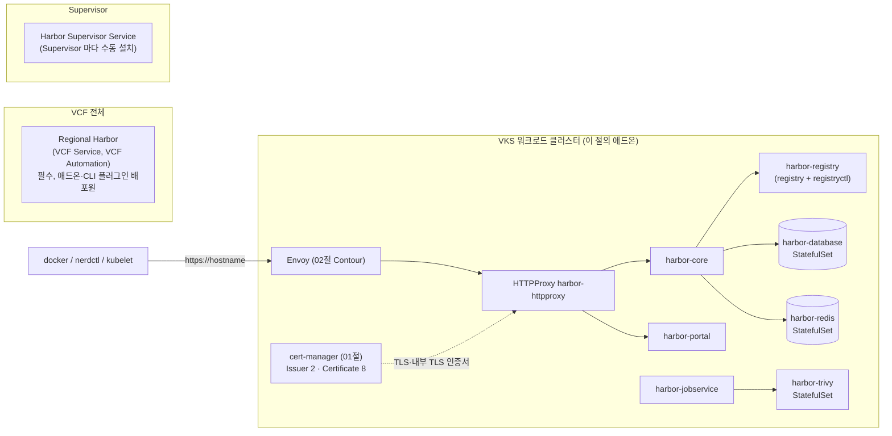

# 10. Harbor

> 커리큘럼: [CURRICULUM.md](CURRICULUM.md) · 앞 절: [09. vSphere PV CSI Webhook](09-vsphere-pv-csi-webhook.md) · 작성 2026-11-02
> 등급: **[근거]** 출처에 그대로 있는 것, **[추론]** 여러 출처를 엮어 직접 내린 결론.
> 기준 판: VKS Add-ons `3.8.0+20261021` (9.1 VKS Add-ons Release Notes, 2026-11-02 확인). 판 호환은 이 문서에서 정리하지 않는다. [공식 호환 매트릭스](https://interopmatrix.broadcom.com/)와 릴리스 노트를 직접 볼 것.

VKS 의 Harbor 애드온은 **워크로드 클러스터 안에 Harbor 레지스트리 한 벌(core·portal·registry·jobservice·DB·Redis·Trivy)을 까는 패키지**다. 밖으로는 Contour 의 HTTPProxy 로 노출하고, 인증서는 cert-manager 가 발급한다.

레지스트리·Harbor·Trivy 자체의 개념(프로젝트, 로봇 계정, 복제, 보관 정책, GC, 스캔)은 루트 [`../harbor-registry.md`](../harbor-registry.md)에 있다. 업스트림 Helm 설치도 그 문서의 [4-1절](../harbor-registry.md#4-1-helm으로-kubernetes에-설치-권장)에 있다(루트 [`../k8s-addon.sh`](../k8s-addon.sh)에는 Harbor 가 없다). 이 절은 그 위에서 세 가지만 판다. 첫째, VCF 안에는 **Harbor 가 세 가지 자리**에 있고 이 애드온은 그중 하나라는 점. 둘째, 공식 설치 문서는 2.14.2 까지인데 3.8.0+20261021 은 **2.15.4 한 판**만 준다는 점. 셋째, values 검증이 느슨해서 빠뜨려도 조용히 넘어가는 값이 있다는 점(패키지 원본을 받아 직접 렌더링해 확인).

---

## 1. 무엇을 하는가



[근거] 패키지가 까는 구성 요소 (Harbor 2.14.2 Package Reference, 9.0, Last Updated October 6, 2026):

| 이름 | 종류 | 하는 일 |
|---|---|---|
| harbor-core | Deployment | 전체 관리, 인증, 토큰 |
| harbor-database | StatefulSet | PostgreSQL |
| harbor-jobservice | Deployment | GC·스캔 같은 작업 예약 |
| harbor-portal | Deployment | 웹 UI |
| harbor-redis | StatefulSet | 캐시 |
| harbor-registry | Deployment | 이미지 배포(registry·registryctl 두 컨테이너) |
| harbor-trivy | StatefulSet | 선택, **기본 켜짐**. 이미지 스캔·SBOM |
| harbor-exporter | Deployment | 선택, **기본 꺼짐**. 메트릭 |

- [근거] 2.15.4 패키지를 기본값으로 렌더링하면 이미지는 `harbor-core`·`harbor-portal`·`registry-photon`·`harbor-registryctl`·`harbor-jobservice`·`harbor-db`·`trivy-adapter-photon`·**`valkey-photon`** 이다(모두 `v2.15.4`). values 키 이름은 여전히 `redis` 다. (3.6 실측, 2026-11-02)

### Harbor 가 세 군데 있다

[근거] VCF 9.1 문서는 Harbor 를 두 방식으로 나눈다. **Regional Harbor(VCF Service)** 는 VCF Automation 에서 한 개 이상의 리전에 까는 것으로, **VCF 에 필수**이며 Supervisor Service·VCF CLI 플러그인·VKS 애드온을 VKS 클러스터에 배포할 때 쓰는 중앙 레지스트리다. **Supervisor Service Harbor** 는 Supervisor 마다 손으로 까는 것으로, software depot 과 연결되지 않아 Regional Harbor 의 용도를 대신하지 못한다. (Installing and Configuring Harbor, 9.1 VCF Services Development Guide, Last Updated October 23, 2026)

| | 이 절의 애드온 | Supervisor Service Harbor | Regional Harbor |
|---|---|---|---|
| 깔리는 곳 | VKS 워크로드 클러스터 안 | Supervisor 하나 | VCF Automation 리전 |
| 누가 | 클러스터 운영자 | VI 관리자 | Provider 관리자 |
| 쓰임 | 그 클러스터(또는 팀)의 앱 이미지 | Supervisor 단위 레지스트리 | 애드온·플러그인 배포원, 필수 |

- [근거] 2.15.4 values 스키마의 `createNetworkPolicy` 설명은 「Harbor **Supervisor Service** 에서는 true 여야 한다」이고, `vmciRelayProxy` 는 「harbor-core 가 관리 네트워크의 서비스에 닿도록 VMCI 릴레이 프록시를 사이드카로 띄운다」이다. 둘 다 기본 false 다. (3.8.0+20261021 저장소의 `harbor.kubernetes.vmware.com` Package, 2026-11-02 확인)
- [추론] 애드온과 Supervisor Service Harbor 가 같은 Carvel 패키지 틀을 쓰는 것으로 보인다. 워크로드 클러스터에서는 두 값을 건드리지 않는다.

### 판과 지원 등급 (3.8.0+20261021 기준)

[근거] 9.1 VKS Add-ons Release Notes(Last Updated October 26, 2026, 2026-11-02 확인)의 저장소별 지원 표에 실린 Harbor 판(꼬리 `-vks.1` 생략)과 What's New 메모:

| 저장소 | 지원 표의 Harbor 판 | What's New 메모 |
|---|---|---|
| 3.5.0+20251022 | 2.14.0+vmware.1, 2.13.2+vmware.1 | |
| 3.5.0+20251218 | 2.14.1, 2.14.0, 2.13.3 (모두 +vmware.1) | |
| 3.6.0+20260211 | 2.14.2, 2.14.1, 2.14.0, 2.13.4 (모두 +vmware.1) | |
| 3.6.0+20260320 | 2.14.3, 2.14.2, 2.14.1, 2.14.0, 2.13.5 (모두 +vmware.1) | 2.13.5·2.14.3 추가. 표에는 `2.14.3_vmware.1` 로 적힘 |
| 3.6.0+20260416 · 20260521 | 2.14.3+vmware.2, 2.14.3+vmware.1, 2.14.2, 2.14.1, 2.14.0, 2.13.5+vmware.2 | 20260416 의 Packages Removed 에 2.13.5+vmware.1 |
| 3.7.0+20260618 | 2.15.1+vmware.1, 2.14.4+vmware.1 | 2.15.1 은 「2.14.x 에서 매끄러운 업그레이드」, K8s 1.34 이상에서 PriorityClass 강제 지원 |
| 3.7.0+20260723 | 2.15.2+vmware.1 | UI 를 Angular 21·Clarity v18·Node.js v22 로 올림, 「2.13+ 에서 매끄러운 업그레이드」 |
| 3.7.0+20260827 · 20260924 | 2.15.2+vmware.2 | 취약점 수정 |
| **3.8.0+20261021** | **2.15.4+vmware.1-vks.1** | Product 등급, Kubernetes 1.33~1.37 모두 Yes. 「2.14.x 에서 매끄러운 업그레이드」 |

- [근거] 3.7.0 묶음에는 Packages Removed 절이 없다. 그런데 3.7.0+20260618 표에서 2.13.x 와 2.14.0~2.14.3 이 한꺼번에 빠졌다. (같은 출처)
- [추론] Velero 1.16·1.17 과 같은 모양이다([08절](08-velero.md)). 2.13 이하를 쓰던 클러스터는 「제거」 공지를 기다리지 말고 저장소를 3.7.0 이후로 올리기 **전에** 2.14 로 올려 둔다.

- [근거] 저장소 안 Package 의 `releasedAt` 은 `2026-10-08T05:37:41Z`, `releaseNotes` 는 업스트림 v2.15.4 링크다. (3.8.0+20261021 저장소, 2026-11-02 확인)
- [근거] 업스트림 v2.15.3(2026-10-06)은 보안 수정 두 건이 **Breaking change** 였다. 사설·루프백·링크 로컬 주소로 가는 웹훅·Slack 전송을 기본 차단했고(GHSA-2phj-cp9f-qq6w), content trust 를 강제한 프로젝트에서 cosign·notation 이 서명 안 된 이미지를 당겨 오던 User-Agent 예외를 없앴다(GHSA-wrw5-gmvj-gf23). v2.15.4(2026-10-09)는 두 가지를 다시 **기본 허용**으로 돌렸다(#24082, #24086). Helm 차트 1.19.4(Harbor 2.15.4)는 「1.19.3(2.15.3)은 건너뛰라」고 적었다.
- [추론] VKS 애드온은 2.15.2+vmware.2 에서 2.15.3 을 거치지 않고 2.15.4 로 갔다. 그래서 VKS 사용자는 2.15.3 의 회귀를 만날 일이 없다. 다만 업스트림 Helm 으로 따로 깐 Harbor 는 판을 박을 때 1.19.3 을 피한다.
- [근거] 2026-11-02 기준 업스트림에는 v2.16.0-rc1(2026-10-27)과 v2.14.6(2026-10-23)이 나와 있다. VKS 저장소에는 아직 없다.

## 2. VKS 에서 어떻게 들어가는가

두 경로의 공통 바탕은 [00절](00-repository-and-install-paths.md)에, Carvel 기초는 [`../carvel-kapp.md`](../carvel-kapp.md)에 있다.

- [근거] 사전 조건은 General Requirements, Manage Package Repository, **Install Cert Manager, Install Contour** 다. (Install Harbor Registry 2.14.2, 9.0)
- [근거] 공식 Harbor 설치 문서 다섯 쪽(2.9.1·2.11.2·2.12.4·2.13.4·2.14.2)은 모두 **레거시 `vcf package install`** 만 안내한다. `vcf addon`·`AddonInstall` 은 한 번도 안 나온다. (2026-11-02 확인)
- [근거] 그런데 3.8.0+20261021 의 Harbor Package 에는 `addons.kubernetes.vmware.com/addon-config-definition` 어노테이션이 붙어 있다. 풀어 보면 `AddonConfigDefinition harbor.kubernetes.vmware.com.2.15.4---vmware.1-vks.1`(네임스페이스 `vmware-system-vks-public`)이고, values 를 워크로드 클러스터의 `vmware-system-tkg/<클러스터>-harbor` Secret 으로 내보내며 `vks_cluster_version` 을 Cluster 의 `spec.topology.version` 에서 채운다. (패키지 원본, 2026-11-02 확인)
- [추론] 그러니 Add-on Management 경로도 열려 있다. 명령 모양은 다른 애드온과 같다고 보고, 쓰기 전에 `vcf addon available list harbor` 로 Supervisor 에 AddonRelease 가 보이는지부터 확인한다. 이 경로를 안내하는 Broadcom 문서는 2026-11-02 기준 없다.

| | 레거시 패키지 (공식 안내) | Add-on Management |
|---|---|---|
| 컨텍스트 | 워크로드 클러스터 | Supervisor, 클러스터 네임스페이스 |
| 이름 | `harbor.kubernetes.vmware.com` | `harbor` [추론] |
| 판 지정 | `--version 2.15.4+vmware.1-vks.1` | AddonRelease 이름 [추론] |
| 설정값 | `--values-file harbor-data-values.yaml` | `--values-config-file` [추론] |
| 구성 요소가 뜨는 곳 | values `namespace`, 기본 `tanzu-system-registry` | 같음 |

### 판 고르기와 업그레이드

- [근거] 공식 문서는 「저장소의 최신 판을 쓰라」고 하고, 판 목록은 `vcf package available get harbor.kubernetes.vmware.com -n tkg-system` 또는 `kubectl -n tkg-system get packages | grep harbor` 로 본다. 업그레이드와 설정 변경은 같은 명령 `vcf package installed update` 이고, kapp-controller 가 반영하는 데 최대 5분 걸린다. (Install Harbor Registry 2.14.2)
- [근거] 3.8.0+20261021 의 2.15.4 는 「2.14.x 에서 매끄러운 업그레이드」만 적혀 있다. (9.1 릴리스 노트)
- [추론] 2.13 이하를 쓰고 있다면 2.14 를 거쳐 올린다. 3.7.0+20260723 의 2.15.2 는 「2.13+ 에서」라 적었지만 그 판은 3.8.0 지원 표에 없다. Harbor 는 판을 올릴 때 DB 스키마를 옮기므로, 올리기 전에 PostgreSQL PVC 를 Velero 로 떠 둔다([08절](08-velero.md)).
- [근거] 패키지에는 `add-rebase-rule-velero.yaml` 이라는 kapp 설정이 들어 있다. PVC 와 StatefulSet `volumeClaimTemplates` 의 `spec.dataSource`·`spec.selector`, 그리고 `velero.io/*` 라벨을 **기존 값 그대로 두라**는 규칙이다. 주석에 「CSI snapshot without/with data mover」라고 적혀 있다. (패키지 bundle `config/`, 2026-11-02 확인)
- [추론] Velero 로 Harbor PVC 를 되살린 뒤 kapp-controller 가 다시 맞추면서 그 PVC 를 지우고 새로 만드는 일을 막으려는 장치다. 08절의 CSI 스냅숏 + data mover 경로로 복구해도 패키지가 그걸 뒤엎지 않는다.

## 3. 실습

> 이름(`harbor.example.test`, `my-packages`)은 자리표시자다. 비밀번호·비밀키는 절대 문서나 리포에 적지 않는다. 판은 `2.15.4+vmware.1-vks.1` 이다.

### 3.1 values 파일 만들기 (워크로드 클러스터 컨텍스트)

```bash
# 판 확인
vcf package available get harbor.kubernetes.vmware.com -n tkg-system
# 기본값 파일 뽑기
vcf package available get harbor.kubernetes.vmware.com/2.15.4+vmware.1-vks.1 \
  --default-values-file-output harbor-data-values.yaml
# 스키마 보기
vcf package available get harbor.kubernetes.vmware.com/2.15.4+vmware.1-vks.1 --values-schema
```

비밀번호·비밀키 일곱 개는 패키지에 든 스크립트로 채운다. [근거] 공식 문서의 방법이다.

```bash
image_url=$(kubectl get package harbor.kubernetes.vmware.com.2.15.4+vmware.1-vks.1 -n tkg-system \
  -o jsonpath='{.spec.template.spec.fetch[0].imgpkgBundle.image}')
imgpkg pull -b "$image_url" -o /tmp/harbor-package
cp /tmp/harbor-package/config/scripts/generate-passwords.sh .
bash generate-passwords.sh harbor-data-values.yaml   # yq 필요, 파일에 바로 써 넣는다
```

- [근거] 2.15.4 의 스크립트는 인자 없이 돌리면 사용법만 보이고 0 이 아닌 값으로 끝난다. 예전엔 인자 없이 돌리면 새 비밀값 7개를 표준 출력에 찍었는데, 이를 CWE-532(로그로 비밀값 노출) 조치로 막았고 출력은 `--stdout` 을 줄 때만 경고와 함께 한다. 파일에 써 넣는 기본 경로는 `yq` 를 쓴다. (bundle `config/scripts/generate-passwords.sh` 주석)
- [추론] 문서는 `kubectl get package ...` 에 네임스페이스를 안 적었다. 패키지 저장소는 `tkg-system` 에 있으므로 `-n tkg-system` 을 붙인다.

그다음 손으로 고칠 값:

```yaml
hostname: harbor.example.test        # 빠뜨려도 오류가 안 난다. 5장 2번
port:
  https: 443                         # Envoy 를 NodePort 로 냈다면 그 포트
enableContourHttpProxy: true         # 기본값. nginx LB 와 동시에 true 불가
persistence:
  persistentVolumeClaim:
    registry:
      storageClass: <기본 StorageClass 가 없으면 이름>
      size: 100Gi                    # 기본 10Gi
    database:   {storageClass: <...>, size: 15Gi}
    jobservice: {jobLog: {storageClass: <...>}}
    redis:      {storageClass: <...>}
    trivy:      {storageClass: <...>}
```

### 3.2 레거시 방식으로 설치

```bash
vcf package install harbor --package harbor.kubernetes.vmware.com \
  --version 2.15.4+vmware.1-vks.1 --values-file harbor-data-values.yaml \
  --namespace my-packages
vcf package installed get harbor --namespace my-packages
# 기대: PACKAGE-VERSION 2.15.4+vmware.1-vks.1, STATUS Reconcile succeeded
kubectl get pod -n tanzu-system-registry
# 기대: harbor-core·database-0·jobservice·portal·redis-0·registry(2/2)·trivy-0 가 Running
```

설정만 바꿀 때:

```bash
vcf package installed update harbor --package harbor.kubernetes.vmware.com \
  --version 2.15.4+vmware.1-vks.1 --values-file harbor-data-values.yaml --namespace my-packages
```

### 3.3 Add-on 방식 [추론]

```bash
vcf context use supervisor:<클러스터-네임스페이스>
vcf addon available list harbor            # AddonRelease 가 보이는지부터
# 보이면 00절의 install 모양을 따른다. 안 보이면 3.2 로.
```

### 3.4 DNS·로그인·CA

```bash
kubectl get svc envoy -n tanzu-system-ingress \
  -o jsonpath='{.status.loadBalancer.ingress[0]}'      # Envoy 외부 IP
kubectl get httpproxy -n tanzu-system-registry           # 기대: harbor-httpproxy  harbor.example.test  harbor-tls  valid
kubectl get certificate -n tanzu-system-registry         # 기대: 8개 모두 READY True
```

- [근거] Envoy 가 LoadBalancer 면 그 External-IP 를, NodePort 면 워커 VM IP(`kubectl get virtualmachines` 를 Supervisor 컨텍스트에서)를 hostname 에 연결한다. DNS 레코드를 손으로 만들거나 ExternalDNS([03절](03-externaldns.md))를 쓴다. 로그인은 `admin` + `harborAdminPassword` 다. 프로젝트 화면의 **Registry Certificate** 에서 `ca.crt` 를 받아 클라이언트 신뢰 저장소에 넣는다. (Install Harbor Registry 2.14.2)
- [근거] 노드(containerd)가 이 Harbor 를 믿게 하는 법은 「Using Private Registries with VKS Clusters」에 따로 있다. 클러스터 스펙에 CA 를 넣는 일이라 이 절에서는 링크만 단다.

### 3.5 클러스터 없이 확인하는 법 (2026-11-02 실측)

3.8.0+20261021 저장소는 익명으로 당길 수 있다. `imgpkg` 가 있으면 `imgpkg pull -i projects.packages.broadcom.com/vsphere/supervisor/vks-standard-packages/3.8.0-20261021/vks-addons:3.8.0-20261021 -o repo` 한 줄이고, 없으면 레지스트리 API(토큰 → manifest → blob)로 받아도 된다.

```bash
# 1) 저장소 bundle 에서 Package 정의 보기
ls repo/packages/harbor.kubernetes.vmware.com/      # 2.15.4+vmware.1-vks.1.yml, metadata.yml
# 2) .imgpkg/images.yml 에서 harbor bundle 의 digest 를 찾아 같은 저장소 경로@digest 로 당긴다
# 3) ytt 로 렌더링 (ytt v0.55.4, 릴리스 sha256 대조)
ytt -f harbor-bundle/config/ --data-values-file test-values.yaml > out.yaml
grep '^kind:' out.yaml | sort | uniq -c
```

실측 결과(필수 일곱 값 + hostname 만 준 values):

| 종류 | 수 | | 종류 | 수 |
|---|---|---|---|---|
| Certificate | 8 | | Secret | 8 |
| Issuer | 2 | | Service | 7 |
| ConfigMap | 7 | | StatefulSet | 3 |
| Deployment | 4 | | PersistentVolumeClaim | 2 |
| HTTPProxy | 1 | | LimitRange · Namespace · kapp Config | 1 · 1 · 1 |

- [근거] 모두 `tanzu-system-registry` 에 생긴다. Certificate 8개는 CA·TLS·token service 와 **내부 TLS 다섯 개**(core·jobservice·portal·registry·trivy)다. 셀프 사인 CA Issuer 로 시작해 Harbor CA Issuer 를 만든다.
- [근거] 직접 만드는 PVC 는 registry·jobservice 둘뿐이고, database·redis·trivy 는 StatefulSet 의 `volumeClaimTemplates` 다. 기본 크기는 registry 10Gi, trivy 5Gi, 나머지 1Gi 다.
- [근거] `harbor-reg-creds` 는 `.dockerconfigjson: {}` 에 `secretgen.carvel.dev/image-pull-secret` 어노테이션이 붙은 빈 Secret 이다. 모든 Pod 가 imagePullSecrets 로 이걸 쓴다.
- [추론] secretgen-controller 가 클러스터의 이미지 pull 자격 증명을 여기 채우는 자리표시자다. 사설 레지스트리 미러를 쓰는 클러스터에서 Harbor Pod 만 ImagePullBackOff 이면 이 Secret 부터 본다.

## 4. 업스트림 Helm 설치와 다른 점

업스트림 설치 절차는 [`../harbor-registry.md` 4-1절](../harbor-registry.md#4-1-helm으로-kubernetes에-설치-권장)에 있다. [근거] 업스트림 차트 `goharbor/harbor-helm` 1.19.4 의 appVersion 은 2.15.4 로, 애드온과 같은 Harbor 판이다(2026-11-02 확인).

| | VKS 애드온 | 업스트림 Helm 차트 |
|---|---|---|
| 노출 | Contour `HTTPProxy` 가 기본, 또는 nginx+LoadBalancer, 또는 Ingress(`ingress.className`) | `expose.type` (ingress·clusterIP·nodePort·loadBalancer) |
| 인증서 | 비워 두면 **cert-manager 가 발급**(내부 TLS 포함) | `expose.tls.certSource` (auto·secret·none) |
| 필수 비밀값 | 일곱 개를 사용자가 채운다(스크립트 제공) | 비우면 차트가 만든다 [추론] |
| 네임스페이스 | values `namespace`, 패키지가 Namespace·LimitRange 를 같이 만든다 | 릴리스 네임스페이스 |
| 추가 환경 변수 | 칸이 없다 | `core.extraEnvVars` 등 |
| Velero 복구 | kapp rebase 규칙이 들어 있다 | 해당 없음 |

- [근거] 업스트림 2.15.3 릴리스 노트는 opt-out 을 `core.extraEnvVars`·`jobservice.extraEnvVars` 로 넣으라고 안내한다. 애드온 2.15.4 values 스키마에는 `extraEnvVars` 가 없다. (2026-11-02 확인)
- [추론] 업스트림 문서의 환경 변수 조정은 애드온에 그대로 옮길 수 없다. 2.15.4 는 두 값이 다시 기본 허용이라 지금은 필요 없지만, 다음 판에서 기본값이 바뀌면 애드온 사용자는 values 칸이 생길 때까지 손댈 방법이 없다.

## 5. 흔한 실수

1. **Regional Harbor 와 클러스터 Harbor 를 하나로 본다.** [근거] Regional Harbor 는 VCF 에 필수이고 애드온·플러그인 배포원이다. Supervisor Service Harbor 는 그 역할을 못 한다. [추론] 이 절의 애드온은 둘 다 아니다. 지우거나 바꿔도 애드온 배포에는 영향이 없지만, Regional Harbor 를 건드리면 모든 클러스터의 애드온 설치가 멈춘다.
2. **`hostname` 을 빼먹는다.** [근거] 3.5 실측: hostname 을 뺀 values 도 오류 없이 렌더링되고 HTTPProxy 의 `fqdn` 이 기본값 **`harbor.yourdomain.com`** 이 된다. TLS 인증서도 그 이름으로 나온다. [추론] 설치는 Reconcile succeeded 인데 아무도 접속하지 못한다. 설치 뒤 `kubectl get httpproxy -n tanzu-system-registry` 의 FQDN 칸을 먼저 본다.
3. **스키마의 required 만 보고 values 를 줄인다.** [근거] 2.15.4 스키마의 `required` 는 `harborAdminPassword`·`secretKey` 둘뿐이다. 실제 템플릿(`values.star`)은 `core.secret`·`core.xsrfKey`·`jobservice.secret`·`registry.secret` 도 요구해 3.5 실측에서 `The core secret should be provided` 로 멈췄다. [추론] Add-on 경로처럼 스키마로 먼저 검사하는 경로에서는 AddonInstall 까지는 받아들여지고 그 뒤 재조정 단계에서 실패한다. 공식 표의 필수 항목 일곱 개를 다 채운다.
4. **`secretKey`(16자)·`core.xsrfKey`(32자) 길이를 틀린다.** [근거] 3.5 실측: 길이 검사 줄이 `assert.failed(...)` 로 적혀 있어(올바른 함수는 `assert.fail`), 길이가 틀리면 원래 메시지 대신 `module has no .failed field or method (did you mean .fail?)` 가 나온다(`values.star:50`, `:57`). [추론] 이 오류를 보면 패키지 버그로 오해하지 말고 두 값의 길이부터 센다.
5. **`enableContourHttpProxy` 와 `enableNginxLoadBalancer` 를 둘 다 켠다.** [근거] `Only one of enableContourHttpProxy and enableNginxLoadBalancer should be set to true` 로 실패한다(3.5 실측). 둘 다 false 면 Ingress 를 만든다(Package Reference).
6. **패키지를 지우고 데이터가 남아 있으리라 여긴다.** [근거] PV 의 `persistentVolumeReclaimPolicy` 가 `Delete` 면 패키지를 지울 때 데이터도 모두 지워진다. (Install Harbor Registry 2.14.2) [추론] vSphere CSI 의 기본 StorageClass 는 보통 Delete 다. 지우기 전에 [08절](08-velero.md)로 떠 둔다.
7. **에어갭에서 `skipUpdate` 만 켠다.** [근거] values 주석: 에어갭에서는 `trivy.skipUpdate` 와 `trivy.offlineScan` 을 **둘 다** 지정해야 하고, `skipUpdate: true` 면 `trivy.db` 를 손으로 받아 `/home/scanner/.cache/trivy/db/trivy.db` 에 넣어야 한다. 기본 DB 저장소는 `ghcr.io/aquasecurity/trivy-db` 다.
8. **공식 문서 예시를 그대로 친다.** [근거] 문서 안의 어긋남(모두 2026-11-02 확인):
    - 설치·참조 문서는 2.9.1·2.11.2·2.12.4·2.13.4·2.14.2 다섯 판뿐이다. 3.8.0+20261021 은 **2.15.4 한 판**만 주고, 문서가 다루는 판은 하나도 3.7.0+20260618 이후 지원 표에 없다(2.14.x 는 3.7.0+20260723 부터 없음).
    - 페이지 주소와 제목이 다르다. `install-harbor-registry-2-12-2.html` 의 제목은 2.12.4, `test.html` 은 2.14.2 설치, `test(1).html` 은 2.13.4 설치다. 참조 문서도 `test.html` 이 2.13.4, `test(1).html` 이 2.14.2 다.
    - 「Install Harbor Registry 2.14.2」 본문 첫 줄은 「2.14.1 을 설치」라고 적었고, 참조 문서도 「Harbor v2.14.1 의 선택 설정」이라 적었다. 같은 페이지의 update 예시는 판 꼬리가 `2.14.2+vmware.1-tkg.1` 이다(실제는 `-vks.1`).
    - 같은 페이지에서 NodePort 절이 두 번 나온다(한 번은 TKG 이름, 한 번은 VKS 이름).
    - 「두 개의 CNAME 레코드를 만들라」고 하지만 hostname 은 하나다. [추론] Notary 를 쓰던 옛 판의 흔적이다(Notary 는 다섯 쪽 어디에도 안 나온다).
    - 참조 문서의 스키마 보기 명령이 `harbor.tanzu.vmware.com/<harbor-version>` 이다(실제 이름은 `harbor.kubernetes.vmware.com`). 선택 항목 표의 `persistence.persistentVolumeClaim.jobLog.size` 는 실제 키가 `persistence.persistentVolumeClaim.jobservice.jobLog.size` 다.
    - 선택 항목 표는 크기를 「1 GB」「10 GB」로 적었고 실제 기본값은 `1Gi`·`10Gi` 다.

## 6. 확인 문제

1. 동료가 「VKS 클러스터에 Harbor 애드온을 깔았으니 이제 Regional Harbor 는 지워도 된다」고 한다. 틀린 이유를 근거와 함께 적고, 클러스터 안 Harbor 를 지웠을 때와 무엇이 다른지 적어라.
2. 다음 values 로 설치했더니 `Reconcile succeeded` 인데 `docker login harbor.team.example` 이 실패한다. values 에는 `harborAdminPassword`, `secretKey`(16자), `database.password`, `core.secret`, `core.xsrfKey`(32자), `jobservice.secret`, `registry.secret` 만 있다. 원인과 확인 명령을 적어라.
3. 3.6.0+20260521 저장소에서 Harbor `2.13.5+vmware.2-vks.1` 을 쓰는 클러스터를 3.8.0+20261021 로 올리려 한다. 순서와, 올리기 전에 할 일 두 가지를 적어라.

<details>
<summary>풀이</summary>

1. Regional Harbor 는 VCF 에 필수이고 Supervisor Service·VCF CLI 플러그인·VKS 애드온을 VKS 클러스터에 배포하는 중앙 레지스트리다(9.1 Installing and Configuring Harbor). 지우면 모든 클러스터의 애드온 설치·업그레이드가 막힌다. 클러스터 안 Harbor 는 그 클러스터 앱 이미지용이라 지워도 다른 클러스터와 애드온 배포에는 영향이 없다. 다만 reclaim policy 가 Delete 면 이미지 데이터가 사라진다.
2. `hostname` 이 빠져 기본값 `harbor.yourdomain.com` 으로 HTTPProxy 와 TLS 인증서가 만들어졌다. 렌더링 단계 검사에 hostname 이 없어 오류가 안 난다. `kubectl get httpproxy -n tanzu-system-registry` 의 FQDN 과 `kubectl get certificate harbor-tls-cert -n tanzu-system-registry -o yaml` 의 dnsNames 를 본다. values 에 hostname 을 넣고 `vcf package installed update` 로 다시 맞춘다.
3. 3.8.0 의 2.15.4 는 「2.14.x 에서」만 매끄러운 업그레이드다. 3.6.0+20260521 지원 표에는 2.14.3+vmware.2 가 있으니 먼저 지금 저장소에서 그 판으로 올리고(2.13.x 는 3.7.0+20260618 부터 표에 없음), 그 뒤 저장소를 3.8.0+20261021 로 올려 2.15.4 로 간다. 올리기 전에 (가) DB·registry PVC 를 Velero 로 백업하고(스키마 이동이 되돌릴 수 없음), (나) 바뀐 values 를 `--values-schema` 로 대조한다. 2.15.4 에는 `network.ipFamilies`·`vmciRelayProxy`·`createNetworkPolicy` 같은 칸이 있고, 손으로 넣던 업스트림 환경 변수는 칸이 없다.

</details>

---

## 7. 출처 (모두 2026-11-02 확인)

- Broadcom TechDocs, VCF 9.0 「Managing vSphere Kubernetes Service Clusters and Workloads」 (모두 Last Updated October 6, 2026)
  - [Install the Harbor Registry](https://techdocs.broadcom.com/us/en/vmware-cis/vcf/vcf-service-administration-and-development/9-0/managing-vsphere-kuberenetes-service-clusters-and-workloads/installing-standard-packages-on-tkg-service-clusters/installing-standard-packages-on-tkg-cluster-using-tkr-for-vsphere-8-x/install-the-harbor-registry-using-the-tanzu-cli.html) 아래: [2.9.1](https://techdocs.broadcom.com/us/en/vmware-cis/vcf/vcf-service-administration-and-development/9-0/managing-vsphere-kuberenetes-service-clusters-and-workloads/installing-standard-packages-on-tkg-service-clusters/installing-standard-packages-on-tkg-cluster-using-tkr-for-vsphere-8-x/install-the-harbor-registry-using-the-tanzu-cli/install-harbor-registry.html), [2.11.2](https://techdocs.broadcom.com/us/en/vmware-cis/vcf/vcf-service-administration-and-development/9-0/managing-vsphere-kuberenetes-service-clusters-and-workloads/installing-standard-packages-on-tkg-service-clusters/installing-standard-packages-on-tkg-cluster-using-tkr-for-vsphere-8-x/install-the-harbor-registry-using-the-tanzu-cli/install-harbor-2-11-2.html), [2.12.4](https://techdocs.broadcom.com/us/en/vmware-cis/vcf/vcf-service-administration-and-development/9-0/managing-vsphere-kuberenetes-service-clusters-and-workloads/installing-standard-packages-on-tkg-service-clusters/installing-standard-packages-on-tkg-cluster-using-tkr-for-vsphere-8-x/install-the-harbor-registry-using-the-tanzu-cli/install-harbor-registry-2-12-2.html), [2.13.4](https://techdocs.broadcom.com/us/en/vmware-cis/vcf/vcf-service-administration-and-development/9-0/managing-vsphere-kuberenetes-service-clusters-and-workloads/installing-standard-packages-on-tkg-service-clusters/installing-standard-packages-on-tkg-cluster-using-tkr-for-vsphere-8-x/install-the-harbor-registry-using-the-tanzu-cli/test(1).html), [2.14.2](https://techdocs.broadcom.com/us/en/vmware-cis/vcf/vcf-service-administration-and-development/9-0/managing-vsphere-kuberenetes-service-clusters-and-workloads/installing-standard-packages-on-tkg-service-clusters/installing-standard-packages-on-tkg-cluster-using-tkr-for-vsphere-8-x/install-the-harbor-registry-using-the-tanzu-cli/test.html)
  - [Harbor Components, Configuration, Data Values](https://techdocs.broadcom.com/us/en/vmware-cis/vcf/vcf-service-administration-and-development/9-0/managing-vsphere-kuberenetes-service-clusters-and-workloads/installing-standard-packages-on-tkg-service-clusters/standard-package-reference/harbor-components--configuration--data-values.html) 아래: [Harbor 2.14.2 Package Reference](https://techdocs.broadcom.com/us/en/vmware-cis/vcf/vcf-service-administration-and-development/9-0/managing-vsphere-kuberenetes-service-clusters-and-workloads/installing-standard-packages-on-tkg-service-clusters/standard-package-reference/harbor-components--configuration--data-values/test(1).html), [Harbor 2.13.4 Package Reference](https://techdocs.broadcom.com/us/en/vmware-cis/vcf/vcf-service-administration-and-development/9-0/managing-vsphere-kuberenetes-service-clusters-and-workloads/installing-standard-packages-on-tkg-service-clusters/standard-package-reference/harbor-components--configuration--data-values/test.html)
  - [Using Private Registries with VKS Clusters](https://techdocs.broadcom.com/us/en/vmware-cis/vcf/vcf-service-administration-and-development/9-0/managing-vsphere-kuberenetes-service-clusters-and-workloads/using-private-registries-with-tkg-service-clusters.html), [General Requirements for Installing Packages](https://techdocs.broadcom.com/us/en/vmware-cis/vcf/vcf-service-administration-and-development/9-0/managing-vsphere-kuberenetes-service-clusters-and-workloads/installing-standard-packages-on-tkg-service-clusters/installing-standard-packages-on-tkg-cluster-using-tkr-for-vsphere-8-x/general-requirements.html)
- Broadcom TechDocs, VCF 9.1
  - [Installing and Configuring Harbor](https://techdocs.broadcom.com/us/en/vmware-cis/vcf/vcf-service-administration-and-development/9-1/using-harbor-as-vcf-service.html) (Last Updated October 23, 2026) — Regional Harbor 와 Supervisor Service Harbor
  - [VKS Add-ons Release Notes](https://techdocs.broadcom.com/us/en/vmware-cis/vcf/vcf-service-administration-and-development/9-1/release-notes/vks-addons-release-notes.html) (Last Updated October 26, 2026) — 3.6.0+20260320 ~ 3.8.0+20261021 의 Harbor 칸, 지원 표, Packages Removed
- 패키지 원본: `projects.packages.broadcom.com/vsphere/supervisor/vks-standard-packages/3.8.0-20261021/vks-addons:3.8.0-20261021` 의 `packages/harbor.kubernetes.vmware.com/2.15.4+vmware.1-vks.1.yml`(Package, values 스키마, AddonConfigDefinition 어노테이션)과 그 Harbor bundle 의 `config/`(`values.star`, `add-rebase-rule-velero.yaml`, `scripts/generate-passwords.sh`). 렌더링은 [ytt v0.55.4](https://github.com/carvel-dev/ytt/releases/tag/v0.55.4)
- Harbor 업스트림
  - 릴리스: [v2.14.0](https://github.com/goharbor/harbor/releases/tag/v2.14.0) (2025-09-17), [v2.15.0](https://github.com/goharbor/harbor/releases/tag/v2.15.0) (2026-03-20), [v2.15.3](https://github.com/goharbor/harbor/releases/tag/v2.15.3) (2026-10-06, Breaking change 둘), [v2.15.4](https://github.com/goharbor/harbor/releases/tag/v2.15.4) (2026-10-09), [v2.16.0-rc1](https://github.com/goharbor/harbor/releases/tag/v2.16.0-rc1) (2026-10-27)
  - 보안 권고: [GHSA-2phj-cp9f-qq6w](https://github.com/goharbor/harbor/security/advisories/GHSA-2phj-cp9f-qq6w), [GHSA-wrw5-gmvj-gf23](https://github.com/goharbor/harbor/security/advisories/GHSA-wrw5-gmvj-gf23)
  - Helm 차트: [goharbor/harbor-helm v1.19.4](https://github.com/goharbor/harbor-helm/releases/tag/v1.19.4) (2026-10-16, appVersion 2.15.4)

다음 절 [11. Istio](CURRICULUM.md) 는 Part 4(트래픽·정책·배포)의 첫 절이다.
