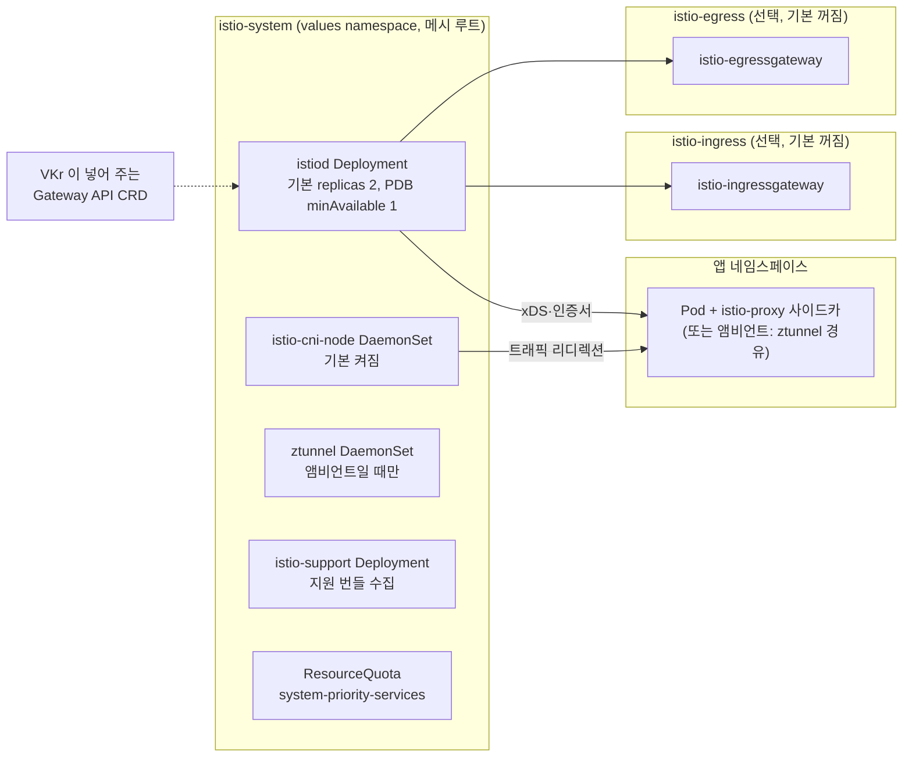

# 11. Istio

> 커리큘럼: [CURRICULUM.md](CURRICULUM.md) · 앞 절: [10. Harbor](10-harbor.md) · 작성 2026-11-02
> 등급: **[근거]** 출처에 그대로 있는 것, **[추론]** 여러 출처를 엮어 직접 내린 결론.
> 기준 판: VKS Add-ons `3.8.0+20261021` (9.1 VKS Add-ons Release Notes, 2026-11-02 확인). 판 호환은 이 문서에서 정리하지 않는다. [공식 호환 매트릭스](https://interopmatrix.broadcom.com/)와 릴리스 노트를 직접 볼 것.

VKS 의 Istio 애드온은 **업스트림 Istio Helm 차트(base·istiod·cni·ztunnel·gateway)를 미리 렌더링해 Carvel 패키지로 묶고, Broadcom 이 고른 값만 열어 둔 것**이다. 설치 단위는 `istio.kubernetes.vmware.com` 패키지 하나다.

서비스 메시·Gateway API 자체의 개념(사이드카, mTLS, VirtualService, GatewayClass/Gateway/HTTPRoute)과 업스트림 Helm 설치는 루트 [`../istio-gateway-api.md`](../istio-gateway-api.md)에 있다. 대화형 업스트림 설치는 루트 [`../k8s-addon.sh`](../k8s-addon.sh)의 `addon_istio` 다. 이 절은 그 위에서 네 가지만 판다. 첫째, 3.8.0+20261021 은 Istio 를 **세 판(1.31.0·1.30.4·1.28.10)** 주고 판마다 맞는 VKr 범위가 다르다는 점. 둘째, 패키지가 **Gateway API CRD 를 깔지 않는다**는 점. 셋째, 공식 문서 예시를 그대로 쓰면 앰비언트 모드가 켜진다는 점. 넷째, values 를 틀리면 어디서 막히는지(패키지 원본을 받아 직접 렌더링해 확인).

---

## 1. 무엇을 하는가



[근거] 패키지가 까는 구성 요소 (Istio Package Reference, 9.0, Last Updated October 6, 2026):

| 이름 | 종류 | 네임스페이스 | 하는 일 |
|---|---|---|---|
| istiod | Deployment | istio-system | 컨트롤 플레인. 서비스 디스커버리, 설정 배포, 인증서 |
| istio-cni-node | DaemonSet | istio-system | 메시 Pod 의 트래픽 리디렉션. 사이드카 모드에선 선택, 앰비언트에선 필수 |
| ztunnel | DaemonSet | istio-system | 앰비언트 데이터 플레인. 앰비언트를 켤 때만 |
| istio-ingressgateway | Deployment | istio-ingress | `gateways.ingress.enabled: true` 일 때만. 기본 false |
| istio-egressgateway | Deployment | istio-egress | `gateways.egress.enabled: true` 일 때만. 기본 false |
| istio-support | Deployment | istio-system | 지원 번들 수집 도구 |

- [근거] 같은 문서는 트래픽 관리(인그레스·이그레스 모두)에 **Kubernetes Gateway API 를 쓰라고 권하고**, 그러면 게이트웨이 인스턴스가 자동으로 배포된다고 적는다. 정적 게이트웨이(위 표의 ingress/egress)는 그 대안이다.
- [근거] 오픈소스와 다른 점으로 「고른 설정값만 지원」, 「설치 때 strict mTLS 강제 가능」, 「FIPS 준수 기본 제공」, 「Gateway API 지원은 VKr 이 주는 gateway-api 판에 묶인다」를 든다. (같은 출처)
- [근거] 렌더링해 보면 이미지는 `install-cni`·`pilot`·`proxyv2`·`support`·`ztunnel` 다섯 개(모두 1.31.0)이고, 패키지가 까는 CRD 15개는 모두 `*.istio.io` 다. `gateway.networking.k8s.io` CRD 는 없다. (3.8.0+20261021 bundle `config/` 와 `.imgpkg/images.yml`, 2026-11-02 실측)

### 판과 지원 등급 (3.8.0+20261021 기준)

[근거] 9.1 VKS Add-ons Release Notes(Last Updated October 26, 2026, 2026-11-02 확인)의 저장소별 지원 표에 실린 Istio 판(꼬리 `+vmware.1-vks.1` 생략):

| 저장소 | 지원 표의 Istio 판 |
|---|---|
| 3.5.0+20251022 | 1.27.1, 1.25.5 |
| 3.5.0+20251218 | 1.27.4, 1.27.1 (1.25.5 는 Packages Removed) |
| 3.6.0+20260211 / 20260320 | 1.28.2, 1.27.5, 1.27.4, 1.27.1 |
| 3.6.0+20260416 / 20260521 | 1.28.5, 1.28.2, 1.27.8, 1.27.5 |
| 3.7.0+20260618 | 1.30.0, 1.28.7 |
| 3.7.0+20260723 / 20260827 | 1.30.2, 1.28.9 |
| 3.7.0+20260924 | 1.30.4, 1.28.10 |
| **3.8.0+20261021** | **1.31.0, 1.30.4, 1.28.10** (Product 등급) |

[근거] 3.8.0+20261021 지원 표에서 판별로 「Yes」가 찍힌 VKr 마이너 (같은 출처, 표의 HTML 칸을 그대로 읽음):

| Istio 판 | v1.37 | v1.36 | v1.35 | v1.34 | v1.33 |
|---|---|---|---|---|---|
| 1.31.0 | Yes | Yes | Yes | Yes | |
| 1.30.4 | | Yes | Yes | Yes | Yes |
| 1.28.10 | | | Yes | Yes | Yes |

- [근거] 패키지 원본 세 판 모두 저장소 안에 있고 `releasedAt` 은 1.28.10·1.30.4 가 2026-09-04, 1.31.0 이 2026-09-18 이다. (3.8.0+20261021 저장소 `packages/istio.kubernetes.vmware.com/`, 2026-11-02 확인)
- [근거] 업스트림 지원 표: 1.31 은 2026-08-27 출시, 지원 끝 ~2027-02(예정), Kubernetes 1.32~1.37. 1.30 은 ~2026-12(예정)까지, 1.32~1.36. 1.29 는 2026-10-15, 1.28 은 2026-07-01 에 지원이 끝났다. 1.28 의 지원 Kubernetes 는 1.30~1.34 다. (istio.io Supported Releases, 2026-11-02 확인)
- [근거] 같은 업스트림 표의 「알려진 CVE 가 없는 판」은 1.31.3+, 1.30.7+, 1.29.10+ 이다. (같은 출처)
- [추론] VKS 가 주는 1.31.0·1.30.4 는 업스트림 기준으로는 「알려진 CVE 가 남은 판」에 든다. Broadcom 이 수정분을 따로 넣었는지는 공개 문서로 확인할 수 없다. 릴리스 노트의 문구는 판마다 「Go dependencies and base images bump」뿐이다. 보안 판단은 Broadcom 보안 공지와 다음 저장소 판을 같이 본다.
- [추론] 1.28.10 은 업스트림 지원이 이미 끝났고, VKr 1.35 의 「Yes」는 업스트림 1.28 의 지원 Kubernetes 범위(1.30~1.34) 밖이다. 새로 깔 때는 1.31.0(VKr 1.34 이상) 또는 1.30.4(VKr 1.33)를 고른다.

## 2. VKS 에서 어떻게 들어가는가

두 경로의 공통 바탕은 [00절](00-repository-and-install-paths.md)에, Carvel 기초는 [`../carvel-kapp.md`](../carvel-kapp.md)에 있다.

- [근거] 공식 설치 문서는 「VKr 1.29 이상」을 대상으로 **레거시 `vcf package install`** 만 안내한다. 네임스페이스 `istio-installed` 를 만들어 거기에 PackageInstall 을 두고, 구성 요소는 values 의 `namespace`(기본 `istio-system`)에 뜬다. (Install Istio, 9.0, Last Updated October 6, 2026)
- [근거] 3.5.0+20251022 의 1.27.1 에서 「Add-on 관리 시스템에서 Istio 패키지 지원」이 들어왔다. (9.1 릴리스 노트)
- [근거] 1.31.0 Package 에는 `AddonConfigDefinition istio.kubernetes.vmware.com.1.31.0---vmware.1-vks.1`(네임스페이스 `vmware-system-vks-public`)이 어노테이션으로 들어 있다. values 를 워크로드 클러스터의 `vmware-system-tkg/<클러스터>-istio-values` Secret 으로 내보내고, `vks_cluster_version` 을 Cluster 의 `spec.topology.version` 에서 채운다. (패키지 원본, 2026-11-02 확인)
- [추론] Add-on 경로의 이름은 `istio` 일 것이다. 공식 Istio 문서에는 `vcf addon`·`AddonInstall` 예시가 없으니, 쓰기 전에 Supervisor 에서 AddonRelease 가 보이는지부터 확인한다.

| | 레거시 패키지 (공식 안내) | Add-on Management |
|---|---|---|
| 컨텍스트 | 워크로드 클러스터 | Supervisor, 클러스터 네임스페이스 |
| 이름 | `istio.kubernetes.vmware.com` | `istio` [추론] |
| PackageInstall 자리 | `istio-installed` (문서 예시) | 애드온 관리가 정함 |
| 설정값 | `--values-file istio-data-values.yaml` | AddonConfig [추론] |
| 구성 요소가 뜨는 곳 | values `namespace`, 기본 `istio-system` | 같음 |

### 판 고르기와 업그레이드

- [근거] 판 목록은 `vcf package available get istio.kubernetes.vmware.com -n tkg-system` 또는 `kubectl -n tkg-system get packages | grep istio` 로 보고, 값 변경과 업그레이드는 `vcf package installed update` 다. (Install Istio, 9.0)
- [근거] 업그레이드 경로 (9.1 릴리스 노트): 1.31.0 은 「1.30.4 에서 매끄럽게」, 1.28.10 은 「먼저 1.30.4 로, 그다음 1.31.0」. 1.30.0 은 「1.28.5 에서」였고 1.27.8 은 1.28.5 또는 1.28.7 을 먼저 거치라고 했다.
- [근거] 패키지 어노테이션 `addons.kubernetes.vmware.com/source-version-constraint` 값은 1.28.10 이 `>=1.26.0`, 1.30.4 가 `>=1.28.0`, 1.31.0 이 `>=1.29.0` 이다. (패키지 원본, 2026-11-02 확인)
- [추론] 이 제약이 Add-on 경로의 업그레이드 사전 점검에 쓰이는 것으로 보인다. 1.28.10 에서 1.31.0 으로 바로 가려 하면 `>=1.29.0` 에 걸린다. VKS 는 업스트림 1.29 를 건너뛰었으니 1.30.4 를 꼭 거친다.
- [추론] VKr 을 올리기 전에 Istio 판부터 맞춘다. 예를 들어 VKr 1.33 + Istio 1.30.4 클러스터를 1.37 로 올리려면, 1.30.4 는 1.37 에 「Yes」가 없으니 1.34 이상이 된 뒤 1.31.0 으로 올리고 그다음 1.37 로 간다. 순서는 [04절](04-cluster-autoscaler.md)처럼 애드온 판 표를 먼저 본다.

## 3. 실습

> 이름(`cluster1`, `mesh1`)은 자리표시자다. 판은 `1.31.0+vmware.1-vks.1` 이다.

### 3.1 values 파일 만들기 (워크로드 클러스터 컨텍스트)

```bash
# 판 확인
kubectl -n tkg-system get packages | grep istio
# 기본값 파일 뽑기
vcf package available get istio.kubernetes.vmware.com/1.31.0+vmware.1-vks.1 \
  --default-values-file-output istio-data-values.yaml -n tkg-system
```

사이드카 모드에 strict mTLS 를 켜는 최소 values (공식 「Install the Istio Add-on with Sidecar mode」 예시와 같은 값):

```yaml
# istio-data-values.yaml
istio:
  namespace: istio-system
  istioCNI:
    enabled: true
  enableStrictMTLS: true        # 메시 전체에 PeerAuthentication default(STRICT) 를 만든다
  meshConfig:
    meshID: cluster1
    meshMTLS:
      minProtocolVersion: TLSV1_3
    enableDNSProxy: true
```

### 3.2 레거시 방식으로 설치

```bash
kubectl create ns istio-installed
vcf package install istio -p istio.kubernetes.vmware.com -v 1.31.0+vmware.1-vks.1 \
  --values-file istio-data-values.yaml -n istio-installed
vcf package installed get istio -n istio-installed
# 기대: STATUS Reconcile succeeded

kubectl get deploy,ds -n istio-system
# 기대: istiod 2/2, istio-support 1/1, istio-cni-node 는 노드 수만큼
kubectl get peerauthentication -n istio-system
# 기대: default (enableStrictMTLS: true 일 때만)
```

- [근거] kapp 설정의 대기 규칙은 ValidatingWebhookConfiguration 의 `failurePolicy` 가 `Fail` 이 될 때까지 기다린다. istiod 가 웹훅 엔드포인트를 준비하면 그 값을 바꾸기 때문이다. 또 istiod → 웹훅 → 정적 게이트웨이 순서로 적용하도록 change-group 을 건다. (bundle `config/kapp-config.yaml`, `overlay/downstream/apply-ordering-overlay.yaml`)
- [추론] 그래서 `Reconcile succeeded` 가 나왔다면 istiod 가 웹훅을 넘겨받은 뒤다. 오래 `Reconciling` 에 머물면 istiod Pod 로그부터 본다.

앱 네임스페이스에 사이드카 주입:

```bash
kubectl label ns demo istio-injection=enabled
kubectl rollout restart deploy -n demo
kubectl get pod -n demo -o jsonpath='{.items[*].spec.containers[*].name}'
# 기대: 앱 컨테이너와 istio-proxy
```

- [근거] 사설 레지스트리 환경에서는 사이드카·게이트웨이 주입에 쓸 레지스트리 Secret 이 **앱 네임스페이스마다** 있어야 하고, 그 이름을 `istio.meshConfig.imagePullSecrets` 에 적는다. 루트·게이트웨이 네임스페이스의 Secret 은 패키지가 만든다. (Istio Package Reference, 9.0)

### 3.3 Gateway API 로 노출

[근거] 패키지는 Gateway API CRD 를 깔지 않고, 지원 범위는 VKr 이 주는 gateway-api 판에 묶인다(Package Reference). VKr 1.36 은 Gateway API v1.5.1 을 넣는다(9.1 릴리스 노트의 Cilium 알려진 문제).

```bash
kubectl get crd | grep gateway.networking.k8s.io
# 기대: gatewayclasses, gateways, httproutes 등. 없으면 VKr 쪽 문제이고, 업스트림 CRD 를 손으로 덮지 않는다 [추론]
kubectl get gatewayclass
# 기대: istio (istiod 가 만든다) [추론]
```

Gateway·HTTPRoute 예제는 루트 [`../istio-gateway-api.md`의 5절](../istio-gateway-api.md#5-실습-gateway-api로-서비스-노출)을 그대로 쓴다. Gateway 를 만들면 istiod 가 그 네임스페이스에 Deployment 와 Service(LoadBalancer)를 띄운다.

### 3.4 Add-on 방식 [추론]

```bash
vcf context use supervisor:<클러스터-네임스페이스>
vcf addon available list istio            # AddonRelease 가 보이는지부터
# 보이면 00절의 AddonInstall 모양(addonRef.name: istio)을 따른다. 안 보이면 3.2 로.
```

### 3.5 자체 CA 와 트레이싱

- [근거] 「Bring Your Own CA」는 cert-manager 로 루트 CA 를 담은 ClusterIssuer 를 만들고, `istio-system` 에 `isCA: true` Certificate 를 **Secret 이름 `cacerts`** 로 발급한 뒤 Istio 를 설치하라고 한다. 예시는 `duration: 8760h`, `renewBefore: 720h` 다. (Bring Your Own CA with the Istio Package, 9.0) 인증서 기초는 [01절](01-cert-manager.md).
- [근거] istiod 는 `cacerts` Secret 을 `/etc/cacerts` 로 마운트하고, 패키지 values 에는 CA 교체 동작을 바꾸는 칸이 없다. (bundle `config/upstream/istiod.yaml`, 스키마)
- [추론] cert-manager 가 중간 CA 를 갱신했을 때 istiod 가 새 키를 바로 쓰는지는 공식 문서에 없다. 갱신 시점 전후로 `istioctl proxy-config secret` 으로 워크로드 인증서의 발급자를 확인하는 절차를 운영 문서에 둔다.
- [근거] 트레이싱 문서는 values 의 `meshConfig.extensionProviders` 에 zipkin(포트 9411)을 넣고 Telemetry `mesh-default` 로 켜라고 한다. 이 릴리스에서 지원하는 트레이싱 제공자는 `opentelemetry`·`zipkin` 둘이다. (Configuring Tracing for Istio, Package Reference)
- [근거] 패키지 검사 규칙은 opentelemetry 제공자를 **하나까지**, zipkin 도 **하나까지** 허용하고, `defaultProviders.tracing` 의 이름이 `extensionProviders` 에 없으면 실패시킨다. (bundle `config/values.star`)

### 3.6 클러스터 없이 확인하는 법 (2026-11-02 실측)

[10절 3.5](10-harbor.md#35-클러스터-없이-확인하는-법-2026-11-02-실측)와 같은 방법으로 3.8.0+20261021 저장소의 `.imgpkg/images.yml` 에서 `istio:v1.31.0_vmware.1-vks.1` bundle digest 를 찾아 받고, ytt v0.55.4(릴리스 sha256 대조 일치)로 렌더링했다.

```bash
ytt -f config/                       # 기본값
ytt -f config/ -f my-values.yaml     # 내 values 를 얹어 본다 (파일 맨 위에 #@data/values)
```

| values | 결과 |
|---|---|
| 없음(기본값) | 리소스 54개. Deployment 2(istiod replicas 2, istio-support), DaemonSet 1(istio-cni-node), CRD 15, PDB 1, ResourceQuota·LimitRange·Namespace 각 1. PeerAuthentication 없음 |
| 3.1 의 사이드카 values | 55개. 위에 PeerAuthentication `default`(STRICT) 하나가 더해짐 |
| `gateways.ingress.enabled: true` + autoscaling | 63개. Namespace `istio-ingress`, Deployment·HPA `istio-ingressgateway`, 그 네임스페이스의 LimitRange·Secret 이 더해짐 |
| `ambientMode.enabled: true`, `istioCNI.enabled: false` | 실패: `istioCNI.enabled should be true when ambient mode is enabled` |
| `enableStrictMtls: true` (대소문자 오타) | 실패: `Expected number of matched nodes to be 1, but was 0` |

- [근거] 스키마의 객체 65곳이 모두 `additionalProperties: false` 라 모르는 키는 렌더링 전에 거절된다. 같은 스키마가 AddonConfigDefinition 에도 들어 있다. (패키지 원본)
- [근거] `istio-system` 네임스페이스에는 `pod-security.kubernetes.io/enforce: privileged` 라벨이, 게이트웨이 네임스페이스에는 `baseline` 이 붙는다. CNI 나 앰비언트를 켜면 ResourceQuota `system-priority-services` 를 만드는데, 주석은 「VKS 는 이런 쿼터가 없으면 Pod 가 system-* priorityClass 를 못 쓰게 막는다. install-cni·ztunnel DaemonSet 에 필요하다」이다. (bundle `overlay/downstream/`)

## 4. 업스트림 Helm 설치와 다른 점

업스트림 설치는 [`../k8s-addon.sh`](../k8s-addon.sh)의 `addon_istio`(차트 `istio/base`·`istiod`·`gateway`)와 [`../istio-gateway-api.md` 4절](../istio-gateway-api.md#4-helm-기반-istio-설치)에 있다. 여기서는 차이만 적는다.

| | VKS 애드온 | 업스트림 Helm |
|---|---|---|
| 설정 | 고른 values 만. 모르는 키는 거절 | 차트 values 전부 |
| istiod 기본 replicas | 2 (스키마 기본값) [근거] | 1 [추론, 차트 기본] |
| istio-cni | 기본 켜짐 [근거] | 별도 차트, 선택 |
| strict mTLS | `enableStrictMTLS` 하나로 PeerAuthentication 생성 | 직접 만든다 |
| 정적 게이트웨이 | 값 하나로 켬, 네임스페이스 `istio-ingress`/`istio-egress` 고정 기본값 | `istio/gateway` 차트를 따로 설치 |
| Gateway API CRD | VKr 이 줌 | 직접 설치 ([`../istio-gateway-api.md` 3절](../istio-gateway-api.md#3-사전-준비-gateway-api-crd-설치)) |
| 지원 번들 | `istio-support` Pod 의 `supportbundle` 명령 | 없음 |
| FIPS | 기본 제공 [근거] | 직접 빌드·선택 |
| 판 | 저장소가 준 판만 (3.8.0 은 1.31.0·1.30.4·1.28.10) | 아무 판 |

- [근거] 업스트림 1.31 부터 `istio-release.storage.googleapis.com`·`gcr.io/istio-release`·`registry.istio.io` 에 아티팩트를 올리지 않는다. Helm 차트는 `blob.istio.io/istio-release/charts`, OCI 차트는 `ghcr.io/istio/release/charts` 로 옮겼고, 옛 주소를 잠깐 끄는 시험이 2026-09-15, 10-13, 11-17, 12-08~09(UTC)에 잡혀 있다. (Announcing Istio 1.31.0, 2026-11-02 확인)
- [추론] 루트 `k8s-addon.sh` 는 아직 `istio-release.storage.googleapis.com/charts` 를 Helm 저장소로 쓴다. 업스트림으로 1.31 이상을 깔 때는 위 새 주소를 쓴다. VKS 애드온은 Broadcom 저장소에서 이미지를 당기므로 이 변경과 상관없다.

## 5. 흔한 실수

1. **Package Reference 의 예시 values 를 그대로 붙인다.** [근거] 그 예시는 `ambientMode.enabled: true`, 정적 ingress·egress 게이트웨이와 오토스케일링을 모두 켜 둔다. 그런데 같은 문서 묶음의 Install Istio 「Known Limitations」는 앰비언트를 **보안 문제 때문에 기본으로 켜지 않는다**고 적는다. 워크로드가 메시 밖으로 떠서 정책을 우회할 수 있고, 노드 간 터널이 TCP 15008 하나로 보여 포트 기반 L4 NetworkPolicy(쿠버네티스·Antrea)가 영향을 받는다는 이유다. [추론] 예시는 「모든 칸을 보여 주는 견본」으로 읽고, 실제로는 3.1 처럼 필요한 칸만 쓴다.
2. **예시의 zipkin 제공자 포트를 믿는다.** [근거] Package Reference 예시는 zipkin 제공자를 `jaeger-collector...:4317` 로 적었고, 트레이싱 전용 문서는 zipkin 을 `:9411` 로 적는다. [추론] 4317 은 OTLP gRPC 포트라 zipkin 형식으로 보내면 받지 못한다. zipkin 은 9411, opentelemetry 는 4317 로 맞춘다.
3. **문서의 기본값과 실제 기본값이 다르다.** [근거] Package Reference 는 istiod replicas 기본 1, autoscaling `minReplicas` 1 이라 적지만 1.31.0 스키마는 2, 2 다(1.28.10 스키마도 2). `accessLogFile` 은 예시가 `""`, 표가 `/dev/stdout`, 스키마가 `/dev/stdout` 이다. `ingressSelector` 기본값은 표에 `ingressgatway` 로 오타가 났고 스키마는 `ingressgateway` 다. `extensionProviders` 설명은 「prometheus, stackdriver, envoyFileAccessLog 가 기본」이라 하지만, 기본값 렌더링 결과의 mesh 설정에는 `envoy`(파일 접근 로그) 제공자 하나와 `defaultProviders.metrics: [prometheus]` 만 있다. [추론] 표가 아니라 `--values-schema`·`--default-values-file-output` 으로 본 값을 믿는다.
4. **Cilium CNI 클러스터에 Istio 를 깐다.** [근거] 3.6.0+20260320 절의 알려진 문제는 「Istio 애드온은 Cilium CNI 로 만든 클러스터와 호환되지 않아 설치가 실패한다」이다. 그 뒤 판에서 해소됐다는 문장은 2026-11-02 기준 찾지 못했다. → 16절 Cilium.
5. **1.28.10 에서 1.31.0 으로 한 번에 올린다.** [근거] 릴리스 노트는 1.30.4 를 거치라고 하고, 1.31.0 의 source-version-constraint 는 `>=1.29.0` 이다. 2절 참조.
6. **사설 레지스트리에서 앱 네임스페이스 Secret 을 빠뜨린다.** [근거] 사이드카 이미지(`proxyv2`)는 앱 Pod 와 함께 당겨지므로 앱 네임스페이스에 Secret 이 있어야 하고 `meshConfig.imagePullSecrets` 에 이름을 적어야 한다. 3.7.0+20260618 의 1.30.0 은 내부용 `istio-registry-creds` 를 `istio-sidecar-injector` ConfigMap 에서 뺐다(취약점 수정). [추론] 그 전 판에서 그 Secret 에 기대던 구성은 올린 뒤 `ImagePullBackOff` 가 날 수 있다.
7. **멀티클러스터를 앰비언트로 한다.** [근거] 멀티클러스터는 1.28.2 부터, 서로 다른 네트워크의 primary-remote·multi-primary, **사이드카 모드만** 지원한다. VKS 는 Pod CIDR 가 겹친다고 보고 multi-network 모델로 깐다. 클러스터마다 같은 루트로 만든 `cacerts` 가 먼저 있어야 한다. `pilot.ignoreResources` 는 멀티클러스터와 같이 못 쓴다(패키지 검사 규칙). (Configure Istio multi-clusters, 1.28.2 릴리스 노트, `values.star`)
8. **Kiali·VM 연동을 기대한다.** [근거] Kiali 는 공식 지원이 아니고 VM 지원도 없다. (Install Istio, Known Limitations)

## 6. 확인 문제

1. VKr 1.33 클러스터에 Istio 1.28.10 이 있다. 클러스터를 VKr 1.37 까지 올리려 한다. Istio 와 VKr 을 어떤 순서로 올려야 하는지, 근거 두 가지와 함께 적어라.
2. 다음 values 로 `vcf package install` 을 했더니 PackageInstall 이 `Reconcile failed` 다. 원인을 두 가지 찾고, 클러스터에 넣기 전에 잡는 방법을 적어라.
   ```yaml
   istio:
     ambientMode:
       enabled: true
     istioCNI:
       enabled: false
     enableStrictMtls: true
   ```
3. 동료가 「VKS Istio 애드온을 깔았으니 Gateway API 도 같이 들어왔다. HTTPRoute 의 최신 실험 기능을 쓰려면 업스트림 experimental CRD 를 kubectl apply 하자」고 한다. 무엇이 문제인지 적어라.

<details>
<summary>풀이</summary>

1. 3.8.0+20261021 지원 표에서 1.28.10 은 VKr 1.35~1.33, 1.30.4 는 1.36~1.33, 1.31.0 은 1.37~1.34 다. 그리고 1.28.10 은 1.30.4 를 거쳐야 1.31.0 으로 간다(릴리스 노트 Upgrade Path, source-version-constraint `>=1.29.0`). 그래서 Istio 1.28.10 → 1.30.4(VKr 1.33 에서) → VKr 1.34 → Istio 1.31.0 → VKr 1.35 → 1.36 → 1.37 순서다. VKr 을 먼저 1.36 까지 올리면 1.28.10 이 지원 범위를 벗어난다.
2. (가) 앰비언트는 istio-cni 가 필수인데 `istioCNI.enabled: false` 라 `values.star` 검사가 `istioCNI.enabled should be true when ambient mode is enabled` 로 막는다. (나) `enableStrictMtls` 는 스키마에 없는 키(`enableStrictMTLS` 가 맞음)라 `additionalProperties: false` 에 걸린다. 넣기 전에 `vcf package available get ... --values-schema` 로 키 이름을 대조하고, 패키지 bundle 을 받아 `ytt -f config/ -f values.yaml` 로 렌더링해 본다(3.6). 덤으로, 앰비언트는 공식 문서가 보안상 기본으로 켜지 않는다고 한 기능이니 켜는 이유부터 확인한다.
3. 패키지는 `*.istio.io` CRD 15개만 깔고 Gateway API CRD 는 VKr 이 준다. Broadcom 은 「Gateway API 지원은 VKr 이 주는 gateway-api 판에 묶인다」고 한다. 업스트림 CRD 로 덮으면 VKr 이 관리하는 CRD 와 판이 어긋나고, VKr 업그레이드 때 덮어쓰이거나 다른 소비자(Contour·AKO·Cilium 의 Gateway API 컨트롤러)와 충돌할 수 있다. VKr 1.36 이 Gateway API v1.5.1 로 바뀌며 Cilium 운영자가 죽은 알려진 문제가 실제 예다. [추론] 필요한 기능이 있으면 그 기능이 든 VKr 판을 기다린다.

</details>

---

## 7. 출처 (모두 2026-11-02 확인)

- Install Istio (9.0, Last Updated October 6, 2026): <https://techdocs.broadcom.com/us/en/vmware-cis/vcf/vcf-service-administration-and-development/9-0/managing-vsphere-kuberenetes-service-clusters-and-workloads/installing-standard-packages-on-tkg-service-clusters/installing-standard-packages-on-tkg-cluster-using-tkr-for-vsphere-8-x/installaing-and-using-istio/install-istio.html>
- Istio Package Reference (9.0): <https://techdocs.broadcom.com/us/en/vmware-cis/vcf/vcf-service-administration-and-development/9-0/managing-vsphere-kuberenetes-service-clusters-and-workloads/installing-standard-packages-on-tkg-service-clusters/standard-package-reference/istio-package-reference.html>
- Using Istio 아래 여섯 쪽(9.0, 모두 Last Updated October 6, 2026): 사이드카 모드, 앰비언트 모드, 트레이싱, Bring Your Own CA, 멀티클러스터, 지원 번들. 시작점 <https://techdocs.broadcom.com/us/en/vmware-cis/vcf/vcf-service-administration-and-development/9-0/managing-vsphere-kuberenetes-service-clusters-and-workloads/installing-standard-packages-on-tkg-service-clusters/installing-standard-packages-on-tkg-cluster-using-tkr-for-vsphere-8-x/installaing-and-using-istio/using-istio.html>
- 9.1 문서 세트에서 Install Istio 주소(9-0 을 9-1 로 바꾼 것)는 404 였다.
- VKS Add-ons Release Notes (9.1, Last Updated October 26, 2026): <https://techdocs.broadcom.com/us/en/vmware-cis/vcf/vcf-service-administration-and-development/9-1/release-notes/vks-addons-release-notes.html>
- 패키지 원본: `projects.packages.broadcom.com/vsphere/supervisor/vks-standard-packages/3.8.0-20261021/vks-addons:3.8.0-20261021` 의 `packages/istio.kubernetes.vmware.com/` 와 1.31.0 bundle(layer sha256 `f8a1e0aa…`), 익명 pull
- Istio Supported Releases: <https://istio.io/latest/docs/releases/supported-releases/>
- Announcing Istio 1.31.0 (2026-08-31): <https://istio.io/latest/news/releases/1.31.x/announcing-1.31/>
- Istio Plug in CA Certificates: <https://istio.io/latest/docs/tasks/security/cert-management/plugin-ca-cert/>
- ytt v0.55.4: <https://github.com/carvel-dev/ytt/releases/tag/v0.55.4>
