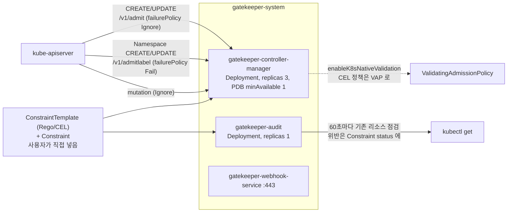
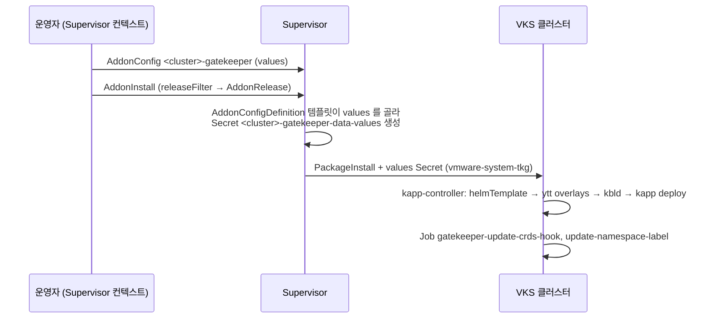

# 12. Gatekeeper (OPA)

> 커리큘럼: [CURRICULUM.md](CURRICULUM.md) · 앞 절: [11. Istio](11-istio.md) · 작성 2026-11-03
> 등급: **[근거]** 출처에 그대로 있는 것, **[추론]** 여러 출처를 엮어 직접 내린 결론.
> 기준 판: VKS Add-ons `3.8.0+20261021` (9.1 VKS Add-ons Release Notes, Last Updated October 26, 2026, 2026-11-03 확인). 판 호환은 이 문서에서 정리하지 않는다. [공식 호환 매트릭스](https://interopmatrix.broadcom.com/)와 릴리스 노트를 직접 볼 것.

VKS 의 Gatekeeper 애드온은 **업스트림 Gatekeeper Helm 차트를 그대로 담고, VKS 에 맞춘 values 파일 하나와 ytt 오버레이 다섯 개를 얹은 Carvel 패키지**다. 설치 단위는 `gatekeeper.kubernetes.vmware.com` 패키지 하나이고, 공식 문서는 Add-on Management 경로(VCF CLI 또는 kubectl 로 `AddonInstall`)만 안내한다.

정책 엔진 자체(ConstraintTemplate·Constraint·Rego·mutation)와 업스트림 Helm 설치는 루트 [`../k8s-addon.sh`](../k8s-addon.sh)의 `addon_opa_gatekeeper` 와 [Gatekeeper 공식 문서](https://open-policy-agent.github.io/gatekeeper/website/docs/)에 있다. 이 절은 그 위에서 네 가지만 판다. 첫째, 패키지가 **정책을 하나도 넣지 않고** 시스템 네임스페이스 면제와 fail-open 웹훅만 고정해 준다는 점. 둘째, Gatekeeper 웹훅이 **VKS 클러스터 업그레이드를 막을 수 있어서** 패키지가 그 사전 점검을 피하는 장치를 넣어 두었다는 점. 셋째, 공식 문서의 values 예시를 그대로 붙이면 PriorityClass 가 빠진다는 점. 넷째, values 를 틀리면 어디서 막히고 어디서 조용히 무시되는지(패키지 원본을 받아 직접 렌더링해 확인).

---

## 1. 무엇을 하는가



[근거] 패키지가 까는 구성 요소 (Gatekeeper Package Reference, 9.0, 2026-11-03 확인):

| 이름 | 종류 | 네임스페이스 | 하는 일 |
|---|---|---|---|
| gatekeeper-controller-manager | Deployment(3) | gatekeeper-system | validating·mutating 승인 웹훅. 들어오는 요청을 Constraint 로 평가 |
| gatekeeper-audit | Deployment(1) | gatekeeper-system | 이미 있는 리소스를 주기적으로 점검해 위반을 보고. 요청을 막지 않음 |
| gatekeeper-webhook-service | Service | gatekeeper-system | 웹훅 443 포트 |
| gatekeeper-validating-webhook-configuration | ValidatingWebhookConfiguration | 클러스터 | 검증 웹훅 등록 |
| gatekeeper-mutating-webhook-configuration | MutatingWebhookConfiguration | 클러스터 | 변형 웹훅 등록 |

- [근거] 3.6.0+20260521 에서 처음 들어올 때 릴리스 노트는 「정책은 미리 넣지 않는다. 사용자가 ConstraintTemplate·Constraint 를 직접 적용한다」, 「VKS 시스템 네임스페이스 보호를 넣었다」, 「주 승인 웹훅은 `failurePolicy: Ignore` 라 Gatekeeper 가 죽어도 워크로드를 막지 않는다」고 적었다. (9.1 VKS Add-ons Release Notes)
- [근거] 정책 묶음이 필요하면 따로 **Policy Bundle** 애드온(3.7.0+20260723 첫 등장, NSA/CISA Kubernetes Hardening Guidance v1.2)을 얹는다. Gatekeeper 애드온이 먼저 깔려 정상이어야 한다. → 23절 Policy Bundle.
- [근거] Install Gatekeeper(9.0) 개요는 정책 정의를 「ConstraintTemplate 으로 논리를 정의하고 Constraint 로 적용하는 두 단계」로 설명하고, 업스트림 Gatekeeper Policy Library 를 쓰라고 안내한다.
- [근거] 렌더링해 보면 이미지는 `gatekeeper`·`gatekeeper-crds`·`curl` 세 개이고, 패키지 bundle 안 차트는 `gatekeeper` 3.23.1(appVersion v3.23.1)이다. (3.8.0+20261021 bundle `chart/Chart.yaml`·`.imgpkg/images.yml`, 2026-11-03 실측)

### 판과 지원 등급 (3.8.0+20261021 기준)

[근거] 9.1 VKS Add-ons Release Notes 의 저장소별 지원 표에 실린 Gatekeeper 판. 모든 판이 Product 등급이다.

| 저장소 | Gatekeeper 판 | 바뀐 점(릴리스 노트) |
|---|---|---|
| 3.6.0+20260521 | 3.22.2+vmware.1-vks.1 | 첫 등장 |
| 3.7.0+20260618 | 3.22.2+vmware.1-vks.1 | 알려진 문제: 웹훅이 클러스터 업그레이드를 막을 수 있음(KB 433183) |
| 3.7.0+20260723 | 3.22.2+vmware.2-vks.1 | 암호 모듈을 BoringCrypto 에서 Go 기본 FIPS 140-3 모듈로 |
| 3.7.0+20260827 | 3.23.0+vmware.1-vks.1 | 업스트림 3.23.0 |
| 3.7.0+20260924 | 3.23.0+vmware.2-vks.1 | Gatekeeper·Policy Bundle 을 함께 깔면 CEL 정책이 업그레이드를 막던 권한 문제 수정 |
| 3.8.0+20261021 | 3.23.1+vmware.1-vks.1 | 의존성·베이스 이미지 갱신. VKr 1.33~1.37 다섯 마이너 모두 Yes |

- [근거] 업스트림 최신 정식 판은 v3.23.1(2026-08-27)이고, 그 뒤로는 v3.24.0-beta.0(2026-07-13)만 있다. (GitHub releases, 2026-11-03 확인) [추론] 3.8.0+20261021 은 업스트림 정식 판과 같은 판을 싣고 있다.
- [근거] 업그레이드 경로는 판마다 「Smooth upgrade from …」로 적혀 있다. 3.23.1 은 3.23.0 에서, 3.23.0 은 3.22.2+vmware.2 에서 올라간다. (같은 출처)

## 2. VKS 에서 어떻게 들어가는가

두 설치 경로의 틀은 [00절](00-repository-and-install-paths.md)에, Carvel 기초는 [`../carvel-kapp.md`](../carvel-kapp.md)에 있다.

### 2.1 공식 문서가 안내하는 경로

[근거] Install Gatekeeper(9.0) 아래에는 「Install Gatekeeper Add-on Using VCF CLI」와 「Using Kubectl」 두 쪽만 있다. 둘 다 Supervisor 에서 `AddonInstall` 을 만드는 Add-on Management 경로다. 클러스터 안에 `PackageInstall` 을 직접 만드는 레거시 절차는 Gatekeeper 에는 없다. VCF CLI 쪽 사전 조건은 VKS 3.5 이상, 저장소 3.6.0+20260521 이상이다.

[근거] 같은 문서의 맨 위 주의: **VCF Automation 9.0.1 이상의 VKS cluster management 기능으로 정책을 관리하고 있다면 그대로 두라**(그 기능이 Gatekeeper 를 관리한다). **직접 깐 오픈소스 Gatekeeper 가 있으면 먼저 지워야** Broadcom 지원 대상이 된다.



### 2.2 패키지 안을 열어 보면

[근거] 3.8.0+20261021 저장소의 `gatekeeper.kubernetes.vmware.com/3.23.1+vmware.1-vks.1.yml` 의 템플릿 단계 (익명 pull, 2026-11-03):

```yaml
template:
  - helmTemplate:
      path: chart
      namespace: gatekeeper-system
      valuesFrom:
        - path: values/use-tag-values.yaml   # VKS 가 고정한 값
  - ytt:
      paths: ['-', overlays]                 # 오버레이 다섯 개
  - kbld:
      paths: ['-', .imgpkg/images.yml]
deploy:
  - kapp:
      rawOptions: [--wait-timeout=600s]
```

[근거] `values/use-tag-values.yaml` 이 고정하는 것 (같은 bundle):

- 웹훅 실패 정책: `validatingWebhookFailurePolicy: Ignore`(주 웹훅 `/v1/admit` 은 fail-open), `validatingWebhookCheckIgnoreFailurePolicy: Fail`(`/v1/admitlabel` 은 fail-closed, 면제 라벨을 스스로 붙이는 것을 막으려고), `mutatingWebhookFailurePolicy: Ignore`. 주석은 「업스트림 차트 기본값이 바뀌어도 고객 클러스터의 승인 동작이 조용히 바뀌지 않게 명시적으로 고정」이라고 적는다.
- 웹훅 어노테이션 두 개(`vksm.broadcom.com/managed`, `kubernetes.vmware.com/verified-safe-to-exclude: "broadcom"`). 주석은 VKS 업그레이드 사전 점검이 이 어노테이션이 있으면 `validation.gatekeeper.sh` 를 건너뛴다고 설명한다. 앞의 것은 VKS 3.7.1 이하가, 뒤의 것은 3.7.2 부터 알아본다.
- `controllerManager.exemptNamespaces` 23개(`kube-system`·`tkg-system`·`cert-manager`·`istio-system`·`velero`·`headlamp`·`multus-cni`·`gpu-operator`·`tekton-pipelines`·`external-secrets` 등)와 접두어 `vmware-system-`·`tanzu-system-`·`tigera-`. 렌더링하면 `--exempt-namespace=` 인자로 들어간다.
- 끈 기능: 위반 내보내기(`enableViolationExport: false`, GHCR 이미지를 못 쓰므로), 외부 인증서 주입, controller-manager NetworkPolicy.
- PriorityClass 는 일부러 고정하지 않고 업스트림 기본값 `system-cluster-critical` 을 따른다.

[근거] 오버레이 다섯 개 (같은 bundle `overlays/`):

| 파일 | 하는 일 |
|---|---|
| 01-add-config-exclusions | Gatekeeper `Config` 로 시스템 네임스페이스를 OPA 캐시 동기화에서 뺀다. 정책 면제가 아니라 메모리 절약 |
| 02-admitlabel-webhook-exemptions | `/v1/admitlabel` 웹훅에서 `tkg-system`·`vmware-system-antrea`·`flow-aggregator` 를 뺀다. 「단일 컨트롤 플레인 클러스터에서 Gatekeeper 가 죽었을 때 업그레이드가 막히지 않게」 |
| 03-kapp-ordering | Helm hook(kapp 에선 무시됨)을 kapp change-group 으로 옮긴다. CRD → 컨트롤러 → 웹훅 → 사후 Job 순, 삭제 땐 웹훅 설정을 먼저 지움 |
| 05-kapp-controller-constraints-rbac | kapp-controller SA 가 `constraints.gatekeeper.sh` 를 읽게 한다. Gatekeeper 가 만든 ValidatingAdmissionPolicy 의 paramRef 조회 때문 |
| 06-kapp-cert-secret-rebase | 웹훅 인증서 Secret 의 data 를 클러스터에 있는 값으로 유지(cert-controller 가 런타임에 채우므로) |

### 2.3 values 가 어떻게 흘러가나

[근거] Package 의 `addons.kubernetes.vmware.com/addon-config-definition` 어노테이션(gzip+base64)을 풀면 AddonConfigDefinition 이 나온다. 그 템플릿은 **이름이 정해진 키만** 골라 `<클러스터>-gatekeeper-data-values` Secret(`vmware-system-tkg`)의 `values.yaml` 로 옮기고, `registry_secret_names` 는 차트의 `image.pullSecrets` 와 각 Job 의 pullSecrets 로 펼친다. (3.8.0+20261021 패키지 원본)

[추론] 그래서 Add-on 경로에서는 AddonConfig 에 차트 원래 키(예: `validatingWebhookFailurePolicy`)를 넣어도 템플릿이 옮기지 않아 클러스터에 닿지 않는다. `use-tag-values.yaml` 주석의 「Package CR 에 고정돼 AddonConfig 로 덮을 수 없다」가 이 뜻이다. 반대로 Package 의 `valuesSchema` 는 맨 위가 `additionalProperties: true` 라, 문서에 없는 `PackageInstall` 을 직접 만들어 values 를 주면 차트로 그대로 넘어간다(3.6 의 `fail` 렌더링).

### 2.4 판 고르기와 업그레이드

```bash
# Supervisor 컨텍스트
kubectl get addonreleases -n vmware-system-vks-public | grep gatekeeper
vcf addon available list gatekeeper
vcf addon available get gatekeeper -v 3.23.1+vmware.1-vks.1 -o values.yaml   # 주석 처리된 기본값
```

- [근거] 업그레이드는 AddonInstall 의 `releaseFilter.ref.name` 을 새 AddonRelease 로 바꾸는 방식이다(00절). 3.22.2+vmware.1 → 3.22.2+vmware.2 → 3.23.0+vmware.1 → 3.23.0+vmware.2 → 3.23.1 의 각 칸이 「Smooth upgrade from 바로 앞」으로 적혀 있다.
- [근거] **클러스터(VKr) 업그레이드 전에** 확인할 것: 3.7.0+20260618 의 알려진 문제는 「Gatekeeper Product Add-on 이 있으면 클러스터 업그레이드 전에 validating/mutating 웹훅을 줄이거나 잠시 꺼야 한다. 아니면 업그레이드가 막힐 수 있다. KB 433183 을 보라」이다. KB 433183 은 VKS 3.6 부터 업그레이드 사전 점검이 `validation.gatekeeper.sh` 같은 서드파티 웹훅을 찾으면 `SystemChecksSucceeded` 를 False 로 두고 `MisconfiguredSoftwareChecks failed: [...]` 메시지를 낸다고 적는다.
- [추론] 3.23.x 패키지는 2.2 의 어노테이션으로 그 점검을 건너뛰게 만든다. 그러니 업그레이드가 막히면 먼저 `kubectl get validatingwebhookconfiguration gatekeeper-validating-webhook-configuration -o jsonpath='{.metadata.annotations}'` 로 두 어노테이션이 있는지 보고, 없으면(옛 판, 또는 직접 깐 오픈소스 Gatekeeper) KB 절차를 따른다. 어느 VKS 판에서 이 문제가 완전히 닫혔다는 문장은 2026-11-03 기준 릴리스 노트에서 찾지 못했다.

## 3. 실습

### 3.1 설치 (kubectl, Add-on 경로)

공식 kubectl 절차를 3.8.0+20261021 판으로 옮긴 것이다. 이름은 예시다.

```yaml
# addonconfig.yaml — Supervisor, 클러스터 네임스페이스
apiVersion: addons.kubernetes.vmware.com/v1alpha1
kind: AddonConfig
metadata:
  name: demo-cluster-gatekeeper          # <클러스터 이름>-gatekeeper
  namespace: demo-ns
  annotations:
    clusteraddon.addons.kubernetes.vmware.com/owned-for-deletion: "true"
spec:
  clusterName: demo-cluster
  values:
    auditInterval: 120
    constraintViolationsLimit: 50
    validatingWebhookTimeoutSeconds: 5   # 최대 30
---
# addoninstall.yaml
apiVersion: addons.kubernetes.vmware.com/v1alpha1
kind: AddonInstall
metadata:
  name: gatekeeper-demo-cluster
  namespace: demo-ns
spec:
  releaseFilter:
    ref:
      name: gatekeeper.kubernetes.vmware.com.3.23.1-vmware.1-vks.1
      namespace: vmware-system-vks-public
  addonRef:
    name: gatekeeper
  clusters:
  - selector:
      matchLabels:
        cluster.x-k8s.io/cluster-name: demo-cluster
```

```bash
kubectl apply -f addonconfig.yaml -f addoninstall.yaml
kubectl get clusteraddon -n demo-ns | grep gatekeeper      # READY True 까지 2분 안팎(공식 예시 2m8s)

# 클러스터 컨텍스트로
kubectl -n gatekeeper-system get deploy,job
# 기대: gatekeeper-controller-manager 3/3, gatekeeper-audit 1/1,
#       job gatekeeper-update-crds-hook·gatekeeper-update-namespace-label Complete
kubectl get validatingwebhookconfiguration gatekeeper-validating-webhook-configuration \
  -o jsonpath='{range .webhooks[*]}{.name}{"\t"}{.failurePolicy}{"\t"}{.timeoutSeconds}{"\n"}{end}'
# 기대: validation.gatekeeper.sh  Ignore  5
#       check-ignore-label.gatekeeper.sh  Fail  5   (두 검증 웹훅이 같은 값을 쓴다, 3.3 렌더링으로 확인)
kubectl get ns kube-system --show-labels | grep -o 'admission.gatekeeper.sh/ignore=[^,]*'
```

### 3.2 첫 정책: dryrun → warn → deny

업스트림 「How to use Gatekeeper」의 `K8sRequiredLabels` 를 그대로 쓰고, 범위만 실습 네임스페이스로 좁힌다.

```bash
kubectl create ns gk-lab
kubectl apply -f https://raw.githubusercontent.com/open-policy-agent/gatekeeper/v3.23.1/demo/basic/templates/k8srequiredlabels_template.yaml
kubectl get constrainttemplate k8srequiredlabels -o jsonpath='{.status.created}'   # true
```

```yaml
# need-owner.yaml
apiVersion: constraints.gatekeeper.sh/v1beta1
kind: K8sRequiredLabels
metadata:
  name: deploy-must-have-owner
spec:
  enforcementAction: dryrun      # 다음에 warn, 그다음 deny
  match:
    kinds:
    - apiGroups: ["apps"]
      kinds: ["Deployment"]
    namespaces: ["gk-lab"]
  parameters:
    labels: ["owner"]
```

```bash
kubectl apply -f need-owner.yaml
kubectl -n gk-lab create deployment web --image=nginx   # dryrun: 그냥 만들어진다
# auditInterval(위 values 로 120초) 뒤
kubectl get k8srequiredlabels deploy-must-have-owner -o jsonpath='{.status.totalViolations}'   # 1

kubectl patch k8srequiredlabels deploy-must-have-owner --type=merge -p '{"spec":{"enforcementAction":"warn"}}'
kubectl -n gk-lab create deployment web2 --image=nginx  # Warning: [deploy-must-have-owner] you must provide labels: {"owner"}

kubectl patch k8srequiredlabels deploy-must-have-owner --type=merge -p '{"spec":{"enforcementAction":"deny"}}'
kubectl -n gk-lab create deployment web3 --image=nginx  # Error ... admission webhook "validation.gatekeeper.sh" denied the request
```

- [근거] `enforcementAction` 은 `deny`(기본)·`dryrun`·`warn` 셋이다. warn 은 dryrun 처럼 막지 않으면서 즉시 경고를 돌려준다. (Gatekeeper Handling Constraint Violations, v3.23.1)
- [추론] 3.2 를 `kube-system` 이나 `cert-manager` 에서 해 보면 아무 일도 안 일어난다. 2.2 의 `--exempt-namespace` 때문이다. 실습 네임스페이스 이름이 면제 목록이나 `vmware-system-` 접두어에 걸리지 않게 고른다.

### 3.3 클러스터 없이 렌더링해 보기

kapp-controller 가 하는 일을 손으로 따라 하면, 클러스터에 넣기 전에 values 가 어떤 결과를 내는지 볼 수 있다. bundle 은 [10절](10-harbor.md)·[11절](11-istio.md)과 같은 방법으로 저장소 layer 의 `packages/gatekeeper.kubernetes.vmware.com/` 에서 이미지 다이제스트를 찾아 익명으로 받는다.

```bash
helm template gatekeeper chart -n gatekeeper-system \
  -f values/use-tag-values.yaml -f my-values.yaml \
  | ytt -f - -f overlays > rendered.yaml
```

[근거] helm v4.3.1·ytt v0.55.4 로 3.23.1 bundle 을 렌더링한 결과 (2026-11-03 실측):

| my-values.yaml | 결과 |
|---|---|
| 없음 | 문서 28개. Deployment 2(controller-manager replicas 3, audit 1), Job 2, PDB 1(minAvailable 1), ResourceQuota `gatekeeper-critical-pods`(PriorityClass `system-cluster-critical`), LimitRange, Secret 2(웹훅 인증서, `secretgen.carvel.dev/image-pull-secret` 어노테이션이 붙은 `gatekeeper-reg-creds`) |
| Package Reference 의 예시 values 전체 | 문서 수는 같지만 두 Deployment 에서 `priorityClassName` 이 사라지고 ResourceQuota 의 values 가 `[null, null]` 이 된다. 5절 1번 |
| `disableMutation: true` | MutatingWebhookConfiguration 이 빠져 27개 |
| `disableMutaion: true` (오타) | 기본값과 글자 하나까지 같다. 오류 없음 |
| `validatingWebhookFailurePolicy: Fail` | `validation.gatekeeper.sh` 가 `Fail` 로 바뀐다. 2.3 대로 Add-on 경로에서는 이 키가 옮겨지지 않는다 |
| `controllerManager.resources.limits.memory: 1Gi` | controller-manager 만 1Gi, requests 는 그대로(맵은 깊게 합쳐짐) |

- [추론] 렌더링은 helm v4 로 했고 kapp-controller 안의 helm 과 판이 다를 수 있다. 다만 「뒤 values 파일의 `null` 은 키를 지운다」, 「모르는 키는 무시한다」는 Helm 의 오래된 동작이라 결과가 달라질 가능성은 낮다고 본다.

## 4. 업스트림 Helm 설치와 다른 점

업스트림 설치는 [`../k8s-addon.sh`](../k8s-addon.sh)의 `addon_opa_gatekeeper`(차트 `gatekeeper/gatekeeper`)에 있다. 여기서는 차이만 적는다.

| | VKS 애드온 | 업스트림 Helm |
|---|---|---|
| 차트 | 업스트림 차트 3.23.1 을 그대로 담음 [근거] | 같은 차트 |
| 시스템 네임스페이스 면제 | 23개 + 접두어 3개를 미리 넣음 [근거] | `exemptNamespaces: []` [근거, 차트 values.yaml] |
| 주 웹훅 실패 정책 | `Ignore` 고정, AddonConfig 로 못 바꿈 [근거·추론] | 차트 기본 `Ignore`, values 로 바꿈 |
| VKS 업그레이드 점검 | 건너뛰기 어노테이션 두 개 [근거] | 없음. KB 433183 대상 [추론] |
| Helm hook | kapp change-group 으로 옮김 [근거] | Helm 이 hook 실행 |
| 위반 내보내기·외부 인증서 주입·NetworkPolicy | 끔 [근거] | 선택 |
| 바꿀 수 있는 값 | AddonConfigDefinition 템플릿이 옮기는 맨 위 키 19개 [근거] | 차트 values 전부 |
| 판 | 저장소가 준 판만(3.8.0 은 3.23.1 하나) | 아무 판 |
| 지원 | 직접 깐 오픈소스 Gatekeeper 는 지우고 애드온을 깔아야 지원 대상 [근거] | 커뮤니티 |

## 5. 흔한 실수

1. **Package Reference 의 예시 values 를 그대로 붙인다.** [근거] 예시는 `controllerManager.priorityClassName:` 과 `audit.priorityClassName:` 을 값 없이 둔다. YAML 에서 빈 값은 `null` 이고, 3.3 렌더링에서 두 Deployment 의 `priorityClassName` 이 사라졌다. 패키지 values 주석은 PriorityClass 를 일부러 비워 업스트림 기본값 `system-cluster-critical` 을 쓰게 했다고 적는다. [추론] 예시를 쓰면 승인 웹훅 Pod 가 일반 우선순위로 떨어져, 자원이 모자랄 때 먼저 밀려날 수 있다. 바꿀 키만 남기고 나머지 줄은 지운다.
2. **VCF CLI 문서의 기본값 목록을 믿는다.** [근거] 그 쪽의 예시 출력은 PriorityClass 기본값을 `vmware-system-important` 로, 캐시 키를 `externalDataProviderCacheTTL` 로 적는다. 3.23.1 의 스키마 키는 `externaldataProviderResponseCacheTTL` 이고 PriorityClass 기본값은 없다(차트 기본값을 따름). [추론] 문서 키 이름을 그대로 쓰면 3.3 의 오타처럼 조용히 무시된다. `vcf addon available get gatekeeper -v <판> -o values.yaml` 로 그 판의 파일을 새로 뽑아 쓴다.
3. **오타가 막힐 거라 기대한다.** [근거] Package 스키마의 맨 위는 `additionalProperties: true` 이고, 하위 객체(`nsLimitRange`·`controllerManager` 등)만 `false` 다. [추론] 맨 위 키의 오타는 오류 없이 사라지고, 하위 객체 안의 오타만 스키마 검사에 걸린다. 적용 뒤엔 3.1 의 jsonpath 로 실제 값을 확인한다.
4. **애드온을 깔았으니 정책이 걸려 있다고 본다.** [근거] 정책은 하나도 들어 있지 않다. ConstraintTemplate·Constraint 를 직접 넣거나 Policy Bundle 애드온을 얹는다. [추론] `kubectl get constraints` 가 비어 있으면 아무것도 막지 않는 상태다.
5. **처음부터 `deny` 로 건다.** [추론] 이미 있는 워크로드가 위반하는지 모른 채 deny 를 걸면 다음 롤아웃·스케일링에서 막힌다. dryrun 으로 audit 결과(`status.totalViolations`)를 보고, warn 으로 사용자에게 알린 뒤 deny 로 올린다(3.2).
6. **fail-closed 로 바꾸고 싶어 values 를 고친다.** [근거] 업스트림 문서는 fail-closed 의 위험으로 「노드가 모두 사라지면 노드 추가 요청도 웹훅을 거쳐야 해서 스스로 회복할 수 없다」를 든다. VKS 패키지는 주 웹훅을 `Ignore` 로 고정했고, 그 이유는 업그레이드 중 CNI Pod 가 못 뜨는 문제(KB 433183)다. [추론] 꼭 막아야 하는 규칙은 웹훅 실패와 상관없는 audit 결과로 함께 감시하고, fail-closed 는 VKS 업그레이드 흐름과 부딪히므로 하지 않는다.
7. **직접 깐 오픈소스 Gatekeeper 위에 애드온을 깐다.** [근거] 공식 문서는 먼저 지우라고 한다. [추론] CRD·웹훅 설정 이름이 같아(`gatekeeper-validating-webhook-configuration` 등) kapp 이 남의 리소스를 가져오려다 소유권 충돌을 낸다.
8. **VKr 업그레이드가 `SystemChecksSucceeded` 에서 멈춘다.** [근거] KB 433183 의 메시지 `MisconfiguredSoftwareChecks failed: [validation.gatekeeper.sh]` 다. 2.4 처럼 어노테이션부터 확인한다.
9. **AddonConfig 이름을 공식 문서 문장대로 붙여 쓴다.** [근거] kubectl 문서는 이름 형식을 `<cluster-name><addon-name>` 이라 적고, 바로 아래 예시는 `wl-antrea-gatekeeper` 다. [추론] 예시처럼 하이픈을 넣는다.

## 6. 확인 문제

1. 3.2 실습을 `cert-manager` 네임스페이스에 Constraint 를 걸어 다시 했더니 deny 인데도 Deployment 가 만들어진다. 이유를 패키지 안 두 곳(values 와 오버레이)을 짚어 설명하고, 둘 중 어느 쪽이 「정책 면제」인지 적어라.
2. 동료가 AddonConfig 에 `validatingWebhookFailurePolicy: Fail` 을 넣고 「이제 Gatekeeper 가 죽어도 요청이 막힌다」고 한다. 실제로 무엇이 일어나는지, 그리고 그 바람이 VKS 에서 왜 위험한지 적어라.
3. Package Reference 의 values 예시를 그대로 AddonConfig 에 붙였다. 설치는 `READY True` 로 끝났다. 무엇을 확인해야 하고, 무엇이 바뀌어 있을지 적어라.

<details>
<summary>풀이</summary>

1. `values/use-tag-values.yaml` 의 `controllerManager.exemptNamespaces` 에 `cert-manager` 가 있어 controller-manager 가 `--exempt-namespace=cert-manager` 로 뜬다. 이것이 정책 면제다. 오버레이 01 의 Gatekeeper `Config` 도 `cert-manager` 를 빼지만 `processes: ["sync"]` 라 OPA 캐시 동기화에서만 뺀다(메모리 절약). Constraint 의 `match` 로는 이 면제를 되돌릴 수 없다.
2. AddonConfigDefinition 템플릿은 정해진 키만 data-values Secret 으로 옮기므로 이 키는 클러스터에 닿지 않는다. 웹훅은 그대로 `Ignore` 다(3.1 의 jsonpath 로 확인). 설령 직접 PackageInstall 로 넣어 Fail 이 되더라도, 업그레이드 중 노드가 바뀌며 Gatekeeper Pod 가 없는 순간 CNI 등 Pod 생성이 막혀 롤아웃이 멈출 수 있다(KB 433183, 업스트림 Failing Closed 의 admission deadlock).
3. `kubectl -n gatekeeper-system get deploy -o custom-columns=NAME:.metadata.name,PC:.spec.template.spec.priorityClassName` 와 `kubectl -n gatekeeper-system get resourcequota gatekeeper-critical-pods -o yaml` 을 본다. 예시의 빈 `priorityClassName:` 이 `null` 로 차트 기본값 `system-cluster-critical` 을 지워 PC 칸이 비어 있고, ResourceQuota 의 scopeSelector 값도 비어 있을 것이다(3.3 렌더링). 바꿀 키만 남긴 AddonConfig 로 다시 적용한다.

</details>

---

## 7. 출처 (모두 2026-11-03 확인)

- Install Gatekeeper (9.0, Last Updated October 6, 2026): <https://techdocs.broadcom.com/us/en/vmware-cis/vcf/vcf-service-administration-and-development/9-0/managing-vsphere-kuberenetes-service-clusters-and-workloads/installing-standard-packages-on-tkg-service-clusters/installing-standard-packages-on-tkg-cluster-using-tkr-for-vsphere-8-x/install-gatekeeper.html>
- Install Gatekeeper Add-on Using VCF CLI (9.0, Last Updated October 6, 2026): <https://techdocs.broadcom.com/us/en/vmware-cis/vcf/vcf-service-administration-and-development/9-0/managing-vsphere-kuberenetes-service-clusters-and-workloads/installing-standard-packages-on-tkg-service-clusters/installing-standard-packages-on-tkg-cluster-using-tkr-for-vsphere-8-x/install-gatekeeper/install-gatekeeper-addon-using-vcf-cli.html>
- Install Gatekeeper Add-on Using Kubectl (9.0): <https://techdocs.broadcom.com/us/en/vmware-cis/vcf/vcf-service-administration-and-development/9-0/managing-vsphere-kuberenetes-service-clusters-and-workloads/installing-standard-packages-on-tkg-service-clusters/installing-standard-packages-on-tkg-cluster-using-tkr-for-vsphere-8-x/install-gatekeeper/install-gatekeeper-addon-using-kubectl.html>
- Gatekeeper Package Reference (9.0): <https://techdocs.broadcom.com/us/en/vmware-cis/vcf/vcf-service-administration-and-development/9-0/managing-vsphere-kuberenetes-service-clusters-and-workloads/installing-standard-packages-on-tkg-service-clusters/standard-package-reference/gatekeeper-addon-reference.html>
- 9.1 문서 세트에서 Install Gatekeeper 와 kubectl 쪽 주소(9-0 을 9-1 로 바꾼 것)는 404 였다.
- VKS Add-ons Release Notes (9.1, Last Updated October 26, 2026): <https://techdocs.broadcom.com/us/en/vmware-cis/vcf/vcf-service-administration-and-development/9-1/release-notes/vks-addons-release-notes.html>
- KB 433183, VKS Cluster Upgrade Fails with update cannot be initiated SystemChecksSucceeded condition is not True: <https://knowledge.broadcom.com/external/article/433183>
- 패키지 원본: `projects.packages.broadcom.com/vsphere/supervisor/vks-standard-packages/3.8.0-20261021/vks-addons:3.8.0-20261021` 의 `packages/gatekeeper.kubernetes.vmware.com/` 와 3.23.1 bundle(다이제스트 `sha256:300c3fd2…`), 익명 pull
- Gatekeeper 문서: How to use Gatekeeper <https://open-policy-agent.github.io/gatekeeper/website/docs/howto/>, Handling Constraint Violations <https://open-policy-agent.github.io/gatekeeper/website/docs/violations/>, Failing Closed <https://open-policy-agent.github.io/gatekeeper/website/docs/failing-closed/>
- Gatekeeper 릴리스: <https://github.com/open-policy-agent/gatekeeper/releases> (v3.23.1, 2026-08-27)
- Helm v4.3.1: <https://github.com/helm/helm/releases/tag/v4.3.1>, ytt v0.55.4: <https://github.com/carvel-dev/ytt/releases/tag/v0.55.4>
