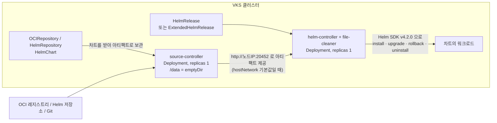

# 13. Helm Controller

> 커리큘럼: [CURRICULUM.md](CURRICULUM.md) · 앞 절: [12. Gatekeeper](12-gatekeeper.md) · 작성 2026-11-06
> 등급: **[근거]** 출처에 그대로 있는 것, **[추론]** 여러 출처를 엮어 직접 내린 결론.
> 기준 판: VKS Add-ons `3.8.0+20261021` (9.1 VKS Add-ons Release Notes, Last Updated November 4, 2026, 2026-11-06 확인). 판 호환은 이 문서에서 정리하지 않는다. [공식 호환 매트릭스](https://interopmatrix.broadcom.com/)와 릴리스 노트를 직접 볼 것.
> 실측 범위: 패키지를 익명으로 받아 ytt 로 렌더링하고 실습의 Flux 리소스 YAML 을 패키지 CRD 스키마로 검사했다. **실제 VKS 클러스터에 설치해 보지는 않았다.** 클러스터 동작에 관한 문장은 그래서 대부분 [추론]이다.

VKS 의 Helm Controller 애드온은 **Flux 의 helm-controller 와 source-controller 두 개만 담은 Carvel 패키지**다. Flux 전체가 아니다. kustomize-controller 도 notification-controller 도 없다. Helm 차트를 `HelmRelease` 라는 리소스로 선언해 두면 컨트롤러가 설치·업그레이드·복구를 맡는다.

Flux 의 개념과 GitOps 흐름은 루트 [`../k8s-cicd.md`](../k8s-cicd.md), Flux 를 직접 까는 방법은 [`../istio-gateway-api.md`](../istio-gateway-api.md) 7장, Helm 자체는 [`../helm.md`](../helm.md)에 있다. 이 절은 그 위에서 다섯 가지만 판다. 첫째, 업스트림과 **판이 얼마나 벌어져 있고** Helm 4 때문에 기본값이 어떻게 바뀌었는지. 둘째, 3.8.0 패키지가 **hostNetwork 를 기본으로 켠다**는 점과 그 영향. 셋째, 두 컨트롤러 모두 cluster-admin 을 쥐는데 `--default-service-account` 를 패키지로 넣을 수 없다는 점. 넷째, Broadcom 이 더한 `ExtendedHelmRelease`. 다섯째, Broadcom 지원이 어디까지인지.

---

## 1. 무엇을 하는가



[근거] 패키지가 까는 구성 요소 (Helm Controller Package Reference, 9.0, 2026-11-06 확인):

| 이름 | 종류 | 네임스페이스 | 복제본 | 하는 일 |
|---|---|---|---|---|
| helm-controller | Deployment | vmware-system-helm | 1 | `HelmRelease` 를 조정해 Helm 작업(설치·업그레이드·롤백·삭제)을 수행 |
| source-controller | Deployment | vmware-system-helm | 1 | `HelmRepository` 등에서 차트를 받아 캐시하고 helm-controller 에 넘김 |

- [근거] Install Helm Controller(9.0)는 이 패키지가 Flux 프로젝트의 Helm Controller 와 Source Controller 를 담았고, `HelmRelease` 로 선언적 차트 관리를 가능하게 한다고 적는다. 공개된 설치 페이지의 본문은 이 소개가 전부다.
- [근거] 렌더링 결과는 리소스 20개다. Deployment 2, ServiceAccount 2, Service 1(`source-controller`), CRD 8, Namespace, LimitRange, ResourceQuota, Secret(`helm-controller-registry-creds`), ClusterRole 1, ClusterRoleBinding 2. (3.8.0+20261021 bundle, ytt v0.55.4, 2026-11-06 실측)
- [근거] CRD 8개는 `helmreleases`·`extendedhelmreleases`, 소스 쪽 `gitrepositories`·`helmrepositories`·`helmcharts`·`ocirepositories`·`buckets`·`externalartifacts` 다. 그래서 Git 저장소의 차트도 쓸 수 있다. 단 Git 의 YAML 을 그대로 적용하는 `Kustomization` 은 없다. (같은 렌더링)
- [근거] `helm-controller` Pod 안에는 Broadcom 이 더한 `file-cleaner` 컨테이너가 같이 돈다. 기본값으로 60분마다 `/tmp` 의 60분 지난 파일을 지운다(패키지 스키마 `fileAgeMinutes`·`intervalMinutes`). 업스트림 Flux 에는 없는 컨테이너다.

### 판과 지원 등급 (3.8.0+20261021 기준)

[근거] 9.1 VKS Add-ons Release Notes 의 저장소별 표. 3.8.0+20261021 은 VKr 1.33~1.37 다섯 마이너 모두 Yes 이고 Product 등급이다.

| 처음 실린 저장소 | Helm Controller 판 | Helm SDK | source-controller | 바뀐 점(릴리스 노트) |
|---|---|---|---|---|
| 3.6.0+20260416 | 1.4.2+v3.19.00-vmware.1-vks.1 | 3.19 | 1.7.0 | 첫 등장 |
| 3.7.0+20260618 | 1.5.4+v4.01.04-vmware.1-vks.1 | 4.1.4 | 1.8.3 | Helm SDK 를 v4 로 |
| 3.7.0+20260723 | 1.5.5+v4.02.00-vmware.1-vks.1 | 4.2.0 | 1.8.5 | 취약점 수정, 레거시 SHA1 체크섬 지원 제거 |
| 3.7.0+20260827 | 1.5.5+v4.02.00-vmware.2-vks.1 | 4.2.0 | 1.8.5 | 업스트림 변경 없음. 두 컨트롤러를 Linux 워커에만 배치, `resourceQuotaConfiguration` 켠 클러스터의 설치 실패 수정 |
| 3.8.0+20261021 | 1.5.5+v4.02.00-vmware.3-vks.1 | 4.2.0 | 1.8.5 | `ExtendedHelmRelease` 도입, CNI 지원을 위한 host network 지원 |

- [근거] 판 이름의 `v4.02.00` 은 Helm SDK 판이다. 3.8.0 이미지의 실행 파일 안 빌드 정보로 `helm-controller/api v1.5.5`, `helm.sh/helm/v4 v4.2.0`, `source-controller/api v1.8.5`, Go 1.26.9 를 확인했다. 이미지 환경 변수는 `GODEBUG=fips140=only` 다. (2026-11-06 실측)
- [근거] 업스트림 최신은 helm-controller v1.7.1, source-controller v1.10.1, Flux v2.10.0 (모두 2026-10-26)이고, v1.5.5 는 2026-05-20 판이다. (GitHub releases, 2026-11-06 확인)
- [추론] 3.8.0 은 helm-controller 업스트림보다 마이너 둘이 뒤다. 그런데 [fluxcd.io 문서](https://fluxcd.io/flux/components/helm/helmreleases/)는 최신 판을 기준으로 적으니, 거기서 본 기능이 VKS 에 없을 수 있다. 예를 들어 v1.7.0 의 `.spec.chart.kind: OCIRepository` 는 패키지 CRD 에 없다. 업스트림 문서를 볼 때는 [태그 v1.5.5 의 spec](https://github.com/fluxcd/helm-controller/blob/v1.5.5/docs/spec/v2/helmreleases.md)을 연다.

### Helm 4 가 바꾼 기본값

[근거] 업스트림 v1.5.0 부터 컨트롤러가 Helm v4 를 쓰면서 기본 동작이 바뀌었다. (helm-controller CHANGELOG 1.5.0)

| 항목 | v1.4 까지(VKS 1.4.2) | v1.5 이후(VKS 1.5.x) |
|---|---|---|
| 새 `HelmRelease` 의 적용 방식 | 클라이언트 쪽 apply | server-side apply |
| 건강 확인 | Helm 3 방식 | kstatus (`poller`) |
| API | `v2`, `v2beta2` | `v2` 만 (`v2beta2` 제거, 올리기 전에 `flux migrate` 필요) |

- [근거] 이미 있는 릴리스는 업그레이드할 때 `auto` 값으로 마지막 성공 판의 적용 방식을 그대로 쓴다. 즉 옛 릴리스는 `.spec.upgrade.serverSideApply: enabled` 를 넣기 전까지 클라이언트 쪽 apply 로 남는다. (같은 출처)
- [근거] 3.8.0 패키지의 `HelmRelease` CRD 는 `v2` 하나만 서비스한다. 소스 CRD 도 모두 `v1` 하나다. (패키지 CRD, 2026-11-06 실측)
- [추론] 1.4.2 에서 1.5.x 로 넘어온 클러스터는 건강 확인 방식이 바뀐다. kstatus 기준으로 Ready 가 안 되는 리소스를 가진 차트는 전에 없던 타임아웃이 날 수 있다. 패키지 값으로는 `UseHelm3Defaults` gate 를 켤 수 없으니(2.3 참고) HelmRelease 마다 `.spec.waitStrategy.name: legacy` 로 돌린다.

---

## 2. VKS 에서 어떻게 들어가는가

설치 경로의 공통 흐름은 [00절](00-repository-and-install-paths.md), Carvel 은 [`../carvel-kapp.md`](../carvel-kapp.md)에 있다. 여기서는 이 패키지만의 특징을 본다.

### 2.1 패키지 안쪽

[근거] Package 의 템플릿 단계는 `ytt -f config/` → `kbld` 다. Helm 차트 렌더링 단계가 없다. (패키지 원본, 2026-11-06 실측) [추론] 즉 Gatekeeper([12절](12-gatekeeper.md))처럼 업스트림 차트를 감싼 것이 아니라 Flux 매니페스트를 바탕으로 한 **ytt 템플릿**이다. `app.kubernetes.io/part-of: flux` 같은 Flux 라벨은 남아 있지만 `flux install` 산출물과 모양이 다른 곳이 있다(2.2, 2.4, 4절).

[근거] 패키지의 Kubernetes 조건은 `addons.kubernetes.vmware.com/kubernetes-version-constraint: '>=1.32.0'` 이고, Package 의 최소 요구량은 CPU 100m·메모리 128Mi(requests), 2000m·2Gi(limits)로 적혀 있다.

[근거] `AddonConfigDefinition`(Package 어노테이션에 gzip+base64 로 들어 있음)의 `templateOutputResources` 가 Cluster CR 의 값을 읽어 `clusterDomain` 과 `coreDNSIP` 를 자동으로 채운다. `coreDNSIP` 는 서비스 CIDR 첫 대역에서 계산한다.

- [추론] 그래서 두 값은 Add-on Management 경로에선 손댈 필요가 없다. 레거시 `vcf package install` 경로는 이 템플릿을 타지 않으니, 클러스터 도메인을 바꾼 환경이라면 `clusterDomain` 을 values 에 직접 넣어야 한다.

### 2.2 hostNetwork 가 기본으로 켜져 있다

3.8.0 패키지에서 가장 눈에 띄는 변경이다. 릴리스 노트는 「Support for enabling host network for CNI support」라고만 적어서 선택 기능처럼 읽히지만, 실제 기본값은 다르다.

- [근거] 패키지 스키마와 `AddonConfigDefinition` 모두 `helmController.hostNetwork`·`sourceController.hostNetwork` 의 기본값이 `true` 다. 설명은 「BYO CNI 가 깔리기 전에 API 서버에 닿게 하려는 것」이고, 「baseline·restricted Pod Security Standards 에서는 허용되지 않는다」고 적혀 있다.
- [근거] 9.0 Package Reference 는 1.4.2 기준 예시라 `hostNetwork`·`clusterDomain`·`coreDNSIP`·`fileCleaner`·probe 값·`deleteFailedHelmRevisions` 가 아예 없다.

기본값 그대로 렌더링한 결과와 끈 결과를 비교하면 이렇다. (ytt v0.55.4, 2026-11-06 실측)

| 항목 | `hostNetwork: true` (기본) | 둘 다 `false` |
|---|---|---|
| 포트 바인딩 | `$(HOST_IP):20440` 등 노드 IP | `:20440` 등 Pod 안 |
| 아티팩트 주소 `--storage-adv-addr` | `http://$(HOST_IP):20452` | `http://source-controller.vmware-system-helm.svc.cluster.local` |
| `wait-for-coredns` init 컨테이너 | 있음 (Deployment 마다) | 없음 |
| DNS | `dnsPolicy: Default` + 직접 만든 resolv.conf | 클러스터 기본 |
| helm-controller 의 필수 podAffinity (source-controller 와 같은 노드) | 있음 | 없음 |

[근거] 패키지 템플릿의 주석은 podAffinity 이유를 「hostNetwork 에서는 아티팩트 서버가 노드 IP 로 광고되는데 다른 노드에서 닿지 않기 때문」이라고 적는다.

[추론] 여기서 세 가지가 따라 나온다.

1. 두 컨트롤러가 스케줄 시점에 한 노드로 묶인다. `source-controller` 가 뜬 노드에 자리가 없으면 `helm-controller` 는 Pending 이다. 규칙이 `requiredDuringSchedulingIgnoredDuringExecution` 이라 뒤에 `source-controller` 만 다른 노드로 옮겨 가면 둘이 갈라질 수 있다. 그때는 `helm-controller` 도 다시 띄운다.
2. 포트 20440·20441·20450·20451·20452 가 노드에서 쓰인다. 같은 포트를 잡는 hostNetwork 워크로드가 있으면 충돌한다.
3. 아티팩트 서버는 평문 HTTP 다. Flux 의 기본 설치는 네임스페이스에 NetworkPolicy 를 두지만 이 패키지의 렌더링 결과에는 없다. 더구나 Kubernetes 문서는 hostNetwork Pod 에 대한 NetworkPolicy 동작을 정의하지 않는다고 적는다. 사설 차트를 쓴다면 이 점을 염두에 둔다. 인증 없이 노드 IP 로 어디까지 받을 수 있는지는 클러스터에서 시험하지 못했다.

[추론] 기본 CNI 를 쓰는 평범한 클러스터라면 스키마 설명의 이유(BYO CNI 전 부트스트랩)에 해당하지 않으니 끄는 쪽을 검토할 만하다. 끄려면 **반드시 두 값을 함께** 끈다. 렌더링해 보면 `helmController.hostNetwork: false` 만 넣었을 때 podAffinity 가 사라지는데 아티팩트 주소는 `http://$(HOST_IP):20452` 로 남는다. 패키지 주석대로라면 두 컨트롤러가 다른 노드에 놓일 때 차트를 못 받는다. (2026-11-06 실측)

### 2.3 고칠 수 있는 값과 없는 값

[근거] 패키지 스키마의 `controllerOptions` 는 `additionalProperties: false` 다. 없는 키를 넣으면 ytt 가 `One or more data values were invalid` 로 멈춘다. (2026-11-06 실측)

| 값 | 기본 | 비고 |
|---|---|---|
| `helmController.controllerOptions.concurrent` | 4 | 동시 조정 수 |
| `...noCrossNamespaceRefs` | false | 네임스페이스 넘는 참조 금지 |
| `...watchAllNamespaces` | true | false 면 `vmware-system-helm` 만 본다 |
| `...deleteFailedHelmRevisions` | true | 실패한 판을 Helm 이력에서 지운다(아래) |
| `...logLevel`·`logEncoding` | info·json | |
| `...metricsAddr`·`healthAddr` | :20440·:20441 | hostNetwork 일 때 충돌 나면 여기를 바꾼다 |
| `sourceController.controllerOptions.metricsAddr`·`healthAddr`·`storageAddr` | :20450·:20451·:20452 | 같은 이유 |
| `helmController.fileCleaner.*` | 60분·60분 | |
| `*.hostNetwork` | true | 2.2 |
| `*.livenessFailureThreshold` 등 | 10 | 느린 부트스트랩 대비 |
| `sourceController.controllerOptions.storageAdvAddr` | "" | 비면 위 표대로 정해짐 |
| `nsLimitRange.defaultRequests` | 50m·64Mi | 네임스페이스 LimitRange |

[근거] 스키마에 **없는** 것: 복제본 수, `--default-service-account`, `--http-timeout`, 임의의 feature gate. 업스트림 Flux 에서 패치로 넣던 설정을 여기서는 values 로 넣을 수 없다.

- [근거] `--feature-gates=DeleteFailedHelmRevisions=True` 는 업스트림 v1.5.5 의 `internal/features/features.go` 에 없고, VKS 이미지의 실행 파일 안에는 그 문자열이 있다. [추론] Broadcom 이 더한 gate 로 보인다. [근거] 스키마 설명은 「실패한 판을 Helm 이력에서 지울지 정한다」이고 동작을 설명한 공개 문서는 찾지 못했다.
- [근거] ytt 템플릿은 `if opts.deleteFailedHelmRevisions:` 일 때만 플래그를 더한다. `false` 로 주면 플래그가 사라진다(렌더링 실측). [추론] 그때의 값은 바이너리 안 기본값을 따를 텐데, 그 기본값은 확인하지 못했다.
- [추론] 기본값 그대로면 `helm history` 에서 실패한 판이 안 보일 수 있다. 실패 원인은 `HelmRelease` 의 status·이벤트에서 찾는다.

### 2.4 권한 구조

- [근거] `cluster-reconciler` ClusterRoleBinding 이 `helm-controller` **와 `source-controller`** 두 ServiceAccount 에 `cluster-admin` 을 준다. (패키지 `config/rbac.yml`)
- [근거] Flux v2.8.0 의 같은 이름 바인딩은 `kustomize-controller` 와 `helm-controller` 만 잇는다. `source-controller` 는 없다. (flux2 `manifests/rbac/reconciler.yaml`)
- [근거] 업스트림 HelmRelease 문서는 기본적으로 릴리스가 클러스터 관리자 계정으로 돌고, 멀티 테넌트에서는 `--default-service-account` 로 impersonation 을 강제하라고 안내한다.
- [추론] 그런데 2.3 대로 그 플래그는 패키지 값으로 넣을 수 없다. 그래서 **네임스페이스에 `HelmRelease` 를 만들 수 있는 사람은 사실상 cluster-admin 이다.** `spec.serviceAccountName` 을 비워 두면 컨트롤러 권한으로 차트의 ClusterRoleBinding 이든 뭐든 적용하기 때문이다. 대신할 수 있는 방법은 두 가지다. 생성 RBAC 를 플랫폼 관리자로 한정하거나, Gatekeeper([12절](12-gatekeeper.md))로 `spec.serviceAccountName` 을 강제한다. 어느 쪽이든 **`helmreleases.helm.toolkit.fluxcd.io` 와 `extendedhelmreleases.helm.toolkit.vmware.com` 을 둘 다** 대상에 넣는다. 같은 reconciler 가 처리하고 EHR 에도 같은 필드가 있어서, 하나만 막으면 다른 쪽으로 우회된다. 여기에 `noCrossNamespaceRefs: true` 를 더한다.
- [근거] 업스트림 flux2 의 `manifests/rbac/` 에는 `edit.yaml`·`view.yaml` 이 있지만 이 패키지의 ClusterRole 은 `crd-controller` 하나뿐이다. [추론] 일반 사용자에게 HelmRelease 조회 권한을 주려면 Role 을 직접 만들어야 한다.

### 2.5 Namespace 와 ResourceQuota

- [근거] `vmware-system-helm` 네임스페이스 라벨은 `pod-security.kubernetes.io/enforce: privileged` 이고 `warn: restricted` 다. [추론] 그래서 hostNetwork 기본값이 PSA 를 통과한다.
- [근거] 패키지는 `hard` 없이 `scopeSelector` 만 있는 ResourceQuota 를 하나 둔다(`system-node-critical`·`system-cluster-critical`). 릴리스 노트는 `resourceQuotaConfiguration` 을 켠 클러스터에서 system-* priorityClass 를 쓰려면 이 CR 이 있어야 하고, 1.5.5+v4.02.00-vmware.2-vks.1 에서 고쳤다고 적는다.
- [근거] 두 Deployment 는 `replicas: 1`, `strategy: Recreate` 다. source-controller 의 `/data` 는 emptyDir 다.
- [추론] 컨트롤러가 재시작되는 동안 조정이 멈출 뿐 이미 설치된 차트의 워크로드는 그대로 돈다. source-controller 가 재시작되면 캐시가 비니 차트를 다시 받는다. 사설 레지스트리가 그때 죽어 있으면 조정이 실패한다.

### 2.6 `ExtendedHelmRelease`

[근거] 3.8.0 패키지에 추가된 CRD 다. 그룹은 `helm.toolkit.vmware.com`, 버전 `v2`, 짧은 이름 `ehr`. CRD 설명에 따르면 「업스트림 HelmRelease CRD 스키마에서 의도적으로 뺀 Broadcom 필드를 노출하는 VMware 전용 짝」이다. **한 릴리스에 HelmRelease 와 ExtendedHelmRelease 를 같이 만들면 안 된다**고 못 박고 있고, 두 CRD 를 같은 reconciler 가 처리한다.

업스트림 v1.5.5 CRD 와 패키지 CRD 를 diff 해서 나온 차이는 이렇다. (2026-11-06 실측)

| 필드 | 위치 | 뜻 (CRD 설명) |
|---|---|---|
| `install.dryRun`·`upgrade.dryRun` | EHR | `helm`(helm dry-run=server)·`kubectl`(kubectl dry-run=server, 매니페스트 추가 검증)·`all` 목록 |
| `rollbackVersion` | EHR | 되돌릴 Helm revision. 설정하면 `chart`·`chartRef` 둘 다 없어도 CEL 검증을 통과한다 |
| `install.labels`·`upgrade.labels` | EHR | Helm 릴리스 메타데이터에 붙일 라벨 |
| `commonMetadata.propagateToChildResources` | EHR | `commonMetadata.labels` 를 워크로드의 Pod 템플릿까지 전파(기본 false) |
| `dependsOn[].labels` | EHR | 의존 대상 라벨을 대조 |
| `status.history[].description`·`rollbackVersion` | **HelmRelease 에도** 추가 | |
| `status.rollbackFailures`, `lastAttemptedReleaseAction` 의 `rollback` | **HelmRelease 에도** 추가 | |

- [근거] 패키지의 `HelmRelease` CRD 는 업스트림 파일과 똑같지 않다. status 쪽에 위 항목이 더 있고 CRD 설명에 `#region Broadcom` 표지가 남아 있다. spec 은 같다.
- [근거] CRD 설명은 EHR 의 status 를 업스트림과 같은 모양으로 둬서 Flux CLI·Lens 같은 도구가 읽을 수 있게 했다고 적는다.
- [추론] 읽기는 그렇다 해도 `flux reconcile helmrelease` 처럼 kind 를 고정한 명령은 EHR 에 쓰지 못할 것이다. 필드의 실제 동작을 설명한 Broadcom 공개 문서도 2026-11-06 까지 찾지 못했다. 3.2 의 기본 `HelmRelease` 부터 쓰고, 드라이런이 정말 필요할 때만 EHR 로 간다.

### 2.7 지원 범위

[근거] 릴리스 노트의 지원 경계. Product 등급 애드온은 설치·삭제·업그레이드와 애드온 자체의 동작을 지원하지만, 예시로 「Helm Controller 애드온 자체의 문제는 보지만 **사용자 차트·릴리스의 작성·디버깅·문제 해결은 돕지 않는다**」고 적었다. 또 「Broadcom 문서에 실린 파라미터·기능으로 한정하고, 업스트림 OSS 문서나 커뮤니티 블로그에만 있는 설정은 검토하지 않는다」고 적었다.

[근거] 같은 절은 사용자 ytt 오버레이도 지원 밖이라고 적는다. 그래서 스키마에 없는 플래그를 오버레이로 넣는 우회는 지원을 포기하는 일이다.

[추론] 이 절에서 다룬 `HelmRelease` 의 많은 필드는 업스트림 문서에만 있다. 2.2 의 `hostNetwork: false` 와 2.6 의 EHR 필드도 패키지 스키마·CRD 에는 있지만 공개 문서에서는 찾지 못했다. 바꾸기 전에 지원 여부를 벤더에 확인한다. 장애가 나면 「컨트롤러가 돌고 있는가」까지가 벤더 몫이고, 차트 문제는 운영 팀 몫이라고 보는 편이 안전하다.

### 2.8 Helm add-on 과의 관계

[근거] 3.8.0+20261021 저장소의 `packages/` 는 디렉터리 23개이고 그중 External Secrets Operator 나 Tekton 은 없다. `.imgpkg/images.yml` 에도 없다. 릴리스 노트는 이 둘을 「Helm add-on」이라고 부른다. (2026-11-06 실측)

[추론] 이름만 보면 Helm Controller 를 쓸 것 같지만 그 연결을 확인한 공개 문서를 찾지 못했다. 24·25절에서 확인한다.

---

## 3. 실습

> 아래 YAML 중 `OCIRepository`·`HelmRelease`·`ExtendedHelmRelease` 는 패키지 CRD 스키마로 필드 이름·enum·필수값을 검사했다. AddonConfig·RBAC 는 그 검사 대상이 아니고, 클러스터에는 어느 것도 적용해 보지 않았다. 이름(`demo-cluster`, `demo-ns`, `apps`)은 예시 값이다.

### 3.1 설치 (Supervisor 컨텍스트)

공개 문서에 이 패키지의 kubectl 절차는 없다. [추론] 다른 애드온과 같은 틀이라고 보고 [12절](12-gatekeeper.md) 3.1 을 따른다. 다만 `addonConfigDefinitionRef` 는 이 패키지의 Package Reference 예시에서 가져왔고, 12절의 `owned-for-deletion` 어노테이션은 Package Reference 예시에 없어 넣지 않았다. [00절](00-repository-and-install-paths.md)대로 이 어노테이션이 없으면 ClusterAddon 을 지워도 AddonConfig 가 남는다. 이름은 짐작하지 말고 먼저 조회한다.

```bash
kubectl get addonrelease -n vmware-system-vks-public | grep helm-controller
kubectl get addonconfigdefinition -n vmware-system-vks-public | grep helm-controller
```

```yaml
# addonconfig.yaml, 평범한 CNI 클러스터에서 hostNetwork 를 끄는 예
apiVersion: addons.kubernetes.vmware.com/v1alpha1
kind: AddonConfig
metadata:
  name: demo-cluster-helm-controller
  namespace: demo-ns
spec:
  addonConfigDefinitionRef:
    name: helm-controller.kubernetes.vmware.com.1.5.5---v4.02.00-vmware.3-vks.1
    namespace: vmware-system-vks-public
  clusterName: demo-cluster
  values:
    helmController:
      hostNetwork: false
      controllerOptions:
        noCrossNamespaceRefs: true
    sourceController:
      hostNetwork: false
```

```bash
kubectl apply -f addonconfig.yaml
# AddonInstall 은 위에서 조회한 AddonRelease 이름으로 12절 3.1 처럼 만든다

# 클러스터 컨텍스트로
kubectl -n vmware-system-helm get deploy,pod,svc -o wide
kubectl get crd | grep -E 'toolkit.fluxcd.io|toolkit.vmware.com'
```

### 3.2 OCI 차트를 HelmRelease 로 설치

[근거] 업스트림은 운영 환경에 `OCIRepository` + `chartRef` 를 권한다. `HelmRepository` 의 `type: oci` 는 유지 보수 모드다. (HelmRelease Recommended settings, HelmRepository spec, source-controller v1.8.5)

```yaml
# podinfo.yaml
apiVersion: source.toolkit.fluxcd.io/v1
kind: OCIRepository
metadata:
  name: podinfo-chart
  namespace: apps
spec:
  interval: 10m
  url: oci://ghcr.io/stefanprodan/charts/podinfo
  layerSelector:
    mediaType: "application/vnd.cncf.helm.chart.content.v1.tar+gzip"
    operation: copy
  ref:
    tag: "6.17.0"              # 실습은 태그 고정. 운영도 semver 범위보다 고정이 재현에 낫다
---
apiVersion: helm.toolkit.fluxcd.io/v2
kind: HelmRelease
metadata:
  name: podinfo
  namespace: apps
spec:
  releaseName: podinfo
  serviceAccountName: apps-deployer    # 비우면 cluster-admin 으로 돈다 (2.4)
  chartRef:
    kind: OCIRepository
    name: podinfo-chart
  interval: 30m
  driftDetection:
    mode: warn                 # 처음엔 warn 으로 보고 enabled 로
  install:
    strategy:
      name: RetryOnFailure
      retryInterval: 5m
  upgrade:
    strategy:
      name: RemediateOnFailure
    remediation:
      retries: 2
      strategy: rollback
  values:
    replicaCount: 2
```

```yaml
# rbac.yaml, 이 네임스페이스 안에서만 움직이는 impersonation 대상
apiVersion: v1
kind: Namespace
metadata:
  name: apps
  labels:
    pod-security.kubernetes.io/enforce: baseline   # 아래 설명 참고
---
apiVersion: v1
kind: ServiceAccount
metadata:
  name: apps-deployer
  namespace: apps
---
apiVersion: rbac.authorization.k8s.io/v1
kind: RoleBinding
metadata:
  name: apps-deployer
  namespace: apps
roleRef:
  apiGroup: rbac.authorization.k8s.io
  kind: ClusterRole
  name: admin
subjects:
- kind: ServiceAccount
  name: apps-deployer
  namespace: apps
```

[근거] 이 리포의 [`../vks-cluster-management.md`](../vks-cluster-management.md) PSA 절에 따르면 VKr 1.26 이상은 기본이 enforce restricted 다. [근거] podinfo 6.17.0 차트의 Deployment 에는 `securityContext` 가 없다(`helm template` 실측). [추론] 그래서 네임스페이스 라벨 없이 넣으면 Pod 가 거절되고 HelmRelease 가 건강 확인 타임아웃으로 실패한다. 실습이니 baseline 으로 낮췄다. 이 실습은 Namespace·RoleBinding·Flux 리소스를 만들 수 있는 관리자 계정으로 돌린다(패키지에 aggregate ClusterRole 이 없어 `admin`·`edit` 로는 HelmRelease 를 만들지 못한다). 운영이라면 라벨을 낮추지 말고 차트 values 로 restricted 를 맞춘다.

```bash
kubectl apply -f rbac.yaml      # Namespace 가 먼저 있어야 한다
kubectl apply -f podinfo.yaml
kubectl -n apps get ocirepository,helmrelease
kubectl -n apps describe helmrelease podinfo
kubectl -n vmware-system-helm logs deploy/helm-controller -c manager | tail -20
```

Flux CLI 없이 다시 조정시키는 방법은 어노테이션이다. [근거] 업스트림 문서의 Triggering a reconcile 절은 `reconcile.fluxcd.io/requestedAt` 에 이전과 다른 값을 주라고 한다. 아래 명령은 문서 예시를 줄여 쓴 것이다(`--field-manager` 생략).

```bash
kubectl -n apps annotate --overwrite helmrelease podinfo \
  reconcile.fluxcd.io/requestedAt="$(date +%s)"
```

### 3.3 드리프트를 일부러 만들기

```bash
kubectl -n apps scale deploy podinfo --replicas=5
kubectl -n apps annotate --overwrite helmrelease podinfo \
  reconcile.fluxcd.io/requestedAt="$(date +%s)"
kubectl -n apps get events --field-selector involvedObject.kind=HelmRelease | tail
```

[근거] `mode: warn` 은 이벤트만 내고, `enabled` 는 서버 쪽 dry-run 결과로 고친다. 상세 JSON Patch 는 `--log-level=debug` 일 때 컨트롤러 로그에 남는다. (HelmRelease Drift detection) values 로는 `helmController.controllerOptions.logLevel: debug` 다.

[근거] 드리프트 감지는 업스트림에서 HelmRelease 마다 켜는 필드다. `interval` 이 길면 그만큼 늦게 발견한다.

### 3.4 클러스터 없이 values 영향 보기

bundle 은 [10절](10-harbor.md)·[11절](11-istio.md)과 같은 방법으로 받는다. 저장소 `.imgpkg/images.yml` 에서 `helm-controller` 다이제스트(3.8.0+20261021 은 `sha256:49153228…`)를 찾아 익명으로 받는다. 차트가 없으니 `helm template` 없이 ytt 만 돌리면 된다.

```bash
# bundle 을 받은 디렉터리에서
ytt -f config/ > default.yaml

ytt -f config/ \
  --data-value-yaml helmController.hostNetwork=false \
  --data-value-yaml sourceController.hostNetwork=false > nohost.yaml

diff <(grep -E 'storage-adv-addr|hostNetwork|podAffinity' default.yaml) \
     <(grep -E 'storage-adv-addr|hostNetwork|podAffinity' nohost.yaml)
```

### 3.5 ExtendedHelmRelease 로 서버 쪽 드라이런 (선택)

[추론] 필드 이름은 CRD 에서 가져왔지만 Broadcom 문서에 예시가 없다. 동작은 직접 확인해야 한다. 아래 예시는 `releaseName` 이 달라 3.2 의 `podinfo` 와 충돌하지 않는다. 같은 릴리스 이름을 쓰면 안 된다.

```yaml
apiVersion: helm.toolkit.vmware.com/v2
kind: ExtendedHelmRelease
metadata:
  name: podinfo-ext
  namespace: apps
spec:
  releaseName: podinfo-ext
  serviceAccountName: apps-deployer
  chartRef:
    kind: OCIRepository
    name: podinfo-chart
  interval: 30m
  install:
    dryRun:
    - kubectl
  upgrade:
    dryRun:
    - helm
```

```bash
kubectl -n apps get ehr
kubectl -n apps describe ehr podinfo-ext
```

---

## 4. 업스트림 설치와 다른 점

오픈소스 Flux 설치는 [`../istio-gateway-api.md`](../istio-gateway-api.md) 7.1 의 `flux install` 이다.

| | VKS 애드온 | 업스트림 `flux install` |
|---|---|---|
| 구성 | helm·source 두 개 | 기본은 kustomize·notification 까지 |
| 네임스페이스 | `vmware-system-helm` | `flux-system` |
| 매니페스트 | Broadcom ytt 템플릿 | Kustomize 기반 |
| Pod 네트워크 | hostNetwork 기본 켜짐 | Pod 네트워크 |
| NetworkPolicy | 없음 | 있음 |
| source-controller 권한 | cluster-admin | `crd-controller` 수준 |
| 튜닝 | 스키마에 있는 값만 | 패치로 플래그 자유롭게 |
| 판 | helm-controller 1.5.5 | 최신 1.7.1 |
| 알림 | Kubernetes Event 뿐 (`Alert`·`Provider` 없음) | notification-controller |
| 추가 CRD | `ExtendedHelmRelease` | 없음 |
| 이미지 | `GODEBUG=fips140=only` | 업스트림 이미지 |

- [추론] `flux` CLI 는 `flux get helmreleases -A`, `flux logs --flux-namespace=vmware-system-helm` 정도로 쓸 수 있겠지만(기본 네임스페이스가 `flux-system` 이라 지정이 필요하다) `flux check`·`flux install` 은 `flux-system` 전체 구성을 전제로 하니 VKS 애드온 위에서 돌리지 않는다. 이 조합을 시험하지는 못했다.
- [추론] `flux install` 을 같은 클러스터에 또 돌리면 CRD 를 두 쪽이 소유하게 된다. 애드온이 있는 클러스터에서는 하지 않는다.

---

## 5. 흔한 실수

1. **Flux 가 전부 깔렸다고 본다.** [근거] `Kustomization`·`Alert` CRD 가 없다. `kubectl get kustomization` 이 실패하는 것이 정상이다.
2. **fluxcd.io 의 최신 문서로 YAML 을 쓴다.** [근거] v1.7.0 의 `.spec.chart.kind` 는 1.5.5 CRD 에 없다. 태그 v1.5.5 문서를 본다.
3. **`v2beta2` 예제를 그대로 넣는다.** [근거] CRD 가 `v2` 만 서비스한다.
4. **`spec.serviceAccountName` 을 비운다.** [추론] cluster-admin 으로 돈다. 2.4 를 본다. RBAC 나 정책을 걸 때 `ExtendedHelmRelease` 를 빼먹지 않는다.
5. **`helmController.hostNetwork: false` 하나만 넣는다.** [추론] podAffinity 가 없어지고 아티팩트 주소는 노드 IP 로 남는다. 두 값을 같이 바꾼다.
6. **PSS 를 조이려고 네임스페이스 라벨을 restricted 로 바꾼다.** [근거] 스키마 설명대로 기본 hostNetwork 는 baseline 에서도 막힌다. [추론] 먼저 hostNetwork 를 끄고, 그래도 패키지가 네임스페이스를 다시 맞출 수 있음을 감안한다.
7. **9.0 Package Reference 의 AddonConfig 예시를 그대로 쓴다.** [근거] `addonConfigDefinitionRef` 가 `1.4.2---v3.19.00-vmware.1-vks.1` 이고 3.8.0 의 값 일부가 없다.
8. **실패 판을 `helm history` 에서 찾는다.** [추론] `DeleteFailedHelmRevisions=True` 가 기본이다. `kubectl describe helmrelease` 와 `.status.history` 를 본다.
9. **`install.remediation.retries` 만 믿고 기다린다.** [근거] 기본 `RemediateOnFailure` 의 retries 기본값은 0 이다. 설치가 한 번 실패하면 재시도하지 않는다. 오래 걸리는 워크로드는 `RetryOnFailure` 를 고려한다.
10. **CRD 업그레이드를 기대한다.** [근거] `.spec.upgrade.crds` 기본은 `Skip` 이고 설치는 `Create` 다. 제3자 차트가 CRD 를 바꾸면 `CreateReplace` 를 명시해야 한다.
11. **한 릴리스에 HelmRelease 와 ExtendedHelmRelease 를 같이 만든다.** [근거] CRD 설명이 금지한다.
12. **차트 장애를 벤더에 올린다.** [근거] 2.7 범위 밖이다.
13. **애드온부터 지운다.** [추론] CRD 와 함께 `HelmRelease` 가 사라지는 동안 컨트롤러도 내려가면 finalizer 처리가 꼬일 수 있다. 시험하지는 못했다. `HelmRelease` 를 먼저 지워 차트를 내린 뒤 애드온을 지운다.

## 6. 확인 문제

1. 3.8.0 클러스터에서 `helm-controller` Pod 만 Pending 이고 이벤트에 `didn't match pod affinity rules` 가 나온다. 왜 이런 제약이 있는지 패키지 기본값으로 설명하고, 해결책 두 가지를 적어라.
2. 네임스페이스 관리자에게 `HelmRelease` 생성 권한만 줬는데 보안 담당자가 위험하다고 한다. 어떤 권한 상승이 가능한지, 업스트림에서 쓰는 해법이 VKS 패키지에서 왜 그대로 안 되는지, 대신 무엇을 할지 적어라.
3. 팀원이 fluxcd.io 문서를 보고 `.spec.chart.kind: OCIRepository` 를 넣었더니 거절됐다. 원인을 판 숫자로 설명하고, 같은 일을 VKS 1.5.5 에서 하는 YAML 의 핵심 두 줄을 적어라.

<details>
<summary>풀이</summary>

1. 3.8.0 은 hostNetwork 가 기본 켜짐이고, 그때 아티팩트 서버가 노드 IP 로 광고된다. 패키지는 이것이 다른 노드에서 닿지 않는다고 보고 helm-controller 에 source-controller 와 같은 노드라는 필수 podAffinity 를 건다. 그 노드에 자원이 없으면 Pending 이다. 해결은 그 노드의 자원을 비우거나, `helmController.hostNetwork`·`sourceController.hostNetwork` 를 **둘 다** false 로 해서 Service 주소를 쓰게 하는 것이다.

2. `spec.serviceAccountName` 없이 만든 HelmRelease 는 컨트롤러 권한(cluster-admin)으로 적용되니, 차트에 ClusterRoleBinding 을 넣으면 클러스터 관리자가 될 수 있다. 업스트림 해법은 `--default-service-account` 인데, 패키지 스키마가 `additionalProperties: false` 라 이 플래그를 넣을 수 없다. 대신 생성 RBAC 를 플랫폼 관리자로 좁히거나, Gatekeeper 로 `serviceAccountName` 을 강제하고, `noCrossNamespaceRefs: true` 를 켠다. 대상에는 `ExtendedHelmRelease` 도 넣는다.

3. 그 필드는 helm-controller v1.7.0 에서 들어왔고 VKS 3.8.0 은 v1.5.5 다. `OCIRepository` 를 따로 만들고 `spec.chartRef` 로 참조한다.

   ```yaml
   chartRef:
     kind: OCIRepository
     name: podinfo-chart
   ```

</details>

## 7. 출처 (모두 2026-11-06 확인)

**Broadcom**

- 9.1 VKS Add-ons Release Notes (Last Updated November 4, 2026): <https://techdocs.broadcom.com/us/en/vmware-cis/vcf/vcf-service-administration-and-development/9-1/release-notes/vks-addons-release-notes.html>
- Helm Controller Package Reference (9.0): <https://techdocs.broadcom.com/us/en/vmware-cis/vcf/vcf-service-administration-and-development/9-0/managing-vsphere-kuberenetes-service-clusters-and-workloads/installing-standard-packages-on-tkg-service-clusters/standard-package-reference/helm-controller-package-reference(2).html>
- Install Helm Controller (9.0): <https://techdocs.broadcom.com/us/en/vmware-cis/vcf/vcf-service-administration-and-development/9-0/managing-vsphere-kuberenetes-service-clusters-and-workloads/installing-standard-packages-on-tkg-service-clusters/installing-standard-packages-on-tkg-cluster-using-tkr-for-vsphere-8-x/install-helm-controller(1).html>
- 패키지 원본: `projects.packages.broadcom.com/vsphere/supervisor/vks-standard-packages/3.8.0-20261021/vks-addons:3.8.0-20261021` 의 `packages/helm-controller.kubernetes.vmware.com/` 와 bundle(다이제스트 `sha256:49153228…`), 익명 pull

**Flux**

- HelmRelease spec v1.5.5: <https://github.com/fluxcd/helm-controller/blob/v1.5.5/docs/spec/v2/helmreleases.md>
- helm-controller CHANGELOG: <https://github.com/fluxcd/helm-controller/blob/v1.7.1/CHANGELOG.md>
- helm-controller feature gate v1.5.5: <https://github.com/fluxcd/helm-controller/blob/v1.5.5/internal/features/features.go>
- HelmRepository spec source-controller v1.8.5: <https://github.com/fluxcd/source-controller/blob/v1.8.5/docs/spec/v1/helmrepositories.md>
- Flux 멀티 테넌시 설정: <https://fluxcd.io/flux/installation/configuration/multitenancy/>
- flux2 v2.8.0 RBAC·NetworkPolicy: <https://github.com/fluxcd/flux2/tree/v2.8.0/manifests>

**Kubernetes·도구**

- Network Policies (hostNetwork 절): <https://kubernetes.io/docs/concepts/services-networking/network-policies/>
- ytt v0.55.4: <https://github.com/carvel-dev/ytt/releases/tag/v0.55.4>
- crane(이미지·bundle 받기): <https://github.com/google/go-containerregistry>
