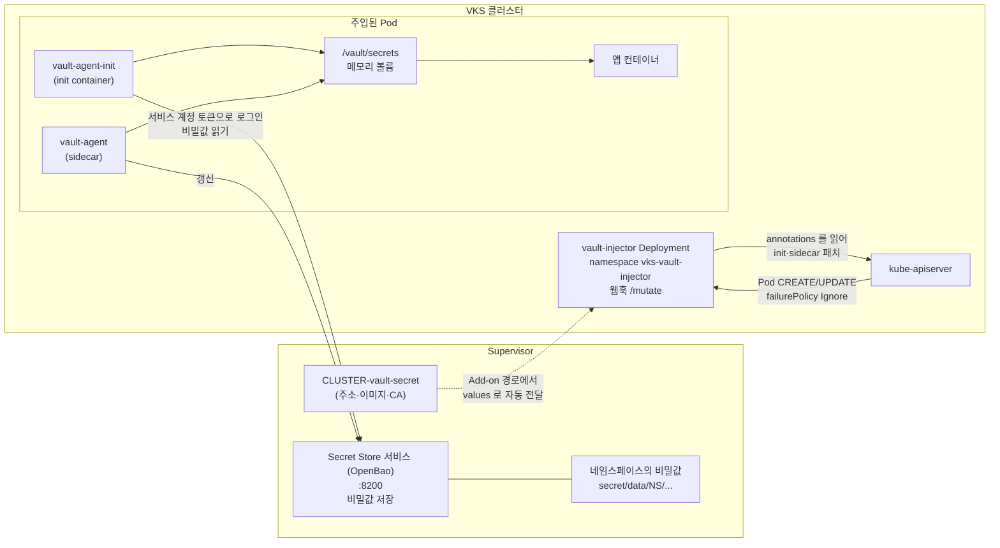

# 14. Vault Injector

> 커리큘럼: [CURRICULUM.md](CURRICULUM.md) · 앞 절: [13. Helm Controller](13-helm-controller.md) · 작성 2026-11-06
> 등급: **[근거]** 출처에 그대로 있는 것, **[추론]** 여러 출처를 엮어 직접 내린 결론.
> 기준 판: VKS Add-ons `3.8.0+20261021` (9.1 VKS Add-ons Release Notes, Last Updated November 4, 2026, 2026-11-06 확인). 판 호환은 이 문서에서 정리하지 않는다. [공식 호환 매트릭스](https://interopmatrix.broadcom.com/)와 릴리스 노트를 직접 볼 것.

Vault Injector 애드온은 **Pod 에 비밀값을 넣어 주는 승인 웹훅 하나**다. 비밀값 저장소는 들어 있지 않다. 저장소는 Supervisor 쪽 **Secret Store 서비스**(OpenBao 기반)이고, 이 패키지는 VKS 클러스터 안에서 Pod 정의를 고쳐 에이전트 컨테이너를 끼워 넣는 일만 한다.

그래서 이 절의 무게는 패키지 설치가 아니라 **세 가지 연결**에 있다. 첫째, Secret Store 서비스와 VKS 클러스터가 어떻게 이어지는지(자동으로 생기는 경로·정책·역할). 둘째, 그 연결값이 Add-on 경로에서는 어떻게 자동으로 들어오고, 레거시 패키지 경로에서는 왜 직접 채워야 하는지. 셋째, 공식 예시를 그대로 쓰면 어디서 막히는지.

[근거] 이 절의 렌더링 결과는 공개 저장소의 패키지 원본을 익명으로 받아 ytt v0.55.4 로 직접 돌린 것이다. **클러스터에 설치해 보지는 못했다.** 실제 주입과 클러스터 쪽 확인(3.2~3.4)은 문서와 소스에서 읽은 내용이고 실측이 아니다.

---

## 1. 무엇을 하는가



| 구성 요소 | 어디에 | 하는 일 |
|---|---|---|
| Secret Store 서비스 | Supervisor | [근거] 비밀값을 관리·보호하는 중앙 서비스. OpenBao 를 쓴다. 비밀값은 한 네임스페이스에 속하고 그 네임스페이스의 워크로드만 쓸 수 있다 (Installing and Configuring the Secret Store Service, 9.1) |
| `vault-injector` Deployment | VKS 클러스터 `vks-vault-injector` | [근거] Pod 에 Vault Agent 컨테이너를 더하는 승인 웹훅. 패키지 설명: 「Vault Secret 을 Pod 안 공유 메모리 볼륨에 렌더링한다」 (패키지 `metadata.yml`) |
| `vault-agent-init`·`vault-agent` | 주입된 Pod | [근거] init 컨테이너가 앱보다 먼저 비밀값을 채우고, 사이드카가 실행 중에 유지한다. 이름은 업스트림 소스의 고정값이다 (vault-k8s v1.7.4 `container_init_sidecar.go`·`container_sidecar.go`) |

[근거] 패키지를 렌더링하면 나오는 리소스 13개: Namespace, ServiceAccount, Deployment, ClusterRole·ClusterRoleBinding, Role·RoleBinding, MutatingWebhookConfiguration, Service, kapp `Config`, ConfigMap(kbld 설정), LimitRange, Secret(이미지 풀 자격). `externalIP` 와 CA 를 주면 Service·Endpoints·`server-cert` Secret 3개가 더해져 16개가 된다. (3.8.0+20261021 bundle, 2026-11-06 실측)

[근거] ClusterRole 은 `mutatingwebhookconfigurations` get·list·watch·patch 와 `nodes` get 뿐이고, 비밀값·Pod 권한은 자기 네임스페이스 Role 안에 있다. `resourceNames` 제한은 없다. (bundle `config/config.yml`) [추론] cluster-admin 보다는 좁지만, 클러스터의 다른 변형 웹훅까지 patch 할 수 있는 권한이다.

### 판과 지원 등급 (3.8.0+20261021 기준)

[근거] 9.1 VKS Add-ons Release Notes 의 저장소별 표.

| 저장소 | Vault Injector 판 | 바뀐 점(릴리스 노트) |
|---|---|---|
| 3.6.0+20260211 | `1.6.2+vmware.1-vks.1` | 처음 들어옴. Add-on 관리로 클러스터 생성 때 자동 설치 |
| 3.6.0+20260416 | `1.6.2+vmware.1-vks.2` | 취약점 수정 |
| 3.7.0+20260618 | `1.7.4+vmware.1-vks.1` | Kubernetes 1.34 이상에서 priority class 설정 지원. `1.6.2+vmware.1-vks.2` 에서 부드러운 업그레이드 |
| 3.7.0+20260723 ~ 20260924 | `1.7.4+vmware.2-vks.1` | 3.7.0+20260924 에 Windows 노드 알려진 문제 등재 |
| **3.8.0+20261021** | **`1.7.4+vmware.4-vks.1`** | Windows 클러스터는 지원하지 않음. 워커 노드 없는 Linux 클러스터는 지원. Windows 관련 알려진 문제 해결 |

- [근거] 3.8.0+20261021 표에서 Product 등급이다. VKr 과의 짝은 [공식 호환 매트릭스](https://interopmatrix.broadcom.com/)로 확인한다.
- [근거] 업스트림 `hashicorp/vault-k8s` 는 v1.7.4 가 2026-04-30, v1.7.7 이 2026-10-27 에 나왔다. 패키지는 v1.7.4 이미지다(bundle `.imgpkg/images.yml`, 다이제스트 `sha256:e0060c82…`).
- [근거] Product 등급이라도 지원 범위는 애드온 자체의 동작이고, 공개 문서에 없는 매개변수와 사용자 ytt 오버레이는 지원 밖이다. (9.1 릴리스 노트 Scope of Support Boundaries)

---

## 2. VKS 에서 어떻게 들어가는가

Carvel 기초는 [`../carvel-kapp.md`](../carvel-kapp.md), 두 설치 경로는 [00절](00-repository-and-install-paths.md)에 있다.

### 2.1 Add-on 경로: Secret Store 서비스가 켜면 따라온다

대부분의 애드온과 달리 **사용자가 `AddonInstall` 을 만드는 문서를 찾지 못했다.** 9.0 Standard Package 표·참조 목차와 Secret Store 문서에서 Install Vault Injector 쪽을 찾지 못했고(2026-11-06), 설명은 Secret Store 쪽 주입 문서에 한 문단 있다.

- [근거] 「VKS 3.6 부터 vault-injector 애드온 패키지가 VKS 클러스터 Pod 에 비밀값을 넣게 해 준다. 패키지는 VKS 저장소에 미리 구성돼 있고 Add-on Management 로 여러 VKS 클러스터에 자동 배포할 수 있다.」 (Inject Secrets in to Pods on VKS Clusters (VCF 9.1))
- [근거] 3.7.0+20260924 알려진 문제는 이 애드온을 「Secret Store Supervisor Service 가 배포하는 vault-injector add-on」이라 부르고, Secret Store 서비스를 깔면 Windows 노드가 있는 **기존 클러스터까지** 영향을 받는다고 적었다. 그 클러스터에서는 `vault-injector` ClusterAddon 이 생겨 있다.
- [근거] 같은 문제의 우회책은 Cluster 라벨이다: `kubectl label cluster <cluster-name> -n <namespace-name> vault-injector.kubernetes.vmware.com/install=false --overwrite`. 그러면 해당 네임스페이스의 ClusterAddon 이 지워진다. (같은 출처)

[추론] 이 둘을 합치면 흐름은 이렇다. Windows 노드 한정으로 쓰인 설명이지만 일반화하면, Secret Store 서비스를 Supervisor 에 설치할 때 그 Supervisor 의 VKS 클러스터에 vault-injector ClusterAddon 이 생기고, 설치 스위치는 사용자의 AddonInstall 이 아니라 위 라벨이다. 04절 Cluster Autoscaler 가 Cluster 라벨로 내장 AddonInstall 을 켜는 것과 같은 모양이다.

### 2.2 AddonConfigDefinition 이 Supervisor 의 값을 옮겨 준다

패키지 어노테이션에 든 AddonConfigDefinition 을 풀면 입력이 둘이다.

| 입력 이름 | 리소스 | 필수 |
|---|---|---|
| `ClusterCR` | `Cluster/<cluster>` (`cluster.x-k8s.io/v1beta2`) | 예 |
| `vaultConfig` | `Secret/<cluster>-vault-secret` | 아니오 (`constraints: optional`) |

출력은 워크로드 클러스터의 `vmware-system-tkg/<cluster>-vault-k8s-data-values` Secret 이고, 키는 아래처럼 옮겨진다. [근거] (AddonConfigDefinition `vault-injector.kubernetes.vmware.com.1.7.4---vmware.4-vks.1`)

| `<cluster>-vault-secret` 키 | 만들어지는 값 | AddonConfig 로 준 값과의 관계 |
|---|---|---|
| `externalIP` | `externalIP` | Secret 이 있으면 **Secret 이 이긴다** |
| `vaultAddr` | `agentInjectVaultAddr` | Secret 이 이긴다 |
| `vaultImage` | `agentInjectVaultImage` | Secret 이 이긴다 |
| `caCertificate` | `agentInjectVaultCACertBytes` | AddonConfig 에 같은 키가 없다 |

- [근거] `vks_cluster_version` 은 `ClusterCR.spec.topology.version` 에서 채워지고, 이 값이 priority class 기본값을 정한다. Kubernetes 1.34 이상이면 `vmware-system-important`, 아니면 없음이다.
- [근거] 워커 노드 수가 0 이면 control-plane toleration 을 자동으로 더한다. [추론] 릴리스 노트의 「워커 노드 없는 Linux 클러스터 지원」이 이 장치로 보인다.
- [추론] `<cluster>-vault-secret` 을 누가 만드는지는 공개 문서에 없다. 이름과 2.1 의 흐름으로 보아 Secret Store 서비스 쪽으로 보인다.

### 2.3 Secret Store 쪽에 자동으로 생기는 것

[근거] VKS 클러스터를 만들면 Secret Store 서비스가 다음을 만든다. (Inject Secrets in to Pods on VKS Clusters (VCF 9.1))

| 무엇 | 이름 | 내용 |
|---|---|---|
| 등록 경로 | `kubernetes-<ns>-<cluster>` | 클러스터가 Secret Store 에 직접 등록되는 인증 경로 |
| Policy | `<ns>-<cluster>` | `secret/data/<ns>/<cluster>*` 읽기 |
| Role | `<ns>-<cluster>` | 위 Policy 를 쓰고, 클러스터 **모든** 서비스 계정에 읽기를 준다 |

- [근거] 9.0 이하 절차는 달랐다. VKS 클러스터가 Secret Store 에 직접 인증할 수 없어 격리가 Supervisor 네임스페이스 단위였고, Supervisor 서비스 계정 토큰을 VKS 클러스터로 복사하고 인젝터 매니페스트를 직접 적용했다. 비밀값 경로도 네임스페이스 단위(`secret/data/<ns>/db-creds`)이고 `tls-skip-verify: 'true'` 를 썼다. (Inject Secrets in to Pods on VKS Clusters (VCF 9.0 and earlier))
- [추론] Policy 끝의 `*` 는 접두사 일치다. 클러스터 `app` 의 Policy 는 같은 네임스페이스 클러스터 `app2` 의 `app2-db-creds` 까지 읽을 수 있다. 같은 네임스페이스에 이름이 앞부분 겹치는 클러스터를 두면 격리가 새므로, 이름을 그렇게 짓지 않는다.
- [추론] Role 이 클러스터 전체 서비스 계정에 열려 있으므로, 앞단에서 격리되는 단위는 **클러스터**이지 네임스페이스나 서비스 계정이 아니다. 한 클러스터의 팀을 서로 가리려면 이 기본 구성으로는 안 된다.

### 2.4 업그레이드

- [근거] `1.7.4+vmware.4-vks.1` 의 판 정보에 업그레이드 경로는 따로 적혀 있지 않다. 앞 판들은 바로 앞 판에서의 부드러운 업그레이드를 적었다.
- [근거] 패키지에는 인젝터를 다시 띄우는 장치가 하나 있다. CA 값이 있으면 Pod 어노테이션 `vault-injector.kubernetes.vmware.com/server-cert-checksum` 을 붙여 CA 가 바뀔 때 롤링한다. 환경 변수를 컨테이너 시작 때만 읽기 때문이다. (bundle `config/config.yml` 주석)
- [추론] 인젝터를 올려도 **이미 뜬 Pod 의 에이전트는 그대로**다. 주입은 Pod 생성 때 일어나므로 에이전트 이미지·설정을 바꾸려면 워크로드를 다시 띄워야 한다.

---

## 3. 실습

### 3.1 패키지를 렌더링해서 동작 확인 (클러스터 없이)

```bash
R=projects.packages.broadcom.com/vsphere/supervisor/vks-standard-packages/3.8.0-20261021/vks-addons
mkdir bundle
crane export "$R@sha256:f576dfcfeb6e72ea532a56ce59f62a83e5751121ddd6580d47690e87421882f3" bundle.tar
tar -xf bundle.tar -C bundle
ytt -f bundle/config | grep -c '^kind:'     # 13
```

values 를 바꿔 가며 결과를 본 표다. (2026-11-06 실측, ytt v0.55.4) 값 파일은 첫 줄에 `#@data/values`, 둘째 줄에 `---` 를 적어 `ytt -f bundle/config -f values.yml` 로 넘긴다. 이 머리가 없으면 오류 없이 값이 무시되니, 평범한 YAML 이라면 `--data-values-file values.yml` 을 쓴다.

| 넣은 값 | 결과 |
|---|---|
| 기본값 | 13개. `priorityClassName` 없음. 에이전트 이미지는 공개 레지스트리가 아닌 주소(5절 2번) |
| `vks_cluster_version: v1.34.2+vmware.1` | `priorityClassName: vmware-system-important` |
| `vks_cluster_version: v1.33.5+vmware.1` | priorityClassName 없음 |
| `externalIP: 192.0.2.10` + `agentInjectVaultCACertBytes` | 16개. Service·Endpoints `secret-store-service`, `server-cert` Secret, checksum 어노테이션, `AGENT_INJECT_VAULT_CACERT_BYTES` |
| `namespace: my-injector` | `AGENT_INJECT_VAULT_ADDR` 도 `https://secret-store-service.my-injector.svc.cluster.local:8200` 으로 따라 바뀜 |
| `resources` 를 1Gi·2Gi 로 | **렌더링 결과가 기본값과 한 글자도 안 다름** (5절 3번) |
| `nsLimitRange.defaultLimits: null` | LimitRange 의 `default` 절만 빠짐 |
| `tolerations` 한 줄 | Deployment 에 그대로 들어가고, 안 적은 칸은 `value: ""` 처럼 빈 값으로 채워짐 |
| 없는 키 `replicaz: 3` | ytt 오류: `Expected number of matched nodes to be 1, but was 0` |
| `agentInjectLogLevel: verbose` | ytt 오류: `must be: one of ["trace", "debug", "info", "warn", "error"]` |

### 3.2 Add-on 경로로 들어온 것 확인

Supervisor 컨텍스트에서:

```bash
kubectl -n <namespace-name> get clusteraddon | grep vault-injector
kubectl -n <namespace-name> get secret <cluster-name>-vault-secret
kubectl get cluster <cluster-name> -n <namespace-name> --show-labels | tr ',' '\n' | grep vault-injector
```

VKS 클러스터 컨텍스트에서:

```bash
kubectl -n vks-vault-injector get deploy,svc,limitrange
kubectl -n vmware-system-tkg get secret <cluster-name>-vault-k8s-data-values
kubectl get mutatingwebhookconfiguration vault-agent-injector-cfg \
  -o jsonpath='{.webhooks[0].failurePolicy}{"\n"}'     # Ignore
kubectl -n vks-vault-injector get deploy vault-injector \
  -o jsonpath='{range .spec.template.spec.containers[0].env[*]}{.name}={.value}{"\n"}{end}' | grep -E 'VAULT_ADDR|VAULT_IMAGE'
```

[추론] 볼 것은 마지막 줄이다. `AGENT_INJECT_VAULT_ADDR` 가 Secret Store 를 가리키고, `AGENT_INJECT_VAULT_IMAGE` 가 클러스터에서 받을 수 있는 주소여야 한다.

### 3.3 레거시 패키지로 넣을 때의 values

[근거] 패키지는 저장소에 있지만 이 패키지의 레거시 설치 절차는 공개 문서에서 찾지 못했다(2026-11-06). 여기서는 패키지 구조를 배우는 용도로만 적는다. [추론] Secret Store 와 이어 주던 Add-on 입력이 없으므로 네 값을 직접 채워야 한다.

```yaml
# vault-injector-values.yaml  (9.1 Secret Store + 레거시 경로, 시험하지 않음)
vks_cluster_version: v1.34.2+vmware.1    # 클러스터 판으로. 이 키와 CA 키는 Package valuesSchema 에 없고 번들 ytt 스키마에만 있음
agentInjectVaultAddr: https://<secret-store-주소>:8200
agentInjectVaultImage: projects.packages.broadcom.com/vsphere/iaas/secret-store-service/9.0.0/openbao_ssl:2.2.1
agentInjectVaultCACertBytes: <base64 PEM CA>
```

```bash
vcf package install vault-injector -p vault-injector.kubernetes.vmware.com \
  -v 1.7.4+vmware.4-vks.1 --values-file vault-injector-values.yaml -n my-packages
vcf package installed get vault-injector -n my-packages
```

[근거] 위 이미지 주소는 익명으로 manifest 를 받을 수 있었다(`crane manifest`, 2026-11-06). 다만 Secret Store 판과 맞는 태그인지는 공개 문서로 확인하지 못했다. [추론] `vks_cluster_version`·CA 키처럼 공개 문서에 없는 값은 Broadcom 지원 범위 밖일 수 있다(1절 지원 범위).

### 3.4 Pod 에 비밀값 넣기

[근거] 아래는 Inject Secrets in to Pods on VKS Clusters (VCF 9.1) 절차다. 문서 예시의 빠진 줄(5절 1번)을 채우고 Pod 에 `namespace: demo` 를 더했다. 전제는 Secret Store 서비스 활성화, 그리고 경로 `secret/data/<ns>/<cluster>-db-creds` 에 비밀값(keyvaluesecret)이 있는 것이다.

```yaml
# demo-ns-sa.yaml
---
apiVersion: v1
kind: ServiceAccount
metadata:
  name: test-service-account
  namespace: demo
---
apiVersion: v1
kind: Secret
metadata:
  name: test-service-account-token
  namespace: demo
  annotations:
    kubernetes.io/service-account.name: test-service-account
type: kubernetes.io/service-account-token
```

```yaml
# nginx-inject.yaml  (<ns>·<cluster> 는 실제 이름으로)
apiVersion: v1
kind: Pod
metadata:
  name: nginx
  namespace: demo
  annotations:
    vault.hashicorp.com/agent-inject: 'true'
    vault.hashicorp.com/role: '<ns>-<cluster>'
    vault.hashicorp.com/agent-inject-secret-config.txt: 'secret/data/<ns>/<cluster>-db-creds'
    vault.hashicorp.com/auth-path: 'auth/kubernetes-<ns>-<cluster>'
spec:
  serviceAccountName: test-service-account
  containers:
    - name: nginx
      image: public.ecr.aws/nginx/nginx
      volumeMounts:
        - mountPath: /var/run/secrets/kubernetes.io/serviceaccount
          name: vault-token
  volumes:
    - name: vault-token
      secret:
        secretName: test-service-account-token
```

```bash
kubectl create ns demo
kubectl apply -f demo-ns-sa.yaml
kubectl label --overwrite ns demo pod-security.kubernetes.io/enforce=privileged
kubectl apply -f nginx-inject.yaml

# 주입 확인. 기대 값: vault-agent-init / nginx vault-agent / injected
kubectl -n demo get pod nginx -o jsonpath='{.spec.initContainers[*].name}{"\n"}{.spec.containers[*].name}{"\n"}'
kubectl -n demo get pod nginx -o jsonpath='{.metadata.annotations.vault\.hashicorp\.com/agent-inject-status}{"\n"}'
# 비밀값이 들어왔는지는 파일 크기로만 본다. 내용을 화면에 찍지 않는다.
kubectl -n demo exec nginx -c nginx -- ls -l /vault/secrets/
# 실패 때
kubectl -n demo logs nginx -c vault-agent-init
```

- [추론] `role` 은 문서 본문의 이름 규칙(`<ns>-<cluster>`)을 따랐다. 문서 예시는 다르게 적혀 있다(5절 4번).
- [근거] 기본 템플릿 값이 `map` 이라(`agentInjectDefaultTemplate`) 파일은 Go 맵을 찍은 모양이다. 앱이 읽을 형식으로 바꾸려면 `vault.hashicorp.com/agent-inject-template-config.txt` 어노테이션을 쓴다. (vault-k8s `annotations.go`, [Agent Sidecar Injector Annotations](https://developer.hashicorp.com/vault/docs/deploy/kubernetes/injector/annotations))

---

## 4. 업스트림 Helm 설치와 다른 점

루트 [`../k8s-addon.sh`](../k8s-addon.sh) 15종에 Vault 는 없다(인증서 CA 연동 예시로 이름만 나온다). 그래서 업스트림 쪽 비교는 `hashicorp/vault-helm` 차트로 했다.

| 항목 | 업스트림 `hashicorp/vault` 차트 | VKS 패키지 | 등급 |
|---|---|---|---|
| 저장소 서버 | 차트가 Vault 서버까지 함께 띄울 수 있음. 외부 서버면 `global.externalVaultAddr` | 서버 없음. Supervisor 의 Secret Store(OpenBao) | [근거] |
| 에이전트 이미지 | Vault 이미지 | `openbao_ssl` 이미지 | [근거] |
| 어노테이션 | `vault.hashicorp.com/*` | 그대로 `vault.hashicorp.com/*` | [근거] |
| 웹훅 규칙 | `CREATE`, `pods`, `scope: Namespaced` | `CREATE`·`UPDATE`, `deployments`·`jobs`·`pods`·`statefulsets`, scope 없음 | [근거] |
| 웹훅 실패 정책 | 기본 `Ignore` | `Ignore` 고정. 키가 없음 | [근거] |
| 인젝터 네임스페이스 | 설치 때 지정 | 기본 `vks-vault-injector`(`namespace` 로 변경 가능), PSA 라벨 `privileged` | [근거] |
| 인젝터 자원 | 차트 values | 컨테이너에 `resources` 없음. LimitRange 기본값 250m·64Mi / 500m·128Mi 를 받음 | [근거] |
| 설정 형식 | Helm values | ytt data values 평면 키, Add-on 은 `agentInjectSettings` 아래 중첩 | [근거] |
| Secret Store 연결 | 사용자가 직접 인증 설정 | 경로·Policy·Role 자동 생성 | [근거] |

[추론] 웹훅 규칙의 `deployments`·`jobs`·`statefulsets` 는 `apiGroups: [""]` 아래 있어 실제로는 맞는 요청이 없고, 일치하는 것은 `pods` 뿐이다. 이 세 리소스는 코어 그룹이 아니기 때문이다. 그래서 Deployment 에 주입하려면 Deployment 가 아니라 **Pod 템플릿**에 어노테이션을 달아야 한다. 업스트림과 같다.

---

## 5. 흔한 실수

1. **9.1 문서 예시를 그대로 붙이면 토큰 없는 빈 볼륨이 된다.** [근거] Inject Secrets in to Pods on VKS Clusters (VCF 9.1)의 예시는 `volumes` 의 `secret:` 에서 끝나고 `secretName` 이 없다. YAML 로는 값이 null 이다. [추론] 볼륨 원본이 비면 Kubernetes 기본값 처리(`SetDefaults_Volume`)로 emptyDir 이 되므로 Pod 는 만들어질 수 있고, 서비스 계정 경로가 빈 볼륨으로 덮여 `vault-agent-init` 의 로그인이 실패할 것이다. 9.0 문서처럼 `secretName: test-service-account-token` 을 넣는다.
2. **기본 에이전트 이미지는 받을 수 없는 주소다.** [근거] `agentInjectVaultImage` 가 비면 `*.packages.vcfd.broadcom.net` 호스트의 `openbao_ssl:2.2.1` 로 렌더링된다. kbld 는 환경 변수 값을 바꾸지 않는다. [근거] 이 호스트는 공개 DNS 에서 풀리지 않았다(`dig +short`, 2026-11-06). [추론] 값이 없으면 주입된 Pod 의 `vault-agent-init` 가 ImagePullBackOff 로 멈춘다. [근거] Add-on 경로라도 안심할 수 없다. KB 452236 은 VCF 9.1·VKS 3.7.0·외부 또는 Regional Harbor 환경에서 `AGENT_INJECT_VAULT_IMAGE` 가 Supervisor 내부 주소(`mgmt-image-proxy.kube-system.svc.cluster.local`)가 되어 VKS 클러스터에서 풀리지 않는 문제를 적었고, 해결 판을 VCF 9.1.1·VKS 3.7.1 로, 우회책을 Pod 어노테이션으로 이미지 덮어쓰기와 vCenter 에서 서비스 직접 설치로 적었다. [추론] 그 어노테이션은 업스트림의 `vault.hashicorp.com/agent-image` 로 보인다(KB 본문에서 예시를 읽지 못했다). 3.2 마지막 명령으로 값을 먼저 본다. 폐쇄망이면 Secret Store 설치 때 `agentInjectImage` 도 지정해야 한다(Configure the agentInjectImage Parameter for Air-Gapped Environments).
3. **`resources` 를 바꿔도 인젝터 자원은 그대로다.** [근거] 번들에서 `resources` 값은 어디에도 쓰이지 않아 3.1 처럼 결과가 같다. Package 스키마 설명은 「vault-injector 컨테이너」용이라 적었지만, 인젝터 컨테이너 자원은 `nsLimitRange` 로 정해진다. [추론] LimitRange 는 Pod 생성 때만 적용되므로 값을 바꾼 뒤 `kubectl -n vks-vault-injector rollout restart deploy vault-injector` 로 다시 띄워야 한다. 반면 AddonConfig 의 `resources` 는 **주입되는 에이전트 사이드카** 값(`agentInjectCpuRequest` 등)이다. 이름이 같고 뜻이 다르다.
4. **문서 안에서 role 이름이 갈린다.** [근거] 9.1 문서 본문은 role 이름을 `vks_namespace-vks_cluster_name`(하이픈)이라 하고, 예시 어노테이션은 `'vks-namespace/vks-cluster-name'`(슬래시)이다. [추론] `vault-agent-init` 로그에 로그인 거절이 보이면 `role` 과 `auth-path` 부터 본다.
5. **limit 을 비워도 사라지지 않는다.** [근거] AddonConfigDefinition 은 사이드카 limit 을 「null 이면 뺀다」고 설명한다. 경우를 나누면, `limits` 키를 빼면 템플릿이 값을 옮기지 않아 번들 기본값 500m·128Mi 가 남고, 빈 문자열이면 vault-k8s 가 빈 환경 변수를 무시하고 깃발 기본값 500m·128Mi 를 쓴다(`flags.go`). [추론] null 이면 키는 있고 값이 없어 템플릿의 `.Values.resources.limits.cpu` 가 nil 오류를 낼 수 있다(컨트롤러의 값 처리는 미확인). 어느 쪽이든 limit 이 사라지리라 기대하지 말고 주입된 Pod 에서 직접 본다. Pod 별 조정은 어노테이션 `vault.hashicorp.com/agent-limits-cpu` 류로 한다.
6. **웹훅이 죽으면 Pod 는 비밀값 없이 뜬다.** [근거] `failurePolicy: Ignore` 라 요청을 막지 않는다. [추론] 앱은 파일 없음으로 뒤늦게 실패하거나, 기본값으로 조용히 돌 수 있다. Pod 어노테이션 `agent-inject-status` 와 컨테이너 목록을 배포 뒤 점검에 넣는다. 인젝터 `replicas` 를 2 이상으로 두면(Add-on 스키마 최대 10) 이 위험이 줄어든다.
7. **Job 이 끝나지 않는다.** [근거] 사이드카가 남아 있으면 Pod 가 끝나지 않으므로, 업스트림은 Job 에 `vault.hashicorp.com/agent-pre-populate-only: "true"` 를 권한다(Annotations 문서).
8. **워크로드 네임스페이스 PSA.** [근거] 9.1 절차는 `demo` 에 `enforce=privileged` 라벨을 건다. 빠뜨리면 [추론] 기본 PSA 에 Pod 가 거절될 수 있다. 문서는 왜 privileged 까지 필요한지 설명하지 않으므로, 운영에서는 낮은 등급으로 시험해 줄이는 것을 검토한다.
9. **이미 뜬 Pod 에는 주입되지 않는다.** [추론] 웹훅 규칙에 `UPDATE` 가 있어도 실행 중인 Pod 에는 컨테이너를 더할 수 없으므로, 주입은 Pod 생성 때의 일이다(2.4). Deployment 의 Pod 템플릿을 고쳐 재배포한다.
10. **vSphere Pod 문서의 경로를 그대로 믿으면 파일을 못 찾는다.** [근거] Inject Secrets in to a vSphere Pod 문서는 파일이 `/vault/secrets/agent-inject-secret-config.txt` 라 하지만, 어노테이션 접미사가 파일 이름이므로 업스트림 규칙으로는 `/vault/secrets/config.txt` 다. 같은 문서 예시의 볼륨 이름도 `token`·`vault-token` 으로 어긋난다. [추론] VKS 에서도 `ls /vault/secrets/` 로 먼저 본다.
11. **Windows 노드.** [근거] 3.8.0+20261021 은 Windows 클러스터를 지원하지 않는다. 앞 판의 알려진 문제는 이 판에서 해결로 적혔다. 앞 판을 쓰는 동안 ClusterAddon 이 `Ready: False` 면 2.1 의 라벨로 끈다.

---

## 6. 확인 문제

1. 같은 네임스페이스에 클러스터 `web` 과 `web-batch` 가 있다. `web-batch` 전용 비밀값을 `secret/data/<ns>/web-batch-db` 에 두었다. `web` 클러스터의 Pod 가 이 값을 읽을 수 있는가? 이유와 대책을 적어라.
2. AddonConfig 로 `agentInjectSettings.vaultAddr` 를 바꿨는데 `AGENT_INJECT_VAULT_ADDR` 가 그대로다. 왜 그런지, 어디를 봐야 하는지 적어라.
3. 인젝터 Pod 의 메모리 limit 을 늘리려고 레거시 values 에 `resources.limits.memory: 512Mi` 를 넣었다. 설치는 성공했는데 변화가 없다. 이유와 올바른 키를 적어라.

<details>
<summary>풀이</summary>

1. 읽을 수 있다. `web` 의 Policy 는 `secret/data/<ns>/web*` 이라 접두사 일치로 `web-batch-db` 에 닿는다(2.3, [추론]). 클러스터 이름이 서로의 접두사가 되지 않게 짓는다.
2. AddonConfigDefinition 템플릿은 `<cluster>-vault-secret` 에 `vaultAddr` 키가 있으면 그 값을 먼저 쓴다(2.2). Supervisor 에서 그 Secret 을 보고, 워크로드 클러스터의 `vmware-system-tkg/<cluster>-vault-k8s-data-values` 로 결과를 확인한다.
3. 번들의 `resources` 는 템플릿에서 쓰이지 않는다(3.1, 5절 3번). 인젝터 컨테이너는 `resources` 없이 네임스페이스 LimitRange 기본값을 받으므로 `nsLimitRange.defaultLimits.memory` 를 바꾼다. Deployment 는 그대로라 롤링이 안 일어나니 `rollout restart` 까지 해야 새 Pod 가 값을 받는다.

</details>

---

## 7. 출처 (모두 2026-11-06 확인)

- VKS Add-ons Release Notes (9.1, Last Updated November 4, 2026): <https://techdocs.broadcom.com/us/en/vmware-cis/vcf/vcf-service-administration-and-development/9-1/release-notes/vks-addons-release-notes.html>
- Installing and Configuring the Secret Store Service (9.1, Last Updated November 4, 2026): <https://techdocs.broadcom.com/us/en/vmware-cis/vcf/vcf-service-administration-and-development/9-1/using-secret-store-service-with-vsphere-supervisor.html>
- Install and Configure Secret Store Service as a Supervisor Service (9.1): <https://techdocs.broadcom.com/us/en/vmware-cis/vcf/vcf-service-administration-and-development/9-1/using-secret-store-service-with-vsphere-supervisor/install-and-configure-secret-store-as-a-supervisor-service.html>
- Configure the agentInjectImage Parameter for Air-Gapped Environments (9.1): <https://techdocs.broadcom.com/us/en/vmware-cis/vcf/vcf-service-administration-and-development/9-1/using-secret-store-service-with-vsphere-supervisor/configure-the-agentinjectimage-parameter-for-air-gapped-environments.html>
- Inject Secrets in to Pods on VKS Clusters (VCF 9.1), 문서 세트는 9.0, Last Updated October 6, 2026: <https://techdocs.broadcom.com/us/en/vmware-cis/vcf/vcf-service-administration-and-development/9-0/using-supervisor-services/using-secret-store-service-with-vsphere-supervisor/managing-secrets-in-vsphere-supervisor-workloads-with-secret-store-service/inject-secrets-in-to-pods-on-vks-clusters(1).html>
- Inject Secrets in to Pods on VKS Clusters (VCF 9.0 and earlier): <https://techdocs.broadcom.com/us/en/vmware-cis/vcf/vcf-service-administration-and-development/9-0/using-supervisor-services/using-secret-store-service-with-vsphere-supervisor/managing-secrets-in-vsphere-supervisor-workloads-with-secret-store-service/inject-secrets-into-pods-on-vks-clusters.html>
- Inject Secrets in to a vSphere Pod: <https://techdocs.broadcom.com/us/en/vmware-cis/vcf/vcf-service-administration-and-development/9-0/using-supervisor-services/using-secret-store-service-with-vsphere-supervisor/managing-secrets-in-vsphere-supervisor-workloads-with-secret-store-service/inject-secrets-into-a-vsphere-pod.html>
- 패키지 원본: `projects.packages.broadcom.com/vsphere/supervisor/vks-standard-packages/3.8.0-20261021/vks-addons:3.8.0-20261021` 의 `packages/vault-injector.kubernetes.vmware.com/` 와 bundle(다이제스트 `sha256:f576dfcf…`), 익명 pull
- KB 452236, VKS Guest Clusters fail to pull Vault Injector sidecar image: <https://knowledge.broadcom.com/external/article/452236>
- vault-k8s v1.7.4: <https://github.com/hashicorp/vault-k8s/tree/v1.7.4>, 릴리스: <https://github.com/hashicorp/vault-k8s/releases>
- vault-helm 웹훅 템플릿: <https://github.com/hashicorp/vault-helm/blob/main/templates/injector-mutating-webhook.yaml>
- Agent Sidecar Injector: <https://developer.hashicorp.com/vault/docs/deploy/kubernetes/injector>, Annotations: <https://developer.hashicorp.com/vault/docs/deploy/kubernetes/injector/annotations>
- Kubernetes `SetDefaults_Volume`: <https://github.com/kubernetes/kubernetes/blob/master/pkg/apis/core/v1/defaults.go>
- ytt v0.55.4: <https://github.com/carvel-dev/ytt/releases/tag/v0.55.4>
