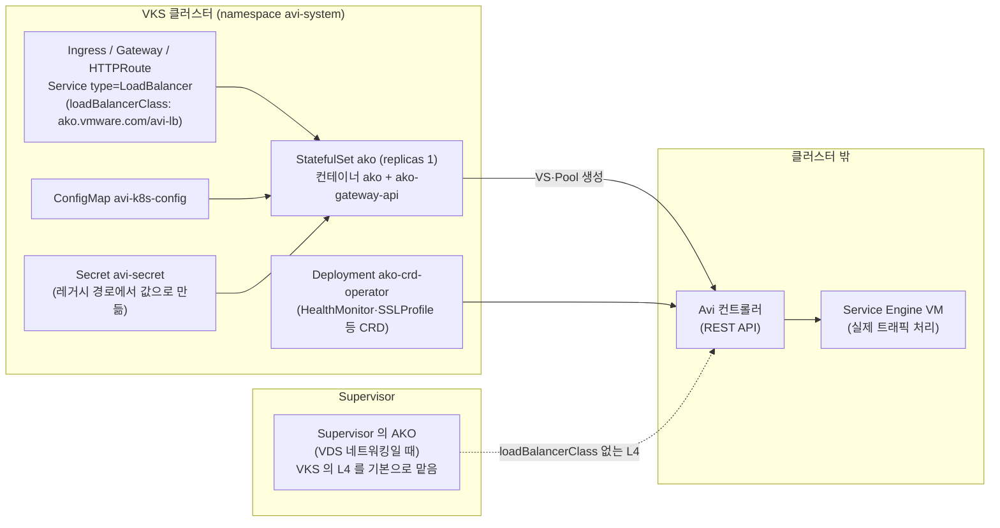

# 15. AKO (Avi Kubernetes Operator)

> 커리큘럼: [CURRICULUM.md](CURRICULUM.md) · 앞 절: [14. Vault Injector](14-vault-injector.md) · 작성 2026-11-10
> 등급: **[근거]** 출처에 그대로 있는 것, **[추론]** 여러 출처를 엮어 직접 내린 결론.
> 기준 판: VKS Add-ons `3.8.0+20261021` (9.1 VKS Add-ons Release Notes, 2026-11-10 확인, 이 날 기준 가장 높은 판). 판 호환은 이 문서에서 정리하지 않는다. [공식 호환 매트릭스](https://interopmatrix.broadcom.com/)와 릴리스 노트를 직접 볼 것.

AKO 는 쿠버네티스 오브젝트(Ingress, `type: LoadBalancer` Service, Gateway API, AKO 전용 CRD)를 지켜보다가 **Avi Load Balancer 컨트롤러에 Virtual Service·Pool 을 만들어 주는 컨트롤러**다. 트래픽은 AKO 가 아니라 Avi 의 Service Engine(SE) VM 이 받는다. 그래서 AKO 하나만 깔아서는 아무것도 안 되고, 클러스터 밖에 Avi 컨트롤러·클라우드·IPAM·SE 그룹이 먼저 있어야 한다.

이 절의 무게는 세 군데에 있다. 첫째, VKS 에는 **이미 Supervisor 쪽 AKO 가 있을 수 있다**는 점(VDS 네트워킹이면 Supervisor 가 VKS 클러스터의 L4 를 맡는다). 둘째, 같은 패키지라도 **레거시 경로와 Add-on 경로에서 기본값이 다르다**는 점. 셋째, 9.0 공식 예시가 옛 판(`1.13.4`)으로 적혀 있어 그대로 쓰면 어디서 막히는지.

[근거] 이 절의 렌더링 결과는 공개 저장소(`3.8.0-20261021/vks-addons`)의 AKO 패키지 원본과 bundle(`@sha256:f3b73bd7…`)을 익명으로 받아 ytt v0.55.4 로 직접 돌린 것이다. **클러스터와 Avi 컨트롤러에 설치해 보지는 못했다.** 3.2~3.4 의 클러스터 쪽 확인 명령과 기대 출력은 문서와 렌더링에서 읽은 것이고 실측이 아니다.

---

## 1. 무엇을 하는가



- [근거] AKO 는 L4~L7 부하 분산을 주며, 인그레스 컨트롤러이자 Gateway API 컨트롤러로 동작해 쿠버네티스 오브젝트를 Avi 오브젝트로 옮긴다. (AKO Package Reference, 9.0)
- [근거] VDS 네트워킹을 쓰는 Supervisor 에는 AKO 가 자동으로 들어가고, 그 AKO 가 Supervisor 의 L4·L7 과 **VKS 클러스터의 L4** 를 paravirtualization 으로 맡는다. VKS 클러스터 안에 AKO 를 따로 깔면 그 클러스터의 L4·L7 을 맡길 수 있다. (Avi 9.1, Deploying AKO via Helm into VKS on vSphere Supervisor with VDS Networking)
- [근거] Supervisor 의 AKO 는 기본으로 모든 워크로드 클러스터의 L4 오브젝트를 처리한다. 클러스터 안 AKO 가 L4 를 맡게 하려면 Service 에 `loadBalancerClass` 를 넣어야 하고, 그러지 않으면 **두 AKO 가 모두 Virtual Service 를 만들어 중복된다.** (같은 문서)
- [근거] AKO 와 Antrea 를 같이 쓰는 VKS 에서는 `NodePortLocal` 이 권장 서비스 유형이다. SE 가 노드 네트워크로 Pod 에 닿기 때문에 노드까지의 라우팅만 신경 쓰면 된다. (같은 문서)

### 판과 지원 등급 (3.8.0+20261021 기준)

| 항목 | 값 | 출처 |
|---|---|---|
| 패키지 판 | `2.3.1+vmware.1-vks.1` 한 판 | 9.1 VKS Add-ons Release Notes |
| 지원 등급 | Product | 같은 곳 |
| VKr | 1.33·1.34·1.35·1.36·1.37 모두 Yes | 같은 곳 |
| 업그레이드 경로 | 2.1.X·2.2.X 에서 「Smooth upgrade」 | 같은 곳 |
| 이번 판의 변화 | 취약점 대응 의존성·베이스 이미지 갱신, **AKO 로그용 영구 볼륨을 기본으로 끔** | 같은 곳 |
| 업스트림 AKO 2.3.1 의 쿠버네티스 지원 | 1.32~1.37, Gateway API v1.6 | AKO 2.3 Compatibility Matrix |
| 업스트림 AKO 2.3.1 이 받는 Avi 컨트롤러 | 31.1.x(31.1.1 이상)·31.2.x(31.2.1 이상)·32.1.1~32.1.4 | 같은 곳 |

- [근거] 3.7.0+20260924 표의 AKO 는 `2.2.3+vmware.1-vks.1` 이었다. (9.1 VKS Add-ons Release Notes)
- [근거] 9.0 「Install AKO」 쪽은 시스템 요구 사항을 Kubernetes 1.24~1.34, Avi 컨트롤러 22.1.3~31.1.1 로 적고, 하위 문서 예시는 모두 `1.13.4+vmware.1-vks.1` 이다. (Install AKO, Last Updated October 6, 2026)
- [추론] 9.0 문서의 「컨트롤러 22.1.3~31.1.1」을 3.8.0 의 2.3.1 에 그대로 대면 안 된다. 업스트림 표에서 2.3.1 은 22.1.x·30.x 컨트롤러를 받지 않는다. 컨트롤러 판은 AKO 판의 Compatibility Matrix 로 확인한다.

## 2. VKS 에서 어떻게 들어가는가

설치 경로 두 가지(레거시 PackageInstall, Supervisor 쪽 Add-on Management)의 일반 구조는 [00절](00-repository-and-install-paths.md), Carvel 기초는 [`../carvel-kapp.md`](../carvel-kapp.md)에 있다. 여기서는 AKO 에만 해당하는 것을 적는다.

### 2.1 패키지 안에 무엇이 들어 있나

[근거] Package `ako.kubernetes.vmware.com.2.3.1+vmware.1-vks.1` 의 템플릿 단계는 `config/ako/crds/`, `config/ako/templates/`, `config/overlays/`, `config/ako-crd-operator/templates/` 네 경로를 ytt 로 돌린 뒤 kbld 로 이미지를 고정한다. 두 Helm 차트(`ako` 2.3.1, `ako-crd-operator` 2.3.1)를 미리 렌더링해 ytt 주석을 단 형태이고, bundle 안의 `values.yaml` 은 ytt 경로에 들어 있지 않다. (패키지 원본, 2026-11-10 확인)

[근거] 값을 하나도 주지 않고 렌더링하면 31개 리소스가 나온다. (ytt v0.55.4, 2026-11-10)

| 묶음 | 리소스 |
|---|---|
| CRD 13개 | `ako.vmware.com` 의 aviinfrasettings·hostrules·httprules·l4rules·ssorules·l7rules, CRD operator 쪽 applicationprofiles·aviresourcestatuses·gatewayextensions·healthmonitors·pkiprofiles·routebackendextensions·sslprofiles |
| 워크로드 | StatefulSet `ako`(컨테이너 `ako`·`ako-gateway-api`), Deployment `ako-crd-operator`(전략 `Recreate`) |
| 설정 | ConfigMap `avi-k8s-config`, LimitRange `ns-limit-range`, Secret `ako-image-pull-secret`(secretgen 이 채움) |
| 권한 | ServiceAccount `ako-sa`·`ako-crd-operator`, Role·RoleBinding `ako-crd-operator-role(binding)`(`avi-system`), ClusterRole·ClusterRoleBinding 두 벌 |
| 클러스터 범위 | IngressClass `avi-lb`, GatewayClass `avi-lb`(`gateway.networking.k8s.io/v1beta1`), ValidatingAdmissionPolicy·Binding `ako-ha-gatewayapi-guard` |
| 네임스페이스 | Namespace `avi-system` |

알아 둘 것 다섯 가지.

1. [근거] Namespace `avi-system` 에 `pod-security.kubernetes.io/enforce: privileged`(warn·audit 도 privileged)가 붙는다. (`config/overlays/namespace.yaml`)
2. [근거] ConfigMap 에 kapp 의 `versioned`·`versioned-keep-original`·`num-versions: "5"` 어노테이션이 붙는다. 소스 주석은 값이 바뀌면 `avi-k8s-config-ver-N` 을 새로 만들고 참조를 바꿔 Pod 를 다시 띄우려는 것이며, AKO 가 정확히 `avi-k8s-config` 라는 이름을 찾기 때문에 원본도 남긴다고 설명한다. (`config/overlays/configmap.yaml`)
3. [근거] ValidatingAdmissionPolicy 는 이름이 `ako` 인 StatefulSet 의 `replicas` 가 1 을 넘으면 거절한다(`failurePolicy: Fail`, `validationActions: [Deny]`). Binding 의 `namespaceSelector` 가 `{}` 라서 **모든 네임스페이스**의 `ako` 라는 StatefulSet 에 걸린다. 업스트림 2.3.1 릴리스 노트도 「HA 와 gateway-api 를 같이 고르면 설치가 실패한다」고 적었다.
4. [근거] `ako-crd-operator` Deployment 는 값과 상관없이 늘 렌더링된다. 하지만 ConfigMap 의 `akoCRDOperatorEnabled` 는 `akoCRDOperator.enabled` 값을 주지 않으면 `"false"` 다. Add-on 경로의 템플릿(2.3)은 이 값을 늘 `true` 로 넣는다.
5. [근거] GatewayClass `avi-lb` 를 늘 만든다. [추론] 클러스터에 Gateway API CRD 가 없으면 kapp 이 이 리소스를 못 만들어 조정이 실패한다. VKS 에서는 VKr 이 Gateway API CRD 를 넣는다([11절](11-istio.md) 참고).

### 2.2 레거시 경로: PackageInstall + values Secret

[근거] 9.0 「Install AKO Using kubectl」은 `tkg-system` 에서 패키지를 확인하고, `ako-data-values.yaml` 을 `ako-data-values` Secret(`tkg-system`)으로 만든 뒤 PackageInstall `ako`(`tkg-system`, `versionSelection.constraints`)를 만든다. 서비스 계정은 「VKS 패키지 설치의 일반 요구 사항」으로 미리 만들어 둔 것을 쓴다.

[근거] 이 경로에서는 values 의 `avicredentials` 로 클러스터 안에 Secret `avi-secret` 을 만든다. `username` 이 있고 `password` 나 `authtoken` 중 하나가 있을 때만 만든다. (`config/overlays/secret.yaml`)

[추론] 즉 레거시 경로에서는 Avi 계정 비밀번호가 **두 곳에 평문 상당으로 남는다**: `tkg-system` 의 values Secret 과 `avi-system` 의 `avi-secret`. values Secret 을 읽을 수 있는 사람은 Avi 계정을 얻는다. 가능하면 Avi 쪽에 AKO 전용 최소 권한 계정이나 토큰을 쓴다.

### 2.3 Add-on 경로: Supervisor 에서 AddonConfig·AddonInstall

[근거] 9.0 「Install AKO Using Add-on Management Feature」(VKS 3.5 이상)는 Supervisor 에서 세 가지를 만든다. (1) 클러스터마다 `<cluster-name>-avi-secret`(클러스터가 있는 Supervisor 네임스페이스, `username`·`password`·`certificateAuthorityData`), (2) `AddonConfig` `<cluster-name>-ako`(컨트롤러 주소·클라우드·테넌트·SE 그룹·VIP 네트워크 또는 NSX VPC 의 T1 경로), (3) `AddonInstall`(클러스터 셀렉터). 설정을 바꿀 땐 AddonConfig 를 고치고, 지우려면 AddonInstall 을 지운다.

AddonConfigDefinition(패키지 어노테이션에 gzip+base64 로 들어 있음)을 풀어 보면 문서에 없는 동작이 보인다. (패키지 원본, 2026-11-10 확인)

- [근거] 정의 이름은 `ako.kubernetes.vmware.com.2.3.1---vmware.1-vks.1` 이다. 판의 `+` 가 `---` 로 바뀐다. 9.0 예시의 `ako.kubernetes.vmware.com.1.13.4+vmware.1-vks.1` 은 3.8.0 저장소에 없는 이름이다.
- [근거] 입력은 `{{.Cluster.name}}-avi-secret`(선택, `optional`)과 Cluster CR 두 개다. Secret 에서 `clusterName`·`cniPlugin`·`controllerHost`·`controllerVersion`·`serviceEngineGroupName`·`tenantName`·`cloudName`·`vrfName`·`dedicatedTenantMode`·`vpcMode`·`nsxtT1LR`·`serviceType`·`storageClass`·계정 값을 읽는다. **같은 키가 Secret 에 있으면 AddonConfig 값보다 Secret 이 이긴다.**
- [근거] Secret 에 `managed` 키가 있으면 `VKSSettings.managed` 와 `controllerAddress` 가 들어간다. ytt 오버레이는 `managed` 가 참일 때 AKO·CRD operator Pod 에 `vmci-relay` 사이드카를 붙이고(`--relay-ports=tcp:443:avi-controller-management-service/avi-proxy-port-443`), 소스 주석은 이를 「VKS 가 AKO 를 관리할 때 관리망의 Avi 컨트롤러에 닿게 하는 TCP 프록시」라고 적는다. [추론] 이 「VKS-managed」 모드는 9.0 Package Reference 의 `vmciRelayResources` 설명에 이름만 나오고 무엇을 하는지는 설명이 없다. 사용자가 손으로 켤 기능으로 보지 말고, 무엇을 켜는지는 문서가 나오면 다시 확인한다.
- [근거] 출력은 워크로드 클러스터의 `vmware-system-tkg` 네임스페이스에 Secret `<cluster>-ako-data-values` 로 쓰인다. Cluster CR 의 `spec.topology.version` 을 `vks_cluster_version` 으로 넘기고, 오버레이는 그 판이 1.34.0 이상이면 `priorityClassName: vmware-system-important` 를 넣는다(값으로 주면 그 값이 먼저).

두 경로의 기본값이 다르다. 같은 키를 비워 둘 때 실제로 들어가는 값:

| 키 | 9.0 Package Reference 표 | 레거시 경로 렌더링(값 없음) | Add-on 경로(AddonConfigDefinition 기본값) |
|---|---|---|---|
| `AKOSettings.clusterName` | `my-cluster` | `my-cluster` | 클러스터 이름 |
| `AKOSettings.cniPlugin` | `""` | `""` | `antrea` |
| `L7Settings.serviceType` | `NodePort` | `NodePort` | `NodePortLocal` |
| `persistentVolumeClaimSpec.enabled` | `true` | 끔(`emptyDir`) | `false` |
| `AKOSettings.allowInsecureControllerConnection` | (표에 없음) | `"true"` | `true` |
| `priorityClassName` | (표에 없음) | 없음 | VKr 1.34 이상이면 `vmware-system-important` |
| `akoCRDOperatorEnabled`(ConfigMap) | (표에 없음) | `"false"` | `"true"` |

[근거] 표의 왼쪽 열은 Package Reference, 가운데 열은 값 없이 렌더링한 ConfigMap·StatefulSet, 오른쪽 열은 AddonConfigDefinition 의 `default`·템플릿이다. (모두 2026-11-10 확인)

### 2.4 판 고르기와 업그레이드

- [근거] 3.8.0+20261021 에는 2.3.1 한 판뿐이고, 2.1.X·2.2.X 에서 올라올 수 있다. (9.1 릴리스 노트)
- [근거] 업스트림 2.3.1 의 CRD operator 는 배포 전략이 `Recreate` 로 바뀌어 새 Pod 를 띄우기 전에 옛 Pod 를 멈춘다. (AKO 2.3.1 Release Notes) [추론] 업그레이드 중 짧게 CRD operator 가 없는 구간이 생긴다. 트래픽은 SE 가 계속 받지만 그동안 CRD 변경은 반영되지 않는다.
- [근거] 9.0 문서에는 1.13.x → 2.x 업그레이드 절차가 따로 없고, 9.1 릴리스 노트의 경로는 2.1.X 부터다. [추론] 1.13.x 를 쓰던 클러스터는 중간 판(2.1.x)을 거쳐야 하는지 공식 호환 매트릭스와 릴리스 노트로 먼저 확인한다.

## 3. 실습

### 3.1 패키지를 렌더링해서 동작 확인 (클러스터 없이)

```bash
# 공개 저장소에서 패키지 목록과 AKO bundle 받기 (crane, ytt 필요)
R=projects.packages.broadcom.com/vsphere/supervisor/vks-standard-packages/3.8.0-20261021/vks-addons
mkdir -p repo bundle
crane export $R:3.8.0-20261021 - | tar -x -C repo
grep -A1 'packages/ako:' repo/.imgpkg/images.yml       # bundle digest 확인
crane export $R@sha256:f3b73bd7cd66c3a89efe32490cad35884822462c5231a7024bab4c8e4d778199 - | tar -x -C bundle

# 패키지와 같은 경로로 렌더링
C=bundle/config
ytt --ignore-unknown-comments -f $C/ako/crds/ -f $C/ako/templates/ \
    -f $C/overlays/ -f $C/ako-crd-operator/templates/ \
    --data-values-file my-values.yaml > rendered.yaml

# 기대: 값 없이 31개, avicredentials 를 주면 avi-secret 이 더해져 32개
grep -c '^kind:' rendered.yaml
grep -A3 'name: avi-system$' rendered.yaml | head    # PSA 라벨
```

[근거] `AKOSettings.clustername`(소문자 n)처럼 키를 틀려도 ytt 는 오류 없이 끝나고 ConfigMap 의 `clusterName` 은 `my-cluster` 로 렌더링된다. 이 bundle 에는 ytt 스키마가 없고 템플릿이 `hasattr(...)` 로 없으면 기본값을 넣기 때문이다. (직접 렌더링, 2026-11-10)

### 3.2 레거시 경로 values (워크로드 클러스터 컨텍스트)

```yaml
# ako-data-values.yaml  (3.8.0 저장소 기준, 시험하지 않음. <...> 는 환경 값)
AKOSettings:
  clusterName: <cluster-name>        # Avi 안에서 클러스터를 가르는 이름. 클러스터마다 달라야 한다
  cniPlugin: antrea                  # 비우면 "" 로 들어간다(2.3 표 참고)
  layer7Only: true                   # Supervisor AKO 가 L4 를 맡는 VDS 환경이면 L7 만
ControllerSettings:
  controllerHost: "<avi-controller-fqdn>"
  controllerVersion: "<controller-version>"
  cloudName: "<cloud-name>"
  serviceEngineGroupName: "Default-Group"
  tenantName: "admin"
NetworkSettings:
  vipNetworkList:                    # 2.3.1 부터 IPAM 에서 얻을 수 있으면 생략 가능(NSX VLAN 은 필요)
    - networkName: "<vip-network>"
      cidr: "<vip-cidr>"
L7Settings:
  serviceType: NodePortLocal         # 비우면 NodePort
avicredentials:
  username: "<ako-user>"
  password: "<password>"             # 파일을 리포에 올리지 말 것
  certificateAuthorityData: |-
    <PEM>
```

```bash
kubectl get packages -n tkg-system | grep ako
# 기대: ako.kubernetes.vmware.com.2.3.1+vmware.1-vks.1 ...
kubectl create secret generic ako-data-values \
  --from-file=values.yaml=ako-data-values.yaml -n tkg-system
```

```yaml
apiVersion: packaging.carvel.dev/v1alpha1
kind: PackageInstall
metadata:
  name: ako
  namespace: tkg-system
spec:
  serviceAccountName: <package-install-sa>   # 00절의 패키지 설치용 SA
  packageRef:
    refName: ako.kubernetes.vmware.com
    versionSelection:
      constraints: 2.3.1+vmware.1-vks.1
  values:
  - secretRef:
      name: ako-data-values
```

### 3.3 Add-on 경로 (Supervisor 컨텍스트)

```yaml
# 클러스터가 있는 Supervisor 네임스페이스에서. <...> 는 환경 값
apiVersion: v1
kind: Secret
metadata:
  name: <cluster-name>-avi-secret
  namespace: <supervisor-namespace>
type: Opaque
stringData:                     # data 대신 stringData 로 쓰면 base64 를 직접 안 만들어도 된다
  username: <ako-user>
  password: <password>
---
apiVersion: addons.kubernetes.vmware.com/v1alpha1
kind: AddonConfig
metadata:
  name: <cluster-name>-ako
  namespace: <supervisor-namespace>
spec:
  addonConfigDefinitionRef:
    name: ako.kubernetes.vmware.com.2.3.1---vmware.1-vks.1   # + 가 --- 로 바뀐 이름
    namespace: vmware-system-vks-public
  clusterName: <cluster-name>
  values:
    AKOSettings:
      layer7Only: true
    ControllerSettings:
      controllerHost: "<avi-controller-fqdn>"
      cloudName: "<cloud-name>"
    NetworkSettings:
      vipNetworkList:
        - networkName: "<vip-network>"
          cidr: "<vip-cidr>"
---
apiVersion: addons.kubernetes.vmware.com/v1alpha1
kind: AddonInstall
metadata:
  name: ako-installer
  namespace: <supervisor-namespace>
spec:
  addonRef:
    name: ako
  clusters:
  - selector:
      matchLabels:
        cluster.x-k8s.io/cluster-name: <cluster-name>
  paused: false
```

```bash
# Supervisor 에서. 정의 이름이 저장소에 있는지 먼저 본다
kubectl get addonconfigdefinitions -n vmware-system-vks-public | grep ako
kubectl get addoninstall ako-installer -n <supervisor-namespace>
```

### 3.4 워크로드 클러스터에서 확인

```bash
kubectl -n avi-system get statefulset,deploy,pod
# [추론] 기대: statefulset.apps/ako 1/1, pod/ako-0 의 READY 는 2/2(ako, ako-gateway-api).
#        VKS-managed 모드면 vmci-relay 가 더해져 3/3. 9.0 문서의 「1/1」은 옛 판 출력이다.
kubectl -n avi-system get cm avi-k8s-config -o jsonpath='{.data.clusterName} {.data.cniPlugin} {.data.serviceType}{"\n"}'
kubectl -n avi-system logs ako-0 -c ako | grep -i -E 'logged into|version'
kubectl get ingressclass avi-lb -o jsonpath='{.metadata.annotations}{"\n"}'

# L4 를 클러스터 안 AKO 에 맡길 Service 는 loadBalancerClass 를 단다
kubectl apply -f - <<'EOF'
apiVersion: v1
kind: Service
metadata:
  name: web-lb
  namespace: demo
spec:
  type: LoadBalancer
  loadBalancerClass: ako.vmware.com/avi-lb
  selector:
    app: web
  ports:
  - port: 80
    targetPort: 8080
EOF
```

[근거] `loadBalancerClass: ako.vmware.com/avi-lb` 은 Avi 9.1 VDS 문서의 예시 값이다. `L4Settings.defaultLBController` 기본값은 `"false"` 다(Package Reference, AddonConfigDefinition).

## 4. 업스트림 Helm 설치와 다른 점

루트 [`../k8s-addon.sh`](../k8s-addon.sh) 에는 AKO 가 없다. 업스트림 설치는 Broadcom 이 배포하는 Helm 차트(`oci://projects.packages.broadcom.com/ako/helm-charts/ako`)로 한다. (Avi 9.1 VDS 문서)

| 항목 | VKS 패키지 2.3.1 | 업스트림 Helm |
|---|---|---|
| 네임스페이스 | 패키지가 `avi-system` 을 만들고 PSA `privileged` 라벨을 붙임 | `--namespace=avi-system` 로 지정, 라벨은 직접 |
| 계정 전달 | 레거시는 values, Add-on 은 Supervisor 의 `<cluster>-avi-secret` | values 또는 `--set avicredentials.*` |
| 기본 서비스 유형 | 레거시 렌더링 `NodePort`, Add-on `NodePortLocal` | GitHub(archived) `master` 의 `helm/ako/values.yaml` 은 `ClusterIP` |
| `enableEVH` | `true` | GitHub `master` values 는 `false` |
| HA 차단 | ValidatingAdmissionPolicy 를 늘 만듦 | 업스트림 2.3.1 은 「HA + gateway-api 면 설치 실패」 |
| 우선순위 | Add-on 경로에서 VKr 1.34 이상이면 `vmware-system-important` | 없음 |
| 지원 범위 | Product 등급, 문서화된 값만 지원, 사용자 ytt 오버레이는 지원 밖 | Avi 지원 정책 |

- [근거] Broadcom 의 공개 OCI 차트 저장소에서 2026-11-10 에 받을 수 있는 가장 높은 판은 `2.1.4` 이고 `2.3.1` 태그는 없다. GitHub 리포(지금은 `vmware-archive/load-balancer-and-ingress-services-for-kubernetes` 로 옮겨져 archived)의 `master` `helm/ako/values.yaml` 은 2025-09-10 커밋이 마지막이고, 판 번호가 붙은 릴리스 브랜치는 `release-2.1.2` 까지다(`release-vcf-9.1` 같은 다른 브랜치의 차트는 `appVersion: latest`). [추론] 그래서 위 표의 업스트림 열은 2.3.1 차트가 아니라 공개된 가장 가까운 원본과 비교한 것이다. 2.3.1 차트를 직접 비교하려면 공개 위치가 생길 때 다시 본다.
- [근거] VKS Add-on 지원 정책은 Broadcom 문서에 나온 값만 지원하고, 업스트림 문서에만 있는 옵션·사용자 ytt 오버레이는 지원 밖이라고 적는다. (9.1 VKS Add-ons Release Notes, Support Tiers)

## 5. 흔한 실수

1. **Supervisor AKO 와 이중으로 VS 를 만든다.** [근거] VDS Supervisor 에서 클러스터 안 AKO 를 깔고 `loadBalancerClass` 없이 `type: LoadBalancer` 를 만들면 두 AKO 가 모두 VS 를 만든다(Avi 9.1 VDS 문서). L7 만 맡길 거면 `layer7Only: true`, L4 도 맡길 거면 Service 마다 `loadBalancerClass` 를 단다.
2. **9.0 예시의 판·이름을 그대로 쓴다.** [근거] 9.0 예시의 `1.13.4+vmware.1-vks.1`(PackageInstall 제약, AddonConfigDefinition 이름)은 3.8.0 저장소에 없다. Add-on 정의 이름은 `+` 대신 `---` 를 쓴 `ako.kubernetes.vmware.com.2.3.1---vmware.1-vks.1` 이다.
3. **Package Reference 표의 기본값을 믿는다.** [근거] 표는 PVC 기본 켜짐·`NodePort`·`cniPlugin ""` 이라 적지만, 2.3.1 렌더링은 PVC 꺼짐이고 Add-on 경로는 `NodePortLocal`·`antrea` 를 넣는다(2.3 표). 로그가 Pod 재시작 때 사라지는 것이 기본이다. 남기려면 `persistentVolumeClaimSpec.enabled: true` 를 명시한다.
4. **키 이름 오타가 조용히 무시된다.** [근거] 스키마가 없어 `clustername` 같은 오타도 렌더링이 성공하고 기본값 `my-cluster` 가 들어간다(3.1). [추론] 여러 클러스터가 같은 `my-cluster` 로 붙으면 Avi 쪽 오브젝트 이름이 겹친다. 적용 뒤 3.4 의 ConfigMap 확인을 빼먹지 않는다.
5. **Add-on 경로에서 AddonConfig 를 고쳐도 값이 안 바뀐다.** [근거] `<cluster>-avi-secret` 에 같은 키(`controllerHost`·`cloudName`·`serviceType` 등)가 있으면 Secret 값이 먼저다. 값을 옮길 땐 두 곳을 같이 본다.
6. **CA 없이 TLS 검증을 끈 채로 둔다.** [근거] `allowInsecureControllerConnection` 은 2.3.1 에서 업그레이드 호환 때문에 기본 `true` 이고, CRD operator 는 ConfigMap 에 키가 없으면 `false` 로 본다(AKO 2.3.1 Release Notes). 같은 노트의 「이제 opt-in」 문장과 기본값 문장이 어긋나 있으니 실제 값은 ConfigMap 으로 확인한다. 운영에서는 `certificateAuthorityData` 를 넣고 `false` 로 둔다.
7. **`ako` 라는 이름의 다른 StatefulSet 을 만든다.** [근거] HA 차단 정책의 Binding 이 모든 네임스페이스에 걸려 이름이 `ako` 이고 `replicas` 가 2 이상인 StatefulSet 은 어느 네임스페이스에서든 거절된다(2.1).
8. **기본 IngressClass 가 둘이 된다.** [근거] 패키지는 `defaultIngController: "true"` 가 기본이라 IngressClass `avi-lb` 에 `is-default-class: "true"` 를 단다. 쿠버네티스는 기본 IngressClass 가 둘 이상이면 `ingressClassName` 없는 새 Ingress 를 승인 단계에서 막는다(Kubernetes Ingress 문서). [추론] 클러스터에 이미 기본으로 표시된 IngressClass 가 있으면 AKO 쪽 `L7Settings.defaultIngController` 를 `"false"` 로 두거나 기존 것의 표시를 거둔다.
9. **PSA 를 낮추려고 네임스페이스 라벨을 고친다.** [근거] 패키지가 `avi-system` 에 `privileged` 를 넣는다. [추론] 레거시 렌더링의 Pod 는 Pod 수준 `runAsUser: 0` 이라 restricted 에 걸리고, VKS-managed 모드의 `vmci-relay` 는 `seccompProfile: Unconfined` 라 baseline 에도 걸린다(Pod Security Standards). 라벨을 손으로 바꾸면 다음 조정 때 kapp 이 되돌리거나 Pod 가 거절된다. PSA 개념은 루트 [`../podsecurity_admission.md`](../podsecurity_admission.md).

## 6. 확인 문제

1. VDS 네트워킹 Supervisor 위의 VKS 클러스터에 AKO 애드온을 깔았다. `loadBalancerClass` 없이 `type: LoadBalancer` Service 를 만들면 어떻게 되고, 두 가지 피하는 방법은 무엇인가?
2. 같은 3.8.0 저장소의 AKO 를 레거시 경로와 Add-on 경로로 각각 값 없이 깔았다. `L7Settings.serviceType` 과 로그 PVC 는 각각 어떻게 들어가는가?
3. Add-on 경로에서 AddonConfig 의 `ControllerSettings.controllerHost` 를 바꿨는데 워크로드 클러스터의 `avi-k8s-config` 가 그대로다. 가장 먼저 무엇을 보는가?

<details>
<summary>답</summary>

1. Supervisor 의 AKO 와 클러스터 안 AKO 가 모두 Virtual Service 를 만들어 중복된다. 클러스터 안 AKO 를 `layer7Only: true` 로 두어 L4 는 Supervisor 에 맡기거나, 클러스터 안 AKO 가 맡을 Service 에 `loadBalancerClass: ako.vmware.com/avi-lb` 를 단다. [근거] Avi 9.1 VDS 문서.
2. 레거시는 `NodePort` 와 `emptyDir`(PVC 없음), Add-on 은 `NodePortLocal` 과 `persistentVolumeClaimSpec.enabled: false`(역시 PVC 없음)다. 둘 다 9.0 Package Reference 표의 「PVC 기본 켜짐」과 다르다. [근거] 렌더링과 AddonConfigDefinition(2.3 표).
3. Supervisor 네임스페이스의 `<cluster-name>-avi-secret` 에 `controllerHost` 키가 있는지 본다. 있으면 그 값이 AddonConfig 보다 먼저다. 그다음 `vmware-system-tkg` 의 `<cluster>-ako-data-values` 가 새 값을 받았는지 본다. [근거] AddonConfigDefinition 템플릿.

</details>

## 7. 출처 (모두 2026-11-10 확인)

- VKS Add-ons Release Notes (9.1): <https://techdocs.broadcom.com/us/en/vmware-cis/vcf/vcf-service-administration-and-development/9-1/release-notes/vks-addons-release-notes.html> (가장 높은 판 3.8.0+20261021)
- AKO Package Reference (9.0): <https://techdocs.broadcom.com/us/en/vmware-cis/vcf/vcf-service-administration-and-development/9-0/managing-vsphere-kuberenetes-service-clusters-and-workloads/installing-standard-packages-on-tkg-service-clusters/standard-package-reference/ako-package-reference.html>
- Install AKO (9.0, Last Updated October 6, 2026): <https://techdocs.broadcom.com/us/en/vmware-cis/vcf/vcf-service-administration-and-development/9-0/managing-vsphere-kuberenetes-service-clusters-and-workloads/installing-standard-packages-on-tkg-service-clusters/installing-standard-packages-on-tkg-cluster-using-tkr-for-vsphere-8-x/install-ako.html>
- Install AKO Using Add-on Management Feature (9.0): <https://techdocs.broadcom.com/us/en/vmware-cis/vcf/vcf-service-administration-and-development/9-0/managing-vsphere-kuberenetes-service-clusters-and-workloads/installing-standard-packages-on-tkg-service-clusters/installing-standard-packages-on-tkg-cluster-using-tkr-for-vsphere-8-x/install-ako/install-ako-using-addon-management-system.html>
- Install AKO Using kubectl (9.0): <https://techdocs.broadcom.com/us/en/vmware-cis/vcf/vcf-service-administration-and-development/9-0/managing-vsphere-kuberenetes-service-clusters-and-workloads/installing-standard-packages-on-tkg-service-clusters/installing-standard-packages-on-tkg-cluster-using-tkr-for-vsphere-8-x/install-ako/install-ako-using-kubectl.html>
- Deploying AKO via Helm into VKS on vSphere Supervisor with VDS Networking (Avi 9.1): <https://techdocs.broadcom.com/us/en/vmware-security-load-balancing/avi-load-balancer/avi-load-balancer-vmware-cloud-foundation/9-1/managing-avi-for-vvf/ako-on-vsphere-with-tanzu-with-vds.html>
- AKO 2.3 Compatibility Matrix: <https://techdocs.broadcom.com/us/en/vmware-security-load-balancing/avi-load-balancer/avi-kubernetes-operator/2-3/ako-release-notes/compatibility-guide-for-ako.html>
- Release Notes for AKO Version 2.3.1: <https://techdocs.broadcom.com/us/en/vmware-security-load-balancing/avi-load-balancer/avi-kubernetes-operator/2-3/ako-release-notes/release-notes-for-ako-version-2-3-1.html>
- 업스트림 소스(GitHub, archived, `master` 의 `helm/ako/values.yaml`, 마지막 커밋 2025-09-10): <https://github.com/vmware-archive/load-balancer-and-ingress-services-for-kubernetes>
- Kubernetes Ingress, Default IngressClass: <https://kubernetes.io/docs/concepts/services-networking/ingress/#default-ingress-class>
- Pod Security Standards: <https://kubernetes.io/docs/concepts/security/pod-security-standards/>
- 패키지 원본: `projects.packages.broadcom.com/vsphere/supervisor/vks-standard-packages/3.8.0-20261021/vks-addons:3.8.0-20261021` 의 `packages/ako.kubernetes.vmware.com/2.3.1+vmware.1-vks.1.yml`, bundle `@sha256:f3b73bd7cd66c3a89efe32490cad35884822462c5231a7024bab4c8e4d778199`
