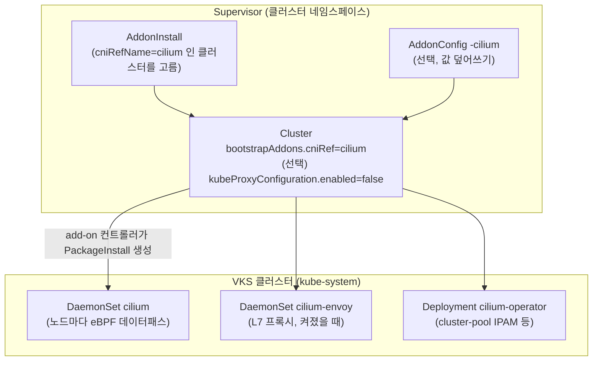

# 16. Cilium (대체 CNI)

> 커리큘럼: [CURRICULUM.md](CURRICULUM.md) · 앞 절: [15. AKO](15-ako.md) · 작성 2026-11-11
> 등급: **[근거]** 출처에 그대로 있는 것, **[추론]** 여러 출처를 엮어 직접 내린 결론.
> 기준 판: VKS Add-ons `3.8.0+20261021` (9.1 VKS Add-ons Release Notes, 2026-11-11 확인, 페이지 표기 Last Updated November 11, 2026, 이 날 기준 가장 높은 판). 판 호환은 이 문서에서 정리하지 않는다. [공식 호환 매트릭스](https://interopmatrix.broadcom.com/)와 릴리스 노트를 직접 볼 것.

Cilium 은 eBPF 로 Pod 네트워크·Service 전달·네트워크 정책·관측(Hubble)을 처리하는 CNI 다. CNI 자체의 개념(eBPF, CiliumNetworkPolicy, Hubble, kube-proxy 대체)은 루트 [`../cni-comparison/04_cilium.md`](../cni-comparison/04_cilium.md)를 먼저 본다. 이 절은 **VKS 가 Cilium 을 어떻게 깔고, 어디서 막히는가**만 다룬다.

다른 애드온과 가장 크게 다른 점은 순서다. Cert Manager 나 Prometheus 는 클러스터가 다 만들어진 뒤에 깔지만, CNI 는 노드가 Ready 가 되기 전에 있어야 한다. 그래서 Cilium 은 **클러스터를 만들기 전에** Supervisor 에 설치 규칙(`AddonInstall`)을 먼저 만들어 두고, 클러스터 YAML 에서 「CNI 는 cilium」이라고 고르는 방식으로 들어간다.

[근거] 이 절의 렌더링 결과는 공개 저장소(`3.8.0-20261021/vks-addons`)의 Cilium 패키지 원본과 bundle(`@sha256:2d6a3975…`)을 익명으로 받아 helm v3.19.0 과 ytt v0.55.4 로 직접 돌린 것이다(2026-11-11). **VKS 클러스터에 실제로 만들어 보지는 못했다.** 3.3~3.5 의 클러스터 쪽 명령과 기대 출력은 문서와 렌더링에서 읽은 것이고 실측이 아니다.

---

## 1. 무엇을 하는가



- [근거] VKS 는 3.6.0+20260320 부터 「standard package add-on framework」로 Cilium 을 대체 CNI 로 지원한다. 그 판의 Cilium 은 `1.19.1+vmware.1-vks.1` 이고 eBPF 데이터패스, Hubble UI·Relay, Kubernetes NetworkPolicy(L3/L4), CiliumNetworkPolicy(L7) 를 새 기능으로 적었다. (9.1 VKS Add-ons Release Notes, 3.6.0+20260320 절)
- [근거] 같은 절은 조건을 「클러스터 생성 **전에**」 저장소 설치, `AddonInstall` 수동 생성, `bootstrapAddons` 변수를 `cilium` 으로 두고 방화벽 규칙을 클러스터 설정에 넣을 것으로 적는다. (같은 출처)
- [근거] 3.7.0+20260618 의 `1.19.4+vmware.1-vks.1` 부터 L7 Proxy, Ingress Controller, Egress Gateway, Gateway API, eBPF Masquerading, Load Balancer XDP Acceleration, Policy Enforcement Mode, Prometheus 지표, Hubble Flow Metrics 를 설정할 수 있게 됐다. 이 가운데 L7 Proxy·Ingress Controller·Egress Gateway·Gateway API·eBPF Masquerading 은 **kube-proxy 를 끈 클러스터**에서만 켤 수 있다. (같은 출처, 3.7.0+20260618 절)
- [근거] VKS 3.7.0 이상과 VKr 1.35 이상에서 `kubernetes.kubeProxyConfiguration.enabled: false` 로 두면 kube-proxy 를 깔지 않고 Cilium 이 ClusterIP·NodePort·LoadBalancer 전달을 eBPF 로 맡는다. (Create a VKS Cluster by Using the Cilium CNI Add-On for VKS 3.7 and later, Last Updated November 6, 2026)

### 판과 지원 등급 (3.8.0+20261021 기준)

| 저장소 판 | Cilium 판 | 지원 VKr(쿠버네티스 마이너) |
|---|---|---|
| 3.6.0+20260320 ~ 3.6.0+20260521 | `1.19.1+vmware.1-vks.1` | 1.35 |
| 3.7.0+20260618 | `1.19.4+vmware.1-vks.1` | 1.36, 1.35 |
| 3.7.0+20260723 | `1.19.5+vmware.2-vks.1` | 1.36, 1.35 |
| 3.7.0+20260827 · 3.7.0+20260924 | `1.20.0+vmware.1-vks.1` | 1.36, 1.35 |
| **3.8.0+20261021** | **`1.20.1+vmware.1-vks.1`** | **1.37, 1.36, 1.35** |

- [근거] 위 표는 9.1 릴리스 노트의 판별 「Supported VKr Versions」 표에서 Cilium 줄만 뽑은 것이다. 3.7.0 이후 표에서 Cilium 의 지원 등급은 **Ecosystem** 이다. (9.1 VKS Add-ons Release Notes, 2026-11-11 확인)
- [근거] 3.8.0+20261021 의 `1.20.1+vmware.1-vks.1` 은 취약점 대응 의존성·베이스 이미지 갱신, Go Native FIPS 빌드이고 업그레이드 경로는 「1.19.x 에서 smooth upgrade」다. (같은 출처)
- [근거] Ecosystem 등급은 Broadcom 이 패키징·서명·수명주기만 맡고 런타임 버그는 업스트림 몫이다. (같은 출처, VKS Add-ons Support Tiers, [00절](00-repository-and-install-paths.md) 1장)
- [추론] Cilium 은 3.6.0 첫 판부터 VKr 1.35 이상만 지원했고 1.34·1.33 칸은 처음부터 비어 있다. 3.6 에서 만든 Cilium 클러스터(1.35)는 3.8.0 의 1.20.1 지원 범위(1.37·1.36·1.35) 안에 있다.

## 2. VKS 에서 어떻게 들어가는가

### 2.1 패키지 안에 무엇이 들어 있나

- [근거] Package `cilium.kubernetes.vmware.com.1.20.1+vmware.1-vks.1` 은 `vmware-system-vks-public` 네임스페이스에 있고, 템플릿 단계는 `helmTemplate`(경로 `chart`, **네임스페이스 `kube-system`**) → `ytt`(`overlays`) → `kbld` 순서다. 배포는 kapp `--wait-timeout=90s`. (패키지 원본, 2026-11-11)
- [근거] helmTemplate 에는 values 파일 세 개가 먼저 들어간다: 이미지를 digest 대신 태그로(`use-only-tag.yaml`), Hubble Relay 의 gops 끄기(`disable-gops.yaml`), **Hubble TLS 끄기**(`disable-hubble-tls.yaml`, `hubble.tls.enabled: false`, `hubble.tls.auto.enabled: false`). (bundle 의 `values/`)
- [근거] bundle 의 `chart/values.yaml` 은 주석을 빼고 비교하면 업스트림 `cilium/cilium` v1.20.1 의 `install/kubernetes/cilium/values.yaml` 과 같다. 차트 판은 `1.20.1`. (2026-11-11 diff)
- [근거] ytt 오버레이는 하나(`versioned-resources.yaml`)이고, 모든 Secret·ConfigMap 에 `kapp.k14s.io/versioned`·`versioned-keep-original` 주석을 단다. (bundle 의 `overlays/`)
- [추론] 그래서 kapp 은 `cilium-config` 를 고칠 때마다 `cilium-config-ver-N` 을 새로 만들고 원래 이름도 남긴다. 클러스터에서 ConfigMap 을 직접 고쳐도 다음 조정 때 패키지 값으로 돌아간다고 보는 게 안전하다. 값은 AddonConfig 로 바꾼다.
- [근거] PackageMetadata 에는 `addons.kubernetes.vmware.com/category: cni`, `features: ServiceProxy`, `internal: "true"` 라벨이 있고, Package 의 업그레이드 전략 주석(base64)을 풀면 `stage: BeforeClusterUpgrade`, `wait: Never` 다. (패키지 원본)
- [추론] 「클러스터를 올리기 전에 CNI 를 먼저 올리고, 끝나기를 기다리지는 않는다」는 뜻으로 읽힌다. 동작 순서는 [00절](00-repository-and-install-paths.md)의 업그레이드 흐름과 함께 확인할 것.

### 2.2 값이 들어가는 길: AddonConfigDefinition 두 갈래

[근거] Package 주석의 `AddonConfigDefinition`(gzip+base64)을 풀면 출력이 두 개다(2026-11-11):

| 출력 | 어디에 만드나 | 넣는 값 |
|---|---|---|
| `supervisorNamespaceOutput` | Supervisor 네임스페이스의 Secret `<cluster>-cilium-data-values` | `kubeProxyReplacement: true`, `k8sServiceHost`·`k8sServicePort`(Cluster 의 `controlPlaneEndpoint`), IPAM, Hubble·지표, 그리고 kube-proxy 가 꺼졌을 때만 L7·Ingress·Egress·Gateway API·bpf·XDP 값 |
| `targetClusterOutput` | 워크로드 클러스터 `vmware-system-tkg` 의 Secret `<cluster>-cilium-data-values` | IPAM, MTU, 정책 모드, Hubble·지표. **kube-proxy 대체·고급 기능 값은 없음** |

- [근거] 두 출력 모두 Pod CIDR 을 Cluster 의 `spec.clusterNetwork.pods.cidrBlocks` 에서 읽어 `ipam.operator.clusterPoolIPv4PodCIDRList`(또는 IPv6)로 넣는다. `:` 가 들어간 블록이면 IPv6 를 켠다. (같은 정의)
- [근거] Supervisor 쪽 템플릿은 kube-proxy 가 켜져 있는데 `l7Proxy`·`ingressController.enabled`·`egressGateway.enabled`·`gatewayAPI.enabled`·`bpf.masquerade` 중 하나라도 참이면 `fail` 로 「require kube-proxy to be disabled」를 낸다. (같은 정의)
- [근거] 같은 템플릿은 `l7Proxy` 를 `l7Proxy OR ingressController.enabled OR gatewayAPI.enabled` 로, `bpf.masquerade` 를 `bpf.masquerade OR egressGateway.enabled` 로 계산해 넣는다. (같은 정의)
- [추론] 즉 Ingress 나 Gateway API 를 켜면 `l7Proxy: false` 라고 적어도 L7 프록시(Envoy)가 같이 켜지고, Egress Gateway 를 켜면 eBPF masquerade 가 같이 켜진다. 공식 문서 표의 「bpf.masquerade 는 Egress Gateway 에 필요」는 사용자가 따로 켜야 한다는 뜻이 아니라 템플릿이 알아서 켠다는 쪽에 가깝다.
- [추론] 공식 문서가 kube-proxy 를 끈 클러스터의 `AddonInstall` 에 `package-install-destination: supervisor` 주석을 붙이라는 것과 Supervisor 쪽 출력에만 `kubeProxyReplacement: true` 가 있는 것을 엮으면, **kube-proxy 를 끄면 Supervisor 출력, 켜 두면 클러스터 출력**이 쓰인다고 보는 게 맞다. 어느 출력이 쓰이는지 고르는 컨트롤러 코드는 공개돼 있지 않아 확인하지 못했다.

### 2.3 스키마와 기본값

[근거] `AddonConfigDefinition` 의 `openAPIV3Schema` 기본값(2026-11-11):

| 값 경로 | 기본값 | 조건 |
|---|---|---|
| `MTU` | `0`(자동) | |
| `hubble.enabled` | `true` | |
| `hubble.relay.enabled` / `hubble.ui.enabled` | `false` / `false` | |
| `hubble.ui.service.type` | `ClusterIP` | `ClusterIP`·`NodePort`·`LoadBalancer` 만 |
| `hubble.metrics.enabled` | `false` | 켜면 dns·drop·tcp·flow·icmp·http 지표, 포트 9965 |
| `prometheus.enabled` | `false` | 에이전트 지표 포트 9962 |
| `operator.prometheus.enabled` | `true` | operator 지표 포트 9963 |
| `policyEnforcementMode` | `default` | `default`·`always`·`never` |
| `l7Proxy`, `ingressController.enabled`, `egressGateway.enabled`, `gatewayAPI.enabled`, `bpf.masquerade` | 모두 `false` | kube-proxy 를 끈 클러스터만 |
| `loadBalancer.acceleration` | `disabled` | `disabled`·`native`·`best-effort` |

- [근거] 하위 객체(`hubble`, `ingressController` 등)는 `additionalProperties: false` 이고, 맨 위 객체에는 `additionalProperties` 지정이 없다. (같은 정의)
- [추론] 그래서 하위 객체 안의 오타는 검증에 걸릴 것이고, 맨 위 키 이름의 오타는 걸리지 않을 수 있다. 실제 검증 동작은 시험하지 않았다.
- [근거] 공식 문서의 「Configurable Values」 표에는 `hubble.metrics.enabled` 가 없지만, 같은 문서의 「All Features Enabled」 예시에는 `hubble.metrics.enabled: true` 가 들어 있다. 스키마에는 있다. (3.7 이후 문서, 2026-11-11 확인)

### 2.4 Add-on 경로: 클러스터를 만들기 전에 할 일

[근거] 3.7 이후 문서의 순서(VKS 3.7 이상, VKr 1.35 이상, Supervisor 에 Cilium 이 든 add-on 저장소 `3.7.0+20260618` 이상):

1. Supervisor 의 클러스터 네임스페이스에 `AddonInstall` 을 만든다. 제약식은 `cluster.cniRefName() == 'cilium'` 이고 `kubeProxyConfiguration().enabled` 가 `true` 인 것과 `false` 인 것 두 가지 중 하나를 고른다. 선택자는 `cluster.x-k8s.io/cluster-name: <cluster-name>`.
2. (선택) `AddonConfig` 를 **`<cluster-name>-cilium`** 이름으로 만든다. 클러스터 생성 전이나 후 모두 된다.
3. Cluster YAML 의 `spec.topology.variables` 에 `bootstrapAddons.cniRef`(`name: cilium`, `namespace: vmware-system-vks-public`)를 넣는다.
4. 방화벽 규칙을 `node.firewall.inboundRules` 로 넣는다. 컨트롤 플레인은 TCP 2379-2380(etcd), UDP 8472(VXLAN), TCP 4240(헬스 체크), TCP 4244(Hubble). 워커는 `machineDeployments[].variables.overrides` 에 8472·4240·4244.
5. (선택) kube-proxy 를 끄려면 `kubernetes.kubeProxyConfiguration.enabled: false`.

- [근거] kube-proxy 를 끈 경우의 `AddonInstall` 에는 `addons.kubernetes.vmware.com/package-install-destination: supervisor` 주석을 붙인다. 부트스트랩 동안 kube-proxy 의 DNAT 규칙이 없어 ClusterIP 로 API 서버에 닿을 수 없으므로 Cilium 의 `PackageInstall` 을 VKS Supervisor Service 네임스페이스에 둔다는 설명이다. (같은 문서)
- [근거] Cluster 를 지워도 `AddonInstall` 은 지워지지 않는다. 클러스터와 함께 지우려면 `AddonInstall` 에 Cluster 를 ownerReference 로 붙인다. `AddonConfig` 는 `clusteraddon.addons.kubernetes.vmware.com/owned-for-deletion: "true"` 주석을 달면 클러스터 삭제 때 같이 지워진다. (같은 문서)
- [근거] 렌더링한 차트의 ConfigMap 값은 `routing-mode: tunnel`, `tunnel-protocol: vxlan`, `hubble-listen-address: :4244` 이다. (3.1 렌더링)
- [추론] 방화벽 표의 8472/UDP·4240/TCP·4244/TCP 는 이 터널·헬스·Hubble 설정과 맞는다. 터널 방식(`routing-mode`·`tunnel-protocol`)을 바꾸는 키는 스키마에 없으므로 AddonConfig 로는 바꿀 수 없다. 사용자 ytt 오버레이로 바꾸면 [00절](00-repository-and-install-paths.md)의 지원 경계 밖이 된다.

### 2.5 VKS 3.6 경로와의 차이

- [근거] 3.6 용 문서는 따로 있다(Create a VKS Cluster Using the Cilium CNI Add-On Package for VKS 3.6). 3.6.0+20260320 의 Cilium 은 VKr 1.35 칸만 지원한다(9.1 릴리스 노트 표). 3.6 문서도 VKr 1.35 이상을 전제조건으로 적고, AddonInstall 제약식에 `version_in_range(cluster.spec.topology.version, '>=1.35.0')` 을 넣는다. (3.6 문서 Last Updated November 6, 2026, 2026-11-11 확인)
- [근거] kube-proxy 를 끄는 구성은 「VKS 3.7.0 과 VKr 1.35 부터」다. (3.7 이후 문서)
- [추론] 3.6 경로는 kube-proxy 를 켠 채 Cilium 을 CNI 로만 쓰는 구성이고, Ingress·Gateway API·Egress Gateway 같은 기능은 3.7 이후 + kube-proxy 끔에서만 고를 수 있다.

### 2.6 판 고르기와 업그레이드

- [근거] 3.8.0+20261021 저장소에는 Cilium 이 `1.20.1+vmware.1-vks.1` 한 판만 있다. (저장소 `packages/cilium.kubernetes.vmware.com/` 파일 목록)
- [근거] 업그레이드 경로는 「1.19.x 에서 smooth upgrade」로 적혀 있다. (9.1 릴리스 노트, 3.8.0+20261021)
- [추론] CNI 를 Antrea·Calico 에서 Cilium 으로, 또는 그 반대로 바꾸는 절차는 공식 문서에서 찾지 못했다. `bootstrapAddons` 는 이름 그대로 부트스트랩 때 쓰는 변수이므로, CNI 를 바꾸려면 새 클러스터를 만들어 옮기는 쪽으로 계획한다.

## 3. 실습

### 3.1 패키지를 렌더링해서 확인 (클러스터 없이)

```bash
# 공개 저장소에서 패키지 목록과 Cilium bundle 받기 (crane, helm, ytt 필요)
R=projects.packages.broadcom.com/vsphere/supervisor/vks-standard-packages/3.8.0-20261021/vks-addons
mkdir -p repo bundle
crane export $R:3.8.0-20261021 - | tar -x -C repo
ls repo/packages/cilium.kubernetes.vmware.com/          # 1.20.1+vmware.1-vks.1.yml, metadata.yml
crane export $R@sha256:2d6a39757d5c9681aba0ebb2517b4d0b621ec209567c8bf919e15bf639e155ec - | tar -x -C bundle

# AddonConfigDefinition(스키마·템플릿) 풀어 보기
grep 'addon-config-definition' repo/packages/cilium.kubernetes.vmware.com/1.20.1+vmware.1-vks.1.yml \
  | awk '{print $2}' | base64 -d | gunzip > acd.yml
grep -n 'default:' acd.yml | head -20
```

```yaml
# v-kp.yaml : kube-proxy 를 켠 클러스터에 targetClusterOutput 이 넣을 값을 흉내 낸 것 (CIDR 은 예시)
ipv4: {enabled: true}
ipv6: {enabled: false}
ipam: {operator: {clusterPoolIPv4PodCIDRList: ["192.168.0.0/16"]}}
MTU: 0
policyEnforcementMode: default
prometheus: {enabled: false}
operator: {prometheus: {enabled: true}}
hubble: {enabled: true, relay: {enabled: false}, ui: {enabled: false, service: {type: ClusterIP}}}
```

```bash
# 패키지와 같은 순서로 렌더링 (helmTemplate → ytt)
helm template cilium bundle/chart --namespace kube-system \
  -f bundle/values/use-only-tag.yaml -f bundle/values/disable-gops.yaml \
  -f bundle/values/disable-hubble-tls.yaml -f v-kp.yaml > h-kp.yaml
ytt -f h-kp.yaml -f bundle/overlays > r-kp.yaml
grep '^kind:' r-kp.yaml | sort | uniq -c
grep -E '^  (kube-proxy-replacement|routing-mode|tunnel-protocol|enable-l7-proxy|external-envoy-proxy):' r-kp.yaml
```

[근거] 결과(2026-11-11, helm v3.19.0, ytt v0.55.4):

| | kube-proxy 켬 (위 값) | kube-proxy 끔 (위 값 + Supervisor 출력의 `kubeProxyReplacement: true`, `k8sServiceHost`·`Port`, 고급 기능 모두 `false`) |
|---|---|---|
| 리소스 수 | 23 | 19 |
| DaemonSet | `cilium`, **`cilium-envoy`** | `cilium` |
| `kube-proxy-replacement` | `"false"` | `"true"` |
| `enable-l7-proxy` | **`"true"`** | `"false"` |
| `routing-mode` / `tunnel-protocol` | `tunnel` / `vxlan` | `tunnel` / `vxlan` |
| 네임스페이스별 | `kube-system` 14 + `cilium-secrets` 4(Role 2·RoleBinding 2) + 클러스터 범위 5(ClusterRole 2·ClusterRoleBinding 2·Namespace `cilium-secrets` 1) | `kube-system` 10 + `cilium-secrets` 4 + 클러스터 범위 5 |

- [근거] 업스트림 차트의 `l7Proxy` 기본값은 `true` 이고, `targetClusterOutput` 은 `l7Proxy` 를 넣지 않는다. (차트 `values.yaml` 2449행, 위 정의)
- [추론] 그래서 **kube-proxy 를 켠 클러스터에서는 공식 표의 「l7Proxy 기본 false」와 달리 Envoy DaemonSet 이 기본으로 뜬다.** 반대로 kube-proxy 를 끈 클러스터는 Supervisor 출력이 `l7Proxy: false` 를 명시하므로 Ingress·Gateway API 를 켜지 않는 한 Envoy 가 없다. 실제 클러스터에서 확인하지 못했으니 3.5 의 명령으로 볼 것.
- [근거] `cilium` 에이전트 컨테이너에는 `NET_ADMIN`·`SYS_ADMIN` 같은 권한이 들어간다(렌더링 결과). Broadcom 의 PSA 문서는 VKS 릴리스 v1.26 이상으로 만든 클러스터의 비시스템 네임스페이스에 기본 enforce restricted 가 걸리고, `kube-system`·`tkg-system`·`vmware-system-cloud-provider` 는 pod security 에서 제외되며, 시스템 네임스페이스의 pod security 는 바꿀 수 없다고 적는다. (Configure PSA for VKr 1.25 and Later, VKS 9.0 문서, Last Updated October 6, 2026, 2026-11-11 확인. 8.0 문서에도 같은 문장)
- [추론] 그래서 `kube-system` 에 뜨는 Cilium Pod 는 VKr 1.26 이상의 기본 enforce restricted 에 걸리지 않는다. `cilium-secrets` 네임스페이스에는 Pod 가 없다. (9.1 판에는 이 안내 페이지가 없고(404, 2026-11-11), 같은 제외 목록은 9.1 「VMware VKr Release Notes」의 TKr 1.25.7 항목에만 있다)

### 3.2 Supervisor 에 AddonInstall 과 AddonConfig 만들기

```yaml
# addoninstall-cilium-no-kubeproxy.yaml  (Supervisor 컨텍스트, <...> 는 환경 값, 시험하지 않음)
apiVersion: addons.kubernetes.vmware.com/v1alpha1
kind: AddonInstall
metadata:
  annotations:
    addons.kubernetes.vmware.com/package-install-destination: supervisor
  name: <cluster-name>-cilium-without-kubeproxy
  namespace: <cluster-namespace>
spec:
  addonRef:
    name: cilium
  clusters:
  - constraints:
      expression: "cluster.cniRefName() == 'cilium' && cluster.kubeProxyConfiguration().enabled == false"
    selector:
      matchLabels:
        cluster.x-k8s.io/cluster-name: <cluster-name>
    stopMatchingBehavior: Retain
---
apiVersion: addons.kubernetes.vmware.com/v1alpha1
kind: AddonConfig
metadata:
  annotations:
    clusteraddon.addons.kubernetes.vmware.com/owned-for-deletion: "true"
  name: <cluster-name>-cilium        # 이름이 이 모양이 아니면 적용되지 않는다
  namespace: <cluster-namespace>
spec:
  values:
    hubble:
      enabled: true
      relay: {enabled: true}
      ui: {enabled: true, service: {type: ClusterIP}}
```

```bash
kubectl apply -f addoninstall-cilium-no-kubeproxy.yaml          # -n 을 안 주면 YAML 의 namespace 를 쓴다
kubectl get addoninstall <cluster-name>-cilium-without-kubeproxy -n <cluster-namespace>
```

kube-proxy 를 켠 클러스터라면 주석을 빼고 이름을 `<cluster-name>-cilium-with-kubeproxy`, 제약식 끝을 `enabled == true` 로 바꾼다. (3.7 이후 문서의 두 예시)

### 3.3 Cluster YAML 에 넣을 변수

```yaml
# spec.topology.variables 에 더한다 (Cluster v1beta1/v1beta2 예시의 나머지는 공식 문서 그대로)
- name: bootstrapAddons
  value:
    cniRef:
      name: cilium
      namespace: vmware-system-vks-public
- name: kubernetes
  value:
    kubeProxyConfiguration:
      enabled: false          # kube-proxy 를 켜 둘 거면 이 항목을 빼고, AddonInstall 도 with-kubeproxy 쪽으로
- name: node
  value:
    firewall:
      inboundRules:
      - {fromPort: 2379, toPort: 2380, protocol: tcp}
      - {fromPort: 8472, toPort: 8472, protocol: udp}
      - {fromPort: 4240, toPort: 4240, protocol: tcp}
      - {fromPort: 4244, toPort: 4244, protocol: tcp}
# 워커는 spec.topology.workers.machineDeployments[].variables.overrides 에
# name: node 로 8472/udp, 4240/tcp, 4244/tcp 세 줄을 넣는다
```

### 3.4 Gateway API 를 쓰려면 (VKr 1.36 이상)

- [근거] VKS 3.7.0 과 VKr 1.36 이상은 Gateway API v1.5.1 을 깔고, Cilium 1.19.4 에 들어 있는 Gateway API 는 v1.4.0-rc.2 라 `gatewayAPI.enabled: true` 로 두면 Cilium operator 가 Gateway API 리소스 조정에 실패한다. 릴리스 노트는 「VKS 3.7.0+ 와 Cilium 1.19.4+, kube-proxy 끈 클러스터」의 알려진 문제로 operator CrashLoopBackOff 를 적는다. (3.7 이후 문서, 9.1 릴리스 노트 3.7.0+20260723 절 Known Issues)
- [근거] 우회는 Cluster 에 `addon.addons.kubernetes.vmware.com/gateway-api=unmanaged` 라벨을 달아 VKS 관리 Gateway API 를 빼고, Cilium 과 맞는 업스트림 Gateway API CRD 를 직접 깐 뒤 `gatewayAPI.enabled: true` 를 켜는 것이다. 라벨을 달면 **VKS 가 v1.5.1 add-on 과 CRD, 그리고 기존 Gateway API 리소스를 모두 지운다.** 라벨은 클러스터 업그레이드 뒤에도 남고, VKS 는 직접 깐 Gateway API 를 관리·업그레이드하지 않는다. (3.7 이후 문서)
- [근거] Cilium 1.20.1 의 `go.mod` 는 `sigs.k8s.io/gateway-api v1.6.1` 이다(1.19.4 는 `v1.4.0-rc.2`). Cilium v1.20 문서는 2026-11-11 기준 Gateway API v1.6.3 CRD 를 깔라고 적는다. (GitHub `cilium/cilium` 태그, docs.cilium.io v1.20)
- [추론] 3.8.0 의 Cilium 1.20.1 에서도 「Cilium 이 기대하는 Gateway API 판 ≠ VKS 가 깔아 주는 판」 구도는 남는다. 문서의 우회 절차가 1.19.4 기준으로만 쓰여 있으니, 1.20.1 에서 깔 CRD 판은 그 판의 Cilium 문서로 정한다. Istio 애드온도 Gateway API CRD 를 VKr 에 기대므로([11절](11-istio.md)) 같은 클러스터에서 `unmanaged` 라벨을 달면 Istio 쪽 Gateway 리소스도 함께 지워진다.

```bash
# Supervisor 컨텍스트. 기존 Gateway·HTTPRoute 가 모두 지워지므로 먼저 백업
kubectl label cluster <cluster-name> -n <cluster-namespace> \
  addon.addons.kubernetes.vmware.com/gateway-api=unmanaged
```

### 3.5 워크로드 클러스터에서 확인

```bash
kubectl -n kube-system get ds cilium cilium-envoy        # [추론] 렌더링 기준: kube-proxy 를 켰으면 둘 다, 껐으면 cilium 만
kubectl -n kube-system get deploy cilium-operator
kubectl -n kube-system get ds kube-proxy                 # 껐으면 NotFound 여야 한다
kubectl -n kube-system get cm | grep cilium-config            # [추론] cilium-config 와 cilium-config-ver-N (렌더링한 ConfigMap 에는 라벨이 없어 -l 로는 못 고른다)
kubectl -n kube-system get cm cilium-config -o jsonpath='{.data.kube-proxy-replacement}{"\n"}'
kubectl -n vmware-system-tkg get secret <cluster-name>-cilium-data-values   # kube-proxy 켠 경로의 값 Secret
kubectl -n kube-system exec ds/cilium -c cilium-agent -- cilium-dbg status --brief
```

## 4. 업스트림 Helm 설치와 다른 점

루트 [`../k8s-addon.sh`](../k8s-addon.sh) 에는 Cilium 이 없다. 업스트림은 `cilium` CLI 나 `helm install cilium cilium/cilium -n kube-system` 으로 깐다. CLI 설치 예시는 [`../cni-comparison/04_cilium.md`](../cni-comparison/04_cilium.md) 「설치」를 본다.

| 항목 | VKS 패키지 1.20.1 | 업스트림 Helm 1.20.1 |
|---|---|---|
| 언제 까는가 | 클러스터 생성 전 `AddonInstall` + `bootstrapAddons` | 노드가 뜬 뒤 직접 |
| 차트 값 | 업스트림 `values.yaml` 그대로 + values 세 개 + AddonConfig 스키마 키만 | 모든 키 |
| Hubble TLS | **끔**(`disable-hubble-tls.yaml`) | 기본 켬(`hubble.tls.enabled: true`) |
| Pod CIDR | Cluster 의 `pods.cidrBlocks` 에서 자동 | 기본 `10.0.0.0/8` |
| kube-proxy 대체 | Cluster 변수 하나로, API 서버 주소도 자동 | `kubeProxyReplacement`·`k8sServiceHost` 직접 |
| `l7Proxy` | kube-proxy 켬: 차트 기본 `true` 그대로 / 끔: 기본 `false` | `true` |
| Gateway API CRD | VKr 이 깐 v1.5.1(VKr 1.36+) 과 충돌, `unmanaged` 라벨로 우회 | 사용자가 맞는 판을 직접 |
| 이미지 | kbld 로 bundle 안 이미지 8개를 씀 | `quay.io/cilium/*` |
| 지원 | Ecosystem(패키징·서명·수명주기만) | 커뮤니티·상용 배포판 |

- [근거] Hubble TLS 업스트림 기본값은 차트 `values.yaml` 의 `hubble.tls.enabled: true` 다. (v1.20.1 태그)
- [추론] VKS 패키지는 Hubble TLS 를 끈 채 4244/TCP 를 노드 간에 연다. Hubble 흐름에는 Pod 간 통신 내역이 담기므로, 노드 네트워크를 다른 시스템과 나눠 쓰는 환경이면 방화벽 규칙의 출발지 범위를 좁힐 것.

## 5. 흔한 실수

1. **클러스터를 먼저 만들고 Cilium 을 나중에 깔려고 한다.** [근거] `AddonInstall` 과 `bootstrapAddons` 는 클러스터 생성 전에 있어야 한다(릴리스 노트 3.6.0+20260320, 3.7 이후 문서). [추론] 이미 Antrea·Calico 로 만든 클러스터는 새로 만들어 옮긴다.
2. **AddonConfig 이름을 마음대로 짓는다.** [근거] 이름은 `<cluster-name>-cilium` 이어야 한다(3.7 이후 문서).
3. **kube-proxy 를 켠 채 Ingress·Gateway API·Egress Gateway 를 켠다.** [근거] AddonConfigDefinition 의 `fail` 로 검증 오류가 난다(2.2).
4. **kube-proxy 를 끄면서 `package-install-destination: supervisor` 주석을 빠뜨린다.** [근거] 문서는 이 주석이 있는 AddonInstall 을 kube-proxy 끔 구성의 전제조건으로 적는다. [추론] 제약식이 `enabled == false` 인 AddonInstall 이 없으면 Cilium 이 깔리지 않아 노드가 NotReady 로 남는다.
5. **「l7Proxy 기본 false」라 믿고 Envoy 자원을 계산에서 뺀다.** [추론] kube-proxy 를 켠 구성은 렌더링상 `cilium-envoy` DaemonSet 이 기본으로 뜬다(3.1). 노드당 Pod 하나가 더 있다.
6. **VKr 1.36 이상에서 Gateway API 를 그냥 켠다.** [근거] VKS 관리 Gateway API v1.5.1 과 함께 켜면 operator 가 실패한다(문서·릴리스 노트는 Cilium 1.19.4 이상 기준으로 적음). 우회 라벨은 기존 Gateway API 리소스를 지운다(3.4).
7. **방화벽 규칙을 컨트롤 플레인에만 넣는다.** [근거] 워커는 `machineDeployments` 마다 overrides 로 따로 넣는다(3.7 이후 문서). [추론] 빠뜨리면 노드 간 VXLAN(8472/UDP)이 막혀 다른 노드의 Pod 와 통신이 안 된다.
8. **3.8.0 저장소로 VKr 1.34 클러스터에 Cilium 을 쓰려 한다.** [근거] 3.8.0 의 Cilium 1.20.1 은 1.37·1.36·1.35 만 지원하고, 1장 표의 어느 판도 1.34 칸은 비어 있다.
9. **Cilium 클러스터에 Istio 애드온을 바로 깐다.** [근거] 3.6.0+20260320 의 알려진 문제는 「Istio 애드온은 Cilium CNI 클러스터와 호환되지 않아 설치가 실패한다」였다. [추론] 3.7.0 이후 판의 알려진 문제 목록에는 이 항목이 없지만 해결됐다는 문장도 찾지 못했다. 자세한 건 [11절](11-istio.md) 5장 4번.

## 6. 확인 문제

1. kube-proxy 를 끈 VKS 클러스터를 Cilium 으로 만들려 한다. Supervisor 와 Cluster YAML 에 각각 무엇을 준비해야 하고, AddonInstall 에는 어떤 주석이 왜 필요한가?
2. 같은 3.8.0 저장소의 Cilium 을 kube-proxy 켬·끔 두 구성으로 값 없이 깔았다. `cilium-envoy` DaemonSet 은 각각 뜨는가, 이유는 무엇인가?
3. VKr 1.36 클러스터에서 Cilium Gateway API 를 쓰려고 `unmanaged` 라벨을 달기 전에 무엇을 확인·백업해야 하는가?

<details>
<summary>답</summary>

1. Supervisor 에는 Cilium 이 든 add-on 저장소(3.7.0+20260618 이상)와, 제약식이 `cniRefName() == 'cilium' && kubeProxyConfiguration().enabled == false` 인 AddonInstall 이 있어야 한다. Cluster YAML 에는 `bootstrapAddons.cniRef`(cilium, `vmware-system-vks-public`), `kubernetes.kubeProxyConfiguration.enabled: false`, 컨트롤 플레인·워커 방화벽 규칙을 넣는다. AddonInstall 에는 `package-install-destination: supervisor` 주석을 단다. 부트스트랩 때는 kube-proxy 의 DNAT 규칙이 없어 ClusterIP 로 API 서버에 닿을 수 없기 때문에 PackageInstall 을 Supervisor 쪽에 둔다.
2. kube-proxy 켬 구성은 뜬다. 클러스터 쪽 값 출력이 `l7Proxy` 를 넣지 않아 업스트림 차트 기본값 `true` 가 남기 때문이다(렌더링 기준, 실클러스터 미확인). kube-proxy 끔 구성은 Supervisor 출력이 `l7Proxy: false` 를 넣으므로 뜨지 않는다. 다만 Ingress 나 Gateway API 를 켜면 템플릿이 `l7Proxy` 를 참으로 바꿔 뜬다.
3. 라벨을 달면 VKS 가 Gateway API v1.5.1 add-on·CRD 와 기존 Gateway API 리소스를 모두 지운다. 그 클러스터의 Gateway·HTTPRoute 등(Istio 애드온이 쓰는 것 포함)을 백업하고, 쓸 Cilium 판이 요구하는 Gateway API CRD 판을 그 판의 Cilium 문서에서 확인한다. 라벨은 업그레이드 뒤에도 남고 VKS 는 직접 깐 CRD 를 관리하지 않는다는 점도 운영 계획에 넣는다.

</details>

## 7. 출처 (모두 2026-11-11 확인)

- VKS Add-ons Release Notes (9.1, Last Updated November 11, 2026): <https://techdocs.broadcom.com/us/en/vmware-cis/vcf/vcf-service-administration-and-development/9-1/release-notes/vks-addons-release-notes.html> (가장 높은 판 3.8.0+20261021)
- Create a VKS Cluster by Using the Cilium CNI Add-On for VKS 3.7 and later (Last Updated November 6, 2026): <https://techdocs.broadcom.com/us/en/vmware-cis/vcf/vcf-consumption/latest/managing-vsphere-kuberenetes-service-clusters-and-workloads/provisioning-tkg-service-clusters/create-a--cluster-using-the-cilium-cni-addon-package-for-vks/cilium-37.html>
- Create a VKS Cluster Using the Cilium CNI Add-On Package for VKS 3.6: <https://techdocs.broadcom.com/us/en/vmware-cis/vcf/vcf-consumption/latest/managing-vsphere-kuberenetes-service-clusters-and-workloads/provisioning-tkg-service-clusters/create-a--cluster-using-the-cilium-cni-addon-package-for-vks/using-the-cilium-cni-addon-package(2).html>
- Configure PSA for VKr 1.25 and Later (VKS 9.0, Last Updated October 6, 2026): <https://techdocs.broadcom.com/us/en/vmware-cis/vcf/vcf-service-administration-and-development/9-0/managing-vsphere-kuberenetes-service-clusters-and-workloads/managing-security-for-tkg-service-clusters/configure-psa-for-tkr-1-25-and-later.html>
- 같은 문장, 8.0 판 Configure PSA for TKR 1.25 and Later (vSphere Supervisor 8.0): <https://techdocs.broadcom.com/us/en/vmware-cis/vsphere/vsphere-supervisor/8-0/using-tkg-service-with-vsphere-supervisor/managing-security-for-tkg-service-clusters/configure-psa-for-tkr-1-25-and-later.html>
- Cilium Gateway API Support (v1.20): <https://docs.cilium.io/en/v1.20/network/servicemesh/gateway-api/gateway-api/>
- Cilium Policy Enforcement Modes: <https://docs.cilium.io/en/latest/security/policy/intro/>
- Cilium v1.20.1 소스(`go.mod`, `install/kubernetes/cilium/values.yaml`): <https://github.com/cilium/cilium/tree/v1.20.1>
- 패키지 원본: `projects.packages.broadcom.com/vsphere/supervisor/vks-standard-packages/3.8.0-20261021/vks-addons:3.8.0-20261021` 의 `packages/cilium.kubernetes.vmware.com/1.20.1+vmware.1-vks.1.yml`, bundle `@sha256:2d6a39757d5c9681aba0ebb2517b4d0b621ec209567c8bf919e15bf639e155ec`
