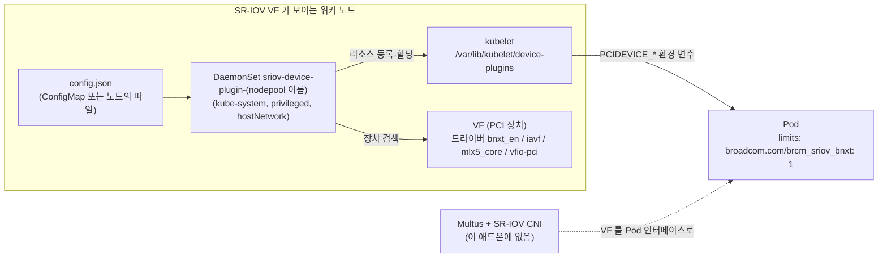

# 17. SR-IOV Network Device Plugin

> 커리큘럼: [CURRICULUM.md](CURRICULUM.md) · 앞 절: [16. Cilium](16-cilium.md) · 작성 2026-11-11
> 등급: **[근거]** 출처에 그대로 있는 것, **[추론]** 여러 출처를 엮어 직접 내린 결론.
> 기준 판: VKS Add-ons `3.8.0+20261021` (9.1 VKS Add-ons Release Notes, 2026-11-11 확인, 페이지 표기 Last Updated November 11, 2026, 이 날 기준 가장 높은 판). 판 호환은 이 문서에서 정리하지 않는다. [공식 호환 매트릭스](https://interopmatrix.broadcom.com/)와 릴리스 노트를 직접 볼 것.

SR-IOV Network Device Plugin 은 노드에 있는 SR-IOV 가상 함수(VF) 같은 네트워크 장치를 찾아 `broadcom.com/brcm_sriov_bnxt` 같은 **확장 리소스**로 kubelet 에 알리고, Pod 가 `resources.limits` 로 그 리소스를 요청하면 장치 하나를 골라 준다. 쿠버네티스 device plugin 의 네트워크판이다.

이 절에서 가장 먼저 잡을 것은 **이 플러그인이 하는 일의 경계**다. 장치를 세고 나눠 주는 것까지가 이 플러그인 몫이고, VF 를 Pod 의 네트워크 인터페이스로 붙이는 일은 하지 않는다. 그 일은 Multus 와 SR-IOV CNI 같은 CNI 쪽이 맡는다(DPDK 처럼 `vfio-pci` 장치를 사용자 공간에서 직접 쓰는 경우는 예외). 그리고 공식 참조 문서의 예시 values 를 그대로 붙이면 깨진다(5절 1번).

[근거] 이 절의 렌더링 결과는 공개 저장소(`3.8.0-20261021/vks-addons`)의 SR-IOV 패키지 원본과 bundle(`@sha256:afa8f37b…`)을 익명으로 받아 ytt v0.55.4 로 직접 돌린 것이다(2026-11-11). **SR-IOV NIC 가 붙은 VKS 클러스터에 설치해 보지는 못했다.** 3.3~3.4 의 클러스터 쪽 명령과 기대 출력은 문서와 렌더링에서 읽은 것이고 실측이 아니다.

---

## 1. 무엇을 하는가



- [근거] 패키지 설명은 「Kubernetes 호스트에 있는 SR-IOV VF 를 찾아 알리는 device plugin」이다. (PackageMetadata `sriov-network-device-plugin.kubernetes.vmware.com`, 2026-11-11 확인)
- [근거] 리소스 이름은 `resourcePrefix/resourceName` 이고, `resourcePrefix` 를 적지 않으면 명령행 기본값 `intel.com` 이 붙는다. (업스트림 v3.11.0 `cmd/sriovdp/main.go`·`manager.go`, README)
- [근거] 장치가 할당되면 컨테이너에 `PCIDEVICE_<리소스 이름 대문자, . 과 / 는 _>` 환경 변수로 PCI 주소가 들어간다. 예: `PCIDEVICE_INTEL_COM_SRIOV=0000:03:02.1`. (업스트림 README)
- [근거] `selectors` 는 객체 하나나 객체 목록을 받고, 목록이 권장이다. 목록은 순서대로 평가한다. (업스트림 README)
- [근거] 9.0 문서의 Windows 표에서 SR-IOV Network Device Plugin 은 Linux 클러스터·하이브리드 클러스터에서 지원, Windows 워커 클러스터에서는 지원하지 않고, Windows 워크로드 지원은 NO 다. (vSphere Supervisor 9.0 Services and Standalone Components PDF 506쪽)
- [근거] 3.5.0+20251218 에서 처음 들어왔고, 하드웨어 요구 사항은 「SR-IOV 가 켜진 하드웨어 가속 노드」다. (9.1 VKS Add-ons Release Notes)

### VKS 클러스터 쪽 기능과의 관계

- [근거] VKS 3.7 은 클러스터 `networks` 변수의 보조 인터페이스에 `driver`(이번 판은 `vfio-pci` 만)와 `sriovResourcePool`(device plugin 리소스 풀 이름과 접두어)을 새로 받는다. 설명은 「Pod 가 `requests: <prefix>/<name>: 1` 로 인터페이스를 바로 쓸 수 있게 한다」이다. (VCF Service Administration and Development 9.1 PDF, VKS 3.7 What's New, 35쪽)
- [추론] 이 VKS 기능이 노드에 장치 설정을 어떻게 남기는지, 이 애드온의 `configFromHostPath` 와 짝을 이루는지는 공개 문서에서 찾지 못했다. 둘을 함께 쓸 때는 9.1 문서의 클러스터 `networks` 변수 설명이 나오면 다시 본다.

### 판과 지원 등급 (3.8.0+20261021 기준)

| 항목 | 값 | 출처 |
|---|---|---|
| 패키지 판 | `3.11.0+vmware.6-vks.1` 한 판 | 9.1 VKS Add-ons Release Notes |
| 지원 등급 | **Ecosystem** | 같은 곳 |
| VKr | 1.33·1.34·1.35·1.36·1.37 모두 Yes | 같은 곳 |
| 업그레이드 경로 | 3.11.0+vmware.1~5, 3.10.0+vmware.3 에서 「Smooth upgrade」 | 같은 곳 |
| 이번 판의 변화 | Go 의존성·베이스 이미지 갱신(취약점 대응) | 같은 곳 |
| 업스트림 | sriov-network-device-plugin v3.11.0 | Package `releaseNotes` |

- [근거] 판 흐름: 3.10.0+vmware.1(3.5.0+20251218, 첫 판) → 3.10.0+vmware.3(DaemonSet 오버레이 문제 수정) → 3.11.0+vmware.1(vhost-net 감지 선택자 추가) → 3.11.0+vmware.3(VKr 1.34 이상에서 priority class 설정) → 3.11.0+vmware.6. (9.1 VKS Add-ons Release Notes)
- [근거] Ecosystem 등급은 Broadcom 지원이 패키징·서명·수명 주기 문제로 한정되고, 런타임 버그·보안 패치·기능 요청은 업스트림 커뮤니티 몫이다. (같은 곳, VKS Add-ons Support Tiers)
- [추론] VF 가 안 보이거나 리소스가 0 으로 뜨는 문제는 대부분 런타임·설정 쪽이라 Broadcom 지원 범위 밖일 가능성이 크다. 업스트림 README 와 이슈를 먼저 본다.

## 2. VKS 에서 어떻게 들어가는가

설치 경로 두 가지(레거시 PackageInstall, Supervisor 쪽 Add-on Management)의 일반 구조는 [00절](00-repository-and-install-paths.md), Carvel 기초는 [`../carvel-kapp.md`](../carvel-kapp.md)에 있다. 여기서는 SR-IOV 에만 해당하는 것을 적는다.

### 2.1 패키지 안에 무엇이 들어 있나

[근거] Package `sriov-network-device-plugin.kubernetes.vmware.com.3.11.0+vmware.6-vks.1` 의 템플릿 단계는 `config/` 전체를 ytt 로 돌리고 kbld 로 이미지를 고정한다. bundle 의 `config/` 에는 업스트림 매니페스트 두 개(`upstream/configMap.yaml`, `upstream/sriovdp-daemonset.yaml`), 오버레이 세 개, `values-schema.yaml`, `values.star` 가 있다. (패키지 원본, 2026-11-11 확인)

[근거] 오버레이가 하는 일 (`config/overlay/overlay-sriov-network-device-plugin.yaml` 등):

1. 업스트림 DaemonSet `kube-sriov-device-plugin-amd64` 와 예시 ConfigMap `sriovdp-config` 를 **지운다**.
2. `nodepools` 항목마다 DaemonSet `sriov-device-plugin-<name>` 을 하나씩 만든다. `config` 를 주면 ConfigMap `sriovdp-config-<name>` 도 만든다. 모두 `kube-system` 이다.
3. ConfigMap 에 `kapp.k14s.io/versioned` 를 붙인다. [추론] kapp 이 값이 바뀔 때마다 `-ver-N` 이 붙은 새 ConfigMap 을 만들고 DaemonSet 참조를 바꾸므로, config 를 고치면 Pod 가 다시 뜬다.
4. Secret `sriov-network-device-plugin-reg-creds`(secretgen 이 채우는 image pull secret)를 만들고 DaemonSet 에 `imagePullSecrets` 로 붙인다.
5. `vks_cluster_version` 이 1.34.0 이상이고 `priorityClassName` 을 비웠으면 `vmware-system-important` 를 넣는다.

[근거] 렌더링한 리소스 (ytt v0.55.4, 2026-11-11):

| values | 나오는 리소스 |
|---|---|
| nodepool 하나 + `config` | Secret, ConfigMap `sriovdp-config-<name>`, DaemonSet `sriov-device-plugin-<name>`, ServiceAccount `sriov-device-plugin` (4개) |
| nodepool 하나 + `configFromHostPath` | Secret, DaemonSet, ServiceAccount (3개, ConfigMap 없음) |

[근거] DaemonSet 은 `hostNetwork: true`, 컨테이너 `privileged: true`, hostPath 4개(`/var/lib/kubelet/device-plugins`, `/var/lib/kubelet/plugins_registry`, `/var/log`, `/var/run/k8s.cni.cncf.io/devinfo/dp`)를 쓰고, 요청 250m·40Mi, 제한 1 CPU·200Mi 다. `config` 경로는 ConfigMap 을 `/etc/pcidp` 에, `configFromHostPath` 경로는 노드 파일을 `/etc/pcidp/config.json` 에(`type: File`) 마운트한다. 둘 다 플러그인 기본 설정 경로 `/etc/pcidp/config.json` 에 닿는다.

[근거] Broadcom 의 PSA 문서는 `kube-system`·`tkg-system`·`vmware-system-cloud-provider` 를 pod security 에서 제외하고, VKr 1.26 이상의 기본을 시스템 아닌 네임스페이스 `enforce: restricted` 로 적는다. (Configure PSA for VKr 1.25 and Later, 9.0, Last Updated October 6, 2026) [추론] 그래서 privileged·hostPath 를 쓰는 플러그인 Pod 자체는 PSA 에 걸리지 않는다. 걸리는 쪽은 VF 를 쓰는 **사용자 Pod** 다(5절 6번).

### 2.2 values 가 무엇을 막는가

[근거] 스키마와 `values.star` 의 검사 (패키지 원본):

- `nodepools` 는 비어 있으면 안 된다. 값을 하나도 안 주면 `'nodepools' must be a non-empty list.` 로 렌더링이 실패한다.
- 항목마다 `config` 와 `configFromHostPath` 중 **정확히 하나**를 줘야 한다. 둘 다 주거나 둘 다 비우면 실패한다.
- `configFromHostPath` 는 `/config.json` 으로 끝나야 한다. `/etc/pcidp/sriov.json` 은 실패한다.
- 스키마에 없는 키는 거절된다. `nodeselector`(소문자 s)를 주면 `did you mean "nodeSelector"?` 로 실패한다.

[근거] 막지 **않는** 것 (직접 렌더링, 2026-11-11):

- `name` 을 빼도 렌더링은 성공하고 이름이 `sriovdp-config-`·`sriov-device-plugin-` 처럼 하이픈으로 끝난다. [근거] 쿠버네티스 오브젝트 이름(DNS 서브도메인)은 영숫자로 끝나야 한다(Kubernetes Object Names and IDs). [추론] 그래서 DaemonSet 생성이 API 서버에서 거절되고 조정이 실패한다. 설치해서 확인하지는 않았다.
- `config` 안의 JSON 문법은 검사하지 않는다. 문자열이기만 하면 통과한다(5절 1번).
- 여러 nodepool 의 `nodeSelector` 가 겹쳐도 막지 않는다.

[근거] 업스트림 v3.11.0 의 `main()` 은 config 파일을 읽거나 JSON 으로 풀지 못하면 오류 로그를 남기고 `return` 한다. (`cmd/sriovdp/main.go`) [추론] 프로세스가 종료 코드 0 으로 끝나고 DaemonSet 이 다시 띄우므로, Pod 가 `Completed` 와 `CrashLoopBackOff` 를 오가며 재시작 횟수만 늘어난다. 「에러로 죽었다」가 아니라 「정상 종료했다」로 보이니 로그를 봐야 한다.

### 2.3 Add-on 경로: 9.0 문서가 안내하는 방법

[근거] 9.0 「Install SR-IOV Network Device Plugin」은 Add-on 경로만 안내한다. VCF CLI(`vcf addon available list`·`vcf addon available get … -o sriov-data-values.yaml`·`vcf addon install create`)와 kubectl(AddonConfig `<cluster-name>-sriov-network-device-plugin` + AddonInstall) 두 방법이다. 문서 예시의 판은 `3.11.0+vmware.1-vks.1` 이다. (9.0 PDF 「vSphere Supervisor 9.0 Services and Standalone Components」 609~611쪽)

[근거] AddonConfigDefinition(패키지 어노테이션에 gzip+base64 로 들어 있음)을 풀어 보면 (패키지 원본, 2026-11-11 확인):

- 정의 이름은 `sriov-network-device-plugin.kubernetes.vmware.com.3.11.0---vmware.6-vks.1` 이다(`+` 가 `---`). AddonRelease 이름은 문서 예시대로 `...3.11.0-vmware.1-vks.1` 처럼 `+` 가 `-` 하나다. 두 이름 규칙이 다르다.
- 입력은 Cluster CR 하나뿐이다. AKO([15절](15-ako.md))처럼 Supervisor 쪽 Secret 을 읽지 않는다.
- 출력은 워크로드 클러스터의 `vmware-system-tkg` 네임스페이스에 Secret `<cluster>-sriov-network-device-plugin-values` 로 쓰이고, Cluster CR 의 `spec.topology.version` 을 `vks_cluster_version` 으로 덧붙인다. 그래서 Add-on 경로에서는 VKr 1.34 이상이면 priority class 가 자동으로 들어간다.
- OpenAPI 스키마는 `nodepools` 항목의 속성으로 `config`·`configFromHostPath`·`nodeSelector` 만 적고 `name` 이 없으며, 대신 최상위에 `name` 이 있다. ytt 스키마(`values-schema.yaml`)에는 `nodepools[].name` 이 있다. [추론] 두 스키마가 어긋나 있다. 문서 예시처럼 nodepool 마다 `name` 을 주는 것이 렌더링 쪽 기준에 맞다.

### 2.4 레거시 경로

[근거] 9.0 문서에는 SR-IOV 를 워크로드 클러스터 안 PackageInstall 로 까는 절차가 없다. 패키지 자체는 저장소에 있다(저장소 추가와 PackageInstall 의 일반 절차는 [00절](00-repository-and-install-paths.md)). [추론] 레거시 PackageInstall 로 깔아도 템플릿은 같지만, 문서에 없는 경로이고 `vks_cluster_version` 을 넣어 주는 주체가 없어 VKr 1.34 이상에서도 priority class 가 빠진다(직접 `priorityClassName` 을 주면 들어간다). 그래서 이 절은 레거시 PackageInstall 예시를 싣지 않는다.

### 2.5 판 고르기와 업그레이드

- [근거] 3.8.0+20261021 에는 3.11.0+vmware.6 한 판뿐이고, 3.10.0+vmware.3 부터 올라올 수 있다. 3.10.0+vmware.1 에서 바로 오는 경로는 적혀 있지 않다. (9.1 릴리스 노트)
- [추론] config 를 바꾸지 않는 판 올림이라도 DaemonSet 이 롤링되면서 노드마다 플러그인이 잠깐 내려간다. 이미 장치를 받은 Pod 는 그대로지만 그동안 새 Pod 는 그 노드에 장치를 못 받는다.

## 3. 실습

### 3.1 패키지를 렌더링해서 동작 확인 (클러스터 없이)

```bash
# 공개 저장소에서 패키지 목록과 SR-IOV bundle 받기 (crane, ytt 필요)
R=projects.packages.broadcom.com/vsphere/supervisor/vks-standard-packages/3.8.0-20261021/vks-addons
mkdir -p repo bundle
crane export $R:3.8.0-20261021 - | tar -x -C repo
grep -B1 -A4 'packages/sriov-network-device-plugin:' repo/.imgpkg/images.yml | grep 'image:'
crane export $R@sha256:afa8f37bdd16b1c02692667d4ed46919a0f675622390046120493f6698ece9c9 - | tar -x -C bundle

ytt -f bundle/config --data-values-file sriov-data-values.yaml > rendered.yaml
grep -E '^kind:' rendered.yaml          # 기대: Secret, ConfigMap, DaemonSet, ServiceAccount

# config.json 이 실제 JSON 인지 따로 검사한다 (ytt 는 검사하지 않는다)
yq '.nodepools[].config' sriov-data-values.yaml | jq . > /dev/null && echo json-ok
```

### 3.2 values (공통)

```yaml
# sriov-data-values.yaml  (3.8.0 저장소 기준, 시험하지 않음. <...> 는 환경 값)
nodepools:
  - name: np-sriov                    # 빼면 이름이 하이픈으로 끝나 생성 실패
    nodeSelector:
      sriov.example.com/capable: "true"   # VF 가 있는 노드에만 띄운다
    config: |
      {
        "resourceList": [
          {
            "resourceName": "brcm_sriov_bnxt",
            "resourcePrefix": "broadcom.com",
            "selectors": [
              {
                "vendors": ["14e4"],
                "devices": ["1806"],
                "drivers": ["bnxt_en"]
              }
            ]
          }
        ]
      }
```

[근거] 리소스 이름·벤더·장치·드라이버 값은 9.0 Package Reference 예시를 따랐고, 그 예시 안의 `#…` 주석만 뺐다(5절 1번). 자기 VF 의 벤더·장치 ID 는 노드에서 `lspci -nn` 으로 본다. [추론] 장치 ID 는 PF 가 아니라 VF 의 것이어야 한다.

### 3.3 Add-on 경로 (Supervisor 컨텍스트)

```bash
# 판 이름 확인 (+ 가 - 로 바뀐 AddonRelease 이름)
kubectl get addonreleases -n vmware-system-vks-public | grep sriov
# 기대(9.0 문서 예시의 이름 규칙을 3.8.0 판에 적용한 것, 실측 아님):
#   sriov-network-device-plugin.kubernetes.vmware.com.3.11.0-vmware.6-vks.1 ...
```

```yaml
# 클러스터가 있는 Supervisor 네임스페이스에서. 이름은 <cluster-name>-<addon-name> 규칙
apiVersion: addons.kubernetes.vmware.com/v1alpha1
kind: AddonConfig
metadata:
  annotations:
    clusteraddon.addons.kubernetes.vmware.com/owned-for-deletion: "true"
  name: <cluster-name>-sriov-network-device-plugin
  namespace: <supervisor-namespace>
spec:
  clusterName: <cluster-name>
  values:
    nodepools:                         # 3.2 의 내용을 그대로
      - name: np-sriov
        nodeSelector:
          sriov.example.com/capable: "true"
        config: |
          { "resourceList": [ { "resourceName": "brcm_sriov_bnxt", "resourcePrefix": "broadcom.com",
            "selectors": [ { "vendors": ["14e4"], "devices": ["1806"], "drivers": ["bnxt_en"] } ] } ] }
---
apiVersion: addons.kubernetes.vmware.com/v1alpha1
kind: AddonInstall
metadata:
  name: <cluster-name>-sriov-network-device-plugin
  namespace: <supervisor-namespace>
spec:
  releaseFilter:
    ref:
      name: sriov-network-device-plugin.kubernetes.vmware.com.3.11.0-vmware.6-vks.1
      namespace: vmware-system-vks-public
  addonRef:
    name: sriov-network-device-plugin
  clusters:
  - selector:
      matchLabels:
        cluster.x-k8s.io/cluster-name: <cluster-name>
```

```bash
kubectl apply -f addonconfig.yaml -f addoninstall.yaml
kubectl get clusteraddon -n <supervisor-namespace> | grep sriov   # 기대: READY True
```

[근거] 이름 규칙, `owned-for-deletion` 어노테이션, `releaseFilter`·`addonRef`·`clusters` 구조는 9.0 문서 예시(610~611쪽)를 따랐고 판만 3.8.0 저장소의 것으로 바꿨다.

### 3.4 워크로드 클러스터에서 확인

```bash
kubectl -n kube-system get ds,pod -l app=sriovdp -o wide
# 기대: daemonset.apps/sriov-device-plugin-np-sriov, nodeSelector 에 맞는 노드마다 Pod 1/1 Running

kubectl -n kube-system logs ds/sriov-device-plugin-np-sriov | grep -i -E 'unmarshal|error|resource'
# config 가 깨졌으면: "error unmarshalling raw bytes ... please make sure the config is in json format"

kubectl get node <worker> -o jsonpath='{.status.allocatable}{"\n"}'
# 기대: "broadcom.com/brcm_sriov_bnxt":"<VF 수>" 가 보인다. 0 이면 selectors 가 장치를 못 찾은 것

# 리소스를 요청하는 Pod (인터페이스를 붙이려면 Multus + SR-IOV CNI 가 따로 필요)
kubectl apply -f - <<'EOF'
apiVersion: v1
kind: Pod
metadata:
  name: vf-check
  namespace: demo
spec:
  containers:
  - name: c
    image: busybox:1.37
    command: ["sh", "-c", "env | grep PCIDEVICE; sleep 3600"]
    securityContext:
      allowPrivilegeEscalation: false
      capabilities: { drop: ["ALL"] }
      runAsNonRoot: true
      runAsUser: 1000
      seccompProfile: { type: RuntimeDefault }
    resources:
      limits:
        broadcom.com/brcm_sriov_bnxt: "1"
EOF
kubectl -n demo logs vf-check   # 기대: PCIDEVICE_BROADCOM_COM_BRCM_SRIOV_BNXT=0000:..
```

[추론] 이 확인용 Pod 는 장치를 받기만 하고 쓰지 않으므로 restricted 를 맞추는 securityContext 를 넣었다. 실제로 VF 를 쓰는 DPDK·RDMA 워크로드는 보통 `IPC_LOCK` 같은 권한이나 hugepage 가 필요해 restricted 에 걸린다(5절 6번).

## 4. 업스트림 설치와 다른 점

루트 [`../k8s-addon.sh`](../k8s-addon.sh) 에는 SR-IOV 가 없다. 업스트림 v3.11.0 은 Helm 차트 없이 `deployments/configMap.yaml` 과 `deployments/sriovdp-daemonset.yaml` 을 `kubectl create -f` 로 넣는다. (업스트림 README, `deployments/` 목록) GPU 클러스터에서 NVIDIA Network Operator 로 같은 플러그인을 넣는 경우는 [`../gpu/10-rdma-gpudirect.md`](../gpu/10-rdma-gpudirect.md) 를 본다.

| 항목 | VKS 패키지 3.11.0+vmware.6 | 업스트림 v3.11.0 매니페스트 |
|---|---|---|
| DaemonSet | nodepool 마다 `sriov-device-plugin-<name>`, nodeSelector 를 값으로 | `kube-sriov-device-plugin` 하나, 모든 노드 |
| 설정 | nodepool 마다 ConfigMap 또는 노드 파일(`configFromHostPath`) | ConfigMap `sriovdp-config` 하나 |
| 이미지 | `v3.11.0` 태그를 Broadcom 저장소 digest 로 고정(kbld), pull secret 자동 | `ghcr.io/...:latest` |
| 검증 | nodepool 비었음·둘 다/둘 다 없음·경로 끝 검사, 스키마 밖 키 거절 | 없음 |
| 우선순위 | VKr 1.34 이상이면 `vmware-system-important` | 없음 |
| 설정 변경 반영 | kapp versioned ConfigMap 으로 Pod 재시작 | ConfigMap 을 고친 뒤 Pod 를 직접 지워야 함 |
| 지원 | Ecosystem 등급(패키징·수명 주기만) | 커뮤니티 |

- [근거] 업스트림 매니페스트의 DaemonSet 이름은 `kube-sriov-device-plugin`, 이미지는 `:latest` 다. VKS bundle 안의 `upstream/` 사본은 이름이 `kube-sriov-device-plugin-amd64`, 이미지가 `:v3.11.0` 이고, 오버레이가 이것을 지운다. (v3.11.0 태그의 `deployments/sriovdp-daemonset.yaml`, 패키지 원본)
- [근거] 업스트림 예시 ConfigMap 은 Intel·Mellanox·Broadcom 장치 네 가지를 한꺼번에 적은 것이고, VKS 패키지는 이것을 쓰지 않는다. `config` 를 반드시 직접 줘야 한다.
- [추론] 업스트림처럼 「모든 노드에 하나」로 두고 싶으면 nodepool 하나에 `nodeSelector` 를 비우면 된다. 다만 노드마다 NIC 가 다르면 nodepool 을 나눠 설정을 달리하는 것이 이 패키지를 쓰는 이유다.

## 5. 흔한 실수

1. **Package Reference 예시를 그대로 붙인다.** [근거] 9.0 SR-IOV Package Reference(HTML, Last Updated October 6, 2026) 예시의 `config: |` 블록 안에 `"selectors": [   #Which network interface devices ...` 주석이 들어 있다. YAML 리터럴 블록 안이라 주석이 아니라 문자열이 된다. 그대로 렌더링하면 ytt 는 성공(rc=0)하지만 결과 `config.json` 은 `Expecting value: line 6 column 24` 로 JSON 이 아니다(직접 렌더링 + `json.loads`, 2026-11-11). 같은 예시가 PDF 판(609쪽)에는 주석 없이 실려 있다. [추론] 플러그인은 2.2 처럼 종료 코드 0 으로 끝나며 재시작을 되풀이한다. 붙이기 전에 `jq .` 로 한 번 통과시킨다.
2. **nodepool `name` 을 뺀다.** [근거] 렌더링은 성공하고 이름이 하이픈으로 끝난다(2.2). [추론] DaemonSet 생성이 거절된다. 이름은 소문자·숫자·하이픈으로, 하이픈으로 끝나지 않게 준다.
3. **`resourcePrefix` 를 빼고 `broadcom.com/...` 를 요청한다.** [근거] 빼면 `intel.com` 이 붙는다(업스트림 기본값). Pod 는 존재하지 않는 리소스를 기다리며 Pending 이 된다. `kubectl get node -o jsonpath='{.status.allocatable}'` 로 실제 이름을 본다.
4. **PF 의 장치 ID 를 적는다.** [추론] 선택자는 노드에서 보이는 장치에 대해 평가되고, 할당할 것은 VF 다. VF 의 벤더·장치 ID 와 드라이버(`iavf`·`bnxt_en`·`mlx5_core`·`vfio-pci` 등)를 `lspci -nnk` 로 확인한다. 리소스 수가 0 이면 이것부터 의심한다.
5. **nodepool 의 nodeSelector 가 겹친다.** [근거] 패키지는 겹침을 막지 않는다(2.2). [추론] 한 노드에 플러그인 Pod 가 둘 뜨고 같은 VF 를 두 설정이 각각 세게 된다. 같은 `resourcePrefix/resourceName` 을 두 플러그인이 등록할 때 kubelet 이 어느 쪽을 남기는지는 확인하지 않았다. 노드 라벨을 nodepool 마다 서로 겹치지 않게 나눈다.
6. **장치만 받으면 네트워크가 붙는 줄 안다.** [근거] 이 플러그인은 장치를 찾고 할당하고 `PCIDEVICE_*` 로 알려 줄 뿐이다(업스트림 README). 3.8.0 애드온 목록에 SR-IOV CNI 는 없다(9.1 릴리스 노트 지원 표). [추론] 커널 네트워크 인터페이스로 쓰려면 Multus(20절)와 SR-IOV CNI 가 따로 필요하다. DPDK 처럼 `vfio-pci` 장치를 사용자 공간에서 직접 쓰면 CNI 없이 장치만으로 된다. 그런 Pod 는 보통 hugepage·`IPC_LOCK` 이 필요해 VKr 1.26 이상 기본 `enforce: restricted` 네임스페이스에서 거절되므로, 그 네임스페이스의 PSA 라벨을 먼저 정한다(루트 [`../podsecurity_admission.md`](../podsecurity_admission.md)).
7. **Windows 워커에 기대한다.** [근거] Windows 워커 클러스터에서는 지원하지 않는다(9.0 PDF 506쪽 표). nodeSelector 에 `kubernetes.io/os: linux` 를 넣어 두면 하이브리드 클러스터에서도 안전하다.
8. **Product 등급처럼 지원을 기대한다.** [근거] Ecosystem 등급이라 런타임 버그는 업스트림 몫이다(1절). 문제를 올리기 전에 업스트림 v3.11.0 README 의 설정 표와 로그를 먼저 본다.

## 6. 확인 문제

1. 9.0 Package Reference 예시 values 를 그대로 Add-on 으로 넣었다. AddonInstall 은 READY 인데 플러그인 Pod 의 재시작 횟수가 계속 늘고, 마지막 상태는 `Completed` 다. 원인과 확인 방법은?
2. Pod 가 `broadcom.com/brcm_sriov_bnxt: 1` 을 요청한 채 Pending 이다. 노드 allocatable 에는 `intel.com/brcm_sriov_bnxt` 가 보인다. 무엇을 빠뜨렸나?
3. 플러그인이 장치를 잘 나눠 주고 Pod 안에 `PCIDEVICE_...` 도 들어왔는데, Pod 안 `ip link` 에는 새 인터페이스가 없다. 왜인가?

<details>
<summary>답</summary>

1. 예시의 `config` 문자열 안에 `#Which network interface ...` 가 그대로 들어가 JSON 이 깨졌다. 플러그인은 config 를 못 풀면 오류 로그만 남기고 정상 종료(코드 0)하므로 DaemonSet 이 계속 다시 띄운다. `kubectl -n kube-system logs ds/sriov-device-plugin-<name>` 에서 `error unmarshalling raw bytes` 를 보고, values 의 `config` 를 `jq .` 로 검사한다. [근거] 9.0 Package Reference HTML 예시, 업스트림 `main.go`, 직접 렌더링.
2. 설정에 `"resourcePrefix": "broadcom.com"` 을 빠뜨려 기본값 `intel.com` 이 붙었다. 설정에 접두어를 넣거나 Pod 요청을 실제 이름에 맞춘다. [근거] 업스트림 README·`main.go`.
3. device plugin 은 장치를 할당만 하고 Pod 네트워크 네임스페이스로 VF 를 옮기지 않는다. 그 일은 Multus 와 SR-IOV CNI 가 `NetworkAttachmentDefinition` 으로 한다. DPDK 용 `vfio-pci` 장치라면 인터페이스가 아니라 `/dev/vfio/*` 로 쓰는 것이 맞다. [근거] 업스트림 README, [추론] CNI 역할 구분.

</details>

## 7. 출처 (모두 2026-11-11 확인)

- VKS Add-ons Release Notes (9.1, Last Updated November 11, 2026): <https://techdocs.broadcom.com/us/en/vmware-cis/vcf/vcf-service-administration-and-development/9-1/release-notes/vks-addons-release-notes.html> (가장 높은 판 3.8.0+20261021)
- SR-IOV Network Device Plugin Package Reference (9.0, Last Updated October 6, 2026): <https://techdocs.broadcom.com/us/en/vmware-cis/vcf/vcf-service-administration-and-development/9-0/managing-vsphere-kuberenetes-service-clusters-and-workloads/installing-standard-packages-on-tkg-service-clusters/standard-package-reference/sriov-network-device-plugin-package-reference.html>
- vSphere Supervisor 9.0 Services and Standalone Components PDF (Install SR-IOV Network Device Plugin 609~611쪽, Windows 지원 표 506쪽): <https://techdocs.broadcom.com/content/dam/broadcom/techdocs/us/en/pdf/vmware/vcf/Supervisor-Async/vmware-cloud-foundation-service-administration-and-development-9-0.pdf>
- VMware Cloud Foundation Service Administration and Development 9.1 PDF (VKS 3.7 What's New, 35쪽): <https://techdocs.broadcom.com/content/dam/broadcom/techdocs/us/en/pdf/vmware/vcf/Supervisor-Async/vmware-cloud-foundation-service-administration-and-development-9-1.pdf>
- Configure PSA for VKr 1.25 and Later (9.0): <https://techdocs.broadcom.com/us/en/vmware-cis/vcf/vcf-service-administration-and-development/9-0/managing-vsphere-kuberenetes-service-clusters-and-workloads/managing-security-for-tkg-service-clusters/configure-psa-for-tkr-1-25-and-later.html>
- 업스트림 sriov-network-device-plugin v3.11.0 (README, `cmd/sriovdp/main.go`·`manager.go`, `deployments/`): <https://github.com/k8snetworkplumbingwg/sriov-network-device-plugin/tree/v3.11.0>
- Kubernetes Object Names and IDs: <https://kubernetes.io/docs/concepts/overview/working-with-objects/names/>
- Kubernetes Device Plugins: <https://kubernetes.io/docs/concepts/extend-kubernetes/compute-storage-net/device-plugins/>
- 패키지 원본: `projects.packages.broadcom.com/vsphere/supervisor/vks-standard-packages/3.8.0-20261021/vks-addons:3.8.0-20261021` 의 `packages/sriov-network-device-plugin.kubernetes.vmware.com/3.11.0+vmware.6-vks.1.yml`, bundle `@sha256:afa8f37bdd16b1c02692667d4ed46919a0f675622390046120493f6698ece9c9`
