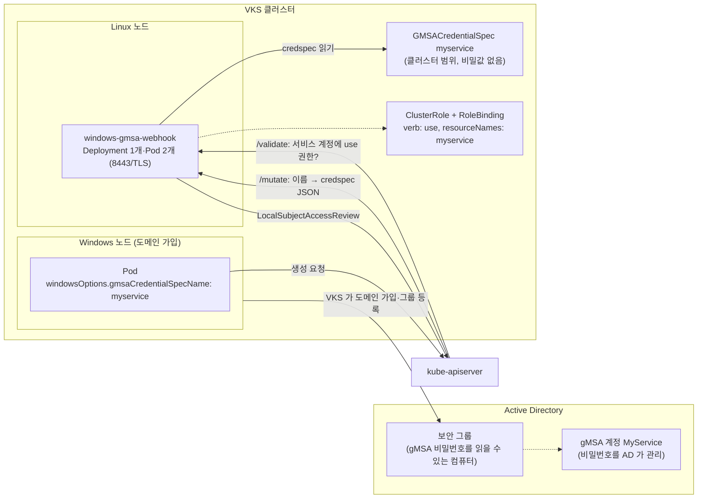

# 18. Windows gMSA Webhook

> 커리큘럼: [CURRICULUM.md](CURRICULUM.md) · 앞 절: [17. SR-IOV Network Device Plugin](17-sriov-network-device-plugin.md) · 작성 2026-11-13
> 등급: **[근거]** 출처에 그대로 있는 것, **[추론]** 여러 출처를 엮어 직접 내린 결론.
> 기준 판: VKS Add-ons `3.8.0+20261021` (9.1 VKS Add-ons Release Notes, 2026-11-13 확인, 페이지 표기 Last Updated November 11, 2026, 이 날 기준 가장 높은 판). 판 호환은 이 문서에서 정리하지 않는다. [공식 호환 매트릭스](https://interopmatrix.broadcom.com/)와 릴리스 노트를 직접 볼 것.

gMSA(Group Managed Service Account)는 Active Directory 가 비밀번호를 대신 관리해 주는 서비스 계정이다. Windows 컨테이너는 이 계정의 신원으로 Kerberos 인증을 받아 도메인 안의 SQL Server·파일 공유 같은 서비스에 붙는다. 쿠버네티스에서는 계정 정보를 클러스터 범위 커스텀 리소스 `GMSACredentialSpec` 으로 두고, Pod 는 그 이름만 적는다. 이 애드온은 그 이름을 실제 credential spec 내용으로 바꿔 넣는 **변경 웹훅**과, Pod 의 서비스 계정이 그 credential spec 을 써도 되는지 검사하는 **검증 웹훅**을 깐다.

이 절에서 먼저 잡을 것은 두 가지다. 하나는 **웹훅이 Windows Pod 만 보지 않는다는 것**이다. 두 웹훅은 자기 네임스페이스를 뺀 모든 네임스페이스의 Pod 생성에 `failurePolicy: Fail` 로 걸리므로, 웹훅이 죽거나 인증서가 깨지면 Linux Pod 생성까지 막힌다(6절 1번). 다른 하나는 **gMSA 가 이 애드온만으로 동작하지 않는다는 것**이다. Windows 노드가 도메인에 가입하고 gMSA 비밀번호를 읽을 수 있는 보안 그룹에 들어가야 하며, 그 일은 VKS 의 Windows 노드 풀 설정(`osConfiguration.directoryJoin`)이 맡는다.

[근거] 이 절의 렌더링 결과는 공개 저장소(`3.8.0-20261021/vks-addons`)의 gMSA 패키지 원본과 bundle(`@sha256:b5349863…`)을 익명으로 받아 ytt v0.55.4 로 직접 돌린 것이다(2026-11-13). **Windows 노드 풀이 있는 VKS 클러스터와 Active Directory 에 설치해 보지는 못했다.** 4.3~4.5 의 클러스터 쪽 명령과 기대 출력은 문서·렌더링·업스트림 소스에서 읽은 것이고 실측이 아니다.

---

## 1. 무엇을 하는가



- [근거] 변경 웹훅은 Pod 명세의 GMSA 이름 참조를 credential spec 의 JSON 내용으로 펼치고, 검증 웹훅은 Pod 의 서비스 계정이 해당 credential spec 에 `use` 동사 권한이 있는지 확인한다. 그 뒤 컨테이너 런타임이 그 credential spec 으로 Windows 컨테이너를 구성한다. (Kubernetes 「Configure GMSA for Windows Pods and containers」, Stable since v1.18, 2026-11-13 확인)
- [근거] GMSA credential spec 은 비밀값을 담지 않는다. 컨테이너 런타임이 원하는 gMSA 를 Windows 에 알리는 정보일 뿐이다. (같은 문서)
- [근거] 권한 검사는 서비스 계정 사용자 정보로 `windows.k8s.io` 그룹 `gmsacredentialspecs` 리소스의 `use` 동사를 `LocalSubjectAccessReview` 로 묻는다. 권한이 없으면 `service account "<이름>" is not authorized to `use` GMSA cred spec "<이름>"` 로 거절한다. (업스트림 v0.14.1 `admission-webhook/kube_client.go`·`webhook.go`)
- [근거] 이미 있는 Pod 의 GMSA 설정을 바꾸는 UPDATE 는 거절한다(`cannot update an existing pod's GMSA settings`). (업스트림 v0.14.1 `webhook.go` `validateUpdateRequest`)
- [근거] 이 웹훅은 Linux 에서만 돈다. 0.11.x 는 Linux 워커가 하나 이상 있어야 하고, 0.13.x 이상은 Linux 워커가 없으면 컨트롤 플레인에서 돈다. (9.0 Install Windows gMSA Webhook Package, Last Updated October 6, 2026)
- [근거] 9.0 문서의 Linux/Windows 표에서 Windows gMSA Webhook 은 Linux 클러스터 「NA」, 하이브리드 클러스터 「Supported」, Windows 워커 클러스터는 0.13.0+vmware.1-vks.1 부터 지원이고 Cert Manager 1.17.2+vmware.1-vks.1 이상이 필요하다. Windows 워크로드 지원은 Yes 다. (vSphere Supervisor 9.0 Services and Standalone Components PDF 507쪽, 표 이름은 「Windows GSMA Webhook」로 오타)

### VKS 쪽 전제: 도메인에 가입한 Windows 노드 풀

- [근거] VKS Service 3.3 부터 Windows 노드를 온프레미스 Active Directory 에 가입시켜 gMSA 를 쓸 수 있다. VKS 는 노드를 지정한 OU 에 가입시키고, gMSA 접근용 보안 그룹에 노드를 넣는 일을 자동으로 한다. (9.0 PDF 264쪽 「Configuring a Windows Node Pool to Use Group Managed Service Accounts」)
- [근거] 노드 풀 `variables.overrides` 의 `osConfiguration.directoryJoin` 에 `credentialSecretRef`(가입 계정 Secret, `username`·`password`), `domain`, `gmsaControlSecurityGroupDN`, `organizationalUnitDN` 을 준다. 도메인 가입에는 `builtin-generic-v3.3.0` 이상의 ClusterClass 가 필요하다. (9.0 PDF 266~268쪽, `directoryJoin` 입력 표 325쪽)
- [근거] Windows 노드 풀은 Antrea CNI 만 지원하고, 컨테이너는 Windows Server 2022 기반이어야 하며, VKS 는 교체·삭제된 Windows 노드의 컴퓨터 객체를 AD 에서 지우지 않는다. Kubernetes 1.32 에서는 gMSA 웹훅과 cert-manager 를 돌릴 Linux VM 이 하나 이상 있어야 한다. (9.0 PDF 276쪽)
- 이 리포의 VKS 클러스터 관리 개요는 루트 [`../vks-cluster-management.md`](../vks-cluster-management.md)에 있다. 이 절은 노드 풀 설정을 되풀이하지 않고 애드온만 다룬다.

### 판과 지원 등급 (3.8.0+20261021 기준)

| 항목 | 값 | 출처 |
|---|---|---|
| 패키지 판 | `0.14.1+vmware.1-vks.1` 한 판 | 9.1 VKS Add-ons Release Notes |
| 지원 등급 | Product | 같은 곳 |
| VKr | 1.33·1.34·1.35·1.36·1.37 모두 Yes | 같은 곳 |
| 업그레이드 경로 | 「Smooth upgrade from 0.13.0+vmware.4-vks.1 or later」 | 같은 곳 |
| 이번 판의 변화(Broadcom 문구) | Go 의존성·베이스 이미지 갱신(취약점 대응) | 같은 곳 |
| 업스트림 | kubernetes-sigs/windows-gmsa v0.14.1 | Package `releaseNotes` |
| 의존 | `addons.kubernetes.vmware.com/depends-on: cert-manager` | Package 어노테이션 |

- [근거] 판 흐름: 0.13.0+vmware.1 은 3.5.0+20251022 에서, 0.11.0+vmware.1-tkg.1·0.13.0+vmware.2-vks.1 은 3.5.0+20251218 에서 「Packages Removed」로 빠졌다. 0.13.0+vmware.3(3.5.0+20251022, 컨테이너 resources·네임스페이스 ResourceQuota·LimitRange 설정 추가) → vmware.4(3.5.0+20251218, 클러스터 갱신 때 reconcile 실패 상태에 머무는 문제 수정) → vmware.5(3.6.0+20260211) → vmware.6(3.6.0+20260416) → vmware.7(3.7.0+20260618, VKr 1.34 이상에서 PriorityClass 설정) → vmware.8(3.7.0+20260723) → vmware.9(3.7.0+20260827, 기본 인증서 유효 기간 1년·기간 설정 가능) → 0.14.1+vmware.1(3.8.0+20261021). (9.1 VKS Add-ons Release Notes)
- [근거] 9.1 릴리스 노트는 3.8.0 이전 판에서 이 애드온 이름을 「Windows **GSMA** Webhook」과 「Windows GMSA Webhook」으로 섞어 적는다. GSMA 는 15곳으로, 3.5.0+20251022~3.7.0+20260924 의 지원 표 10곳 전부, What's New 4곳(3.6.0+20260416·3.7.0+20260618·3.7.0+20260723·3.7.0+20260827), 3.5.0+20251022 의 Packages Removed 1곳이다. 3.7.0+20260924 저장소에 들어 있는 `0.13.0+vmware.9-vks.1`(`crane export .../3.7.0-20260924/vks-addons:3.7.0-20260924`, 2026-11-13)은 그 판 지원 표의 GSMA 줄과 맞는다. [추론] 릴리스 노트에서 이 애드온을 찾을 땐 `gmsa` 와 `gsma` 를 같이 검색한다.
- [근거] 업스트림 v0.14.1 은 웹훅의 GMSA 권한 검사와 변경을 **init 컨테이너에도** 적용한다(PR #179, 2026-09-03 머지). (업스트림 v0.14.1 릴리스 노트) Broadcom 릴리스 노트의 0.14.1 문구에는 이 변화가 없다. [추론] 0.13 에서 init 컨테이너에만 gMSA 이름을 적어 두던 워크로드는 0.14.1 로 올린 뒤 그 서비스 계정에 `use` 권한이 없으면 새 Pod 생성이 거절된다.

---

## 2. 패키지가 까는 것

[근거] 기본값으로 렌더링한 결과(`ytt -f config/`, 값 파일 없음)는 Namespace·ServiceAccount·ClusterRole·ClusterRoleBinding·CRD 1개·Deployment·Service·Secret(이미지 풀용 빈 `{}`)·ResourceQuota·LimitRange·Issuer·ClusterIssuer·Certificate 2개·MutatingWebhookConfiguration·ValidatingWebhookConfiguration 이다. **PodDisruptionBudget 과 GMSACredentialSpec 은 기본으로 만들지 않는다**(2.2).

### 2.1 웹훅 범위와 인증서

```yaml
# 렌더링 결과에서 발췌 (MutatingWebhookConfiguration, 검증 웹훅도 같은 모양)
webhooks:
- name: admission-webhook.windows-gmsa.sigs.k8s.io
  clientConfig:
    service: {name: windows-gmsa-webhook, namespace: windows-gmsa-webhook, path: /mutate}
  rules:
  - operations: ["CREATE"]          # 검증 웹훅은 CREATE, UPDATE
    apiGroups: [""]
    apiVersions: ["*"]
    resources: ["pods"]
  failurePolicy: Fail
  namespaceSelector:
    matchExpressions:
    - {key: kubernetes.io/metadata.name, operator: NotIn, values: [windows-gmsa-webhook]}
    - {key: windows.k8s.io/disabled, operator: NotIn, values: ["true"]}
```

- [근거] 두 웹훅 모두 `objectSelector` 가 없고, 빠지는 네임스페이스는 웹훅 자신의 네임스페이스와 `windows.k8s.io/disabled=true` 레이블이 붙은 곳뿐이다. 업스트림 Helm 차트(v0.14.1 태그의 `charts/gmsa`)도 같다. (렌더링 결과, 업스트림 `mutatingwebhook.yaml`)
- [근거] `failurePolicy: Fail` 은 웹훅 호출 오류가 승인 실패로 이어진다는 뜻이다. (Kubernetes API reference, MutatingWebhookConfiguration v1)
- [근거] `certificates.certManager.enabled: true`(기본)이면 selfSigned ClusterIssuer `windows-gmsa-webhook-ca` → CA Certificate(기본 `caDuration: 26280h`, `caRenewBefore: 8760h`) → CA Issuer → 서빙 Certificate(기본 `leafDuration: 8760h`, `leafRenewBefore: 720h`, DNS 이름 `windows-gmsa-webhook.<ns>.svc`·`.svc.cluster.local`) 사슬을 만들고, 웹훅 설정에 `cert-manager.io/inject-ca-from` 어노테이션을 단다. (bundle `config/issuer.yaml`·`mutatingwebhook.yaml`)
- [근거] 인증서 기간 설정은 0.13.0+vmware.9 릴리스 노트에 처음 적혔고(「기본 인증서 유효 기간 1년, 기간 설정 지원」, 9.1 릴리스 노트), 3.7.0+20260924 저장소의 그 판 패키지 스키마에 `caDuration`·`leafDuration` 이 이미 있다. 네 값은 0.14.1 패키지 스키마에 있지만 9.0 Package Reference 의 표와 예시에는 없다. (패키지 스키마, 9.0 Windows gMSA Webhook Package Reference, Last Updated October 6, 2026)

### 2.2 Deployment·PDB·네임스페이스 한도

- [근거] 컨테이너는 Pod `runAsUser: 1000`, 컨테이너 `allowPrivilegeEscalation: false`·`capabilities.drop: [ALL]`·`runAsNonRoot: true`·`seccompProfile: RuntimeDefault`, 볼륨은 서빙 인증서 Secret 하나다. `nodeSelector` 에는 사용자 값과 상관없이 `kubernetes.io/os: linux` 가 덧씌워진다. 기본 tolerations 는 컨트롤 플레인 NoSchedule 두 개, 기본 affinity 는 「컨트롤 플레인이 아닌 노드를 선호」다. (bundle `config/deployment.yaml`·`schema.yaml`)
- [근거] `vks_cluster_version` 이 1.34.0 이상이고 `priorityClassName` 이 비어 있으면 `vmware-system-important` 를 넣는다. 이 값은 Package `valuesSchema`(OpenAPI)에는 없고 bundle ytt 스키마에만 빈 문자열 기본값으로 있으며, Add-on 경로에서는 AddonConfigDefinition 의 출력 템플릿이 Cluster 의 `spec.topology.version` 을 넣어 준다. (bundle `deployment.yaml`·`schema.yaml`, AddonConfigDefinition `templateOutputResources`) 이 자동 설정은 0.13.0+vmware.7 에서 들어왔다(「Support enforce PriorityClass setting … >= v1.34」, 9.1 릴리스 노트). 렌더링으로 확인: `v1.35.0+vmware.2-fips` → `vmware-system-important`, `v1.33.6+vmware.1-fips` 와 값 없음(레거시 경로) → 넣지 않음.
- [근거] `podDisruptionBudget` 은 스키마에서 nullable 이라 기본값이 `null` 이고, 그래서 값 파일 없이 렌더링하면 PDB 가 없다. 값을 주면 `minAvailable` 이 있을 때 그것만 쓰고, `maxUnavailable` 은 `minAvailable` 이 `null` 일 때만 쓴다(bundle `config/pdb.yaml`). 두 키도 각각 nullable 이라 하나만 주면 다른 하나는 `null` 이 된다. 렌더링으로 확인: Package Reference 예시처럼 둘 다 1 → `minAvailable: 1` 하나, `{maxUnavailable: 1}` 만 → `maxUnavailable: 1`, `{minAvailable: null}` 만 → 두 값 모두 없는 PDB.
- [근거] 기본 ResourceQuota 는 네임스페이스의 `requests.cpu: 1000m`·`requests.memory: 1024Mi`, LimitRange 기본 요청은 컨테이너당 300m·256Mi, Deployment 요청도 300m·256Mi 다. (렌더링 결과)
- [근거] 패키지는 이 네임스페이스에 PSA 레이블을 달지 않는다. Broadcom 의 PSA 문서는 VKr 1.26 이상에서 시스템이 아닌 네임스페이스의 기본을 `enforce: restricted` 로 적는다. (bundle `namespace.yaml`, Configure PSA for VKr 1.25 and Later, 9.0) [추론] 위 securityContext 는 restricted 프로필의 요구(권한 상승 금지, ALL 제거, non-root, RuntimeDefault seccomp, Secret 볼륨)를 모두 맞추므로 웹훅 Pod 는 기본 PSA 에 걸리지 않는다.

### 2.3 values 검사: 막는 것과 안 막는 것

| 입력 | ytt 결과 (v0.55.4, 2026-11-13) |
|---|---|
| 오타 키 `replicaCont: 1` | rc=1, 「One or more data values were invalid」 |
| `qps: "30"` (문자열) | rc=1 (스키마 기본값이 float) |
| 9.0 Package Reference 예시를 그대로 | rc=1, `yaml: line 38: did not find expected <document start>` (6절 2번) |
| `certificates.certManager.enabled: false`, `caBundle` 비움 | rc=0, 웹훅 두 개에 `caBundle: ""` 로 렌더링 (6절 3번) |
| `credential.domainJoinConfig.machineAccountName` 없이 일부만 | rc=0, GMSACredentialSpec 을 만들지 않음 |
| `replicaCount: 4` | rc=0 (ResourceQuota 와 대조하지 않음, 6절 5번) |

[근거] 맨 위 스키마는 ytt `#@data/values-schema` 라 모르는 키를 거절한다. `affinity`·`nodeSelector`·`tolerations` 만 `#@schema/type any=True` 라 모양 검사가 없다. 스키마 주석은 tolerations 의 필드를 명시하면 ytt 가 `tolerationSeconds` 에 기본값 0 을 채워 Deployment 가 거절되므로 일부러 검사를 껐다고 적는다. (bundle `config/schema.yaml`)

### 2.4 credential spec 을 패키지로 만들기

[근거] `credential.domainJoinConfig.machineAccountName` 이 있으면 패키지가 GMSACredentialSpec 하나를 만든다. 이름은 `machineAccountName` 을 소문자로 바꾸고 `_` 를 `-` 로 바꾼 것이다. 렌더링 예: `WebApp_1` → `webapp-1`. `ActiveDirectoryConfig.GroupManagedServiceAccounts` 에는 같은 계정을 `netBiosName` 범위와 `dnsName` 범위로 두 번 넣는다. (bundle `config/credentialspec.yaml`, 렌더링 `r-cred.yaml`)

[추론] 패키지 값으로는 credential spec 을 **하나만** 만들 수 있고, 그 객체는 애드온 수명에 묶인다. gMSA 계정이 여럿이거나 애드온을 다시 깔 일이 있으면 credential spec 은 따로 관리하는 편이 낫다(6절 6번).

---

## 3. VKS 에 들어가는 두 경로

### 3.1 Add-on 경로 (VKS 3.5 이상)

- [근거] AddonConfigDefinition 이름은 `windows-gmsa-webhook.kubernetes.vmware.com.0.14.1---vmware.1-vks.1`(`+` 가 `---`), 네임스페이스는 `vmware-system-vks-public` 이다. 입력으로 Cluster(`cluster.x-k8s.io/v1beta2`)를 읽고, 출력은 대상 클러스터의 `vmware-system-tkg` 네임스페이스 Secret `<cluster>-windows-gmsa-webhook` 의 `values.yaml` 이며, 사용자 값 아래에 `vks_cluster_version` 을 붙인다. (Package 어노테이션의 AddonConfigDefinition 을 풀어 확인)
- [근거] AddonConfig 이름은 `<cluster-name>-<addon-name>` 이어야 한다. (9.0 Install Windows gMSA Webhook Addon using Kubectl)
- [근거] AddonConfigDefinition 스키마에서 `tolerations` 는 기본값이 목록인데 `type: object` 로 적혀 있다. 패키지 OpenAPI 스키마도 같다. (AddonConfigDefinition, Package `valuesSchema`) [추론] AddonConfig 검증이 이 스키마를 그대로 쓴다면 `tolerations` 를 목록으로 바꿔 넣을 때 거절될 수 있다. Supervisor 에서 시험하지 못했으므로, tolerations 를 바꿔야 하면 먼저 AddonConfig 를 만들어 상태를 본다.

### 3.2 레거시 PackageInstall 경로

- [근거] 레거시 경로는 `vcf package install windows-gmsa-webhook --package windows-gmsa-webhook.kubernetes.vmware.com --version <판> --values-file <파일> --namespace windows-gmsa-webhook-package` 이다. PackageInstall 이 있는 네임스페이스는 `windows-gmsa-webhook-package`, 실제 리소스가 깔리는 곳은 values 의 `namespace`(기본 `windows-gmsa-webhook`)다. (9.0 Install Windows gMSA Webhook Package)
- [근거] 0.13.0 이상은 패키지 이름이 `windows-gmsa-webhook.kubernetes.vmware.com` 이고, 그 전(0.11.x)은 `windows-gmsa-webhook.tanzu.vmware.com` 이다. (같은 문서)

설치 흐름과 kapp-controller 동작은 [00절](00-repository-and-install-paths.md)과 루트 [`../carvel-kapp.md`](../carvel-kapp.md)를 본다.

---

## 4. 실습

### 4.1 클러스터 없이 확인하는 법 (렌더링)

```bash
# crane, ytt 필요. 공개 저장소라 로그인 없이 받는다.
R=projects.packages.broadcom.com/vsphere/supervisor/vks-standard-packages/3.8.0-20261021/vks-addons
mkdir -p repo bundle
crane export $R:3.8.0-20261021 - | tar -x -C repo
ls repo/packages/windows-gmsa-webhook.kubernetes.vmware.com/      # 0.14.1+vmware.1-vks.1.yml
grep -A5 'kbld.carvel.dev/id: .*windows-gmsa-webhook' repo/.imgpkg/images.yml   # bundle 다이제스트 확인
crane export $R@sha256:b534986378bb7a9c1b065c8bd5d53188c52be69ee92e0b93e17cb9d06c67ad68 - | tar -x -C bundle

ytt -f bundle/config > default.yaml && grep '^kind:' default.yaml | sort | uniq -c
printf 'vks_cluster_version: v1.35.0+vmware.2-fips\n' > v135.yaml
ytt -f bundle/config --data-values-file v135.yaml | grep priorityClassName   # vmware-system-important
```

Add-on 정의는 Package 어노테이션에 gzip+base64 로 들어 있다.

```bash
P=repo/packages/windows-gmsa-webhook.kubernetes.vmware.com/0.14.1+vmware.1-vks.1.yml
grep 'addon-config-definition' $P | awk '{print $2}' | base64 -d | gunzip > acd.yaml
grep -n 'templateOutputResources' -A12 acd.yaml
```

### 4.2 values 파일

```yaml
# gmsa-values.yaml — 기본값과 다른 것만 적는다
podDisruptionBudget:      # 기본은 null(PDB 없음). 노드 드레인 때 두 개가 함께 내려가지 않게 한다
  minAvailable: 1
certificates:
  certManager:
    enabled: true         # cert-manager 애드온이 먼저 Ready 여야 한다(01절)
```

```bash
ytt -f bundle/config --data-values-file gmsa-values.yaml | grep -A6 'kind: PodDisruptionBudget'
```

### 4.3 Add-on 경로로 설치 (Supervisor 컨텍스트)

```yaml
# addonconfig.yaml — 이름은 <cluster>-windows-gmsa-webhook
apiVersion: addons.kubernetes.vmware.com/v1alpha1
kind: AddonConfig
metadata:
  name: wl-win-windows-gmsa-webhook
  namespace: demo-ns
  annotations:
    clusteraddon.addons.kubernetes.vmware.com/owned-for-deletion: "true"
spec:
  values:
    podDisruptionBudget:
      minAvailable: 1
---
# addoninstall.yaml
apiVersion: addons.kubernetes.vmware.com/v1alpha1
kind: AddonInstall
metadata:
  name: wl-win-windows-gmsa-webhook
  namespace: demo-ns
spec:
  releaseFilter:
    ref:
      name: windows-gmsa-webhook.kubernetes.vmware.com.0.14.1-vmware.1-vks.1
      namespace: vmware-system-vks-public
  addonRef:
    name: windows-gmsa-webhook
  clusters:
  - selector:
      matchLabels:
        cluster.x-k8s.io/cluster-name: wl-win
```

```bash
kubectl -n vmware-system-vks-public get addonreleases | grep windows-gmsa-webhook   # 실제 이름 확인
kubectl -n demo-ns apply -f addonconfig.yaml -f addoninstall.yaml
kubectl -n demo-ns get clusteraddon | grep windows-gmsa-webhook                     # READY True 기대
```

[근거] AddonConfig·AddonInstall 의 모양과 어노테이션은 9.0 「Install Windows gMSA Webhook Addon using Kubectl」 예시를 따랐고, 판 이름만 3.8.0 저장소의 0.14.1 로 바꿨다. `releaseFilter.ref.name` 의 `+` 가 `-` 로 바뀌는 것은 그 문서의 예시 이름(`...0.13.0-vmware.5-vks.1`)을 따른 것이다. [추론] 정확한 이름은 위 첫 줄 `addonreleases` 출력으로 확인한다.

### 4.4 credential spec·권한·Windows Pod (VKS 클러스터 컨텍스트)

```yaml
# 1) credential spec — 값은 AD 에서 New-CredentialSpec 으로 뽑는다(예시 값은 Kubernetes 문서의 contoso 예)
apiVersion: windows.k8s.io/v1
kind: GMSACredentialSpec
metadata:
  name: webapp1                 # 소문자. Pod 는 이 이름을 그대로 적는다
credspec:
  ActiveDirectoryConfig:
    GroupManagedServiceAccounts:
    - {Name: WebApp1, Scope: CONTOSO}
    - {Name: WebApp1, Scope: contoso.com}
  CmsPlugins: [ActiveDirectory]
  DomainJoinConfig:
    DnsName: contoso.com
    DnsTreeName: contoso.com
    Guid: 244818ae-87ac-4fcd-92ec-e79e5252348a
    MachineAccountName: WebApp1
    NetBiosName: CONTOSO
    Sid: S-1-5-21-2126449477-2524075714-3094792973
---
# 2) 이 credential spec 하나만 쓸 수 있는 권한
apiVersion: rbac.authorization.k8s.io/v1
kind: ClusterRole
metadata:
  name: webapp1-gmsa-use
rules:
- apiGroups: ["windows.k8s.io"]
  resources: ["gmsacredentialspecs"]
  verbs: ["use"]
  resourceNames: ["webapp1"]
---
apiVersion: v1
kind: ServiceAccount
metadata:
  name: webapp1
  namespace: demo
---
apiVersion: rbac.authorization.k8s.io/v1
kind: RoleBinding
metadata:
  name: webapp1-gmsa-use
  namespace: demo
subjects:
- {kind: ServiceAccount, name: webapp1, namespace: demo}
roleRef:
  apiGroup: rbac.authorization.k8s.io
  kind: ClusterRole
  name: webapp1-gmsa-use
---
# 3) Windows Pod
apiVersion: v1
kind: Pod
metadata:
  name: gmsa-check
  namespace: demo
spec:
  os: {name: windows}           # restricted 의 Linux 전용 검사(권한 상승·seccomp·capabilities)를 빼 준다
  serviceAccountName: webapp1
  nodeSelector: {kubernetes.io/os: windows}
  securityContext:
    runAsNonRoot: true
    windowsOptions:
      gmsaCredentialSpecName: webapp1
      runAsUserName: ContainerUser
  containers:
  - name: shell
    image: mcr.microsoft.com/windows/servercore:ltsc2022
    command: ["powershell", "-Command", "Start-Sleep 3600"]
```

- [근거] `spec.os.name: windows` 면 restricted 의 권한 상승·seccomp·capabilities 검사가 빠진다. non-root 검사는 남는다. (Kubernetes Pod Security Standards, 2026-11-13 확인)
- [근거] Server Core 이미지는 기본으로 ContainerAdministrator 로 돈다. (Kubernetes 「Security For Windows Nodes」) [추론] 그래서 restricted 네임스페이스에서는 `runAsUserName: ContainerUser` 를 같이 준다. Windows 노드에서 `runAsNonRoot` 를 어떻게 판정하는지는 실측하지 못했다.
- [근거] Windows 노드 풀 컨테이너는 Windows Server 2022 기반이어야 한다. (9.0 PDF 276쪽)

### 4.5 확인 명령

```bash
kubectl -n windows-gmsa-webhook get deploy,pods,svc,pdb
kubectl get mutatingwebhookconfiguration,validatingwebhookconfiguration windows-gmsa-webhook \
  -o jsonpath='{range .items[*]}{.metadata.name}{" caBundle="}{.webhooks[0].clientConfig.caBundle}{"\n"}{end}' | cut -c1-80
kubectl -n windows-gmsa-webhook get certificate          # READY True 두 개
# 권한이 맞는지 Pod 를 만들기 전에 확인
# RoleBinding 이 있는 Pod 네임스페이스를 -n 으로 준다(없으면 현재 컨텍스트의 네임스페이스로 묻는다)
kubectl auth can-i use gmsacredentialspecs.windows.k8s.io/webapp1 -n demo --as=system:serviceaccount:demo:webapp1
# Pod 가 credspec 을 받았는지: 변경 웹훅이 이름 옆에 JSON 내용을 채운다
kubectl -n demo get pod gmsa-check -o jsonpath='{.spec.securityContext.windowsOptions.gmsaCredentialSpec}' | head -c 200
# 도메인 연결 확인 (Kubernetes 문서의 문제 해결 순서)
kubectl -n demo exec gmsa-check -- nltest /parentdomain
kubectl -n demo exec gmsa-check -- nltest /query
```

[근거] 마지막 두 명령은 Kubernetes 문서의 문제 해결 절이 쓰는 확인 순서다(credspec 전달 → DNS·DC 도달 → secure channel). `nltest /parentdomain` 이 `RPC_S_SERVER_UNAVAILABLE` 이면 Pod 가 credspec 을 제대로 받지 못한 것이다.

---

## 5. 업스트림 설치와 다른 점

업스트림은 `deploy-gmsa-webhook.sh` 스크립트나 `charts/gmsa` Helm 차트로 깐다. 루트 `k8s-addon.sh` 에는 gMSA 웹훅이 없다.

| 항목 | 업스트림 (v0.14.1 태그의 차트) | VKS 패키지 0.14.1+vmware.1-vks.1 |
|---|---|---|
| 차트·이미지 판 | `Chart.yaml` 은 version·appVersion 0.13.0, 이미지 태그 `v0.13.0` 그대로 | 이미지 v0.14.1_vmware.1 을 다이제스트로 고정(kbld) |
| securityContext | `podSecurityContext: {}`·`securityContext: {}` (사용자 몫) | restricted 를 맞춘 값을 고정 |
| 컨트롤 플레인 배치 | tolerations·affinity 기본 비어 있음 | 컨트롤 플레인 toleration + 「워커 선호」 affinity 기본 |
| PDB | `podDisruptionBudget.enabled: false` | 키가 `null` 이면 없음, 값을 주면 생성 |
| 보기 권한 | `viewerRole: true` 면 `aggregate-to-view` ClusterRole 추가 | 해당 값 없음 |
| 네임스페이스 한도 | 없음 | ResourceQuota·LimitRange 를 만든다 |
| 인증서 기간 | cert-manager 기본 | `caDuration` 등 네 값 |
| priorityClass | 값으로만 | VKr 1.34 이상이면 `vmware-system-important` 자동 |
| 웹훅 범위·failurePolicy | 같음 (자기 네임스페이스와 `windows.k8s.io/disabled=true` 만 제외, Fail) | 같음 |

[근거] 업스트림 v0.14.1 태그의 `charts/gmsa/Chart.yaml`·`values.yaml`·`templates/` 와 bundle `config/` 대조(2026-11-13). [추론] 업스트림 차트로 0.14.1 을 깔려면 이미지 태그를 직접 올려야 한다. 차트 판이 0.13.0 그대로라 차트 판 번호만 보고 고르면 0.13.0 이미지가 들어간다.

---

## 6. 흔한 실수

1. **웹훅이 Windows Pod 만 막는 줄 안다.** [근거] 두 웹훅은 자기 네임스페이스와 `windows.k8s.io/disabled=true` 네임스페이스를 뺀 모든 곳의 Pod 생성에 `failurePolicy: Fail` 로 걸린다(2.1). [추론] 웹훅 Pod 가 모두 내려가거나, cert-manager 가 서빙 인증서를 갱신하지 못하면 `kube-system` 을 포함한 다른 네임스페이스의 새 Pod 가 만들어지지 않는다. 그래서 PDB(4.2)와 cert-manager 상태 감시가 필요하다. gMSA 를 절대 쓰지 않는 네임스페이스에 `windows.k8s.io/disabled=true` 를 다는 방법도 있지만, 시스템 네임스페이스 레이블은 클러스터 운영 정책과 맞춰 정한다.
2. **9.0 Package Reference 예시를 그대로 붙인다.** [근거] 예시는 대부분의 줄이 공백 한 칸으로 시작하는데 `affinity:` 블록만 0칸에서 시작해 YAML 로 읽히지 않는다(PyYAML `expected '<document start>'`, ytt rc=1). 앞 공백 한 칸을 모두 지우면 rc=0 이다. 같은 예시의 PDB 두 값은 렌더링에서 `minAvailable` 만 남는다. (9.0 Package Reference HTML, Last Updated October 6, 2026, 렌더링 `e-doc.txt`·`r-doc-fixed.yaml`)
3. **cert-manager 를 끄고 `caBundle` 을 비운다.** [근거] 그대로 렌더링되어 웹훅에 `caBundle: ""` 이 들어간다(2.3). `caBundle` 이 없으면 API 서버는 자기 시스템 신뢰 루트로 웹훅 인증서를 검증한다(k8s.io/api `admissionregistration/v1/types.go` 의 `CABundle` 주석). [추론] 자체 서명 인증서는 그 루트에 없으므로 호출이 TLS 오류로 실패하고, `failurePolicy: Fail` 이라 1번과 같은 결과가 된다. 끌 거면 `secretName` Secret(`tls.crt`·`tls.key`)과 `caBundle`(base64)을 함께 준비한다.
4. **credential spec 이름과 Pod 의 참조가 다르다.** [근거] 9.0 PDF 의 절차는 `myservice` 라는 GMSACredentialSpec 을 만들고 ClusterRole 의 `resourceNames` 도 `myservice` 로 주지만, 마지막 Pod 예시는 `gmsaCredentialSpecName: myserv` 를 적는다. (9.0 PDF 269~270쪽) Kubernetes 문서 예시도 리소스 이름 `gmsa-WebApp1` 과 Pod 참조 `gmsa-webapp1`·`gmsa-Webapp1` 이 섞여 있다. [근거] 쿠버네티스 객체 이름은 소문자 DNS 하위 도메인 규칙을 따른다(Object Names and IDs). 이름은 소문자 하나로 정하고 credential spec·ClusterRole·Pod 에 똑같이 적는다.
5. **`replicaCount` 만 올린다.** [근거] 네임스페이스 ResourceQuota 기본 `requests.cpu: 1000m`, 웹훅 요청은 Pod 당 300m 다(2.2). [추론] 4개(1200m)면 네 번째 Pod 가 할당량에 막혀 만들어지지 않고, 3개(900m)여도 롤링 업데이트 때 새 Pod 하나가 더해지면 1200m 라 진행이 멈출 수 있다. `replicaCount` 를 올릴 땐 `resourceQuota.requests.cpu` 도 함께 올린다.
6. **애드온을 지웠다 다시 깔면 credential spec 이 남아 있을 줄 안다.** [근거] GMSACredentialSpec CRD 는 이 패키지가 깔고(`config/crds.yaml`, kapp 삭제 전략 어노테이션 없음), CRD 를 지우면 그 안의 사용자 객체도 모두 지워진다(Kubernetes CRD 문서). [추론] 애드온 삭제는 손으로 만든 credential spec 까지 지운다. 지우기 전에 `kubectl get gmsacredentialspecs -o yaml` 로 받아 둔다.
7. **Windows 노드 풀만 만들고 도메인 가입을 빼먹는다.** [근거] 웹훅은 Pod 명세를 채우고 권한을 볼 뿐이고, gMSA 비밀번호를 읽는 것은 도메인에 가입해 보안 그룹에 들어간 Windows 노드다(1절). `directoryJoin` 은 `builtin-generic-v3.3.0` 이상이 필요하다. 또 9.0 PDF 266쪽 변수 개요 YAML 조각은 키를 `credentialSecurityRef` 로 적지만, 325쪽 `directoryJoin` 입력 표와 267·348쪽 예시는 `credentialSecretRef` 다. [추론] 266쪽 표기는 오타로 보이므로 `credentialSecretRef` 를 쓴다. ClusterClass 변수 스키마로 직접 확인하지는 못했다.
8. **옛 문서의 패키지 이름·판으로 설치한다.** [근거] 9.0 PDF 269쪽 절차는 `windows-gmsa-webhook.tanzu.vmware.com` `0.11.0+vmware.1-tkg.1` 로 설치하고 확인 명령에 공백이 빠져 있다(`kubectl -n windows-gmsa-webhookget pod`). 0.11.0 은 3.5.0+20251218 에서 저장소에서 빠졌다. 9.0 kubectl 설치 문서의 AddonConfig 주석은 「cert-manager-data-values.yaml 을 붙여 넣으라」고 적는다(복사 오류). 판과 이름은 3.8.0 저장소의 `kubectl get packages`·`addonreleases` 로 고른다.
9. **0.14.1 로 올린 뒤 init 컨테이너 Pod 가 막힌다.** [근거] 업스트림 v0.14.1 부터 init 컨테이너의 GMSA 참조도 권한 검사·변경을 받는다(1절 표 아래). 올리기 전에 init 컨테이너에 `gmsaCredentialSpecName` 을 쓰는 워크로드의 서비스 계정 권한을 4.5 의 `kubectl auth can-i ... -n <Pod 네임스페이스>` 로 점검한다.
10. **`randomHostname` 을 모든 Pod 에 적용되는 설정으로 안다.** [근거] 이 값은 GMSA 를 쓰는 Pod 이면서 `spec.hostname` 이 비어 있을 때만 무작위 UUID 를 hostname 으로 넣는다. 이미 hostname 이 있으면 그대로 두고 경고만 남긴다. (업스트림 v0.14.1 `webhook.go` 409~422행) 업스트림 PR #155 는 이 기능의 목적을 적지 않는다.

---

## 7. 확인 문제

1. 기본값으로 이 애드온을 깐 클러스터에서 cert-manager 가 고장 나 서빙 인증서가 만료됐다. Linux 전용 네임스페이스에서 Deployment 를 새로 배포하면 어떻게 되는가? 이유를 웹훅 설정 두 가지로 설명하라.
2. `replicaCount: 3` 으로 바꾸고 values 의 다른 값은 그대로 두었다. 처음 설치는 되는데 이후 values 를 고쳐 롤링 업데이트를 하면 무엇이 걸릴 수 있는가? 어떤 값을 함께 고쳐야 하는가?
3. 서비스 계정 `demo:webapp1` 의 Pod 가 「is not authorized to `use` GMSA cred spec」 오류로 거절됐다. 확인할 객체 세 가지와 확인 명령 하나를 적어라.

<details><summary>답 보기</summary>

1. 새 Pod 가 만들어지지 않는다. 웹훅이 `objectSelector` 없이 자기 네임스페이스를 뺀 모든 네임스페이스의 Pod CREATE 에 걸리고(Windows 여부와 무관), `failurePolicy: Fail` 이라 TLS 오류가 곧 거절이다. 그 네임스페이스에 `windows.k8s.io/disabled=true` 가 있었다면 빠진다.
2. 롤링 업데이트의 추가 Pod 하나까지 4개(1200m)가 되어 ResourceQuota `requests.cpu: 1000m` 를 넘을 수 있다(6절 5번, 추론). `resourceQuota.requests.cpu` 를 함께 올린다.
3. GMSACredentialSpec 이름(소문자, Pod 참조와 같은지), ClusterRole 의 `verbs: [use]`·`resourceNames`, 그 ClusterRole 을 서비스 계정에 묶는 RoleBinding(네임스페이스·서비스 계정 이름). 명령: `kubectl auth can-i use gmsacredentialspecs.windows.k8s.io/<이름> -n demo --as=system:serviceaccount:demo:webapp1`(`-n` 을 빼면 현재 컨텍스트 네임스페이스로 물어 RoleBinding 이 안 보인다).

</details>

---

## 출처 (모두 2026-11-13 확인)

- 9.1 VKS Add-ons Release Notes (Last Updated November 11, 2026): <https://techdocs.broadcom.com/us/en/vmware-cis/vcf/vcf-service-administration-and-development/9-1/release-notes/vks-addons-release-notes.html>
- 9.0 Install Windows gMSA Webhook (Last Updated October 6, 2026): <https://techdocs.broadcom.com/us/en/vmware-cis/vcf/vcf-service-administration-and-development/9-0/managing-vsphere-kuberenetes-service-clusters-and-workloads/installing-standard-packages-on-tkg-service-clusters/installing-standard-packages-on-tkg-cluster-using-tkr-for-vsphere-8-x/install-windows-gmsa-webhook.html>
  - Addon using VCF CLI: <https://techdocs.broadcom.com/us/en/vmware-cis/vcf/vcf-service-administration-and-development/9-0/managing-vsphere-kuberenetes-service-clusters-and-workloads/installing-standard-packages-on-tkg-service-clusters/installing-standard-packages-on-tkg-cluster-using-tkr-for-vsphere-8-x/install-windows-gmsa-webhook/install-windows-gmsa-webhook-addon.html>
  - Addon using Kubectl: <https://techdocs.broadcom.com/us/en/vmware-cis/vcf/vcf-service-administration-and-development/9-0/managing-vsphere-kuberenetes-service-clusters-and-workloads/installing-standard-packages-on-tkg-service-clusters/installing-standard-packages-on-tkg-cluster-using-tkr-for-vsphere-8-x/install-windows-gmsa-webhook/install-windows-gmsa-webhook-addon-using-kubectl.html>
  - Package: <https://techdocs.broadcom.com/us/en/vmware-cis/vcf/vcf-service-administration-and-development/9-0/managing-vsphere-kuberenetes-service-clusters-and-workloads/installing-standard-packages-on-tkg-service-clusters/installing-standard-packages-on-tkg-cluster-using-tkr-for-vsphere-8-x/install-windows-gmsa-webhook/install-windows-gmsa-webhook-package.html>
- 9.0 Windows gMSA Webhook Package Reference (Last Updated October 6, 2026): <https://techdocs.broadcom.com/us/en/vmware-cis/vcf/vcf-service-administration-and-development/9-0/managing-vsphere-kuberenetes-service-clusters-and-workloads/installing-standard-packages-on-tkg-service-clusters/standard-package-reference/windows-gmsa-webhook-package-reference.html>
- vSphere Supervisor 9.0 Services and Standalone Components PDF (Windows 노드 풀·gMSA 264~270쪽, Windows 노드 풀 요구 사항 276쪽, `directoryJoin` 입력 표 325쪽, Linux/Windows 표 507쪽): <https://techdocs.broadcom.com/content/dam/broadcom/techdocs/us/en/pdf/vmware/vcf/Supervisor-Async/vmware-cloud-foundation-service-administration-and-development-9-0.pdf>
- Configure PSA for VKr 1.25 and Later (9.0): <https://techdocs.broadcom.com/us/en/vmware-cis/vcf/vcf-service-administration-and-development/9-0/managing-vsphere-kuberenetes-service-clusters-and-workloads/managing-security-for-tkg-service-clusters/configure-psa-for-tkr-1-25-and-later.html>
- 패키지 원본: `projects.packages.broadcom.com/vsphere/supervisor/vks-standard-packages/3.8.0-20261021/vks-addons:3.8.0-20261021` 의 `packages/windows-gmsa-webhook.kubernetes.vmware.com/0.14.1+vmware.1-vks.1.yml`, bundle `@sha256:b534986378bb7a9c1b065c8bd5d53188c52be69ee92e0b93e17cb9d06c67ad68`. 비교용 `3.7.0-20260924/vks-addons:3.7.0-20260924` 의 `0.13.0+vmware.9-vks.1.yml`
- 업스트림 kubernetes-sigs/windows-gmsa v0.14.1 릴리스: <https://github.com/kubernetes-sigs/windows-gmsa/releases/tag/v0.14.1>, 차트 <https://github.com/kubernetes-sigs/windows-gmsa/tree/v0.14.1/charts/gmsa>, 웹훅 소스 <https://github.com/kubernetes-sigs/windows-gmsa/tree/v0.14.1/admission-webhook>, PR #179 <https://github.com/kubernetes-sigs/windows-gmsa/pull/179>, PR #155 <https://github.com/kubernetes-sigs/windows-gmsa/pull/155>
- Kubernetes 「Configure GMSA for Windows Pods and containers」: <https://kubernetes.io/docs/tasks/configure-pod-container/configure-gmsa/>
- Kubernetes Pod Security Standards: <https://kubernetes.io/docs/concepts/security/pod-security-standards/>
- Kubernetes 「Security For Windows Nodes」: <https://kubernetes.io/docs/concepts/security/windows-security/>
- Kubernetes API reference, MutatingWebhookConfiguration v1: <https://kubernetes.io/docs/reference/kubernetes-api/admissionregistration/mutating-webhook-configuration-v1/>
- k8s.io/api `admissionregistration/v1/types.go` (`CABundle` 주석): <https://github.com/kubernetes/api/blob/master/admissionregistration/v1/types.go>
- Kubernetes 「Extend the Kubernetes API with CustomResourceDefinitions」(CRD 삭제 시 객체 삭제): <https://kubernetes.io/docs/tasks/extend-kubernetes/custom-resources/custom-resource-definitions/>
- Kubernetes 「Object Names and IDs」: <https://kubernetes.io/docs/concepts/overview/working-with-objects/names/>
