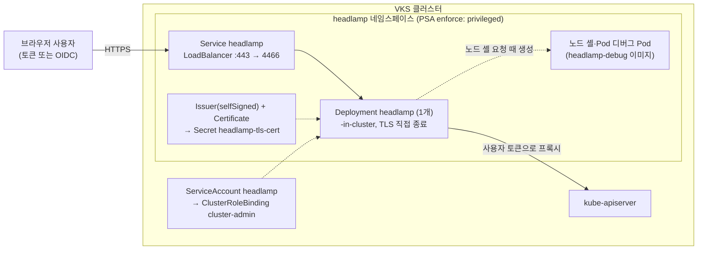

# 19. Headlamp

> 커리큘럼: [CURRICULUM.md](CURRICULUM.md) · 앞 절: [18. Windows gMSA Webhook](18-windows-gmsa-webhook.md) · 작성 2026-11-13
> 등급: **[근거]** 출처에 그대로 있는 것, **[추론]** 여러 출처를 엮어 직접 내린 결론.
> 기준 판: VKS Add-ons `3.8.0+20261021` (9.1 VKS Add-ons Release Notes, 2026-11-13 확인, 페이지 표기 Last Updated November 11, 2026, 이 날 기준 가장 높은 판). 판 호환은 이 문서에서 정리하지 않는다. [공식 호환 매트릭스](https://interopmatrix.broadcom.com/)와 릴리스 노트를 직접 볼 것.

Headlamp 는 쿠버네티스 웹 UI 다. 리소스 목록·로그·exec·YAML 편집·리소스 지도를 브라우저에서 보여 주고, 플러그인으로 화면을 늘린다. VKS 애드온은 업스트림 Headlamp 에 플러그인 묶음(cert-manager·Prometheus·Gatekeeper·Clarity 테마, 그리고 업스트림의 app-catalog)과 Photon 기반 디버그 이미지를 얹고, 기본으로 **LoadBalancer + 자체 서명 TLS** 로 밖에 연다.

이 절에서 먼저 잡을 것은 세 가지다.

1. **UI 에 들어오는 사람의 권한은 그 사람이 낸 토큰이 정한다.** 기본 설정에서 Headlamp 는 Pod 의 서비스 계정으로 사용자를 대신하지 않는다(1절).
2. **그런데 패키지는 Headlamp 서비스 계정에 `cluster-admin` 을 묶고, 네임스페이스를 PSA `privileged` 로 연다.** 이 네임스페이스에 Pod 를 만들 수 있는 사람은 사실상 클러스터 관리자다(2.1, 6절 1·2번).
3. **Ecosystem 등급이다.** Broadcom 은 설치·업그레이드까지만 지원하고 런타임 버그·보안 패치는 업스트림 몫이다(1절 표).

[근거] 이 절의 렌더링 결과는 공개 저장소(`3.8.0-20261021/vks-addons`)의 Headlamp 패키지 원본과 bundle(`@sha256:860a768a…`)을 익명으로 받아 ytt v0.55.4 로 직접 돌린 것이다(2026-11-13). **VKS 클러스터에 설치해 보지는 못했다.** 4.3~4.5 의 클러스터 쪽 명령과 기대 출력은 문서·렌더링·업스트림 소스에서 읽은 것이고 실측이 아니다.

[근거] 9.0·9.1 문서 세트에서 Headlamp 전용 설치·Package Reference 쪽은 찾지 못했다(다른 애드온과 같은 주소 규칙으로 짐작한 두 주소가 404, 2026-11-13). 그래서 이 절의 1차 출처는 릴리스 노트·패키지 원본·Broadcom VCF 블로그·업스트림이다.

---

## 1. 무엇을 하는가



- [근거] Headlamp 는 CNCF Sandbox 프로젝트이고, 인증된 사용자의 권한에 맞춰 UI 를 보여 주는 RBAC 인지형 UI 다. 블로그는 Kubernetes Dashboard 가 2026년 초 지원 종료·보관된 뒤 권장 대안으로 Headlamp 에 관심이 옮겨 갔다고 적는다. (Broadcom VCF 블로그 「Headlamp as a VMware vSphere Kubernetes Service Add-on」, 2026-08-12)
- [근거] in-cluster 로 돌 때 Pod 서비스 계정 토큰으로 모든 사용자를 인증하는 `--unsafe-use-service-account-token` 은 기본 `false` 이고, 플래그 설명은 「사용자별 인증을 끈다, 인증 프록시 뒤에서만 안전하다」이다. (업스트림 v0.45.0 `backend/pkg/config/config.go`)
- [근거] Broadcom 블로그의 설치 예시는 UI 를 연 뒤 사용자용 토큰을 따로 만들어 붙여 넣고, 그 이유를 「RBAC 이 유지되고 최종 사용자가 가진 권한만큼만 보이게 하려고」라고 적는다. 블로그는 보여 주기용으로 `cluster-admin` 을 썼다고 밝히고, 실제로는 필요한 최소 권한의 RoleBinding·ClusterRoleBinding 을 권한다. (같은 블로그)
- [추론] 위 두 사실을 합치면, 기본 설치에서 UI 사용자의 권한은 서비스 계정이 아니라 사용자가 낸 토큰의 RBAC 이 정한다.
- [근거] OIDC 로그인도 지원한다(`oidc.*` 값, 3.1). VKS 3.7 의 네이티브 OIDC 인증은 Headlamp 같은 대시보드의 JWT 통과 인증을 쓸 수 있게 한다고 적는다. (VKS 3.7 Release Notes, Last Updated November 11, 2026)

### 판과 지원 등급 (3.8.0+20261021 기준)

| 항목 | 값 | 출처 |
|---|---|---|
| 패키지 이름 | `headlamp.kubernetes.vmware.com` | 패키지 원본 |
| 판 | `0.45.0+vmware.2-vks.1` 한 판, `releasedAt: 2026-09-24` | 패키지 원본, 9.1 릴리스 노트 |
| 지원 등급 | Ecosystem | 9.1 릴리스 노트 지원 표 |
| 업스트림 | Headlamp v0.45.0 (2026-08-20 UTC 릴리스) | 패키지 `releaseNotes`, 업스트림 릴리스 |
| 이미지 | `headlamp`·`headlamp-debug`·`headlamp-node-builder` 세 개(`v0.45.0_vmware.2`) | bundle `.imgpkg/images.yml` |

[근거] Ecosystem 등급은 「Broadcom 이 검증한 OSS 패키지. 지원은 패키징·서명·수명 주기 문제로 한정되고, 런타임 버그·보안 패치·기능 요청은 업스트림 커뮤니티가 맡는다」이다. 지원 표에서 Ecosystem 은 설치·업그레이드 Broadcom 지원, 취약점 관리는 Community(각주: 커뮤니티가 수정을 낸 뒤 그 패치를 패키징하는 일은 Broadcom 이 맡는다), 런타임 버그 수정·설정 지원은 None(upstream)이다. (9.1 릴리스 노트 「VKS Add-ons Support Tiers」·「Support Matrix」) 어느 VKr 에서 쓸 수 있는지는 머리말의 공식 호환 매트릭스를 본다.

### 판 흐름 (9.1 릴리스 노트에서)

| 저장소 판 | Headlamp 판 | 바뀐 것 |
|---|---|---|
| 3.7.0+20260618 | 0.42.0+vmware.1 (🆕) | 애드온 설치 상태로 플러그인 자동 설치, artifactHub 밖 플러그인 직접 내려받기, VKS 로고, 디버그 이미지를 Photon 기반으로 바꾸고 노드 디버그 Pod 를 Headlamp 네임스페이스로 옮김 |
| 3.7.0+20260723 | 0.43.0+vmware.1 | 0.42.0 에서 매끄러운 업그레이드, Prometheus 플러그인 0.8.2→0.9.0, cert-manager 플러그인 0.1.0→0.1.1 |
| 3.7.0+20260827 | 0.44.0+vmware.1 | Prometheus 플러그인 0.9.1. **ClusterRoleBinding 대상 네임스페이스가 `kube-system` 으로 잘못 들어가던 문제**와 OIDC 플래그(`-oidc-cookie` → `-oidc-use-cookie`) 수정 |
| 3.7.0+20260924 | 0.45.0+vmware.1 | 업스트림 0.45.0, Clarity 플러그인 기본 설치, Gatekeeper 플러그인 자동 설치, Supervisor 쪽 OIDC 외부 Secret 을 게스트로 전파, Certificate 기본 `isCA: false` |
| 3.8.0+20261021 | 0.45.0+vmware.2 | Gatekeeper 플러그인 vmware-0.3.0, Photon·Go·Node.js 기반 이미지 갱신. 0.45.0+vmware.1 에서 매끄러운 업그레이드 |

[근거] 위 표의 각 줄은 9.1 릴리스 노트 해당 판 「What's New」·「Resolved Issues」 문구를 옮긴 것이다. 3.7.0+20260827 의 Prometheus 애드온 쪽에도 「Headlamp 자동 감지를 위한 prometheus 서비스 레이블 추가」가 있다.

---

## 2. 패키지가 까는 것

[근거] 기본값으로 렌더링한 결과(`ytt -f bundle/config`, 값 파일 없음)는 Namespace·LimitRange·Secret(이미지 풀용 빈 `{}`)·ConfigMap(`headlamp-runtime-images`)·Issuer·Certificate·ServiceAccount·ClusterRoleBinding·Deployment·Service 열 개다. CRD 와 웹훅은 없다.

### 2.1 권한과 네임스페이스

```yaml
# 렌더링 결과에서 발췌
apiVersion: v1
kind: Namespace
metadata:
  name: headlamp
  labels:
    pod-security.kubernetes.io/enforce: privileged
---
apiVersion: rbac.authorization.k8s.io/v1
kind: ClusterRoleBinding
metadata:
  name: headlamp-admin
subjects:
- {kind: ServiceAccount, name: headlamp, namespace: headlamp}
roleRef: {kind: ClusterRole, name: cluster-admin, apiGroup: rbac.authorization.k8s.io}
```

- [근거] bundle 의 `config/upstream/headlamp-deployment.yaml` 은 서비스 계정 `headlamp` 을 `cluster-admin` 에 묶는 ClusterRoleBinding `headlamp-admin` 을 담고, 오버레이는 그 대상 네임스페이스만 values 의 `namespace` 로 바꾼다. Deployment 에 `automountServiceAccountToken: false` 는 없다. (bundle `config/upstream/headlamp-deployment.yaml`, `config/overlays/overlay-headlamp.yaml`, 렌더링 결과)
- [근거] 이름은 「upstream」이지만 업스트림 v0.45.0 의 `kubernetes-headlamp.yaml` 과 같지 않다. 업스트림 파일에는 ServiceAccount 와 ClusterRoleBinding 이 없고 `headlamp-admin` 서비스 계정 토큰 Secret 이 있다. 업스트림 Helm 차트 v0.45.0 은 `clusterRoleBinding.create: true`, `clusterRoleName: cluster-admin` 이 기본이다. (업스트림 v0.45.0 `kubernetes-headlamp.yaml`, `charts/headlamp/values.yaml`)
- [근거] 네임스페이스 PSA 는 `enforce: privileged` 이고, 오버레이 주석은 「노드 셸·Pod 디버그 Pod 가 이 네임스페이스에서 돌 수 있게 baseline 에서 privileged 로 바꿨다」고 적는다. 컨테이너 인자에 `-node-shell-namespace=<namespace>` 가 붙는다. (overlay, 렌더링 결과)
- [근거] Broadcom 의 PSA 문서는 VKr 1.26 이상에서 시스템이 아닌 네임스페이스의 기본을 `enforce: restricted` 로 적는다. (Configure PSA for VKr 1.25 and Later, 9.0) [추론] 따라서 이 패키지의 네임스페이스는 클러스터 기본보다 느슨하다. 이 네임스페이스에 Pod 를 만들 수 있는 주체는 특권 Pod 를 띄울 수 있고, 같은 네임스페이스의 `headlamp` 서비스 계정을 Pod 에 붙이면 `cluster-admin` 토큰을 얻는다. 이 네임스페이스의 `pods`·`deployments` 등 생성 권한은 클러스터 관리자에게만 준다(6절 1번).

### 2.2 Deployment·Service·TLS

- [근거] Pod 는 `runAsNonRoot: true`·`runAsUser: 65532`·`seccompProfile: RuntimeDefault`, `headlamp` 컨테이너는 `allowPrivilegeEscalation: false`·`capabilities.drop: [ALL]`·`readOnlyRootFilesystem: true` 다. init 컨테이너 두 개(`install-addons`, `prepull-debug-image`)에는 컨테이너 수준 securityContext 가 없다. (렌더링 결과)
- [근거] Kubernetes Pod Security Standards 의 Restricted 는 init 컨테이너를 포함한 모든 컨테이너에 `allowPrivilegeEscalation: false` 와 `capabilities.drop: [ALL]` 을 요구한다. (Kubernetes 「Pod Security Standards」) [추론] 그래서 `createNamespace: false` 로 이미 있는 restricted 네임스페이스에 깔면 init 컨테이너 때문에 Pod 생성이 거절될 것이다(6절 5번).
- [근거] Service 는 기본 `type: LoadBalancer`, `port: 443`, `targetPort: 4466` 이다. `gatewayApi.enabled: true` 이면 `ClusterIP`, 포트 80 으로 바뀐다. `targetPort` 는 오버레이가 4466 으로 고정해 `service.targetPort` 값은 렌더링에 쓰이지 않는다. 패키지 OpenAPI 스키마는 `service.targetPort` 기본을 443 으로, bundle `values.yaml` 은 4466 으로 적는다. (overlay, 패키지 `valuesSchema`, `config/values.yaml`, `service.targetPort: 443` 렌더링 결과)
- [근거] Gateway API 를 쓰지 않으면 Pod 가 TLS 를 직접 끝낸다. 인자에 `-tls-cert-path`·`-tls-key-path` 가 붙고, Secret `headlamp-tls-cert`(또는 `tls.existingSecret`)를 `/etc/headlamp/tls` 에 마운트하며, 프로브 scheme 이 HTTPS 로 바뀐다. (overlay, 렌더링 결과)
- [근거] `tls.certManager.enabled: true`(기본)이고 `existingSecret` 이 비어 있으면 selfSigned Issuer `headlamp-issuer` 와 Certificate `headlamp-cert` 를 만든다. 기본은 `duration: 87600h`(10년), `renewBefore: 360h`, `dnsNames` 는 `hostname` 하나(기본 `headlamp.vks.example.com`), `ipAddresses` 는 비어 있다. (렌더링 결과)
- [추론] 따라서 기본 설치로 LoadBalancer IP 에 접속하면 브라우저는 자체 서명이고 이름도 맞지 않는 인증서를 보게 된다. 실제 이름을 `hostname` 에 넣고, IP 로 접속할 거면 `tls.certManager.ipAddresses` 에 넣거나, 조직 CA 로 만든 Secret 을 `tls.existingSecret` 으로 준다(6절 3번).
- [근거] Broadcom 블로그의 전제 조건은 VKS 3.7 과 「VKS 클러스터에 Cert-Manager 애드온 설치」다. (Broadcom VCF 블로그) Issuer·Certificate 는 `cert-manager.io/v1` 리소스다. (렌더링 결과) cert-manager 설치는 [01절](01-cert-manager.md)을 본다.
- [근거] 기본 자원은 요청 100m·128Mi, 한도 500m·256Mi 다. LimitRange 는 컨테이너 기본 요청 100m·128Mi 를 넣고 `default: {}`(기본 한도 없음)로 렌더링된다. `priorityClassName` 이 비어 있으면 `vks_cluster_version` 이 1.34.0 이상일 때 `vmware-system-observability` 를 넣는다. 렌더링으로 확인: `v1.35.2+vmware.1-fips`·`v1.34.0` → 넣음, `v1.33.1+vmware.1`·값 없음 → 넣지 않음. (overlay, 렌더링 결과)

### 2.3 values 검사: 막는 것과 안 막는 것

| 입력 | ytt 결과 (v0.55.4, 2026-11-13) |
|---|---|
| 오타 키 `servce: {type: ClusterIP}` | rc=0, 새 키로 들어가고 렌더링에 안 쓰임. Service 는 LoadBalancer 그대로 |
| `service.targetPort: 443` | rc=0, Service `targetPort` 는 4466 그대로 |
| `replicaCount: 0` | rc=0, `replicas: 0` (패키지 스키마는 `minimum: 1`) |
| `tls.certManager.enabled: false`, `existingSecret` 없음 | rc=0, Issuer·Certificate 는 빠지는데 Deployment 는 Secret `headlamp-tls-cert` 를 그대로 마운트 (6절 4번) |
| `createNamespace: false` | rc=0, Namespace 와 LimitRange 가 함께 빠짐 |
| 같은 파일에 `installedAddons` 를 두 번 | rc=0, 뒤의 값이 이김 (3.1) |

- [근거] bundle 의 값 파일은 `#@data/values` 이고 `#@data/values-schema` 가 없고, 위 표처럼 ytt 단계에서 형식·범위를 검사하지 않는다. (bundle `config/values.yaml`, 2.3 표에서 확인)
- [근거] Add-on 경로의 AddonConfigDefinition 스키마는 `config`·`image`·`oidc`·`pluginsManager`·`resources`·`nsLimitRange` 등에 `additionalProperties: false` 가 있지만, 맨 위와 `service`·`tls`·`gatewayApi` 에는 없다. (AddonConfigDefinition `schema.openAPIV3Schema`) [추론] AddonConfig 검증이 이 스키마를 그대로 쓴다면 `oidc` 아래 오타는 거절되고, 맨 위나 `service` 아래 오타는 조용히 통과한다. Supervisor 에서 시험하지 못했다.

### 2.4 플러그인

- [근거] init 컨테이너 `install-addons` 가 이미지 안 `/plugins` 에서 `app-catalog` 와 `headlamp-clarity` 를 늘 복사하고, `installedAddons` 에 적힌 이름을 추가로 복사한다. (overlay)
- [근거] Add-on 경로에서는 AddonConfigDefinition 이 ClusterAddon `<cluster>-cert-manager`·`<cluster>-prometheus`·`<cluster>-gatekeeper` 를 선택 입력으로 읽고, 있으면 `installedAddons` 에 해당 이름을 넣는다. (AddonConfigDefinition `templateInputResources`·`templateOutputResources`) [추론] 입력 정의에 네임스페이스가 적혀 있지 않으므로 클러스터와 같은 Supervisor 네임스페이스에서 찾는 것으로 보이지만, 확인하지 못했다.
- [근거] Broadcom 블로그(VKS 3.7 기준)는 cert-manager·Prometheus 애드온을 Headlamp 보다 나중에 깔아도 애드온 컨트롤러가 계속 확인해 플러그인을 넣는다고 적는다. Gatekeeper 플러그인 자동 설치는 0.45.0+vmware.1 릴리스 노트에 있다.
- [근거] `pluginsManager.enabled: true` 이면 사이드카 `headlamp-plugin`(`headlamp-node-builder` 이미지)과 ConfigMap `headlamp-plugin-config` 를 더하고, init 컨테이너가 `plugin.yml` 의 `source:` 가 `.tar.gz` 이고 artifacthub.io 가 아닌 주소를 `curl`(없으면 `wget`)로 내려받아 플러그인 디렉터리에 푼다. `-watch-plugins-changes` 도 켜진다. (overlay, 렌더링 결과)
- [추론] 이 경로는 런타임에 외부 주소로 나가므로 에어갭 클러스터에서는 실패하고, 내려받은 코드가 브라우저에서 사용자 토큰으로 돈다. 플러그인 출처는 내부 저장소로 한정한다(6절 7번).

---

## 3. VKS 에 들어가는 두 경로

### 3.1 Add-on 경로 (VKS 3.5 이상)

- [근거] AddonConfigDefinition 이름은 `headlamp.kubernetes.vmware.com.0.45.0---vmware.2-vks.1`(`+` 가 `---`), 네임스페이스는 `vmware-system-vks-public` 이다. 출력은 대상 클러스터 `vmware-system-tkg` 네임스페이스의 Secret `<cluster>-headlamp` 의 `values.yaml` 이다. (Package 어노테이션의 AddonConfigDefinition 을 풀어 확인)
- [근거] 출력 템플릿은 사용자 값 전체를 `toYaml .Values` 로 쓴 뒤 그 아래에 `vks_cluster_version` 과 `installedAddons:` 목록을 다시 붙인다. 감지된 애드온이 없으면 `installedAddons: []` 다. (같은 곳)
- [추론] 사용자가 AddonConfig 에 `installedAddons` 를 적으면 값 파일에 같은 키가 두 번 생기고, ytt 는 뒤의 값을 쓰므로(2.3 표 마지막 줄) 사용자 값은 무시된다. Add-on 경로에서 플러그인은 애드온 감지로만 고른다고 보는 편이 안전하다.
- [근거] OIDC 값을 Supervisor 의 Secret 에서 읽을 수 있다. `oidc.externalSecret.enabled: true` 와 `name` 을 주면 그 Secret 의 `clientID`·`clientSecret`·`issuerURL`·`scopes`(쉼표 구분)를 base64 로 풀어 `oidc` 값에 넣는다. AddonConfigDefinition 의 `addonInstallPermission` 은 `secrets` 의 `get`·`list` 를 요구한다. (AddonConfigDefinition) 0.45.0+vmware.1 릴리스 노트의 「Supervisor 클러스터의 Day-1 OIDC 외부 Secret 생성과 게스트 클러스터 자동 전파」가 이것이다.
- [추론] 이때 비밀값은 게스트 클러스터 `vmware-system-tkg` 의 values Secret 에 평문 YAML 로 들어간다. 그 네임스페이스의 Secret 읽기 권한도 OIDC 클라이언트 비밀값 읽기 권한과 같다.
- AddonConfig·AddonInstall 의 일반 모양과 이름 규칙(`<cluster-name>-<addon-name>`)은 [00절](00-repository-and-install-paths.md)을 본다.

### 3.2 레거시 PackageInstall 경로

- [근거] 패키지 `headlamp.kubernetes.vmware.com` 은 같은 Carvel 저장소에 들어 있다(`packages/headlamp.kubernetes.vmware.com/0.45.0+vmware.2-vks.1.yml`). (저장소 원본)
- [추론] 그래서 다른 패키지처럼 PackageInstall 로도 깔 수 있겠지만, Headlamp 는 3.7.0+20260618 에서 처음 들어온 애드온이고 레거시 경로 설치 문서를 찾지 못했다. Broadcom 블로그는 VCF Automation 의 Add-ons 탭과 Add-on 관리 문서만 안내한다. 이 경로에서는 `vks_cluster_version` 이 비어 priority class 가 안 붙고(2.2), 플러그인 자동 감지도 없다.

설치 흐름과 kapp-controller 동작은 [00절](00-repository-and-install-paths.md)과 루트 [`../carvel-kapp.md`](../carvel-kapp.md)를 본다.

---

## 4. 실습

### 4.1 클러스터 없이 확인하는 법 (렌더링)

```bash
# crane, ytt 필요. 공개 저장소라 로그인 없이 받는다.
R=projects.packages.broadcom.com/vsphere/supervisor/vks-standard-packages/3.8.0-20261021/vks-addons
mkdir -p repo bundle
crane export $R:3.8.0-20261021 - | tar -x -C repo
ls repo/packages/headlamp.kubernetes.vmware.com/        # 0.45.0+vmware.2-vks.1.yml, metadata.yml
grep -A5 'kbld.carvel.dev/id: .*packages/headlamp:' repo/.imgpkg/images.yml   # bundle 다이제스트 확인
crane export $R@sha256:860a768a2ea1137dfd8c4d4a1786980649289c4e067934f146ae51eacd2d654d - | tar -x -C bundle

ytt -f bundle/config > default.yaml && grep '^kind:' default.yaml | sort | uniq -c
grep -B2 -A6 'kind: ClusterRoleBinding' default.yaml        # cluster-admin
grep 'pod-security' default.yaml                             # enforce: privileged
```

Add-on 정의는 Package 어노테이션에 gzip+base64 로 들어 있다.

```bash
P=repo/packages/headlamp.kubernetes.vmware.com/0.45.0+vmware.2-vks.1.yml
grep 'addon-config-definition' $P | awk '{print $2}' | base64 -d | gunzip > acd.yaml
grep -n 'templateInputResources' -A30 acd.yaml
```

### 4.2 values 파일

```yaml
# headlamp-values.yaml — 기본값과 다른 것만 적는다 (이름·주소는 예시)
hostname: headlamp.lab.example.internal      # 인증서 dnsNames 에 들어간다
service:
  type: LoadBalancer
  annotations: {}
tls:
  certManager:
    ipAddresses: []                           # IP 로 접속할 거면 LB IP 를 넣는다
oidc:
  enabled: false                              # OIDC 를 쓸 때는 3.1 의 externalSecret 경로를 권한다
```

```bash
ytt -f bundle/config --data-values-file headlamp-values.yaml | grep -A3 'dnsNames'
```

### 4.3 Add-on 경로로 설치 (Supervisor 컨텍스트)

```yaml
# addonconfig.yaml — 이름은 <cluster>-headlamp
apiVersion: addons.kubernetes.vmware.com/v1alpha1
kind: AddonConfig
metadata:
  name: wl-01-headlamp
  namespace: demo-ns
  annotations:
    clusteraddon.addons.kubernetes.vmware.com/owned-for-deletion: "true"
spec:
  values:
    hostname: headlamp.lab.example.internal
---
# addoninstall.yaml
apiVersion: addons.kubernetes.vmware.com/v1alpha1
kind: AddonInstall
metadata:
  name: wl-01-headlamp
  namespace: demo-ns
spec:
  releaseFilter:
    ref:
      name: headlamp.kubernetes.vmware.com.0.45.0-vmware.2-vks.1
      namespace: vmware-system-vks-public
  addonRef:
    name: headlamp
  clusters:
  - selector:
      matchLabels:
        cluster.x-k8s.io/cluster-name: wl-01
```

```bash
kubectl -n demo-ns get clusteraddon | grep cert-manager                   # 먼저 Ready 여야 한다
kubectl -n vmware-system-vks-public get addonreleases | grep headlamp     # 실제 이름 확인
kubectl -n demo-ns apply -f addonconfig.yaml -f addoninstall.yaml
kubectl -n demo-ns get clusteraddon | grep headlamp                       # READY True 기대
```

[추론] AddonConfig·AddonInstall 의 모양과 어노테이션은 18절에서 쓴 9.0 Add-on 설치 예시의 틀을 Headlamp 이름으로 바꾼 것이다. Headlamp 용 공식 kubectl 예시는 찾지 못했으므로 `releaseFilter.ref.name` 과 `addonRef.name` 은 위 `addonreleases` 출력으로 확인한다.

### 4.4 사용자 토큰 만들기 (VKS 클러스터 컨텍스트)

블로그 예시처럼 `cluster-admin` 을 주지 말고 읽기 전용부터 시작한다. 내장 ClusterRole `view` 는 Secret 을 읽지 못한다.

```yaml
# headlamp-viewer.yaml
apiVersion: v1
kind: ServiceAccount
metadata:
  name: headlamp-viewer
  namespace: team-a
---
apiVersion: rbac.authorization.k8s.io/v1
kind: RoleBinding
metadata:
  name: headlamp-viewer
  namespace: team-a
subjects:
- {kind: ServiceAccount, name: headlamp-viewer, namespace: team-a}
roleRef: {kind: ClusterRole, name: view, apiGroup: rbac.authorization.k8s.io}
```

```bash
kubectl apply -f headlamp-viewer.yaml
kubectl -n team-a create token headlamp-viewer --duration=8h     # 출력 토큰을 UI 에 붙여 넣는다
kubectl auth can-i list pods -n team-a --as=system:serviceaccount:team-a:headlamp-viewer      # yes
kubectl auth can-i list secrets -n team-a --as=system:serviceaccount:team-a:headlamp-viewer   # no
```

- [근거] `kubectl create token` 은 서비스 계정 토큰을 요청하고 `--duration` 으로 기간을 요청한다. 서버는 요청보다 길거나 짧은 기간의 토큰을 돌려줄 수 있다. 네임스페이스를 안 주면 현재 네임스페이스의 서비스 계정을 쓴다. (kubectl reference `kubectl create token`) 그래서 위 예시는 `-n` 을 명시했다. `team-a` 네임스페이스는 미리 있어야 한다.
- [근거] 내장 `view` 는 대부분의 객체를 읽을 수 있지만 Role·RoleBinding 과 Secret 은 읽지 못한다. (Kubernetes 「Using RBAC Authorization」 user-facing roles) RBAC 기초는 루트 [`../k8s-rbac.md`](../k8s-rbac.md)를 본다.

### 4.5 확인 명령

```bash
kubectl -n headlamp get deploy,svc,certificate,issuer
kubectl -n headlamp get svc headlamp -o jsonpath='{.status.loadBalancer.ingress[0].ip}{"\n"}'
kubectl get ns headlamp --show-labels | tr ',' '\n' | grep pod-security    # enforce=privileged
kubectl get clusterrolebinding headlamp-admin -o jsonpath='{.roleRef.name}{" "}{.subjects[0].namespace}{"\n"}'   # cluster-admin headlamp
kubectl -n headlamp get deploy headlamp -o jsonpath='{.spec.template.spec.containers[0].args}' | tr ',' '\n'
kubectl -n headlamp logs deploy/headlamp -c install-addons                   # Installing app-catalog... 등
```

[추론] 기대 출력은 렌더링 결과에서 읽은 것이다. `headlamp-admin` 의 대상 네임스페이스가 `kube-system` 이면 0.44.0 전 판의 문제(1절 판 흐름)가 남아 있는 것이다.

---

## 5. 업스트림 설치와 다른 점

루트 `k8s-addon.sh` 에는 Headlamp 가 없다. 업스트림 설치는 Helm 차트(`headlamp/headlamp`)나 `kubernetes-headlamp.yaml` 이다.

| 항목 | 업스트림 Helm 차트 v0.45.0 기본 | VKS 패키지 0.45.0+vmware.2 기본 |
|---|---|---|
| Service | `ClusterIP`, 80 | `LoadBalancer`, 443 |
| TLS | 끔(`tlsCertPath` 주석 처리) | cert-manager selfSigned 로 Pod 가 직접 종료 |
| 서비스 계정 권한 | ClusterRoleBinding `cluster-admin` (`clusterRoleBinding.create: true`) | 같음, 값으로 끌 수 없음 |
| `unsafeUseServiceAccountToken` | `false` | 플래그 없음(기본 `false`), `config.extraArgs` 로는 넣을 수 있음 |
| 네임스페이스 PSA | 차트가 다루지 않음 | `enforce: privileged` 레이블을 단 Namespace 생성 |
| 노드 셸·Pod 디버그 이미지 | 플래그 기본 빈 값 | Photon 기반 `headlamp-debug`, init 컨테이너로 미리 당김 |
| 플러그인 | `pluginsManager` (기본 꺼짐) | app-catalog·Clarity 늘 설치, cert-manager·Prometheus·Gatekeeper 는 애드온 감지로 |
| 테마 | 업스트림 기본 | `Clarity Light`·`Clarity Dark` |
| priority class | `priorityClassName: ""`(빈 값) | VKr 1.34 이상이면 `vmware-system-observability` |

[근거] 업스트림 쪽은 v0.45.0 태그의 `charts/headlamp/values.yaml`·`backend/pkg/config/config.go`, VKS 쪽은 렌더링 결과다.

---

## 6. 흔한 실수

1. **headlamp 네임스페이스를 일반 작업 공간처럼 쓴다.** PSA 가 privileged 이고 cluster-admin 서비스 계정이 있다(2.1). 이 네임스페이스에 Pod·Deployment·Job 을 만들 권한을 개발 팀에 주지 않는다. [추론]
2. **`config.extraArgs` 에 `-unsafe-use-service-account-token` 을 넣어 로그인 화면을 없앤다.** 업스트림은 이 플래그를 「사용자별 인증을 끈다, 인증 프록시 뒤에서만 안전」이라고 적는다. 기본 LoadBalancer 와 합치면 LB 에 닿는 누구나 cluster-admin 이 된다. [근거: 업스트림 플래그 설명, 렌더링] [추론: 결과]
3. **기본 hostname 으로 깔고 인증서 경고를 무시하라고 안내한다.** 기본 인증서는 `headlamp.vks.example.com` 이름에 자체 서명이다(2.2). 실제 이름·IP 를 넣거나 조직 CA Secret 을 `tls.existingSecret` 으로 준다. [근거]
4. **cert-manager 없이 `tls.certManager.enabled: false` 만 준다.** Issuer·Certificate 는 빠지지만 Deployment 는 `headlamp-tls-cert` Secret 을 그대로 마운트한다(2.3 표). [추론] Secret 볼륨은 `optional` 이 아니면 Secret 이 생길 때까지 Pod 가 시작하지 못한다. Gateway API 를 쓰지 않는다면 `existingSecret` 을 같이 준다.
5. **`createNamespace: false` 로 기존 네임스페이스에 깐다.** Namespace 와 함께 LimitRange 도 빠지고, init 컨테이너에 컨테이너 수준 securityContext 가 없어 restricted 네임스페이스에서는 거절될 것이다(2.2). [근거: 렌더링, PSS] [추론: 거절]
6. **`service.targetPort` 를 바꿔 포트를 맞추려 한다.** 오버레이가 4466 으로 고정한다. 패키지 스키마의 기본 443 도 실제와 다르다(2.2). [근거]
7. **`pluginsManager` 로 인터넷의 플러그인을 바로 받는다.** 런타임에 외부로 나가 에어갭에서 실패하고, 받은 코드가 사용자 토큰으로 돈다(2.4). [추론]
8. **Add-on 경로에서 `installedAddons` 를 AddonConfig 에 적는다.** 출력 템플릿이 같은 키를 뒤에 다시 써 무시된다(3.1). [추론]
9. **Ecosystem 등급인데 런타임 문제를 Broadcom 지원으로 풀려 한다.** 런타임 버그·보안 패치는 업스트림 몫이다(1절). 판 올리기는 릴리스 노트의 업그레이드 경로를 본다. [근거]

---

## 7. 확인 문제

1. 기본 설치에서 브라우저 사용자가 Headlamp 로 보는 리소스의 범위는 무엇이 정하는가? 패키지가 서비스 계정에 묶은 `cluster-admin` 은 그 범위와 어떤 관계인가?
   - 답: 사용자가 넣은 토큰(또는 OIDC 신원)의 RBAC 이 정한다. `--unsafe-use-service-account-token` 이 기본 `false` 라 서비스 계정 권한으로 사용자를 대신하지 않는다. 다만 서비스 계정 토큰은 Pod 에 마운트돼 있어, 그 네임스페이스에 Pod 를 만들 수 있으면 얻을 수 있다(1절, 2.1).
2. `gatewayApi.enabled: true` 로 바꾸면 Service·TLS·프로브는 어떻게 달라지는가?
   - 답: Service 는 `ClusterIP`·80, Pod 는 TLS 를 끝내지 않아 TLS 인자·볼륨이 빠지고 프로브는 HTTP 로 바뀐다. 대신 Gateway(`gatewayClassName` 기본 `istio`, 443 HTTPS Terminate)와 HTTPRoute 가 생기고, 인증서 Secret 은 Gateway 리스너가 쓴다(2.2, overlay). Istio 는 [11절](11-istio.md)을 본다.
3. 클러스터 `wl-01` 에 Prometheus 애드온(ClusterAddon `wl-01-prometheus`)이 깔려 있고 AddonConfig 에는 `installedAddons: [gatekeeper]` 를 적었다. Gatekeeper 애드온은 없다. 어떤 플러그인이 깔리는가?
   - 답: [추론] app-catalog·Clarity(늘)와 prometheus. 출력 템플릿이 감지 결과로 `installedAddons` 를 다시 써 사용자가 적은 gatekeeper 는 무시된다(3.1).

---

## 출처 (모두 2026-11-13 확인)

- 9.1 VKS Add-ons Release Notes (Last Updated November 11, 2026): <https://techdocs.broadcom.com/us/en/vmware-cis/vcf/vcf-service-administration-and-development/9-1/release-notes/vks-addons-release-notes.html>
- VKS 3.7 Release Notes (Last Updated November 11, 2026): <https://techdocs.broadcom.com/us/en/vmware-cis/vcf/vcf-service-administration-and-development/9-1/release-notes/vks-release-notes/vmware-tanzu-kubernetes-grid-service-37-release-notes.html>
- Broadcom VCF 블로그 「Headlamp as a VMware vSphere Kubernetes Service Add-on」(2026-08-12): <https://blogs.vmware.com/cloud-foundation/2026/08/12/headlamp-as-a-vmware-vsphere-kubernetes-service-add-on/>
- Managing Add-ons in VKS Clusters (9.0): <https://techdocs.broadcom.com/us/en/vmware-cis/vcf/vcf-service-administration-and-development/9-0/managing-vsphere-kuberenetes-service-clusters-and-workloads/managing-add-ons-in-vks-clusters.html>
- Configure PSA for VKr 1.25 and Later (9.0): <https://techdocs.broadcom.com/us/en/vmware-cis/vcf/vcf-service-administration-and-development/9-0/managing-vsphere-kuberenetes-service-clusters-and-workloads/managing-security-for-tkg-service-clusters/configure-psa-for-tkr-1-25-and-later.html>
- 패키지 원본: `projects.packages.broadcom.com/vsphere/supervisor/vks-standard-packages/3.8.0-20261021/vks-addons:3.8.0-20261021`, Headlamp bundle `@sha256:860a768a2ea1137dfd8c4d4a1786980649289c4e067934f146ae51eacd2d654d`
- 업스트림 Headlamp v0.45.0: <https://github.com/kubernetes-sigs/headlamp/releases/tag/v0.45.0>, `backend/pkg/config/config.go`, `kubernetes-headlamp.yaml`, `charts/headlamp/values.yaml` (v0.45.0 태그)
- Kubernetes 「Pod Security Standards」: <https://kubernetes.io/docs/concepts/security/pod-security-standards/>
- Kubernetes 「Using RBAC Authorization」: <https://kubernetes.io/docs/reference/access-authn-authz/rbac/>
- kubectl reference `kubectl create token`: <https://kubernetes.io/docs/reference/kubectl/generated/kubectl_create/kubectl_create_token/>
