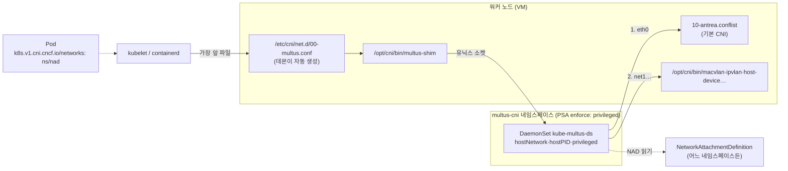

# 20. Multus

> 커리큘럼: [CURRICULUM.md](CURRICULUM.md) · 앞 절: [19. Headlamp](19-headlamp.md) · 이어지는 절: [17. SR-IOV Network Device Plugin](17-sriov-network-device-plugin.md), 21. Whereabouts(작성 예정) · 작성 2026-11-14
> 등급: **[근거]** 출처에 그대로 있는 것, **[추론]** 여러 출처를 엮어 직접 내린 결론.
> 기준 판: VKS Add-ons `3.8.0+20261021` (9.1 VKS Add-ons Release Notes, 2026-11-14 확인, 페이지 표기 Last Updated November 11, 2026, 이 날 기준 가장 높은 판). 판 호환은 이 문서에서 정리하지 않는다. [공식 호환 매트릭스](https://interopmatrix.broadcom.com/)와 릴리스 노트를 직접 볼 것.

Multus 는 **메타 CNI** 다. 스스로 네트워크를 만들지 않고, Pod 가 생길 때 기본 CNI(VKS 에서는 보통 Antrea)를 먼저 부른 뒤 Pod 어노테이션이 가리키는 `NetworkAttachmentDefinition`(NAD)의 CNI 설정으로 다른 CNI 플러그인(macvlan·ipvlan·host-device 등)을 차례로 불러 `net1`, `net2` 같은 인터페이스를 더 붙인다. 쿠버네티스 CNI 기초는 루트 [`../k8s-networking.md`](../k8s-networking.md)를 먼저 본다.

이 절에서 먼저 잡을 것은 세 가지다.

1. **패키지는 업스트림 「thick plugin」 빠른 설치 매니페스트에 거의 손대지 않은 것이다.** 업스트림은 그 파일이 「시험용 빠른 설치이고 업그레이드·삭제 시나리오는 일부러 다루지 않는다」고 적는다(2절·5절).
2. **values 로 바꿀 수 있는 데몬 설정은 세 개뿐이다.** 그래서 `namespaceIsolation` 을 켤 수 없고, 어느 네임스페이스의 Pod 든 다른 네임스페이스의 NAD 를 `<ns>/<name>` 으로 쓸 수 있다(2.3, 6절 2번).
3. **애드온을 지우면 NAD CRD 가 같이 지워지고, 그 CRD 에 딸린 모든 네임스페이스의 NAD 가 사라진다**(추론, 6절 4번).

[근거] 이 절의 렌더링 결과는 공개 저장소(`3.8.0-20261021/vks-addons`)의 Multus 패키지 원본과 bundle(`@sha256:89b04f80…`)을 익명으로 받아 ytt v0.55.4 로 직접 돌린 것이다(2026-11-14). **VKS 클러스터에 설치해 보지는 못했다.** 4.3~4.5 의 클러스터 쪽 명령과 기대 출력은 문서·렌더링·업스트림 소스에서 읽은 것이고 실측이 아니다.

[근거] 9.0·9.1 문서 세트에서 Multus 전용 설치·Package Reference 쪽은 찾지 못했다. 다른 애드온과 같은 주소 규칙으로 짐작한 `…/{9-0,9-1}/managing-vsphere-kuberenetes-service-clusters-and-workloads/installing-standard-packages-on-tkg-service-clusters/` 아래 `standard-package-reference/multus-package-reference.html`·`standard-package-reference/multus-cni-package-reference.html`·`install-multus.html` 여섯 주소가 모두 404 였다(2026-11-14). 9.0 의 Standard Package Reference 목록 쪽(`…/installing-standard-packages-on-tkg-service-clusters/standard-package-reference.html`)은 열리고, 거기 실린 참조 13개에 Multus 는 없다. 9.1 은 같은 규칙의 목록 쪽 자체가 404 라, 9.1 주소의 404 는 주소 규칙이 다르다는 뜻일 수도 있다. 그래서 1차 출처는 릴리스 노트·패키지 원본·업스트림이다.

---

## 1. 무엇을 하는가



- [근거] Multus 는 쿠버네티스 Pod 에 여러 네트워크 인터페이스를 붙이는 CNI 메타 플러그인이고, 먼저 Pod 간 통신을 맡는 기본 CNI 가 깔려 있어야 한다. 모든 Pod 는 기본 네트워크 인터페이스를 갖고, Multus 가 붙이는 것은 그에 더한 것이다. (업스트림 README v4.3.1)
- [근거] thick plugin 은 클라이언트·서버 구조다. 노드의 shim 실행 파일이 런타임에서 CNI 호출을 받아 유닉스 소켓으로 multus-daemon 에 넘기고, 데몬이 NAD 에서 위임할 CNI 설정을 읽어 실제 플러그인을 부른다. (업스트림 `docs/thick-plugin.md`)
- [근거] 패키지 설명은 「sriov·macvlan 처럼 다른 종류의 CNI 로 Pod 에 여러 인터페이스를 붙이게 한다」이다. (PackageMetadata `longDescription`)
- [추론] 이 애드온이 까는 것은 Multus 자신(shim·데몬)뿐이다. bundle 의 이미지는 `multus-cni` 하나이고(`.imgpkg/images.yml`), 초기화 컨테이너는 `install_multus -t thick` 으로 shim 만 `/opt/cni/bin` 에 복사한다. macvlan 같은 보조 CNI 실행 파일은 노드에 이미 있어야 하는데, VKr 노드 이미지에 무엇이 들어 있는지는 확인하지 못했다. 쓰기 전에 노드에서 `ls /opt/cni/bin` 으로 본다(4.5).

### 판과 지원 등급 (3.8.0+20261021 기준)

| 항목 | 값 | 출처 |
|---|---|---|
| 패키지 이름 | `multus-cni.kubernetes.vmware.com` | 패키지 원본 |
| 판 | `4.3.1+vmware.1-vks.1` 한 판, `releasedAt: 2026-10-20` | 패키지 원본, 9.1 릴리스 노트 |
| 지원 등급 | **Product** | 9.1 릴리스 노트 지원 표 |
| VKr | 1.37·1.36·1.35·1.34·1.33 모두 Yes | 같은 표 |
| 업스트림 | multus-cni v4.3.1 (2026-09-08 UTC 릴리스) | 패키지 `releaseNotes`, 업스트림 릴리스 |
| 이미지 | `multus-cni:v4.3.1_vmware.1` 하나 | bundle `.imgpkg/images.yml` |

[근거] Product 등급은 Broadcom 이 패키징·검증하고 배포·수명 주기·런타임 문제 해결을 지원한다. 다만 지원 범위의 「Out of Scope」에 따르면 Broadcom 공식 문서에 실린 매개변수와 기능만 도와주고, 업스트림 문서에만 있는 설정은 검토하지 않는다. 또 애드온 자체의 동작만 보고 사용자가 만든 결과물은 보지 않는다. (9.1 릴리스 노트 「VKS Add-ons Support Tiers」·「Scope of Support Boundaries & Exclusions」)
[추론] Multus 에서 「사용자가 만든 결과물」은 NAD 의 CNI 설정(macvlan 의 `master`·IPAM 등)이다. 보조 네트워크가 안 붙는 문제는 Multus 데몬 로그로 Multus 문제인지, 위임한 CNI 설정 문제인지부터 가른다.

### 판 흐름 (9.1 릴리스 노트에서)

| 저장소 판 | Multus 판 | 바뀐 것 |
|---|---|---|
| 3.7.0+20260618 | 4.2.4+vmware.1 (🆕) | 처음 들어옴 |
| 3.7.0+20260723 | 4.2.4+vmware.2 | Go 의존성·기반 이미지 갱신(취약점) |
| 3.7.0+20260827 | 4.3.0+vmware.1 | 같은 이유의 갱신. 4.2.4+vmware.1·.2 에서 매끄러운 업그레이드 |
| 3.7.0+20260924 | 4.3.0+vmware.1 | 변화 없음 |
| 3.8.0+20261021 | 4.3.1+vmware.1 | 같은 이유의 갱신. 4.2.4+vmware.1·.2, 4.3.0+vmware.1 에서 매끄러운 업그레이드 |

[근거] 위 표는 9.1 릴리스 노트 해당 판 「What's New」와 지원 표를 옮긴 것이다. 3.7.0+20260924 의 「변화 없음」은 그 판 What's New 에 Multus 항목이 없고 지원 표의 판이 4.3.0+vmware.1 로 같다는 뜻이다.
[근거] VKS Add-ons 이전에도 Multus 는 있었다. 9.0 「vSphere Supervisor 9.0 Services and Standalone Components」 PDF 62~63쪽에 VKr v1.30.1 for vSphere 8.x 시절 「Standard Package v2024.7.2」 저장소 표가 실려 있고(표는 62쪽에서 시작), 63쪽에 `Multus CNI v4.0.1+vmware.2-tkg.1-multus-cni`(3.7.1·3.8.0 에서 업그레이드)와 `Whereabouts v0.6.3+vmware.1-tkg.2-whereabouts` 가 있다.
[추론] 그래서 「Multus 는 3.7.0 에서 처음 생긴 기능」이 아니라 「VKS Add-ons 저장소에는 3.7.0+20260618 에 처음 들어왔다」가 정확하다. 옛 `-tkg.` 판과 새 `-vks.` 판 사이의 업그레이드 경로는 릴리스 노트에 없다.

[근거] 업스트림 v4.3.1 의 바뀐 점에는 `resource.k8s.io/v1` DRA 연동, conflist 위임 설정을 보존해 DEL 때 IP 가 새지 않게 한 수정, thick plugin 의 정상 종료(graceful termination)가 들어 있다. (업스트림 v4.3.1 릴리스) Broadcom 노트에는 「Go 의존성·기반 이미지 갱신」만 적혀 있다.

---

## 2. 패키지가 까는 것

[근거] 기본값으로 렌더링한 결과(`ytt -f bundle/config`, 값 파일 없음)는 CustomResourceDefinition·ClusterRole·ClusterRoleBinding·ServiceAccount·ConfigMap·DaemonSet·Namespace·LimitRange·Secret(이미지 풀용 빈 `{}`) 아홉 개다. 웹훅·Service 는 없다. 기본 values 의 `nads` 는 이름이 빈 항목 하나라 NAD 는 만들어지지 않는다.

### 2.1 업스트림 매니페스트와의 차이

[근거] bundle 의 `config/upstream/multus-daemonset.yml` 을 업스트림 v4.3.1 `deployments/multus-daemonset-thick.yml` 과 비교하면(줄 끝 공백 무시, 파일 끝 줄바꿈 차이 제외) 차이는 넷뿐이다. 맨 위 주석 8줄 삭제, CRD `versions` 들여쓰기, DaemonSet 에 `nodeSelector: kubernetes.io/os: linux` 추가, 이미지 참조(`ghcr.io/k8snetworkplumbingwg/multus-cni:snapshot-thick` → `multus/multus-cni:4.3.1`, 컨테이너·init 컨테이너 두 곳). 그 위에 ytt 오버레이가 네임스페이스를 `kube-system` 에서 `multus-cni` 로 옮기고, 자원 값·priority class·풀 Secret·NAD 를 더한다. (`diff` 결과, 2026-11-14)
[근거] 업스트림 매니페스트 맨 위 주석(패키지에서 지운 8줄)은 「이 배포 파일은 시험용 빠른 설치이고, 여러 설정 옵션·드문 배포 시나리오·업그레이드/갱신/삭제 시나리오는 일부러 신경 쓰지 않는다. 그건 각 플랫폼 배포가 다룰 몫이다」라고 적는다.

### 2.2 권한과 네임스페이스

```yaml
# 렌더링 결과에서 발췌
kind: Namespace
metadata:
  name: multus-cni
  labels:
    pod-security.kubernetes.io/enforce: privileged
---
kind: DaemonSet            # kube-multus-ds, multus-cni 네임스페이스
spec:
  template:
    spec:
      hostNetwork: true
      hostPID: true
      nodeSelector: {kubernetes.io/os: linux}
      tolerations:                     # 모든 NoSchedule·NoExecute taint 를 견딘다
      - {operator: Exists, effect: NoSchedule}
      - {operator: Exists, effect: NoExecute}
      containers:
      - name: kube-multus              # securityContext.privileged: true
      initContainers:
      - name: install-multus-binary    # securityContext.privileged: true
      volumes:                         # hostPath: / (hostroot), /etc/cni/net.d, /opt/cni/bin,
                                       # /run, /run/netns, /var/lib/kubelet, /var/lib/cni/multus …
```

- [근거] 데몬 Pod 는 `hostNetwork`·`hostPID`·`privileged`·`hostPath`(호스트 루트 `/` 포함)를 쓴다. Pod Security Standards 의 Baseline 은 호스트 네임스페이스 공유, privileged 컨테이너, hostPath 볼륨을 모두 막는다. (렌더링 결과, Kubernetes 「Pod Security Standards」) 패키지는 네임스페이스를 `enforce: privileged` 로 만든다(렌더링 결과).
- [추론] Baseline 이상이면 데몬 Pod 가 거절되므로 privileged 가 필요하다.
- [근거] 데몬은 root 가 아니면 시작하지 않는다(`failed to run multus-daemon with root`). thick 모드에서는 위임 CNI 를 `chrootDir`(`/hostroot`) 아래 호스트 루트로 chroot 해서 부른다. (업스트림 `cmd/multus-daemon/main.go`, `docs/thick-plugin.md`)
- [근거] ClusterRole `multus` 는 `k8s.cni.cncf.io` 그룹의 모든 자원에 모든 동사, Pod·`pods/status` 의 get·list·update·watch, `resource.k8s.io` 의 ResourceClaim·ResourceSlice 읽기, 이벤트 생성을 준다. (렌더링 결과)
- [추론] 데몬이 모든 taint 를 견디므로 컨트롤 플레인 노드에도 뜬다. 노드마다 컨테이너 요청 200m·100Mi(2.3 표)가 붙는다.
- [추론] `createNamespace: false`(레거시 values 에만 있는 키, 2.3)로 기존 네임스페이스에 깔면 Namespace 와 LimitRange 가 렌더링되지 않는다(아래 표, 렌더링으로 확인). 그 네임스페이스가 VKr 기본 `restricted` 나 `baseline` 이면 DaemonSet Pod 생성이 PSA 에 거절된다. PSA 수준과 VKS 기본값은 루트 [`../podsecurity_admission.md`](../podsecurity_admission.md)를 본다.

### 2.3 values: 무엇을 바꿀 수 있나

| 키 | 기본값(bundle `values.yaml`) | 하는 일 |
|---|---|---|
| `namespace` | `multus-cni` | 데몬과, 네임스페이스를 안 준 NAD 가 들어갈 곳 |
| `createNamespace` | `true` | 끄면 Namespace·LimitRange 를 안 만든다. **Package 스키마에는 없다** |
| `priorityClassName` | `""` | 비어 있고 `vks_cluster_version` 이 1.34.0 이상이면 `vmware-system-important` |
| `daemonset.resources` | 요청 200m·100Mi, 제한 300m·150Mi | 데몬 컨테이너 자원 |
| `nsLimitRange.defaultRequests` | 300m·150Mi | LimitRange 기본 요청. **스키마 기본값은 100m·128Mi 로 다르다** |
| `nsLimitRange.defaultLimits` | cpu·memory `""` | 비면 LimitRange `default: {}` |
| `configmap.cniVersion` | `0.3.1` | 생성되는 `00-multus.conf` 의 CNI 판 |
| `configmap.logLevel` | `verbose` | `debug`·`verbose`·`error`·`panic` |
| `configmap.multusConfigFile` | `auto` | 기본 CNI 설정을 감싸 `00-multus.conf` 를 자동으로 만든다 |
| `nads[]` | 이름 빈 항목 하나 | `metadata.name`·`namespace`·`annotations`, `spec.config`(JSON 문자열)로 NAD 를 만든다 |

- [근거] 데몬 설정(`daemon-config.json`)은 ytt 함수가 만든다. 바꿀 수 있는 것은 `cniVersion`·`logLevel`·`multusConfigFile` 셋이고, 나머지(`chrootDir: /hostroot`, `logToStderr: true`, `cniConfigDir`·`multusAutoconfigDir: /host/etc/cni/net.d`, `socketDir: /host/run/multus/`)는 고정이다. (bundle `overlay-multus-cni.yaml`)
- [근거] 업스트림 데몬 설정은 `namespaceIsolation`(기본 false)·`globalNamespaces`·`readinessindicatorfile`·`defaultNetworks`·`metricsPort` 등을 더 받는다. (업스트림 `docs/configuration.md`, `docs/thick-plugin.md`)
- [근거] values 에 없는 키를 넣으면 ytt 가 거절한다. `configmap.namespaceIsolation: true` 와 맨 위 `namespaceIsolation: true` 둘 다 `Overlaying data values … Map item … ` 오류로 rc=1 이다. (렌더링, 2026-11-14)
- [추론] 그래서 패키지 values 로는 namespace isolation 이나 readiness indicator 를 켤 수 없다. 켜려면 패키지 밖에서 데몬 설정을 고쳐야 하는데, kapp 이 다음 조정 때 되돌리고 Broadcom 지원 범위(1절)에서도 벗어난다.

렌더링으로 확인한 경우(ytt v0.55.4, 2026-11-14):

| 입력 | 결과 |
|---|---|
| 값 파일 없음 | rc=0, 아홉 종류, NAD 없음, priority class 없음 |
| `nads` 두 개(하나는 `namespace: app`) | rc=0, NAD 둘. 네임스페이스를 안 준 것은 `multus-cni`, 준 것은 `app` |
| `nads[].spec.config: '{"type": "macvlan", '`(깨진 JSON) | **rc=0**, NAD 가 그대로 렌더링된다 |
| `nads: []` | rc=0, NAD 없음 |
| `createNamespace: false` | rc=0, Namespace·LimitRange 없음(일곱 종류) |
| `configmap.namespaceIsolation: true` / `namespaceIsolation: true` | rc=1 (모르는 키) |
| `vks_cluster_version` = v1.35.2 / v1.34.0 | `priorityClassName: vmware-system-important` |
| `vks_cluster_version` = v1.33.1 / 없음 | priority class 없음 |

- [근거] NAD CRD 의 `spec.config` 는 스키마상 그냥 `string` 이다. (렌더링된 CRD) [추론] 그래서 깨진 JSON 은 렌더링·API 서버 어디서도 막히지 않고, 그 NAD 를 쓰는 Pod 가 만들어질 때 CNI 오류로 처음 드러난다.
- [추론] `app` 처럼 다른 네임스페이스에 NAD 를 두면 그 네임스페이스가 먼저 있어야 한다. kapp 은 없는 네임스페이스에 객체를 만들지 못해 애드온 조정이 실패한다고 본다(확인 안 함).

### 2.4 `00-multus.conf` 가 생기고 지워지는 때

- [근거] `multusConfigFile: auto` 이면 데몬은 `multusAutoconfigDir` 에서 알파벳 순으로 가장 앞의 CNI 설정(`00-multus` 로 시작하는 파일은 빼고)을 기본 네트워크로 잡고, 그것을 감싼 `00-multus.conf` 를 `cniConfigDir` 에 쓴다. 기본 설정 파일이 바뀌면 다시 만든다. (업스트림 `pkg/server/config/manager.go`, `generator.go` `findMasterPlugin`, `docs/quickstart.md`)
- [근거] 데몬은 SIGTERM 을 받으면 정상 종료 모드로 바꾸고 10초(`SigTermCancelAfter`) 뒤 컨텍스트를 취소한다(`cmd/multus-daemon/main.go`). 컨텍스트가 취소돼 설정 감시가 끝나면 자기가 쓴 `00-multus.conf` 를 지운다(`Delete old config @ …` 로그 후 `os.Remove`, `manager.go` `Start`). 렌더링된 DaemonSet 의 `terminationGracePeriodSeconds` 는 30 이라 10초보다 길다.
- [근거] kubelet·런타임은 디렉터리에서 알파벳 순으로 첫 번째 CNI 설정을 쓴다. (업스트림 `docs/how-to-use.md`)
- [추론] 위 세 가지를 합치면, 데몬 Pod 가 정상 종료된 노드에서는 `00-multus.conf` 가 사라지고 런타임이 바로 `10-antrea.conflist` 같은 기본 CNI 를 쓴다. 이때 만들어지는 Pod 는 **오류 없이 `eth0` 만 갖고 뜬다.** DaemonSet 롤링 업데이트·애드온 업그레이드 중 그 노드에 뜬 Pod 가 보조 인터페이스 없이 떠 있을 수 있다. 반대로 노드가 갑자기 죽는 등 정상 종료가 아니면 파일이 남아, 데몬이 없는 동안 shim 이 소켓에 못 붙어 Pod 생성이 실패할 수 있다.
- [근거] `configmap.cniVersion` 을 `0.4.0` 이상으로 올리면 데몬은 기본 CNI 설정의 `cniVersion` 도 0.4.0 이상인지 검사하고, 아니면 `delegate cni version is … while top level cni version is …` 오류를 낸다. (업스트림 `pkg/server/config/generator.go` `CheckVersionCompatibility`) 업스트림 Antrea v2.7.0 의 `antrea-cni.conflist` 는 `"cniVersion":"0.3.0"` 이다. (Antrea `build/charts/antrea/conf/antrea-cni.conflist`)
- [근거] 이 검사는 설정 관리자를 만드는 단계에서 돌고, 실패하면 데몬은 `failed to create the configuration manager for the primary CNI plugin` 로그를 남기고 종료 코드 2로 끝난다. (`cmd/multus-daemon/main.go`)
- [추론] VKS 의 Antrea 가 업스트림과 같은 conflist 를 쓴다면 `cniVersion` 을 올리는 순간 데몬 Pod 가 종료 코드 2로 재시작을 되풀이하고 `00-multus.conf` 는 생기지 않는다. VKS 노드의 실제 값은 확인하지 않았다. 바꾸기 전에 노드의 `/etc/cni/net.d/10-antrea.conflist` 를 먼저 본다.

---

## 3. VKS 에 들어가는 두 경로

### 3.1 Add-on 경로 (VKS 3.5 이상)

- [근거] AddonConfigDefinition 이름은 `multus-cni.kubernetes.vmware.com.4.3.1---vmware.1-vks.1`(`+` 가 `---`), 네임스페이스는 `vmware-system-vks-public` 이다. 입력은 대상 Cluster 객체 하나(`cluster.x-k8s.io/v1beta2`)이고, 출력은 대상 클러스터 `vmware-system-tkg` 네임스페이스의 Secret `<cluster>-multus-cni` 의 `values.yaml` 이다. 템플릿은 `toYaml .Values` 뒤에 `vks_cluster_version` 에 Cluster 의 `spec.topology.version` 을 붙인다. (Package 어노테이션의 AddonConfigDefinition 을 풀어 확인)
- [근거] AddonConfigDefinition 스키마는 Package `valuesSchema` 와 같다. `createNamespace` 키는 없고, 맨 위에 `additionalProperties: false` 도 없다. `nads[]` 항목과 그 `metadata`·`spec`, `nsLimitRange` 에는 `additionalProperties: false` 가 있다. (같은 곳)
- [추론] Add-on 경로에서는 `vks_cluster_version` 이 채워지므로 VKr 1.34 이상이면 데몬에 `vmware-system-important` priority class 가 붙는다. 레거시 경로는 이 값이 비어 붙지 않는다(2.3 표).
- [추론] Add-on 컨트롤러가 스키마 기본값을 채워 넘긴다면 `nsLimitRange.defaultRequests` 는 100m·128Mi, `nads` 는 `[]` 가 되어 레거시(300m·150Mi)와 LimitRange 가 다르다. 컨트롤러가 기본값을 채우는지는 Supervisor 없이 확인하지 못했다. 데몬 컨테이너는 자원을 직접 적으므로 이 차이는 같은 네임스페이스에 자원 없이 만든 다른 Pod 에만 닿는다.
- AddonConfig·AddonInstall 의 일반 모양과 이름 규칙(`<cluster-name>-<addon-name>`)은 [00절](00-repository-and-install-paths.md)을 본다.

### 3.2 레거시 PackageInstall 경로

- [근거] 패키지 `multus-cni.kubernetes.vmware.com` 은 같은 Carvel 저장소에 들어 있다(`packages/multus.kubernetes.vmware.com/4.3.1+vmware.1-vks.1.yml`). 디렉터리 이름은 `multus` 이고 패키지 이름(`refName`)은 `multus-cni` 다. (저장소 원본)
- [추론] 그래서 다른 패키지처럼 PackageInstall 로도 깔 수 있겠지만, 이 판의 레거시 설치 문서는 찾지 못했다. 이 경로에서는 `vks_cluster_version` 이 비어 priority class 가 안 붙는다.

설치 흐름과 kapp-controller 동작은 [00절](00-repository-and-install-paths.md)과 루트 [`../carvel-kapp.md`](../carvel-kapp.md)를 본다.

---

## 4. 실습

### 4.1 클러스터 없이 확인하는 법 (렌더링)

```bash
# crane, ytt 필요. 공개 저장소라 로그인 없이 받는다.
R=projects.packages.broadcom.com/vsphere/supervisor/vks-standard-packages/3.8.0-20261021/vks-addons
mkdir -p repo bundle
crane export $R:3.8.0-20261021 - | tar -x -C repo
ls repo/packages/multus.kubernetes.vmware.com/            # 4.3.1+vmware.1-vks.1.yml, metadata.yml (디렉터리 이름은 multus)
grep -A5 'kbld.carvel.dev/id: .*packages/multus:' repo/.imgpkg/images.yml   # bundle 다이제스트 확인
crane export $R@sha256:89b04f80b5268a5178e8cc78823db0d0eee5f457221954d612127e4bc11fe336 - | tar -x -C bundle
ytt -f bundle/config > default.yaml && grep '^kind:' default.yaml | sort | uniq -c
grep 'pod-security' default.yaml                                  # enforce: privileged
grep -A12 'daemon-config.json' default.yaml                       # 고정된 데몬 설정
ytt -f bundle/config -v vks_cluster_version=v1.34.0 | grep priorityClassName
```

Add-on 정의는 Package 어노테이션에 gzip+base64 로 들어 있다.

```bash
P=repo/packages/multus.kubernetes.vmware.com/4.3.1+vmware.1-vks.1.yml
grep 'addon-config-definition' $P | awk '{print $2}' | base64 -d | gunzip > acd.yaml
grep -n 'templateOutputResources' -A12 acd.yaml
```

### 4.2 values 파일

```yaml
# multus-values.yaml — 기본값과 다른 것만 적는다 (인터페이스 이름·대역은 예시)
nads:
- metadata:
    name: ipvlan-data           # 네임스페이스를 안 주면 multus-cni 에 생긴다
  spec:
    config: '{"cniVersion":"0.3.1","name":"ipvlan-data","type":"ipvlan","master":"eth1","mode":"l2","ipam":{"type":"host-local","subnet":"192.168.50.0/24","rangeStart":"192.168.50.100","rangeEnd":"192.168.50.150"}}'
```

```bash
ytt -f bundle/config --data-values-file multus-values.yaml | grep -B2 -A6 '^kind: NetworkAttachmentDefinition'
# config 가 JSON 인지는 렌더링이 보지 않으니 따로 본다
python3 -c 'import json,sys; json.loads(sys.argv[1]); print("JSON OK")' "$(grep config: multus-values.yaml | sed "s/^ *config: '//; s/'$//")"
```

- [근거] Antrea 의 Multus 안내는 bridge 모드 macvlan 이 부모 인터페이스 하나에 MAC 을 여러 개 붙이므로 네트워크가 promiscuous 모드를 받아야 하고, 노드가 가상 네트워크에 있으면 대개 설정을 바꿔야 한다고 적는다(VirtualBox·VMware Fusion 예시). ipvlan 은 macvlan 과 달리 모든 인터페이스가 부모와 같은 MAC 을 쓴다. (Antrea v2.7.0 `docs/cookbooks/multus/README.md`, CNI 「ipvlan plugin」)
- [추론] vSphere 포트 그룹에서도 같은 종류의 보안 설정이 걸릴 수 있다고 보고 예시는 ipvlan 으로 썼다. VKS 환경에서는 확인하지 않았다.
- [추론] `host-local` IPAM 은 노드마다 따로 주소를 기록하므로 노드가 둘 이상이면 같은 대역에서 같은 IP 가 두 번 나갈 수 있다. 클러스터 전체에서 겹치지 않게 나눠 주는 IPAM 이 다음 절 Whereabouts 다.
- `eth1` 은 예시다. 워커 VM 에 보조 NIC 이 없으면 보조 네트워크를 붙일 부모 인터페이스가 없다. 노드의 인터페이스 이름부터 확인한다(4.5).

### 4.3 Add-on 경로로 설치 (Supervisor 컨텍스트)

```yaml
# addonconfig.yaml — 이름은 <cluster>-multus-cni
apiVersion: addons.kubernetes.vmware.com/v1alpha1
kind: AddonConfig
metadata:
  name: wl-01-multus-cni
  namespace: demo-ns
  annotations:
    clusteraddon.addons.kubernetes.vmware.com/owned-for-deletion: "true"
spec:
  values:
    nads:
    - metadata:
        name: ipvlan-data
      spec:
        config: '{"cniVersion":"0.3.1","name":"ipvlan-data","type":"ipvlan","master":"eth1","mode":"l2","ipam":{"type":"host-local","subnet":"192.168.50.0/24","rangeStart":"192.168.50.100","rangeEnd":"192.168.50.150"}}'
---
# addoninstall.yaml
apiVersion: addons.kubernetes.vmware.com/v1alpha1
kind: AddonInstall
metadata:
  name: wl-01-multus-cni
  namespace: demo-ns
spec:
  releaseFilter:
    ref:
      name: multus-cni.kubernetes.vmware.com.4.3.1-vmware.1-vks.1
      namespace: vmware-system-vks-public
  addonRef:
    name: multus-cni
  clusters:
  - selector:
      matchLabels:
        cluster.x-k8s.io/cluster-name: wl-01
```

```bash
kubectl -n vmware-system-vks-public get addonreleases | grep -i multus      # 실제 이름 확인
kubectl -n demo-ns apply -f addonconfig.yaml -f addoninstall.yaml
kubectl -n demo-ns get clusteraddon | grep -i multus                        # READY True 기대
```

[추론] AddonConfig·AddonInstall 의 모양과 어노테이션은 18·19절에서 쓴 9.0 Add-on 설치 예시의 틀을 이름만 바꾼 것이다. Multus 용 공식 kubectl 예시는 찾지 못했다. `releaseFilter.ref.name` 과 `addonRef.name` 은 위 `addonreleases` 출력으로 확인한다. AddonConfig 이름의 `multus-cni` 는 출력 Secret 이름 `<cluster>-multus-cni`(3.1)에서 짐작했다.

### 4.4 보조 인터페이스를 쓰는 Pod (VKS 클러스터 컨텍스트)

```yaml
# pod-ipvlan.yaml
apiVersion: v1
kind: Pod
metadata:
  name: net-test
  namespace: team-a
  annotations:
    k8s.v1.cni.cncf.io/networks: multus-cni/ipvlan-data     # <NAD 네임스페이스>/<이름>
spec:
  securityContext:
    runAsNonRoot: true
    runAsUser: 65534
    seccompProfile: {type: RuntimeDefault}
  containers:
  - name: c
    image: busybox:1.37
    command: ["sh", "-c", "ip addr; sleep 3600"]
    securityContext:
      allowPrivilegeEscalation: false
      capabilities: {drop: ["ALL"]}
```

```bash
kubectl -n team-a apply -f pod-ipvlan.yaml
kubectl -n team-a exec net-test -- ip addr                  # eth0 와 net1 이 보여야 한다
kubectl -n team-a get pod net-test -o jsonpath='{.metadata.annotations.k8s\.v1\.cni\.cncf\.io/network-status}{"\n"}'
```

- [근거] 다른 네임스페이스의 NAD 는 어노테이션에 `<namespace>/` 를 붙여 가리킨다. 붙은 인터페이스는 `net1`, `net2` … 이고, Pod 어노테이션 `k8s.v1.cni.cncf.io/network-status` 에 각 네트워크의 인터페이스·IP·MAC 이 기록된다. (업스트림 `docs/how-to-use.md`, `docs/quickstart.md`)
- [추론] 보조 인터페이스를 붙이는 일은 노드의 privileged 데몬이 하므로, 워크로드 Pod 자체는 `restricted` 네임스페이스에서도 뜰 수 있다고 본다. 위 예시는 restricted 조건(비 root, 권한 상승 금지, capability 전부 제거, seccomp)을 채웠다. `team-a` 는 미리 있어야 한다.
- [추론] 위 Pod 는 `multus-cni` 네임스페이스의 NAD 를 쓴다. 이 패키지는 namespace isolation 을 켤 수 없으므로(2.3) `team-a` 사용자도, 다른 어느 네임스페이스 사용자도 같은 방식으로 이 NAD 를 쓸 수 있다.

SR-IOV VF 를 붙일 때는 NAD 에 `k8s.v1.cni.cncf.io/resourceName` 어노테이션을 달아 [17절](17-sriov-network-device-plugin.md)의 device plugin 자원 이름과 묶는다(아래 두 줄의 근거·추론).
- [근거] 업스트림 DRA 예시는 NAD 의 `k8s.v1.cni.cncf.io/resourceName` 값이 장치 쪽 `k8s.cni.cncf.io/resourceName` 과 정확히 같은 문자열이어야 하고, 맞으면 Multus 가 그 장치의 `deviceID` 를 CNI 에 넘긴다고 적는다. SR-IOV NAD 예시는 `intel.com/sriov_vf` 처럼 확장 자원 이름 꼴을 쓴다. (업스트림 `docs/how-to-use.md` 「Run pod with network annotation and Dynamic Resource Allocation driver」)
- [추론] device plugin 경로에서도 같은 규칙으로, NAD 어노테이션 값을 17절 플러그인이 광고한 `resourcePrefix/resourceName` 과 똑같이 맞춘다. VKS 워커처럼 VM 노드라면 위임 CNI 는 SR-IOV CNI 대신 host-device 다(17절 5절 6번).

### 4.5 확인 명령

```bash
kubectl -n multus-cni get ds kube-multus-ds -o wide
kubectl get ns multus-cni --show-labels | tr ',' '\n' | grep pod-security       # enforce=privileged
kubectl -n multus-cni get cm -l app=multus                                        # kapp versioned 이름(…-ver-N)
kubectl -n multus-cni logs ds/kube-multus-ds -c kube-multus | grep -i 'Generated MultusCNI config'
kubectl get crd network-attachment-definitions.k8s.cni.cncf.io
kubectl get net-attach-def -A
# 노드 쪽(노드 셸·디버그 Pod 로): 설정 파일 순서와 보조 CNI 실행 파일
ls /etc/cni/net.d/        # 00-multus.conf 가 기본 CNI 설정보다 앞에 있어야 한다
ls /opt/cni/bin/          # multus-shim 과, NAD 가 쓰는 ipvlan·macvlan·host-device 가 있는지
```

[추론] 기대 출력은 렌더링 결과와 업스트림 소스에서 읽은 것이다. ConfigMap 은 kapp `versioned` 어노테이션 때문에 `multus-daemon-config-ver-N` 꼴로 생기고 최근 5개를 남기며(`kapp.k14s.io/num-versions: "5"`), `versioned-keep-original` 때문에 원래 이름 `multus-daemon-config` 도 함께 남는다고 본다. 데몬 로그의 `Generated MultusCNI config` 줄은 `manager.go` 의 로그 문구다.

---

## 5. 업스트림 설치와 다른 점

| 항목 | 업스트림 `multus-daemonset-thick.yml` (v4.3.1) | VKS 애드온 |
|---|---|---|
| 네임스페이스 | `kube-system` | `multus-cni`(새로 만들고 PSA privileged) |
| 이미지 | `ghcr.io/…/multus-cni:snapshot-thick` | Broadcom 저장소 `multus-cni:v4.3.1_vmware.1`(kbld 다이제스트 고정) |
| 노드 선택 | 없음 | `kubernetes.io/os: linux` |
| 자원 | 요청·제한 고정 | values 로 바꿈, LimitRange 추가 |
| priority class | 없음 | VKr 1.34 이상이면 `vmware-system-important`(Add-on 경로) |
| NAD | 사용자가 따로 만든다 | `nads[]` values 로 함께 만들 수 있다 |
| 데몬 설정 | 파일을 직접 고친다(모든 키) | 세 키만 values 로 |
| 업그레이드·삭제 | 「다루지 않는다」(파일 주석) | kapp 이 조정·삭제. 매끄러운 업그레이드 경로는 릴리스 노트에 판별로 적힘 |

루트 [`../k8s-addon.sh`](../k8s-addon.sh)의 오픈소스 Helm 설치 목록에는 Multus 가 없다. 업스트림 설치는 위 매니페스트를 `kubectl apply` 하는 방식이 기본이다. (업스트림 README)

[근거] Antrea 에도 자체(native) 보조 네트워크 지원이 있다. 아직 alpha 이고 기본으로 꺼져 있으며, `SecondaryNetwork` 기능 게이트를 켜면 같은 NAD CRD 로 VLAN·SR-IOV 보조 네트워크를 붙인다. 따로 「Antrea + Multus」 안내도 둔다. (Antrea v2.7.0 `docs/secondary-network.md`, `docs/cookbooks/multus/README.md`) [추론] VKS 에서 Antrea 의 이 기능 게이트를 켤 수 있는지, 켰을 때 Multus 애드온과 같은 NAD 를 두고 겹치는지는 확인하지 않았다. 둘 중 하나만 쓰는 편이 안전하다.

---

## 6. 흔한 실수

1. **Multus 만 깔면 보조 네트워크가 생기는 줄 안다.** [근거] 이 애드온은 shim·데몬만 깐다(1절). [추론] NAD 가 쓰는 CNI 실행 파일이 노드 `/opt/cni/bin` 에 있어야 하고, 워커 VM 에 그 네트워크로 나가는 부모 인터페이스(보조 NIC)가 있어야 한다. 둘 다 Multus 밖의 일이다.
2. **NAD 를 `multus-cni` 네임스페이스에 두면 그 네임스페이스 사람만 쓰는 줄 안다.** [근거] 업스트림 `namespaceIsolation` 기본값은 false 이고, 패키지 데몬 설정에 그 키가 없으며 values 로 넣으면 ytt 가 거절한다(2.3). [추론] 어느 네임스페이스의 Pod 든 `<ns>/<name>` 으로 다른 네임스페이스의 NAD 를 쓸 수 있다. 특정 망(관리망·스토리지망)에 붙는 NAD 는 Pod 를 만들 수 있는 모든 사람에게 열린 셈이다. 막아야 하면 승인 정책(12절 Gatekeeper)으로 `k8s.v1.cni.cncf.io/networks` 어노테이션 값을 검사하는 방법을 생각한다(검증 안 함).
3. **NAD `config` 의 JSON 오류를 설치 때 잡을 줄 안다.** [근거] 깨진 JSON 도 렌더링 rc=0 이고, CRD 스키마는 `string` 이다(2.3). [추론] 오류는 그 NAD 를 쓰는 Pod 가 `ContainerCreating` 에서 멈출 때 처음 보인다. values 에 넣기 전에 JSON 을 따로 검사한다(4.2).
4. **애드온을 지워도 NAD 는 남는 줄 안다.** [근거] NAD CRD 는 패키지가 깔고(렌더링 결과), bundle 에 kapp `delete-strategy` 어노테이션은 없다. CRD 를 지우면 API 서버가 그 CRD 의 모든 사용자 객체를 지운다. (Kubernetes 「Extend the Kubernetes API with CustomResourceDefinitions」 Delete a CustomResourceDefinition) [추론] 애드온 삭제는 패키지 values 로 만든 NAD 뿐 아니라 사용자가 다른 네임스페이스에 직접 만든 NAD 까지 지운다. 지우기 전에 `kubectl get net-attach-def -A -o yaml` 로 백업한다. 다른 구성 요소가 같은 CRD 를 먼저 깔아 두었다면 kapp 의 소유·삭제 동작이 달라질 수 있는데, 이 경우는 확인하지 않았다.
5. **롤링 업데이트 중 뜬 Pod 를 믿는다.** [추론] 데몬이 정상 종료하면 `00-multus.conf` 를 지우므로(2.4) 그 사이 뜬 Pod 는 오류 없이 `eth0` 만 가질 수 있다. 애드온 업그레이드 뒤에는 보조 인터페이스가 필요한 Pod 의 `network-status` 어노테이션을 다시 확인하고, 없으면 그 Pod 를 다시 만든다.
6. **`configmap.cniVersion` 을 최신(1.0.0 등)으로 올린다.** [근거] 0.4.0 이상이면 기본 CNI 설정의 판도 0.4.0 이상이어야 하고, 업스트림 Antrea conflist 는 0.3.0 이다(2.4). [추론] VKS Antrea 가 같다면 데몬이 종료 코드 2 로 재시작을 되풀이하고 `00-multus.conf` 가 생기지 않는다. 기본값 0.3.1 을 그대로 두거나 노드의 Antrea conflist 판부터 본다.
7. **기존 네임스페이스에 깔려고 `createNamespace: false` 를 쓴다.** [근거] Package 스키마와 AddonConfigDefinition 에 이 키가 없고, 레거시 values 로 끄면 Namespace·LimitRange 가 렌더링되지 않는다(2.3). [추론] 그 네임스페이스가 privileged 가 아니면 데몬 Pod 가 PSA 에 거절된다. 따로 둘 이유가 없으면 기본 `multus-cni` 를 쓴다.
8. **`host-local` IPAM 을 여러 노드에서 같은 대역으로 쓴다.** [추론] 노드마다 따로 주소를 기록하므로 노드 간에 IP 가 겹칠 수 있다(4.2). 노드 범위를 나누거나 21절 Whereabouts 를 쓴다.
9. **업스트림 문서에만 있는 설정으로 지원을 요청한다.** [근거] Broadcom 의 도움·설정 안내·문제 해결은 공식 문서에 실린 매개변수와 기능으로 한정되고, 업스트림 문서에만 있는 설정은 검토하지 않는다(1절). 문서에 없는 매개변수를 바꾸거나 넣는 사용자 ytt 오버레이도 지원 범위 밖이다(9.1 릴리스 노트 Out of Scope). [추론] 패키지 밖에서 데몬 설정을 고친 구성은 kapp 조정 때 되돌아간다. Multus 전용 Broadcom 문서가 없으므로 어느 매개변수가 「공식 문서에 실린 것」인지도 분명하지 않다. 문의 전에 Package 스키마의 키만 쓴 구성인지 확인한다.

---

## 7. 확인 문제

1. VKS 클러스터에 Multus 애드온을 깔고 macvlan NAD 를 만들었는데, Pod 가 `failed to find plugin "macvlan" in path [/opt/cni/bin]` 로 멈춘다. 애드온을 다시 깔면 해결될까?
2. `team-b` 개발자가 자기 Pod 에 `k8s.v1.cni.cncf.io/networks: multus-cni/storage-net` 을 달았다. 이 패키지 기본 설정에서 이 요청은 막히는가? values 로 막을 수 있는가?
3. 애드온 업그레이드 직후 같은 노드에 뜬 Pod 하나만 `net1` 이 없다. 다른 Pod 들은 정상이고 오류 이벤트도 없다. 가장 그럴듯한 원인은?

<details>
<summary>답</summary>

1. 아니다. 이 애드온은 shim·데몬만 깔고 macvlan 같은 보조 CNI 실행 파일은 넣지 않는다(1절, 6절 1번). 노드 이미지에 그 플러그인이 있어야 한다. VKS 노드에 무엇이 있는지 `ls /opt/cni/bin` 으로 먼저 본다.
2. 막히지 않는다. 업스트림 `namespaceIsolation` 기본은 false 이고, 패키지 데몬 설정에는 그 키가 없으며 values 로 넣으면 ytt 가 모르는 키로 거절한다(2.3). 막으려면 승인 정책 같은 패키지 밖의 수단이 필요하다(6절 2번).
3. 데몬 Pod 가 교체되는 동안 `00-multus.conf` 가 지워져 런타임이 기본 CNI(Antrea)만 불렀을 가능성이 크다(2.4, 6절 5번). 이 경우 오류가 남지 않는다. `network-status` 어노테이션으로 확인하고 Pod 를 다시 만든다.

</details>

---

## 출처 (모두 2026-11-14 확인)

- VKS Add-ons Release Notes (9.1, Last Updated November 11, 2026): <https://techdocs.broadcom.com/us/en/vmware-cis/vcf/vcf-service-administration-and-development/9-1/release-notes/vks-addons-release-notes.html>
- vSphere Supervisor 9.0 Services and Standalone Components (PDF) 62~63쪽 「Standard Package v2024.7.2」 표 — 이 리포의 앞 절들에서 쓴 9.0 PDF 와 같은 문서
- 패키지 원본: `projects.packages.broadcom.com/vsphere/supervisor/vks-standard-packages/3.8.0-20261021/vks-addons:3.8.0-20261021` 의 `packages/multus.kubernetes.vmware.com/`, bundle `@sha256:89b04f80b5268a5178e8cc78823db0d0eee5f457221954d612127e4bc11fe336`
- 업스트림 multus-cni v4.3.1: 릴리스 <https://github.com/k8snetworkplumbingwg/multus-cni/releases/tag/v4.3.1>, README·`docs/thick-plugin.md`·`docs/configuration.md`·`docs/how-to-use.md`·`docs/quickstart.md`·`deployments/multus-daemonset-thick.yml`·`cmd/multus-daemon/main.go`·`pkg/server/config/manager.go`·`pkg/server/config/generator.go` <https://github.com/k8snetworkplumbingwg/multus-cni/tree/v4.3.1>
- Antrea v2.7.0 `build/charts/antrea/conf/antrea-cni.conflist`, `docs/secondary-network.md`, `docs/cookbooks/multus/README.md`: <https://github.com/antrea-io/antrea/tree/v2.7.0>
- CNI ipvlan plugin: <https://www.cni.dev/plugins/current/main/ipvlan/>
- Kubernetes 「Pod Security Standards」: <https://kubernetes.io/docs/concepts/security/pod-security-standards/>
- Kubernetes 「Extend the Kubernetes API with CustomResourceDefinitions」: <https://kubernetes.io/docs/tasks/extend-kubernetes/custom-resources/custom-resource-definitions/>
- Multi-Net Spec(NAD CRD 정의): <https://github.com/k8snetworkplumbingwg/multi-net-spec>
