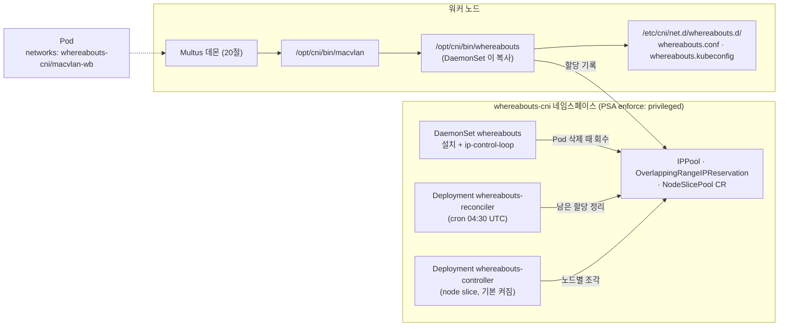

# 21. Whereabouts

> 커리큘럼: [CURRICULUM.md](CURRICULUM.md) · 앞 절: [20. Multus](20-multus.md) · 이어지는 절: 22. NFS Client(작성 예정) · 작성 2026-11-14
> 등급: **[근거]** 출처에 그대로 있는 것, **[추론]** 여러 출처를 엮어 직접 내린 결론.
> 기준 판: VKS Add-ons `3.8.0+20261021` (9.1 VKS Add-ons Release Notes, 2026-11-14 확인, 페이지 표기 Last Updated November 11, 2026, 이 날 기준 가장 높은 판). 판 호환은 이 문서에서 정리하지 않는다. [공식 호환 매트릭스](https://interopmatrix.broadcom.com/)와 릴리스 노트를 직접 볼 것.

Whereabouts 는 **CNI IPAM 플러그인** 이다. 스스로 인터페이스를 만들지 않는다. [20절 Multus](20-multus.md)가 NAD 로 부르는 macvlan·ipvlan 같은 CNI 설정의 `ipam` 칸에 `"type": "whereabouts"` 로 들어가, 클러스터 전체에서 겹치지 않게 보조 인터페이스의 IP 를 나눠 준다. 20절 4.2 의 `host-local` 예시가 노드마다 따로 주소를 기록해 노드가 둘 이상이면 같은 IP 를 두 번 줄 수 있던 문제를 푸는 쪽이다.

이 절에서 먼저 잡을 것은 세 가지다.

1. **할당 기록(IPPool CR)은 애드온 네임스페이스 `whereabouts-cni` 에 쌓인다.** 그래서 애드온을 지우거나 `namespace` 값을 바꾸면 돌고 있는 Pod 의 할당 기록이 사라지거나 안 보이게 되어 같은 IP 가 다시 나갈 수 있다(추론, 2.3·6절 1~2번).
2. **0.9.4 부터 정리(reconcile) 작업이 DaemonSet 에서 별도 Deployment 로 나왔고, 기본 일정은 하루 한 번 04:30 UTC 다.** VKS values 로는 일정을 바꿀 수 없고, ConfigMap 을 직접 고치면 kapp 조정 때 되돌아간다고 본다(추론, 2.2·6절 3번).
3. **ytt 렌더링 단계에서는 values 에 없는 키나 오타가 아무 오류 없이 무시된다.** bundle 에 ytt 값 스키마가 없고 kapp-controller 는 values 를 `--data-values-file` 로 넘기기 때문이다. Add-on 경로에서 API 서버가 일부를 걸러 주는지는 확인하지 못했다(2.4).

[근거] 이 절의 렌더링 결과는 공개 저장소(`3.8.0-20261021/vks-addons`)의 Whereabouts 패키지 원본과 bundle(`@sha256:3af85dc1…`)을 익명으로 받아 ytt v0.55.4 로 직접 돌린 것이다(2026-11-14). 비교용으로 `3.7.0-20260618/vks-addons` 의 0.9.3 bundle(`@sha256:68011d2d…`)도 받았다. **VKS 클러스터에 설치해 보지는 못했다.** 4.3~4.5 의 클러스터 쪽 명령과 기대 출력은 렌더링·업스트림 소스에서 읽은 것이고 실측이 아니다.

[근거] 9.0·9.1 문서 세트에서 Whereabouts 전용 설치·Package Reference 쪽은 찾지 못했다(20절 머리말과 같은 사정). 그래서 1차 출처는 릴리스 노트·패키지 원본·업스트림 v0.9.4 이다.

---

## 1. 무엇을 하는가



- [근거] Whereabouts 는 `192.168.2.0/24` 같은 범위를 받아 DHCP 서버 없이 그 안에서 IP 를 준다. Pod 에 준 IP 는 그 Pod 가 사는 동안 데이터 저장소에 기록하고, Pod 가 지워지면 풀어 준다. 늘 비어 있는 가장 낮은 주소를 주고, `.0` 으로 끝나는 주소는 주지 않는다. `exclude` 로 범위 일부를 뺄 수 있다. 저장소는 etcd 또는 쿠버네티스 CR 이다. (업스트림 README v0.9.4 「Introduction」)
- [근거] 업스트림이 이 플러그인을 만든 동기는 Multus 예시의 `host-local` 을 노드 여러 대에서 쓰다가 IP 가 겹치는 일이었다. (같은 곳)
- [근거] 패키지 설명은 「클러스터 전체에서 IP 주소를 할당하는 CNI IPAM 플러그인」이다. (PackageMetadata `longDescription`)
- [추론] Whereabouts 혼자서는 Pod 에 아무것도 붙이지 않는다. 보조 인터페이스를 붙이는 Multus(20절)와 macvlan·ipvlan 같은 메인 플러그인이 함께 있어야 쓸 데가 생긴다. VKS 애드온 사이의 의존은 릴리스 노트에 적혀 있지 않다(Policy Bundle 의 Gatekeeper 의존은 적혀 있는 것과 대조된다).

### 판과 지원 등급 (3.8.0+20261021 기준)

| 항목 | 값 | 출처 |
|---|---|---|
| 패키지 이름 | `whereabouts.kubernetes.vmware.com` | 패키지 원본 |
| 판 | `0.9.4+vmware.3-vks.1` 한 판, `releasedAt: 2026-10-21` | 패키지 원본, 9.1 릴리스 노트 |
| 지원 등급 | **Product** | 9.1 릴리스 노트 지원 표 |
| VKr | 1.37·1.36·1.35·1.34·1.33 모두 Yes | 같은 표 |
| 업스트림 | whereabouts v0.9.4 (2026-06-03 UTC 릴리스) | 패키지 `releaseNotes`, 업스트림 릴리스 |
| 이미지 | `whereabouts:v0.9.4_vmware.3` 하나 (DaemonSet·Deployment 두 개가 같은 이미지) | bundle `.imgpkg/images.yml`, 렌더링 |

[근거] Product 등급의 지원 범위와 「Out of Scope」(공식 문서에 실린 매개변수만, 사용자가 만든 결과물은 보지 않음)는 20절 1절과 같다. (9.1 릴리스 노트 「VKS Add-ons Support Tiers」·「Scope of Support Boundaries & Exclusions」)
[추론] Whereabouts 에서 「사용자가 만든 결과물」은 NAD 안의 `ipam` 설정(범위·제외 대역·게이트웨이)이다. IP 가 안 나오면 플러그인 문제인지 설정 문제인지부터 가른다(4.5).

### 판 흐름 (9.1 릴리스 노트에서)

| 저장소 판 | Whereabouts 판 | 바뀐 것 |
|---|---|---|
| 3.7.0+20260618 | 0.9.3+vmware.1 (🆕) | 처음 들어옴 |
| 3.7.0+20260723 | 0.9.4+vmware.1 | Go 의존성·기반 이미지 갱신(취약점). 0.9.3+vmware.1 에서 매끄러운 업그레이드 |
| 3.7.0+20260827 | 0.9.4+vmware.2 | 같은 이유의 갱신. 0.9.3+vmware.1, 0.9.4+vmware.1 에서 매끄러운 업그레이드 |
| 3.7.0+20260924 | 0.9.4+vmware.2 | 변화 없음 |
| 3.8.0+20261021 | 0.9.4+vmware.3 | 같은 이유의 갱신. 0.9.3+vmware.1, 0.9.4+vmware.1·.2 에서 매끄러운 업그레이드 |

[근거] 위 표는 9.1 릴리스 노트 해당 판 「What's New」와 지원 표를 옮긴 것이고, 판 번호 끝의 `-vks.1` 은 줄여 적었다(원문은 모두 `…-vks.1`). 3.7.0+20260924 의 「변화 없음」은 그 판 What's New 에 Whereabouts 항목이 없고 지원 표의 판이 같다는 뜻이다.
[근거] VKS Add-ons 이전 TKG 시절 Standard Package v2024.7.2 에도 `Whereabouts v0.6.3+vmware.1-tkg.2` 가 있었다(9.0 「vSphere Supervisor 9.0 Services and Standalone Components」 PDF 63쪽. 20절을 쓸 때 확인한 같은 표이고, 이 절을 쓰며 PDF 를 다시 열지는 않았다).
[근거] 업스트림 v0.9.4 의 바뀐 점에 「IP reconciler 스케줄러를 별도 Deployment 로 옮김」(#700), 「node-controller 가 multi-NAD 검사에서 whereabouts 가 아닌 NAD 를 건너뜀」(#704), 「install-cni 가 노드 이름을 호스트에 남김」(#703)이 있다. (업스트림 v0.9.4 릴리스) Broadcom 노트에는 「Go 의존성·기반 이미지 갱신」만 적혀 있다.
[근거] 실제로 0.9.3+vmware.1 bundle 에는 `overlay-reconciler.yaml`·`upstream/reconciler.yaml` 이 없고, DaemonSet 이 cron ConfigMap 을 마운트한다. 0.9.4+vmware.3 bundle 은 DaemonSet 에서 cron 마운트가 빠지고 `whereabouts-reconciler` Deployment 가 생겼다. (두 bundle 비교, 2026-11-14)
[추론] 그래서 0.9.3 에서 0.9.4 로 올리면 정리 작업이 도는 곳이 노드마다 하나(DaemonSet)에서 클러스터에 하나(Deployment)로 바뀐다. 「매끄러운 업그레이드」는 Broadcom 이 적은 것이고, 이 변화가 사용자 쪽에서 보이는 차이는 로그를 보는 자리(4.5)다.

---

## 2. 패키지가 까는 것

[근거] 기본값으로 렌더링한 결과(`ytt -f bundle/config`, 값 파일 없음)는 Namespace·LimitRange·Secret(이미지 풀용 빈 `{}`)·ServiceAccount·ClusterRole·ClusterRoleBinding·ConfigMap·DaemonSet 하나씩, Deployment 둘(`whereabouts-controller`·`whereabouts-reconciler`), CRD 셋(`ippools`·`overlappingrangeipreservations`·`nodeslicepools`, 그룹 `whereabouts.cni.cncf.io`)이다. 웹훅·Service 는 없다.

### 2.1 업스트림 매니페스트와의 차이

[근거] bundle 의 `config/upstream/` 을 업스트림 v0.9.4 `doc/crds/` 와 비교하면(공백 무시) 이렇다. (`diff -w` 결과, 2026-11-14)

| bundle 파일 | 업스트림 파일 | 차이 |
|---|---|---|
| `daemonset-install.yaml` | `daemonset-install.yaml` | 맨 위 주석 1줄 삭제, `nodeSelector: kubernetes.io/os: linux` 추가, 이미지(`ghcr.io/…/whereabouts:latest` → `whereabouts/whereabouts:0.9.4`) |
| `node-slice-controller.yaml` | `node-slice-controller.yaml` | 같은 세 가지 |
| `reconciler.yaml` | `reconciler-deployment.yaml` | 맨 위 주석 1줄 변경, Deployment `metadata.labels`(`tier`·`app`) 삭제, selector 를 `name:` 에서 `app: whereabouts-reconciler` 로, template 라벨에서 `tier: node`·`name:` 삭제, 컨테이너 이름 `whereabouts-reconciler` → `reconciler`, `nodeSelector` 추가, 이미지 (resources·image 키 순서와 따옴표 표기 변경은 뺀다) |
| CRD 세 개 | CRD 세 개 | controller-gen 판 표기(v0.14.0 → v0.20.0), 설명 문장의 오타 하나(`ippools` 만) |

- [근거] 업스트림 README 의 설치 명령은 DaemonSet·CRD 둘·reconciler 만 `kubectl apply` 하고, node slice controller 와 `nodeslicepools` CRD 는 넣지 않는다. node slice 는 README 에서 「[Experimental]」이다. (업스트림 README 「Installation」·「Fast IPAM by Using Preallocated Node Slices」)
- [근거] 패키지는 node slice controller 를 기본으로 켠다(`whereabouts.nodeSliceController.enable: true`). (bundle `values.yaml`, Package `valuesSchema`)
- [추론] 업스트림이 실험 기능이라 따로 두는 컨트롤러가 VKS 에서는 기본으로 뜬다. 쓰지 않으면 4.2 처럼 끄는 편이 깔끔하다. 이 컨트롤러는 `node_slice_size` 가 든 NAD 가 있을 때만 일을 한다(2.2).
- [근거] 그 위에 ytt 오버레이가 네임스페이스를 `kube-system` 에서 `whereabouts-cni` 로 옮기고(ServiceAccount·ClusterRoleBinding 주체·ConfigMap·DaemonSet·Deployment 둘), 자원 값·priority class·toleration·풀 Secret 을 더한다. (bundle `overlays/`)

### 2.2 구성 요소와 권한

```yaml
# 렌더링 결과에서 발췌 (vks_cluster_version=v1.34.0)
kind: Namespace
metadata:
  name: whereabouts-cni
  labels:
    pod-security.kubernetes.io/enforce: privileged
---
kind: DaemonSet                      # whereabouts
spec:
  template:
    spec:
      hostNetwork: true
      priorityClassName: vmware-system-important
      tolerations:                   # 업스트림 NoSchedule 에 패키지가 NoExecute 를 더함
      - {operator: Exists, effect: NoSchedule}
      - {operator: Exists, effect: NoExecute}
      containers:
      - name: whereabouts            # securityContext.privileged: true
        args: ["-c", "SLEEP=false source /install-cni.sh\n/token-watcher.sh &\n/ip-control-loop -log-level debug\n"]
        volumeMounts:                # hostPath /opt/cni/bin, /etc/cni/net.d
---
kind: Deployment                     # whereabouts-reconciler, replicas: 1
spec:
  template:
    spec:
      priorityClassName: vmware-system-important
      containers:
      - name: reconciler
        command: ["/ip-reconciler"]
        args: ["-log-level", "debug"]   # values 의 reconciler.logLevel
---
kind: Deployment                     # whereabouts-controller (node slice), replicas: 1
spec:
  template:
    spec:                            # priorityClassName 없음, toleration 없음
      containers:
      - command: ["/node-slice-controller"]
        volumeMounts:                # hostPath /opt/cni/bin, /etc/cni/net.d
```

- [근거] DaemonSet 컨테이너는 `install-cni.sh` 로 `/whereabouts` 실행 파일을 노드 `/opt/cni/bin` 에 복사하고, 노드 `/etc/cni/net.d/whereabouts.d/` 에 `whereabouts.kubeconfig`(ServiceAccount 토큰, 컨텍스트 네임스페이스는 `WHEREABOUTS_NAMESPACE`)·`whereabouts.conf`·`nodename` 을 쓴다. 파일 권한 기본값은 600 이다. 토큰이나 CA 가 바뀌면 `token-watcher.sh` 가 1초마다 확인해 kubeconfig 를 다시 쓴다. (업스트림 `script/install-cni.sh`·`lib.sh`·`token-watcher.sh` v0.9.4)
- [근거] `WHEREABOUTS_NAMESPACE` 는 Pod 자기 네임스페이스(downward API `metadata.namespace`)다. 쿠버네티스 저장소 백엔드는 IPPool·OverlappingRangeIPReservation 을 kubeconfig 컨텍스트의 네임스페이스에 만든다. (렌더링 결과, 업스트림 `pkg/storage/kubernetes/ipam.go` v0.9.4)
- [추론] 그래서 VKS 에서 할당 기록은 NAD 가 어느 네임스페이스에 있든 모두 `whereabouts-cni` 에 쌓인다.
- [근거] `ip-control-loop` 은 `NODENAME` 과 같은 노드의 Pod 만 지켜보다가, Pod 삭제 이벤트가 오면 그 Pod 의 `network-status` 어노테이션에서 NAD 와 풀을 찾아 IP 를 회수한다. 실패하면 세 번까지 다시 큐에 넣고, 그래도 실패하면 포기한다. (업스트림 `pkg/controlloop/pod.go` v0.9.4, `NumRequeues <= maxRetries`, `maxRetries = 2`)
- [근거] `ip-reconciler` 는 `/cron-schedule/config` 의 cron 식에 맞춰 할당 기록과 실제 Pod 를 대조해 남은 IP 를 푼다. 스케줄러 시간대는 UTC 로 고정이다(`gocron.WithLocation(time.UTC)`). ConfigMap `whereabouts-config` 의 기본값은 `"30 4 * * *"` 이다. 남은 IP 는 노드 장애(갑작스러운 전원 차단·재부팅)나 `--grace-period=0 --force` 삭제로 생긴다. (업스트림 `cmd/reconciler/main.go`·`doc/extended-configuration.md` v0.9.4, 렌더링 결과)
- [추론] 04:30 UTC 는 한국 시간 13:30 이다. 노드가 통째로 죽으면 그 노드의 `ip-control-loop` 도 같이 죽으므로, 그 노드 Pod 들의 IP 는 다음 정리 시각까지 최대 하루 가까이 묶여 있을 수 있다.
- [근거] reconciler 매니페스트 주석은 「리더 선출이 없으니 replicas 를 1보다 크게 두지 말 것, 중복 정리가 일어난다」고 적는다. (bundle·업스트림 `reconciler.yaml`)
- [근거] ClusterRole `whereabouts-cni` 는 `whereabouts.cni.cncf.io` 의 `ippools`·`overlappingrangeipreservations`·`nodeslicepools` 에 get·list·watch·create·update·patch·delete, `coordination.k8s.io` lease 에 모든 동사, Pod·Node 읽기, NAD 읽기, 이벤트 생성을 준다. 이 역할 하나를 DaemonSet·reconciler·node slice controller 가 같은 ServiceAccount `whereabouts` 로 쓴다. (렌더링 결과)
- [추론] 노드 `/etc/cni/net.d/whereabouts.d/whereabouts.kubeconfig` 에는 이 ServiceAccount 의 토큰이 들어 있다. 노드 셸에 root 로 들어올 수 있는 사람은 클러스터 전체 Pod 목록을 읽고 할당 기록을 고칠 수 있다.
- [근거] node slice controller 는 Fast IPAM 용이다. NAD 의 `ipam` 에 `node_slice_size`(예 `"/22"`)가 있으면 그 크기로 노드마다 범위 조각을 미리 나눠 할당 경합을 줄인다. 업스트림은 「DaemonSet·컨트롤러를 NAD 와 같은 네임스페이스에서 돌려야 한다」고 적고, 컨트롤러는 `WHEREABOUTS_NAMESPACE` 가 없으면 시작하지 않는다. (업스트림 README 「Fast IPAM」, `cmd/nodeslicecontroller/node_slice_controller.go` v0.9.4)
- [추론] VKS 에서 Fast IPAM 을 쓰려면 NAD 를 `whereabouts-cni` 네임스페이스에 두어야 한다. 다른 네임스페이스의 NAD 에 `node_slice_size` 를 넣었을 때 어떻게 되는지는 시험하지 않았다.
- [근거] node slice controller 매니페스트는 ServiceAccount 토큰을 `kube-api-access-6kd6k` 라는 고정 이름의 projected 볼륨으로 직접 적고, deprecated 필드 `serviceAccount` 도 함께 쓴다. 업스트림 파일 그대로다. (bundle·업스트림 `node-slice-controller.yaml`)
- [추론] 돌고 있는 Pod 를 `kubectl get -o yaml` 로 뽑은 모양이 그대로 남은 것으로 보인다. 동작에는 문제가 없다고 보지만, 이 Deployment 에만 패키지의 priority class 가 안 붙는다는 점은 남는다.

### 2.3 PSA 와 네임스페이스

- [근거] DaemonSet 은 `hostNetwork`·`privileged`·`hostPath` 를 쓰고, node slice controller 도 `hostPath` 두 개를 마운트한다. Pod Security Standards 의 Baseline 은 호스트 네임스페이스, privileged 컨테이너, hostPath 볼륨을 모두 막는다. 패키지는 네임스페이스를 `enforce: privileged` 로 만든다. (렌더링 결과, Kubernetes 「Pod Security Standards」)
- [추론] 그래서 `createNamespace: false` 로 미리 만든 네임스페이스에 깔 때 그 네임스페이스가 VKr 기본 `restricted` 나 `baseline` 이면 DaemonSet 과 node slice controller Pod 가 거절된다. reconciler 는 hostPath·privileged 가 없지만 컨테이너 securityContext 도 없어 `restricted` 는 통과하지 못한다고 본다. PSA 수준과 VKS 기본값은 루트 [`../podsecurity_admission.md`](../podsecurity_admission.md)를 본다.
- [근거] `createNamespace` 의 스키마 설명은 「패키지를 설치·삭제할 때 네임스페이스를 만들지·지울지」이다. (Package `valuesSchema`)
- [추론] 기본값(true)으로 애드온을 지우면 `whereabouts-cni` 네임스페이스가 지워지고, 그 안의 IPPool 기록도 함께 사라진다. CRD 도 패키지가 깔았으므로 같이 지워진다고 본다. 보조 인터페이스를 쓰는 Pod 가 살아 있는 채로 다시 깔면 새 기록은 비어 있으니, 이미 쓰고 있는 IP 를 새 Pod 에 또 줄 수 있다.

### 2.4 values: 무엇을 바꿀 수 있나

| 키 | 기본값 | 렌더링에 쓰이는 곳 |
|---|---|---|
| `namespace` | `whereabouts-cni` | 모든 네임스페이스 자원, 할당 기록 위치(2.2) |
| `createNamespace` | `true` | Namespace·LimitRange 를 만들지 |
| `priorityClassName` | `""` | DaemonSet·reconciler. 비어 있고 `vks_cluster_version` ≥ 1.34 면 `vmware-system-important` |
| `nsLimitRange.defaultRequests` | `100m`·`100Mi` | LimitRange `defaultRequest` |
| `nsLimitRange.defaultLimits` | `""`·`""` | 둘 다 비면 LimitRange `default: {}` |
| `whereabouts.tolerations` | `[{operator: Exists, effect: NoExecute}]` | DaemonSet 기존 toleration 뒤에 덧붙임 |
| `whereabouts.config.resources` | 요청 100m·100Mi, 한도 100m·200Mi | DaemonSet 컨테이너 |
| `whereabouts.nodeSliceController.enable` | `true` | `false` 면 `whereabouts-controller` Deployment 가 렌더링에서 빠짐 |
| `whereabouts.nodeSliceController.resources` | 요청 100m·100Mi, 한도 100m·200Mi | node slice controller 컨테이너 |
| `whereabouts.reconciler.logLevel` | `debug` | reconciler `args[1]` |
| `whereabouts.reconciler.resources` | 요청·한도 100m·50Mi | reconciler 컨테이너 |

[근거] 위 표는 bundle `values.yaml`·`overlays/` 와 Package `valuesSchema` 를 대조한 것이다.

- [근거] DaemonSet 의 `ip-control-loop -log-level debug` 는 업스트림 셸 인자 그대로 고정이라 values 로 바꿀 수 없다. reconciler 의 로그 수준만 열려 있다. (bundle `daemonset-install.yaml`·`overlay-reconciler.yaml`)
- [근거] cron 식(`whereabouts-config` ConfigMap 의 `cron-expression`)은 values 에 없다. (같은 곳)
- [근거] `whereabouts.reconciler: null` 을 주면 reconciler Deployment 가 렌더링에서 빠진다. 오버레이 주석은 「블록을 통째로 빼면 Deployment 를 지운다」이다. (렌더링 rc=0, `whereabouts-reconciler` 0건, `overlay-reconciler.yaml`)
- [추론] 그러면 Pod 삭제 때의 회수(`ip-control-loop`)만 남고, 노드 장애·강제 삭제로 남은 IP 를 푸는 작업이 없어진다.
- [근거] bundle 에는 ytt 값 스키마(`#@data/values-schema`)가 없고 `#@data/values` 파일 하나뿐이다. kapp-controller 는 values Secret 을 ytt 에 `--data-values-file` 로 넘긴다. (bundle `values.yaml`, kapp-controller `pkg/template/ytt.go` develop 브랜치)
- [근거] 그 방식으로 렌더링하면 없는 키(`cronExpression: "*/10 * * * *"`)도, 있는 블록 안의 오타(`whereabouts.reconcilr.logLevel: info`)도 rc=0 으로 통과하고 결과에 아무 영향이 없다. 올바른 키(`whereabouts.reconciler.logLevel: info`)는 `args` 를 `info` 로 바꾼다. (렌더링, 2026-11-14)
- [추론] Add-on 경로의 AddonConfigDefinition 스키마는 맨 위와 `whereabouts` 아래에 `additionalProperties: false` 가 없고 `nsLimitRange` 에만 있다(3.1). 그래서 오타는 `nsLimitRange` 안에서만 걸러질 가능성이 있다. API 서버가 이 스키마로 AddonConfig 를 검사하는지는 Supervisor 없이 확인하지 못했다. 값을 넣은 뒤에는 늘 렌더링 결과나 실제 객체로 확인한다(4.1·4.5).

---

## 3. VKS 에 들어가는 두 경로

### 3.1 Add-on 경로 (VKS 3.5 이상)

- [근거] AddonConfigDefinition 이름은 `whereabouts.kubernetes.vmware.com.0.9.4---vmware.3-vks.1`(`+` 가 `---`), 네임스페이스는 `vmware-system-vks-public` 이다. 입력은 대상 Cluster 객체 하나(`cluster.x-k8s.io/v1beta2`)이고, 출력은 대상 클러스터 `vmware-system-tkg` 네임스페이스의 Secret `<cluster>-whereabouts` 의 `values.yaml` 이다. 템플릿은 `toYaml .Values` 뒤에 `vks_cluster_version` 에 Cluster 의 `spec.topology.version` 을 붙인다. (Package 어노테이션의 AddonConfigDefinition 을 풀어 확인)
- [근거] AddonConfigDefinition 스키마는 Package `valuesSchema` 와 같고, `createNamespace` 도 들어 있다(20절 Multus 와 다르다). 맨 위 `additionalProperties: false` 는 없다. (같은 곳)
- [추론] Add-on 경로에서는 `vks_cluster_version` 이 채워지므로 VKr 1.34 이상이면 DaemonSet·reconciler 에 `vmware-system-important` priority class 가 붙는다. 레거시 경로는 이 값이 비어 붙지 않는다(`vks_cluster_version` 빈 값으로 렌더링하면 `priorityClassName` 0건).
- AddonConfig·AddonInstall 의 일반 모양과 이름 규칙은 [00절](00-repository-and-install-paths.md)을 본다.

### 3.2 레거시 PackageInstall 경로

- [근거] 패키지 `whereabouts.kubernetes.vmware.com` 은 같은 Carvel 저장소에 들어 있다(`packages/whereabouts.kubernetes.vmware.com/0.9.4+vmware.3-vks.1.yml`). 디렉터리 이름과 패키지 이름이 같다. (저장소 원본)
- [추론] 그래서 PackageInstall 로도 깔 수 있겠지만, 이 판의 레거시 설치 문서는 찾지 못했다.

설치 흐름과 kapp-controller 동작은 [00절](00-repository-and-install-paths.md)과 루트 [`../carvel-kapp.md`](../carvel-kapp.md)를 본다.

---

## 4. 실습

### 4.1 클러스터 없이 확인하는 법 (렌더링)

```bash
# crane, ytt 필요. 공개 저장소라 로그인 없이 받는다.
R=projects.packages.broadcom.com/vsphere/supervisor/vks-standard-packages/3.8.0-20261021/vks-addons
mkdir -p repo bundle
crane export $R:3.8.0-20261021 - | tar -x -C repo
ls repo/packages/whereabouts.kubernetes.vmware.com/       # 0.9.4+vmware.3-vks.1.yml, metadata.yml
grep -A5 'kbld.carvel.dev/id: .*packages/whereabouts:' repo/.imgpkg/images.yml   # bundle 다이제스트 확인
crane export $R@sha256:3af85dc1ee6718106302eaa48937845f5db4de98b83dde78e5b1506de9522250 - | tar -x -C bundle
ytt -f bundle/config > default.yaml && grep '^kind:' default.yaml | sort | uniq -c
grep 'pod-security' default.yaml                                  # enforce: privileged
grep -A2 'cron-expression' default.yaml                           # "30 4 * * *" (UTC)
ytt -f bundle/config -v vks_cluster_version=v1.34.0 | grep priorityClassName   # 2건 (DaemonSet·reconciler)
```

Add-on 정의는 Package 어노테이션에 gzip+base64 로 들어 있다.

```bash
P=repo/packages/whereabouts.kubernetes.vmware.com/0.9.4+vmware.3-vks.1.yml
grep 'addon-config-definition' $P | awk '{print $2}' | base64 -d | gunzip > acd.yaml
grep -n 'templateOutputResources' -A12 acd.yaml
```

### 4.2 values 파일

```yaml
# whereabouts-values.yaml — 기본값과 다른 것만 적는다
whereabouts:
  nodeSliceController:
    enable: false          # Fast IPAM 을 안 쓰면 끈다 (2.1)
  reconciler:
    logLevel: error        # 기본 debug
```

```bash
ytt -f bundle/config --data-values-file whereabouts-values.yaml > out.yaml
grep -c 'name: whereabouts-controller' out.yaml        # 0 이어야 한다
grep -A3 '/ip-reconciler' out.yaml                     # -log-level, error
```

[근거] 위 두 값은 렌더링으로 결과가 바뀌는 것을 확인했다(2026-11-14). 오타는 rc=0 으로 조용히 무시되므로(2.4) `grep` 으로 결과를 보는 단계를 빼지 않는다.

### 4.3 Add-on 경로로 설치 (Supervisor 컨텍스트)

```yaml
# addonconfig.yaml — 이름은 <cluster>-whereabouts
apiVersion: addons.kubernetes.vmware.com/v1alpha1
kind: AddonConfig
metadata:
  name: wl-01-whereabouts
  namespace: demo-ns
  annotations:
    clusteraddon.addons.kubernetes.vmware.com/owned-for-deletion: "true"
spec:
  values:
    whereabouts:
      nodeSliceController:
        enable: false
---
# addoninstall.yaml
apiVersion: addons.kubernetes.vmware.com/v1alpha1
kind: AddonInstall
metadata:
  name: wl-01-whereabouts
  namespace: demo-ns
spec:
  releaseFilter:
    ref:
      name: whereabouts.kubernetes.vmware.com.0.9.4-vmware.3-vks.1
      namespace: vmware-system-vks-public
  addonRef:
    name: whereabouts
  clusters:
  - selector:
      matchLabels:
        cluster.x-k8s.io/cluster-name: wl-01
```

```bash
kubectl -n vmware-system-vks-public get addonreleases | grep -i whereabouts   # 실제 이름 확인
kubectl -n demo-ns apply -f addonconfig.yaml -f addoninstall.yaml
kubectl -n demo-ns get clusteraddon | grep -i whereabouts                     # READY True 기대
```

[추론] AddonConfig·AddonInstall 의 모양은 20절 4.3 과 같은 틀(9.0 Add-on 설치 예시)을 이름만 바꾼 것이다. Whereabouts 용 공식 kubectl 예시는 찾지 못했다. `releaseFilter.ref.name` 과 `addonRef.name` 은 위 `addonreleases` 출력으로 확인한다. AddonConfig 이름의 `whereabouts` 는 출력 Secret 이름 `<cluster>-whereabouts`(3.1)에서 짐작했다. Multus 애드온(20절)이 먼저 깔려 있어야 4.4 를 할 수 있다.

### 4.4 Whereabouts IPAM 을 쓰는 NAD 와 Pod (VKS 클러스터 컨텍스트)

```yaml
# nad-ipvlan-wb.yaml — 대역·인터페이스 이름은 예시
apiVersion: k8s.cni.cncf.io/v1
kind: NetworkAttachmentDefinition
metadata:
  name: ipvlan-wb
  namespace: team-a
spec:
  config: '{
    "cniVersion": "0.3.1",
    "name": "ipvlan-wb",
    "type": "ipvlan",
    "master": "eth1",
    "mode": "l2",
    "ipam": {
      "type": "whereabouts",
      "range": "192.168.60.0/24",
      "range_start": "192.168.60.100",
      "range_end": "192.168.60.150",
      "exclude": ["192.168.60.120/30"]
    }
  }'
---
apiVersion: apps/v1
kind: Deployment
metadata:
  name: wb-test
  namespace: team-a
spec:
  replicas: 3
  selector:
    matchLabels: {app: wb-test}
  template:
    metadata:
      labels: {app: wb-test}
      annotations:
        k8s.v1.cni.cncf.io/networks: ipvlan-wb       # 같은 네임스페이스면 이름만
    spec:
      securityContext:
        runAsNonRoot: true
        runAsUser: 65534
        seccompProfile: {type: RuntimeDefault}
      containers:
      - name: c
        image: busybox:1.37
        command: ["sh", "-c", "ip -4 addr show net1; sleep 3600"]
        securityContext:
          allowPrivilegeEscalation: false
          capabilities: {drop: ["ALL"]}
```

```bash
kubectl -n team-a apply -f nad-ipvlan-wb.yaml
kubectl -n team-a get pods -l app=wb-test -o wide             # 서로 다른 노드에 퍼졌는지
for p in $(kubectl -n team-a get pods -l app=wb-test -o name); do
  kubectl -n team-a exec $p -- ip -4 -o addr show net1
done                                                          # 192.168.60.100·101·102 처럼 겹치지 않아야 한다
kubectl -n whereabouts-cni get ippools.whereabouts.cni.cncf.io   # 기록은 NAD 네임스페이스가 아니라 여기
```

- [근거] 필수 매개변수는 `type: whereabouts` 와 `range` 이고, `range_start`·`range_end`·`exclude` 는 선택이다. `exclude` 가 서브넷 안에 맞게 들어 있는지는 CIDR 문법 말고는 따로 검사하지 않는다. 게이트웨이·경로·DNS 는 static IPAM 플러그인의 설정을 그대로 쓸 수 있다. (업스트림 README 「Core Parameters」)
- [근거] 같은 CIDR 을 두 번 설정하면 기본으로는 따로 할당하지 않는다. 겹치는 범위 검사(`enable_overlapping_ranges`, 기본 true)는 다른 범위에 이미 나간 IP 를 다시 주지 않게 하고, `network_name` 을 주면 같은 CIDR 을 따로 할당할 수 있다. (같은 곳 「Overlapping Ranges」·「Network names」)
- [추론] 위 예시라면 `.100` 부터 차례로 나가고 `.120`~`.123`(/30)은 건너뛴다. 대역을 실제 망과 맞추는 일(물리 스위치·다른 DHCP 와 겹치지 않게)은 사용자 몫이다(1절 Out of Scope).
- ipvlan 을 고른 까닭과 `eth1`(보조 NIC) 조건은 20절 4.2 를 본다.

### 4.5 확인 명령

```bash
kubectl -n whereabouts-cni get ds whereabouts -o wide
kubectl -n whereabouts-cni get deploy                                   # whereabouts-reconciler, (켰으면) whereabouts-controller
kubectl get ns whereabouts-cni --show-labels | tr ',' '\n' | grep pod-security   # enforce=privileged
kubectl -n whereabouts-cni get cm whereabouts-config -o jsonpath='{.data.cron-expression}{"\n"}'
kubectl -n whereabouts-cni logs deploy/whereabouts-reconciler | tail       # 정리 작업 로그 (0.9.4 부터 여기)
kubectl -n whereabouts-cni logs ds/whereabouts | grep -i 'Done configuring CNI'
kubectl get crd | grep whereabouts.cni.cncf.io                           # 3개
kubectl -n whereabouts-cni get ippools,overlappingrangeipreservations
# 노드 쪽(노드 셸·디버그 Pod 로)
ls /opt/cni/bin/whereabouts
ls -l /etc/cni/net.d/whereabouts.d/      # whereabouts.conf, whereabouts.kubeconfig(600), nodename
```

[추론] 기대 출력은 렌더링 결과와 업스트림 소스에서 읽은 것이다. `Done configuring CNI.  Sleep=false` 는 `install-cni.sh` 의 출력 문구다. Pod 가 `net1` 없이 뜨거나 생성이 멈추면 먼저 `kubectl -n team-a describe pod` 의 이벤트에서 CNI 오류 문구를 보고, Multus 데몬 로그(20절 4.5)로 Multus 단계인지 Whereabouts 단계인지 가른다.

---

## 5. 업스트림 설치와 다른 점

루트 [`../k8s-addon.sh`](../k8s-addon.sh) 에는 Whereabouts 가 없다. 업스트림 설치는 README 의 `kubectl apply`(4개 파일)나 Helm 차트다.

| 항목 | 업스트림 v0.9.4 | VKS 애드온 |
|---|---|---|
| 네임스페이스 | `kube-system` | `whereabouts-cni`(PSA privileged, 패키지가 만들고 지움) |
| node slice controller | README 설치에서 빠짐, 「Experimental」 | 기본 켜짐 |
| reconciler 일정 | ConfigMap 을 `kubectl edit` 로 고치라고 안내 | values 에 없음. 직접 고치면 되돌아간다고 봄(6절 3번) |
| 로그 수준 | 데몬·reconciler 모두 `debug` 고정 인자 | reconciler 만 values 로 |
| 이미지 | `ghcr.io/k8snetworkplumbingwg/whereabouts:latest` | `whereabouts:v0.9.4_vmware.3`(Broadcom 저장소) |
| toleration | NoSchedule 전부 | + NoExecute 전부 |
| priority class | 없음 | 1.34 이상 Add-on 경로에서 `vmware-system-important`(DaemonSet·reconciler) |

- [근거] 업스트림 Helm 차트(`deployment/whereabouts-chart`)는 v0.9.4 태그에서도 `version: 0.1.1`, `appVersion: v0.8.0` 이고 기본 이미지 태그도 `v0.8.0` 이다. README 는 `oci://ghcr.io/k8snetworkplumbingwg/whereabouts-chart` 로 설치하라고 적는다. (업스트림 `Chart.yaml`·`values.yaml`·README v0.9.4)
- [추론] 업스트림 차트를 그대로 쓰면 앱 판이 0.9.4 가 아닐 수 있다. 업스트림과 VKS 를 비교할 때는 차트보다 `doc/crds/` 매니페스트가 기준이다(2.1).

---

## 6. 흔한 실수

1. **애드온을 지웠다 다시 깔면 같은 상태로 돌아온다고 생각한다.** [근거] 할당 기록은 `whereabouts-cni` 네임스페이스의 IPPool CR 이고(2.2), `createNamespace: true` 면 삭제 때 네임스페이스를 지운다(2.3). [추론] 보조 인터페이스를 쓰는 Pod 가 살아 있으면 재설치 뒤 같은 IP 가 새 Pod 에 또 나갈 수 있다. 지우기 전에 그 NAD 를 쓰는 Pod 를 먼저 내린다.
2. **`namespace` 값을 운영 중에 바꾼다.** [추론] 기록 위치가 kubeconfig 컨텍스트 네임스페이스라(2.2) 새 네임스페이스에는 기존 할당이 없다. 1번과 같은 중복이 생길 수 있다.
3. **upstream 문서대로 `kubectl edit configmap whereabouts-config` 로 정리 주기를 바꾼다.** [근거] 업스트림은 그렇게 안내하지만(`doc/extended-configuration.md`), VKS values 에는 그 키가 없다(2.4). [추론] kapp-controller 가 주기적으로 조정하면 패키지가 렌더링한 값(`30 4 * * *`)으로 되돌린다. 또 `ip-reconciler` 는 시작 때 cron 식으로 작업을 못 만들면 종료하므로(`cmd/reconciler/main.go` 의 `couldNotCreateConfigWatcherError`), 깨진 식은 재시작 반복으로 보일 수 있다(실측 안 함).
4. **정리 시각을 한국 시간으로 읽는다.** [근거] 스케줄러는 UTC 고정이다(2.2). [추론] `30 4 * * *` 은 KST 13:30 이다. 업무 시간 한가운데 정리가 돈다는 뜻이다.
5. **`reconciler` 블록을 지우면 로그만 줄어든다고 생각한다.** [근거] 블록이 null 이면 reconciler Deployment 자체가 빠진다(2.4). [추론] 노드 장애로 남은 IP 가 영영 안 풀려 범위가 고갈될 수 있다. 업스트림 「Known limitations」도 노드 강제 중단이 할당을 남겨 IP 를 고갈시킬 수 있다고 적는다.
6. **values 오타가 오류로 잡힐 거라 믿는다.** [근거] ytt 값 스키마가 없어 `--data-values-file` 로 넘긴 없는 키·오타가 rc=0 으로 통과한다(2.4). 렌더링 결과나 실제 객체로 바뀐 것을 확인한다.
7. **Fast IPAM(`node_slice_size`)을 아무 네임스페이스 NAD 에 넣는다.** [근거] 업스트림은 DaemonSet·컨트롤러와 같은 네임스페이스의 NAD 를 요구하고, 기능은 Experimental 이다(2.2). [추론] VKS 에서는 `whereabouts-cni` 에 NAD 를 둬야 하고, 그러면 20절 6절 2번처럼 다른 네임스페이스 Pod 가 `whereabouts-cni/<nad>` 로 그 NAD 를 쓰게 된다.
8. **넓은 IPv6 범위를 그대로 믿는다.** [근거] `range` 가 /64 이하로 넓으면 처음 /65 만 할당된다(uint64 오프셋 계산). (업스트림 README 「Known limitations」·「Core Parameters」 Note 2)
9. **`exclude` 를 서브넷 밖으로 적고 안심한다.** [근거] 제외 대역이 서브넷 안에 있는지 검사하지 않는다(4.4).

---

## 7. 확인 문제

1. 노드 셋에 걸친 Pod 세 개가 같은 NAD 로 보조 인터페이스를 받는다. `host-local` 과 Whereabouts 중 어느 쪽에서 IP 가 겹칠 수 있고, Whereabouts 는 겹치지 않게 하려고 무엇을 어디에 기록하나?
2. 워커 노드 하나가 전원이 나가 그 위 Pod 들이 다른 노드로 옮겨졌다. 옛 Pod 의 IP 는 언제, 무엇이 풀어 주나? 3.8.0+20261021 기본값 기준으로 한국 시간으로 답하라.
3. 운영 중인 클러스터에서 Whereabouts 애드온을 지웠다가 바로 다시 깔았다. 어떤 문제가 생길 수 있고, 지우기 전에 무엇을 했어야 하나?

<details><summary>답</summary>

1. `host-local` 은 노드마다 따로 기록하므로 노드 사이에서 같은 IP 가 나갈 수 있다. Whereabouts 는 할당을 쿠버네티스 CR(IPPool, 겹침 검사용 OverlappingRangeIPReservation)로 클러스터에 하나만 기록한다. VKS 에서는 그 CR 이 NAD 네임스페이스가 아니라 `whereabouts-cni` 에 쌓인다(1절, 2.2).
2. 그 노드의 `ip-control-loop` 도 같이 죽어 삭제 이벤트로는 회수되지 않는다. 남은 할당은 `whereabouts-reconciler` 가 cron `30 4 * * *`(UTC)에 맞춰 풀어 준다. 한국 시간으로 매일 13:30 이다(2.2, 6절 4번).
3. `createNamespace: true` 면 `whereabouts-cni` 와 그 안의 IPPool 기록이 지워진다. 살아 있는 Pod 가 쓰는 IP 를 새 기록이 모르니 다음 Pod 에 같은 IP 가 또 나갈 수 있다. 지우기 전에 그 NAD 를 쓰는 워크로드를 먼저 내린다(2.3, 6절 1번). (추론, 실측 안 함)

</details>

---

## 출처 (모두 2026-11-14 확인)

- VKS Add-ons Release Notes (VCF 9.1, Last Updated November 11, 2026): <https://techdocs.broadcom.com/us/en/vmware-cis/vcf/vcf-service-administration-and-development/9-1/release-notes/vks-addons-release-notes.html>
- vSphere Supervisor 9.0 Services and Standalone Components PDF 63쪽(TKG 시절 Standard Package 표): [20절 출처](20-multus.md#출처-모두-2026-11-14-확인)와 같은 문서(20절 작성 때 확인)
- 패키지 원본: `projects.packages.broadcom.com/vsphere/supervisor/vks-standard-packages/3.8.0-20261021/vks-addons:3.8.0-20261021` 의 `packages/whereabouts.kubernetes.vmware.com/`, bundle `@sha256:3af85dc1ee6718106302eaa48937845f5db4de98b83dde78e5b1506de9522250`
- 비교용 0.9.3 bundle: `…/3.7.0-20260618/vks-addons@sha256:68011d2de43ec28a29acdcfb1bfcec658ad3b99222884e44c5ff786148dcd52e`
- 업스트림 whereabouts v0.9.4: <https://github.com/k8snetworkplumbingwg/whereabouts/tree/v0.9.4> (README, `doc/crds/`, `doc/extended-configuration.md`, `script/install-cni.sh`·`lib.sh`·`token-watcher.sh`, `cmd/reconciler/main.go`, `cmd/nodeslicecontroller/node_slice_controller.go`, `pkg/controlloop/pod.go`, `pkg/reconciler/config.go`, `pkg/storage/kubernetes/ipam.go`, `deployment/whereabouts-chart/`)
- 업스트림 v0.9.4 릴리스: <https://github.com/k8snetworkplumbingwg/whereabouts/releases/tag/v0.9.4>
- kapp-controller ytt 템플릿 단계: <https://github.com/carvel-dev/kapp-controller/blob/develop/pkg/template/ytt.go>
- Kubernetes Pod Security Standards: <https://kubernetes.io/docs/concepts/security/pod-security-standards/>
- 렌더링 도구: ytt v0.55.4, crane v0.22.1
