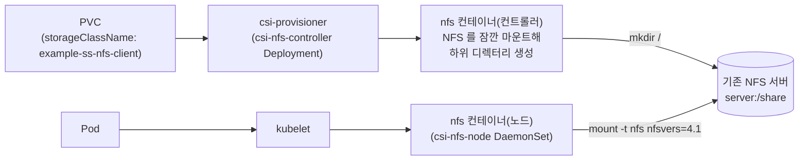

# 22. NFS Client

> 커리큘럼: [CURRICULUM.md](CURRICULUM.md) · 앞 절: [21. Whereabouts](21-whereabouts.md) · 이어지는 절: 23. Policy Bundle(작성 예정) · 작성 2026-11-16
> 등급: **[근거]** 출처에 그대로 있는 것, **[추론]** 여러 출처를 엮어 직접 내린 결론.
> 기준 판: VKS Add-ons `3.8.0+20261021` (9.1 VKS Add-ons Release Notes, 2026-11-16 확인, 페이지 표기 Last Updated November 11, 2026, 이 날 기준 가장 높은 판). 판 호환은 이 문서에서 정리하지 않는다. [공식 호환 매트릭스](https://interopmatrix.broadcom.com/)와 릴리스 노트를 직접 볼 것.

「NFS Client」라는 이름과 달리 이 애드온의 알맹이는 **업스트림 `csi-driver-nfs`(드라이버 이름 `nfs.csi.k8s.io`)** 다. 이미 있는 NFS 서버의 공유 디렉터리 아래에 PVC 마다 하위 디렉터리를 만들어 PV 로 내준다. NFS 서버 자체를 클러스터 안에 만들어 주지는 않는다. 예전에 많이 쓰던 `nfs-subdir-external-provisioner`(옛 이름 nfs-client-provisioner, 루트 [`../csi-comparison/04_other_csi.md`](../csi-comparison/04_other_csi.md) 5절)와는 다른 프로젝트다.

이 절에서 먼저 잡을 것은 네 가지다.

1. **기본값으로 깔면 드라이버만 뜨고 StorageClass 는 하나도 생기지 않는다.** `nfs.server` 가 빈 값이면 패키지가 StorageClass 를 지운다(2.4).
2. **`nfs.server` 를 주면 `storageClass.create: false` 여도 StorageClass 가 생긴다.** 템플릿이 `storageClass.create` 를 읽지 않는다(2.4).
3. **`storageClass.defaultClass` 를 빈 문자열로 두면 그 StorageClass 가 클러스터 기본 클래스가 된다.** Broadcom 이 업스트림 StorageClass 에 `is-default-class: "true"` 를 넣어 두었고, 빈 값이면 그것을 덮어쓰지 않는다(2.1, 2.4).
4. **만들어지는 StorageClass 는 `onDelete: archive`·`mountPermissions: "0777"`·`reclaimPolicy: Delete` 다.** PVC 를 지워도 NFS 서버의 데이터가 `archived-<디렉터리>` 로 남아 공간을 계속 차지하고, 마운트 루트는 누구나 쓸 수 있게 열린다(2.4).

[근거] 이 절의 렌더링 결과는 공개 저장소(`3.8.0-20261021/vks-addons`)의 NFS Client 패키지 원본과 bundle(`@sha256:c7ba3552…`)을 익명으로 받아 ytt v0.55.4 로 직접 돌린 것이다(2026-11-16). **VKS 클러스터와 NFS 서버로 설치해 보지는 못했다.** 4.3~4.5 의 클러스터 쪽 명령과 기대 출력은 렌더링·업스트림 문서에서 읽은 것이고 실측이 아니다.

[근거] 9.0·9.1 문서 세트에서 NFS Client 전용 설치·Package Reference 쪽은 찾지 못했다(19~21절과 같은 사정). 그래서 1차 출처는 릴리스 노트·패키지 원본·업스트림 csi-driver-nfs v4.13.4 이다.

---

## 1. 무엇을 하는가



- [근거] 드라이버는 이미 구성된 NFSv3 또는 NFSv4 서버가 있어야 하고, PVC 마다 NFS 서버에 새 하위 디렉터리를 만들어 동적 프로비저닝을 한다. (업스트림 README·`docs/driver-parameters.md`)
- [근거] 컨트롤러 Deployment 는 `hostNetwork: true` 이고 업스트림 매니페스트 주석은 「컨트롤러도 디렉터리를 만들려고 NFS 를 마운트해야 한다」고 적는다. 노드 DaemonSet 도 `hostNetwork: true` 이고 주석은 「hostNetwork 가 없으면 원래 NFS 연결이 끊긴다」고 적는다. (업스트림 `deploy/v4.13.4/csi-nfs-controller.yaml`·`csi-nfs-node.yaml`)
- [추론] 그래서 NFS 서버로 가는 트래픽은 Pod 네트워크가 아니라 **노드 IP** 에서 나간다. NFS 서버의 export 허용 대역과 방화벽은 Pod CIDR 이 아니라 워커(와 컨트롤러가 뜨는) 노드 대역으로 연다.
- [근거] CSIDriver 는 `attachRequired: false`, `volumeLifecycleModes: [Persistent]`, `fsGroupPolicy: File` 이다. (bundle `config/upstream/csi-nfs-driverinfo.yaml`)
- [근거] 컨트롤러에는 `csi-snapshotter` 사이드카도 들어 있다. 업스트림은 스냅숏을 NFS 서버 위의 tar(.tar.gz) 아카이브로 만든다. (렌더링 결과, 업스트림 `docs/driver-parameters.md`)
- [추론] 스냅숏 CRD 와 snapshot-controller 는 이 패키지가 깔지 않는다. VKS 에서는 VKr 쪽에 있다고 본 [09절](09-vsphere-pv-csi-webhook.md) 5절의 추론을 따른다.

### 판과 지원 등급 (3.8.0+20261021 기준)

| 항목 | 값 | 출처 |
|---|---|---|
| 애드온 판 | `4.13.4+vmware.2-vks.1` 한 판 | 9.1 릴리스 노트 What's New·지원 표 |
| 지원 등급 | Product | 같은 지원 표 |
| VKr | 1.37·1.36·1.35·1.34·1.33 모두 Yes | 같은 지원 표 |
| 업그레이드 경로 | 4.13.2+vmware.1·4.13.2+vmware.2·4.13.4+vmware.1 에서 바로 | What's New 의 Upgrade Path |
| 업스트림 | csi-driver-nfs v4.13.4 (2026-07-01 공개) | Package `releaseNotes`, GitHub 릴리스 |
| 이미지(kbld 전 태그) | nfsplugin v4.13.4, csi-provisioner v6.3.0, csi-resizer v2.2.0, csi-snapshotter v8.6.0, livenessprobe v2.19.0, csi-node-driver-registrar v2.17.0 | 렌더링 결과 |

- [근거] 업스트림 README 의 호환 표에서 가장 높은 판은 v4.13.6 이다(2026-11-16 확인). VKS 가 싣는 판은 그보다 두 패치 낮은 4.13.4 다.
- [근거] 업스트림 v4.13.4 의 변경은 CVE-2026-25680 수정, CSI 사이드카 이미지 갱신, `revisionHistoryLimit` 설정 추가, volume ID 검증 추가다. (GitHub 릴리스 v4.13.4)

### 판 흐름 (9.1 릴리스 노트에서)

| 저장소 판 | NFS Client 판 | 적힌 내용 |
|---|---|---|
| 3.7.0+20260618 | `4.13.2+vmware.1-vks.1` 🆕 | 처음 들어옴. 사이드카 판: CSI Provisioner 6.1.0, Resizer 2.0.0, Snapshotter 8.4.0, Liveness Probe 2.17.0, Node Driver Registrar 2.15.0 |
| 3.7.0+20260723 | `4.13.2+vmware.2-vks.1` | Go 의존성·기본 이미지 취약점 갱신 |
| 3.7.0+20260827 | `4.13.4+vmware.1-vks.1` | 위와 같은 갱신. Resolved Issues 에 ResourceQuota 문제 해결(아래) |
| 3.7.0+20260924 | `4.13.4+vmware.1-vks.1` | 지원 표에 그대로 |
| 3.8.0+20261021 | `4.13.4+vmware.2-vks.1` | 취약점 갱신 |

- [근거] 3.7.0+20260827 Resolved Issues: 클러스터에 `resourceQuotaConfiguration` 이 켜져 있으면 Helm Controller 와 NFS Client 애드온 배포가 실패했다. 두 애드온은 `system-cluster-critical`·`system-node-critical` priority class 를 쓰는데, 그 설정에서는 해당 네임스페이스에 ResourceQuota CR 이 있어야 그 priority class 를 쓸 수 있다. NFS Client 는 `4.13.4+vmware.1-vks.1` 에서 고쳐졌다. (9.1 릴리스 노트)
- [근거] 3.8.0+20261021 bundle 에는 `system-priorityclass-resourcequota` 라는 ResourceQuota 가 들어 있다. `scopeSelector` 로 두 priority class 만 고르고 `hard` 는 비어 있다. `createNamespace` 가 참일 때만 만든다. (렌더링 결과, `config/overlays/overlay-nfs-client.yaml`)
- [근거] 3.7.0 과 3.8.0 판에 「Packages Removed」 절은 없다. (9.1 릴리스 노트)

---

## 2. 패키지가 까는 것

### 2.1 업스트림 매니페스트와의 차이

[근거] bundle 의 `config/upstream/` 다섯 파일을 업스트림 `deploy/v4.13.4/` 의 같은 이름 파일과 줄 끝 공백을 빼고 비교했다. 네 파일(controller·node·driverinfo·rbac)은 같고, `storageclass.yaml` 만 다르다. Broadcom 판은 업스트림 예시 StorageClass `nfs-csi` 에 다음 두 어노테이션을 더했다.

```yaml
  annotations:
    storageclass.kubernetes.io/is-default-class: "true"
    kapp.k14s.io/update-strategy: "fallback-on-replace"
```

나머지 차이는 ytt 오버레이(`config/overlays/`)가 렌더링 때 얹는다.

| 오버레이가 바꾸는 것 | 업스트림 | VKS 렌더링 결과 |
|---|---|---|
| 네임스페이스 | `kube-system` | `nfs-client`(values `namespace`), Namespace 객체도 만든다 |
| 컨트롤러 tolerations | control-plane 계열 세 개 + `CriticalAddonsOnly` | `CriticalAddonsOnly` 하나만 남김 |
| 컨트롤러 nodeSelector | `kubernetes.io/os: linux` | 같음 + `controller.nodeSelector` 를 합침 |
| 자원 | 업스트림 값 | values 의 `controller.resources`·`node.resources` |
| 이미지 풀 시크릿 | 없음 | `nfs-client-reg-creds`(secretgen 의 image-pull-secret 자리) |
| LimitRange·ResourceQuota | 없음 | `ns-limit-range`, `system-priorityclass-resourcequota` |
| StorageClass | 예시 `nfs-csi` 하나 | 2.4 의 규칙으로 바꾸거나 지움 |
| kapp 어노테이션 | 없음 | Deployment·DaemonSet 에 `kapp.k14s.io/disable-default-label-scoping-rules: ""` |

- [추론] 컨트롤러에서 control-plane 톨러레이션을 뺐으므로 VKS 에서는 컨트롤러가 워커 노드에만 뜬다. 워커가 NFS 서버에 닿지 않으면 PVC 생성(디렉터리 만들기)부터 실패한다.

### 2.2 구성 요소와 권한

```text
# 기본 values 렌더링 결과 (kind / name)
Secret              nfs-client-reg-creds
Namespace           nfs-client                         # pod-security.kubernetes.io/enforce: privileged
LimitRange          ns-limit-range
ResourceQuota       system-priorityclass-resourcequota
Deployment          csi-nfs-controller                 # replicas 1, hostNetwork, system-cluster-critical
CSIDriver           nfs.csi.k8s.io
DaemonSet           csi-nfs-node                       # hostNetwork, system-node-critical, tolerations: operator Exists
ServiceAccount      csi-nfs-controller-sa
ServiceAccount      csi-nfs-node-sa
ClusterRole         nfs-external-provisioner-role
ClusterRoleBinding  nfs-csi-provisioner-binding
ClusterRole         nfs-external-resizer-role
ClusterRoleBinding  nfs-csi-resizer-role
# StorageClass 는 없다 (2.4)
```

- [근거] 컨트롤러·노드의 `nfs` 컨테이너는 `privileged: true` 이고, 컨트롤러 쪽은 `allowPrivilegeEscalation: true` 다. 노드 쪽은 `/var/lib/kubelet/pods` 를 `mountPropagation: Bidirectional` 로 마운트한다. (렌더링 결과)
- [근거] 컨트롤러 Deployment 는 `replicas: 1`, `maxSurge: 0`·`maxUnavailable: 1` 이다. 사이드카는 리더 선출을 켜 둔다. (렌더링 결과)
- [추론] 복제본이 하나라 컨트롤러 Pod 가 다른 노드로 옮겨 가는 동안에는 새 PVC 생성·확장·스냅숏이 멈춘다. 이미 마운트된 볼륨은 노드 DaemonSet 이 맡으므로 그 사이에도 계속 쓴다.
- [근거] provisioner ClusterRole 은 PV 생성·삭제, PVC·StorageClass·스냅숏 객체 조회, `secrets` `get` 을 갖는다. (`config/upstream/rbac-csi-nfs.yaml`)

### 2.3 PSA 와 네임스페이스

- [근거] 패키지가 만드는 `nfs-client` 네임스페이스에는 `pod-security.kubernetes.io/enforce: privileged` 라벨이 붙는다. (렌더링 결과)
- [근거] Pod Security Standards 의 Baseline 은 `hostNetwork: true`, privileged 컨테이너, hostPath 볼륨을 막는다. (Kubernetes PSS 문서)
- [추론] 컨트롤러·노드 Pod 가 셋 다 쓰므로 이 네임스페이스는 privileged 가 아니면 Pod 가 거절된다. 렌더링된 Pod 스펙과 네임스페이스 라벨은 서로 맞다. 다만 이 네임스페이스에 다른 워크로드를 같이 두면 그 워크로드도 privileged 수준으로 열린다.
- [근거] `createNamespace` 는 bundle `values.yaml` 에만 있고(기본 `true`) Package `valuesSchema` 와 AddonConfigDefinition 스키마에는 없다. (패키지 원본)
- [추론] Add-on 경로에서는 `createNamespace` 를 바꿀 길이 사실상 없다고 본다(스키마에 없는 키). 그러면 `namespace` 를 `kube-system` 같은 이미 있는 이름으로 주면 패키지가 그 Namespace 객체에 privileged 라벨을 붙여 kapp 소유로 가져가려 한다. 실측하지 않았다. `namespace` 는 기본값 그대로 둔다.

### 2.4 values: StorageClass 가 만들어지는 규칙

[근거] values 는 셋으로 나뉜다. `nfs`·`storageClass`(주 StorageClass 하나), `storageClasses`(목록으로 여럿), `controller`·`node`·`nsLimitRange`(자원). (Package `valuesSchema`, bundle `config/values.yaml`)

| 키 | 기본값 | 템플릿이 실제로 하는 일 |
|---|---|---|
| `nfs.server` | `""` | 빈 값이면 업스트림 StorageClass `nfs-csi` 를 **지운다**. 값이 있으면 그 StorageClass 를 살려 이름·매개변수를 바꾼다 |
| `nfs.path` | `/nfs-storage` | 매개변수 `share` 로 들어간다 |
| `storageClass.create` | `true` | **읽지 않는다.** `false` 로 줘도 결과가 같다 |
| `storageClass.name` | `example-ss-nfs-client` | 빈 값이 아니면 이름을 바꾼다. 빈 값이면 업스트림 이름 `nfs-csi` 그대로 |
| `storageClass.defaultClass` | `"false"` | 빈 값이 아니면 `is-default-class` 를 소문자로 바꿔 넣는다. **빈 값이면 업스트림의 `"true"` 가 남는다** |
| `storageClasses[].storageClass.create` | `false` | `true` 인 항목만 StorageClass 를 하나씩 더 만든다 |
| `storageClasses[].storageClass.nfs.server` | `""` | 빈 값이면 업스트림 예시 주소 `nfs-server.default.svc.cluster.local` 이 그대로 남는다 |

[근거] 어느 쪽으로 만들어지든 StorageClass 매개변수에는 `onDelete: archive` 와 `mountPermissions: "0777"` 이 붙고, `reclaimPolicy: Delete`, `volumeBindingMode: Immediate`, `allowVolumeExpansion: true`, `mountOptions: [nfsvers=4.1]` 은 업스트림 예시 그대로다. 이 값들을 바꾸는 values 키는 없다. (렌더링 결과)

렌더링으로 확인한 경우(2026-11-16, ytt v0.55.4):

```text
기본 values                                  → StorageClass 0개
nfs.server=192.0.2.10, path=/export/k8s     → example-ss-nfs-client, is-default-class "false"
위 + storageClass.create=false, defaultClass="" → example-ss-nfs-client 가 그대로 생기고 is-default-class "true"
storageClasses 에 server 를 비운 항목          → server: nfs-server.default.svc.cluster.local
주 StorageClass 와 목록 항목 둘 다 defaultClass "true" → 기본 클래스 표시가 두 개
storageClasses 항목에 defaultClass 키를 빼면    → ytt 오류 "struct has no .defaultClass field or method", 렌더링 실패
nfs.sever (오타)                             → rc=0, 오류 없이 무시
```

- [근거] `onDelete` 는 `delete`(업스트림 기본)·`retain`·`archive` 중 하나다. `archive` 면 볼륨 삭제 때 하위 디렉터리를 지우지 않고 같은 자리에 `archived-<하위 디렉터리>` 로 옮긴다. (업스트림 `docs/driver-parameters.md`, `pkg/nfs/controllerserver.go` v4.13.4)
- [근거] `mountPermissions` 의 업스트림 기본은 `0` 이고 이때 드라이버는 마운트 루트에 `chmod` 를 하지 않는다. 0 이 아니면 마운트할 때마다 `chmod` 한다. 업스트림 문서는 `"0777"` 이 공유를 누구나 쓸 수 있게 만들고 여러 테넌트 클러스터에서 쓰지 말라고 경고하며, 마지막 수단으로만 권한다. (업스트림 `docs/driver-parameters.md` master, 2026-11-16 확인. 이 경고 문단은 v4.13.4 태그 문서에는 없고 그 뒤 master 에 들어왔다)
- [근거] bundle 에는 ytt 값 스키마(`#@data/values-schema`)가 없고 `config/values.yaml` 은 `#@data/values` 다. (bundle 원본)
- [추론] 그래서 ytt 렌더링 단계에서는 없는 키·오타가 rc=0 으로 무시되고, 목록 항목은 기본값을 채워 주지 않아 빠진 키가 있으면 렌더링이 실패한다. Add-on 경로에서 API 서버가 AddonConfigDefinition 스키마(하위 객체마다 `additionalProperties: false`, 기본값 있음)로 먼저 걸러 주는지는 확인하지 못했다. 21절 2.4 와 같은 한계다.

---

## 3. VKS 에 들어가는 두 경로

### 3.1 Add-on 경로 (VKS 3.5 이상)

- [근거] AddonConfigDefinition 이름은 `nfs-client.kubernetes.vmware.com.4.13.4---vmware.2-vks.1`(`+` 가 `---`), 네임스페이스는 `vmware-system-vks-public` 이다. 출력은 대상 클러스터 `vmware-system-tkg` 네임스페이스의 Secret `<cluster>-nfs-client` 의 `values.yaml` 이고, 템플릿은 `toYaml .Values` 하나뿐이다. 21절과 달리 `vks_cluster_version` 같은 덧붙는 값은 없다. (Package 어노테이션의 AddonConfigDefinition 을 풀어 확인)
- [근거] AddonConfigDefinition 스키마는 Package `valuesSchema` 와 같다. 맨 위 `additionalProperties: false` 는 없다. (같은 곳)
- AddonConfig·AddonInstall 의 일반 모양과 이름 규칙은 [00절](00-repository-and-install-paths.md)을 본다.

### 3.2 레거시 PackageInstall 경로

- [근거] 패키지 `nfs-client.kubernetes.vmware.com` 은 같은 Carvel 저장소에 들어 있다(`packages/nfs-client.kubernetes.vmware.com/4.13.4+vmware.2-vks.1.yml`). PackageMetadata 의 분류는 `container storage interface`, 설명은 「A CSI for NFS.」다. (저장소 원본)
- [추론] 그래서 PackageInstall 로도 깔 수 있겠지만, 이 판의 레거시 설치 문서는 찾지 못했다.

설치 흐름과 kapp-controller 동작은 [00절](00-repository-and-install-paths.md)과 루트 [`../carvel-kapp.md`](../carvel-kapp.md)를 본다.

---

## 4. 실습

### 4.1 클러스터 없이 확인하는 법 (렌더링)

```bash
# crane, ytt 필요. 공개 저장소라 로그인 없이 받는다.
R=projects.packages.broadcom.com/vsphere/supervisor/vks-standard-packages/3.8.0-20261021/vks-addons
mkdir -p repo bundle
crane export $R:3.8.0-20261021 - | tar -x -C repo
ls repo/packages/nfs-client.kubernetes.vmware.com/       # 4.13.4+vmware.2-vks.1.yml, metadata.yml
grep -A5 'kbld.carvel.dev/id: .*packages/nfs-client:' repo/.imgpkg/images.yml   # bundle 다이제스트 확인
crane export $R@sha256:c7ba35523496ffd5bb34929d2b6b942cfe65e0893645d442f6ac57786e00d125 - | tar -x -C bundle
ytt -f bundle/config > default.yaml && grep '^kind:' default.yaml | sort | uniq -c   # StorageClass 없음
grep 'pod-security' default.yaml                                  # enforce: privileged
```

Add-on 정의는 Package 어노테이션에 gzip+base64 로 들어 있다.

```bash
P=repo/packages/nfs-client.kubernetes.vmware.com/4.13.4+vmware.2-vks.1.yml
grep 'addon-config-definition' $P | awk '{print $2}' | base64 -d | gunzip > acd.yaml
grep -n 'templateOutputResources' -A10 acd.yaml
```

### 4.2 values 파일

```yaml
# nfs-client-values.yaml — 서버 주소와 경로는 예시
nfs:
  server: 192.0.2.10        # 문서용 예시 주소(RFC 5737)
  path: /export/k8s
storageClass:
  name: nfs-sc
  defaultClass: "false"     # 빈 값으로 두지 않는다 (2.4)
```

```bash
ytt -f bundle/config --data-values-file nfs-client-values.yaml > out.yaml
grep -c '^kind: StorageClass' out.yaml               # 1
grep -A12 '^kind: StorageClass' out.yaml | grep -E 'name:|is-default|server|share|onDelete|mountPermissions'
```

[근거] 위 값으로 StorageClass `nfs-sc` 하나가 `is-default-class: "false"`, `server: 192.0.2.10`, `share: /export/k8s` 로 나오는 것을 렌더링으로 확인했다(2026-11-16). 오타는 rc=0 으로 무시되므로 `grep` 으로 결과를 보는 단계를 빼지 않는다.

### 4.3 Add-on 경로로 설치 (Supervisor 컨텍스트)

```yaml
# addonconfig.yaml — 이름은 <cluster>-nfs-client
apiVersion: addons.kubernetes.vmware.com/v1alpha1
kind: AddonConfig
metadata:
  name: wl-01-nfs-client
  namespace: demo-ns
  annotations:
    clusteraddon.addons.kubernetes.vmware.com/owned-for-deletion: "true"
spec:
  values:
    nfs:
      server: 192.0.2.10
      path: /export/k8s
    storageClass:
      name: nfs-sc
      defaultClass: "false"
---
# addoninstall.yaml
apiVersion: addons.kubernetes.vmware.com/v1alpha1
kind: AddonInstall
metadata:
  name: wl-01-nfs-client
  namespace: demo-ns
spec:
  releaseFilter:
    ref:
      name: nfs-client.kubernetes.vmware.com.4.13.4-vmware.2-vks.1
      namespace: vmware-system-vks-public
  addonRef:
    name: nfs-client
  clusters:
  - selector:
      matchLabels:
        cluster.x-k8s.io/cluster-name: wl-01
```

```bash
kubectl -n vmware-system-vks-public get addonreleases | grep -i nfs   # 실제 이름 확인
kubectl -n demo-ns apply -f addonconfig.yaml -f addoninstall.yaml
kubectl -n demo-ns get clusteraddon | grep -i nfs                     # READY True 기대
```

[추론] AddonConfig·AddonInstall 의 모양은 20·21절 4.3 과 같은 틀(9.0 Add-on 설치 예시)을 이름만 바꾼 것이다. NFS Client 용 공식 kubectl 예시는 찾지 못했다. `releaseFilter.ref.name` 과 `addonRef.name` 은 위 `addonreleases` 출력으로 확인한다. AddonConfig 이름의 `nfs-client` 는 출력 Secret 이름 `<cluster>-nfs-client`(3.1)에서 짐작했다. `kubectl` 은 `-n` 을 빼면 현재 컨텍스트의 네임스페이스로 가므로 위 명령은 모두 `-n` 을 붙였다.

### 4.4 PVC 와 Pod (VKS 클러스터 컨텍스트)

```yaml
# nfs-pvc-pod.yaml
apiVersion: v1
kind: PersistentVolumeClaim
metadata:
  name: shared-data
  namespace: demo
spec:
  accessModes: ["ReadWriteMany"]
  storageClassName: nfs-sc
  resources:
    requests:
      storage: 5Gi
---
apiVersion: v1
kind: Pod
metadata:
  name: nfs-writer
  namespace: demo
spec:
  securityContext:
    runAsNonRoot: true
    runAsUser: 1000
    fsGroup: 1000
    seccompProfile:
      type: RuntimeDefault
  containers:
  - name: app
    image: busybox:1.37
    command: ["sh", "-c", "date >> /data/log.txt && sleep 3600"]
    securityContext:
      allowPrivilegeEscalation: false
      capabilities:
        drop: ["ALL"]
    volumeMounts:
    - name: data
      mountPath: /data
  volumes:
  - name: data
    persistentVolumeClaim:
      claimName: shared-data
```

- [추론] NFS 공유는 여러 노드의 Pod 가 함께 마운트할 수 있어 `ReadWriteMany` 로 쓴다. 다만 요청한 `storage` 크기는 NFS 서버 쪽에서 강제되지 않는다고 본다. 업스트림 문서는 동적 프로비저닝을 「하위 디렉터리를 만든다」로만 설명하고 쿼터를 말하지 않는다. 실측하지 않았다.
- [추론] 워크로드 Pod 는 privileged 가 필요 없다(마운트는 노드 DaemonSet 이 한다). 위 Pod 는 restricted 수준 네임스페이스에서도 들어가도록 적었다.
- [근거] `fsGroup` 으로 마운트 루트의 그룹을 바꾸려면 CSIDriver 가 `fsGroupPolicy: File` 이어야 하고(2.2 의 렌더링 결과가 그렇다), NFS export 가 kubelet 의 `chown`/`chgrp` 를 허용해야 한다(`no_root_squash` 또는 공유를 가진 `squash_uid`). root squash export 는 이를 거절해 마운트 실패로 보일 수 있다. (업스트림 `docs/driver-parameters.md` master, 2026-11-16 확인)

### 4.5 확인 명령

```bash
kubectl -n nfs-client get deploy,ds,pod -o wide
kubectl get csidriver nfs.csi.k8s.io
kubectl get storageclass                               # nfs-sc, (default) 표시가 붙지 않아야 한다
kubectl get storageclass nfs-sc -o jsonpath='{.parameters}{"\n"}'
kubectl -n demo get pvc shared-data                    # Bound 기대
kubectl -n demo exec nfs-writer -- cat /data/log.txt
kubectl -n nfs-client logs deploy/csi-nfs-controller -c nfs --tail=50
```

[추론] 기대 출력은 렌더링과 업스트림 문서에서 읽은 것이다. PVC 가 `Pending` 이면 컨트롤러 `nfs` 컨테이너 로그에서 마운트 실패(서버 주소, export 허용 대역, `nfsvers=4.1` 불일치)를 먼저 본다.

### GPU·NFS 서버 없이 해 볼 수 있는 것

- 4.1·4.2 의 렌더링은 클러스터가 필요 없다.
- [추론] kind 같은 로컬 클러스터에 업스트림 v4.13.4 매니페스트와 업스트림 예시 NFS 서버(`deploy/example/nfs-provisioner/nfs-server.yaml`)를 깔면 드라이버 동작 자체는 볼 수 있다. VKS 패키지와는 네임스페이스·StorageClass 규칙(2.1, 2.4)이 다르다는 점을 기억한다. 업스트림 Helm 설치와 직접 비교는 5절을 본다.

---

## 5. 업스트림 설치와 다른 점

| 항목 | 업스트림(`deploy/v4.13.4` 또는 Helm 차트) | VKS 애드온 |
|---|---|---|
| 네임스페이스 | `kube-system` | `nfs-client`(PSA privileged 라벨을 붙여 새로 만듦) |
| 예시 StorageClass | `nfs-csi` 를 손으로 고쳐 적용 | values 로 이름·서버·경로만, 서버가 비면 만들지 않음 |
| 기본 클래스 | 예시에는 표시 없음 | 업스트림 사본에 `"true"` 를 넣어 두고 values 로 덮어씀(빈 값이면 `"true"`) |
| `onDelete`·`mountPermissions` | StorageClass 에 사용자가 고름(기본 `delete`·`0`) | `archive`·`"0777"` 고정 |
| 컨트롤러 배치 | control-plane 노드 허용 | 워커만 |
| 자원·LimitRange·ResourceQuota | 없음(차트 values 로 자원만) | values 로 자원, LimitRange·ResourceQuota 를 더 깖 |
| 값 검증 | Helm 차트 values | ytt 스키마 없음(2.4) |

- 루트 [`../k8s-addon.sh`](../k8s-addon.sh)에는 NFS CSI 가 없다. 비슷한 역할의 `nfs-subdir-external-provisioner` Helm 설치는 [`../csi-comparison/04_other_csi.md`](../csi-comparison/04_other_csi.md) 5절에 있다. 두 프로젝트는 드라이버 이름(`nfs.csi.k8s.io` 대 `cluster.local/nfs-subdir-external-provisioner`)부터 다르다.
- [근거] 업스트림 Helm 차트 v4.13.4 의 values 에는 드라이버 단위 기본값 `driver.mountPermissions: 0` 이 있다(`charts/latest/csi-driver-nfs/values.yaml` v4.13.4 태그, 2026-11-16 확인). VKS values 에는 그런 키가 없다.

---

## 6. 흔한 실수

1. **기본값으로 깔고 StorageClass 를 찾는다.** [근거] `nfs.server` 가 비면 StorageClass 가 0개다(2.4). 애드온이 READY 여도 PVC 를 받을 클래스가 없다.
2. **`storageClass.create: false` 로 주 StorageClass 를 막으려 한다.** [근거] 템플릿이 그 키를 읽지 않아 `nfs.server` 만 있으면 생긴다(2.4). 막으려면 `nfs.server` 를 비우고 `storageClasses` 목록만 쓴다.
3. **`defaultClass` 를 비워 「기본값 그대로」라고 생각한다.** [근거] 빈 값이면 Broadcom 이 넣은 `is-default-class: "true"` 가 남는다(2.1, 2.4). [추론] vSphere CSI 의 기본 클래스가 이미 있는 클러스터라면 기본 표시가 두 개가 되고, `storageClassName` 을 안 적은 PVC 가 어느 쪽으로 갈지 사용자가 예상하기 어려워진다. 기본 클래스는 하나만 둔다.
4. **PVC 를 지우면 NFS 공간이 돌아온다고 생각한다.** [근거] `onDelete: archive` 라 하위 디렉터리가 `archived-…` 로 남는다(2.4). [추론] NFS 서버 쪽에서 주기적으로 정리하지 않으면 공간이 계속 찬다. values 로는 이 값을 바꿀 수 없다.
5. **`mountPermissions: "0777"` 을 그냥 둔다.** [근거] 업스트림 문서는 이 값이 공유를 누구나 쓸 수 있게 만들고 여러 테넌트 클러스터에서 쓰지 말라고 경고한다(2.4). [추론] 테넌트 사이 격리가 필요하면 NFS export 를 나누고 클러스터도 나누는 쪽으로 설계한다.
6. **NFS export 를 Pod CIDR 로 연다.** [추론] 컨트롤러·노드 Pod 가 `hostNetwork` 라 요청은 노드 IP 에서 나간다(1절). 워커 노드 대역을 허용해야 한다.
7. **`storageClasses` 목록에 `nfs.server` 를 빼먹는다.** [근거] 그 항목은 업스트림 예시 주소 `nfs-server.default.svc.cluster.local` 을 그대로 갖는다(2.4). [추론] 그런 서비스가 없으면 PVC 가 `Pending` 으로 남는다. 목록 항목은 `create`·`name`·`defaultClass`·`nfs.server`·`nfs.path` 를 모두 적는다(빠지면 렌더링이 실패하기도 한다).
8. **이름만 보고 `nfs-subdir-external-provisioner` 문서를 따라 한다.** [근거] 이 애드온은 csi-driver-nfs 다(Package `releaseNotes`). StorageClass 매개변수 이름(`server`·`share`·`onDelete`)과 provisioner 이름이 다르다.
9. **NFSv3 전용 서버에 붙인다.** [근거] 만들어지는 StorageClass 의 `mountOptions` 는 `nfsvers=4.1` 고정이다(2.4). [추론] v4.1 을 못 하는 서버면 마운트가 실패한다. 이 경우 패키지 values 로는 바꿀 수 없어, StorageClass 를 따로 만들어 쓰는 쪽을 검토한다(실측 안 함).

---

## 7. 확인 문제

1. 3.8.0+20261021 의 NFS Client 애드온을 values 없이 깔았다. `kubectl get storageclass` 에 무엇이 새로 보이나? 그 이유는?
2. values 에 `nfs.server`·`nfs.path` 와 `storageClass.defaultClass: ""` 를 넣었다. 클러스터에 vSphere CSI 기본 클래스가 이미 있다면 무엇이 문제가 되나?
3. 개발팀이 PVC 를 수십 번 만들고 지웠는데 NFS 서버 용량이 계속 줄어든다. 이유와, values 로 막을 수 있는지를 답하라.

<details><summary>답</summary>

1. 새 StorageClass 는 없다. `nfs.server` 가 빈 값이면 패키지 오버레이가 업스트림 예시 StorageClass `nfs-csi` 를 지운다(2.4). 드라이버(Deployment·DaemonSet·CSIDriver)만 뜬다.
2. `defaultClass` 가 빈 값이면 업스트림 사본에 Broadcom 이 넣은 `is-default-class: "true"` 가 남아 NFS StorageClass 도 기본 클래스로 표시된다. 기본 표시가 두 개가 되어 `storageClassName` 없는 PVC 가 어느 쪽으로 갈지 예상하기 어렵다(2.1, 2.4, 6절 3번). `"false"` 를 명시한다.
3. StorageClass 에 `onDelete: archive` 가 고정돼 PVC 를 지워도 하위 디렉터리가 `archived-…` 로 남는다. values 로는 바꿀 수 없다(2.4, 6절 4번). NFS 서버 쪽에서 정리하거나, 패키지 밖에서 `onDelete` 를 고른 StorageClass 를 따로 만들어 쓴다.

</details>

---

## 출처 (모두 2026-11-16 확인)

- VKS Add-ons Release Notes (VCF 9.1, Last Updated November 11, 2026): <https://techdocs.broadcom.com/us/en/vmware-cis/vcf/vcf-service-administration-and-development/9-1/release-notes/vks-addons-release-notes.html>
- 패키지 원본: `projects.packages.broadcom.com/vsphere/supervisor/vks-standard-packages/3.8.0-20261021/vks-addons:3.8.0-20261021` 의 `packages/nfs-client.kubernetes.vmware.com/`, bundle `@sha256:c7ba35523496ffd5bb34929d2b6b942cfe65e0893645d442f6ac57786e00d125`
- 업스트림 csi-driver-nfs v4.13.4 매니페스트: <https://github.com/kubernetes-csi/csi-driver-nfs/tree/master/deploy/v4.13.4>
- 업스트림 v4.13.4 릴리스: <https://github.com/kubernetes-csi/csi-driver-nfs/releases/tag/v4.13.4>
- 업스트림 README(호환 표): <https://github.com/kubernetes-csi/csi-driver-nfs/blob/master/README.md>
- 업스트림 Driver Parameters: <https://github.com/kubernetes-csi/csi-driver-nfs/blob/master/docs/driver-parameters.md>
- 업스트림 `onDelete: archive` 처리: <https://github.com/kubernetes-csi/csi-driver-nfs/blob/v4.13.4/pkg/nfs/controllerserver.go>
- Kubernetes Pod Security Standards: <https://kubernetes.io/docs/concepts/security/pod-security-standards/>
- Kubernetes 기본 StorageClass: <https://kubernetes.io/docs/concepts/storage/storage-classes/#default-storageclass>
- 렌더링 도구: ytt v0.55.4, crane v0.22.1
