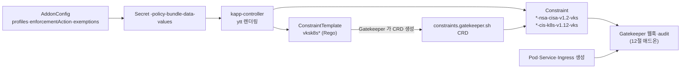

# 23. Policy Bundle

> 커리큘럼: [CURRICULUM.md](CURRICULUM.md) · 앞 절: [22. NFS Client](22-nfs-client.md) · 이어지는 절: 24. External Secrets Operator(작성 예정) · 작성 2026-11-17
> 등급: **[근거]** 출처에 그대로 있는 것, **[추론]** 여러 출처를 엮어 직접 내린 결론.
> 기준 판: VKS Add-ons `3.8.0+20261021` (9.1 VKS Add-ons Release Notes, 2026-11-17 확인, 페이지 표기 Last Updated November 11, 2026, 이 날 기준 가장 높은 판). 판 호환은 이 문서에서 정리하지 않는다. [공식 호환 매트릭스](https://interopmatrix.broadcom.com/)와 릴리스 노트를 직접 볼 것.

Policy Bundle 은 정책 엔진이 아니라 **정책 내용물**이다. 엔진은 [12절 Gatekeeper](12-gatekeeper.md)이고, 이 애드온은 그 위에 Broadcom 이 고른 ConstraintTemplate 과 Constraint 묶음(「프로필」)을 깐다. 12절에서 「정책은 미리 넣지 않는다」고 했던 빈자리를 채우는 짝이다.

이 절에서 먼저 잡을 것은 다섯 가지다.

1. **values 없이 깔아도 NSA/CISA 프로필의 Constraint 19개가 `warn` 으로 바로 걸린다.** 막지는 않지만 위반 경고와 감사(audit) 기록이 쌓이기 시작한다(2.2).
2. **`exemptions` 의 `namespaceSelector`·`labelSelector` 는 이름과 달리 Gatekeeper `match` 의 「포함」 조건으로 들어간다.** `matchLabels` 로 「면제할 네임스페이스」를 적으면 오히려 그 네임스페이스에만 정책이 걸린다(2.4, 6절 1번).
3. **Pod 대상 Constraint 는 Pod 를 볼 뿐 Deployment 를 보지 않는다.** `deny` 로 올리면 `kubectl apply` 는 성공하고 ReplicaSet 이 Pod 를 못 만드는 모양으로 실패가 드러난다(6절 3번).
4. **면제 네임스페이스 31개는 패키지에 박혀 있어 values 로 뺄 수 없다.** 반대로 이 목록에 없는 애드온 네임스페이스(예: 14절 Vault Injector 의 기본 `vks-vault-injector`)는 정책을 받는다(2.3).
5. **레거시 경로와 Add-on 경로에서 `profiles: []` 의 뜻이 다르다.** 레거시는 Constraint 0개, Add-on 경로는 스키마가 막고 출력 템플릿이 NSA 프로필로 되돌린다(3.1).

[근거] 이 절의 렌더링 결과는 공개 저장소(`3.8.0-20261021/vks-addons`)의 Policy Bundle 패키지 원본과 bundle(`@sha256:c285b5f9…`), 비교용 `3.7.0-20260924/vks-addons` 의 앞 판 bundle(`@sha256:303fea77…`)을 익명으로 받아 ytt v0.55.4 로 직접 돌린 것이다(2026-11-17). **VKS 클러스터에 설치해 Gatekeeper 가 실제로 경고·거절하는 것은 보지 못했다.** 4.3~4.5 의 클러스터 쪽 명령과 기대 출력은 렌더링·Gatekeeper 문서에서 읽은 것이고 실측이 아니다.

[근거] 9.0·9.1 문서 세트에서 Policy Bundle 전용 설치·Package Reference 쪽은 찾지 못했다. Broadcom VCF 블로그(2026-08-04)가 가리키는 「install-policy-bundle.html」 주소와, 12절 Gatekeeper 문서와 같은 경로 규칙으로 만든 9.0·9.1 주소가 모두 404 였다(2026-11-17). 그래서 1차 출처는 릴리스 노트·패키지 원본·블로그·업스트림 Gatekeeper 문서다.

---

## 1. 무엇을 하는가



- [근거] 릴리스 노트의 첫 소개는 「NSA/CISA Kubernetes Hardening Guidance v1.2 에 맞춘 쿠버네티스 승인 정책 묶음」이고, 사용자가 고를 수 있는 것은 정책 선택, 정책별 `audit`(관찰)·`deny`(승인 때 거절), 네임스페이스·워크로드 단위 면제 세 가지다. 전제 조건은 「Broadcom 이 만든 Gatekeeper 애드온이 대상 클러스터에 설치돼 정상일 것」이다. (9.1 릴리스 노트, 3.7.0+20260723 What's New)
- [근거] 릴리스 노트가 말한 `audit` 은 values 에 없는 값이다. 스키마가 받는 값은 `dryrun`·`warn`·`deny` 셋이고 기본은 `warn` 이다. (Package `valuesSchema`)
- [근거] PackageMetadata 설명은 「NSA/CISA v1.2, CIS Kubernetes Benchmark v1.12 등 산업 준수 프로필의 ConstraintTemplate·Constraint 를 판 관리해 깐다. 템플릿 다음에 Constraint 가 오도록 kapp change-rule 순서를 패키지가 맡는다」이다. (`metadata.yml`)
- [근거] Package 어노테이션 `addons.kubernetes.vmware.com/depends-on: gatekeeper` 로 Gatekeeper 애드온 의존을 선언한다. bundle 의 주석은 「AddonRelease.dependsOn 으로 플랫폼이 Gatekeeper 준비를 보장하므로 패키지 안의 사전 점검 Job 은 없다」고 적는다. (Package, `values/use-tag-values.yaml`)
- [근거] Pod·Namespace·Deployment 같은 워크로드는 하나도 만들지 않는다. 렌더링 결과는 ConstraintTemplate·Constraint 와 kapp 용 자리표시 CRD 뿐이다(2.1).

### 판과 지원 등급 (3.8.0+20261021 기준)

| 항목 | 값 | 출처 |
|---|---|---|
| 애드온 판 | `0.2.0+vmware.1-vks.3` 한 판 | 9.1 릴리스 노트 지원 표 |
| 지원 등급 | Product | 같은 지원 표 |
| VKr | 이 문서에서 정리하지 않는다 | [공식 호환 매트릭스](https://interopmatrix.broadcom.com/) |
| 의존 | Gatekeeper 애드온(3.8.0+20261021 은 `3.23.1+vmware.1-vks.1`) | Package 어노테이션, 12절 |
| 프로필 | `nsa-cisa-k8s-v1.2`(기본), `cis-k8s-v1.12` | Package `valuesSchema` |
| 업스트림 | 없음(Broadcom 이 만든 정책 묶음). 템플릿 상당수가 gatekeeper-library 의 같은 이름 정책과 닮았다 | 템플릿 원본 [추론, 5절] |

### 판 흐름 (9.1 릴리스 노트에서)

| 저장소 판 | Policy Bundle 판 | 적힌 내용 |
|---|---|---|
| 3.7.0+20260723 | `0.1.0+vmware.1-vks.1` 🆕 | 처음 들어옴. NSA/CISA v1.2 프로필 |
| 3.7.0+20260827 | `0.2.0+vmware.1-vks.1` | CIS Kubernetes Benchmark v1.12(5.2절, Pod Security Standards) 프로필 추가. 단독으로도, NSA/CISA 와 함께도 켤 수 있음. 0.1.0 에서 바로 올림 |
| 3.7.0+20260924 | `0.2.0+vmware.1-vks.2` | 버그 수정: Gatekeeper 와 Policy Bundle 이 함께 깔린 클러스터에서 CEL 기반 정책이 업그레이드를 막던 권한 문제(같은 판 Gatekeeper `3.23.0+vmware.2-vks.1` 에도 같은 문구) |
| 3.8.0+20261021 | `0.2.0+vmware.1-vks.3` | What's New 표에는 없고 지원 표에만 판이 바뀌어 있다 |

- [근거] vks.2 → vks.3 의 실제 차이는 두 bundle 을 받아 비교해서 찾았다(2026-11-17). 면제 네임스페이스에 `tekton-operator`·`tekton-pipelines`·`calico-system`·`tigera-*`·`external-secrets` 가 더해졌고, configure-to-activate 정책의 켜짐 판단이 「블록이 있으면」에서 「필수 목록이 비어 있지 않으면」으로 바뀌었으며(주석: AddonConfig 전달 과정이 빈 목록을 `{}` 로 채워 보낸다), `exemptImages` 비교가 대소문자를 가리지 않게 바뀌었다. (`lib/exemptions.lib.yaml`, `lib/exempt_container.star` diff)
- [추론] 그래서 3.7.0+20260924 이하의 vks.2 에서는 Add-on 경로로 정책 묶음을 설정할 때 `policyParameters` 를 안 적은 정책이 켜질 수 있었다고 읽힌다. 릴리스 노트에는 이 변경이 없다. 클러스터에서 재현하지는 않았다.
- [근거] 3.8.0+20261021 의 Gatekeeper bundle 에는 kapp-controller 서비스 계정이 모든 `constraints.gatekeeper.sh` 자원을 읽게 하는 ClusterRole 이 들어 있다. 주석은 「Gatekeeper 가 만든 ValidatingAdmissionPolicy 가 paramRef 로 Constraint 를 찾을 때 kapp-controller 의 aggregated API 서버가 그 조회를 한다」고 적는다. (3.8.0+20261021 Gatekeeper bundle `overlays/05-kapp-controller-constraints-rbac.yaml`)
- [근거] 3.8.0+20261021 의 Policy Bundle 템플릿 25개는 모두 Rego 엔진만 쓴다(`code[].engine: Rego` 3개, 나머지는 `rego:`). 업스트림 gatekeeper-library 의 privileged-containers 템플릿은 `K8sNativeValidation`(CEL)과 Rego 를 함께 싣는다. (렌더링 결과, gatekeeper-library master 2026-11-17)

---

## 2. 패키지가 까는 것

### 2.1 기본 values 렌더링 결과

```text
# ytt -f bundle/config  (values 없이)
  23 ConstraintTemplate          # vksk8s*·vksdisallowroot·vksdenycontrolplanescheduling
  23 CustomResourceDefinition    # 자리표시. kapp.k14s.io/exists: "" 라 kapp 이 만들지 않는다
  19 Constraint                  # nsa-cisa-k8s-v1.2 의 기본 켜짐 정책
```

- [근거] 자리표시 CRD 는 `kapp.k14s.io/exists: ""` 어노테이션이 붙어 kapp 이 만들지도 지우지도 않고, Gatekeeper 가 템플릿을 보고 진짜 CRD 를 만들 때까지 기다리는 용도다. 주석: 「Vks* 종류는 Gatekeeper 가 실행 중에 만들기 때문에 배포 시작 시점엔 없어서, kapp 의 GVK 조회를 통과시키려고 넣는다」. (`templates/_crds.yaml`, `lib/gatekeeper_crd.lib.yaml`)
- [근거] 순서는 오버레이가 정한다. 템플릿과 자리표시 CRD 는 change-group `policy-bundle/templates`, Constraint 는 `upsert after upserting policy-bundle/templates` 와 `delete before deleting policy-bundle/templates` 두 규칙을 받는다. (`overlays/02-kapp-ordering.yaml`)
- [근거] 주석은 지우는 순서의 이유를 「템플릿을 먼저 지우면 Gatekeeper 가 CRD 를 지워 Constraint 가 따라 지워지고, kapp 은 클러스터가 더 이상 모르는 종류를 찾게 된다. 프로필을 빼거나 `profiles: []` 로 바꿀 때마다 생긴다」고 적는다. (같은 파일)
- [근거] 모든 템플릿·Constraint 에 `vks.vmware.com/managed-by: vks-policy-bundle` 라벨이 붙는다. (`overlays/01-add-policy-bundle-labels.yaml`)
- [근거] 템플릿은 프로필이 켜졌을 때만 렌더링된다. NSA 만 켜면 23개, CIS 만 켜면 8개, 둘 다 켜면 25개다. (렌더링 결과)

### 2.2 프로필별 Constraint

[근거] 아래 표는 3.8.0+20261021 bundle 을 렌더링해 뽑았다. 대상 자원은 `match.kinds`, 매개변수는 패키지에 고정된 값이다.

| 템플릿 종류(kind) | NSA 기본 | CIS 기본 | 대상 | 패키지가 고정한 매개변수 |
|---|---|---|---|---|
| `VksDenyControlPlaneScheduling` | ✅ | | Pod | nodeSelector·nodeAffinity·toleration 으로 control-plane 노드에 붙는 것 금지 |
| `VksDisallowRoot` | ✅ | ✅ | Pod | 컨테이너 단위 실효 securityContext, `runAsUser: 0`, initContainers 까지 |
| `VksK8sBlockNodePort` | ✅ | | Service | |
| `VksK8sContainerLimits` | ✅ | | Pod | `cpu: "-1"`(CPU 상한 검사 끔), `memory: 2Gi` 를 넘는 limit 금지, limit 없음도 위반 |
| `VksK8sContainerRequests` | ✅ | | Pod | `cpu: "4"`, `memory: 2Gi` 를 넘는 request 금지 |
| `VksK8sDisallowedTags` | ✅ | | Pod | `tags: [latest]` |
| `VksK8sHttpsOnly` | ✅ | | Ingress | `tlsOptional: false`. 어노테이션 `kubernetes.io/ingress.allow-http: "false"` 와 TLS 필요 |
| `VksK8sImageDigests` | ✅ | | Pod | 이미지에 다이제스트 필수 |
| `VksK8sPSPAllowPrivilegeEscalationContainer` | ✅ | ✅ | Pod | |
| `VksK8sPSPAutomountServiceAccountTokenPod` | ✅ | | Pod | |
| `VksK8sPSPCapabilities` | ✅ | ✅ | Pod | `requiredDropCapabilities: [ALL]`, `allowedCapabilities: []` |
| `VksK8sPSPFSGroup` | ✅ | | Pod | `MustRunAs` 1~65535 |
| `VksK8sPSPHostFilesystem` | ✅ | ✅ | Pod | `allowedHostPaths: []`(hostPath 전부 금지) |
| `VksK8sPSPHostNamespace` | | ✅ | Pod | hostPID·hostIPC |
| `VksK8sPSPHostNetworkingPorts` | ✅ | ✅ | Pod | `hostNetwork: false`, 호스트 포트 0~0 |
| `VksK8sPSPHostProcess` | | ✅ | Pod | Windows HostProcess 컨테이너 |
| `VksK8sPSPPrivilegedContainer` | ✅ | ✅ | Pod | |
| `VksK8sPSPReadOnlyRootFilesystem` | ✅ | | Pod | |
| `VksK8sPSPSeccomp` | ✅ | | Pod | `RuntimeDefault`·`Localhost` 만 |
| `VksK8sRequiredProbes` | ✅ | | Pod | readiness·liveness 둘 다 |
| `VksK8sRequiredResources` | ✅ | | Pod | limits·requests 의 cpu·memory 모두 |
| `VksK8sAllowedRepos` | 설정해야 켜짐 | | Pod | `policyParameters` 의 `repos` |
| `VksK8sDisallowedRepos` | 설정해야 켜짐 | | Pod | 위와 같음 |
| `VksK8sRequiredLabels` | 설정해야 켜짐 | | Pod | `labels`(키, 선택 정규식) |
| `VksK8sRequiredAnnotations` | 설정해야 켜짐 | | Pod | `annotations`(키, 선택 정규식) |

- [근거] Package 스키마 설명도 「기본 켜짐 정책은 NSA 19개, CIS 8개, configure-to-activate 4개는 `policyParameters` 블록이 있어야 배포된다」고 적는다. (Package `valuesSchema` 의 `skipConstraints` 설명)
- [근거] 표의 고정 매개변수(메모리 2Gi, CPU request 4, `latest` 태그, 허용 seccomp 등)를 바꾸는 values 키는 없다. 사용자가 고를 수 있는 것은 켜고 끄기(`skipConstraints`), 동작(`enforcementAction`), 면제(네임스페이스·셀렉터·이미지), 그리고 configure-to-activate 4개의 값뿐이다. (스키마)
- [근거] NSA 프로필의 기본 19개에는 hostPID·hostIPC 를 보는 `VksK8sPSPHostNamespace` 가 없다. 이 템플릿은 CIS 프로필에만 있다. (렌더링 결과)
- [추론] 그래서 NSA 프로필만 켠 클러스터는 `hostPID: true` Pod 를 정책으로 걸러 내지 않는다. hostPID·hostIPC 까지 막으려면 CIS 프로필을 함께 켜거나 PSA(루트 [`../podsecurity_admission.md`](../podsecurity_admission.md))에 맡긴다.
- [근거] `VksK8sContainerLimits` 의 Rego 는 `mem > max_mem` 으로 비교한다. 템플릿 설명은 「Max memory limit (exclusive)」라고 적지만 코드상 정확히 `2Gi` 는 통과하고 그보다 크면 위반이다. (`templates/vksk8scontainerlimits.yaml` 180·190행 근처)

### 2.3 면제 네임스페이스 (values 로 뺄 수 없음)

[근거] 모든 Constraint 의 `match.excludedNamespaces` 맨 앞에 아래 31개가 붙는다. 주석은 「AddonConfig 로 실수로 지우지 못하게, 누가 Constraint 를 손으로 고쳐도 kapp 조정이 되살리게 여기에 박는다」고 적는다. (`lib/exemptions.lib.yaml` `PLATFORM_NAMESPACES`)

```text
kube-system  tkg-system  gatekeeper-system  pinniped-concierge  secretgen-controller
avi-system  cert-manager  istio-system  velero  velero-vsphere-plugin-backupdriver
windows-gmsa-webhook  flow-aggregator  vmware-system-*  tanzu-system-*
vmware-system-auth  vmware-system-cloud-provider  vmware-system-csi  vmware-system-vksm  vmware-system-helm
tekton-operator  tekton-pipelines  headlamp  istio-ingress  istio-egress  whereabouts-cni
multus-cni  gpu-operator  nfs-client  calico-system  tigera-*  external-secrets
```

- [근거] 주석은 「Gatekeeper v3.9.0 부터 `excludedNamespaces` 가 앞뒤 `*` 글롭을 받는다」고 적는다. (같은 파일)
- [근거] Gatekeeper 애드온 자체도 `controllerManager.exemptNamespaces` 23개와 접두어 `vmware-system-`·`tanzu-system-`·`tigera-` 를 웹훅에서 아예 건너뛴다(12절 2.2). 두 목록은 같은 계열이지만 별개로 관리된다. (3.8.0+20261021 Gatekeeper bundle `values/use-tag-values.yaml`)
- [추론] 이 문서의 다른 절에서 본 애드온 네임스페이스 가운데 14절 Vault Injector 의 기본 `vks-vault-injector` 는 두 목록 어디에도 없다. 이 네임스페이스는 PSA `privileged` 라벨을 받는다(14절). 그래서 `deny` 로 올린 뒤 인젝터 Pod 를 다시 띄우면 Pod 정책에 걸릴 수 있다. 실제로 걸리는지는 인젝터 Pod 명세와 대조해야 하며 시험하지 않았다. 해당하면 `exemptions.global.namespaces` 에 더한다.

### 2.4 values: 세 층 면제 모델

| 키 | 뜻 | 합치는 규칙 |
|---|---|---|
| `profiles` | 켤 프로필 목록 | 기본 `[nsa-cisa-k8s-v1.2]` |
| `enforcementAction` | 모든 Constraint 의 기본 동작 | `dryrun`·`warn`·`deny`, 기본 `warn` |
| `exemptions.global` | 모든 프로필·Constraint 공통 | |
| `exemptions.profiles.<프로필>` | 그 프로필 Constraint 만. `skipConstraints`·`policyParameters` 도 여기 | |
| `exemptions.constraints.<kind>` | 그 kind 의 Constraint 만 | |
| `namespaces`·`images` | 면제 네임스페이스·이미지 글롭 | 세 층을 모두 더한다(위 31개 + global + profile + constraint) |
| `namespaceSelector`·`labelSelector` | 셀렉터 | 가장 구체적인 층 하나만 쓴다(constraint > profile > global) |
| `enforcementAction` | 동작 | 가장 구체적인 층(constraint > profile > 맨 위) |

[근거] 위 규칙은 `lib/exemptions.lib.yaml` 의 `merge_namespaces`·`merge_images`·`resolve_selector`·`resolve_enforcement` 와 values 주석에 그대로 있다.

**셀렉터의 실제 동작.** [근거] 렌더링하면 `exemptions.global.namespaceSelector` 값은 Constraint 의 `spec.match.namespaceSelector` 에 그대로 들어간다(4.2 의 렌더링으로 확인). [근거] Gatekeeper 문서는 `namespaceSelector` 를 「객체가 속한 네임스페이스에 대한 라벨 셀렉터」라 설명하고, 여러 matcher 가 있으면 자원이 각 matcher 를 모두 만족해야 범위에 든다고 적는다. (Gatekeeper `howto.md` 「The match field」, 2026-11-17)
[추론] 즉 이 값은 「이 라벨이 붙은 네임스페이스에만 적용」이다. 스키마 설명의 「matching 네임스페이스를 건너뛴다」와 반대로 움직인다. 라벨로 면제하려면 `matchExpressions` 에 `operator: NotIn` 이나 `DoesNotExist` 를 써야 원하는 뜻이 된다. 클러스터에서 확인하지는 않았다.

**constraint 층은 kind 단위다.** [근거] `exemptions.constraints.VksK8sPSPPrivilegedContainer` 처럼 kind 로 키를 잡으므로, 두 프로필을 함께 켜면 같은 kind 의 두 Constraint(`…-nsa-cisa-v1.2-vks`, `…-cis-k8s-v1.12-vks`)에 똑같이 적용된다. 4.2 의 렌더링에서 두 Constraint 가 모두 `deny` 로 나왔다. 반면 `skipConstraints` 는 프로필 층에만 있어 한쪽 프로필에서만 뺀다.

**검증이 닿는 곳.** [근거] bundle 에는 ytt 값 스키마(`#@data/values-schema`)가 없다. 그래서 ytt 렌더링 단계에서는 `enforcementActon: deny`(오타)가 조용히 무시돼 19개가 `warn` 으로 나오고, `enforcementAction: block` 은 그대로 `block` 으로 렌더링되며, 스키마에 없는 `exemptions.global.enforcementAction: deny` 는 코드가 읽어 19개를 `deny` 로 만든다. 모두 rc=0 이다. (ytt v0.55.4 렌더링, 2026-11-17)
[근거] Gatekeeper 문서는 Constraint 의 enforcementAction 이 `deny`·`dryrun`·`warn` 중 하나여야 하며, 이 검증을 끄는 플래그가 따로 있다고 적는다. (Gatekeeper `violations.md`)
[추론] 그래서 `block` 같은 값은 렌더링을 지나 Gatekeeper 쪽에서 거절되거나 Constraint 가 동작하지 않을 것으로 본다. Add-on 경로에서 AddonConfig 를 만들 때 API 가 ACD 스키마로 거절하는지는 확인하지 못했다(21·22절과 같은 사정).

---

## 3. VKS 에 들어가는 두 경로

### 3.1 Add-on 경로 (VKS 3.5 이상)

- [근거] AddonConfigDefinition 이름은 `policy-bundle.kubernetes.vmware.com.0.2.0---vmware.1-vks.3`(`+` 가 `---`), 네임스페이스는 `vmware-system-vks-public`, 라벨 `addons.kubernetes.vmware.com/category: policy` 다. (Package 어노테이션의 AddonConfigDefinition 을 풀어 확인)
- [근거] 출력은 대상 클러스터 `vmware-system-tkg` 네임스페이스의 Secret `<cluster>-policy-bundle-data-values` 다. 다른 애드온의 `<cluster>-<애드온>` 꼴과 이름이 다르다. 템플릿은 `toYaml .Values` 가 아니라 `profiles`·`enforcementAction`·`exemptions` 세 키만 골라 쓴다. (같은 곳)
- [근거] 출력 템플릿은 `profiles` 가 비었으면 `- nsa-cisa-k8s-v1.2` 를, `enforcementAction` 이 비었으면 `warn` 을 써 넣는다. ACD 스키마는 `profiles` 에 `minItems: 1` 을 두고, Package 스키마는 `minItems: 0` 과 「`[]` 로 두면 Constraint 를 하나도 깔지 않는다」는 설명을 둔다. 그 밖에는 ACD 에 `nullable: true` 가 더해진 것만 다르다. (Package·ACD 스키마 비교)
- [추론] 그래서 Add-on 경로로는 「Gatekeeper 는 두고 Policy Bundle 정책만 잠시 모두 빼기」를 `profiles: []` 로 할 수 없다. 프로필의 Constraint 를 모두 `skipConstraints` 에 넣거나, 애드온 자체를 지운다.
- [근거] Package 어노테이션 `addons.kubernetes.vmware.com/upgrade-strategy` 를 풀면 `stage: BeforeClusterUpgrade`, `wait: Never` 다. 주석은 「클러스터 업그레이드 전에 새 정책을 적용하되 이 애드온 조정을 기다리느라 업그레이드를 막지 않는다. Gatekeeper 주 웹훅이 `failurePolicy=Ignore` 라 일시 실패가 클러스터를 묶지 않는다」고 적는다. (Package)
- AddonConfig·AddonInstall 의 일반 모양과 이름 규칙은 [00절](00-repository-and-install-paths.md)을 본다.

### 3.2 레거시 PackageInstall 경로

- [근거] 패키지 `policy-bundle.kubernetes.vmware.com` 은 같은 Carvel 저장소에 있다(`packages/policy-bundle.kubernetes.vmware.com/0.2.0+vmware.1-vks.3.yml`). PackageMetadata 의 표시 이름은 「VKS Policy Package」, 분류는 `policy`·`compliance`·`security` 다. deploy 단계는 `kapp --wait-timeout=600s` 다. (저장소 원본)
- [추론] PackageInstall 로도 깔 수 있겠지만 이 판의 레거시 설치 문서는 찾지 못했다. 레거시 경로에는 `depends-on` 을 처리하는 AddonRelease 가 없으니 Gatekeeper 가 먼저 READY 인지 사용자가 확인해야 한다. 그렇지 않으면 자리표시 CRD 를 기다리다 600초 제한에 걸릴 수 있다.

설치 흐름과 kapp-controller 동작은 [00절](00-repository-and-install-paths.md)과 루트 [`../carvel-kapp.md`](../carvel-kapp.md)를 본다.

---

## 4. 실습

### 4.1 클러스터 없이 확인하는 법 (렌더링)

```bash
# crane, ytt 필요. 공개 저장소라 로그인 없이 받는다.
R=projects.packages.broadcom.com/vsphere/supervisor/vks-standard-packages/3.8.0-20261021/vks-addons
mkdir -p repo bundle
crane export $R:3.8.0-20261021 - | tar -x -C repo
ls repo/packages/policy-bundle.kubernetes.vmware.com/        # 0.2.0+vmware.1-vks.3.yml, metadata.yml
grep -A5 'kbld.carvel.dev/id: .*packages/policy-bundle:' repo/.imgpkg/images.yml   # bundle 다이제스트
crane export $R@sha256:c285b5f92adde0ae7d45259361cb5c1b4970af49f77a295f634bbe5897beff51 - | tar -x -C bundle
ytt -f bundle/config > default.yaml && grep '^kind:' default.yaml | sort | uniq -c   # 템플릿 23, CRD 23, Constraint 19
grep -c 'apiVersion: constraints.gatekeeper.sh' default.yaml                        # 19
sed -n '/PLATFORM_NAMESPACES = \[/,/^#@ \]/p' bundle/config/lib/exemptions.lib.yaml | grep -c '^#@   "'   # 면제 31개
```

Add-on 정의와 업그레이드 전략은 Package 어노테이션에 들어 있다.

```bash
P=repo/packages/policy-bundle.kubernetes.vmware.com/0.2.0+vmware.1-vks.3.yml
grep 'addon-config-definition' $P | awk '{print $2}' | base64 -d | gunzip > acd.yaml
grep -n 'templateOutputResources' -A16 acd.yaml
grep 'upgrade-strategy' $P | awk '{print $2}' | base64 -d
```

### 4.2 values 파일: 단계적 도입

```yaml
# policy-bundle-values.yaml — 두 프로필, 기본은 warn, 특권 컨테이너만 deny
profiles:
  - nsa-cisa-k8s-v1.2
  - cis-k8s-v1.12
enforcementAction: warn
exemptions:
  global:
    namespaces: [legacy-apps]          # 31개에 더해진다
  profiles:
    nsa-cisa-k8s-v1.2:
      skipConstraints: [VksK8sImageDigests]
      policyParameters:
        VksK8sAllowedRepos:
          repos: ["registry.example.com/"]
  constraints:
    VksK8sPSPPrivilegedContainer:
      enforcementAction: deny          # kind 단위라 NSA·CIS 두 Constraint 모두
```

```bash
ytt -f bundle/config --data-values-file policy-bundle-values.yaml > out.yaml
grep -c 'apiVersion: constraints.gatekeeper.sh' out.yaml          # 27 (NSA 19 - 1 + 1, CIS 8)
grep -B12 'enforcementAction: deny' out.yaml | grep '  name:'     # psp-privileged-container 두 개
grep -c 'legacy-apps' out.yaml                                   # 27
```

[근거] 위 값으로 Constraint 27개, 그중 `deny` 는 `psp-privileged-container-nsa-cisa-v1.2-vks` 와 `psp-privileged-container-cis-k8s-v1.12-vks` 둘, `k8s-allowed-repos-nsa-cisa-v1.2-vks` 가 `repos: [registry.example.com/]` 로 켜지고 `k8s-image-digests-…` 는 빠지는 것을 렌더링으로 확인했다(2026-11-17). 두 프로필을 켜면 같은 kind 의 자리표시 CRD 가 6개 겹쳐 31개 나오는데, 주석은 「내용이 같으면 kapp 이 중복을 버린다」고 적는다(`templates/_crds.yaml`).

### 4.3 Add-on 경로로 설치 (Supervisor 컨텍스트)

Gatekeeper 애드온이 먼저 깔려 있어야 한다([12절](12-gatekeeper.md) 4절).

```yaml
# addonconfig.yaml — 이름은 <cluster>-policy-bundle (추론, 아래)
apiVersion: addons.kubernetes.vmware.com/v1alpha1
kind: AddonConfig
metadata:
  name: wl-01-policy-bundle
  namespace: demo-ns
  annotations:
    clusteraddon.addons.kubernetes.vmware.com/owned-for-deletion: "true"
spec:
  values:
    profiles: [nsa-cisa-k8s-v1.2]
    enforcementAction: warn
    exemptions:
      global:
        namespaces: [legacy-apps]
---
# addoninstall.yaml
apiVersion: addons.kubernetes.vmware.com/v1alpha1
kind: AddonInstall
metadata:
  name: wl-01-policy-bundle
  namespace: demo-ns
spec:
  releaseFilter:
    ref:
      name: policy-bundle.kubernetes.vmware.com.0.2.0-vmware.1-vks.3
      namespace: vmware-system-vks-public
  addonRef:
    name: policy-bundle
  clusters:
  - selector:
      matchLabels:
        cluster.x-k8s.io/cluster-name: wl-01
```

```bash
kubectl -n vmware-system-vks-public get addonreleases | grep -i -E 'gatekeeper|policy'   # 실제 이름 확인
kubectl -n demo-ns get clusteraddon | grep -i gatekeeper                                 # READY True 먼저
kubectl -n demo-ns apply -f addonconfig.yaml -f addoninstall.yaml
kubectl -n demo-ns get clusteraddon | grep -i policy                                     # READY True 기대
```

[추론] AddonConfig·AddonInstall 의 모양은 20~22절 4.3 과 같은 틀(9.0 Add-on 설치 예시)에 이름만 바꾼 것이다. Policy Bundle 용 공식 kubectl 예시는 찾지 못했다. `addonRef.name` 은 Package 어노테이션 `addon.kubernetes.vmware.com/addon-name: policy-bundle` 에서, AddonConfig 이름은 다른 애드온의 `<cluster>-<애드온>` 규칙에서 짐작했다. 출력 Secret 이름은 `-data-values` 가 붙어 다르다(3.1). 이름이 틀렸다면 `addonreleases`·`clusteraddon` 출력으로 바로잡는다. `kubectl` 은 `-n` 을 빼면 현재 컨텍스트의 네임스페이스로 가므로 위 명령은 모두 `-n` 을 붙였다.

### 4.4 위반을 일부러 만들어 보기 (VKS 클러스터 컨텍스트)

```yaml
# bad-pod.yaml — latest 태그, 다이제스트 없음, 특권, probe·limit 없음
apiVersion: v1
kind: Pod
metadata:
  name: bad-pod
  namespace: policy-demo
spec:
  containers:
  - name: app
    image: registry.example.com/demo/app:latest
    securityContext:
      privileged: true
```

```bash
kubectl create namespace policy-demo
kubectl label namespace policy-demo pod-security.kubernetes.io/enforce=privileged   # PSA 가 먼저 막지 않게(실습용)
kubectl -n policy-demo apply -f bad-pod.yaml
# 기대(warn): "Warning: [psp-privileged-container-nsa-cisa-v1.2-vks] ..." 같은 줄이 여러 개 나오고 Pod 는 만들어진다
kubectl -n policy-demo delete pod bad-pod
kubectl -n policy-demo create deployment bad --image=registry.example.com/demo/app:latest
# 기대: Deployment 에는 경고가 없다. Pod 를 만드는 쪽이 ReplicaSet 컨트롤러라 경고는 사용자에게 오지 않는다
```

[근거] Gatekeeper 문서는 `warn` 이 거절하지 않고 「왜 거절됐을지」를 경고로 돌려준다고 설명하고, 예시 출력이 `Warning: [<constraint 이름>] …` 꼴이다. (Gatekeeper `violations.md`)
[추론] 여기서 `policy-demo` 에 PSA privileged 라벨을 붙이는 이유는 VKr 의 PSA 가 특권 Pod 를 먼저 거절하면 Gatekeeper 경고까지 가지 않기 때문이다(16절에서 본 VKr 기본 PSA 수준 참고). 실습이 끝나면 네임스페이스를 지운다. 기대 출력은 문서·렌더링에서 읽은 것이고 실측이 아니다.

### 4.5 확인 명령

```bash
kubectl get constrainttemplates -l vks.vmware.com/managed-by=vks-policy-bundle
kubectl get constraints                                  # 모든 Constraint 종류를 한 번에 (Gatekeeper CRD 범주)
kubectl get vksk8spspprivilegedcontainer psp-privileged-container-nsa-cisa-v1.2-vks \
  -o jsonpath='{.spec.enforcementAction}{" "}{.status.totalViolations}{"\n"}'
kubectl get vksk8spspprivilegedcontainer psp-privileged-container-nsa-cisa-v1.2-vks \
  -o jsonpath='{range .status.violations[*]}{.namespace}/{.name}: {.message}{"\n"}{end}'
kubectl -n vmware-system-tkg get secret wl-01-policy-bundle-data-values -o jsonpath='{.data.values\.yaml}' | base64 -d
```

[추론] `status.totalViolations`·`status.violations` 는 Gatekeeper audit 가 채우는 값이라 `dryrun`·`warn` 단계에서 「`deny` 로 올리면 무엇이 걸릴지」를 보는 데 쓴다. 마지막 명령은 ACD 의 `targetClusterOutput` 표기를 따라 대상(VKS) 클러스터 컨텍스트에서 치는 것으로 적었다(22절 3.1 과 같은 읽기). 실제로 그 자리에 생기는지는 확인하지 못했다.

### 클러스터 없이 해 볼 수 있는 것

- 4.1·4.2 의 렌더링은 클러스터가 필요 없다.
- [추론] kind 같은 로컬 클러스터에 업스트림 Gatekeeper(루트 [`../k8s-addon.sh`](../k8s-addon.sh) 8번)를 깐 뒤, 4.2 의 `out.yaml` 에서 자리표시 CRD(`kapp.k14s.io/exists`)를 뺀 ConstraintTemplate 을 먼저, Constraint 를 나중에 `kubectl apply` 하면 정책 동작 자체는 볼 수 있다. VKS 와는 면제 네임스페이스가 Gatekeeper 쪽에서 다르다는 점(2.3)을 기억한다.

---

## 5. 업스트림 설치와 다른 점

| 항목 | 업스트림(Gatekeeper + gatekeeper-library 직접 적용) | VKS 애드온 |
|---|---|---|
| 정책 원본 | gatekeeper-library 에서 고르고 매개변수를 직접 씀 | Broadcom 이 고른 25개 템플릿, 매개변수 대부분 고정(2.2) |
| 이름 | `K8sPSPPrivilegedContainer` 등 | `Vks` 접두어(`VksK8s…`). 사용자 템플릿과 충돌 방지(템플릿 설명) |
| 엔진 | 템플릿에 따라 CEL + Rego 함께 | Rego 만(1절) |
| 묶음 단위 | 없음. 정책마다 따로 | 프로필(`nsa-cisa-k8s-v1.2`, `cis-k8s-v1.12`) |
| 시스템 면제 | 사용자가 직접 | 31개 고정 + 세 층 values(2.3, 2.4) |
| 적용 순서 | 템플릿 → CRD 생성 대기 → Constraint 를 사용자가 맞춤 | kapp change-rule·자리표시 CRD 가 맞춤(2.1) |
| 기본 동작 | Constraint 기본 `deny`(Gatekeeper 문서) | 패키지 기본 `warn` |

- 업스트림 Gatekeeper 설치와 샘플 ConstraintTemplate 은 루트 [`../k8s-addon.sh`](../k8s-addon.sh)의 「8. OPA Gatekeeper」를 본다. 같은 스크립트의 Kyverno 와의 비교도 거기 있다.
- [근거] 업스트림 privileged-containers 템플릿은 `metadata.gatekeeper.sh/version: 1.1.3` 이고 Rego 에서 `exclude_update` 라이브러리로 UPDATE 요청을 건너뛴다. VKS 의 `vksk8spspprivilegedcontainer` 도 `1.1.3` 이고, VKS 템플릿 25개 중 11개가 같은 `exclude_update` 를 쓴다. (gatekeeper-library master, bundle `templates/`, 2026-11-17)
- [추론] 판 표기와 라이브러리가 같아 VKS 템플릿 상당수가 gatekeeper-library 를 바탕으로 이름을 바꾸고 CEL 을 뺀 것으로 보인다. 전체를 줄 단위로 비교하지는 않았다.

---

## 6. 흔한 실수

1. **`exemptions.*.namespaceSelector` 에 `matchLabels` 로 면제 라벨을 적는다.** [근거] 값이 `spec.match.namespaceSelector` 에 그대로 들어간다(2.4). [추론] Gatekeeper 에서 이것은 「적용 대상」 조건이라 그 라벨이 붙은 네임스페이스에만 정책이 걸리고 나머지는 빠진다. 면제는 `namespaces` 목록을 쓰거나 `matchExpressions` 의 `NotIn`·`DoesNotExist` 로 적는다.
2. **기본값이면 아무 일도 없을 거라 생각한다.** [근거] values 없이도 NSA Constraint 19개가 `warn` 으로 깔린다(2.1). [추론] 막지는 않지만 `kubectl apply` 마다 경고가 여러 줄 붙고, CI 가 경고를 실패로 다루면 파이프라인이 깨질 수 있다.
3. **Deployment 를 apply 했는데 경고가 없어서 통과했다고 본다.** [근거] Pod 대상 Constraint 는 `kinds: [Pod]` 만 본다(2.2). [추론] Deployment 에서 생긴 Pod 의 경고는 ReplicaSet 컨트롤러가 받는다. `deny` 로 올리면 Deployment 는 만들어지고 `kubectl describe rs` 이벤트에 `admission webhook … denied` 가 쌓인다. 4.5 의 `status.violations` 로 미리 본다.
4. **`deny` 로 한 번에 올린다.** [근거] 공식 블로그도 운영 중인 클러스터는 `warn` 으로 시작해 고친 뒤 `deny` 로 가라고 권한다. [추론] 특히 `VksK8sImageDigests`(다이제스트 없는 이미지 전부), `VksK8sRequiredProbes`, `VksK8sPSPReadOnlyRootFilesystem`, `VksK8sContainerLimits`(2Gi 초과 메모리) 는 평범한 앱도 대부분 걸린다. 정책별로 `exemptions.constraints.<kind>.enforcementAction` 을 하나씩 올린다.
5. **메모리 상한·`latest` 금지 같은 매개변수를 values 로 바꾸려 한다.** [근거] 그런 키가 없다(2.2). [추론] 큰 메모리가 필요한 워크로드는 그 kind 를 `skipConstraints` 로 빼거나 네임스페이스·이미지로 면제하고, 다른 상한이 필요하면 직접 만든 ConstraintTemplate 으로 따로 건다.
6. **사이드카 주입을 잊는다.** [추론] 변경(mutating) 웹훅이 검증 웹훅보다 먼저 돌므로 Gatekeeper 는 주입된 사이드카까지 본다. 14절 Vault Injector 의 에이전트 컨테이너, 11절 Istio 의 사이드카·init 컨테이너(CNI 를 안 쓰면 `NET_ADMIN` 류 권한)가 `VksK8sPSPCapabilities`·`VksK8sImageDigests`·`VksK8sContainerLimits` 등에 걸릴 수 있다. 시험하지 않았다. `warn` 단계에서 주입된 Pod 의 위반 메시지를 먼저 본다.
7. **Contour 등으로 만든 Ingress 가 `VksK8sHttpsOnly` 경고를 받는데 이유를 모른다.** [근거] 이 정책은 TLS 와 함께 `kubernetes.io/ingress.allow-http: "false"` 어노테이션을 요구한다(템플릿 설명). Ingress 가 아닌 Contour HTTPProxy·Gateway API 자원은 대상이 아니다(`match.kinds` 가 Ingress 뿐).
8. **NSA 프로필이면 hostPID 도 막힌다고 생각한다.** [근거] `VksK8sPSPHostNamespace` 는 CIS 프로필에만 있다(2.2).
9. **Add-on 경로에서 `profiles: []` 로 정책을 모두 끄려 한다.** [근거] ACD 스키마가 `minItems: 1` 이고 출력 템플릿이 빈 값을 NSA 로 바꾼다(3.1).
10. **오타를 낸 values 가 적용됐다고 믿는다.** [근거] ytt 단계에서는 오타가 rc=0 으로 무시된다(2.4). 4.5 의 `-o jsonpath='{.spec.enforcementAction}'` 로 실제 값을 본다.
11. **애드온 네임스페이스면 다 면제된다고 생각한다.** [근거] 면제 목록은 31개로 고정이고(2.3) [추론] `vks-vault-injector` 처럼 빠진 곳이 있다. 필요하면 `exemptions.global.namespaces` 에 더한다.

---

## 7. 확인 문제

1. Gatekeeper 와 Policy Bundle 을 values 없이 깔았다. `privileged: true` Pod 를 `kubectl apply` 하면 무엇이 일어나나? Deployment 로 만들면 무엇이 다른가?
2. 플랫폼 팀이 `exemptions.global.namespaceSelector.matchLabels: {policy-exempt: "true"}` 를 넣고 몇몇 네임스페이스에 그 라벨을 붙였다. 나머지 앱 네임스페이스의 정책은 어떻게 되나?
3. NSA·CIS 두 프로필을 켜고 `exemptions.constraints.VksK8sPSPPrivilegedContainer.enforcementAction: deny` 를 넣었다. `deny` 가 되는 Constraint 는 몇 개고, NSA 쪽만 `deny` 로 하려면 어떻게 하나?

<details><summary>답</summary>

1. 기본은 NSA 프로필 19개, `warn` 이라 Pod 는 만들어지고 `Warning: [psp-privileged-container-nsa-cisa-v1.2-vks] …` 같은 경고가 여러 줄 붙는다(2.1, 4.4). 단 PSA 가 먼저 거절하면 Gatekeeper 경고까지 가지 않는다. Deployment 로 만들면 Pod 를 만드는 쪽이 ReplicaSet 컨트롤러라 사용자에게는 경고가 오지 않고, 위반은 Constraint 의 `status.violations` 에서 본다(6절 3번).
2. 셀렉터는 Gatekeeper `match.namespaceSelector` 로 들어가 「그 라벨이 붙은 네임스페이스에만 적용」이 된다. 라벨을 안 붙인 앱 네임스페이스는 정책 범위에서 빠지고, 면제하려던 네임스페이스에만 정책이 걸린다(2.4, 6절 1번). `namespaces` 목록이나 `NotIn` 표현식으로 고친다.
3. 두 개다. constraint 층은 kind 단위라 `psp-privileged-container-nsa-cisa-v1.2-vks` 와 `…-cis-k8s-v1.12-vks` 가 함께 `deny` 가 된다(2.4, 4.2). 「NSA 쪽 그 Constraint 만」 동작을 바꾸는 키는 없다(프로필 층 `enforcementAction` 은 그 프로필 Constraint 전부를 바꾼다). 대신 `exemptions.profiles.cis-k8s-v1.12.skipConstraints: [VksK8sPSPPrivilegedContainer]` 로 CIS 쪽 Constraint 를 아예 빼면 남는 NSA 쪽 하나만 `deny` 다. 이 조합으로 렌더링하면 Constraint 26개 중 `deny` 는 `psp-privileged-container-nsa-cisa-v1.2-vks` 하나였다(2026-11-17).

</details>

---

## 출처 (모두 2026-11-17 확인)

- VKS Add-ons Release Notes (VCF 9.1, Last Updated November 11, 2026): <https://techdocs.broadcom.com/us/en/vmware-cis/vcf/vcf-service-administration-and-development/9-1/release-notes/vks-addons-release-notes.html>
- VCF 블로그 「Simplify Kubernetes Security with the VMware vSphere Kubernetes Service Policy Bundle」(2026-08-04): <https://blogs.vmware.com/cloud-foundation/2026/08/04/simplify-kubernetes-security-with-the-vmware-vsphere-kubernetes-service-policy-bundle/>
- 패키지 원본: `projects.packages.broadcom.com/vsphere/supervisor/vks-standard-packages/3.8.0-20261021/vks-addons:3.8.0-20261021` 의 `packages/policy-bundle.kubernetes.vmware.com/`, bundle `@sha256:c285b5f92adde0ae7d45259361cb5c1b4970af49f77a295f634bbe5897beff51`
- 비교용 앞 판: `…/3.7.0-20260924/vks-addons:3.7.0-20260924` 의 `0.2.0+vmware.1-vks.2`, bundle `@sha256:303fea77d34065824275b362776039e69d9cdc9c9f2b33f0f4dbffd9d4ecf576`
- Gatekeeper 애드온 bundle(같은 저장소, 면제 목록·kapp-controller RBAC): `@sha256:300c3fd2844cc22d48f2a25116bd741b9ebb5500b1ff8f44152e6bf9625ec93b`
- Gatekeeper 「How to use Gatekeeper」(match 필드): <https://github.com/open-policy-agent/gatekeeper/blob/master/website/docs/howto.md>
- Gatekeeper 「Handling Constraint Violations」(dryrun·warn): <https://github.com/open-policy-agent/gatekeeper/blob/master/website/docs/violations.md>
- gatekeeper-library privileged-containers: <https://github.com/open-policy-agent/gatekeeper-library/blob/master/library/pod-security-policy/privileged-containers/template.yaml>
- Kubernetes Pod Security Standards: <https://kubernetes.io/docs/concepts/security/pod-security-standards/>
- 렌더링 도구: ytt v0.55.4, crane v0.22.1
