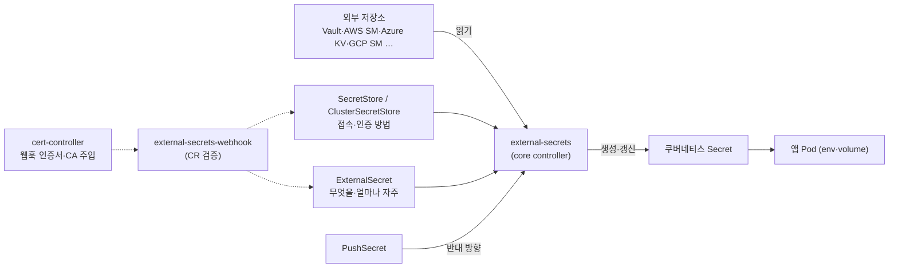
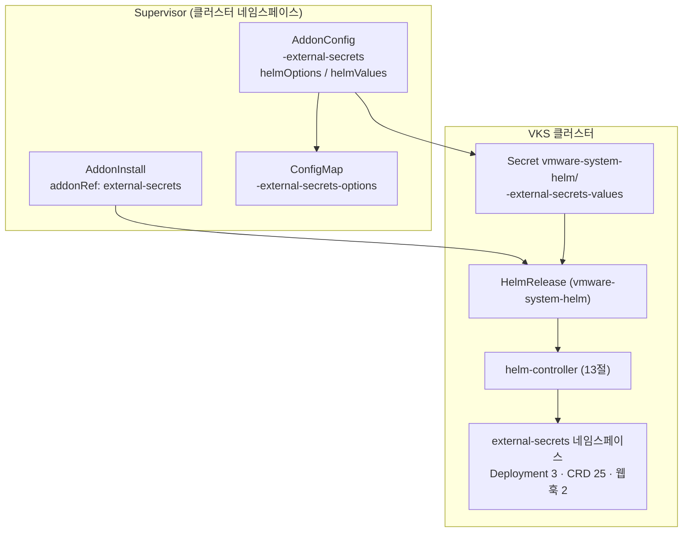

# 24. External Secrets Operator

> 커리큘럼: [CURRICULUM.md](CURRICULUM.md) · 앞 절: [23. Policy Bundle](23-policy-bundle.md) · 이어지는 절: 25. Tekton Operator(작성 예정) · 작성 2026-11-19
> 등급: **[근거]** 출처에 그대로 있는 것, **[추론]** 여러 출처를 엮어 직접 내린 결론.
> 기준 판: VKS Add-ons `3.8.0+20261021` (9.1 VKS Add-ons Release Notes, 2026-11-19 확인, 페이지 표기 Last Updated November 11, 2026, 이 날 기준 가장 높은 판). 판 호환은 이 문서에서 정리하지 않는다. [공식 호환 매트릭스](https://interopmatrix.broadcom.com/)와 릴리스 노트를 직접 볼 것.

External Secrets Operator(ESO)는 클러스터 밖 비밀값 저장소(Vault·AWS Secrets Manager·Azure Key Vault·Google Secret Manager 등)의 값을 읽어 쿠버네티스 `Secret` 으로 만들어 주는 오퍼레이터다. 이 절은 VKS 애드온 가운데 **처음으로 다루는 「Helm add-on」** 이라, 00~23절의 Carvel 패키지와 무엇이 다른지가 절반이다.

이 절에서 먼저 잡을 것은 다섯 가지다.

1. **ESO 는 Carvel 저장소(`vks-addons`)에 없다.** 같은 판 아래 따로 있는 `vks-addons-helm` OCI 경로의 Helm 차트이고, 클러스터 안에서는 13절 Helm Controller(Flux)가 `HelmRelease` 로 깐다(2.1, 2.2).
2. **레거시 `PackageInstall` 경로가 없다.** 공식 설치 문서도 Add-on 경로(VCF CLI·kubectl) 둘만 안내한다(2.3).
3. **애드온을 지우면 동기화된 `Secret` 까지 사라질 수 있다.** CRD 가 차트 템플릿에 들어 있고, ESO 기본 `creationPolicy: Owner` 는 `Secret` 에 ownerReference 를 단다(2.5, 6절 1번). 공식 설치 문서도 같은 경고를 적는다.
4. **Supervisor 의 Secret Store 와 이으려면 ESO 가 아니라 14절 Vault Injector 를 쓰라고 공식 문서가 말한다.** 릴리스 노트의 「vSphere Supervisor 백엔드」 문구와 어긋난다(1절).
5. **values 오타는 어디서도 걸러지지 않는다.** 차트 values 스키마와 AddonConfigDefinition 모두 모르는 키를 받아들인다(2.4).

[근거] 이 절의 렌더링 결과는 공개 레지스트리 `vks-addons-helm/external-secrets` 저장소의 태그 `2.11.0_vmware.1-vks.1` 차트와 그 OCI 어노테이션(AddonConfigDefinition), 업스트림 차트 `external-secrets` 2.11.0 을 익명으로 받아 helm v3.19.0 으로 직접 돌린 것이다(2026-11-19). **VKS 클러스터에 설치해 보지는 못했다.** 4절의 클러스터 쪽 명령과 기대 출력은 공식 설치 문서와 렌더링에서 읽은 것이고 실측이 아니다.

[근거] 이 절을 쓰면서 9.0·9.1 문서 세트와 다른 **「VCF Consumption」 문서 세트(`vcf-consumption/latest/installing-addons-on-vks-clusters/`, Last Updated November 17, 2026)** 에 ESO 설치 문서 세 쪽과 Add-on Reference 가 있는 것을 찾았다. 같은 목차에 Multus·Whereabouts·NFS Client·Headlamp·Tekton Operator·Policy-Bundle 의 Add-on Reference 도 있다. 19~23절에서 「전용 문서를 찾지 못했다」고 적은 것은 이 문서 세트를 보기 전의 일이다.

---

## 1. 무엇을 하는가



- [근거] 릴리스 노트의 첫 소개는 「HashiCorp Vault, AWS Secrets Manager, Azure Key Vault, Google Secret Manager, vSphere Supervisor 같은 외부 백엔드의 비밀값을 쿠버네티스 Secret 으로 자동 동기화하는 Helm add-on」이다. 핵심 기능으로 여러 백엔드와 양방향 동기화(PushSecret), 자격 증명 교체·drift 조정·템플릿, FIPS 140-3·Distroless non-root·PSS Restricted 호환을 든다. (9.1 릴리스 노트, 3.8.0+20261021 What's New)
- [근거] 공식 설치 개요 문서는 사용자 자원 네 가지를 든다. `SecretStore`(네임스페이스 단위 접속·인증), `ClusterSecretStore`(클러스터 단위, 네임스페이스 제한 가능), `ExternalSecret`(무엇을 가져와 어떤 Secret 으로 만들지·갱신 주기), `PushSecret`(쿠버네티스 Secret 을 외부로 복제). (Install External Secrets Operator, Last Updated November 17, 2026)
- [근거] 같은 문서에 「Secret Store Supervisor Service 와 연동하려면 ESO 대신 Vault Injector 애드온을 쓰라」는 주석이 있다. [추론] 릴리스 노트가 백엔드로 든 「vSphere Supervisor」와 어긋난다. Supervisor Secret Store 는 OpenBao 기반이고(14절), ESO 2.11 CRD 에는 `vault`·`openBao` 제공자가 있어 기술적으로는 붙일 수 있어 보이지만, Broadcom 이 지원하는 경로는 14절이다. 이 절에서는 Supervisor 연동을 다루지 않는다.
- [근거] Add-on Reference 는 설치되는 자원을 Deployment 셋(`external-secrets`, `external-secrets-cert-controller`, `external-secrets-webhook`, 각 1개)과 ClusterIP Service `external-secrets-webhook`(443)으로 적는다. (External Secrets Operator Add-on Reference)

### 판과 지원 등급 (3.8.0+20261021 기준)

| 항목 | 값 | 출처 |
|---|---|---|
| 애드온 판 | `2.11.0+vmware.1-vks.1` 한 판 🆕 | 9.1 릴리스 노트 지원 표 |
| 지원 등급 | Product | 같은 지원 표 |
| VKr | 이 문서에서 정리하지 않는다 | [공식 호환 매트릭스](https://interopmatrix.broadcom.com/) |
| 설치 형식 | Helm add-on(VKS 3.7 이후 Add-on 관리의 Helm 지원) | 릴리스 노트, VKS 3.7 릴리스 노트 |
| 전제 | VKS 3.8 이상 클러스터 | 설치 문서 Prerequisites |
| 업스트림 | external-secrets v2.11.0(2026-09-18 GitHub 릴리스), 차트 2.11.0 | 차트 `Chart.yaml`, GitHub 릴리스 |
| 이미지 | `…/vks-addons-helm/containers/external-secrets/external-secrets:v2.11.0_vmware.1` (세 Deployment 가 같은 이미지) | 차트 values |

[근거] 3.8.0+20261021 에서 처음 들어왔으므로 판 흐름 표는 아직 없다. 업그레이드 경로 문구도 없다. (9.1 릴리스 노트)

---

## 2. VKS 에서 어떻게 들어가는가

### 2.1 저장소: Carvel 저장소가 아니라 Helm 차트 OCI

[근거] 3.8.0+20261021 Carvel 저장소(`…/3.8.0-20261021/vks-addons:3.8.0-20261021`)의 `packages/` 에는 ESO 가 없다(13절 2.8 에서 23개 디렉터리로 확인, 2026-11-19 다시 확인). 같은 레지스트리 카탈로그에는 아래 세 경로가 따로 있다.

```text
projects.packages.broadcom.com/vsphere/supervisor/vks-standard-packages/3.8.0-20261021/
├── vks-addons                                      # Carvel 저장소(00~23절)
└── vks-addons-helm/
    ├── external-secrets            태그 2.11.0_vmware.1-vks.1   # Helm 차트(OCI)
    ├── containers/external-secrets/external-secrets  태그 v2.11.0_vmware.1  # 이미지
    └── tekton-operator                                          # 25절
```

- [근거] 차트 매니페스트의 config 미디어 타입은 `application/vnd.cncf.helm.config.v1+json`, 층은 `application/vnd.cncf.helm.chart.content.v1.tar+gzip` 이다. 즉 보통의 OCI Helm 차트다. (crane manifest, 2026-11-19)
- [근거] 차트 매니페스트 어노테이션 `addons.kubernetes.vmware.com/addon-config-definition` 에 AddonConfigDefinition(`external-secrets.2.11.0---vmware.1-vks.1`, 네임스페이스 `vmware-system-vks-public`)이 gzip+base64 로 들어 있다. Carvel 애드온은 이것을 Package 어노테이션에 담았는데(10절 이후), Helm add-on 은 차트 OCI 매니페스트에 담는다. (같은 출처)
- [추론] Add-on 관리가 이 어노테이션을 읽어 AddonConfigDefinition 을 만든다고 보이지만, Helm add-on 의 `AddonRelease` 원본(어느 OCI 를 가리키는지)은 공개 레지스트리·문서에서 찾지 못했다. 릴리스 노트가 말하는 support.broadcom.com 의 Add-on 저장소 YAML 은 로그인이 필요하다.

### 2.2 클러스터 안에서: Helm Controller 가 `HelmRelease` 로 깐다

[근거] VKS 3.7 릴리스 노트: 「Add-on 관리 틀이 Helm 기반 애드온을 지원한다. Carvel 애드온과 같은 선언형 API 로 Helm 차트 애드온을 배포·관리하며, 이를 위해 helm-controller 가 기본 애드온으로 들어와 `builtin-generic-v3.7.0` ClusterClass 이상을 쓰는 VKS 클러스터에 자동 설치된다.」 (VKS 3.7 Release Notes, Last Updated November 11, 2026)

[근거] 설치 문서의 확인 단계는 워크로드 클러스터에서 `kubectl get helmrelease -n vmware-system-helm` 으로 「Flux helm-controller 가 관리하는 Helm release」를 보라고 한다. (Install External Secrets Operator add-on using kubectl)

[근거] AddonConfigDefinition 의 `templateOutputResources` 는 두 개다. (ACD 원본)

| 출력 | 어디에 | 이름 | 내용 |
|---|---|---|---|
| `targetClusterOutput` Secret | 워크로드 클러스터 `vmware-system-helm` | `<cluster>-external-secrets-values` (`referenceType: ValuesRef`) | `values.yaml` 키에 AddonConfig 의 `helmValues` 를 그대로 |
| `supervisorNamespaceOutput` ConfigMap | Supervisor 의 클러스터 네임스페이스 | `<cluster>-external-secrets-options` | `helmOptions`(지금은 `targetNamespace` 하나) |



- [추론] 그림의 `AddonInstall → HelmRelease` 화살표는 설치 문서가 HelmRelease 를 확인하라고 한 것과 ACD 출력을 엮은 것이다. HelmRelease 가 차트를 어떤 source(OCIRepository 등)로 가리키는지, `install`/`uninstall` 옵션이 무엇인지는 보지 못했다.
- [근거] 차트 values 의 이미지 `repository` 는 레지스트리 없는 `containers/external-secrets/external-secrets` 이고 `global.imageRegistry` 기본값은 `""` 이다. values 주석은 「빈 문자열이면 접두어가 없어지고, 그때 각 repository 에 레지스트리 호스트가 없으면 Docker Hub 로 풀린다」고 적는다. 기본 values 로 `helm template` 하면 이미지가 `containers/external-secrets/external-secrets:v2.11.0_vmware.1@sha256:b755cb1d…` 로 나온다. (차트 values, 렌더링)
- [추론] 따라서 Add-on 관리가 `global.imageRegistry` 를 `…/3.8.0-20261021/vks-addons-helm`(또는 9.1 의 regional Harbor 같은 미러)로 채워 넘긴다고 보인다. `global.imageRegistry` 를 그 경로로 주고 렌더링하면 이미지가 레지스트리 카탈로그에 실제로 있는 경로·다이제스트와 맞는다. 어디서 채우는지는 확인하지 못했다. 직접 `helm install` 할 때는 반드시 넣어야 한다(4.1).

### 2.3 레거시 `PackageInstall` 경로는 없다

- [근거] Carvel 저장소에 Package 가 없으므로 `PackageInstall` 로 깔 대상이 없다. 설치 문서도 「VCF CLI」·「kubectl」 두 쪽뿐이고 둘 다 Supervisor 컨텍스트에서 `AddonInstall`(또는 `vcf addon install create`)을 만든다. (설치 문서 세 쪽)
- [근거] 그런데 `vcf addon available list external-secrets` 예시 출력의 PACKAGE 칸은 `external-secrets.kubernetes.vmware.com/2.11.0+vmware.1-vks.1` 이다. (VCF CLI 설치 문서) [추론] Carvel 애드온과 같은 이름 규칙의 표시일 뿐, 클러스터 안에 그런 `Package` 자원이 생긴다는 뜻으로 읽지 않는다.
- [근거] 전제는 「VKS 3.8 이상 클러스터」이고, AddonConfig 이름은 반드시 `<cluster-name>-external-secrets` 여야 한다. (kubectl 설치 문서)

### 2.4 values: `helmOptions` 와 `helmValues`

[근거] ACD 스키마의 맨 위 키는 `helmOptions`(속성 `targetNamespace`, 기본 `external-secrets`)와 `helmValues` 둘이다. `helmValues` 는 차트 values 를 거의 그대로 옮긴 스키마(최상위 키 약 80개)에 `x-kubernetes-preserve-unknown-fields: true` 가 붙어 있다. (ACD 원본)

[근거] 차트의 `values.schema.json` 도 최상위에 `additionalProperties` 가 없다. `replicaCont: 2`(오타)나 `webhook.replicaCont: 2` 를 넣어도 `helm template` 이 rc=0 으로 끝나고 값은 무시된다. (helm v3.19.0, 2026-11-19)

[추론] 그래서 Add-on 경로든 직접 Helm 이든 오타는 조용히 통과한다. 바꾼 값은 4.4 의 확인 명령으로 실제 Deployment 에서 본다.

**Broadcom 이 바꾼 기본값** — [근거] 업스트림 차트 2.11.0 과 Broadcom 차트의 values 를 비교한 결과다(빈 줄·주석·들여쓰기 차이는 뺐다).

| 키 | 업스트림 2.11.0 | VKS 차트 | ACD 기본값 | Add-on Reference 표 |
|---|---|---|---|---|
| `priorityClassName`(셋 다) | `""` | `vmware-system-important` | `vmware-system-important` | `""` |
| `nodeSelector`(셋 다, `global` 포함) | `{}` | `kubernetes.io/os: linux` | (기본값 없음) | `{}` |
| `resources.requests` controller / webhook / cert-controller | `{}` | 20m·64Mi / 50m·64Mi / 20m·96Mi | (없음) | `{}` |
| `image.repository`·`tag` | `ghcr.io/external-secrets/external-secrets`, `""` | `containers/…`, `v2.11.0_vmware.1@sha256:b755cb1d…` | — | — |
| `global.imageRegistry` | 없음 | `""` | 스키마에 없음 | 없음 |
| `bitwarden-sdk-server` 하위 차트 | 의존성 있음(`enabled: false`) | 의존성·값 모두 없음 | 없음 | 소개 문단에 Bitwarden 이 나옴 |
| `nsLimitRange` | 없음 | `defaultRequests` 100m·128Mi | 스키마 있음 | 없음 |
| `vault.tokenCacheSize` | 262144 | 262144 | 262144 | **1000** |

- [근거] VKS 차트에만 있는 템플릿 `limitrange.yaml` 이 대상 네임스페이스에 `LimitRange ns-limit-range` 를 만든다(기본 requests 100m·128Mi, limits 는 값을 줄 때만). (차트 템플릿)
- [근거] 세 Deployment 템플릿은 Kubernetes 판이 1.34 미만이고 값이 `vmware-system-important` 이면 `priorityClassName` 을 빼도록 바뀌었다. `--kube-version 1.33.0` 렌더링에서는 세 Pod 모두 priorityClassName 이 없고, `1.35.0` 에서는 셋 다 `vmware-system-important` 다. (차트 템플릿, 렌더링)
- [근거] 차트에 ResourceQuota 템플릿은 없다. (렌더링 결과 kind 목록) [추론] 릴리스 노트는 Helm Controller·NFS Client 에서 `resourceQuotaConfiguration` 이 켜진 클러스터가 `system-*` priority class Pod 를 띄우려면 ResourceQuota 가 필요했다는 문제를 적었다. ESO 의 `vmware-system-important` 가 같은 제약에 걸리는지는 확인하지 못했다.
- [근거] `app.kubernetes.io/version` 라벨에서 `+` 를 `_` 로 바꾸는 것 말고는 `_helpers.tpl` 의 차이는 `global.imageRegistry` 처리뿐이다. 25개 CRD 는 업스트림과 같다(파일 내용 해시 일치). (diff)

### 2.5 CRD 와 삭제

- [근거] `installCRDs: true`(기본)면 CRD 25개를 **차트 템플릿으로** 만든다(`templates/crds/`). `helm.sh/resource-policy: keep` 어노테이션은 없다. (차트 원본, 렌더링)
- [근거] ESO 의 `creationPolicy: Owner`(기본)는 만든 Secret 에 ownerReference 를 달고, 원래 ExternalSecret 이 없어지면 그 Secret 은 가비지 컬렉션 대상이 된다. (ESO 「Lifecycle: ownership & deletion」)
- [근거] 공식 설치 문서의 삭제 절 경고: 「기본 설정에서 애드온을 지우면 사용자 자원을 지우고, 만들어진 쿠버네티스 Secret 도 지울 수 있어 그것에 기대는 워크로드에 영향이 간다. 지우기 전에 필요한 자원을 백업하라.」 (kubectl 설치 문서)
- [추론] 순서는 이렇다. 애드온 삭제 → HelmRelease 삭제 → helm uninstall 이 템플릿의 CRD 를 지움 → 모든 ExternalSecret 이 사라짐 → `Owner` 로 만든 Secret 이 GC 로 지워짐 → 그 Secret 을 env 로 읽던 Pod 는 다음 재시작에서 못 뜬다. 판 업그레이드 때 애드온을 지웠다 다시 까는 습관이 가장 위험하다.

### 2.6 판 고르기와 업그레이드

- [근거] 지금은 한 판뿐이라 고를 것이 없다. `kubectl get addonreleases -A | grep external-secrets` 또는 `vcf addon available list external-secrets` 로 본다. AddonRelease 이름은 `external-secrets.2.11.0-vmware.1-vks.1` 이다. (설치 문서 두 쪽)
- [근거] VCF CLI 로 판을 고정하려면 `--addon-release-name external-secrets.2.11.0-vmware.1-vks.1` 을 준다. (VCF CLI 설치 문서)
- [근거] 설정 변경은 Supervisor 에서 AddonConfig 를 고치면(`kubectl edit addonconfig <cluster>-external-secrets`) 반영된다. (kubectl 설치 문서) Carvel 애드온의 업그레이드 흐름은 [00절](00-repository-and-install-paths.md) 2.5 와 [`../carvel-kapp.md`](../carvel-kapp.md)를, Helm 쪽 조정은 [13절](13-helm-controller.md)을 본다.

---

## 3. 클러스터 없이 확인하는 법 (렌더링)

> 도구: crane v0.22.1, helm v3.19.0. 모두 공개 경로에서 익명으로 받는다.

```bash
REG=projects.packages.broadcom.com/vsphere/supervisor/vks-standard-packages/3.8.0-20261021/vks-addons-helm

# 1) 차트 받기 (OCI)
helm pull oci://$REG/external-secrets --version 2.11.0+vmware.1-vks.1 --untar -d vks-eso
#   helm 이 + 를 _ 로 바꿔 태그 2.11.0_vmware.1-vks.1 을 찾는다 (helm v3.19.0 으로 받아짐, 2026-11-19).

# 2) AddonConfigDefinition 꺼내기
TAG=2.11.0_vmware.1-vks.1
crane manifest "$REG/external-secrets:$TAG" \
  | python3 -c 'import json,sys,base64,gzip;m=json.load(sys.stdin);print(gzip.decompress(base64.b64decode(m["annotations"]["addons.kubernetes.vmware.com/addon-config-definition"])).decode())' \
  > acd.yaml

# 3) 렌더링 (설치 문서 예시처럼 릴리스 이름 external-secrets)
helm template external-secrets vks-eso/external-secrets -n external-secrets --kube-version 1.35.0 \
  --set global.imageRegistry=$REG > out.yaml
grep -c '^kind: CustomResourceDefinition' out.yaml     # 25
grep 'image:' out.yaml | sort -u                       # $REG/containers/external-secrets/external-secrets:v2.11.0_vmware.1@sha256:b755cb1d…

# 4) 업스트림과 비교
helm pull external-secrets --repo https://charts.external-secrets.io --version 2.11.0 --untar -d up
diff -r up/external-secrets vks-eso/external-secrets | less
```

[근거] 위 3) 의 렌더링 결과 kind 는 LimitRange 1, ServiceAccount 3, Secret 1(웹훅 인증서 자리), CRD 25, ClusterRole 5, ClusterRoleBinding 2, Role 1, RoleBinding 1, Service 1, Deployment 3, ValidatingWebhookConfiguration 2 다. Namespace 는 만들지 않는다. (2026-11-19)

**PSA 와 대조** — [근거] 세 컨테이너 모두 `allowPrivilegeEscalation: false`, `capabilities.drop: [ALL]`, `readOnlyRootFilesystem: true`, `runAsNonRoot: true`, `runAsUser: 1000`, `seccompProfile: RuntimeDefault` 이고 `hostNetwork: false` 다. Pod Security Standards 의 restricted 조건(권한 상승 금지, ALL drop, non-root, seccomp RuntimeDefault/Localhost)에 맞는다. (렌더링, Kubernetes PSS 문서) [추론] 그래서 `external-secrets` 네임스페이스를 PSA `restricted` 로 강제해도 기본 values 로는 막히지 않는다. 그 네임스페이스를 누가 어떤 PSA 라벨로 만드는지는 HelmRelease 를 보지 못해 확인하지 못했다.

**웹훅** — [근거] ValidatingWebhookConfiguration 두 개(`secretstore-validate`, `externalsecret-validate`)의 웹훅 셋은 `secretstores`·`clustersecretstores`·`externalsecrets` 만 대상으로 하고 `failurePolicy: Fail` 이다(값 `webhook.failurePolicy`). (렌더링) [추론] 웹훅이 죽어도 일반 Pod·Secret 생성은 막히지 않고, ESO 자원의 생성·수정만 막힌다. 18절 gMSA 웹훅처럼 모든 Pod 에 걸리는 종류가 아니다.

---

## 4. 실습

> 아래 `SecretStore`·`ExternalSecret`·`ClusterSecretStore` YAML 은 차트 CRD(`external-secrets.io/v1`, served·storage)의 openAPI 스키마로 필드 이름·필수값·enum 을 검사했다(오류 0). AddonConfig·AddonInstall 은 공식 문서 예시를 옮긴 것이고 그 검사 대상이 아니다. 클러스터에는 어느 것도 적용해 보지 않았다. 이름(`demo`, `team-a`, `vault.example.com`)은 예시 값이다.

### 4.1 Add-on 경로로 설치 (Supervisor 컨텍스트)

[근거] 아래는 kubectl 설치 문서의 순서다.

```bash
kubectl config use-context <supervisor-context>
kubectl get addonreleases -A | grep external-secrets
# vmware-system-vks-public   external-secrets.2.11.0-vmware.1-vks.1   external-secrets   12s
```

```yaml
# addonconfig.yaml  (이름은 반드시 <cluster-name>-external-secrets)
apiVersion: addons.kubernetes.vmware.com/v1alpha1
kind: AddonConfig
metadata:
  name: <cluster-name>-external-secrets
  namespace: <cluster-namespace>
  labels:
    addon.kubernetes.vmware.com/addon-namespace: <cluster-namespace>
spec:
  values:
    helmOptions:
      targetNamespace: external-secrets
    helmValues:
      installCRDs: true
      replicaCount: 1
---
# addoninstall.yaml
apiVersion: addons.kubernetes.vmware.com/v1alpha1
kind: AddonInstall
metadata:
  name: external-secrets-<cluster-name>
  namespace: <cluster-namespace>
spec:
  addonRef:
    name: external-secrets
  clusters:
    - selector:
        matchLabels:
          cluster.x-k8s.io/cluster-name: <cluster-name>
```

```bash
kubectl apply -f addonconfig.yaml -n <cluster-namespace>
kubectl apply -f addoninstall.yaml -n <cluster-namespace>
kubectl get addonconfig  -n <cluster-namespace> | grep external
kubectl get clusteraddon -n <cluster-namespace> | grep external
```

VCF CLI 로는 `vcf addon install create external-secrets --cluster-name <cluster-name> -n <cluster-namespace> -y` 한 줄이고, values 를 줄 때는 `vcf addon available get external-secrets -v 2.11.0+vmware.1-vks.1 -o values.yaml` 로 기본 파일을 받아 고친 뒤 `--values-config-file values.yaml` 을 붙인다. [근거] (VCF CLI 설치 문서)

[근거] 워커가 모두 Windows 인 클러스터에는 ESO Pod 가 갈 Linux 노드가 없으므로, 세 구성 요소에 control-plane taint 용 tolerations 를 넣으라고 문서가 안내한다(문서 예시는 YAML 앵커 `&controlPlaneTolerations` 로 셋에 같은 값을 준다). [추론] 앵커는 `kubectl apply`·VCF CLI 가 YAML 을 읽을 때 풀리므로 그대로 써도 되지만, `kubectl edit` 으로 다시 열면 풀린 모양으로 보인다.

### 4.2 values: 운영용으로 조금 고치기

```yaml
spec:
  values:
    helmOptions:
      targetNamespace: external-secrets
    helmValues:
      installCRDs: true
      replicaCount: 2                 # 2 이상이면 leaderElect 를 켠다 (차트 values 주석)
      leaderElect: true
      resources:
        requests: {cpu: 50m, memory: 64Mi}
        limits:   {cpu: 200m, memory: 256Mi}
      webhook:
        replicaCount: 2
      podDisruptionBudget:
        enabled: true
      processPushSecret: false        # 클러스터 → 외부 쓰기를 쓰지 않는다면 끈다
```

- [근거] `leaderElect` 의 values 주석: 「replicaCount 나 certController.replicaCount 가 1 보다 크면 켜야 한다」. `resources` 예시 값은 Add-on Reference 의 AddonConfig 예시와 같다. (차트 values, Add-on Reference)
- [근거] `processPushSecret`·`crds.createPushSecret` 은 Add-on Reference 표에 있는 키다. `crds.create*` 를 false 로 하면 짝인 `process*` 도 false 로 해야 한다(차트 values 주석).
- [추론] PushSecret 은 클러스터 안 Secret 을 외부 저장소에 **쓰는** 기능이라, 쓰지 않는다면 끄는 편이 권한 면에서 안전하다. 끄는 것만으로 저장소 쪽 쓰기 권한이 없어지지는 않으므로 저장소 정책(Vault policy 등)에서도 읽기만 준다.

### 4.3 외부 저장소 없이 흐름 보기 (VKS 클러스터 컨텍스트)

[근거] ESO 에는 시험용 `fake` 제공자가 있다(CRD `spec.provider.fake.data[]`). 외부 저장소 없이 `ExternalSecret → Secret` 흐름만 본다.

```yaml
apiVersion: external-secrets.io/v1
kind: SecretStore
metadata:
  name: demo-fake
  namespace: demo
spec:
  provider:
    fake:
      data:
        - key: /demo/db
          value: '{"username":"app","password":"s3cr3t-demo"}'
---
apiVersion: external-secrets.io/v1
kind: ExternalSecret
metadata:
  name: demo-db
  namespace: demo
spec:
  refreshInterval: 1h
  secretStoreRef:
    kind: SecretStore
    name: demo-fake
  target:
    name: demo-db
    creationPolicy: Owner
    deletionPolicy: Retain
  dataFrom:
    - extract:
        key: /demo/db
```

```bash
kubectl create namespace demo
kubectl apply -f demo.yaml
kubectl -n demo get secretstore,externalsecret
# 기대: SecretStore STATUS Valid, ExternalSecret STATUS SecretSynced (실측 아님, ESO 문서 기준)
kubectl -n demo get secret demo-db -o jsonpath='{.metadata.ownerReferences[0].kind}{"\n"}'
# 기대: ExternalSecret   ← creationPolicy: Owner 이므로
kubectl -n demo get secret demo-db -o jsonpath='{.data.username}' | base64 -d; echo
```

[추론] 마지막 ownerReference 확인이 2.5 의 삭제 연쇄를 눈으로 보는 지점이다. 시험이 끝나면 `kubectl delete ns demo` 로 지운다.

### 4.4 실제 저장소 예: Vault, 네임스페이스 제한

```yaml
apiVersion: external-secrets.io/v1
kind: ClusterSecretStore
metadata:
  name: vault-team-a
spec:
  conditions:
    - namespaces: ["team-a"]          # 이 네임스페이스의 ExternalSecret 만 이 저장소를 쓸 수 있다
  provider:
    vault:
      server: https://vault.example.com:8200
      path: secret
      version: v2
      auth:
        kubernetes:
          mountPath: kubernetes-vks-demo
          role: eso-team-a
          serviceAccountRef:
            name: external-secrets
            namespace: external-secrets
```

- [근거] `ClusterSecretStore` 는 「네임스페이스 제한을 둘 수 있다」(설치 개요 문서). 필드는 CRD 의 `spec.conditions[].namespaces` 다.
- [추론] `conditions` 없이 ClusterSecretStore 를 만들면 모든 네임스페이스의 ExternalSecret 이 그 저장소 권한으로 아무 경로나 읽으려 할 수 있다. 팀마다 저장소를 나누거나 `conditions` 로 묶는다.
- [근거] Vault 의 Kubernetes 인증을 쓰려면 Vault 쪽에 클러스터 API 서버 정보와 role 을 미리 만들어야 한다(ESO Vault 제공자 문서). Supervisor Secret Store 를 쓰려면 이 방식이 아니라 [14절](14-vault-injector.md)을 쓴다(1절).

### 4.5 확인 명령

```bash
# Supervisor
kubectl get addoninstall,clusteraddon,addonconfig -n <cluster-namespace> | grep external

# VKS 클러스터
kubectl get helmrelease -n vmware-system-helm
kubectl -n vmware-system-helm get secret <cluster-name>-external-secrets-values \
  -o jsonpath='{.data.values\.yaml}' | base64 -d          # 내가 넣은 helmValues 가 그대로 왔는가
kubectl -n external-secrets get deploy -o custom-columns=NAME:.metadata.name,REPLICAS:.spec.replicas,PC:.spec.template.spec.priorityClassName
kubectl -n external-secrets get limitrange ns-limit-range -o yaml
kubectl get crd | grep -c external-secrets.io                 # 25 (installCRDs 기본)
kubectl get validatingwebhookconfiguration | grep validate
```

---

## 5. 업스트림 Helm 설치와 다른 점

[근거] 루트 [`../k8s-addon.sh`](../k8s-addon.sh)에는 External Secrets Operator 가 없다. 업스트림 설치는 ESO 공식 문서의 `helm install external-secrets external-secrets/external-secrets -n external-secrets --create-namespace` 다.

| 항목 | 업스트림 차트 2.11.0 | VKS Helm add-on |
|---|---|---|
| 설치 주체 | 사용자가 `helm install` | Supervisor 의 AddonInstall → 클러스터의 helm-controller HelmRelease(2.2) |
| 차트 위치 | `charts.external-secrets.io` | `…/3.8.0-20261021/vks-addons-helm/external-secrets` |
| 이미지 | `ghcr.io/external-secrets/external-secrets:v2.11.0` | Broadcom 재빌드 `v2.11.0_vmware.1`, 다이제스트 고정 |
| 이미지 레지스트리 바꾸기 | 이미지마다 `repository` 를 통째로 | `global.imageRegistry` 하나로(업스트림 GitHub 릴리스 노트에 같은 기능 PR #6983 이 있으나 차트 저장소의 2.11.0 values 에는 아직 없음) |
| Bitwarden SDK 서버 | 하위 차트로 켤 수 있음 | 하위 차트가 빠짐 |
| 스케줄링 기본 | 제약 없음 | Linux 노드, `vmware-system-important`(1.34 이상) |
| 요청량 | 없음 | 세 Deployment 에 requests, 네임스페이스 LimitRange |
| 값 넣는 곳 | `-f values.yaml` | AddonConfig `spec.values.helmValues` |
| 지원 | 커뮤니티 | Product 등급. 단 문서에 있는 매개변수만 지원 범위(릴리스 노트 「Out of Scope」) |

- [근거] 릴리스 노트의 지원 범위: 「구성 지원은 Broadcom 공식 문서에 게시된 매개변수와 기능에 한정한다. 업스트림 OSS 문서에만 있는 설정은 검토하지 않는다.」 (9.1 릴리스 노트, Scope of Support Boundaries) [추론] ESO 의 거의 모든 실제 설정은 SecretStore·ExternalSecret 자원 쪽(업스트림 문서)에 있다. 애드온 자체의 건강까지가 벤더 몫이고, 저장소 연결 문제는 운영 팀 몫으로 보는 편이 안전하다.

---

## 6. 흔한 실수

1. **판을 올리거나 값을 크게 바꾸려고 애드온을 지웠다 다시 깐다.** [근거] 설치 문서가 「기본 설정에서 삭제는 Secret 도 지울 수 있다」고 경고하고, CRD 가 차트 템플릿에 있다(2.5). [추론] 판 변경·설정 변경은 AddonConfig 수정으로 하고, 삭제가 꼭 필요하면 먼저 `kubectl get externalsecret -A -o yaml` 과 대상 Secret 을 백업하거나, 중요한 ExternalSecret 은 `creationPolicy: Orphan` 으로 바꿔 둔다.
2. **Supervisor Secret Store 의 비밀값을 ESO 로 가져오려 한다.** [근거] 공식 문서는 그 경우 Vault Injector 를 쓰라고 한다(1절). 릴리스 노트의 「vSphere Supervisor」 문구만 보고 고르지 않는다.
3. **Add-on Reference 표의 기본값을 믿는다.** [근거] 표는 `priorityClassName` 을 `""`, `resources`·`nodeSelector` 를 `{}`, `vault.tokenCacheSize` 를 1000 으로 적지만 차트와 ACD 의 실제 기본값은 `vmware-system-important`, requests 있음, Linux nodeSelector, 262144 다(2.4). 표에 없는 `nsLimitRange`·`global.imageRegistry` 도 있다.
4. **오타 낸 values 가 적용됐다고 믿는다.** [근거] ACD 는 `x-kubernetes-preserve-unknown-fields`, 차트 스키마는 `additionalProperties` 제한이 없어 rc=0 으로 통과한다(2.4). 4.5 의 values Secret 과 Deployment 로 확인한다.
5. **직접 `helm install` 로 Broadcom 차트를 깔고 이미지가 안 받아진다.** [근거] 기본 `global.imageRegistry` 가 `""` 라 이미지가 `containers/external-secrets/external-secrets`(Docker Hub 로 풀림)가 된다(2.2). `--set global.imageRegistry=…/vks-addons-helm` 을 준다. 끝의 `/` 는 차트가 잘라 준다(`_helpers.tpl`).
6. **`replicaCount: 2` 만 올린다.** [근거] 차트 values 주석상 여러 개면 `leaderElect: true` 가 필요하다(4.2). [추론] 안 켜면 두 컨트롤러가 같은 ExternalSecret 을 동시에 조정한다.
7. **`conditions` 없는 ClusterSecretStore 를 만든다.** [추론] 모든 네임스페이스가 같은 저장소 권한을 빌려 쓰게 된다(4.4).
8. **Windows 워커만 있는 클러스터에서 Pod 가 Pending 인 이유를 모른다.** [근거] 기본 nodeSelector 가 `kubernetes.io/os: linux` 이고(2.4) 공식 문서가 control-plane tolerations 를 안내한다(4.1).
9. **`processPushSecret: false` 만 하고 `crds.createPushSecret` 을 남기거나, 반대로 CRD 만 끈다.** [근거] values 주석상 `crds.create*` 를 끄면 짝 `process*` 도 꺼야 한다(4.2). [추론] 반대로 `process*` 만 끄면 CRD 는 남아 사용자가 PushSecret 을 만들 수 있지만 아무도 처리하지 않는다.

---

## 7. 확인 문제

1. 3.8.0+20261021 Carvel 저장소의 `packages/` 를 아무리 찾아도 ESO 가 없다. ESO 차트는 어디에 있고, 클러스터 안에서는 무엇이 그것을 까는가?
2. 운영 중인 클러스터에서 판 올림을 하려고 ESO 애드온을 지우고 바로 다시 깔았다. 그 사이 앱 Pod 에 무슨 일이 생길 수 있고, 미리 무엇을 했어야 하나?
3. 1.33 VKr 클러스터와 1.35 VKr 클러스터에 같은 기본 AddonConfig 로 ESO 를 깔았다. 두 클러스터의 ESO Pod 에서 다른 점은 무엇인가?

<details><summary>답</summary>

1. 같은 판 아래 `…/3.8.0-20261021/vks-addons-helm/external-secrets`(OCI Helm 차트, 태그 `2.11.0_vmware.1-vks.1`)에 있고 AddonConfigDefinition 은 차트 OCI 매니페스트 어노테이션에 들어 있다(2.1). 클러스터 안에서는 VKS 3.7 부터 기본 애드온인 helm-controller 가 `vmware-system-helm` 의 HelmRelease 로 깐다(2.2). 그래서 레거시 PackageInstall 경로가 없다(2.3).
2. CRD 가 차트 템플릿이라 helm uninstall 때 함께 지워지고, ExternalSecret 이 사라지면 기본 `creationPolicy: Owner` 로 만든 Secret 이 가비지 컬렉션된다. 그 Secret 을 쓰는 Pod 는 재시작 때 못 뜰 수 있다(2.5, 6절 1번). 판 변경은 AddonConfig·AddonRelease 로 하고, 지워야 한다면 ExternalSecret·Secret 백업이나 `creationPolicy: Orphan` 전환을 먼저 한다.
3. 1.33 쪽은 세 Pod 에 `priorityClassName` 이 없고, 1.35 쪽은 `vmware-system-important` 가 붙는다. 차트가 1.34 미만이면 그 값을 빼도록 바뀌어 있다(2.4). 이미지·Linux nodeSelector·requests·LimitRange 는 같다.

</details>

---

## 출처 (모두 2026-11-19 확인)

- VKS Add-ons Release Notes (VCF 9.1, Last Updated November 11, 2026): <https://techdocs.broadcom.com/us/en/vmware-cis/vcf/vcf-service-administration-and-development/9-1/release-notes/vks-addons-release-notes.html>
- VKS 3.7 Release Notes (Helm 기반 애드온, Last Updated November 11, 2026): <https://techdocs.broadcom.com/us/en/vmware-cis/vcf/vcf-service-administration-and-development/9-1/release-notes/vks-release-notes/vmware-tanzu-kubernetes-grid-service-37-release-notes.html>
- Install External Secrets Operator (VCF Consumption, Last Updated November 17, 2026): <https://techdocs.broadcom.com/us/en/vmware-cis/vcf/vcf-consumption/latest/installing-addons-on-vks-clusters/installing-standard-packages-on-tkg-service-clusters-installing-standard-packages-on-tkg-cluster-using-tkr-for-vsphere-8-x-install-external-secrets.html>
- Install External Secrets Operator add-on using VCF CLI: <https://techdocs.broadcom.com/us/en/vmware-cis/vcf/vcf-consumption/latest/installing-addons-on-vks-clusters/installing-standard-packages-on-tkg-service-clusters-installing-standard-packages-on-tkg-cluster-using-tkr-for-vsphere-8-x-install-external-secrets-install-external-secrets-addon-using-vcf-cli.html>
- Install External Secrets Operator add-on using kubectl: <https://techdocs.broadcom.com/us/en/vmware-cis/vcf/vcf-consumption/latest/installing-addons-on-vks-clusters/installing-standard-packages-on-tkg-service-clusters-installing-standard-packages-on-tkg-cluster-using-tkr-for-vsphere-8-x-install-external-secrets-install-external-secrets-addon-using-kubectl.html>
- External Secrets Operator Add-on Reference: <https://techdocs.broadcom.com/us/en/vmware-cis/vcf/vcf-consumption/latest/installing-addons-on-vks-clusters/installing-standard-packages-on-tkg-service-clusters-standard-package-reference-external-secrets-package-reference.html>
- VCF 블로그 「Webinar Recap: Operationalizing VMware vSphere Kubernetes Service with Add-Ons」(2026-09-24, Helm 패키지 지원은 VKS 3.7): <https://blogs.vmware.com/cloud-foundation/2026/09/24/webinar-recap-operationalizing-vmware-vsphere-kubernetes-service-with-add-ons/>
- 차트 원본: `projects.packages.broadcom.com/vsphere/supervisor/vks-standard-packages/3.8.0-20261021/vks-addons-helm/external-secrets` 저장소, 태그 `2.11.0_vmware.1-vks.1`, 차트 층 `@sha256:8208f48cff10f8aac98c8ef248d0dc9b8584977dc4a7be27562823fa06fade43`
- 업스트림 v2.11.0 릴리스: <https://github.com/external-secrets/external-secrets/releases/tag/v2.11.0>
- 업스트림 차트 2.11.0: <https://charts.external-secrets.io> (`helm pull external-secrets --version 2.11.0`)
- ESO 「Lifecycle: ownership & deletion」: <https://external-secrets.io/latest/guides/ownership-deletion-policy/>
- ESO 공식 문서(설치·제공자): <https://external-secrets.io/latest/>
- Kubernetes Pod Security Standards: <https://kubernetes.io/docs/concepts/security/pod-security-standards/>
- 렌더링 도구: helm v3.19.0, crane v0.22.1
