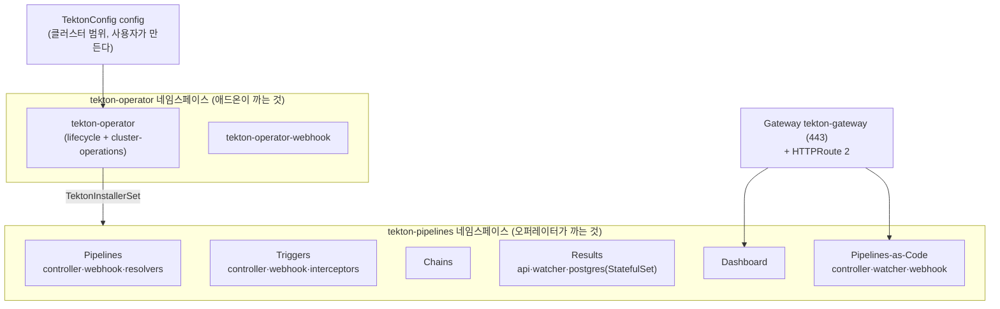

# 25. Tekton Operator

> 커리큘럼: [CURRICULUM.md](CURRICULUM.md) · 앞 절: [24. External Secrets Operator](24-external-secrets-operator.md) · 마지막 절 · 작성 2026-11-20
> 등급: **[근거]** 출처에 그대로 있는 것, **[추론]** 여러 출처를 엮어 직접 내린 결론.
> 기준 판: VKS Add-ons `3.8.0+20261021` (9.1 VKS Add-ons Release Notes, 2026-11-20 확인, 페이지 표기 Last Updated November 11, 2026, 이 날 기준 가장 높은 판). 판 호환은 이 문서에서 정리하지 않는다. [공식 호환 매트릭스](https://interopmatrix.broadcom.com/)와 릴리스 노트를 직접 볼 것.

Tekton Operator 는 Tekton CI/CD 묶음(Pipelines·Triggers·Dashboard·Chains·Results·Pipelines-as-Code)을 `TektonConfig` 한 자원으로 깔고 관리하는 오퍼레이터다. 24절 ESO 와 같은 **Helm add-on** 이라 설치 틀(Supervisor AddonInstall → 클러스터의 helm-controller HelmRelease)은 [24절 2.2](24-external-secrets-operator.md#22-클러스터-안에서-helm-controller-가-helmrelease-로-깐다)와 같다. 이 절은 Tekton 에서만 달라지는 것에 집중한다. Tekton 자체(Task·Pipeline·Trigger)의 개념은 루트 [`../k8s-cicd.md`](../k8s-cicd.md)를 본다.

이 절에서 먼저 잡을 것은 다섯 가지다.

1. **애드온을 깔아도 Tekton 은 아직 없다.** VKS 차트는 `operator.autoInstallComponents` 를 업스트림과 반대로 `false` 로 바꿨다. 사용자가 `TektonConfig` 를 직접 만들어야 Pipelines 이 뜬다(2.3).
2. **기본값으로 깔면 Istio Gateway 와 cert-manager 인증서를 만든다.** 둘 다 없는 클러스터는 `exposure.enabled: false` 를 먼저 넣어야 한다(2.4, 6절 1번).
3. **대시보드가 인증 없이 밖으로 열릴 수 있다.** 업스트림 Dashboard 는 자체 인증이 없고, 오퍼레이터의 대시보드 기본값은 읽기·쓰기다. VKS 기본 노출은 그 앞에 아무 인증도 두지 않는다(2.4, 6절 2번).
4. **애드온 삭제는 Tekton 전체를 지운다.** CRD 가 차트 템플릿에 있고(`installCRDs: true`), `tekton-pipelines` 네임스페이스도 차트가 만든다(2.5).
5. **지원 표는 VKr 1.33 을 「Yes」라 적지만 차트 기본 최소 판은 1.34 다**(1절 표, 6절 5번).

[근거] 이 절의 렌더링 결과는 공개 레지스트리 `vks-addons-helm/tekton-operator` 저장소의 태그 `0.80.0_vmware.1-vks.1` 차트와 그 OCI 어노테이션(AddonConfigDefinition), 업스트림 `tektoncd/operator` v0.80.0 의 `charts/tekton-operator` 를 익명으로 받아 helm v3.19.0 으로 직접 돌린 것이다(2026-11-20). **VKS 클러스터에 설치해 보지는 못했다.** 4절의 클러스터 쪽 명령과 기대 출력은 공식 문서에서 옮긴 것이고 실측이 아니다.

---

## 1. 무엇을 하는가



- [근거] 릴리스 노트의 첫 소개: 「Tekton CI/CD 묶음(Pipelines, Dashboard, Triggers, Chains, Results, Pipelines-as-Code) 전체의 배포·수명 주기·구성을 자동화하는 Helm add-on. 중앙 `TektonConfig` 자원으로 선언형 관리. FIPS 140-3, Distroless non-root, PSS Restricted 호환.」 (9.1 릴리스 노트, 3.8.0+20261021 What's New)
- [근거] 애드온은 오퍼레이터와 그 승인 웹훅을 `tekton-operator` 네임스페이스에 깔고, `TektonConfig` 가 생기면 오퍼레이터가 Tekton 구성 요소를 `tekton-pipelines` 에 깐다. Add-on Reference 는 `profile: all`·Results 켬 기준으로 Deployment 16개(그중 `tekton-events-controller` 는 선택)와 StatefulSet `tekton-results-postgres` 를 적는다. (Tekton Operator Add-on Reference, Last Updated November 17, 2026)
- [근거] 프로필: `lite` 는 Pipelines 만, `basic` 은 Pipelines·Triggers·Chains·Results, `all` 은 여기에 Dashboard·Pipelines-as-Code 를 더한다. (같은 문서)
- [근거] Ecosystem 등급의 지원 범위는 「패키징·서명·수명 주기 문제까지. 런타임 버그·보안 패치·기능 요청은 업스트림 커뮤니티 몫」이다. (9.1 릴리스 노트, VKS Add-ons Support Tiers) [추론] Pipeline 이 왜 실패하는지, Chains 서명이 왜 안 붙는지는 Broadcom 지원 범위 밖으로 보는 편이 맞다.

### 판과 지원 등급 (3.8.0+20261021 기준)

| 항목 | 값 | 출처 |
|---|---|---|
| 애드온 판 | `0.80.0+vmware.1-vks.1` 한 판 🆕 | 9.1 릴리스 노트 지원 표 |
| 지원 등급 | Ecosystem | 같은 지원 표 |
| 지원 표의 VKr | 1.37·1.36·1.35·1.34·1.33 모두 Yes | 같은 지원 표(2026-11-20 HTML 표에서 칸을 직접 셈) |
| 차트 기본 최소 Kubernetes | `kubernetesMinVersion: v1.34.0` | 차트 values, ACD |
| 설치 형식 | Helm add-on | 릴리스 노트, 설치 문서 |
| 전제 | VKS 3.8 이상 클러스터 | 설치 문서 Prerequisites |
| 업스트림 | tektoncd/operator v0.80.0 (GitHub 릴리스 2026-06-24) | 차트 `Chart.yaml` `sources`, GitHub 릴리스 |
| 함께 오는 구성 요소 판(이미지 태그) | Pipelines v1.12.0, Triggers v0.36.0, Dashboard v0.68.0, Chains v0.27.1, Results v0.19.0, PAC v0.48.0, Results 용 PostgreSQL v15.0 | 차트 values 의 이미지 태그 |

[근거] 3.8.0+20261021 에서 처음 들어왔으므로 판 흐름 표·업그레이드 경로 문구는 아직 없다. (9.1 릴리스 노트)

---

## 2. VKS 에서 어떻게 들어가는가

### 2.1 저장소와 설치 틀: 24절과 같다

[근거] 차트는 `…/3.8.0-20261021/vks-addons-helm/tekton-operator`(태그 `0.80.0_vmware.1-vks.1`), 이미지는 같은 경로 아래 `containers/tekton-operator/` 에 24개 저장소로 있다. 차트 매니페스트의 config 미디어 타입은 `application/vnd.cncf.helm.config.v1+json` 이고, 어노테이션 `addons.kubernetes.vmware.com/addon-config-definition` 에 AddonConfigDefinition(`tekton-operator.0.80.0---vmware.1-vks.1`, `vmware-system-vks-public`)이 gzip+base64 로 들어 있다. (crane catalog·manifest, 2026-11-20)

[근거] ACD 의 `templateOutputResources` 는 24절과 같은 모양이다. 워크로드 클러스터 `vmware-system-helm` 에 Secret `<cluster>-tekton-operator-values`(`helmValues` 를 `values.yaml` 로), Supervisor 쪽에 ConfigMap `<cluster>-tekton-operator-options`(`helmOptions`). 설치 문서도 확인 단계에서 `kubectl get helmrelease -n vmware-system-helm` 을 보라고 한다. (ACD 원본, kubectl 설치 문서)

- [근거] 레거시 `PackageInstall` 경로는 없다. 설치 문서는 VCF CLI·kubectl 두 쪽뿐이고 둘 다 Supervisor 에서 AddonInstall 을 만든다. AddonConfig 이름은 반드시 `<cluster-name>-tekton-operator` 다. (설치 문서 세 쪽)
- [근거] Policy Bundle 이 Deny 모드이고 Tekton Operator 를 기본(`tekton-operator`)이 아닌 네임스페이스에 깔면 그 네임스페이스를 Policy Bundle 면제 목록에 넣으라고 문서가 따로 경고한다. (kubectl 설치 문서) 면제 목록은 [23절](23-policy-bundle.md)을 본다.
- HelmRelease 원본과 `global.imageRegistry` 를 누가 채우는지는 24절과 같이 공개 자료에서 찾지 못했다. [24절 2.2](24-external-secrets-operator.md)의 추론을 그대로 따른다.

### 2.2 차트가 만드는 것

[근거] 기본 values 에 `--kube-version 1.35.0`, `-n tekton-operator` 로 렌더링한 kind 와 위치다(2026-11-20).

| kind | 이름 | 네임스페이스 |
|---|---|---|
| CustomResourceDefinition ×14 | `*.operator.tekton.dev` (모두 `scope: Cluster`) | — |
| Namespace | `tekton-pipelines` (PSA `enforce`·`audit`·`warn` 모두 `baseline`) | — |
| Deployment | `tekton-operator`(컨테이너 2: `tekton-operator-lifecycle`, `tekton-operator-cluster-operations`), `tekton-operator-webhook` | 릴리스 네임스페이스 |
| ServiceAccount·Secret·ConfigMap 2·Service 2 | `tekton-operator…` | 릴리스 네임스페이스 |
| LimitRange | `ns-limit-range` (기본 requests 100m·128Mi) | 릴리스 네임스페이스 |
| ClusterRole 2·ClusterRoleBinding 2·Role·RoleBinding | `tekton-operator`, `tekton-config-read-role` 등 | — |
| Gateway | `tekton-gateway` (HTTPS 443, `gatewayClassName: istio`) | `tekton-pipelines` |
| HTTPRoute ×2 | `tekton-dashboard-route`(→ `tekton-dashboard:9097`), `tekton-pac-route`(→ `pipelines-as-code-controller:8080`) | `tekton-pipelines` |
| Issuer | `tekton-issuer` (`selfSigned: {}`) | `tekton-pipelines` |
| Certificate | `tekton-tls-cert` (10년, `dnsNames` 는 두 호스트 이름) | `tekton-pipelines` |

- [근거] 릴리스 네임스페이스(`tekton-operator`)는 차트가 만들지 않는다. `tekton-pipelines` Namespace 는 `operator.defaultTargetNamespace` 가 릴리스 네임스페이스와 다를 때만 렌더링된다(`-n tekton-pipelines` 로 렌더링하면 0개). (`templates/namespace.yaml`, 렌더링)
- [근거] `tekton.dev` 쪽 CRD(Task·Pipeline·PipelineRun 등)는 차트에 없다. (렌더링 결과 CRD 이름 목록) [추론] 그것들은 `TektonConfig` 를 만든 뒤 오퍼레이터가 `TektonInstallerSet` 으로 깐다.

### 2.3 values: 업스트림 차트와 다른 기본값

[근거] 업스트림 `tektoncd/operator` v0.80.0 의 `charts/tekton-operator` 와 비교했다(주석·빈 줄 제외). VKS 차트에만 있는 템플릿은 `exposure.yaml`·`limitrange.yaml`·`namespace.yaml` 셋이다.

| 키 | 업스트림 v0.80.0 | VKS 차트 | 무엇이 달라지나 |
|---|---|---|---|
| `installCRDs` | `false` | `true` | CRD 가 Helm 릴리스 소유가 된다(2.5) |
| `operator.autoInstallComponents` | `true` | `false` | 기본 `TektonConfig` 가 자동으로 안 생긴다 |
| `operator.defaultTargetNamespace` | `""`(코드 기본 `tekton-pipelines`) | `"tekton-pipelines"` | 차트가 그 Namespace 를 직접 만든다 |
| `operator.resources`·`webhook.resources` | `{}` | requests 50m·128Mi / 50m·64Mi | |
| `podSecurityContext`·`securityContext` | `{}` | non-root 65532, seccomp RuntimeDefault, ALL drop, 읽기 전용 루트 | |
| `priorityClassName` | 없음 | `vmware-system-important` (1.34 미만이면 템플릿이 뺀다) | 24절과 같은 처리 |
| `nodeSelector` | `{}` | `kubernetes.io/os: linux` | |
| `nsLimitRange`·`global.imageRegistry`·`exposure.*` | 없음 | 있음 | |
| 구성 요소 이미지 키(`pipelinesController` 등 21개) | 없음 | 있음 → 오퍼레이터에 `IMAGE_*` 환경변수로 넘어간다 | 오퍼레이터가 까는 Tekton 이미지도 Broadcom 재빌드가 된다 |
| ClusterRole `clusterroles`·`roles` 동사 | get·create·update·delete·list·watch | 여기에 **`bind`·`escalate`** 추가 | 아래 참고 |
| `kubernetesMinVersion` | `v1.34.0` | `v1.34.0` | 같음 |
| `pruner.image` | `ghcr.io/tektoncd/plumbing/tkn@sha256:233de6c8…` | 같음 | `global.imageRegistry` 가 안 붙는다(6절 4번) |

- [근거] `bind`·`escalate` 는 RBAC 가 「자기에게 없는 권한을 담은 Role 을 만들거나 묶는 것」을 허용하는 동사다. (Kubernetes RBAC 문서 「Restrictions on role creation or update」) [추론] 이 두 동사가 붙은 오퍼레이터 ServiceAccount 는 사실상 클러스터 전체 권한과 같다고 보고, 이 SA 의 토큰을 다루는 사람을 그만큼 제한한다.
- [근거] 업스트림 차트에도 있는 ClusterRoleBinding `tekton-config-read-rolebinding` 은 `system:authenticated` 그룹에 `TektonConfig` 읽기를 준다. (렌더링)
- [근거] ACD 의 `helmValues` 는 `x-kubernetes-preserve-unknown-fields: true` 이고, 차트에는 `values.schema.json` 이 없다. `--set operator.autoInstallComponent=true`(끝 s 빠짐)와 `--set exposure.gatway.create=false`(오타)로 렌더링해도 rc=0 이고, 결과는 `AUTOINSTALL_COMPONENTS: "false"`, Gateway 1개 그대로다. (helm v3.19.0, 2026-11-20) [추론] 오타는 Add-on 경로든 직접 Helm 이든 조용히 무시된다. 단 ACD 안의 일부 하위 객체(`exposure`, `operator`, `rbac` 등)는 `additionalProperties: false` 라, 그 아래 오타는 Supervisor 쪽 검증에서 걸릴 수 있다. 실제로 걸리는지는 확인하지 못했다.

### 2.4 노출(Gateway API)과 TLS

[근거] `exposure.enabled` 기본은 `true` 이고, 켜지면 Gateway 하나와 HTTPRoute 둘, cert-manager `Issuer`(self-signed)·`Certificate` 를 만든다. 설치 문서 Prerequisites: 「기본값으로 깔기 전에 Istio 애드온(또는 호환 Gateway API 제공자)과 cert-manager 애드온이 워크로드 클러스터에 있는지 확인하라. 없으면 `helmValues.exposure.enabled: false` 로 둔다.」 (kubectl 설치 문서, `templates/exposure.yaml`)

[근거] 템플릿의 분기를 렌더링으로 확인한 결과다.

| 설정 | Gateway | HTTPRoute | Issuer·Certificate | 비고 |
|---|---|---|---|---|
| 기본 | 생성(`tekton-pipelines`) | 2 | 생성 | |
| `exposure.enabled: false` | 없음 | 없음 | 없음 | Gateway API·cert-manager 자원 0개 |
| `tls.certManager.enabled: false` 만 | 생성 | 2 | **없음** | Gateway 가 여전히 `tekton-tls-cert` 를 가리킨다 |
| `tls.existingSecret: <이름>` | 생성 | 2 | 없음 | Gateway 가 그 Secret 을 가리킨다 |
| `gateway.create: false` + `gateway.namespace` | 없음 | 2(그 Gateway 를 parentRef) | 없음 | |

- [추론] 셋째 줄은 없는 Secret 을 가리키는 리스너가 된다. Gateway API 규칙상 그 리스너는 `ResolvedRefs=False` 로 남고 HTTPS 가 안 열린다. cert-manager 를 끌 때는 `existingSecret` 을 같이 준다.
- [근거] Gateway 리스너는 `allowedRoutes.namespaces.from: All` 이다. (렌더링) [추론] 다른 네임스페이스의 사용자도 이 Gateway(와 그 인증서)에 자기 HTTPRoute 를 붙일 수 있다. 공유 클러스터라면 `gateway.create: false` 로 관리되는 Gateway 를 쓰거나 Gateway 를 따로 막는다.
- [근거] 기본 호스트 이름 `tekton-dashboard.vks.example.com`·`tekton-pac.vks.example.com` 은 자리표시라 실제 이름으로 바꾸라고 Add-on Reference 가 적는다. 또 「Git 제공자는 self-signed 인증서인 PAC 웹훅을 거절할 수 있다. 신뢰되는 인증서를 주는 issuer 나 기존 Secret 을 써라」. (Add-on Reference)
- [근거] Tekton Dashboard 는 「자체 인증·인가가 없고, 앞에 둔 프록시가 넘기는 인증 헤더를 API 서버에 넘길 뿐」이며 기본적으로 자기 ServiceAccount 권한으로 동작한다. (tektoncd/dashboard `docs/install.md`) 오퍼레이터의 `TektonDashboard` `readonly` 기본값은 `false` 다. (tektoncd/operator v0.80.0 `docs/TektonDashboard.md`) 공식 문서의 VKS 예시 `TektonConfig` 는 `dashboard.readonly` 를 정하지 않는다. (deploy 문서)
- [추론] 따라서 문서 예시대로 깔고 호스트 이름을 실제 DNS 로 바꾸면, 그 주소에 닿는 누구나 대시보드 ServiceAccount 권한으로 PipelineRun 을 만들고 지울 수 있는 화면이 열린다. Istio·Gateway 쪽에 인증(oauth2-proxy 등)을 두거나, `TektonConfig` 에 `dashboard.readonly: true` 를 넣거나, `exposure.dashboard.enabled: false` 로 내부에서만 `kubectl port-forward` 로 본다. Istio Gateway API 는 루트 [`../istio-gateway-api.md`](../istio-gateway-api.md)와 [11절](11-istio.md)을 본다.

### 2.5 CRD·네임스페이스와 삭제

- [근거] `installCRDs: true`(VKS 기본)면 `operator.tekton.dev` CRD 14개가 차트 템플릿(`templates/kubernetes-crds.yaml`)으로 들어가고 `helm.sh/resource-policy: keep` 은 없다. values 주석과 ACD 설명 모두 「true 면 차트를 지울 때 모든 Tekton 자원이 연쇄 삭제된다 — 위험」이라고 적는다. (차트 원본, ACD)
- [근거] 공식 삭제 순서: 워크로드 클러스터에서 `kubectl delete tektonconfig config` → `tekton-pipelines` Pod 가 다 없어질 때까지 기다림 → `kubectl delete tektoninstallerset --all` → Supervisor 에서 AddonInstall·AddonConfig 삭제. 경고: 「Tasks·Pipelines·PipelineRuns 를 포함해 모두 지워진다. 파이프라인 정의와 실행 이력을 먼저 백업하라.」 (kubectl 설치 문서) `TektonInstallerSet` CRD 는 `scope: Cluster` 라 `--all` 에 `-A` 가 필요 없다. (CRD 원본)
- [추론] `tekton-pipelines` Namespace 도 Helm 릴리스 소유라, 애드온 삭제 때 그 네임스페이스와 안의 모든 것(Results PostgreSQL 의 PVC 포함)이 함께 지워진다고 보인다. Add-on Reference 의 vSphere CSI 예시 PipelineRun 은 `namespace: tekton-pipelines` 에 만드는데, 사용자 파이프라인은 그 네임스페이스에 두지 않는 편이 안전하다.
- [근거] 설정 변경은 Supervisor 에서 AddonConfig 를 고치면 helm-controller 를 거쳐 반영된다. (kubectl 설치 문서) 판 변경도 지웠다 다시 깔지 말고 이 경로로 한다. 판 고르기는 `kubectl get addonreleases -A | grep tekton-operator`(이름 `tekton-operator.0.80.0-vmware.1-vks.1`)로 본다.

---

## 3. 클러스터 없이 확인하는 법 (렌더링)

> 도구: crane v0.22.1, helm v3.19.0. 모두 공개 경로에서 익명으로 받는다.

```bash
REG=projects.packages.broadcom.com/vsphere/supervisor/vks-standard-packages/3.8.0-20261021/vks-addons-helm

# 1) 차트 받기 (helm 이 + 를 _ 로 바꿔 태그를 찾는다)
helm pull oci://$REG/tekton-operator --version 0.80.0+vmware.1-vks.1 --untar -d vks-tekton

# 2) AddonConfigDefinition 꺼내기
crane manifest "$REG/tekton-operator:0.80.0_vmware.1-vks.1" \
  | python3 -c 'import json,sys,base64,gzip;m=json.load(sys.stdin);print(gzip.decompress(base64.b64decode(m["annotations"]["addons.kubernetes.vmware.com/addon-config-definition"])).decode())' \
  > acd.yaml

# 3) 렌더링
helm template tekton-operator vks-tekton/tekton-operator -n tekton-operator --kube-version 1.35.0 \
  --set global.imageRegistry=$REG > out.yaml
grep -c '^kind: CustomResourceDefinition' out.yaml        # 14
grep -A3 'kind: Namespace' out.yaml                        # tekton-pipelines, PSA baseline
grep -A1 'AUTOINSTALL_COMPONENTS' out.yaml | sort -u       # "false"
grep -A1 'IMAGE_JOB_PRUNER_TKN' out.yaml | sort -u         # ghcr.io/… (레지스트리 접두어 없음)

# 4) Istio·cert-manager 없는 클러스터용
helm template t vks-tekton/tekton-operator -n tekton-operator --set exposure.enabled=false \
  | grep -c '^kind: \(Gateway\|HTTPRoute\|Issuer\|Certificate\)'   # 0

# 5) 업스트림과 비교
curl -sL https://codeload.github.com/tektoncd/operator/tar.gz/refs/tags/v0.80.0 | tar xz operator-0.80.0/charts
diff -r operator-0.80.0/charts/tekton-operator vks-tekton/tekton-operator | less
```

**PSA 와 대조** — [근거] 오퍼레이터·웹훅 Pod 는 `runAsNonRoot: true`, `runAsUser: 65532`, `seccompProfile: RuntimeDefault`, 컨테이너마다 `allowPrivilegeEscalation: false`, `capabilities.drop: [ALL]`, `readOnlyRootFilesystem: true` 이고 `hostNetwork` 는 없다(웹훅은 `false`). PSS restricted 조건에 맞는다. (렌더링, Kubernetes PSS 문서) [추론] 그래서 릴리스 네임스페이스 `tekton-operator` 를 restricted 로 강제해도 애드온 Pod 는 막히지 않는다. 그 네임스페이스를 누가 어떤 PSA 라벨로 만드는지는 HelmRelease 를 보지 못해 확인하지 못했다.

[근거] 반면 차트가 만드는 `tekton-pipelines` 는 `enforce: baseline` 이다. 설치 개요 문서는 「모든 controller·webhook Pod 가 PSS restricted 를 지킨다」고 적는다. (namespace 템플릿, Install Tekton Operator 개요) [추론] 두 문장은 충돌하지 않는다. 구성 요소 Pod 는 restricted 수준으로 만들어졌고, 네임스페이스 강제 수준만 한 단계 낮다. 다만 Results PostgreSQL 은 UID 1001 Photon 이미지라고 문서가 따로 적어(non-root) 이 부분은 실측으로 확인할 거리다.

---

## 4. 실습

> 아래 AddonConfig·AddonInstall·TektonConfig 는 공식 문서 예시를 옮기고 줄였다. CRD 스키마 검사는 하지 않았고 클러스터에도 적용하지 않았다. `<…>` 는 자리표시다.

### 4.1 Istio·cert-manager 가 없는 클러스터에 깔기 (Supervisor 컨텍스트)

```yaml
# addonconfig.yaml  (이름은 반드시 <cluster-name>-tekton-operator)
apiVersion: addons.kubernetes.vmware.com/v1alpha1
kind: AddonConfig
metadata:
  name: <cluster-name>-tekton-operator
  namespace: <cluster-namespace>
  labels:
    addon.kubernetes.vmware.com/addon-namespace: <cluster-namespace>
spec:
  values:
    helmOptions:
      targetNamespace: tekton-operator
    helmValues:
      installCRDs: true
      operator:
        autoInstallComponents: false
        defaultTargetNamespace: tekton-pipelines
      exposure:
        enabled: false            # Istio·cert-manager 가 없으면 반드시
---
apiVersion: addons.kubernetes.vmware.com/v1alpha1
kind: AddonInstall
metadata:
  name: tekton-operator-<cluster-name>
  namespace: <cluster-namespace>
spec:
  addonRef:
    name: tekton-operator
  clusters:
  - selector:
      matchLabels:
        cluster.x-k8s.io/cluster-name: <cluster-name>
```

```bash
kubectl config use-context <supervisor-context>
kubectl get addonreleases -A | grep tekton-operator
kubectl apply -f addonconfig.yaml -n <cluster-namespace>
kubectl get clusteraddon -n <cluster-namespace> | grep tekton-operator
# 기대(문서 예시): <cluster-name>-tekton-operator … tekton-operator.0.80.0-vmware.1-vks.1  True

kubectl config use-context <workload-context>
kubectl get helmrelease -n vmware-system-helm
kubectl get deploy -n tekton-operator
# 기대(문서 예시): tekton-operator 1/1, tekton-operator-webhook 1/1  (Pod 는 2/2, 1/1)
kubectl get pods -n tekton-pipelines
# 기대: 아직 아무것도 없다 (autoInstallComponents: false)
```

[근거] VCF CLI 로는 `vcf addon install create tekton-operator --cluster-name <cluster-name> -n <cluster-namespace> -y` 다. values 파일을 줄 때는 `--addon-release-name tekton-operator.0.80.0-vmware.1-vks.1 --values-config-file values.yaml` 을 함께 줘야 하고, 문서는 「그 판의 스키마로 VCF CLI 가 설정을 검증하도록」이라고 이유를 적는다(VCF CLI 설치 문서). [추론] 2.3 에서 본 `additionalProperties: false` 하위 객체의 오타는 이 경로에서 먼저 걸릴 수 있다. 문서의 기본 AddonConfig 예시는 `exposure.enabled: true` 그대로다.

### 4.2 Tekton 띄우기: `TektonConfig` (워크로드 클러스터 컨텍스트)

```yaml
apiVersion: operator.tekton.dev/v1alpha1
kind: TektonConfig
metadata:
  name: config                  # 이름은 config 하나만
spec:
  profile: basic                # lite / basic / all
  targetNamespace: tekton-pipelines
  pruner:
    disabled: true              # 6절 4번
  result:
    disabled: false
    is_external_db: false
    options:
      deployments:
        tekton-results-watcher:
          spec:
            template:
              spec:
                containers:
                  - name: watcher
                    args:
                      - -completed_run_grace_period=2h
      statefulSets:
        tekton-results-postgres:
          spec:
            volumeClaimTemplates:
              - metadata:
                  name: postgredb
                spec:
                  storageClassName: <storage-class>   # 클러스터에 실제로 있는 이름
                  accessModes: [ReadWriteOnce]
                  resources:
                    requests:
                      storage: 10Gi
```

- [근거] 공식 예시는 `profile: all` 이고 나머지는 위와 같다. 「pruner 를 끄고 results-watcher 의 `-completed_run_grace_period=2h` 로 끝난 PipelineRun·TaskRun 을 PostgreSQL 에 보관한 뒤 etcd 에서 지운다」, 「Results DB 에는 유효한 storageClassName 이 필요하다」. (deploy 문서, Add-on Reference)
- [추론] 여기서는 `basic` 으로 줄였다. Dashboard·PAC 를 쓰지 않으면 2.4 의 노출 문제가 생기지 않는다. `all` 을 쓸 때는 `spec.dashboard.readonly: true` 를 같이 넣는다(오퍼레이터 `TektonConfig` 문서 예시의 필드).

```bash
kubectl apply -f tekton-config.yaml
kubectl get tektonconfig config
# 기대(문서 예시): config   v0.80.0_vmware.1   True
kubectl get tektoninstallerset
kubectl get pods -n tekton-pipelines
kubectl get pvc -n tekton-pipelines                # postgredb-tekton-results-postgres-0 Bound
```

### 4.3 첫 파이프라인 (사용자 네임스페이스에)

```yaml
apiVersion: tekton.dev/v1
kind: Task
metadata:
  name: hello
  namespace: demo-ci
spec:
  steps:
    - name: say
      image: <내부 레지스트리>/library/busybox:1.36
      script: |
        echo "hello from tekton"
      securityContext:
        runAsNonRoot: true
        runAsUser: 1000
        allowPrivilegeEscalation: false
        capabilities: {drop: [ALL]}
        seccompProfile: {type: RuntimeDefault}
---
apiVersion: tekton.dev/v1
kind: TaskRun
metadata:
  generateName: hello-run-
  namespace: demo-ci
spec:
  taskRef:
    name: hello
```

```bash
kubectl create namespace demo-ci
kubectl apply -f task.yaml && kubectl create -f taskrun.yaml
kubectl -n demo-ci get taskrun
kubectl -n demo-ci logs -l tekton.dev/task=hello --all-containers
```

[추론] 사용자 파이프라인은 `tekton-pipelines` 가 아니라 따로 만든 네임스페이스에 둔다(2.5). TaskRun Pod 에는 Tekton 이 init 컨테이너(entrypoint 복사 등)를 넣으므로, 그 네임스페이스를 PSA restricted 로 강제하면 Tekton 이 넣는 컨테이너의 securityContext 도 맞아야 한다. 이 조합은 클러스터에서 확인할 거리로 남긴다. Task·Pipeline 문법은 [`../k8s-cicd.md`](../k8s-cicd.md)를 본다.

### 4.4 확인 명령 모음

```bash
# Supervisor
kubectl get addoninstall,clusteraddon,addonconfig -n <cluster-namespace> | grep tekton

# VKS 클러스터
kubectl -n vmware-system-helm get secret <cluster-name>-tekton-operator-values \
  -o jsonpath='{.data.values\.yaml}' | base64 -d          # 넣은 helmValues 가 그대로 왔는가
kubectl -n tekton-operator get deploy tekton-operator \
  -o jsonpath='{range .spec.template.spec.containers[0].env[*]}{.name}={.value}{"\n"}{end}' \
  | grep -E 'AUTOINSTALL|DEFAULT_TARGET|KUBERNETES_MIN|PRUNER'
kubectl get ns tekton-pipelines --show-labels            # PSA baseline
kubectl get gateway,httproute,certificate -n tekton-pipelines   # exposure 를 켰을 때만
kubectl get crd | grep -c operator.tekton.dev            # 14
```

---

## 5. 업스트림 설치와 다른 점

[근거] 루트 [`../k8s-addon.sh`](../k8s-addon.sh)에는 Tekton 이 없다. 업스트림 오퍼레이터의 기본 설치는 `kubectl apply -f https://infra.tekton.dev/tekton-releases/operator/previous/v0.80.0/release.yaml` 이다. (v0.80.0 GitHub 릴리스)

| 항목 | 업스트림 (release.yaml 또는 차트) | VKS Helm add-on |
|---|---|---|
| 설치 주체 | 사용자 | Supervisor AddonInstall → helm-controller HelmRelease |
| 기본 `TektonConfig` | 자동 생성(`autoInstallComponents: true`) | 만들지 않음, 사용자가 직접 |
| CRD 소유 | 차트 기본 `installCRDs: false` | `true`, 삭제 때 연쇄 삭제 |
| `tekton-pipelines` Namespace | 오퍼레이터가 만든다(코드 기본) | 차트가 PSA baseline 라벨로 만든다 |
| Dashboard·PAC 노출 | 없음 | Istio Gateway + self-signed 인증서가 기본 켜짐 |
| 이미지 | `ghcr.io/tektoncd/…` | Broadcom 재빌드 `…_vmware.1`, 다이제스트 고정. pruner 만 ghcr 그대로 |
| 오퍼레이터 RBAC | `clusterroles`·`roles` 에 bind·escalate 없음 | 있음 |
| 지원 | 커뮤니티 | Ecosystem 등급: 패키징·서명·수명 주기까지 |

---

## 6. 흔한 실수

1. **기본 AddonConfig 로 Istio·cert-manager 없는 클러스터에 깐다.** [근거] 기본값은 `gateway.networking.k8s.io`·`cert-manager.io` 자원을 렌더링한다(2.4). [추론] 해당 CRD 가 없으면 Helm 이 그 kind 를 찾지 못해 설치가 실패하고 HelmRelease 가 준비되지 않는다. 문서도 `exposure.enabled: false` 를 먼저 넣으라고 한다.
2. **문서 예시를 그대로 깔고 호스트 이름만 바꿔 공개한다.** [근거] Dashboard 는 자체 인증이 없고 오퍼레이터 기본 `readonly: false` 다(2.4). [추론] 인증 프록시 없이 공개하면 누구나 파이프라인을 실행할 수 있다.
3. **애드온을 깔고 Tekton 이 안 뜬다며 기다린다.** [근거] VKS 기본 `autoInstallComponents: false` 라 `TektonConfig config` 를 직접 만들어야 한다(2.3, 4.2).
4. **pruner 를 켠 채 사설망(에어갭) 클러스터에 쓴다.** [근거] `IMAGE_JOB_PRUNER_TKN` 은 `ghcr.io/tektoncd/plumbing/tkn@sha256:233de6c8…` 로 렌더링되고 `global.imageRegistry` 접두어가 붙지 않는다(`_helpers.tpl` 의 `pruner-image`). Broadcom 레지스트리 카탈로그의 `containers/tekton-operator/` 24개에도 tkn 이 없다. [근거] 오퍼레이터는 `pruner.disabled` 가 false 면 keep 기본값을 채워 pruner 를 돌린다(`tektonconfig_defaults.go`). [추론] 바깥으로 못 나가는 클러스터에서는 pruner CronJob Pod 가 이미지를 못 받는다. 공식 예시가 `pruner.disabled: true` 인 것도 이것과 맞는다. 같은 이유로 `controllers` 기본 목록에 있는 `tektonhub` 도 차트에 이미지가 없다.
5. **VKr 1.33 클러스터에 기본값으로 깐다.** [근거] 지원 표는 1.33 에 Yes 를 적지만 차트는 `KUBERNETES_MIN_VERSION=v1.34.0` 을 넣고, 오퍼레이터 v0.80.0 이 쓰는 knative/pkg(`cb58ae50e894`)는 API 서버 판이 그보다 낮으면 「Version check failed」로 프로세스를 끝낸다(`version.CheckMinimumVersion`, `sharedmain.CheckK8sClientMinimumVersionOrDie`). values 주석은 「낮추는 것은 비운영·시험 클러스터에서만」이라 적는다. [추론] 1.33 에서는 오퍼레이터가 CrashLoopBackOff 가 되거나, `kubernetesMinVersion` 을 낮춰 「시험용」 설정으로 돌려야 한다. 오퍼레이터 main 이 그 함수를 부르는지는 소스로 확인하지 못했고, 실측도 없다.
6. **`tls.certManager.enabled: false` 만 넣는다.** [근거] Gateway 는 그대로 `tekton-tls-cert` 를 가리킨다(2.4 표). `existingSecret` 을 같이 준다.
7. **애드온을 지웠다 다시 깔아 판을 바꾼다.** [근거] CRD·`tekton-pipelines` 가 릴리스 소유라 Tekton 전체와 실행 이력이 사라진다(2.5). AddonConfig 수정으로 바꾼다.
8. **사용자 파이프라인을 `tekton-pipelines` 에 둔다.** [근거] Add-on Reference 의 PipelineRun 예시가 그렇게 적는다. [추론] 애드온 삭제·`TektonConfig` 삭제 때 함께 지워지고, 시스템 구성 요소와 같은 PSA·LimitRange 를 받는다(2.5, 4.3).
9. **Add-on Reference 표의 기본값을 믿는다.** [근거] 표는 `operator.resources.requests.cpu` 를 100m, `webhook.resources.requests` 를 100m·128Mi, `nodeSelector` 를 「(none)」으로 적지만 차트·ACD 기본은 50m, 50m·64Mi, `kubernetes.io/os: linux` 다. 문서의 AddonConfig 예시는 operator cpu 를 100m 로 따로 넣는다.
10. **오타 낸 values 가 적용됐다고 믿는다.** [근거] 차트 스키마가 없고 ACD 맨 위도 모르는 키를 받는다(2.3). 4.4 의 values Secret 과 Deployment 환경변수로 확인한다.

---

## 7. 확인 문제

1. Tekton Operator 애드온을 기본 AddonConfig 로 깔았는데 `tekton-pipelines` 에 Pod 가 하나도 없다. 무엇이 빠졌고, 업스트림 설치와 왜 다른가?
2. Istio 도 cert-manager 도 없는 VKS 클러스터에 Tekton 을 깔려 한다. AddonConfig 에 무엇을 넣어야 하고, 넣지 않으면 어떤 자원 때문에 문제가 되나?
3. 팀이 Tekton Dashboard 를 사내 DNS 이름으로 열어 쓰고 싶어 한다. VKS 기본 노출 설정 그대로 열면 무엇이 위험하고, 무엇을 바꿔야 하나?

<details><summary>답</summary>

1. `TektonConfig config` 가 없다. VKS 차트는 `operator.autoInstallComponents` 를 `false` 로 바꿔 기본 TektonConfig 를 자동으로 만들지 않는다(업스트림 차트 기본은 `true`). 워크로드 클러스터에서 `profile`·`targetNamespace`·Results 저장소를 정한 TektonConfig 를 직접 적용해야 한다(2.3, 4.2).
2. `helmValues.exposure.enabled: false`. 기본값은 `gateway.networking.k8s.io` 의 Gateway·HTTPRoute 와 `cert-manager.io` 의 Issuer·Certificate 를 렌더링하므로, 그 CRD 가 없는 클러스터에서는 Helm 설치가 그 kind 에서 막힌다(2.4, 6절 1번, 실측 아님).
3. Dashboard 는 자체 인증이 없고 오퍼레이터의 `readonly` 기본값이 `false` 라, 그 주소에 닿는 사람은 대시보드 ServiceAccount 권한으로 파이프라인을 만들고 지울 수 있다. 또 인증서는 self-signed 이고 Gateway 는 모든 네임스페이스의 HTTPRoute 를 받는다. 인증 프록시를 앞에 두고, `dashboard.readonly: true` 를 넣고, `existingSecret` 이나 신뢰되는 issuer 로 인증서를 바꾸고, 공유 클러스터면 관리되는 Gateway(`gateway.create: false`)를 쓴다(2.4).

</details>

---

## 출처 (모두 2026-11-20 확인)

- VKS Add-ons Release Notes (VCF 9.1, Last Updated November 11, 2026): <https://techdocs.broadcom.com/us/en/vmware-cis/vcf/vcf-service-administration-and-development/9-1/release-notes/vks-addons-release-notes.html>
- Install Tekton Operator (VCF Consumption, Last Updated November 17, 2026): <https://techdocs.broadcom.com/us/en/vmware-cis/vcf/vcf-consumption/latest/installing-addons-on-vks-clusters/installing-standard-packages-on-tkg-service-clusters-installing-standard-packages-on-tkg-cluster-using-tkr-for-vsphere-8-x-install-tekton.html>
- Install Tekton Operator add-on using kubectl: <https://techdocs.broadcom.com/us/en/vmware-cis/vcf/vcf-consumption/latest/installing-addons-on-vks-clusters/installing-standard-packages-on-tkg-service-clusters-installing-standard-packages-on-tkg-cluster-using-tkr-for-vsphere-8-x-install-tekton-install-tekton-addon-using-kubectl.html>
- Install Tekton Operator add-on using VCF CLI: <https://techdocs.broadcom.com/us/en/vmware-cis/vcf/vcf-consumption/latest/installing-addons-on-vks-clusters/installing-standard-packages-on-tkg-service-clusters-installing-standard-packages-on-tkg-cluster-using-tkr-for-vsphere-8-x-install-tekton-install-tekton-addon-using-vcf-cli.html>
- Deploy Tekton instance using the Tekton Operator: <https://techdocs.broadcom.com/us/en/vmware-cis/vcf/vcf-consumption/latest/installing-addons-on-vks-clusters/installing-standard-packages-on-tkg-service-clusters-installing-standard-packages-on-tkg-cluster-using-tkr-for-vsphere-8-x-install-tekton-deploy-tekton-instance.html>
- Tekton Operator Add-on Reference: <https://techdocs.broadcom.com/us/en/vmware-cis/vcf/vcf-consumption/latest/installing-addons-on-vks-clusters/installing-standard-packages-on-tkg-service-clusters-standard-package-reference-tekton-package-reference.html>
- 차트 원본: `projects.packages.broadcom.com/vsphere/supervisor/vks-standard-packages/3.8.0-20261021/vks-addons-helm/tekton-operator` 저장소, 태그 `0.80.0_vmware.1-vks.1`
- 업스트림 tektoncd/operator v0.80.0 릴리스: <https://github.com/tektoncd/operator/releases/tag/v0.80.0>, 차트: <https://github.com/tektoncd/operator/tree/v0.80.0/charts/tekton-operator>
- 오퍼레이터 문서 `TektonConfig.md`·`TektonDashboard.md` (v0.80.0): <https://github.com/tektoncd/operator/tree/v0.80.0/docs>
- 오퍼레이터 `tektonconfig_defaults.go` (v0.80.0): <https://github.com/tektoncd/operator/blob/v0.80.0/pkg/apis/operator/v1alpha1/tektonconfig_defaults.go>
- knative/pkg `version/version.go`·`injection/sharedmain/main.go` (커밋 `cb58ae50e894`, operator v0.80.0 `go.mod` 기준): <https://github.com/knative/pkg/blob/cb58ae50e894/version/version.go>
- Tekton Dashboard 설치·접근 제어 문서: <https://github.com/tektoncd/dashboard/blob/main/docs/install.md>
- Kubernetes RBAC 「Restrictions on role creation or update」: <https://kubernetes.io/docs/reference/access-authn-authz/rbac/#restrictions-on-role-creation-or-update>
- Kubernetes Pod Security Standards: <https://kubernetes.io/docs/concepts/security/pod-security-standards/>
- 렌더링 도구: helm v3.19.0, crane v0.22.1
